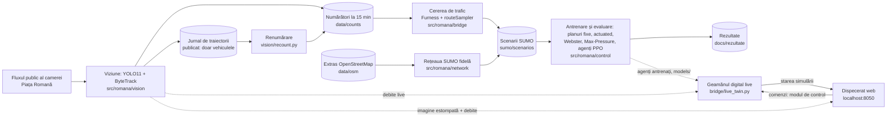

# Semaforizare Piața Romană

Cât timp ar câștiga participanții la trafic din Piața Romană, în București, dacă s-ar schimba **doar programul
semafoarelor existente**, fără nicio lucrare pe stradă? Proiectul caută răspunsul în simulare.

Camera publică din Piața Romană, al cărei flux este difuzat de Webcam România, ține loc de senzor. Modulul de viziune
detectează și numără automat vehiculele, bicicliștii și pietonii, cu modelul YOLO11 și cu algoritmul ByteTrack.
Numărătorile servesc la calibrarea cererii de trafic, adică a numărului de participanți care intră în piață și a
direcțiilor în care merg. Cererea calibrată alimentează un geamăn digital al pieței: o simulare în SUMO, construită ca
replică fidelă după OpenStreetMap, în care geometria, benzile, sensurile, trecerile și semafoarele rămân cele reale. Pe
acest geamăn se compară planurile clasice de semaforizare cu agenți de învățare prin întărire (PPO), programe care
învață singure, prin încercări în simulare, cum să comande semaforul. Un dispecerat web îi permite unui om să
urmărească simularea și să preia controlul.

Răspunsul căutat nu este un singur agent AI, ci **cea mai bună combinație implementabilă pe cazuri reale de trafic**.
După debitul măsurat de cameră, traficul se împarte în trei cazuri: lejer, mediu și intens. Debitul este numărul de
vehicule care trec prin piață într-o oră și se notează veh/h, adică vehicule pe oră. Fiecare caz primește strategia
care câștigă pe el, fie un plan fix, fie un agent. Alegerea se face pe o zi de validare și se verifică pe o zi nouă,
nefolosită la alegere, după o regulă fixată dinainte: „cel mai bun câștigă” (§ 9.9).

**Pe ziua de test, miercuri 28.10, a câștigat planul fix scurt 12/14/12.** Are aceleași faze ca planul fix de
referință, dar durate mai scurte: 12 s de verde pentru direcția nord–sud, 14 s pentru est–vest și 12 s pentru pietoni.
Rezultatul: −6,9% din timpul pierdut față de programul realist, strategia folosită până atunci în geamănul în timp
real, și −6,7% față de planul fix de referință (§ 9.10). Semnul minus înseamnă mai puțin timp pierdut, deci un câștig.
**Ziua de confirmare, joi 29.10, l-a confirmat**: −7,0% față de programul realist (Wilcoxon p = 7·10⁻⁸) și tot −7,0%
față de planul fix de referință (p = 1·10⁻¹¹). Valori p atât de mici arată că diferențele sunt semnificative statistic,
adică foarte greu de explicat prin întâmplare.

> Totul se petrece în simulare: proiectul nu comandă niciun semafor real. Proiectul nu este afiliat cu Webcam România
> sau cu operatorul camerei. Din imaginile camerei, depozitul conține doar două imagini făcute dintr-un singur cadru
> estompat, publicate cu acordul scris al Webcam România (`docs/imagini/`).

Proiect pentru disciplinele *Interfețe om-calculator* și *Internet of Things* · Universitatea Transilvania din Brașov,
Facultatea de Matematică și Informatică, Informatică ID, anul III · 2026–2027 · Autor: **Niunin Matei-Gabriel**.

## Cum funcționează

Diagrama arată drumul datelor, de la cameră până la dispecerat. Termenii tehnici sunt explicați sub ea.



Termenii din diagramă, pe scurt:

| Termen | Ce înseamnă |
|---|---|
| YOLO11 | rețeaua neuronală preantrenată care recunoaște, în fiecare cadru, vehiculele, bicicliștii și pietonii |
| ByteTrack | algoritmul care leagă detecțiile de la un cadru la altul, ca fiecare participant să fie urmărit și numărat o singură dată |
| jurnalul de traiectorii | drumul fiecărui participant prin imagine, păstrat ca șir de poziții; din el, numărătorile se pot reface oricând, prin renumărare |
| metoda Furness și `routeSampler` | metoda Furness estimează, din numărători, câte vehicule merg de la fiecare intrare la fiecare ieșire; `routeSampler`, un instrument al SUMO, alege apoi rutele care reproduc aceste numere |
| OpenStreetMap, SUMO | OpenStreetMap este harta liberă a lumii, întreținută de voluntari, din care s-a construit rețeaua; SUMO este simulatorul de trafic Eclipse SUMO, cu sursă deschisă |
| plan fix | fazele semaforului se repetă mereu în aceeași ordine și cu aceleași durate |
| actuated | semaforul prelungește verdele cât timp detectoarele din simulare văd vehicule venind la intervale scurte |
| Webster | un plan fix calculat cu formula clasică a lui Webster, din debitele estimate |
| Max-Pressure | strategia care, la fiecare decizie, alege faza cu cea mai mare diferență dintre cozile dinaintea semaforului și cele de după el |
| agenți PPO | rețele neuronale antrenate în simulare, prin încercări repetate: primesc o recompensă cu atât mai mare cu cât mai puțini participanți stau pe loc și învață să o mărească; PPO este algoritmul de antrenare |


*Zonele de numărare desenate peste un cadru al camerei din 28.10.2026 (§ 4.3). În aceste zone, programul înregistrează
intrările, ieșirile și traversările. Sursa: Webcam România – https://webcamromania.ro. Persoanele, plăcuțele de
înmatriculare și textul publicitar al camerei sunt estompate. Imaginea nu este licențiată de proiect; este publicată cu
acordul scris al Webcam România (§ 14.1).*

## Rezultate pe scurt

Întâi vin modul de măsurare și testele pe zile noi, apoi rezultatele mai vechi, obținute pe calibrări anterioare și
păstrate ca istoric.

**Cum se măsoară.** Indicatorul este pierderea totală de timp a tuturor participanților: vehicule, bicicliști și
pietoni. La vehicule intră și întârzierea la intrarea în rețea. Fiecare scenariu se simulează de mai multe ori, cu
seed-uri diferite. Seed-ul este valoarea care pornește generatorul de numere aleatoare al simulării: schimbă doar
partea aleatorie, nu și ziua de trafic. Două strategii se compară pe perechi de simulări, cu același scenariu și
același seed. Strategiile se aleg pe date de validare și se măsoară pe date de test, nefolosite la alegere. Testele
statistice pe perechi, testul t și testul Wilcoxon, dau valoarea p: probabilitatea de a obține o diferență cel puțin
la fel de mare dacă cele două strategii ar fi, de fapt, la fel de bune. Când p este sub 0,05, diferența se numește
semnificativă.

Dacă nu se precizează altfel, procentele sunt față de **planul fix de referință**, N–S 36 s / E–V 28 s / pietoni 12 s:
36 s de verde pentru direcția nord–sud, 28 s pentru est–vest și 12 s pentru pietoni. Programul real nu este public. De
aceea, fazele au fost reconstruite din geometria hărții OpenStreetMap (OSM), iar duratele sunt o ipoteză declarată
(§ 6.3, § 10). În grila de 10 planuri fixe din § 9.5, doar planul 46/48/12 a egalat în medie planul de referință: e mai
bun la vârf și mai slab la trafic lejer. Pe seed-urile de test 1–10, 46/48/12 iese cu +1,4% față de el.

**Testul pe o zi nouă (§ 9.9).** Înregistrarea din 21–22.10 s-a dovedit sacadată, deci acele zile sunt subnumărate:
camera a numărat mai puțini participanți decât au trecut în realitate (§ 4.6). Prima zi lucrătoare înregistrată
continuu este luni 26.10, cu un vârf de ≈5 000 veh/h prin piață. Ca să poată trece acest debit, geamănul a fost
calibrat: timpul de reacție al șoferilor a fost fixat la 0,8 s, valoare aleasă pe vârful aceleiași zile (§ 6.4). Mai
jos, această variantă apare ca „geamănul calibrat” sau „capacitatea calibrată”, iar cea veche, cu parametrii impliciți
ai SUMO, ca „capacitatea implicită”. Până la acest test, ziua de luni nu fusese folosită nici la antrenare, nici la
alegerea strategiilor.

Pe ziua de luni, E13, adică agentul oficial (`ppo_romana`) reantrenat pe cererea calibrată, dă **−9,5% / −9,7%** față
de planul fix. Agenții poartă numele experimentului din care provin (§ 9.5). Prima cifră e cu participanți
indisciplinați, adică în ipoteza că vehiculele și pietonii trec pe roșu în primele secunde, iar vehiculele pot bloca
intersecția (§ 9.4); a doua, cu participanți disciplinați. La ambele teste statistice, p ≤ 0,001. E13 câștigă în
fiecare scenariu și e mai bun decât actuated în toate cele 60 de perechi. Cu participanți indisciplinați, e la
egalitate cu agentul oficial nereantrenat (−10,0%). Programul realist dă −3,9% cu participanți indisciplinați,
diferență nesemnificativă, și −6,4% cu participanți disciplinați. Pe 10 seed-uri, E13 dă −9,2% / −7,9%. Reantrenarea
lui E13 pe ziua de luni, experimentul E14, nu l-a întrecut (§ 9.5). Strategia geamănului în timp real s-a decis pe
testul din 28.10, după protocolul fixat dinainte în § 9.9 și descris mai jos.

O grilă de 23 de planuri fixe pe geamănul calibrat arată că ciclurile scurte câștigă. Ciclul este timpul în care
semaforul trece o dată prin toate fazele. Planul 12/14/12, cu un ciclu de ≈53 s, dă pe validare −9,3% față de planul
fix, la nivelul lui E13: diferența dintre ei nu este semnificativă. A intrat în test ca primul candidat, după decizia
„cel mai bun câștigă” (§ 9.9). Verzile lui, de 12–14 s, păreau aproape de timpul de degajare a pietonilor, adică de
timpul de care are nevoie un pieton care pornește la sfârșitul verdelui ca să termine traversarea. Modelul nu impune
acest timp. Verificarea trecerilor, făcută după test (§ 9.10), a arătat că singura problemă rămasă este faza de pietoni
de 12 s, aceeași în toate planurile. Cu această fază lungită la 18 s, câștigul se păstrează.

Din 28.10, geamănul calibrat, cu timpul de reacție de 0,8 s, este implicit pentru toată munca nouă: scenariile din
versiunea curentă a depozitului, geamănul în timp real, antrenarea și testele. Rezultatele obținute înainte rămân în
documentație ca istoric.

**Testul final (miercuri 28.10, § 9.10).** Au intrat în test trei candidați: planul 12/14/12, programul format din
planuri fixe pe cazuri de trafic (`TOD_DEBIT`) și agentul E13. Ei au fost comparați cu programul în vigoare, programul
realist, pe o zi lucrătoare nouă, înregistrată de la 00:10 la 24:00. Testul a avut 12 scenarii, seed-urile 1–10 și
ambele comportamente, cu participanți disciplinați și indisciplinați: 840 de simulări în total. Toți cei trei candidați
bat semnificativ programul realist, cu −6,0…−7,2% din pierderea totală (Wilcoxon p între 0,0001 și 0,0013), iar între
ei diferențele nu sunt semnificative. De aceea, regula alege candidatul cel mai simplu, **planul fix 12/14/12**, cu un
ciclu de ≈53 s în loc de ≈91 s. Acesta a trecut apoi în geamănul în timp real.

Câștigul vine de la pietoni, care așteaptă mai puțin: −12% față de planul fix de referință. Vehiculele pierd puțin
(+1–2%). Față de programul realist câștigă și vehiculele (−2…−3%), și pietonii (−10%). Măsura pe persoană, care
socotește orele pierdute de oameni, nu de vehicule, dă același câștigător, cu 20, 40 sau 70 de călători pe autobuz.

Cu planul câștigător, nicio trecere de pietoni nu are mai puțin de 12 s de verde pe ciclu, adică durata fazei de
pietoni, la fel ca în planul de referință. Mai trebuie verificată după normele de proiectare doar această fază de
12 s, pe trecerea cea mai lungă, de 12,8 m (§ 9.10, `romana.control.treceri`). Ghidurile europene calculează degajarea
pietonilor la o viteză de mers de 1,2 m/s. Chiar cu faza de pietoni lungită la 18 s în ambele planuri, ciclul scurt
rămâne cu 7,9% mai bun decât ciclul actual (Wilcoxon p < 0,000001).

În noaptea zilei de test, între 03:46 și 04:28, calculatorul a prelucrat de 4–5 ori mai puține cadre, cel mai probabil
din cauza calculelor rulate în paralel. Astfel, unele vehicule nu au fost numărate, iar fereastra liniștită a
zilei, ora cu cel mai puțin trafic, a căzut tocmai peste acest interval. Fără ea, decizia rămâne aceeași (§ 4.6,
§ 9.10).

**Confirmarea (joi 29.10, § 9.10).** În noaptea următoare, același lanț de prelucrare a rulat singur pe ziua de joi,
înregistrată întreagă, cu o oprire de 13 minute, scoasă din alegerea ferestrelor. Au rezultat 14 scenarii și 980 de
simulări. Protocolul cerea doar ca planul 12/14/12 să nu iasă semnificativ mai slab decât programul realist. A
ieșit semnificativ mai bun: −7,0% din pierderea totală, adică 80 612 h față de 86 691 h. E mai bun în ambele
comportamente, cu participanți indisciplinați și disciplinați (p = 0,0007 / 0,00002), și are cea mai mică pierdere
totală dintre candidați. Doar programul `TOD_FIX`, raportat informativ, nu candidat, iese cu 0,6% mai jos, diferență
nesemnificativă. Câștigul vine tot de la pietoni: −15% față de planul fix de referință, în timp ce vehiculele pierd
puțin mai mult (+0,4…+0,6%). Pe ambele zile reunite, adică pe 260 de perechi, diferența este de −7,0%, cu
p = 4·10⁻¹⁰. Geamănul în timp real rămâne pe planul 12/14/12.

**Rezultatele obținute pe calibrările anterioare.** Camera numără mai multe ieșiri decât intrări. De aceea, rezultatele
mai vechi sunt date pentru două calibrări ale cererii (§ 5.1): marginea „de jos”, care folosește doar intrările, și
marginea „de sus”, care folosește media dintre intrări și ieșiri. Numărătoarea de referință din 26.10 a arătat că
cererea reală era mai aproape de marginea de sus. Pentru această numărătoare, agenți AI au adnotat cadru cu cadru două
clipuri de 3 minute (§ 4.3). După ea, vârful zilelor lucrătoare este de ≈2 520–2 560 veh/h, față de ≈2 400–2 510 la
marginea de sus și ≈1 640 la marginea de jos. Toate aceste cifre sunt din 21–22.10, zile care s-au dovedit
subnumărate, cum s-a văzut la testul pe o zi nouă (§ 4.6). Pe cererea calibrată după numărătoarea de referință,
strategiile au fost reevaluate doar pe seed-urile 1–5, fără reantrenarea agenților (§ 9.8). Cu participanți
indisciplinați, programul realist dă −6,2% față de planul fix, nesemnificativ (p = 0,46), și −11,7% față de actuated.
Cu participanți disciplinați dă −1,3%.

În această parte, procentele sunt medii pe scenarii ale comparațiilor pe perechi. Alegerile s-au făcut pe seed-urile
de validare 11–15, iar la primele alegeri, inclusiv la agentul E3, pe seed-urile 11–13. A existat o singură excepție:
la trafic greu, la marginea de sus, validarea a ales agentul E7, dar a fost preferat planul 46/48/12, mai simplu,
pentru că pe seed-urile de test 1–5 cele două s-au dovedit echivalente (p = 0,32, § 9.5). Cifrele sunt pe seed-urile
de test 1–10 sau, unde se precizează, pe 1–5 (§ 9.1).

**Programul pe tipuri de trafic** folosește, pentru fiecare tip de trafic, strategia cea mai bună pe validare. Când
două strategii sunt practic la fel de bune, o folosește pe cea mai simplă: de exemplu, planul 46/48/12 în locul
agentului E7, cu care e statistic echivalent pe seed-urile de test 1–5 (p = 0,32; § 9.2, § 9.5). În dispecerat,
programul apare ca modul „Program pe cazuri de trafic”. În geamănul în timp real, el comută după debitul camerei, adică
după media dintre intrări și ieșiri, cu pragurile 2 400 / 4 100 veh/h, stabilite pe ziua de validare 26.10.
Câștigătorul testului final, planul 12/14/12, e același în toate cazurile, deci nu comută. Variantele programului sunt
în tabelul următor.

| Varianta | Trafic lejer | Trafic moderat (prânz) | Trafic greu (vârf, dimineață) | Unde se folosește |
|---|---|---|---|---|
| **plan scurt**: câștigătorul testului din 28.10, confirmat pe 29.10 (§ 9.10) | planul fix 12/14/12 s | planul fix 12/14/12 s | planul fix 12/14/12 s | geamănul în timp real, ca variantă implicită din 29.10 (`"plan_scurt"` în `live_twin.py`) |
| planuri fixe pe cazuri (`TOD_DEBIT`), candidat | planul fix 16/10/12 s | planul fix 16/10/12 s | planul fix 12/14/12 s | evaluarea; geamănul în timp real (`"tod_debit"`) |
| marginea de sus | agentul E9 (`ppo_romana_lejer`) | agentul E3 (`ppo_romana_zn3`) | planul fix 46/48/12 s | evaluarea; geamănul în timp real (`VARIANTA_PROGRAM = "marginea_sus"`) |
| marginea de jos | actuated, egal cu agentul oficial, dar mai simplu | agentul E3 | planul fix de referință | doar evaluarea, pentru că geamănul nu are mod actuated |
| realist (participanți indisciplinați) | agentul oficial (`ppo_romana`) | agentul E3 | agentul E3 | evaluarea; geamănul în timp real, ca variantă implicită până pe 29.10 (`"realist"`) |

Rezultatele obținute pe calibrările anterioare, față de planul fix de referință:

| Situația simulată | Strategia | Rezultatul față de planul fix de referință |
|---|---|---|
| Zile lucrătoare, marginea de sus; 10 scenarii × 10 seed-uri | programul pe tipuri de trafic | **−6,9%**: p = 0,0003 la testul t și 0,00002 la testul Wilcoxon; mai bun în 79 din 100 de rulări. Față de actuated: −3,2% (p = 0,04) |
| Zile lucrătoare, marginea de jos; 10 × 10 | programul pe tipuri de trafic | **−1,5%**, nesemnificativ la testul t (p = 0,49). La trafic greu, programul este chiar planul fix. În cele 50 de rulări în care diferă, la trafic lejer și la prânz, e mai bun în 44 (Wilcoxon p = 0,0003) |
| Zile lucrătoare, **participanți indisciplinați** (ipoteză, § 9.4); 5 scenarii la marginea de jos × 10 | „programul realist” | **−16,0%** (p = 0,00001 / 0,000002; mai bun în 42 din 50). Față de actuated: −18,4% (46 din 50) |
| Duminică 25.10, zi nefolosită la antrenare sau la alegere; marginea de sus, datele până la 11:30; 5 × 10 | programul pe tipuri de trafic | −5,2% (p = 0,03; mai bun în 43 din 50). Semnificativ mai bun și decât actuated (p = 0,0006) |
| Duminică, marginea de jos, datele până la 13:50, cu vârful de prânz (≈3 480 veh/h); 5 × 5, seed-urile 1–5 | programul pe tipuri de trafic | −4,5%: mai bun în toate cele 15 rulări în care diferă (Wilcoxon p = 0,0001). Aici actuated a fost mai bun: −6,2% |
| Duminică, participanți indisciplinați; 5 × 10 | „programul realist” | −4,4% (mai bun în 40 din 50; Wilcoxon p = 0,035, dar testul t nu e semnificativ: p = 0,53). Față de actuated: egalitate (−0,7%) |

Pe aceste calibrări, câștigul depinde de nivelul real al cererii și de disciplina participanților. La marginea de jos,
câștigul este nesemnificativ; la marginea de sus ajunge la ≈7%, iar cu indisciplina ipotetică, la ≈16%.

Scenariile `zi_*` și `indisciplinat_*` din versiunea curentă a depozitului nu mai sunt cele pe care s-au obținut
cifrele din tabelul de mai sus. Din 26.10, ele folosesc cererea calibrată pe numărătoarea de referință: vârful din
21–22.10 e de ≈2 520–2 560 veh/h, iar cel de luni de ≈5 000 (§ 5.1, § 5.4). Din 28.10 folosesc și capacitatea
calibrată (§ 6.4). Pentru a reproduce cifrele, aduceți scenariile vechi din istoricul git. Acolo, fiecare versiune
salvată, numită commit, are un identificator scurt, folosit în comenzile de mai jos:

- marginea de jos: `git checkout e1d0f77 -- sumo/scenarios sumo/demand config/demand.json`;
- marginea de sus: `git checkout 7a79502 -- sumo/scenarios sumo/demand config/demand.json`;
- revenirea: `git checkout HEAD -- sumo config/demand.json`. Fișierele adăugate după acea versiune, de exemplu
  `zi_2026-10-25_pranz`, rămân cele curente.

Alte rezultate, pe scurt:

- Pe calibrările anterioare, cu geamănul la capacitatea implicită, cu participanți disciplinați și în zilele
  lucrătoare, un singur agent AI nu bătea un plan fix bine reglat. Pe ziua de luni, cu capacitatea calibrată, E13
  singur dă −9,7%, dar planul fix scurt 12/14/12 ajunge pe validare la nivelul lui (§ 9.9). Cifrele de atunci:
  agentul oficial dădea +5,4% la marginea de sus și +3,8% la marginea de jos (§ 9.2). Duminică, la marginea de sus,
  agenții folosiți singuri, pe tot traficul, au câștigat −4,9…−6,5% (§ 9.3). Cu participanți indisciplinați, E3 singur
  dădea −14,1%, iar la vârf până la −28,0% (§ 9.4).
- Agentul oficial dădea −4,6% cu zonele inițiale ale camerei și +5,2% pe datele renumărate. Agentul care comanda
  piața împreună cu 4 intersecții vecine a dat +35,4%. Rezultatul e din 22.10, cu zonele inițiale, iar datele brute
  sunt în commitul `f1c0150` (§ 9.5).
- La vârf, pe geamănul cu capacitatea implicită, 50–78% din timpul vehiculelor oprite sau neintroduse în rețea venea
  din coada de pe Bd. Dacia vest, care nici nu încăpea în rețea. Cu capacitatea calibrată, această coadă dispare, iar
  timpul total de oprire scade de ≈12 ori la aceeași cerere. Rămâne o coadă de intrare la marginea vestică a rețelei,
  pe Calea Victoriei. Nu s-a lămurit încă dacă e o limită reală sau un efect al marginii (§ 9.6,
  `romana.control.localizare`).

Datele brute sunt în `docs/rezultate/` (Anexa A).

## Cum se rulează (Windows)

Cerințe:

- Windows 10/11, testat pe Windows 11;
- Python 3.11–3.13, testat pe 3.12;
- ≈4 GB liberi pe disc și internet la instalare;
- placa grafică nu este necesară.

SUMO 1.28 se instalează prin pip, ca pachetul `eclipse-sumo`. Dacă variabila `SUMO_HOME` indică altă instalare, se
folosește aceea, care trebuie să fie tot 1.28. Dacă nu este, goliți variabila în aceeași fereastră, înainte de a porni
scripturile: `set SUMO_HOME=` în cmd sau `Remove-Item Env:SUMO_HOME` în PowerShell. `PORNESTE_TOT.bat`, pornit din
acea fereastră, moștenește setarea. Versiunea curentă are ≈330 MB, din care ≈200 MB sunt jurnalele de traiectorii,
deja comprimate. Pentru o copie fără istoric, folosiți `git clone --depth 1`.

```bat
git clone https://github.com/NiuninMatei/Semaforizare_Piata_Romana.git
cd Semaforizare_Piata_Romana
scripts\0_instalare.bat
```

| Ce doriți să faceți | Comanda |
|---|---|
| Refacerea mediului pe Python 3.12, doar dacă `pip` a afișat erori. Scriptul scrie „Instalare terminata.” chiar și atunci. Erorile apar de regulă pe Python 3.14+, pe care îl poate alege `0_instalare.bat`: scriptul creează `.venv` cu `py -3`, adică cu cel mai nou Python 3 al lansatorului, sau cu `python` din PATH | `py -3.12 -m venv --clear .venv`, apoi `.venv\Scripts\python -m pip install -r requirements.txt` |
| Demonstrația de comparație: prânzul din 21.10, cu planul fix, Max-Pressure și agentul oficial, pe seed-urile 1–5. Scenariul este cel din versiunea curentă a depozitului, cu cererea calibrată din 26.10, pe care strategiile au fost reevaluate în § 9.8. Durează câteva minute și scrie doar în `outputs/demo` | `scripts\9_demo_comparatie.bat` |
| Agentul E3 la vârful din 22.10, cu participanți indisciplinați; în rezultatul demonstrației, E3 apare în coloana „Agent AI (PPO)”. Scenariul din versiunea curentă are cererea calibrată din 26.10 (≈2 560 veh/h, § 5.4) și, din 28.10, capacitatea calibrată (§ 6.4), deci nu mai reproduce § 9.8. Acolo, cu tipurile de vehicule vechi, E3 dă −16,1% față de planul fix pe seed-urile 1–5; ca raport al mediilor, cum îl afișează demonstrația, diferența este de ≈ −20%. Tipurile vechi se aduc cu `git checkout 75592d3 -- sumo/demand/vtypes.add.xml sumo/demand/vtypes_indisciplinat.add.xml`, iar revenirea se face cu `git checkout HEAD -- sumo/demand`. Cifra din § 9.4, −28,0% pe 10 seed-uri, e la marginea de jos; pe seed-urile 1–5, ca raport al mediilor, ea este de ≈ −27%. Se reproduce după `git checkout e1d0f77 -- sumo/scenarios sumo/demand config/demand.json`, iar revenirea se face cu `git checkout HEAD -- sumo config/demand.json` | `scripts\9_demo_comparatie.bat --scenariu sumo\scenarios\indisciplinat_zi_2026-10-22_varf.sumocfg --model models\ppo_romana_zn3.zip` |
| Simularea vizuală în SUMO-GUI, interfața grafică a simulatorului: vârful din 21.10 cu agentul oficial, apoi cu planul fix | `scripts\8_simulare_gui.bat`, apoi `scripts\8_simulare_gui.bat sumo\scenarios\zi_2026-10-21_varf.sumocfg --strategie fix_referinta` |
| Cele 64 de teste automate. Ele verifică numărarea, statisticile pe perechi, validarea, scenariile cu participanți indisciplinați, numărătoarea de referință, calibrarea camerei, depistarea prelucrării încetinite în `calitate`, veghea fluxului de cadre, verdele pe treceri și ferestrele din `scenarii_zi` | `set PYTHONPATH=src`, apoi `.venv\Scripts\python -m unittest discover tests`; în PowerShell, prima comandă devine `$env:PYTHONPATH="src"` |
| Reproducerea statisticilor din § 9 și a calibrării (§ 11.8). Comanda alăturată reface, de exemplu, programul realist din § 9.4 | `.venv\Scripts\python -m romana.control.analiza docs\rezultate\robustete_indisciplinat.csv docs\rezultate\robustete_indisciplinat_6_10.csv --program REALIST=lejer:ppo_romana,moderat:ppo_romana_zn3,greu:ppo_romana_zn3` |
| O evaluare scurtă. **Atenție:** evaluarea rescrie `docs/rezultate/rezultate_brute.csv`, `rezultate.md` și graficul; le readuceți la versiunea din depozit cu `git checkout -- docs/rezultate`. Fără `--scenarii`, evaluarea ia toate cele 97 de fișiere din `sumo/scenarios` și se oprește imediat cu `FileNotFoundError` la scenariile `capacitate_*` și `indisciplinat_*`. Acestea folosesc rutele scenariilor `zi_*` și nu au `od_estimat.json`, de care are nevoie planul Webster. Dați deci întotdeauna explicit scenariile `zi_*` / `referinta_*`, ca în comanda alăturată. Cu toate cele 22 de strategii (4 clasice + 18 modele) și cu cele 5 seed-uri implicite, un scenariu cere 22 × 5 = 110 simulări | `scripts\5_evalueaza.bat --scenarii sumo\scenarios\zi_2026-10-21_varf.sumocfg --strategii fix_referinta rl_ppo --model models\ppo_romana.zip --seeds 1` |
| Antrenarea unui agent nou. Dați un `--nume` nou, altfel se suprascrie `models/ppo_romana.zip`. Dați și scenariile explicit: implicit intră toate, inclusiv duminica și `indisciplinat_*`, iar `cmd.exe` nu expandează `*`, adică nu-l înlocuiește cu numele fișierelor | `scripts\4_antreneaza_ai.bat --nume test --scenarii sumo\scenarios\zi_2026-10-21_varf.sumocfg sumo\scenarios\zi_2026-10-22_varf.sumocfg` |
| Sistemul în timp real, cu camera: modulul de viziune, geamănul în SUMO-GUI și dispeceratul (localhost:8050). La prima rulare se descarcă ponderile YOLO11, adică parametrii rețelei neuronale antrenate, și se exportă local în formatul OpenVINO. `config/camera.json` este setat pentru o placă grafică Intel (`"device": "intel:gpu"`). Fără ea, scrieți `"intel:cpu"` sau ștergeți cheia. Cu o placă NVIDIA, urmați indicația din `0_instalare.bat`: instalați întâi în `.venv` PyTorch cu CUDA de pe https://pytorch.org și setați apoi `"runtime": "pytorch"` și `"device": "0"`. La prima rulare, geamănul pornește în modul „Program pe cazuri de trafic”, cu varianta aleasă după regula din § 9.9; la pornirile următoare, în ultimul mod confirmat din dispecerat, păstrat în `outputs/live/command.json`. Tot la prima rulare își generează, o singură dată, rutele candidate (`sumo/demand/candidate*.rou.xml`, nepăstrate în git), deci prima pornire durează mai mult. Celelalte moduri se aleg din dispecerat și se confirmă | `scripts\PORNESTE_TOT.bat` |
| Veghea fluxului de cadre, pornită lângă sistemul în timp real. Ea se oprește cu o alertă și un diagnostic (`outputs/logs/veghe_alerta_*.json`) dacă scade numărul de cadre prelucrate pe secundă, dacă imaginea pare înghețată sau dacă jurnalul nu mai crește (§ 4.6) | `scripts\2d_veghe.bat` |

Fluxul vine de la o cameră care nu aparține proiectului: se folosește doar în scop academic, fără redistribuirea
imaginilor. Pe disc, sistemul scrie doar previzualizarea estompată, suprascrisă continuu (§ 4.5, § 14.1). Pașii
compleți sunt în § 11.4; pentru `routeSampler` instalați și `scipy` (§ 11.7). Proiectul a fost testat doar pe Windows.

## Structura repository-ului

| Calea | Ce conține |
|---|---|
| `src/romana/` | `vision/` – detecția, urmărirea, numărarea pe perechi origine–destinație (O–D), renumărarea, numărătoarea de referință în `referinta.py` și calibrarea camerei pe rețea în `calibrare_camera.py`; `bridge/` – estimarea O–D, cererea SUMO, scenariile zilei, scenariile cu participanți indisciplinați în `indisciplinat.py` și geamănul în timp real; `network/` – rețeaua din OSM; `control/` – controlerul sigur de semafor, mediul pentru învățarea prin întărire (RL), PPO, strategiile de referință, evaluarea, validarea pe seed-uri în `validare.py`, statisticile pe perechi în `analiza.py`, localizarea întârzierilor la vârf în `localizare.py`, demonstrația, SUMO-GUI și exportul NumPy; `dashboard/` – dispeceratul; `iot/` – gol, iar MQTT, un protocol de mesaje pentru dispozitive conectate, e opțional în `vision/run_vision.py --mqtt`; `common.py`, `atribuire_osm.py`, `doc_pdf.py` |
| `config/` | `camera.json` – fluxul, detectorul și zonele; `network.json` – semafoarele, grupurile de semnal și fazele; `demand.json` – cererea și calibrarea ei |
| `data/` | `counts/` – numărătorile pe intervale de 15 min, singurul loc unde apar și pietonii, sub formă agregată; `trajectories/` – traiectoriile vehiculelor, fără imagini și fără identificatori; `osm/` – extrasul OpenStreetMap |
| `sumo/` | `net/` – rețeaua. `demand/` – câte un dosar pentru fiecare scenariu `zi_*` și `referinta_*`, plus `vtypes.add.xml`, cu tipurile de vehicule, și `zi_*_rezumat.json`; scenariile `indisciplinat_*` folosesc aceleași dosare `zi_*`, cu `vtypes_indisciplinat.add.xml`. Unele dosare păstrează fișiere vechi: contează doar ce listează `.sumocfg`. `scenarios/` – `zi_*` sunt scenariile din date reale, cu cererea calibrată din 26.10 (§ 5.4); `indisciplinat_*` sunt testul de robustețe, pe rutele scenariilor `zi_*`; `referinta_*` sunt scenariile ipotetice inițiale; `capacitate_*` folosesc rutele scenariilor `zi_*` din 25–26.10, cu `vtypes_capacitate*.add.xml`; din 28.10, aceste fișiere au aceleași valori ca `vtypes.add.xml` / `vtypes_indisciplinat.add.xml`. Scenariile `capacitate_*` sunt păstrate pentru reproducerea § 9.9, a analizei cu capacitatea calibrată din § 9.6 și a validării E14 (§ 6.4). Scenariile marginilor de jos și de sus, pe care s-au obținut rezultatele, sunt în istoricul git, la `e1d0f77` / `7a79502` |
| `models/` | 19 agenți PPO, în trei feluri de fișiere. `.zip` este formatul Stable-Baselines3; conține date pickle, un format Python care poate rula cod la încărcare, deci se deschide doar din surse de încredere. `.npz` păstrează aceeași politică, adică regula după care agentul alege fazele, într-o formă care nu cere PyTorch, și e varianta preferată la rulare; lipsește la trei agenți. `.json` descrie scenariile, hiperparametrii antrenării și setările citite la rulare. Varianta actuală a geamănului în timp real, planul fix 12/14/12, nu are nevoie de niciun model. Celelalte variante ale programului folosesc `ppo_romana`, `ppo_romana_zn3` (E3), `ppo_romana_lejer` (E9) și `ppo_romana_cal` (E13). Restul sunt experimente (§ 9.5) |
| `scripts/` | scripturile numerotate de la `0_instalare` la `10_documentatie_pdf`, dintre care `8_` și `9_` sunt demonstrații; `PORNESTE_TOT`; `_mediu.bat`, care activează `.venv` și setează `PYTHONPATH=src` |
| `docs/` | `DOCUMENTATIE.md` / `.pdf`; `rezultate/` – evaluările și validările (Anexa A), iar cele mai vechi sunt în istoricul git; `rezultate/referinta/` – numărătoarea de referință din 26.10, fără imagini; `antrenare/` – jurnale din Borna 4, ale unor modele scoase între timp; `corespondenta_commituri.txt` (§ 12.5) |
| `tests/`, `legacy/` | testele automate: numărarea, statisticile, validarea, scenariile cu participanți indisciplinați, numărătoarea de referință, calibrarea camerei, prelucrarea încetinită, verdele pe treceri, ferestrele din `scenarii_zi`; ciorna inițială, făcută până la 18.10.2026, cu raportul de audit |
| `LICENSE`, `LICENSES/`, `NOTICE`, `REUSE.toml`, `*/LICENTA.txt`; `requirements.txt`; `.claude/` | licențele, atribuirile terților, harta „cale → licență” și notele de licență din `data/`, `sumo/`, `models/`; dependențele Python; notițele de lucru ale lui Claude Code, care nu sunt documentație și pot conține cifre depășite |

## Documentația

Totul este într-un singur document: **[docs/DOCUMENTATIE.md](docs/DOCUMENTATIE.md)**, disponibil și ca
[PDF](docs/DOCUMENTATIE.pdf), cu pagini numerotate. La începutul lui, o legendă explică notațiile, termenii și
abrevierile. Ce merită citit, după interes:

- în 5 minute: § 9.10, § 9.7, § 10;
- profesor sau student: § 1–3, § 8 (interfața și euristicile Nielsen), § 12 (jurnalul lucrului), § 13;
- inginer de trafic: § 5, § 6, § 7.4, § 9, § 10;
- programator: § 4, § 7, § 11, Anexa A;
- drepturi și date personale: § 4.5, § 12.5, § 14.1.

## Limite principale

| Limita | Ce înseamnă |
|---|---|
| Baza de comparație este ipotetică | Duratele planului de referință sunt o ipoteză, iar majoritatea intersecțiilor din BTMS, sistemul de management al traficului din București, funcționează adaptiv (§ 1, § 10). Față de actuated, câștigul depinde de calibrare: în zilele lucrătoare, −3,2% la marginea de sus, practic zero la marginea de jos (+0,4%, p = 0,62) și −18,4% cu participanți indisciplinați. Duminică, la marginea de jos, actuated a fost mai bun |
| Puține date | Șase zile. Intervalul de la miercuri 21.10, ora 11:45, până joi 22.10, ora 11:00, și încă ≈1,6 h din seara demonstrației în direct (18:41–19:11 și 20:48–21:54) au fost înregistrate cu urmărire sacadată, deci sunt subnumărate (§ 4.6). Duminică 25.10 (de la 01:14), luni 26.10 (de la 09:11), miercuri 28.10 (00:10–24:00) și joi 29.10 (00:00–24:00) au fost înregistrate continuu. Din marți 27.10 există doar noaptea (00:00–06:04), iar din vineri 30.10, intervalul 00:00–08:30, publicat fără scenarii. Testele pe zile noi: duminica (§ 9.3), lunea (§ 9.9), miercurea (testul final) și joia (confirmarea, § 9.10). Cazul lejer de zi (1 200–2 400 veh/h) nu intră în scenariile zilelor de test, iar noaptea din 28.10 a căzut pe o încetinire a prelucrării (§ 4.6) |
| Indisciplina este o ipoteză | Ipoteza se aplică tuturor participanților. Autoturismele și camioanele trec pe roșu în primele 2 s și, după 1 s de așteptare, intră în intersecție chiar dacă o blochează; autobuzele, motocicletele și bicicletele au valori proprii. Pietonii traversează pe roșu în primele 5 s și uneori ignoră vehiculele. Parametrii sunt aleși, nu măsurați, iar cifra de −16% depinde de ei |
| Geamănul în timp real | Simulează participanți disciplinați. Varianta implicită din 29.10, planul 12/14/12, nu comută, deci este exact strategia evaluată. La variantele care comută, de exemplu programul realist, comutarea în timp real nu a fost evaluată: cifrele lor sunt compuse din rulările componentelor, după cazul de trafic al scenariului |
| Reproductibilitate parțială | Statisticile din § 9 se refac din `docs/rezultate/` cu `romana.control.analiza`; validările și testele, cu `romana.control.validare`; scenariile `indisciplinat_*`, cu `romana.bridge.indisciplinat`; factorii de corecție și modelul camerei, din `docs/rezultate/referinta/` (§ 11.8). Simulările sunt deterministe: cu aceleași fișiere și același seed dau același rezultat. Fișierele mai vechi cer însă versiunea scenariilor din istoricul git (`e1d0f77`, `7a79502`). Pentru cele marcate „tipurile vechi” se aduc doar tipurile de vehicule din `75592d3`; pentru cele din 21–22.10 și pentru codul de atunci, vezi Anexa A. În plus, câteva validări conțin candidați sau puncte intermediare ale antrenării care nu sunt publicate |
| Transferul în realitate | Agenții văd coada și vehiculele de pe fiecare bandă de intrare, precum și pietonii care așteaptă, valori exacte în simulare. Pe stradă ar fi nevoie de detectoare pe fiecare bandă, de detecția pietonilor, de integrarea cu BTMS și de validare împreună cu operatorul (§ 10) |

## Licențe și drepturi

| Partea | Căile | Licența |
|---|---|---|
| Codul și modelele. Licența AGPL este obligatorie pentru modulul de viziune, care folosește Ultralytics YOLO11, și a fost aleasă pentru tot codul; modelele au aceeași licență, din alegerea autorului | `src/`, `scripts/`, `tests/`, `config/`, `models/`, `requirements.txt`; harta completă, fișier cu fișier, este în `REUSE.toml` | [GNU AGPL v3 sau ulterioară](LICENSE) |
| Extrasul OSM, rețeaua, cererea și scenariile | `data/osm/`, `sumo/` | [ODbL 1.0](LICENSES/ODbL-1.0.txt), © [OpenStreetMap contributors](https://www.openstreetmap.org/copyright) |
| Numărătorile și traiectoriile | `data/counts/`, `data/trajectories/`, `docs/rezultate/referinta/clip*/traiectorii/` | ODbL 1.0, © 2026 Niunin Matei-Gabriel, în măsura în care există drepturi |
| Documentația, rezultatele și acest README | `docs/`, fără traiectoriile de mai sus și fără `docs/imagini/`; `README.md`, `NOTICE`, `.claude/CLAUDE.md` | [CC BY 4.0](LICENSES/CC-BY-4.0.txt); rezultatele și modelele conțin informații din OpenStreetMap, © OpenStreetMap contributors, ODbL 1.0 |
| Ciorna inițială | `legacy/google_ai_draft/` | codul și arhiva `ai_semafor_romana.zip`: GNU AGPL v3 sau ulterioară; fișierele `osm*`: ODbL 1.0, © OpenStreetMap contributors; `build.bat`, `run.bat` și `output.add.xml`, generate de osmWebWizard: [CC0 1.0](LICENSES/CC0-1.0.txt); `README.md`: CC BY 4.0 |
| Bibliotecile folosite, care nu sunt incluse în depozit (`NOTICE`, § 14.2) | – | Eclipse SUMO: EPL-2.0 OR GPL-2.0-or-later; Ultralytics: AGPL-3.0; Stable-Baselines3, Gymnasium: MIT; OpenCV, OpenVINO: Apache-2.0; Flask, Python-Markdown 3.8.1: BSD-3-Clause; Paho MQTT: EPL-2.0 OR EDL-1.0; PyTorch: licențe permisive |

Harta completă a licențelor, fișier cu fișier, inclusiv pentru `.gitignore`, `.gitattributes` și `.vscode/`, se află în
`NOTICE`, `REUSE.toml` și § 14.1. Licențele proiectului nu acoperă citatele din surse terțe, subseturile de fonturi
Microsoft încorporate în `docs/DOCUMENTATIE.pdf` și mărcile comerciale menționate. Acestea rămân ale titularilor lor.

**Imaginile camerei** nu sunt licențiate de proiect. Drepturile asupra lor aparțin operatorului camerei, care nu este
identificat public; Webcam România declară că nu deține drepturi asupra fluxurilor. Capturile publicate anterior au fost
eliminate din tot istoricul pe 26.10.2026, iar commiturile au primit identificatori noi
(`docs/corespondenta_commituri.txt`). Pe 27.10.2026, Webcam România și-a dat acordul scris pentru analiza automată a
fluxului în scop academic și necomercial, cu sursa indicată („Webcam România – https://webcamromania.ro”), și pentru
publicarea a 1–2 capturi cu persoanele estompate (§ 14.1). Pe baza acestui acord, `docs/imagini/` conține două imagini
dintr-un singur cadru din 28.10.2026. Pe ele sunt estompate persoanele, plăcuțele tuturor vehiculelor și textul
publicitar al camerei (figurile 4.1 și 4.2). Imaginile nu intră sub nicio licență a proiectului
(`LicenseRef-Toate-drepturile-rezervate`).

## Confidențialitate

Modulul de viziune nu înregistrează video. Cadrele sunt analizate în memorie, iar pe disc rămâne doar ultima
previzualizare pentru dispecerat: o imagine de 960 px, cu persoanele estompate, suprascrisă continuu și nepăstrată în
git. Capturile și clipurile scurte folosite la calibrarea zonelor și la numărătoarea de referință (26.10) au fost
stocate doar local și au fost șterse după folosire. Cele citite de asistentul Claude, adică capturile și planșele cu
cadre din clipuri, au fost însă trimise spre analiză la Anthropic. Copii ale lor au rămas în jurnalele locale ale
sesiunilor asistentului și urmează să fie șterse odată cu jurnalul local complet (§ 4.3, § 4.5). Singurele imagini
publicate sunt cele două figuri estompate din `docs/imagini/`, verificate bucată cu bucată înainte de publicare.
Numerele de înmatriculare nu se citesc.

Se publică numărătorile agregate și traiectoriile vehiculelor, adică clasa, momentul de început și pozițiile
normalizate, fără imagini și fără identificatori. Sunt date **pseudonimizate, nu anonime**: riscul ca un participant să
fie recunoscut după traiectoria lui nu este nul. Traiectoriile pietonilor nu se publică, iar versiunile vechi care le
conțineau au fost scoase din istoric. Informarea persoanelor vizate, cerută de Regulamentul general privind protecția
datelor (art. 14 GDPR), este în § 4.5.
Contact: [Issues](https://github.com/NiuninMatei/Semaforizare_Piata_Romana/issues).

## Autor și asistență generativă

**Niunin Matei-Gabriel** a definit tema, cerințele și principiile proiectului: replica fidelă a rețelei, includerea
tuturor participanților, cererea calibrată pe datele camerei, schimbarea doar a programului semaforului și lucrul pe
borne, adică pe etape. A coordonat lucrul, a luat deciziile de ansamblu și a verificat rezultatele. Tot de la el
au venit zonele desenate pe imaginea camerei, verificarea rețelei în Street View, auditul numărării, cererea calculată
doar din intrări și testul cu participanți indisciplinați (§ 12.2).

Asistența generativă (§ 13): până la 18.10.2026, modulul AI Google din Chrome, cu care s-a făcut ciorna din `legacy/`;
din 20.10.2026, **Claude** (Anthropic), modelul Claude Opus 5.5, prin Claude Code, pe calculatorul autorului. Claude a
scris aproape tot codul și documentația și a rulat colectarea datelor, antrenarea și evaluarea. Commiturile lui, adică
versiunile salvate de el în istoric, poartă linia `Co-Authored-By: Claude …`.

**Starea proiectului (30.10.2026).** Bornele 0–8 sunt încheiate. Borna 9 a continuat pe 26–30.10 cu:

- experimentele E10–E14 (§ 9.5);
- calitatea înregistrării și veghea fluxului de cadre (§ 4.6);
- capacitatea geamănului (§ 6.4);
- testul pe ziua de luni (§ 9.9);
- testul final pe miercuri 28.10, câștigat de planul fix 12/14/12 și confirmat pe joi 29.10 (§ 9.10).

Colectarea datelor s-a oprit pe 30.10, la 08:30. Noaptea și dimineața zilei sunt publicate în `data/`, fără scenarii.

Pe 26.10, zonele de numărare au fost refăcute pe baza unei numărători de referință: două clipuri, fiecare adnotat de
doi adnotatori AI independenți, adică de instanțe separate ale asistentului Claude (§ 4.3). Tot atunci, cererea a fost
calibrată cu factori de corecție pentru intrările de pe fiecare braț al pieței, adică de pe fiecare stradă care pleacă
din ea (§ 5.1). `data/counts` și scenariile din `sumo/scenarios` au fost refăcute cu cererea calibrată (§ 5.4), iar
strategiile au fost reevaluate pe ele pe seed-urile 1–5, fără reantrenarea agenților (§ 9.8). Cifrele din tabelul de
rezultate provin din calibrările anterioare: datele din 21, 22 și 25.10.2026, numărate cu zonele desenate de autor pe
23–24.10. Scenariile lor sunt în commiturile `e1d0f77` și `7a79502`. Rezultatul coridorului, adică al agentului
care comanda piața împreună cu cele 4 intersecții vecine, este din 22.10, cu zonele inițiale. Analiza localizării
întârzierilor la vârf (§ 9.6) a fost refăcută pe cererea calibrată.
