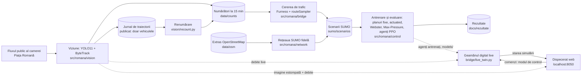

# Semaforizare Piața Romană

Cât timp ar câștiga participanții la trafic din Piața Romană (București) dacă s-ar schimba **doar programul
semafoarelor existente**, fără nicio lucrare pe stradă? Proiectul caută răspunsul în simulare. Fluxul public al camerei
din Piața Romană, difuzat de Webcam România, servește ca senzor: vehiculele, bicicliștii și pietonii sunt detectați și
numărați automat (YOLO11 + ByteTrack). Numărătorile calibrează cererea dintr-un geamăn digital SUMO, replică fidelă după
OpenStreetMap (geometria, benzile, sensurile, trecerile și semafoarele rămân cele reale), pe care se compară planuri
clasice de semaforizare cu agenți de învățare prin întărire (PPO); un dispecerat web lasă omul să preia controlul.

> Totul rulează în simulare: proiectul nu comandă niciun semafor real. Nu este afiliat cu Webcam România sau cu
> operatorul camerei, iar depozitul nu conține imagini din cameră.

Proiect pentru disciplinele *Interfețe om-calculator* și *Internet of Things* · Universitatea Transilvania din Brașov,
Facultatea de Matematică și Informatică, Informatică ID, anul III · 2026–2027 · Autor: **Niunin Matei-Gabriel**.

## Cum funcționează



## Rezultate pe scurt

Indicatorul: pierderea totală de timp a tuturor participanților (vehicule, inclusiv întârzierea la intrarea în rețea,
bicicliști, pietoni), față de **planul fix de referință** N–S 36 s / E–V 28 s / pietoni 12 s. Programul real nu este
public: fazele sunt reconstruite din geometria OSM, duratele sunt o ipoteză declarată (§ 6.3, § 10); în grila de 10
planuri fixe (§ 9.5), doar planul 46/48/12 l-a egalat în medie (mai bun la vârf, mai slab la trafic lejer); pe
seed-urile de test 1–10, 46/48/12 iese cu +1,4% față de el. Procentele sunt medii pe scenarii ale comparațiilor pe
perechi (același scenariu, același seed). Alegerile s-au făcut pe seed-urile de validare 11–15 (11–13 la primele,
inclusiv agentul E3), cu o excepție: la trafic greu (marginea de sus) validarea a ales agentul E7, iar planul 46/48/12,
mai simplu, a fost preferat după echivalența lor pe seed-urile de test 1–5 (p = 0,32, § 9.5). Cifrele sunt pe
seed-urile de test 1–10 (1–5 unde se precizează; § 9.1); seed-ul schimbă doar partea aleatorie, nu ziua de trafic.
Camera numără mai multe ieșiri decât intrări, de aceea rezultatele sunt date pentru două calibrări ale cererii:
marginea „de jos” (doar intrările) și cea „de sus” (media intrări/ieșiri) (§ 5.1). Numărătoarea de referință din 26.10
(două clipuri de 3 minute adnotate cadru cu cadru, § 4.3) arată că cererea reală era mai aproape de marginea de sus:
vârful zilelor lucrătoare ≈2 520–2 560 veh/h, față de ≈2 400–2 510 (marginea de sus) și ≈1 640 (marginea de jos).
Rezultatele nu au fost încă refăcute pe această calibrare.

| Situația simulată | Strategia | Față de planul fix de referință |
|---|---|---|
| Zile lucrătoare, marginea de sus, 10 scenarii × 10 seed-uri | program pe tipuri de trafic | **−6,9%** (p = 0,0003 la testul t, 0,00002 Wilcoxon; mai bun în 79 din 100 de rulări); față de actuated −3,2% (p = 0,04) |
| Zile lucrătoare, marginea de jos, 10 × 10 | program pe tipuri de trafic | **−1,5%**, nesemnificativ la testul t (p = 0,49): la trafic greu programul este chiar planul fix; în cele 50 de rulări în care diferă (trafic lejer și prânz) e mai bun în 44 (Wilcoxon p = 0,0003) |
| Zile lucrătoare, **participanți indisciplinați** (ipoteză, § 9.4), 5 scenarii la marginea de jos × 10 | „programul realist” | **−16,0%** (p = 0,00001 / 0,000002; 42 din 50); față de actuated −18,4% (46 din 50) |
| Duminică 25.10 (nefolosită la antrenare sau alegere), marginea de sus, datele până la 11:30, 5 × 10 | program pe tipuri de trafic | −5,2% (p = 0,03; 43 din 50); semnificativ mai bun și decât actuated (p = 0,0006) |
| Duminică, marginea de jos, datele până la 13:50 cu vârful de prânz (≈3 480 veh/h), 5 × 5 (seed-urile 1–5) | program pe tipuri de trafic | −4,5% (mai bun în toate cele 15 rulări în care diferă; Wilcoxon p = 0,0001); aici actuated a fost mai bun: −6,2% |
| Duminică, participanți indisciplinați, 5 × 10 | „programul realist” | −4,4% (40 din 50; Wilcoxon p = 0,035, testul t nesemnificativ: p = 0,53); față de actuated, egalitate (−0,7%) |

Câștigul depinde de nivelul real al cererii și de disciplina participanților: de la nesemnificativ (marginea de jos) la
≈7% (marginea de sus) și ≈16% cu indisciplina ipotetică. Scenariile `zi_*` și `indisciplinat_*` din arbore folosesc,
din 26.10, cererea calibrată pe numărătoarea de referință (vârful zilelor lucrătoare ≈2 520–2 560 veh/h, § 5.1, § 5.4), nu
cele pe care s-au obținut cifrele de mai sus. Pentru a le reproduce:
- marginea de jos: `git checkout e1d0f77 -- sumo/scenarios sumo/demand config/demand.json`;
- marginea de sus: `git checkout 7a79502 -- sumo/scenarios sumo/demand config/demand.json`;
- revenire: `git checkout HEAD -- sumo config/demand.json` (fișierele adăugate după acel commit, de exemplu
  `zi_2026-10-25_pranz`, rămân cele curente).

Datele brute: `docs/rezultate/` (Anexa A).

**Programul pe tipuri de trafic** folosește pentru fiecare tip de trafic strategia cea mai bună pe validare, iar la
performanță practic egală pe cea mai simplă (de exemplu planul 46/48/12 în locul agentului E7, statistic echivalent
pe seed-urile de test 1–5, p = 0,32; § 9.2, § 9.5). În geamănul live comută după debitul camerei (media intrărilor
și ieșirilor, praguri 1 300 / 2 000 veh/h).

| Varianta | Lejer | Moderat (prânz) | Greu (vârf, dimineață) | Unde există |
|---|---|---|---|---|
| marginea de sus | agentul E9 (`ppo_romana_lejer`) | agentul E3 (`ppo_romana_zn3`) | planul fix 46/48/12 s | evaluare; geamănul live (`VARIANTA_PROGRAM = "marginea_sus"`) |
| marginea de jos | actuated (egal cu agentul oficial, mai simplu) | agentul E3 | planul fix de referință | doar evaluare (geamănul nu are mod actuated) |
| realist (participanți indisciplinați) | agentul oficial (`ppo_romana`) | agentul E3 | agentul E3 | evaluare; geamănul live (implicită, `"realist"` în `live_twin.py`) |

- Cu participanți disciplinați, în zilele lucrătoare, un singur agent AI nu bate un plan fix bine reglat (oficialul:
  +5,4% / +3,8% la marginea de sus / de jos, § 9.2); duminică, la marginea de sus, agenții singuri au câștigat
  −4,9…−6,5% (§ 9.3); cu participanți indisciplinați, E3 singur dă −14,1%, până la −28,0% la vârf (§ 9.4).
- Agentul oficial dădea −4,6% cu zonele inițiale ale camerei și +5,2% pe datele renumărate; agentul pentru piață plus
  4 vecini a dat +35,4% (22.10, zonele inițiale; date brute în commitul `f1c0150`) (§ 9.5).
- La vârf, 68% din timpul pierdut era al vehiculelor care nu încăpeau în rețea (coada de pe Bd. Dacia dinspre Calea
  Victoriei): o limită de capacitate pe care semaforul nu o elimină. Analiza e din 22.10 (datele din 21.10, zonele
  inițiale, marginea de sus) și nu a fost refăcută pe datele renumărate (§ 9.6).

## Cum se rulează (Windows)

Cerințe: Windows 10/11 (testat pe Windows 11), Python 3.11–3.13 (testat pe 3.12), ≈4 GB liberi, internet la instalare;
placa grafică nu e necesară. SUMO 1.28 vine din pip (`eclipse-sumo`); dacă `SUMO_HOME` indică altă instalare, aceea e
folosită și trebuie să fie tot 1.28 (altfel, în aceeași fereastră, înainte de scripturi: `set SUMO_HOME=` în cmd sau
`Remove-Item Env:SUMO_HOME` în PowerShell; `PORNESTE_TOT.bat` pornit din acea fereastră moștenește setarea).
Versiunea curentă are ≈100 MB (fără istoric: `git clone --depth 1`).

```bat
git clone https://github.com/NiuninMatei/Semaforizare_Piata_Romana.git
cd Semaforizare_Piata_Romana
scripts\0_instalare.bat
```

| Ce vrei să faci | Comandă |
|---|---|
| Doar dacă `pip` a afișat erori (scriptul scrie „Instalare terminata.” chiar și atunci), de regulă pe Python 3.14+ (`0_instalare.bat` creează `.venv` cu `py -3`, cel mai nou Python 3 al lansatorului, sau cu `python` din PATH): mediul refăcut pe 3.12 | `py -3.12 -m venv --clear .venv`, apoi `.venv\Scripts\python -m pip install -r requirements.txt` |
| Prânzul din 21.10 (scenariul din arbore, cu cererea calibrată din 26.10, încă neevaluată în § 9) cu planul fix, Max-Pressure și agentul oficial, seed-urile 1–5 (câteva minute; scrie doar în `outputs/demo`) | `scripts\9_demo_comparatie.bat` |
| Agentul E3 la vârful din 22.10 cu participanți indisciplinați (E3 apare în coloana „Agent AI (PPO)”). Scenariul din arbore are cererea calibrată din 26.10 (≈2 560 veh/h, § 5.4), pe care E3 nu a fost reevaluat. Cifra publicată (§ 9.4: −28,0% pe 10 seed-uri; pe seed-urile 1–5, ≈ −27% ca raport al mediilor, cum o afișează demonstrația) e la marginea de jos: se reproduce după `git checkout e1d0f77 -- sumo/scenarios sumo/demand config/demand.json` (revenire: `git checkout HEAD -- sumo config/demand.json`) | `scripts\9_demo_comparatie.bat --scenariu sumo\scenarios\indisciplinat_zi_2026-10-22_varf.sumocfg --model models\ppo_romana_zn3.zip` |
| SUMO-GUI: vârful din 21.10 cu agentul oficial, apoi cu planul fix | `scripts\8_simulare_gui.bat`, apoi `scripts\8_simulare_gui.bat sumo\scenarios\zi_2026-10-21_varf.sumocfg --strategie fix_referinta` |
| Cele 10 teste automate ale numărării | `set PYTHONPATH=src`, apoi `.venv\Scripts\python -m unittest discover tests` (PowerShell: `$env:PYTHONPATH="src"`) |
| O evaluare scurtă. **Atenție:** evaluarea rescrie `docs/rezultate/rezultate_brute.csv`, `rezultate.md` și graficul (refacere: `git checkout -- docs/rezultate`). Fără `--scenarii`, evaluarea ia toate cele 35 de fișiere din `sumo/scenarios` și se oprește imediat cu `FileNotFoundError` la scenariile `indisciplinat_*` (nu au `od_estimat.json`, cerut de planul Webster; folosesc rutele scenariilor `zi_*`); dați întotdeauna explicit scenariile `zi_*` / `referinta_*`, ca în comanda alăturată (cu toate cele 19 strategii – 4 clasice + 15 modele: 19 × 5 = 95 de simulări pe scenariu) | `scripts\5_evalueaza.bat --scenarii sumo\scenarios\zi_2026-10-21_varf.sumocfg --strategii fix_referinta rl_ppo --model models\ppo_romana.zip --seeds 1` |
| Antrenarea unui agent nou: dați un `--nume` nou (altfel se suprascrie `models/ppo_romana.zip`) și scenariile explicit (implicit intră toate, inclusiv duminica și `indisciplinat_*`; `cmd.exe` nu expandează `*`) | `scripts\4_antreneaza_ai.bat --nume test --scenarii sumo\scenarios\zi_2026-10-21_varf.sumocfg sumo\scenarios\zi_2026-10-22_varf.sumocfg` |
| Sistemul live, cu camera: viziunea, geamănul SUMO-GUI și dispeceratul (localhost:8050). La prima rulare se descarcă ponderile YOLO11 și se exportă local în OpenVINO. `config/camera.json` e setat pentru o placă grafică Intel (`"device": "intel:gpu"`); fără ea, `"intel:cpu"` sau ștergeți cheia; cu NVIDIA: întâi PyTorch cu CUDA de pe https://pytorch.org în `.venv` (cum indică `0_instalare.bat`), apoi `"runtime": "pytorch"` și `"device": "0"`. La prima rulare geamănul pornește în modul „Agent AI” (apoi în ultimul mod confirmat, păstrat în `outputs/live/command.json`) și își generează o singură dată rutele candidate (`sumo/demand/candidate*.rou.xml`, neversionate), deci prima pornire durează mai mult; „Program pe tipuri de trafic” se alege din dispecerat și se confirmă (descrierea de pe buton e încă a unei variante vechi) | `scripts\PORNESTE_TOT.bat` |

Fluxul aparține unei camere terțe: doar uz academic, fără redistribuirea imaginilor; sistemul scrie pe disc doar
previzualizarea estompată, suprascrisă continuu (§ 4.5, § 14.1). Pașii completi sunt în § 11.4 (pentru
`routeSampler` instalați și `scipy`, § 11.7). Proiectul a fost testat doar pe Windows.

## Structura repository-ului

| Cale | Ce conține |
|---|---|
| `src/romana/` | `vision/` (detecție, urmărire, numărare O–D, renumărare), `bridge/` (estimarea O–D, cererea SUMO, scenariile zilei, geamănul live), `network/` (rețeaua din OSM), `control/` (controlerul sigur de semafor, mediul RL, PPO, liniile de bază, evaluarea, demonstrația, SUMO-GUI, exportul NumPy), `dashboard/` (dispeceratul), `iot/` (gol; MQTT opțional în `vision/run_vision.py --mqtt`), `common.py`, `atribuire_osm.py`, `doc_pdf.py` |
| `config/` | `camera.json` (fluxul, detectorul, zonele), `network.json` (semafoarele, grupurile de semnal, fazele), `demand.json` (cererea și calibrarea ei) |
| `data/` | `counts/` (numărători la 15 min; pietonii doar aici, agregat), `trajectories/` (traiectoriile vehiculelor, fără imagini și identificatori), `osm/` (extrasul OpenStreetMap) |
| `sumo/` | `net/` (rețeaua), `demand/` (un dosar pentru fiecare scenariu `zi_*` și `referinta_*` – scenariile `indisciplinat_*` folosesc aceleași dosare `zi_*`, cu `vtypes_indisciplinat.add.xml` –, plus `vtypes.add.xml` și `zi_*_rezumat.json`; unele dosare păstrează fișiere vechi – contează doar ce listează `.sumocfg`), `scenarios/` (`zi_*` = date reale, cu cererea calibrată din 26.10, § 5.4; `indisciplinat_*` = testul de robustețe, pe rutele scenariilor `zi_*`; `referinta_*` = scenariile ipotetice inițiale; scenariile marginilor de jos și de sus, pe care s-au obținut rezultatele, sunt în istoricul git, la `e1d0f77` / `7a79502`) |
| `models/` | 15 agenți PPO: `.zip` (Stable-Baselines3; conține pickle – doar din surse de încredere), `.npz` (aceeași politică, preferată la rulare, fără PyTorch; lipsește la două), `.json` (scenariile, hiperparametrii, setările citite la rulare). Programul folosește `ppo_romana`, `ppo_romana_zn3` (E3), `ppo_romana_lejer` (E9); restul sunt experimente (§ 9.5) |
| `scripts/` | de la `0_instalare` la `10_documentatie_pdf` (`8_`, `9_` = demonstrații), `PORNESTE_TOT`, `_mediu.bat` (`.venv` și `PYTHONPATH=src`) |
| `docs/` | `DOCUMENTATIE.md` / `.pdf`; `rezultate/` (evaluările și validările – Anexa A; cele mai vechi sunt în istoricul git); `antrenare/` (jurnale din Borna 4, ale unor modele scoase între timp); `corespondenta_commituri.txt` (§ 12.5) |
| `tests/`, `legacy/` | testele numărării; ciorna inițială (până la 18.10.2026), cu raportul de audit |
| `LICENSE`, `LICENSES/`, `NOTICE`, `REUSE.toml`, `*/LICENTA.txt`; `requirements.txt`; `.claude/` | licențele, atribuirile terților, harta „cale → licență”, notele de licență din `data/`, `sumo/`, `models/`; dependențele Python; notițele de lucru ale lui Claude Code (nu sunt documentație, pot conține cifre depășite) |

## Documentația

Totul este într-un singur document: **[docs/DOCUMENTATIE.md](docs/DOCUMENTATIE.md)** (și [PDF](docs/DOCUMENTATIE.pdf), cu
pagini numerotate). În 5 minute: § 9.2, § 9.4, § 9.7, § 10. Profesor sau student: § 1–3, § 8 (euristicile Nielsen), § 12
(jurnalul), § 13. Inginer de trafic: § 5, § 6, § 7.4, § 9, § 10. Programator: § 4, § 7, § 11, Anexa A. Drepturi și date
personale: § 4.5, § 12.5, § 14.1.

## Limite principale

| Limită | Ce înseamnă |
|---|---|
| Baza de comparație este ipotetică | duratele planului de referință sunt o ipoteză, iar majoritatea intersecțiilor din BTMS funcționează adaptiv (§ 1, § 10). Față de actuated, câștigul depinde de calibrare: în zilele lucrătoare −3,2% (marginea de sus), practic zero la marginea de jos (+0,4%, p = 0,62), −18,4% cu participanți indisciplinați; duminică, la marginea de jos, actuated a fost mai bun |
| Puține date | ≈23 de ore continue din zilele lucrătoare (miercuri 21.10, 11:45 – joi 22.10, 11:00) și o duminică parțială (25.10, de la 01:14); singurul test pe o zi nouă este duminica |
| Indisciplina este o ipoteză | aplicată tuturor participanților: autoturismele și camioanele trec pe roșu în primele 2 s și blochează intersecția după 1 s (autobuzele, motocicletele, bicicletele au valori proprii), pietonii traversează pe roșu în primele 5 s și ignoră uneori vehiculele; parametri aleși, nu măsurați, de care depinde cifra de −16% |
| Geamănul live | simulează participanți disciplinați; comutarea lui automată nu a fost evaluată: cifrele programului sunt compuse din rulările componentelor, după tipul scenariului |
| Reproductibilitate parțială | `evaluate.py` reface doar `rezultate_brute.csv` / `rezultate.md`; `validare_*`, `robustete_*`, `*_alegere.json`, scenariile `indisciplinat_*` și statisticile provin din scripturi auxiliare care nu sunt în depozit; `seeduri_validare` din `*_alegere.json` este `[11, 12, 13]` și la validările pe 11–15, iar `robustete_*_alegere.json` sunt calcule pe seed-urile de test, nu alegeri |
| Transferul în realitate | agenții observă coada și vehiculele de pe fiecare bandă de intrare și pietonii care așteaptă, exacte în simulare; pe stradă ar trebui detectoare pe fiecare bandă, detecția pietonilor, integrare cu BTMS și validare cu operatorul (§ 10) |

## Licențe și drepturi

| Partea | Căi | Licență |
|---|---|---|
| Codul (AGPL obligatorie pentru viziune, care folosește Ultralytics YOLO11, și aleasă pentru tot codul) și modelele (aceeași licență, alegerea autorului) | `src/`, `scripts/`, `tests/`, `config/`, `models/`, `requirements.txt` (harta completă, fișier cu fișier: `REUSE.toml`) | [GNU AGPL v3 sau ulterioară](LICENSE) |
| Extrasul OSM, rețeaua, cererea, scenariile | `data/osm/`, `sumo/` | [ODbL 1.0](LICENSES/ODbL-1.0.txt), © [OpenStreetMap contributors](https://www.openstreetmap.org/copyright) |
| Numărătorile și traiectoriile | `data/counts/`, `data/trajectories/` | ODbL 1.0, © 2026 Niunin Matei-Gabriel, în măsura în care există drepturi |
| Documentația, rezultatele, acest README | `docs/`, `README.md`, `NOTICE`, `.claude/CLAUDE.md` | [CC BY 4.0](LICENSES/CC-BY-4.0.txt); rezultatele și modelele conțin informații din OpenStreetMap, © OpenStreetMap contributors, ODbL 1.0 |
| Ciorna inițială | `legacy/google_ai_draft/` | codul și arhiva `ai_semafor_romana.zip`: GNU AGPL v3 sau ulterioară; fișierele `osm*`: ODbL 1.0, © OpenStreetMap contributors; `build.bat`, `run.bat`, `output.add.xml` (generate de osmWebWizard): [CC0 1.0](LICENSES/CC0-1.0.txt); `README.md`: CC BY 4.0 |
| Bibliotecile (neincluse; `NOTICE`, § 14.2) | – | Eclipse SUMO: EPL-2.0 OR GPL-2.0-or-later; Ultralytics: AGPL-3.0; Stable-Baselines3, Gymnasium: MIT; OpenCV, OpenVINO: Apache-2.0; Flask, Python-Markdown 3.8.1: BSD-3-Clause; Paho MQTT: EPL-2.0 OR EDL-1.0; PyTorch: licențe permisive |

Harta completă, fișier cu fișier (inclusiv `.gitignore`, `.gitattributes`, `.vscode/`), se află în `NOTICE`,
`REUSE.toml` și § 14.1. Licențele proiectului nu acoperă citatele din surse terțe, subseturile de fonturi Microsoft
încorporate în `docs/DOCUMENTATIE.pdf` și mărcile comerciale menționate: acestea rămân ale titularilor lor.

**Imaginile camerei** nu sunt licențiate de proiect: drepturile aparțin operatorului camerei, neidentificat public
(Webcam România declară că nu deține drepturi asupra fluxurilor). Capturile publicate anterior au fost eliminate din tot
istoricul pe 26.10.2026, cu identificatori de commit noi (`docs/corespondenta_commituri.txt`). Autorul a cerut în scris
acordul Webcam România; până la răspuns nu se publică nicio imagine, iar la refuz analiza fluxului se oprește (§ 12.5).

## Confidențialitate

Modulul de viziune nu înregistrează video: cadrele sunt analizate în memorie; pe disc rămâne doar ultima
previzualizare pentru dispecerat (960 px, persoane estompate, suprascrisă continuu, neversionată). Capturile și cele
două clipuri de 3 minute folosite la calibrarea zonelor și la numărătoarea de referință (26.10) au stat doar local și au
fost șterse după folosire (§ 4.3, § 4.5). Numerele de înmatriculare nu se citesc. Se publică numărători agregate și
traiectoriile vehiculelor (clasa, momentul de început, pozițiile normalizate), fără imagini și identificatori: date
**pseudonimizate, nu anonime**; ale pietonilor nu se publică (versiunile vechi care le conțineau au fost scoase din
istoric). Informarea persoanelor vizate (art. 14 GDPR): § 4.5; contact:
[Issues](https://github.com/NiuninMatei/Semaforizare_Piata_Romana/issues).

## Autor și asistență generativă

**Niunin Matei-Gabriel** a definit tema, cerințele și principiile (replica fidelă a rețelei, toți participanții, cererea
calibrată pe cameră, schimbarea doar a programului semaforului, lucrul pe borne), a coordonat lucrul, a luat deciziile de
ansamblu și a verificat rezultatele; de la el au venit zonele desenate pe imaginea camerei, verificarea rețelei în Street
View, auditul numărării, cererea din intrări și testul cu participanți indisciplinați (§ 12.2). Asistența generativă
(§ 13): până la 18.10.2026, modulul AI Google din Chrome (ciorna din `legacy/`); din 20.10.2026, **Claude** (Anthropic),
model Claude Opus 5.5, prin Claude Code, pe calculatorul autorului. Claude a scris aproape tot codul și documentația și a
rulat colectarea datelor, antrenarea și evaluarea; commit-urile lui poartă linia `Co-Authored-By: Claude …`.

**Starea proiectului (26.10.2026).** Bornele 0–8 sunt încheiate; Borna 9 a continuat și pe 26.10 (E10, E11; § 9.5).
Pe 26.10 zonele de numărare au fost refăcute pe o numărătoare de referință (două clipuri adnotate de câte doi
adnotatori independenți, § 4.3), iar cererea a fost calibrată cu factori de corecție pe braț (§ 5.1); `data/counts` și
scenariile din `sumo/scenarios` au fost refăcute cu cererea calibrată (§ 5.4), dar reevaluarea strategiilor pe ele nu
este încă făcută. Cifrele din tabelul de rezultate provin din calibrările anterioare (datele din 21, 22 și 25.10.2026,
numărate cu zonele desenate de autor pe 23–24.10; scenariile lor sunt în commiturile `e1d0f77` și `7a79502`);
rezultatul coridorului și analiza de 68% sunt din 22.10, cu zonele inițiale.
