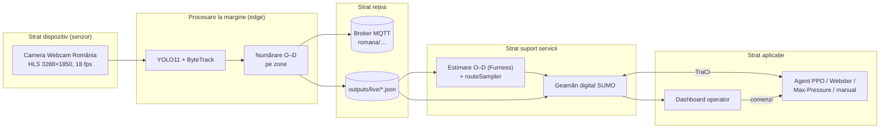
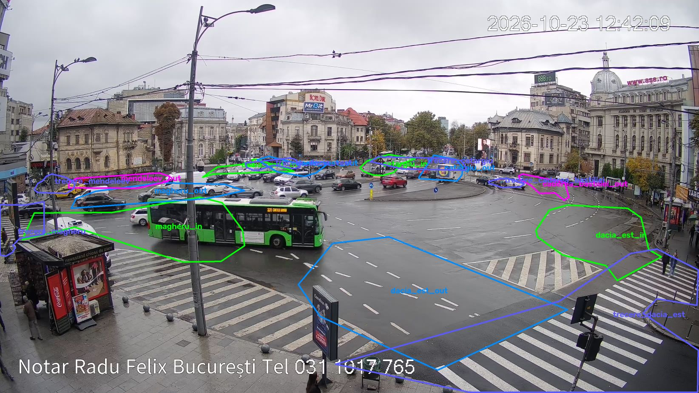
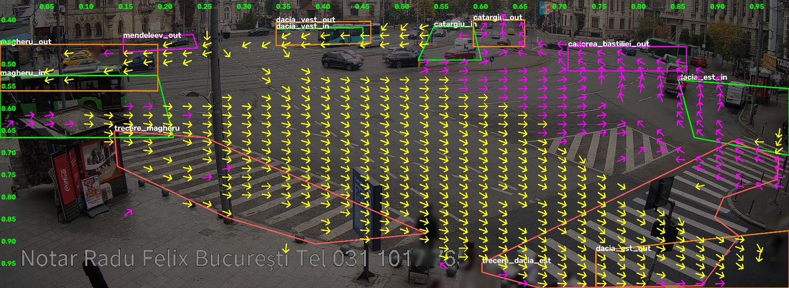
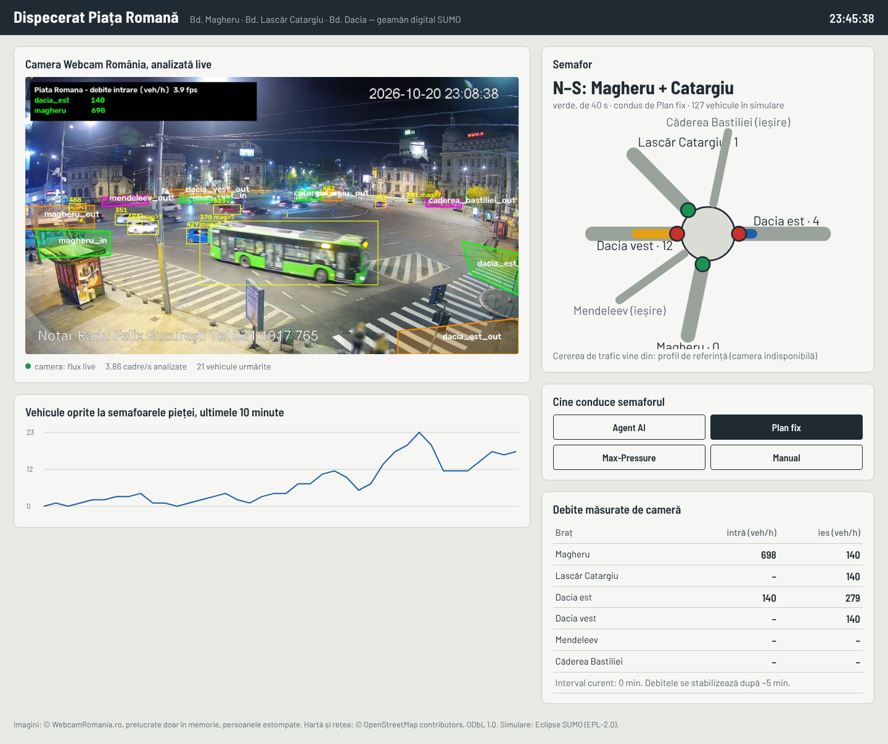

# Semaforizare Piața Romană – documentația proiectului

**Semaforizarea inteligentă, bazată pe inteligență artificială, a intersecției Piața Romană din București,
cu date preluate în timp real de pe camera publică Webcam România și simulare în SUMO**

Autor: Niunin Matei-Gabriel · Universitatea Transilvania din Brașov, Facultatea de Matematică și Informatică,
Informatică ID, anul III · Discipline: *Interfețe om-calculator* și *Internet of Things* · Anul universitar 2026–2027

---

## Cuprins

1. [Context și motivație](#1-context-și-motivație)
2. [Obiective și cerințe](#2-obiective-și-cerințe)
3. [Arhitectura sistemului (perspectiva IoT)](#3-arhitectura-sistemului-perspectiva-iot)
4. [Modulul de viziune artificială](#4-modulul-de-viziune-artificială)
5. [Puntea cameră → simulare: cererea de trafic calibrată](#5-puntea-cameră--simulare-cererea-de-trafic-calibrată)
6. [Rețeaua rutieră în SUMO](#6-rețeaua-rutieră-în-sumo)
7. [Controlul inteligent al semafoarelor](#7-controlul-inteligent-al-semafoarelor)
8. [Interfața om-calculator: dispeceratul](#8-interfața-om-calculator-dispeceratul)
9. [Rezultate](#9-rezultate)
10. [Limitări, aspecte etice și lucrări viitoare](#10-limitări-aspecte-etice-și-lucrări-viitoare)
11. [Ghid de instalare și rulare](#11-ghid-de-instalare-și-rulare)
12. [Jurnalul bornelor](#12-jurnalul-bornelor)
13. [Asistență generativă](#13-asistență-generativă)
14. [Bibliografie și licențe](#14-bibliografie-și-licențe)

---

## 1. Context și motivație

Piața Romană este nodul în care axa nord–sud Lascăr Catargiu – Magheru (paralelă cu magistrala de metrou M2)
se intersectează cu axa est–vest a Bulevardului Dacia[^wiki-romana]. În piață se varsă, în plus, două străzi cu
sens unic de ieșire: Str. D. I. Mendeleev și Str. Căderea Bastiliei. Camera Webcam România montată pe clădirea
dintre Bd. Magheru și Bd. Dacia (axa estică) filmează continuu „sensul giratoriu din mijlocul pieței, trecerile de
pietoni, traficul de pe bulevardele Magheru, Lascăr Catargiu și Dacia”[^webcam].

Bucureștiul este unul dintre cele mai congestionate orașe din lume. În ediția 2025 a TomTom Traffic Index,
nivelul mediu de congestie a fost de 62,5%, orașul a ocupat locul 20 global (5 în Europa), iar un șofer a
pierdut în medie 171 de ore pe an la orele de vârf, cu o viteză medie de vârf de 14 km/h[^tomtom][^pmb-tomtom].

Municipalitatea operează sistemul de management al traficului BTMS, extins la aproximativ 267–268 de intersecții
coordonate dintr-un centru unic, majoritatea cu automate „cu funcționare în mod adaptiv”[^btms-267][^buletin-btms].
În 2026 a fost anunțat un proiect nou, bazat pe AI, pentru 92 de intersecții în prima etapă: „Vom monta 305 camere
şi 1.500 de senzori”, cu ajustarea timpilor de semaforizare după numărul de mașini și prioritate pentru transportul
public[^digi24-ai]. Axa Unirii – Universitate – Piața Romană – Piața Victoriei a fost chiar pilotul primului sistem
„undă verde” din 2007[^economedia]. Infrastructura rămâne însă fragilă: în mai 2026 un incendiu la un punct trafo
de pe Bd. Magheru 43 a lăsat nefuncționale semafoarele din zona Pieței Romane[^adevarul-incendiu] – motiv pentru
care sistemul propus are întotdeauna un plan fix de rezervă.

Proiectul arată, la scară academică, lanțul complet pe care îl presupun aceste sisteme: **senzor video →
date de trafic → model digital al intersecției → decizie automată → supraveghere umană**.

## 2. Obiective și cerințe

| # | Cerință (din tema proiectului) | Cum este îndeplinită |
|---|---|---|
| R1 | Preluarea în timp real a datelor de pe camera publică | `vision/stream.py` citește fluxul HLS cu reconectare automată; `run_vision.py` analizează 4–6 cadre/s |
| R2 | Direcțiile **din care vin** și **spre care se îndreaptă** vehiculele, cât mai aproape de adevăr | 10 zone poligonale (intrare/ieșire pe fiecare braț) calibrate pe traiectorii reale; matrice O–D pe intervale de 15 min; 2 zone pe trecerile de pietoni vizibile |
| R3 | Transformarea datelor în flux de trafic simulat în SUMO, nu trafic aleator | estimare O–D Furness + `routeSampler.py` pe viraje, pe tipuri de vehicule (inclusiv biciclete); pietoni din numărătorile de pe treceri; trafic de fond doar ca fracțiune declarată |
| R4 | Model AI care recunoaște semafoarele intersecției și le controlează | cele 16 semafoare fizice ale pieței sunt identificate automat după coordonate și grupate într-un controler, ca automatul real; agent PPO care alege ordinea și durata fazelor reale |
| R5 | Antrenare până la fluidizarea optimă a intersecției | antrenare pe mai multe scenarii, în paralel; evaluare față de 4 linii de bază pe 5 seed-uri, pentru toți participanții (vehicule, bicicliști, pietoni) |
| R6 | Extindere la intersecțiile principale conexe | varianta „coridor”: Piața Romană + cei 4 vecini imediați care o alimentează, controlați simultan |
| R7 | Documentație în limba română, cu surse și licențe | acest document; note de subsol; § 14 |
| R8 | Evoluție vizibilă pe GitHub, pe borne | commit + push la fiecare bornă (§ 12) |

Cerințe nefuncționale: siguranță (agentul nu poate produce stări periculoase ale semaforului), confidențialitate
(nicio imagine stocată), reproductibilitate (rețea, cerere și rezultate regenerabile din scripturi),
rulare pe un laptop Windows fără GPU.

## 3. Arhitectura sistemului (perspectiva IoT)

Sistemul urmează modelul pe straturi din recomandarea ITU-T Y.2060[^itu-y2060]:

* **Senzorul virtual.** Camera nu este a proiectului; este tratată ca un senzor public, iar „inteligența” rulează pe
  stația locală (*edge computing*). Spre restul sistemului pleacă doar **numărători agregate** – economie de lățime de
  bandă și, mai ales, conformitate cu principiul minimizării datelor din GDPR[^gdpr].
* **Rețea.** Modulul de viziune publică opțional pe MQTT (OASIS Standard 5.0[^mqtt]; broker recomandat Eclipse
  Mosquitto[^mosquitto]): `romana/stare/camera` (retained, QoS 1), `romana/numaratori/interval` (retained),
  `romana/evenimente/viraj`. Local, aceleași date sunt scrise atomic în `outputs/live/*.json`.
* **Servicii.** Estimarea matricei O–D și generarea cererii; geamănul digital SUMO.
* **Aplicație.** Controlerul semaforului și dispeceratul.

## 4. Modulul de viziune artificială

### 4.1 Sursa video

Fluxul `mono.m3u8` este o listă HLS de segmente `.ts` de 6 s, H.264, 3288 × 1850 px, 18 fps (verificat cu
`ffprobe` la 20.10.2026). `FrameSource` îl citește prin FFmpeg/OpenCV[^opencv][^ffmpeg] pe un fir separat și
păstrează doar ultimul cadru; la căderea fluxului se reconectează cu întârziere exponențială (1 s → 30 s).

**Camere pentru intersecțiile conexe.** S-au căutat (21.10.2026) toate camerele publice din zona modelată:
lista Webcam România pentru București (8 camere)[^webcam-buc], Windy Webcams, Meteoblue și listele de
intersecții supravegheate. Rezultat:

| Cameră | Ce arată | Folosită? |
|---|---|---|
| Webcam România – Piața Romană (HLS) | piața, toate cele 6 brațe, 2 treceri de pietoni | **da** – singura sursă video a proiectului |
| Webcam România – Piața Victoriei (YouTube live) | pasajul Victoriei, în afara zonei modelate (dincolo de Lascăr Catargiu × Gh. Manu) | nu |
| „Calea Victoriei City Cam” (YouTube) | imagine statică a Ateneului, fără trafic | nu |
| Windy / Meteoblue „Piața Romană” | aceeași cameră Webcam România | – |
| Listele de „intersecții supravegheate” (Dacia × Dorobanți, Magheru × Enescu) | camere ale Poliției / PMB, fără imagine publică | nu (indisponibile) |

Pentru intersecțiile conexe (§ 6.1) nu există deci camere publice. Conform principiului proiectului, traficul
lor este simulat din datele Pieței Romane: rutele candidate pornesc de la marginea rețelei și traversează
intersecțiile vecine (§ 5.2), astfel încât fiecare vecin primește exact traficul observat care intră în piață
sau iese din ea pe brațul lui, plus traficul de fond declarat (15%).

**Calculul pe laptop.** Laptopul nu are placă grafică NVIDIA; YOLO11s la 1600 px rula pe procesor cu ≈0,9
cadre/s, prea puțin pentru urmărire (traiectorii fragmentate, Magheru subnumărat la ≈250 veh/h). Detectorul
este exportat automat în formatul Intel OpenVINO[^openvino] (`runtime: "openvino"` în `config/camera.json`) și
rulează pe placa grafică Intel integrată: ≈5 cadre/s cu exact aceleași detecții pe cadrul de test (34 de
vehicule, 11 persoane), lăsând procesorul liber pentru simulare și antrenare.

### 4.2 Detecție și urmărire

* **Detecție:** Ultralytics YOLO11[^yolo11], preantrenat pe COCO[^coco]; clasele folosite: car (2) → `passenger`,
  motorcycle (3), bus (5, include troleibuzele STB), truck (7), bicycle (1) și person (0) – pentru numărarea
  pietonilor pe treceri (§ 4.4) și pentru estomparea în previzualizare.
  Implicit `yolo11s` la 1600 px pe regiunea de interes (partea de jos a cadrului, fără cer), configurabil în
  `config/camera.json`; pe GPU NVIDIA se poate folosi `--device 0`.
* **Urmărire:** ByteTrack[^bytetrack] (asociază și detecțiile cu scor mic, util la ocluziile din piață);
  alternativ BoT-SORT[^botsort].
* **Punctul de referință** al fiecărui vehicul este mijlocul laturii de jos a dreptunghiului (contactul cu solul),
  mai stabil la perspectivă decât centrul.

### 4.3 Zonele de intrare/ieșire și matricea origine–destinație

Camera vede cele șase brațe ale pieței, de la stânga la dreapta: Bd. Magheru (extremă stânga), Str. Mendeleev
(ieșire), Bd. Dacia vest (centru-stânga), Bd. Lascăr Catargiu (centru-dreapta), Str. Căderea Bastiliei (ieșire,
lângă clădirea ASE) și Bd. Dacia est (extremă dreapta). Pentru fiecare braț cu dublu sens s-au definit **două**
poligoane – banda de intrare spre piață și banda de ieșire – iar pentru străzile cu sens unic doar zona de ieșire
(10 zone în total, `config/camera.json`, coordonate normalizate 0–1, independente de rezoluție).

*Zonele de numărare finale (verde = intrare, portocaliu = ieșire, mov = străzi cu sens unic de ieșire, roșu =
treceri de pietoni); săgețile albe arată sensul de mers cerut în fiecare zonă. Imagine: © WebcamRomania.ro,
captură din 21.10.2026, 11:18, persoane estompate automat; folosită în scop de citare academică.*

*Câmpul de mișcare calculat din ≈119.000 de traiectorii ale zilei de 21.10 (direcția medie pe celule; galben =
spre partea de jos a imaginii, mov = spre partea de sus): se văd inelul circulat în sens trigonometric, intrările
de pe Magheru (stânga jos, spre dreapta) și Dacia est (dreapta, în sus), ieșirile spre Catargiu și Căderea
Bastiliei (sus). Imagine de fundal: © WebcamRomania.ro, persoane estompate.*

Poziția zonelor nu a fost aleasă „din ochi”: s-au înregistrat 3 minute de flux, s-au urmărit vehiculele cu
YOLO11 + ByteTrack (256 de traiectorii) și s-au suprapus traiectoriile pe imagine, cu punctele de început și de
sfârșit marcate; zonele s-au pus acolo unde traiectoriile intră și ies din cadru. **Calibrarea actuală este
preliminară (imagini de noapte)**; rafinarea pe lumină de zi este planificată în Borna 7. Dacă operatorul mută
camera, zonele se redesenează interactiv cu `scripts\2b_calibrare_zone.bat`.

Regula de numărare (`classify()` în `vision/od_counter.py`), aplicată pe traiectoria întreagă la închiderea ei:

* originea = **prima** zonă de intrare vizitată **înaintea oricărei ieșiri**; destinația = **ultima** zonă de
  ieșire a **altui** braț, vizitată după origine. Zonele de intrare și de ieșire ale aceluiași braț sunt
  alăturate: prima variantă a regulii producea 25 de „întoarceri” Magheru → Magheru în 5 minute, de fapt
  vehicule care atingeau banda vecină;
* pe brațele îndepărtate, parțial ascunse (Dacia vest, Lascăr Catargiu, Mendeleev, Căderea Bastiliei), zonele
  sunt marcate `capat_traiectorie`: o intrare contează doar dacă traiectoria **începe** acolo (vehiculul apare
  din strada ascunsă), o ieșire doar dacă traiectoria **se termină** acolo (toleranță 1,5 s). Verificarea
  sensului de mers (`recount --directii`) a arătat că fosta zonă „intrare Dacia vest” prindea de fapt
  vehiculele care circulă pe inel prin dreptul străzii (73 din 74 se îndepărtau de centru);
* fiecare zonă cere un **sens de mers** în imagine (±60°), măsurat pe primele / ultimele 1,5 s ale
  traiectoriei (zonele `capat_traiectorie`) sau pe porțiunea din zonă: intrările se mișcă spre piață,
  ieșirile dinspre piață. Zonele unui braț se pot astfel suprapune fără confuzie;
* o traiectorie completă produce un viraj (origine → destinație); una fragmentată (vehicul pierdut la o
  ocluzie) contribuie doar la numărătoarea pe braț.

**Calibrarea pe datele de zi (21.10.2026).** Pozițiile zonelor au fost stabilite din jurnalul primelor 1,5 ore
de traiectorii (≈16.000 de fragmente): câmpul de mișcare arată sensul fiecărei benzi (inelul circulă în sens
trigonometric), iar hărțile cu începuturile și sfârșiturile traiectoriilor arată unde vehiculele apar din /
dispar în străzile parțial ascunse (Lascăr Catargiu sus-centru, Dacia vest în spatele stației de troleibuz,
Căderea Bastiliei sus-dreapta). Geometria din rețeaua OSM (azimutul fiecărui braț văzut din poziția camerei)
confirmă ordinea brațelor în imagine: camera privește spre vest, deci stânga = sud (Magheru), dreapta = nord
(Căderea Bastiliei). Corecții: fosta zonă de intrare Dacia vest era pe inel; zona Căderea Bastiliei era prea sus
(0 vehicule); intrarea Dacia est stătea parțial peste trecerea de pietoni, iar vehiculele circulă deasupra ei.

**Reunirea fragmentelor.** La 5 cadre/s, stâlpii, autobuzele și copacii întrerup urmărirea. Înainte de
numărare, `recount` reunește fragmentele aceleiași traiectorii: un fragment care se termină este legat de unul
care începe în cel mult 2 s, aproape de poziția prezisă din viteza de la capăt, de aceeași categorie și cu
direcție compatibilă (≈12% din fragmente sunt reunite). Chiar și așa, doar ≈10% dintre vehicule sunt urmărite
de la intrare până la ieșire – matricea O–D se sprijină deci în principal pe totalurile pe brațe (§ 5.1).

Se agregă pe intervale de 15 minute, separat pe tipuri de vehicule, în `data/counts/numaratori_AAAA-LL-ZZ.csv`.

**Jurnalul anonim de traiectorii și renumărarea.** Pe lângă numărători, modulul salvează în
`data/trajectories/traiectorii_AAAA-LL-ZZ.jsonl.gz` fiecare traiectorie închisă: clasa obiectului și pozițiile
punctului de contact cu solul, în coordonate normalizate, cu timpul relativ – fără imagini, fără numere de
înmatriculare, fără ID-ul de urmărire. Astfel zonele pot fi recalibrate **după** colectare, iar
`python -m romana.vision.recount` reface numărătorile din jurnal (testat: rezultat identic cu numărarea live).
Tot din jurnal se desenează câmpul de mișcare al vehiculelor și capetele traiectoriilor (`recount --flux`),
folosite la plasarea zonelor.

### 4.4 Pietoni și bicicliști

În simulare intră toți participanții observabili pe cameră. Camera vede două dintre cele 7 treceri semaforizate
ale pieței: trecerea de pe Bd. Magheru (prim-plan, stânga) și trecerea dublă de pe Bd. Dacia est (prim-plan,
dreapta). Pentru fiecare s-a desenat o zonă cu rolul `trecere` (`config/camera.json`), peste marcajul zebră
de pe cadrul din 21.10.2026, 01:30 (de verificat pe lumină de zi).

* **Pietoni.** Persoanele detectate sunt urmărite cu același ByteTrack. Un pieton este numărat **o singură dată
  pe fiecare trecere** pe care a fost văzut în cel puțin 2 cadre și pe care s-a deplasat cel puțin 4% din
  lățimea cadrului (punctul de contact cu solul în zona trecerii) – cine doar așteaptă la bordură nu contează;
  în CSV apar ca rânduri `pietoni` (braț, trecere). Debitul măsurat se extrapolează la toată piața cu
  `factor_extrapolare_pietoni` = 2,5 din `config/demand.json` (ipoteză declarată: camera vede 2 din cele ≈7
  treceri semaforizate; factorul se va verifica printr-o numărătoare manuală).
* **Bicicliști și motocicliști.** Bicicleta (clasa 1) este numărată ca vehicul pe zonele de intrare/ieșire, ca
  orice alt vehicul, și primește în SUMO rute pe care bicicletele au acces. Persoana de pe bicicletă sau
  motocicletă **nu** este numărată ca pieton: o persoană al cărei punct de contact cu solul cade în caseta unei
  biciclete/motociclete (lărgită cu 25%) este exclusă (`is_rider` în `vision/od_counter.py`).

### 4.5 Confidențialitate

Imaginile pot conține persoane și numere de înmatriculare, deci prelucrarea intră sub GDPR[^gdpr] și sub ghidul
EDPB 3/2019 privind dispozitivele video[^edpb]. Măsurile implementate: prelucrare exclusiv în memorie; nicio
înregistrare video sau decupaj salvat; fără citirea numerelor de înmatriculare; ID-urile de urmărire sunt
temporare și uitate la închiderea traiectoriei; persoanele sunt estompate în previzualizarea pentru dashboard
(redusă la 960 px și suprascrisă continuu); se publică doar numărători agregate și jurnalul de traiectorii
anonime (clasă + poziții normalizate ale punctului de contact cu solul, fără imagini sau identificatori), din
care nu se poate reconstitui nicio imagine și nicio persoană. Fișierele `.ts`/`.mp4` sunt
excluse din Git (`.gitignore`). Fluxul este public, iar utilizarea este strict academică; pagina operatorului
menționează „Toate drepturile rezervate”[^webcam], de aceea imaginile nu sunt redistribuite, iar pentru o
utilizare dincolo de proiectul academic se recomandă acordul scris al Webcam România.

## 5. Puntea cameră → simulare: cererea de trafic calibrată

Aceasta este piesa care asigură că agentul se antrenează pe **trafic real**, nu pe trafic aleatoriu.

### 5.1 Estimarea matricei O–D (Furness)

Camera nu urmărește fiecare vehicul de la intrare până la ieșire (stâlpi, autobuze care acoperă alte vehicule,
distanța până la brațele îndepărtate). De aceea se combină trei surse (`bridge/od_estimation.py`):

* **totalurile pe linii** $T_o$ = vehiculele intrate pe brațul $o$ (cea mai fiabilă măsurătoare);
* **totalurile pe coloane** $U_d$ = vehiculele ieșite pe brațul $d$, rescalate la $\sum T$;
* **sămânța** $S_{od}$ = virajele complete observate + $w \cdot p_{od}$, unde $p$ este o distribuție a priori
  (`config/demand.json`) folosită doar ca regularizare când observațiile lipsesc ($w = 2$ vehicule-echivalent).

Matricea se echilibrează prin metoda Furness (IPF)[^ortuzar], alternând scalarea coloanelor și a liniilor și
terminând pe linii. Un factor de corecție a detecției (numărătoare manuală / automată) poate fi setat după
validarea manuală pe 15 minute.

**Echilibrarea intrări / ieșiri.** Pe datele de zi, suma ieșirilor numărate a depășit suma intrărilor cu
≈30% (ex. 12:00–12:15: 1.856 față de 2.436 veh/h). Diferența nu poate fi reală la scara a 15 minute (stocarea
pe inel este de câteva zeci de vehicule): camera **subnumără intrările** de la marginea cadrului (Magheru, Dacia
est – vehiculele apar deja parțial în zonă, în spatele chioșcului și al stației de autobuz) și **supranumără
ieșirile** spre străzile parțial ascunse (un vehicul pierdut lângă o stradă pare că a ieșit pe ea). O
comparație cu numărarea pe linii de control (*screen lines*) a dat erori de sens opus (≈745 intrări și ≈1.330
ieșiri pe oră), deci adevărul este între cele două metode. În lipsa unei numărători manuale de referință,
ambele sume sunt tratate ca măsurători ale aceluiași debit și aduse la **media** lor înainte de Furness
(`echilibrare: "medie"` în `config/demand.json`); fiecare parte își păstrează distribuția pe brațe. Incertitudinea
rămasă (≈±15–20%) este acoperită de scenariile de sensibilitate ×0,8 și ×1,2 (§ 5.4).

### 5.2 De la O–D la vehicule în SUMO

1. Se generează un set mare de **rute candidate realiste**: drumuri minime de la marginea rețelei
   (`randomTrips.py` + `duarouter`), păstrând doar rutele care pornesc și se termină pe artere și au cel mult
   15% din lungime pe străzi rezidențiale, plus rute garantate pentru fiecare pereche intrare → ieșire.
2. Pentru fiecare interval de 15 min și fiecare tip de vehicul se scrie un fișier de viraje (`edgeRelation`
   de la muchia de intrare a brațului la muchia de ieșire).
3. `routeSampler.py`[^sumo-turns] alege din setul candidat exact atâtea rute câte trebuie pentru a reproduce
   virajele (optimizare liniară); calitatea se raportează prin indicatorul GEH și fișierele `mismatch_*.xml`.
4. Traficul de pe străzile vecine care **nu** trece prin piață (nemonitorizat video) se adaugă separat, ca
   fracțiune declarată din volumul observat (`fond_fractiune`, implicit 15%), pe rute care evită piața.

Astfel, intersecțiile vecine primesc traficul care chiar intră și iese din Piața Romană pe brațele lor, ceea ce
răspunde cerinței de a nu antrena agentul pe un flux necorespunzător realității.

### 5.3 Scenariul de referință (până la datele de zi)

În lipsa datelor oficiale publice de volum pentru Piața Romană (singura cifră publică găsită este o estimare
neoficială de ~3.446 veh/h pe Magheru spre Romană, dintr-un singur ciclu de semafor, 2011/2012[^wizard]),
până la colectarea datelor de zi se folosesc trei scenarii ipotetice explicite: *moderat* (0,7× → 1.442 veh/h
prin piață), *vârf* (720 / 620 / 390 / 330 veh/h pe Magheru / Catargiu / Dacia est / Dacia vest → 2.060 veh/h)
și *aglomerat* (1,2× → 2.472 veh/h), fiecare cu 15% trafic de fond și 1.200 de pietoni/h prin zona pieței
(stația de metrou M2 și ASE; valoare ipotetică). Compoziția: 88% autoturisme, 4% autobuze/troleibuze, 3%
camioane, 3% motociclete, 2% biciclete. Volumul de vârf a fost ales astfel încât planul fix de referință să
funcționeze aproape de saturație pe replica fidelă a rețelei: peste ≈1,0× inelul se suprasaturează, ceea ce
corespunde congestiei cunoscute a pieței. Scenariile servesc la dezvoltarea și verificarea lanțului și vor fi
completate cu scenarii construite din numărătorile reale.

### 5.4 Scenariile din date reale (Borna 9)

Prima zi de date: **miercuri, 21.10.2026, 11:45–21:01** (9 h 15 min de flux continuu, ≈5–6 cadre/s, nicio
reconectare). Jurnalul de traiectorii a fost renumărat cu zonele calibrate pe zi: 123.829 de fragmente,
108.585 de traiectorii după reunire, 16.110 intrări numărate, 7.733 de pietoni pe trecerile vizibile.

Profilul zilei (debit echilibrat prin piață, ferestre glisante de o oră) are forma așteptată: ≈2.000 veh/h la
prânz, un vârf secundar la 13:00–14:00 (≈2.600 veh/h, pauza de masă), creștere de la 15:30, **vârful de seară
la 17:15–18:15 (≈2.780 veh/h)** și scădere după 18:30 (≈1.260 veh/h la 20:00–21:00). Pietonii numărați pe
cele două treceri vizibile: 600–1.250 pe oră.

`python -m romana.bridge.scenarii_zi --zi 2026-10-21` alege automat ferestrele și construiește scenariile:

| Scenariu | Fereastra | Vehicule prin piață (veh/h) | Fond | Pietoni/h | Observații |
|---|---|---|---|---|---|
| `zi_2026-10-21_pranz` | 12:00–13:00 | 2.068 | 310 | 2.258 | |
| `zi_2026-10-21_varf` | 17:15–18:15 | 2.779 | 417 | 2.418 | ora de vârf a zilei |
| `zi_2026-10-21_linistit` | 20:00–21:00 | 1.262 | 189 | 1.988 | |
| `zi_2026-10-21_varf_x1_2` | vârf × 1,2 | 3.335 | 500 | 2.418 | sensibilitate (marja de măsurare) |
| `zi_2026-10-21_linistit_x0_8` | liniștit × 0,8 | 1.010 | 151 | 1.988 | sensibilitate |

**A doua zi de date: joi, 22.10.2026, 00:00–11:00** (colectarea a continuat peste noapte și în vârful de
dimineață; prioritatea procesului de viziune a fost ridicată în timpul vârfului, ca antrenarea care rula în
paralel să nu-i scadă rata de cadre). 79.041 de fragmente → 66.915 traiectorii; noaptea 230–500 veh/h
(01:00–05:00), creștere bruscă de la 06:30, vârful de dimineață de la 07:15 și un platou de 2.300–2.700 veh/h
între 08:00 și 10:45:

| Scenariu | Fereastra | Vehicule prin piață (veh/h) | Fond | Pietoni/h | Observații |
|---|---|---|---|---|---|
| `zi_2026-10-22_dimineata` | 07:30–08:30 | 2.243 | 336 | 2.218 | vârful clasic de dimineață |
| `zi_2026-10-22_varf` | 09:45–10:45 | 2.502 | 375 | 2.152 | ora cu debitul maxim |
| `zi_2026-10-22_linistit` | 03:45–04:45 | 284 | 43 | 19 | noaptea |
| `zi_2026-10-22_varf_x1_2` | vârf × 1,2 | 3.003 | 450 | 2.152 | sensibilitate |
| `zi_2026-10-22_linistit_x0_8` | noapte × 0,8 | 227 | 34 | 19 | sensibilitate |

Cu cele două zile, proiectul are **10 scenarii din date reale**, de la noapte (≈230 veh/h) la vârful de seară
(≈2.500 veh/h) și suprasarcina de sensibilitate (≈3.000 veh/h). Agentul v1 a fost antrenat doar pe 21.10; ziua
de 22.10 servește întâi ca test de generalizare (§ 9.1), apoi agenții finali sunt antrenați pe ambele zile.

Compoziția măsurată pe toată ziua de 21.10 (intrări și ieșiri): 92,7% autoturisme, 3,7% autobuze și troleibuze, 3,2%
camioane, 0,3% biciclete, 0,1% motociclete – mult sub ipoteza inițială (2% biciclete, 3% motociclete), într-o zi
de octombrie cu 12–15 °C. Pentru fiecare tip de vehicul,
`routeSampler` reproduce toate relațiile de viraj țintă (GEH < 5 pentru 100% din relații). Scenariile ipotetice
`referinta_*` (§ 5.3) rămân în proiect pentru comparație, dar agenții din Borna 9 sunt antrenați **doar** pe
scenariile din date reale.

### 5.5 Geamănul digital live

`bridge/live_twin.py` rulează SUMO (opțional SUMO-GUI) continuu, în timp real: în fiecare secundă citește
debitele curente publicate de modulul de viziune și injectează vehicule pe brațe ca proces Poisson cu acele
debite, cu destinații după proporțiile de viraj observate și tipuri după compoziția traficului (bicicliștii pe
rute permise bicicletelor). Pietonii sunt injectați tot Poisson, pe trasee pietonale care trec prin piață, cu
debitul măsurat pe trecerile vizibile × factorul de extrapolare. Dacă fluxul camerei lipsește mai mult de 60 s,
trece pe profilul de referință și **afișează explicit** acest lucru în dashboard. Modul „plan fix” rulează
planul de referință complet (N–S / E–V / pietoni, § 6.3).

## 6. Rețeaua rutieră în SUMO

### 6.1 Construcție reproductibilă

`network/build_network.py` pornește de la extrasul OpenStreetMap[^osm] al zonei și rulează `netconvert`[^sumo]
pe un dreptunghi de 2,2 × 1,6 km, care include Piața Romană și primele intersecții semaforizate pe fiecare braț:

| ID în proiect | Intersecție | Distanța | Cameră | În coridorul controlat |
|---|---|---|---|---|
| `romana` | Piața Romană (Magheru – Lascăr Catargiu – Dacia) | – | da | da (controlerul principal) |
| `dacia_eminescu` | Bd. Dacia × Str. M. Eminescu × Calea Dorobanți (Dacia est) | ~215 m | nu | da |
| `magheru_enescu` | Bd. Magheru × Str. G. Enescu / Tache Ionescu (sud) | ~350 m | nu | da |
| `catargiu_manu` | Bd. Lascăr Catargiu × Str. Gh. Manu (nord-vest) | ~490 m | nu | da |
| `dacia_victoriei` | Bd. Dacia × Calea Victoriei (Dacia vest) | ~480 m | nu | da |
| `dacia_polona` | Bd. Dacia × Str. Polonă | ~525 m | nu | nu – Bd. Dacia este aici sens unic de ieșire din piață |

Semafoarele sunt găsite **după coordonatele geografice** (centroidul nodurilor), nu după ID-urile generate de
`netconvert`, care se schimbă la fiecare regenerare. Sensurile unice Mendeleev și Căderea Bastiliei (doar ieșire
din piață) sunt confirmate atât de etichetele OSM (`oneway=yes`), cât și de traiectoriile observate pe cameră.

**Coridorul controlat** (varianta „coridor” a agentului) cuprinde piața și cei 4 vecini imediați care o
alimentează. Bd. Dacia × Str. Polonă a fost scoasă din coridor la observația autorului, confirmată de OSM: pe
ambele tronsoane dintre Calea Dorobanți și Str. Polonă, Bd. Dacia are `oneway=yes` (doar autobuzele circulă în
contrasens, `oneway:bus=no`), deci la Polonă traficul obișnuit doar pleacă din piață. Intersecția rămâne în
simulare, pe programul ei actual. Piața Victoriei și Piața Universității sunt mai departe (≈0,9 și ≈1,5 km, cu
alte intersecții semaforizate între ele și piață) și în afara zonei modelate; nicio cameră publică nu le acoperă.
Denumirea străzii este **Calea Dorobanți**; în OSM apare ca „Calea Dorobanților”.

### 6.2 Replica fidelă a pieței (Borna 8)

**Principiul:** infrastructura rămâne exact cea din realitate – inelul pieței, axa centrală N–S, benzile și
virajele marcate, sensurile unice, benzile dedicate STB, trotuarele, trecerile de pietoni și pozițiile reale ale
semafoarelor. Proiectul schimbă **doar modul în care semafoarele existente răspund traficului** (programul,
ordinea și durata fazelor) – singurul lucru care se poate implementa pe automatul real.

Importul `netconvert` folosește etichetele OSM pentru trotuare (`--osm.sidewalks`), accesul bicicletelor,
benzile de viraj și restricțiile pe benzi (`--osm.turn-lanes`, `--osm.lane-access`), iar trecerile de pietoni și
zonele de așteptare sunt reconstruite la toate intersecțiile (`--crossings.guess`, `--walkingareas`; opțiunea
`--osm.crossings` provoacă un crash în netconvert 1.28 pe acest extras). Rezultatul: 6.943 de muchii, 924 de
noduri, 53 de semafoare, 225 de benzi dedicate autobuzelor și trotuare pe toate arterele.

În OSM, piața are **16 semafoare fizice** (pe intrări, pe inel, pe axa centrală și la treceri). Ca în realitate,
unde toate sunt conduse de un singur automat de intersecție, ele sunt grupate într-un controler `romana`
(cele aflate la cel mult 80 m de centrul pieței, `--tls.join` cu `--tls.join-exclude` pentru restul). Controlerul
are 61 de legături: 54 pentru vehicule și 7 treceri de pietoni.

*Istoric:* în Bornele 3–7 piața fusese modelată ca un singur nod agregat, pentru că primul import OSM intra în
blocaj circular pe segmentele interne foarte scurte. În Borna 8, cu programul construit pe grupuri de semnal, s-a
constatat că inelul se bloca atunci când semnalele de pe brațele de ieșire primeau roșu și opreau vehiculele
deja intrate pe inel. Cu ieșirile pe verde în toate fazele de vehicule (§ 6.3), replica fidelă funcționează, iar
nodul agregat (care nu respecta realitatea) a fost abandonat.

### 6.3 Grupurile de semnal și fazele semaforului Piața Romană

Programul nu este cel ghicit de `netconvert`, ci este construit pe **grupuri de semnal** cu semnificație de
trafic (`config/network.json` → `romana_grupuri`), după muchia OSM pe care stau vehiculele la linia de oprire:

| Grup | Legături | Rol |
|---|---|---|
| `intrare_magheru`, `intrare_catargiu`, `intrare_dacia_est`, `intrare_dacia_vest` | 12 / 3 / 4 / 2 | intrările în piață |
| `axa_ns_centru` | 6 | axa centrală N–S, prin mijlocul pieței |
| `inel_dacia` | 11 | inelul din jurul insulei, pe direcția Dacia |
| `iesire_magheru_catargiu`, `iesire_dacia` | 12 / 4 | semnalele de pe brațele de ieșire |
| `pietoni` | 7 | trecerile de pietoni (grup automat) |

| Faza | Semnificație | În planul fix |
|---|---|---|
| 0 | N–S: Magheru ↔ Lascăr Catargiu prin centru | da, 36 s |
| 1 | E–V: Dacia în jurul insulei | da, 28 s |
| 2 | Pietoni: toate trecerile, axa centrală se golește | da, 12 s |
| 3 | N–S, cu intrările Dacia deschise (fără dozare) | nu |
| 4 | E–V, cu intrările Magheru/Catargiu deschise (fără dozare) | nu |

Planul fix de referință are un ciclu de ≈ 91 s (3 faze + galben 3 s + roșu de degajare 2 s după fiecare).
Ieșirile au verde în toate fazele de vehicule, pentru că fiecare ieșire este alimentată în ambele faze principale;
trecerile de pe ieșiri primesc verde în faza de pietoni. **Trecerile de pietoni primesc verde automat** în orice
fază în care niciun flux de vehicule cu verde nu le intersectează geometric (verificare de siguranță la
construcția programului; `build_network.py` refuză un program în care o trecere nu primește niciodată verde).
Roșul de degajare păstrează verdele legăturilor care rămân verzi și în faza următoare. Fazele 3–4 există ca
opțiuni, dar evaluarea a arătat că, deschizând intrările spre un inel deja ocupat, ele blochează piața (§ 7.4);
de aceea strategiile adaptive aleg implicit doar dintre fazele 0–2.

Intersecțiile vecine păstrează programele `actuated` generate (realist: sistemul BTMS funcționează adaptiv), cu
excepția variantei „coridor”, în care sunt conduse de agent.

## 7. Controlul inteligent al semafoarelor

### 7.1 Formularea ca problemă de decizie Markov

* **Pas de decizie:** 5 s simulate.
* **Stare:** pentru fiecare semafor controlat – faza verde curentă (one-hot), indicatorul „verde minim
  îndeplinit”, durata verdelui curent (normalizată la verdele maxim), pentru fiecare bandă de intrare coada
  (vehicule oprite) și densitatea, normalizate la capacitatea de stocare a benzii (lungime / 7,5 m), și, pentru
  fiecare zonă de așteptare a unei treceri controlate, numărul de pietoni care așteaptă (normalizat la 15).
  Aceeași funcție (`observation()` din `control/signals.py`) servește antrenarea, evaluarea și geamănul digital.
* **Acțiune:** faza verde dorită. La Piața Romană, implicit una din cele 3 faze ale planului real (N–S, E–V,
  pietoni): agentul decide **ordinea și durata** fazelor, adică exact ce se poate programa pe automatul existent
  (fazele „fără dozare” se pot activa cu `--toate-fazele`). În varianta coridor, câte o acțiune pentru fiecare din
  cele 5 semafoare ale coridorului – spațiu `MultiDiscrete`.
* **Recompensă:** $r_t = -\frac{1}{100}\left(\sum_{\ell} q_\ell(t) + \sum_{c} p_c(t) + b(t)\right)$,
  unde $q_\ell$ este numărul de vehicule oprite pe banda de intrare $\ell$, $p_c$ numărul de pietoni care
  așteaptă la trecerea $c$, iar $b$ numărul de vehicule care nu pot intra în rețea (blocate la margine); un
  pieton și un vehicul neintrodus cântăresc cât un vehicul oprit. *Lecție din Borna 8:* cu o penalizare mică
  pentru $b$ (0,002), agentul coridor a învățat să „ascundă” coada în afara rețelei – cozi de 4–8 vehicule în
  piață, dar ≈450 s așteptare medie și ≈400 de vehicule rămase în scenariul moderat. Este un exemplu clasic de
  exploatare a recompensei (*reward hacking*); modelele au fost reantrenate cu formula de mai sus, iar evaluarea
  raportează și întârzierea la intrarea în rețea.
* **Varianta „cozi în amonte” (v2, Borna 9).** Pe scenariile din date reale, la vârf, benzile scurte de la
  linia de oprire (30–90 m) sunt pline indiferent de decizii, deci $\sum_\ell q_\ell$ nu mai variază, iar
  cozile care cresc spre intersecțiile vecine (ex. Bd. Dacia dinspre Calea Victoriei) nu se văd. Cu
  `--obs-amonte`, observația primește, pentru fiecare intrare a fiecărui controler, coada de pe muchiile din
  amonte pe ≈250 m (normalizată la capacitatea lor de stocare) și numărul de vehicule neintroduse, iar
  recompensa adaugă la $\sum_\ell q_\ell$ și vehiculele oprite pe aceste benzi din amonte (fiecare bandă o
  singură dată): $r_t = -\frac{1}{100}\left(\sum_{\ell} q_\ell + \sum_{u} q_u + \sum_{c} p_c + b\right)$.
  Opțiunea se salvează în `models/*.json` (`obs_amonte`), astfel încât evaluarea și geamănul digital folosesc
  automat aceeași observație.

### 7.2 Siguranța prin construcție

Agentul nu setează direct culorile. `control/signals.py` primește doar „faza verde următoare” și impune:
galben 3 s, roșu general 2 s (pe legăturile care se schimbă), verde minim 10 s, verde maxim 90 s (după care
faza avansează forțat). Ciorna inițială sărea direct între faze verzi, fără galben (vezi
`legacy/google_ai_draft/README.md`).

### 7.3 Algoritmul de învățare

PPO (Proximal Policy Optimization)[^ppo] din Stable-Baselines3[^sb3], rețea MLP 128 × 128, rată de învățare
3·10⁻⁴, ≈1.024 de tranziții pe actualizare, lot 128, 10 epoci, γ = 0,98, λ_GAE = 0,95, coeficient de entropie
0,01. Simularea rulează prin `libsumo` (aceeași interfață ca TraCI, fără comunicație prin socket), în **8 procese
paralele** (`SubprocVecEnv`, opțiunea `--medii`): ≈55–70 de pași de decizie pe secundă pe procesorul laptopului
(i5-13420H), față de ≈18 cu un singur proces – replica fidelă, cu pietoni, este mult mai costisitoare decât
nodul agregat. Pe Windows, PYTHONPATH-ul setat de instalatorul SUMO umbrește pachetul pip `libsumo` cu varianta
din instalare, căreia îi lipsesc DLL-uri; `control/env.py` încarcă explicit pachetul pip. Fiecare episod = o
oră de trafic, pe un scenariu ales aleator din setul de antrenare, cu seed SUMO aleator. PPO a fost preferat lui DQN[^dqn] pentru că suportă natural acțiunile `MultiDiscrete` ale
variantei coridor. Literatura de referință pentru RL în semaforizare: IntelliLight[^intellilight],
PressLight[^presslight], CoLight[^colight], MPLight[^mplight] și sintezele lui Wei et al.[^survey2019][^survey2021];
mediul a fost scris în stilul sumo-rl[^sumorl].

### 7.4 Linii de bază

1. **Plan fix de referință:** programul din rețea (N–S 36 s, E–V 28 s, pietoni 12 s, ciclu ≈ 91 s) – linia de
   bază față de care se raportează procentele.
2. **Plan fix Webster**[^webster]: ciclul optim $C_0 = \frac{1{,}5L + 5}{1 - Y}$ (limitat la 60–150 s), cu $L$ =
   timpul pierdut (7 s/fază, plus întreaga fază de pietoni) și $Y = \sum_i y_i$, $y_i$ = cel mai mare raport
   debit / debit de saturație (1800 veh/h/bandă, doar benzile de autoturisme, fără benzile STB) dintre intrările
   fazei de vehicule $i$; verdele se împarte proporțional cu $y_i$, faza de pietoni își păstrează durata.
3. **Actuated SUMO:** pe aceleași 3 faze, prelungirea verdelui cât timp detectoarele văd vehicule la intervale sub
   3 s (min 10 s, max 60 s).
4. **Max-Pressure**[^maxpressure]: la fiecare decizie se alege faza cu presiunea maximă
   $\sum (\text{coadă amonte} - \text{coadă aval})$ pe legăturile ei verzi; pentru trecerile de pietoni, „coada”
   amonte este numărul de pietoni care așteaptă (altfel faza de pietoni nu ar fi aleasă niciodată). Este un
   algoritm fără învățare, cu garanții teoretice de stabilitate, pe care un agent RL trebuie să-l egaleze sau
   să-l depășească pentru a fi convingător. Pe replica fidelă, Max-Pressure cu toate cele 5 faze alegea mereu
   fazele „fără dozare” (cele mai multe legături verzi ⇒ presiunea cea mai mare) și bloca piața complet
   (scenariul moderat, 1 seed: 1.226 de vehicule rămase în rețea, față de 107 la planul fix); restrâns la fazele
   planului real, nu mai blochează piața (97 de vehicule rămase, media pe 5 seed-uri; rezultatele complete în § 9).

### 7.5 Metrici

Din `tripinfo` SUMO, pe toată durata scenariului plus 15 minute de golire, **separat pe categorii de
participanți**:

* vehicule motorizate: timpul mediu de așteptare (medie și mediană pe seed-uri), pierderea de timp
  (*timeLoss*), întârzierea la intrarea în rețea (*departDelay*), durata medie a călătoriei, vehiculele sosite,
  emisiile de CO₂ (modelul HBEFA din SUMO);
* bicicliști (`vType` bicycle): așteptarea și pierderea de timp medii;
* pietoni (`personinfo`/`walk`): pierderea de timp medie a deplasării;
* pierderea de timp totală a tuturor participanților (ore, inclusiv întârzierea la intrare), vehiculele rămase
  în rețea sau neintroduse la final, coada medie de
  vehicule și numărul mediu de pietoni care așteaptă la trecerile Pieței Romane (eșantionate la 5 s).

Se raportează media ± abaterea standard pe 5 seed-uri. Observație: o parte din întârzieri se produce la
semafoarele de la marginea zonei modelate (de ex. Str. Știrbei Vodă, Str. Ion Câmpineanu), pe rutele care pornesc
de acolo; ele depind foarte puțin de strategia de la Piața Romană, deci nu schimbă clasamentul strategiilor, dar
măresc valorile absolute.

## 8. Interfața om-calculator: dispeceratul

`scripts\7_dashboard.bat` deschide la `http://localhost:8050` consola operatorului (Flask + HTML/JS fără
framework). Principiul de proiectare: **automatizarea propune, omul supervizează** – operatorul vede ce vede
algoritmul și poate prelua oricând controlul.

| Euristică Nielsen[^nielsen] | Aplicare în dashboard |
|---|---|
| Vizibilitatea stării sistemului | indicatoare pentru flux cameră / reconectare, cadre/s, vârsta datelor; faza curentă cu etapa (verde/galben/roșu de degajare) și secundele de verde; sursa cererii („camera live” sau „profil de referință”); vehiculele și pietonii din simulare, pietonii care așteaptă la treceri, debitul de pietoni măsurat de cameră |
| Potrivirea cu lumea reală | schema pieței respectă orientarea reală a brațelor; denumiri de străzi, nu ID-uri de muchii; culori de semafor |
| Controlul și libertatea utilizatorului | patru moduri de control; revenirea la AI sau la planul fix dintr-un clic; `Esc` anulează |
| Consistență și standarde | aceleași denumiri ale modurilor în butoane, confirmări și starea afișată |
| Prevenirea erorilor | schimbarea modului cere confirmare explicită; în modul manual se alege doar faza verde – galbenul și roșul de siguranță se aplică automat |
| Recunoaștere în loc de reamintire | fazele manuale sunt afișate cu numele lor complet; legenda culorilor cozilor e implicită (albastru < 8, galben < 18, roșu ≥ 18 vehicule) |
| Design estetic și minimalist | o singură accentuare cromatică (albastrul STB), restul neutru; culorile de semafor folosite doar pentru stare |
| Ajutor la recunoașterea și remedierea erorilor | mesajele de lipsă indică exact scriptul de pornit („Porniți scripts\2_viziune_live.bat”) |

Sunt respectate și regulile lui Shneiderman[^shneiderman] privind feedback-ul informativ, închiderea dialogului
(confirmare → stare actualizată) și controlul intern al utilizatorului. Accesibilitate: contrast ridicat,
focalizare vizibilă de la tastatură, etichete ARIA pentru schemă și grafic, `prefers-reduced-motion` respectat,
aranjare pe o coloană sub 900 px. Atribuirile cerute (OSM, Webcam România, SUMO) apar permanent în subsol.

## 9. Rezultate

Rezultatele complete, regenerate automat de `scripts\5_evalueaza.bat`, sunt în
[`docs/rezultate/rezultate.md`](rezultate/rezultate.md), iar graficul comparativ în
[`docs/rezultate/comparatie_strategii.png`](rezultate/comparatie_strategii.png).

<!-- REZULTATE_INCEPUT -->
### 9.0 Rezumat final – cele 10 scenarii din date reale (21 și 22.10.2026)

*300 de simulări: 10 scenarii (§ 5.4) × 6 strategii × 5 seed-uri SUMO (1–5). Pierderea totală de timp a tuturor
participanților – vehicule (inclusiv întârzierea la intrare), bicicliști, pietoni –, procente față de planul fix
de referință; agentul oficial (v1) a fost ales pe seed-uri de validare separate (11–13).*

| Scenariu | Plan fix (h) | Webster | Actuated | Max-Pressure | **Agent RL piață (v1)** | Agent RL coridor |
|---|---|---|---|---|---|---|
| 21.10 liniștit ×0,8 | 105,1 | −5% | −5% | −14% | **−13%** | −7% |
| 21.10 liniștit (20–21) | 112,1 | +7% | −4% | −10% | **−5%** | −9% |
| 21.10 prânz (12–13) | 244,0 | −3% | +5% | +5% | **−5%** | +60% |
| 21.10 vârf (17:15–18:15) | 335,7 | +16% | +27% | +3% | **−2%** | +60% |
| 21.10 vârf ×1,2 | 427,2 | 0% | +30% | +5% | **+1%** | +88% |
| 22.10 dimineața (07:30–08:30) | 301,4 | −4% | +8% | −1% | **0%** | +58% |
| 22.10 noaptea (03:45–04:45) | 8,6 | −5% | −6% | −9% | **−7%** | +6% |
| 22.10 noaptea ×0,8 | 7,1 | −6% | −8,5% | −7% | **−8,5%** | +1% |
| 22.10 vârf (09:45–10:45) | 339,0 | +9% | +45% | +6% | **−4%** | +55% |
| 22.10 vârf ×1,2 | 462,8 | +13% | +39% | +2% | **−2%** | +43% |
| **Media pe cele 10 scenarii** | – | +2,4% | +13,1% | −2,0% | **−4,6%** | +35,4% |

**Agentul RL al pieței este cea mai bună strategie în medie (−4,6%) și singura care nu pierde semnificativ în
niciun scenariu** (cel mai rău caz: +0,7% la suprasarcina de 3.000 veh/h, în marja de variație între seed-uri).
Câștigă clar la trafic lejer și mediu (până la −13,5%) și la vârful zilei de 22.10 (−4,2%), zi pe care nu a
văzut-o la antrenare. Max-Pressure, al doilea, e foarte bun noaptea, dar pierde la vârf; actuated și Webster
pierd mult în saturație.

### 9.1 Pe datele reale din 21.10.2026 (Borna 9) – dezvoltarea agentului

*Scenariile din § 5.4 (prânz, vârf, liniștit, plus sensibilitățile ×1,2 și ×0,8), 5 seed-uri SUMO pe scenariu
(1–5); selecția modelelor s-a făcut pe alte seed-uri (11–13), ca alegerea să nu fie făcută pe datele de test.*

**Pierderea totală de timp a tuturor participanților** (vehicule, inclusiv întârzierea la intrare, bicicliști,
pietoni; ore; media pe 5 seed-uri; procente față de planul fix de referință):

| Strategie | Liniștit ×0,8 | Liniștit | Prânz | Vârf | Vârf ×1,2 |
|---|---|---|---|---|---|
| Plan fix de referință | 105,1 | 112,1 | 244,0 | 335,7 | 427,2 |
| Plan fix (Webster) | 100,2 (−5%) | 120,5 (+7%) | 237,8 (−3%) | 389,7 (+16%) | 426,9 (0%) |
| Actuated SUMO | 99,8 (−5%) | 107,9 (−4%) | 255,3 (+5%) | 428,0 (+27%) | 553,4 (+30%) |
| Max-Pressure | 90,6 (−14%) | 101,1 (−10%) | 256,0 (+5%) | 346,3 (+3%) | 447,6 (+5%) |
| **Agent RL v1 (PPO)** | **90,9 (−13%)** | 106,7 (−5%) | **232,3 (−5%)** | **327,9 (−2%)** | 430,1 (+1%) |
| Agent RL v2 (cozi în amonte) | 91,0 (−13%) | 102,7 (−8%) | 237,2 (−3%) | 328,5 (−2%) | 491,6 (+15%) |
| Agent RL v3 (imitație + PPO) | 116,0 (+10%) | 121,1 (+8%) | 272,1 (+12%) | 335,2 (0%) | 455,6 (+7%) |

**Ce arată datele reale.**

* **Agentul v1 este singura strategie care nu pierde nicăieri semnificativ** față de planul fix: câștigă clar la
  volume mici și medii (−13% / −5% / −5%), iar la vârf și la suprasarcină este la egalitate statistică (−2% și
  +1%, în condițiile în care între seed-uri valorile variază cu ±5–8%). Max-Pressure este foarte bun când traficul
  e lejer, dar pierde la prânz și la vârf; actuated pierde mult în saturație (+27–30%).
* **Plafonul la vârf este mic.** O căutare exhaustivă a planului fix la vârf (32 de împărțiri ale verdelui N–S /
  E–V / pietoni × 2 seed-uri) găsește cel mai bun plan, 50 / 40 / 10 s, la **−5,4%** față de planul de referință;
  planurile prost alese ajung la +69%. Planul actual al proiectului este deci deja aproape de optimul planurilor
  fixe, iar spațiul de câștig al oricărui semafor al pieței la vârf este de ordinul câtorva procente.
* **De ce:** la vârf, 68% din timpul pierdut este al vehiculelor care nu încap în rețea – coada de pe Bd. Dacia
  dinspre Calea Victoriei continuă dincolo de marginea zonei modelate –, 24% se pierde în zona pieței (intrări și
  250 m în amonte), iar doar 8% în restul rețelei. Brațul Dacia vest (2 benzi pentru autoturisme, verde doar în
  faza E–V) este gâtuirea; mai mult verde pentru el înseamnă mai puțin pentru axa N–S, la fel de încărcată.
* **Experimente negative, raportate ca atare.** (1) v2 – observația și recompensa cu cozile din amonte (§ 7.1) –
  nu aduce câștig față de v1 și se degradează la suprasarcină. (2) v3 – preantrenarea prin imitație a celui mai bun
  plan fix la vârf, urmată de PPO – reproduce planul cu acuratețe 99,5%, dar planul optim la vârf (ciclu lung) este
  risipitor când traficul e lejer, iar agentul păstrează prea mult din el: +8–12% la volume mici și medii; niciun
  checkpoint intermediar nu este mai bun.
* **Generalizare pe o zi nevăzută.** Agentul v1, antrenat doar pe 21.10, a fost evaluat pe scenariile din
  22.10 (noapte, vârf de dimineață, vârful zilei 09:45–10:45). Față de planul fix: noapte −7% și −8,5%,
  dimineața 07:30–08:30 0%, **vârful zilei −4,2%** și vârf ×1,2 −1,7% – singura strategie care întrece planul
  fix la vârf pe 22.10 (Max-Pressure +6%, Webster +9%, actuated +45%). Agentul a învățat o regulă generală, nu
  scenariile pe care a fost antrenat.
* **Alegerea agentului final.** Două agenți noi, antrenați pe ambele zile (rețetă v1, inițializări diferite),
  au fost comparați cu v1 pe seed-uri de validare separate (11–13), pe 4 scenarii (prânz și vârf 21.10,
  dimineață și vârf 22.10): scor mediu față de planul fix −3,5% (v1), +1,5% și +6,9% (noii agenți). Agentul
  oficial rămâne **v1** (`models/ppo_romana`); variația mare de la o antrenare la alta este o proprietate
  cunoscută a PPO, iar selecția pe date de validare – nu pe cele de test – este procedura corectă
  (`docs/rezultate/validare_finala.csv`, `alegere_agent.json`).
* **Pietonii câștigă și ei** la agentul v1, spre deosebire de scenariile ipotetice (§ 9.2): pierderea lor de timp
  scade de la 153 la 125 s (liniștit ×0,8, −19%), de la 154 la 140 s (liniștit, −9%), de la 154 la 141 s (prânz,
  −8%), de la 188 la 178 s (vârf, −5%) și rămâne practic egală la suprasarcină (185 față de 182 s, +1%).
  Detaliile pe toate categoriile de participanți sunt în `docs/rezultate/rezultate.md`.

### 9.2 Pe scenariile ipotetice (Borna 8, înaintea datelor reale)

*Secțiune păstrată pentru comparație: replica fidelă a rețelei, cu toți participanții, pe cele trei scenarii de
referință ipotetice (§ 5.3). Diferența față de § 9.1 este instructivă: cu cererea ipotetică, planul fix intra des
în blocaj, iar agentul îl evita; pe datele reale, după corectarea erorilor de numărare (§ 4.3, § 5.1), rețeaua
este saturată în alt loc (brațul Dacia vest), iar câștigurile sunt mult mai mici.*

**Configurație.** 3 scenarii × 6 strategii × 5 seed-uri SUMO = 90 de simulări a câte 75 de minute (60 de minute
de cerere + 15 minute de golire). Agentul pieței: PPO, 500.736 de pași de decizie (≈ 700 de episoade de o oră),
72,9 minute de antrenare în 8 procese paralele, recompensa din § 7.1, acțiuni = cele 3 faze ale planului real.
Agentul coridor: 300.000 de pași, 6 controlere.

**Pierderea totală de timp a tuturor participanților** (vehicule, inclusiv întârzierea la intrare, bicicliști,
pietoni; ore; media pe 5 seed-uri, procente față de planul fix de referință):

| Strategie | Moderat (1.442 veh/h) | Vârf (2.060 veh/h) | Aglomerat (2.472 veh/h) |
|---|---|---|---|
| Plan fix de referință | 183,0 | 432,3 | 728,3 |
| Plan fix (Webster) | 291,5 (+59%) | 481,6 (+11%) | 731,8 (+0%) |
| Actuated SUMO | 189,2 (+3%) | 386,1 (−11%) | 580,7 (−20%) |
| Max-Pressure | 192,2 (+5%) | 379,1 (−12%) | 687,1 (−6%) |
| **Agent RL piață (PPO)** | **177,8 (−3%)** | **298,6 (−31%)** | **405,3 (−44%)** |
| Agent RL coridor (PPO) | 361,0 (+97%) | 563,8 (+30%) | 624,0 (−14%) |

**Așteptarea medie a vehiculelor motorizate** (s): agentul pieței obține 121 / 150 / 204 s, față de 135 / 402 /
790 s la planul fix (−10% / −63% / −74%) și 135 / 261 / 503 s la actuated, cel mai bun algoritm clasic. Abaterea
standard între seed-uri este mică (25 / 21 / 54 s), deci politica nu mai cade în blocaj ca planurile fixe sau
Max-Pressure, a căror medie este trasă în sus de câteva rulări blocate (de aceea raportul dă și mediana).
Bicicliștii câștigă la fel: 61 / 72 / 124 s așteptare, față de 78 / 402 / 807 s la planul fix.

**Pietonii.** Pierderea de timp a pietonilor crește ușor la agentul pieței în scenariile moderat și vârf (+12% și
+6%: 171 și 178 s față de 153 și 168 s) și scade în scenariul aglomerat (−9%). Recompensa cântărește un pieton
care așteaptă cât un vehicul oprit, iar la volume mari de vehicule agentul favorizează golirea cozilor. Este un
compromis explicit, care poate fi mutat prin ponderea pietonilor în recompensă (lucrare viitoare: o pondere pe
persoană, ca pentru călătorii din autobuze).

**Observații.**

* **Webster** dă rezultate mai slabe decât planul de referință: cu debitul de saturație teoretic (1.800
  veh/h/bandă), gradul de saturație calculat este mic (Y ≈ 0,25), iar ciclul rezultat (≈ 72 s) se dovedește prea
  scurt pentru inelul pieței: capacitatea reală a intrărilor este mult sub cea teoretică (ipoteză: țeserea pe inel
  și cozile interne), iar timpul pierdut la schimbarea fazelor are pondere mai mare într-un ciclu scurt.
* **Max-Pressure** este bun în mediană la vârf (174 s), dar instabil; restrâns la fazele planului real, nu mai
  blochează piața ca varianta cu toate fazele (§ 7.4).
* **Agentul coridor** nu depășește planurile `actuated` ale intersecțiilor vecine: cu o acțiune comună pentru 6
  controlere (fazele vecinilor sunt cele generate de `netconvert`) și 300.000 de pași, curba de învățare se
  plafonează sub cea a agentului pieței (recompensă medie pe episod ≈ −1.250 față de ≈ −1.050). Rezultatul negativ
  este raportat ca atare; pentru coordonare, direcțiile promițătoare sunt agenți descentralizați cu parametri
  comuni (MPLight[^mplight]) sau atenție pe graf (CoLight[^colight]).
* **Prima versiune a recompensei** a produs un agent coridor care „ascundea” coada la marginea rețelei (§ 7.1);
  evaluarea pe toți participanții și cu întârzierea la intrare a făcut problema vizibilă.
* Valorile absolute sunt mari pentru că includ întârzierile de la semafoarele de la marginea zonei și cozile de
  intrare (§ 7.5); comparația dintre strategii este cea relevantă.

Pe cererea ipotetică, agentul reducea pierderea totală cu 31–44% la volume mari – în principal pentru că planul
fix intra în blocaj, iar agentul îl evita. Datele reale (§ 9.1) nu au confirmat această amploare: cererea
măsurată are altă structură, iar după corectarea erorilor de numărare gâtuirea este capacitatea brațului Dacia
vest, pe care niciun program de semafor nu o poate mări.

### 9.3 Coridorul (piața + 4 vecini) – rezultat negativ

Agentul coridor final (rețeta v1, 500.000 de pași pe ambele zile, 5 controlere: piața și cei 4 vecini care o
alimentează, cu fazele vecinilor curățate de variantele de 5 s) este **mult mai slab** decât lăsarea vecinilor pe
programele lor actuale: +55…+88% la prânz, vârf și suprasarcină, apropiat de planul fix doar noaptea și seara.
Motivele probabile: (1) vecinii au deja programe `actuated` bune (ca sistemul BTMS real), iar o politică
învățată comun pentru 5 intersecții, cu un spațiu de acțiuni de 3×3×3×2×3 = 162 de combinații, nu ajunge la
nivelul lor în 500.000 de pași; (2) o decizie proastă la un vecin (de ex. verde scurt pe direcția spre piață)
umple brațul respectiv al pieței, iar efectul se propagă. Încercările anterioare (cu 6 controlere, cu recompensa
veche, cu cozile din amonte) au dat același verdict. **Concluzia practică: AI-ul conduce semaforul Pieței
Romane, iar intersecțiile vecine rămân pe programele lor adaptive actuale.** Pentru o coordonare reală ar fi
nevoie de agenți descentralizați, câte unul pe intersecție, cu parametri comuni (MPLight[^mplight]) sau de
atenție pe graf (CoLight[^colight]), și de mult mai mult timp de antrenare.

### 9.4 Concluzie

Pe replica fidelă a pieței, cu toți participanții și cu cererea măsurată pe cameră, un controler care schimbă doar
**ordinea și durata fazelor existente** (ce se poate programa pe automatul real) aduce câștiguri reale dar
modeste: în medie −4,6% din pierderea totală de timp pe 10 scenarii din două zile, până la −13,5% la trafic
lejer, −4,2% la vârful unei zile nevăzute la antrenare, câștiguri și pentru pietoni, și niciodată o pierdere
semnificativă – ceea ce niciun algoritm clasic testat nu reușește. La vârf, spațiul de câștig este oricum mic:
și cel mai bun plan fix posibil câștigă doar ≈5%, pentru că gâtuirea este capacitatea brațului Dacia vest și
coada care depășește zona pieței. Coordonarea învățată cu vecinii (§ 9.3) nu a funcționat în forma încercată;
pentru câștiguri mari la vârf rămân direcțiile din afara scopului proiectului: coordonare descentralizată mult mai
antrenată, măsuri de infrastructură sau de gestionare a cererii.
<!-- REZULTATE_SFARSIT -->

### 9.5 Reevaluarea pe datele renumărate cu zonele corectate (23.10.2026)

După evaluarea prin demonstrație (`docs/OBSERVATII_EVALUARE.md`), zonele camerei au fost redesenate de autor,
cele două zile au fost renumărate (virajele urmărite complet: 2 800 → 4 995) și cele 10 scenarii regenerate.
Agentul oficial (antrenat pe scenariile vechi) a fost reevaluat pe scenariile noi, nevăzute la antrenare:
3 strategii × 10 scenarii × 3 seed-uri = 90 de simulări (`outputs/eval/rezultate.csv`, `docs/rezultate/`).
Pierderea totală de timp față de planul fix:

| Scenariu | Max-Pressure | Agent RL (antrenat pe datele vechi) |
|---|---|---|
| 21.10 liniștit / ×0,8 | −7,3% / −8,2% | **−7,4% / −8,0%** |
| 21.10 prânz | +22,6% | **−16,8%** |
| 21.10 vârf / ×1,2 | +28,8% / +11,4% | +33,6% / +22,8% |
| 22.10 dimineață | +16,2% | +10,9% |
| 22.10 liniștit / ×0,8 | −4,0% / −9,5% | **−7,6%** / −9,1% |
| 22.10 vârf / ×1,2 | +17,9% / +23,4% | +23,1% / +10,2% |
| **Medie** | **+9,1%** | **+5,2%** |

**Interpretare.** Cu cererea măsurată mai corect, planul fix rămâne cea mai bună strategie la vârf, iar
agentul păstrează câștigul doar la trafic lejer și moderat (până la −16,8% la prânz). Agentul a fost antrenat pe
o cerere estimată cu zonele vechi, cu alte proporții de viraj; rezultatul arată că politica învățată depinde de
calitatea datelor de intrare și **trebuie reantrenată pe scenariile noi** (cu selecție pe seed-urile de validare
11–13, ca în § 9.2). Rezultatul de −4,6% din § 9.1 rămâne valabil pentru scenariile construite cu zonele vechi
(`docs/rezultate/rezultate_v1_si_experimente.csv`, `outputs/eval/rezultate_zone_vechi.csv`).

**Experimentul E2 – reantrenarea pe scenariile noi (24.10.2026, rezultat negativ).** Agentul oficial a fost
antrenat în continuare 100 000 de pași pe cele 10 scenarii noi (`models/ppo_romana_zn`, 8 medii paralele,
~20 min) și comparat cu agentul vechi pe seed-urile de validare 11–13, pe 5 scenarii
(`docs/rezultate/validare_zone_noi.csv`): agentul vechi +11,3% față de planul fix, cel reantrenat +19,8%
(+53% la vârful din 22.10). Conform regulii de selecție, agentul oficial rămâne `ppo_romana`. Interpretare: o
continuare scurtă a antrenării pe o cerere mult mai grea la vârf destabilizează politica; e nevoie de o
antrenare completă (500 000 de pași sau mai mult, de la zero, cu selecție pe validare), care cere câteva ore.

### 9.6 Cel mai bun plan fix pe datele noi și programul pe tipuri de trafic (24.10.2026)

**Grila de planuri fixe** (`docs/rezultate/grila_plan_zone_noi.csv`): 11 planuri (verde N–S ∈ {36, 46, 56} s ×
E–V ∈ {28, 38, 48} s, pietoni 12 s, plus 50/40/10 s), selecție pe seed-ul de validare 11 (5 scenarii), test pe
seed-urile 1–3 (10 scenarii). Planul de referință (36/28/12 s) iese practic optim în medie; cel mai bun din grilă,
**46/48/12 s**, dă +0,2% în medie pe test, dar **câștigă la trafic greu** (vârf 21.10 ×1,2: −15,0%; vârf 22.10
×1,2: −11,5%; vârf 21.10: −3,7%; dimineața 22.10: −2,4%) și pierde la trafic lejer (+7…+9%).

**Programul pe tipuri de trafic** (practică curentă la automatele reale: planuri diferite pe intervale orare).
Agentul RL (§ 9.5) și planul 46/48/12 se completează: agentul câștigă la trafic lejer, planul cu ciclu lung la
trafic greu. Regula, stabilită pe datele de validare (nu pe cele de test): trafic lejer → agentul RL; prânz →
planul de referință (pe validare niciuna dintre alternative nu l-a bătut); vârf și dimineață → planul 46/48/12.
Pe scenariile de test (seed-urile 1–3), față de planul fix actual:

| Tip | Scenarii | Strategie | Rezultat |
|---|---|---|---|
| lejer | 21.10 / 22.10 liniștit, ×0,8 | agent RL | −7,4%, −8,0%, −7,6%, −9,1% |
| prânz | 21.10 prânz | plan de referință | 0% |
| greu | vârf 21.10 / 22.10, ×1,2, dimineața 22.10 | plan 46/48/12 | −3,7%, −15,0%, +1,7%, −11,5%, −2,4% |
| **medie** | 10 scenarii | | **−6,3%** |

**Experimentul E3 – fine-tuning cu rată de învățare mică (24.10.2026).** Agentul oficial continuat 60 000 de pași
pe scenariile noi cu rata de învățare 3·10⁻⁵ (de 10 ori mai mică decât la E2; `models/ppo_romana_zn3`). Pe
validare (seed-urile 11–13): +11,0% în medie față de planul fix, practic la fel ca agentul vechi (+11,3%), dar
**primul agent care bate planul fix la prânz** (−5,2% pe validare, −17,6% pe seed-urile de test 1–3). Cu E3 la
prânz, programul pe tipuri de trafic devine: lejer → agentul oficial, prânz → E3, vârf/dimineață → 46/48/12 s,
cu **−8,1% în medie** pe cele 10 scenarii de test (față de −6,3% cu planul de referință la prânz). În geamănul
live, banda de mijloc folosește încă planul de referință (un al doilea model în `live_twin.py` – pas următor).

**Implementat** în geamănul live și în dispecerat: modul „Program pe tipuri de trafic” comută automat după debitul
măsurat de cameră la intrările pieței (sub 1 300 veh/h → agentul AI; 1 300–2 000 → agentul E3; peste
2 000 → planul 46/48/12; pragurile despart scenariile liniștite, de prânz și de vârf), iar dispeceratul arată ce
strategie e activă în fiecare moment.

Limite: planul a fost ales pe un singur seed de validare; regula presupune că tipul de trafic se cunoaște
(intervalul orar sau debitul măsurat de cameră, deja disponibil live); câștigul la prânz rămâne de obținut prin
reantrenarea completă a agentului.

## 10. Limitări, aspecte etice și lucrări viitoare

* **Precizia numărării.** Zonele sunt calibrate pe datele de zi (§ 4.3), dar nu există o numărătoare manuală de
  referință: suma ieșirilor numărate depășește suma intrărilor cu ≈30%, iar adevărul este între cele două
  (echilibrarea „medie”, § 5.1). O numărătoare manuală de 15 minute pe fiecare braț ar permite fixarea
  factorului de corecție din `config/demand.json` și ar reduce incertitudinea (acum ±15–20%, acoperită de
  scenariile de sensibilitate).
* **Brațele îndepărtate** (Catargiu, Dacia vest, Căderea Bastiliei) apar mici în imagine și parțial ascunse.
  *Redus pe 22–23.10:* zonele au fost redesenate după observațiile de la evaluarea prin demonstrație
  (`docs/OBSERVATII_EVALUARE.md`) și apoi înlocuite cu decupajele desenate de autor pe capturi ale camerei
  (§ 4.3); după renumărare, virajele urmărite complet au crescut de la 2 800 la 4 995 (≈21% din intrări, față
  de ≈11%), deci matricea O–D se sprijină mai mult pe viraje observate.
* **Două zile de date** (o zi lucrătoare de miercuri după-amiaza și seara, joi noaptea și dimineața), în
  octombrie, cu vreme rece: weekendul, vara, ploaia puternică sau evenimentele speciale nu sunt acoperite.
* **Programul real al automatului** nu este public. Grupurile de semnal și planul fix de referință (§ 6.3) sunt
  reconstruite din geometria OSM și din conflictele dintre mișcări, nu preluate de la PMB/BTMS; duratele
  36 / 28 / 12 s sunt ipoteze declarate.
* **Trecerile de pietoni** sunt reconstruite de `netconvert` (`--crossings.guess`), nu importate direct din OSM
  (crash în netconvert 1.28). *Verificat pe 23.10* cu capturile din cameră și din Google Street View: rețeaua
  are treceri pe toate brațele pieței (Magheru 12, Lascăr Catargiu 6, Dacia 34, Mendeleev 9, Căderea Bastiliei 13
  segmente de trecere); Str. Mendeleev și Str. Căderea Bastiliei sunt sens unic de ieșire din piață, ca în
  rețea; Magheru are 4 benzi spre piață și 3 dinspre piață, iar Bd. Dacia (vest și est) câte 2 benzi pe sens,
  ca în rețea. Pe brațele pieței nu există parcare pe carosabil, cu excepția străzilor Mendeleev și Căderea
  Bastiliei (verificat de autor în Street View); vehiculele parcate nu sunt modelate în SUMO, iar pe aceste două
  străzi ele ocupă doar marginea, în afara benzii de circulație.
* **Pietonii** sunt număraţi acum pe 6 zone de trecere desenate de autor (față de 2), dar pe trecerile
  îndepărtate persoanele sunt prea mici în imagine pentru detector; extrapolarea cu un factor declarat (2,5)
  rămâne; traseele lor în simulare sunt plauzibile (drumuri minime prin zona pieței), nu observate.
* **Intersecțiile vecine** nu au cameră; traficul lor propriu este o fracțiune declarată (15%).
* **Transfer în realitate.** O politică antrenată în simulare nu se aplică direct pe un automat real; ar fi
  nevoie de validare în buclă închisă cu operatorul (rolul dispeceratului) și de integrare cu sistemul BTMS.
* **Licențe.** Ultralytics YOLO este AGPL-3.0: publicarea proiectului impune publicarea întregului cod.

Lucrări viitoare: recompensă cu prioritate pentru transportul public, ponderată cu numărul de călători
(obiectiv declarat și de PMB); coordonare multi-agent cu atenție pe graf (CoLight); validare pe mai multe zile
de date; compararea planului fix de referință cu programul real, dacă poate fi obținut de la operator.

## 11. Ghid de instalare și rulare

**Cerințe:** Windows 10/11, Python 3.11–3.13, ~3 GB spațiu, conexiune la internet pentru fluxul camerei.
SUMO poate fi instalarea oficială existentă (cu `SUMO_HOME` setat) sau pachetul `eclipse-sumo` din
`requirements.txt`. GPU-ul NVIDIA este opțional.

| Script (`scripts\`) | Ce face |
|---|---|
| `0_instalare.bat` | creează `.venv` și instalează dependențele |
| `1_construieste_retea.bat` | regenerează rețeaua SUMO din OSM |
| `2_viziune_live.bat` | analiza live a camerei (fereastră cu zonele; `q` = oprire); scrie numărătorile |
| `2b_calibrare_zone.bat` | redesenarea zonelor pe un cadru live |
| `3_genereaza_cerere.bat` | scenariu SUMO din numărători, ex.: `--nume dimineata --de-la "2026-10-21 07:30" --pana-la "2026-10-21 08:30"` |
| `4_antreneaza_ai.bat` | antrenare PPO (`--coridor` pentru piață + 4 vecini, `--pasi N`) |
| `5_evalueaza.bat` | evaluare comparativă, actualizează `docs/rezultate/` |
| `6_geaman_digital.bat` | SUMO-GUI alimentat live de cameră |
| `7_dashboard.bat` | dispeceratul web |
| `8_simulare_gui.bat` | rulează un scenariu în SUMO-GUI cu agentul AI |
| `PORNESTE_TOT.bat` | viziune + geamăn digital + dashboard, în trei ferestre |

Flux tipic pentru o zi de date: rulați `2_viziune_live.bat` în intervalul dorit (ex. 07:30–09:30), apoi
`3_genereaza_cerere.bat` cu acel interval, `4_antreneaza_ai.bat`, `5_evalueaza.bat`.

## 12. Jurnalul bornelor

| Bornă | Data | Conținut | Asistent |
|---|---|---|---|
| Ciornă | 18.10.2026 | scenariu `osmWebWizard` cu trafic aleator, script YOLOv8 cu 3 linii, PPO 2000 pași | modulul AI Google (Chrome) |
| B0 | 20.10.2026 | audit al ciornei (erori de sintaxă, `hash()` nedeterminist, fără galben, scenariu în blocaj), restructurare | Claude (Anthropic) |
| B1 | 20.10.2026 | rețea SUMO reproductibilă din OSM, 6 semafoare identificate geografic | Claude |
| B2 | 20.10.2026 | viziune: HLS, YOLO11 + ByteTrack, 10 zone calibrate pe traiectorii reale, matrice O–D | Claude |
| B3 | 20.10.2026 | estimare Furness + routeSampler, scenarii; diagnosticarea blocajului inelului și nodul agregat | Claude |
| B4 | 20–21.10.2026 | mediu RL, PPO (piață și coridor), Webster / actuated / Max-Pressure, evaluare | Claude |
| B5 | 20.10.2026 | geamăn digital live, dispecerat web, MQTT, scripturi Windows | Claude |
| B6 | 20–21.10.2026 | documentația de față | Claude |
| B7 | 21–22.10.2026 | viziune pe lumină de zi: căutarea camerelor publice pentru intersecțiile conexe, OpenVINO pe GPU Intel (~5 cadre/s), jurnal anonim de traiectorii și renumărare, sensul de mers pe zone, reunirea fragmentelor, zone recalibrate din câmpul de mișcare; colectare continuă 21.10 11:45 – 22.10 11:00 (zi, seară, noapte, vârf de dimineață) | Claude |
| B8 | 21.10.2026 | replica fidelă a rețelei (16 semafoare fizice într-un controler, grupuri de semnal, treceri, trotuare, benzi STB); toți participanții: pietoni și bicicliști în cerere, cameră, geamăn digital, recompensă și evaluare; liniile de bază corectate pe rețeaua nouă (plan fix de referință, Webster, actuated, Max-Pressure); antrenare paralelă; reantrenare și evaluare | Claude |
| B9 | 21–22.10.2026 | scenariile din date reale (10, din două zile), echilibrarea intrări/ieșiri, corectarea zonelor Dacia vest și a rutelor (bulevardele brațelor), agenții PPO pe date reale (v1–v3 și experimente, selecție pe seed-uri de validare), plafonul planurilor fixe și localizarea întârzierilor, test de generalizare pe ziua nevăzută, coridorul cu 4 vecini (fără Bd. Dacia × Str. Polonă, sens unic de ieșire), agentul final antrenat pe ambele zile, GHID_PROFESOR.md | Claude |

Fiecare bornă corespunde unui commit cu prefixul „Borna N” în istoricul GitHub.

## 13. Asistență generativă

Conform cerințelor de integritate academică, se declară folosirea asistenților generativi:

* **până la 18.10.2026 inclusiv** (ciorna din `legacy/google_ai_draft/`): modulul AI Google integrat în browserul
  Chrome[^google-ai];
* **începând cu 20.10.2026** (Bornele 0–9): Claude, asistent AI dezvoltat de Anthropic, model Claude Opus 5.5,
  rulat prin Claude Code în aplicația desktop Claude[^claude], direct pe calculatorul autorului.

**Contribuția declarată a asistentului.** Claude a realizat cea mai mare parte a muncii de implementare:
auditul ciornei, arhitectura sistemului, **aproape tot codul sursă** (viziune, estimarea cererii, rețeaua
SUMO, mediul de învățare, agenții, liniile de bază, evaluarea, geamănul digital, dispeceratul, testele),
colectarea și calibrarea datelor de pe cameră, antrenarea și evaluarea modelelor, diagnosticarea erorilor și
redactarea acestei documentații. A lucrat autonom pe repository, cu acordul explicit al autorului de a controla
calculatorul (inclusiv publicarea commit-urilor pe GitHub prin GitHub Desktop). Fiecare commit realizat de
asistent poartă linia `Co-Authored-By: Claude …` în istoricul Git.

**Contribuția autorului.** Niunin Matei-Gabriel a definit tema, cerințele și principiile proiectului (replica
fidelă a rețelei reale, toți participanții la trafic, cererea calibrată pe cameră, lucrul pe borne, lucrul local),
a coordonat și a direcționat lucrul, a luat deciziile de ansamblu, a pus la dispoziție echipamentul și
permisiunile și a verificat rezultatele.

Deciziile de proiectare, rezultatele experimentale și sursele au fost verificate prin rularea efectivă a
codului; afirmațiile despre lumea reală sunt susținute de sursele de mai jos.

## 14. Bibliografie și licențe

Fiecare sursă este citată în text printr-o notă de subsol. Lista de mai jos indică și licența / termenii de
utilizare ai resurselor folosite efectiv în proiect.

| Resursă folosită | Licență / termeni |
|---|---|
| Claude (Anthropic), model Claude Opus 5.5, prin Claude Code – asistent AI care a scris cea mai mare parte a codului și a documentației (§ 13) | Termenii Anthropic; conținutul generat aparține utilizatorului, cu obligația declarării folosirii AI[^claude] |
| Modulul AI Google din Chrome – ciorna inițială (`legacy/`) | Termenii Google[^google-ai] |
| Date OpenStreetMap (rețeaua rutieră) | ODbL 1.0 – „© OpenStreetMap contributors”[^osm] |
| Eclipse SUMO 1.28.0 (simulator, `sumolib`, `traci`, `libsumo`, `routeSampler`) | EPL-2.0[^sumo] |
| Ultralytics YOLO11 | AGPL-3.0[^yolo11] |
| Ponderi preantrenate pe COCO | adnotări COCO CC BY 4.0[^coco] |
| ByteTrack (implementarea din Ultralytics) | MIT[^bytetrack] |
| Stable-Baselines3, Gymnasium, sumo-rl | MIT[^sb3][^sumorl] |
| OpenCV | Apache-2.0[^opencv] |
| Intel OpenVINO (inferența YOLO pe placa grafică Intel) | Apache-2.0[^openvino] |
| FFmpeg (prin OpenCV) | LGPL-2.1+[^ffmpeg] |
| Flask | BSD-3-Clause[^flask] |
| Eclipse Paho MQTT / Mosquitto | EPL-2.0 / EDL-1.0[^mosquitto] |
| Fluxul video Webcam România | © WebcamRomania.ro, toate drepturile rezervate; folosit doar pentru analiză în memorie, în scop academic[^webcam] |
| Fonturi Barlow (dashboard, Google Fonts) | SIL Open Font License 1.1[^barlow] |

[^wiki-romana]: Wikipedia, „Piața Romană” și „Piața Romană metro station”, https://en.wikipedia.org/wiki/Pia%C8%9Ba_Roman%C4%83, accesat 20.10.2026. Licență CC BY-SA 4.0.
[^webcam]: Webcam România, „Webcam Piața Romană București – Live din Centrul Capitalei”, https://webcamromania.ro/webcam-orase/webcam-piata-romana-bucuresti/, accesat 20.10.2026. Flux: https://s5.webcamromania.ro/piataromanab/tracks-v1/mono.m3u8. © 2016–2026 WebcamRomania.ro, toate drepturile rezervate.
[^tomtom]: TomTom, „Bucharest traffic report – TomTom Traffic Index 2025”, https://www.tomtom.com/traffic-index/city/bucharest/, publicat ianuarie 2026. © TomTom, citare cu atribuire.
[^pmb-tomtom]: Primăria Municipiului București, „București, pe locul 20 în lume din punct de vedere al traficului…”, https://www.bucuresti.ro/articole/bucuresti-pe-locul-20-in-lume-din-punct-de-vedere-al-traficului-care-este-viteza-medie-cu-care-se-circula-in-oras-1751, 2026.
[^btms-267]: Business24, „București: extinderea sistemului de trafic – rețea centralizată de intersecții”, https://business24.ro/trafic-inteligent/bucuresti-extindere-sistem-trafic-retea-centralizata-intersectii-1670366, 6.10.2026; B365, https://b365.ro/pmb-anunta-extinderea-sistemului-de-semaforizare-inteligenta-dar-nu-se-spune-si-ce-presupune-aminteste-ca-e-implementat-deja-in-267-de-intersectii-din-bucuresti-622733/. Drepturi rezervate (presă).
[^buletin-btms]: Buletin de București, „Sistemul de semaforizare inteligentă din București se extinde: patru noi intersecții integrate în BTMS”, https://buletin.de/bucuresti/sistemul-de-semaforizare-inteligenta-din-bucuresti-se-extinde-patru-noi-intersectii-integrate-in-btms-anul-acesta/, 2026; HCL PMB nr. 187/2026.
[^digi24-ai]: Digi24, „Bucureștiul face primul pas către semaforizarea inteligentă: PMB modernizează aproape 100 de intersecții cu ajutorul AI”, https://www.digi24.ro/digieconomic/consumer/bucurestiul-face-primul-pas-catre-semaforizarea-inteligenta-pmb-modernizeaza-aproape-100-de-intersectii-cu-ajutorul-ai-101141, 2026; declarație PMB citată de Stiripesurse/Capital.ro, 14.05.2026.
[^economedia]: Economedia, despre pilotul „undă verde” din 2007 pe axa Unirii – Universitate – Romană – Victoriei („fluența circulației crescând cu 30%”), https://economedia.ro, accesat 20.10.2026.
[^adevarul-incendiu]: Adevărul, despre incendiul de la punctul trafo de pe Bd. Magheru 43 care a afectat semafoarele din zona Piața Romană, 8.05.2026, https://adevarul.ro.
[^gdpr]: Regulamentul (UE) 2016/679 (GDPR), https://eur-lex.europa.eu/eli/reg/2016/679/oj; Legea nr. 190/2018. Reutilizare EUR-Lex conform Deciziei 2011/833/UE.
[^edpb]: European Data Protection Board, *Guidelines 3/2019 on processing of personal data through video devices*, v2.0, 2020, https://edpb.europa.eu.
[^itu-y2060]: ITU-T, Recomandarea Y.2060 *Overview of the Internet of things*, 2012, https://www.itu.int/rec/T-REC-Y.2060-201206-I.
[^mqtt]: OASIS, *MQTT Version 5.0*, OASIS Standard, 7.03.2019, https://docs.oasis-open.org/mqtt/mqtt/v5.0/mqtt-v5.0.html.
[^mosquitto]: R. A. Light, „Mosquitto: server and client implementation of the MQTT protocol”, *Journal of Open Source Software* 2(13):265, 2017, doi:10.21105/joss.00265, https://mosquitto.org. Licență EPL-2.0 / EDL-1.0; clientul Eclipse Paho Python: EPL-2.0 / EDL-1.0.
[^webcam-buc]: Webcam România, „Webcam Live Municipiul București”, https://webcamromania.ro/webcam-live/municipiul-bucuresti/; pagina Piața Victoriei, https://webcamromania.ro/webcam-orase/webcam-piata-victoriei-bucuresti/, accesate 21.10.2026. © WebcamRomania.ro.
[^openvino]: Intel, *OpenVINO Toolkit* 2026.4, https://docs.openvino.ai, licență Apache-2.0; exportul din Ultralytics: https://docs.ultralytics.com/integrations/openvino/.
[^opencv]: G. Bradski, „The OpenCV Library”, *Dr. Dobb's Journal of Software Tools*, 2000; https://opencv.org/license/ (Apache-2.0 de la versiunea 4.5.0).
[^ffmpeg]: FFmpeg, https://ffmpeg.org/legal.html (LGPL-2.1+ / GPL în funcție de compilare).
[^yolo11]: G. Jocher, J. Qiu, *Ultralytics YOLO11*, v11.0.0, 2024, https://github.com/ultralytics/ultralytics, https://docs.ultralytics.com/models/yolo11. Licență AGPL-3.0 sau Enterprise.
[^coco]: T.-Y. Lin et al., „Microsoft COCO: Common Objects in Context”, ECCV 2014, doi:10.1007/978-3-319-10602-1_48, https://cocodataset.org. Adnotări CC BY 4.0.
[^bytetrack]: Y. Zhang et al., „ByteTrack: Multi-Object Tracking by Associating Every Detection Box”, ECCV 2022, LNCS 13682, pp. 1–21, doi:10.1007/978-3-031-20047-2_1, https://github.com/FoundationVision/ByteTrack (MIT).
[^botsort]: N. Aharon, R. Orfaig, B.-Z. Bobrovsky, „BoT-SORT: Robust Associations Multi-Pedestrian Tracking”, arXiv:2206.14651, 2022.
[^ortuzar]: J. de D. Ortúzar, L. G. Willumsen, *Modelling Transport*, ed. a 4-a, Wiley, 2011, cap. 5 (metoda Furness / IPF); K. P. Furness, „Time function iteration”, *Traffic Engineering and Control* 7(7), 1965.
[^sumo-turns]: Eclipse SUMO Documentation, „Turns – routeSampler.py”, https://sumo.dlr.de/docs/Tools/Turns.html și „Routes from Observation Points”, https://sumo.dlr.de/docs/Demand/Routes_from_Observation_Points.html, accesat 20.10.2026.
[^wizard]: Wizard Media, „Măsurători trafic outdoor București”, https://www.wizard-media.ro/panouri-2013/pag/masuratori-trafic-outdoor-bucuresti/, 2011/2012 – estimare neoficială, folosită doar ca ordin de mărime.
[^osm]: OpenStreetMap Foundation, „Copyright and License”, https://www.openstreetmap.org/copyright; Open Data Commons, *Open Database License (ODbL) v1.0*, https://opendatacommons.org/licenses/odbl/1-0/. Date © OpenStreetMap contributors; rețeaua `.net.xml` derivată este distribuită tot sub ODbL.
[^sumo]: P. A. Lopez, M. Behrisch, L. Bieker-Walz, J. Erdmann, Y.-P. Flötteröd, R. Hilbrich, L. Lücken, J. Rummel, P. Wagner, E. Wießner, „Microscopic Traffic Simulation using SUMO”, *21st IEEE ITSC*, 2018, pp. 2575–2582, doi:10.1109/ITSC.2018.8569938. Eclipse SUMO 1.28.0, doi:10.5281/zenodo.23219601, https://sumo.dlr.de, licență EPL-2.0.
[^ppo]: J. Schulman, F. Wolski, P. Dhariwal, A. Radford, O. Klimov, „Proximal Policy Optimization Algorithms”, arXiv:1707.06347, 2017.
[^sb3]: A. Raffin, A. Hill, A. Gleave, A. Kanervisto, M. Ernestus, N. Dormann, „Stable-Baselines3: Reliable Reinforcement Learning Implementations”, *JMLR* 22(268):1–8, 2021, https://jmlr.org/papers/v22/20-1364.html. Cod MIT; Gymnasium (Farama Foundation), MIT.
[^dqn]: V. Mnih et al., „Human-level control through deep reinforcement learning”, *Nature* 518:529–533, 2015, doi:10.1038/nature14236.
[^intellilight]: H. Wei, G. Zheng, H. Yao, Z. Li, „IntelliLight: A Reinforcement Learning Approach for Intelligent Traffic Light Control”, KDD 2018, pp. 2496–2505, doi:10.1145/3219819.3220096.
[^presslight]: H. Wei et al., „PressLight: Learning Max Pressure Control to Coordinate Traffic Signals in Arterial Network”, KDD 2019, doi:10.1145/3292500.3330949.
[^colight]: H. Wei et al., „CoLight: Learning Network-level Cooperation for Traffic Signal Control”, CIKM 2019, pp. 1913–1922, doi:10.1145/3357384.3357902.
[^mplight]: C. Chen et al., „Toward A Thousand Lights: Decentralized Deep Reinforcement Learning for Large-Scale Traffic Signal Control”, AAAI 2020, https://ojs.aaai.org/index.php/AAAI/article/view/5744.
[^survey2019]: H. Wei, G. Zheng, V. Gayah, Z. Li, „A Survey on Traffic Signal Control Methods”, arXiv:1904.08117, 2019.
[^survey2021]: H. Wei, G. Zheng, V. Gayah, Z. Li, „Recent Advances in Reinforcement Learning for Traffic Signal Control: A Survey of Models and Evaluation”, *ACM SIGKDD Explorations* 22(2), 2021, doi:10.1145/3447556.3447565.
[^sumorl]: L. N. Alegre, *SUMO-RL*, 2019, https://github.com/LucasAlegre/sumo-rl, v1.4.5 (MIT).
[^webster]: F. V. Webster, *Traffic Signal Settings*, Road Research Technical Paper No. 39, HMSO, Londra, 1958.
[^maxpressure]: P. Varaiya, „Max pressure control of a network of signalized intersections”, *Transportation Research Part C* 36:177–195, 2013, doi:10.1016/j.trc.2013.08.014.
[^nielsen]: J. Nielsen, R. Molich, „Heuristic evaluation of user interfaces”, CHI '90, doi:10.1145/97243.97281; J. Nielsen, „Enhancing the explanatory power of usability heuristics”, CHI '94, doi:10.1145/191666.191729; https://www.nngroup.com/articles/ten-usability-heuristics/.
[^shneiderman]: B. Shneiderman, C. Plaisant, M. Cohen, S. Jacobs, N. Elmqvist, N. Diakopoulos, *Designing the User Interface*, ed. a 6-a, Pearson, 2016; https://www.cs.umd.edu/users/ben/goldenrules.html.
[^flask]: Pallets, *Flask*, https://flask.palletsprojects.com (BSD-3-Clause).
[^barlow]: J. Tribby, *Barlow* (familie de fonturi), Google Fonts, https://fonts.google.com/specimen/Barlow (SIL OFL 1.1).
[^google-ai]: Google, modulul de asistență AI integrat în browserul Chrome, folosit pentru ciorna proiectului până la 18.10.2026.
[^claude]: Anthropic, *Claude* (model Claude Opus 5.5, ID `claude-opus-5-5`), asistent AI generativ, rulat prin *Claude Code* (aplicația desktop Claude), https://www.anthropic.com/claude, https://www.anthropic.com/claude-code; termeni de utilizare: https://www.anthropic.com/legal. Folosit începând cu 20.10.2026 pentru implementare, experimente și documentație (contribuția detaliată în § 13).
