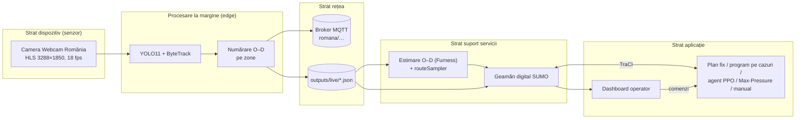

# Semaforizare Piața Romană – documentația proiectului

**Semaforizarea inteligentă, bazată pe inteligență artificială, a intersecției Piața Romană din București,
cu date preluate în timp real de pe camera publică Webcam România și simulare în SUMO**

Autor: Niunin Matei-Gabriel · Universitatea Transilvania din Brașov, Facultatea de Matematică și Informatică,
Informatică ID (învățământ la distanță), anul III · Discipline: *Interfețe om-calculator* și *Internet of Things* ·
Anul universitar 2026–2027

Documentația: © 2026 Niunin Matei-Gabriel, licența CC BY 4.0 (§ 14.1) · Conține informații din OpenStreetMap,
© OpenStreetMap contributors, ODbL 1.0 – https://www.openstreetmap.org/copyright · Sursa fluxului video:
Webcam România – https://webcamromania.ro, care și-a dat pe 27.10.2026 acordul scris pentru folosirea fluxului
(§ 14.1) · Codul sursă, sub licența GNU AGPL v3, și datele: https://github.com/NiuninMatei/Semaforizare_Piata_Romana

---

## Cuprins

- [Legendă: notații, termeni și abrevieri](#legendă-notații-termeni-și-abrevieri)

1. [Context și motivație](#1-context-și-motivație)
2. [Obiective și cerințe](#2-obiective-și-cerințe)
3. [Arhitectura sistemului (perspectiva IoT)](#3-arhitectura-sistemului-perspectiva-iot)
4. [Modulul de viziune artificială](#4-modulul-de-viziune-artificială)
5. [Puntea cameră → simulare: cererea de trafic calibrată](#5-puntea-cameră--simulare-cererea-de-trafic-calibrată)
6. [Rețeaua rutieră în SUMO](#6-rețeaua-rutieră-în-sumo)
7. [Controlul inteligent al semafoarelor](#7-controlul-inteligent-al-semafoarelor)
8. [Interfața om-calculator: dispeceratul](#8-interfața-om-calculator-dispeceratul)
9. [Rezultate](#9-rezultate)
10. [Limitări, aspecte etice și lucrări viitoare](#10-limitări-aspecte-etice-și-lucrări-viitoare)
11. [Ghid de utilizare](#11-ghid-de-utilizare)
12. [Jurnalul proiectului](#12-jurnalul-proiectului)
13. [Asistență generativă](#13-asistență-generativă)
14. [Bibliografie și licențe](#14-bibliografie-și-licențe)
- [Anexa A. Fișierele de rezultate](#anexa-a-fișierele-de-rezultate-docsrezultate)

## Legendă: notații, termeni și abrevieri

O trimitere de forma (§ 4.6) arată unde este explicat pe larg un subiect: aici, capitolul 4, subcapitolul 6. Paragrafele
care încep cu „Pentru specialiști” dau detalii tehnice și pot fi sărite fără să se piardă firul. Rezultatele pe scurt
sunt în § 9.10, § 9.7 și § 10, iar tabelele de mai jos explică notațiile, termenii și abrevierile folosite des, cu
trimitere la locul unde sunt prezentate în detaliu.

**Notațiile**

| Termen sau notație | Ce înseamnă, pe scurt | Unde |
|---|---|---|
| 12/14/12, 36/28/12, 16/10/12, 46/48/12 | Un plan fix, scris prin secundele de verde ale celor trei faze, în ordine: nord–sud, est–vest și pietoni. Planul 12/14/12 a câștigat testul final, iar 36/28/12 este planul de referință; cu galbenul și roșul de degajare, ciclul lor durează ≈53 s, respectiv ≈91 s. Planul 16/10/12 este celălalt plan scurt, iar 46/48/12 a fost ales pentru traficul greu în programul marginii de sus. În 12/14/18 și 36/28/18, faza de pietoni e lungită la 18 s. | § 6.3, § 9.9, § 9.10 |
| N–S, E–V | Cele două axe ale pieței și fazele lor: nord–sud, între Bd. Magheru și Bd. Lascăr Catargiu, prin mijlocul pieței, și est–vest, pe Bd. Dacia, în jurul insulei centrale. | § 6.3 |
| O–D | Origine–destinație: brațul pe care intră un vehicul și cel pe care iese. Matricea O–D arată câte vehicule merg de la fiecare intrare la fiecare ieșire. | § 4.3, § 5.1 |
| veh/h | Vehicule pe oră, unitatea debitului; veh/h/bandă înseamnă vehicule pe oră pe o singură bandă. | § 5.4 |
| h | Ore. Pierderea de timp se adună pentru toți participanții: 10 oameni care pierd câte 6 minute însumează 1 h. Orele adunate pe vehicule se mai numesc vehicul-ore, iar cele adunate pe oameni, ore-om. „h pe pereche” este media diferențelor în ore dintre două strategii, calculate pereche cu pereche. | § 7.5, § 9.1 |
| % | Diferența față de strategia de comparație, de obicei planul de referință: un procent negativ înseamnă mai puțin timp pierdut, deci un câștig, iar unul pozitiv, timp pierdut în plus. „Din pierderea totală” compară sumele orelor pierdute. „Media pe perechi” și „media pe scenarii” sunt mediile diferențelor procentuale calculate pereche cu pereche, respectiv scenariu cu scenariu; ele dau unei ore de noapte aceeași greutate ca unei ore de vârf. | § 9.1, § 9.10 |
| p | Rezultatul unui test statistic: cât de probabil ar fi să apară doar din întâmplare o diferență cel puțin la fel de mare, dacă strategiile ar fi de fapt la fel de bune. Sub 0,05, diferența se numește semnificativă. 7·10⁻⁸ înseamnă 0,00000007; „p (t / Wilcoxon)” dă valorile celor două teste, în această ordine. | § 9.1 |
| mai bun în k din n, k / n | În câte dintre cele n perechi de simulări strategia a pierdut mai puțin timp decât cea cu care e comparată. | § 9.1 |
| ×1,2 și ×0,8 | Scenariile de sensibilitate: aceeași oră, cu numărul de vehicule înmulțit cu 1,2 la vârf, respectiv cu 0,8 la ora liniștită; pietonii rămân aceiași. Ele acoperă incertitudinea măsurării. | § 5.4 |
| intervalele de 15 minute | Unitatea de timp a numărătorilor: camera adună vehiculele și pietonii pe sferturi de oră. Pe aceeași grilă se aleg ferestrele scenariilor, iar geamănul în timp real comută după debitul sfertului de oră în curs. | § 4.3, § 5.4, § 9.9 |
| § | Trimitere la un capitol sau subcapitol al acestui document: § 9.10 înseamnă capitolul 9, subcapitolul 10. După numele unei licențe, de exemplu AGPL § 13, trimite la o secțiune a acelei licențe. | tot documentul |
| ≈, –, … | ≈ înseamnă „aproximativ”; 4–6 sau −6,0…−7,2% arată un interval, de la prima valoare la a doua. | tot documentul |
| ± | „Media ± abaterea standard”: valoarea medie și cât se abat de obicei rezultatele de la ea, de la un seed la altul. | § 7.5 |
| 28.10, AAAA-LL-ZZ | Datele scurte sunt din 2026: 28.10 înseamnă 28 octombrie 2026. În numele fișierelor, data se scrie an-lună-zi, ca în `zi_2026-10-28_varf`; orele sunt în formatul de 24 de ore. | tot documentul |
| s, m, m/s, px | Secunde, metri, metri pe secundă și pixeli, adică punctele din care e formată imaginea. | tot documentul |
| Borna N, B0–B9 | Bornele sunt etapele lucrului; fiecare apare în istoricul GitHub prin commit-uri care încep cu „Borna N: …”. | § 12.3 |
| R1–R8, O1–O18, P1–P7 | R1–R8 sunt cerințele din tema proiectului; O1–O18, observațiile autorului; P1–P7, problemele găsite la rularea sistemului. | § 2, § 12.2 |

**Traficul și semafoarele**

| Termen sau notație | Ce înseamnă, pe scurt | Unde |
|---|---|---|
| braț | Fiecare dintre cele șase străzi care pleacă din piață. Bd. Magheru, Bd. Lascăr Catargiu, Bd. Dacia vest și Bd. Dacia est au dublu sens; Str. Mendeleev și Str. Căderea Bastiliei au sens unic, de ieșire din piață. | § 4.3 |
| inel | Carosabilul din jurul insulei centrale a pieței, pe care se circulă ca într-un sens giratoriu; axa N–S trece prin mijlocul pieței. | § 6.2, § 6.3 |
| fază | Intervalul în care au verde doar anumite mișcări, compatibile între ele. Planul semaforului din piață folosește trei faze: N–S, E–V și faza de pietoni, cu verde pe toate trecerile. Alte două faze, „fără dozare”, deschid deodată toate intrările spre inel; ele blochează piața, de aceea nu se folosesc implicit. | § 6.3, § 7.1 |
| ciclu | Timpul după care fazele se repetă: toate verzile, plus 5 s după fiecare fază, adică 3 s de galben și 2 s de roșu de degajare. Pentru 12/14/12: 12 + 14 + 12 + 3 × 5 = 53 s; pentru planul de referință, 91 s. La un ciclu scurt, fiecare fază și fiecare trecere primesc verde mai des. | § 6.3, § 7.4 |
| verde | Cât timp, în secunde, are verde o fază. Controlerul impune un verde minim de 10 s și un verde maxim de 90 s. | § 6.3, § 7.2 |
| galben | Cele 3 s de galben care încheie un verde, pe legăturile care se schimbă. | § 7.2 |
| roșu de degajare | Cele 2 s de după galben, cu roșu pe legăturile care se schimbă, ca intersecția să se golească înaintea fazei următoare; se numește și roșu general. Legăturile care rămân verzi și în faza următoare își păstrează verdele. | § 6.3, § 7.2 |
| legătură, grup de semnal, controler | Legătura este o mișcare comandată de semafor, cu semnalul ei, de exemplu de pe o bandă de intrare spre una de ieșire. Un grup de semnal reunește legăturile care primesc mereu aceeași culoare. Controlerul este automatul care conduce semnalele unei intersecții: cele 16 semafoare fizice ale pieței formează în simulare un singur controler, `romana`, cu 61 de legături. | § 6.2, § 6.3 |
| debit | Câte vehicule sau câți pietoni trec într-o oră, în veh/h sau pietoni/h. Pentru cererea unui braț sau a pieței, textul spune adesea „volum”. | § 5.4 |
| debit echilibrat | Media dintre totalul intrărilor și totalul ieșirilor numărate de cameră, pe oră, fără factorii de corecție. După el se aleg ferestrele zilei și cazurile de trafic. Diferă de volumul calibrat al scenariului: la vârful din 26.10, 4 653 față de 5 009 veh/h. | § 5.4, § 9.9 |
| cerere | Traficul care vrea să treacă prin piață într-un interval: câte vehicule și câți pietoni, pe unde intră și pe unde ies. În simulare, cererea se construiește din numărătorile camerei, nu din trafic aleatoriu. | § 5 |
| coadă | Vehiculele oprite unul în spatele altuia înaintea unui semafor; în model, numărul de vehicule oprite pe o bandă de intrare. | § 7.1, § 9.6 |
| pierderea de timp | Cât durează în plus o deplasare față de una făcută tot timpul cu viteza dorită, fără opriri și fără încetiniri. Pierderea totală de timp, indicatorul principal, adună pierderile tuturor participanților dintr-o simulare: vehicule, bicicliști și pietoni. La vehicule intră și întârzierea la intrare, adică timpul cât așteaptă la marginea rețelei simulate până au loc; cele care nu reușesc să intre până la final se numesc neintroduse. | § 7.5, § 9.1 |
| saturație | O intersecție e saturată când primește cam atâtea vehicule câte poate trece; peste acest punct e suprasaturată, iar cozile cresc continuu. Debitul de saturație al unei benzi este cel mai mare debit care poate trece pe ea la verde; în calculul Webster se ia 1800 veh/h. | § 5.3, § 6.4, § 7.4 |
| plan fix | Program care repetă aceleași faze, cu aceleași durate, oricât trafic ar fi. Se notează prin secundele de verde ale fazelor, de exemplu 12/14/12; planurile scurte, 12/14/12 și 16/10/12, au ciclul de ≈53 s. | § 7.4 |
| planul de referință | Planul fix 36/28/12, cu ciclul de ≈91 s: ipoteza proiectului pentru programul actual al semaforului, care nu este public. Procentele se dau față de el, dacă nu se spune altfel. Apare și ca „planul fix”, „planul fix actual” sau `FIX`. | § 6.3, § 7.4, § 10 |
| actuated | Semaforul acționat de trafic, în varianta din SUMO: pe aceleași 3 faze, verdele se prelungește cât timp detectoarele văd vehicule venind la mai puțin de 3 s unul după altul, între 10 și 60 s. Intersecțiile vecine din simulare au programe de acest fel. | § 6.3, § 7.4 |
| Webster | Plan fix calculat cu formula lui Webster, din 1958: lungimea ciclului și împărțirea verdelui între faze rezultă din debitele intrărilor, iar faza de pietoni își păstrează durata. | § 7.4 |
| Max-Pressure | Algoritm clasic, fără învățare. La fiecare decizie dă verde fazei cu „presiunea” cea mai mare, adică suma, pe legăturile ei verzi, a diferențelor dintre coada din amonte și cea din aval. Amonte înseamnă înaintea semaforului, aval, după el; la treceri, coada din amonte e numărul pietonilor care așteaptă. | § 7.4 |
| programul pe cazuri de trafic | Program care folosește, pentru fiecare caz de trafic, strategia cea mai bună pe validare, iar la rezultate practic egale, pe cea mai simplă. În geamănul în timp real comută singur, după debitul echilibrat măsurat de cameră; varianta se alege din `VARIANTA_PROGRAM`. În § 9.2–9.8 se numește „program pe tipuri de trafic”; acolo apar programul marginii de jos, cel al marginii de sus și programul realist. Varianta actuală, planul 12/14/12, e aceeași în toate cazurile, deci nu comută. | § 5.5, § 9.2, § 9.9 |
| cazurile de trafic: lejer, mediu, intens | Din 28.10, cazurile se stabilesc după debitul echilibrat: lejer sub 2 400 veh/h, intens peste 4 100 veh/h, mediu între ele. Înainte, cazurile se numeau lejer, moderat și greu și se stabileau, în comparații, după numele scenariilor: lejer pentru scenariile liniștite, moderat pentru prânz, greu pentru celelalte; pragurile geamănului în timp real erau 1 300 și 2 000 veh/h. | § 9.2, § 9.8, § 9.9 |
| traficul de fond | Traficul de pe străzile vecine care nu trece prin piață și nu e văzut de cameră. În simulare se adaugă ca o fracțiune declarată, 15% din volumul observat, pe trasee care ocolesc piața. | § 5.2 |
| trecere | Trecere de pietoni semaforizată. Semaforul pieței comandă 7 treceri, de 6,4–12,8 m: patru au verde doar în faza de pietoni, trei și într-o fază de vehicule. Pe imaginea camerei sunt 10 zone de trecere, dar pietonii sunt detectați sigur doar pe trecerile din prim-plan. | § 4.4, § 6.3, § 9.10 |
| degajarea pietonilor | Timpul de care are nevoie un pieton care pornește la sfârșitul verdelui ca să termine traversarea. Ghidurile europene îl calculează la 1,2 m/s: pe cea mai lungă trecere a pieței, de 12,8 m, rezultă ≈10,7 s. Modelul nu îl impune separat; verificarea fazei de pietoni de 12 s după normele de proiectare rămâne de făcut înaintea unei aplicări reale. | § 9.10, § 10 |

**Simularea și statistica**

| Termen sau notație | Ce înseamnă, pe scurt | Unde |
|---|---|---|
| SUMO | Simulatorul de trafic cu sursă deschisă folosit în proiect, Eclipse SUMO 1.28; numele vine de la *Simulation of Urban MObility*. Simulează fiecare vehicul, biciclist și pieton în parte, pe o rețea construită din OpenStreetMap cu unealta `netconvert`. Programele proiectului îl comandă prin interfața TraCI sau prin biblioteca `libsumo`, mai rapidă. | § 6, § 7.3 |
| geamăn digital | Replica Pieței Romane în SUMO: străzile, benzile, trecerile și semafoarele reale, după OpenStreetMap, cu traficul reconstituit din datele camerei. Geamănul în timp real, numit „live” în titlul § 5.5, rulează continuu și primește debitele măsurate de cameră. | § 5.5, § 6 |
| dispecerat | Consola web a operatorului: arată imaginea camerei, starea simulării și faza curentă și permite, după o confirmare, schimbarea modului de control, inclusiv trecerea la comanda manuală. | § 8 |
| scenariu | O oră de trafic reconstituită din numărătorile unei zile reale, urmată de 15 minute de golire, în care participanții rămași își termină drumul. Numele arată ziua și fereastra, adică ora aleasă: liniștit, ora cu cel mai puțin trafic; dimineața, 07:30–08:30; prânz, 12:00–13:00; vârf, ora cu cel mai mult trafic; seara, 17:30–18:30. Ferestrele cu oră fixă intră doar dacă datele le acoperă complet și nu se suprapun cu vârful. Prefixul `indisciplinat_` marchează varianta cu participanți indisciplinați, iar `referinta_*` sunt scenariile ipotetice de dinaintea datelor reale. | § 5.3, § 5.4 |
| cererea calibrată, marginea de jos, marginea de sus | Cererea calibrată, folosită din 26.10, pornește de la intrările numărate pe fiecare braț, înmulțite cu factorii de corecție; ieșirile dau doar proporțiile de viraj. Înainte au existat două calibrări: marginea de jos, cu volumele doar din intrări, și marginea de sus, cu media dintre intrări și ieșiri. Se credea că cererea reală e între ele; s-a dovedit că e de circa două ori marginea de sus. | § 5.1, § 9.1 |
| metoda Furness, `routeSampler` | Metoda Furness, numită și IPF, potrivește matricea O–D cu totalurile numărate pe brațe. Unealta SUMO `routeSampler.py` alege apoi traseele vehiculelor simulate astfel încât să reproducă virajele numărate. Indicatorul GEH arată cât de aproape e un debit simulat de cel numărat: cu cât e mai mic, cu atât potrivirea e mai bună. | § 5.1, § 5.2, § 5.4 |
| lanțul de prelucrare | Șirul de pași executați automat, unul după altul. În timp real, lanțul duce de la imaginea camerei la detecție, urmărire și numărători. La testul final și la confirmare, lanțul a rulat noaptea, fără intervenție: verificarea înregistrării, renumărarea, publicarea jurnalului, scenariile, simulările, analizele și regula de decizie. | § 4.3, § 9.10 |
| seed | Valoarea care pornește generatorul de numere aleatoare al simulării: de ea depind momentele în care sosesc participanții și variațiile din felul în care conduc șoferii. Aceeași strategie, pe același scenariu și cu același seed, dă exact același rezultat. Alegerile se fac pe seed-urile de validare 11–15, la primele alegeri 11–13, iar rezultatele se raportează pe seed-urile de test 1–10, unele doar pe 1–5. | § 9.1, § 11.8 |
| pereche | Două simulări cu același scenariu și același seed, una cu o strategie, cealaltă cu alta; strategiile sunt judecate astfel în exact aceleași condiții. „Perechile reunite” sunt cele ale ambelor comportamente, luate împreună. | § 9.1, § 9.9 |
| testul Wilcoxon, testul t | Teste statistice pe perechi. Testul Wilcoxon, al rangurilor cu semn, ține seama de semnul diferențelor și de ordinea lor după mărime, așa că o valoare extremă îl influențează puțin; regula de decizie îl folosește bilateral, adică verifică diferențele în ambele sensuri. Testul t pe perechi se uită la media diferențelor și la cât variază ele, deci e mai sensibil la valorile extreme. | § 9.1, § 9.9 |
| semnificativ | Statistic semnificativ: testul dă p sub 0,05, deci diferența e greu de pus pe seama întâmplării, adică a variației de la un seed la altul. „Nesemnificativ”, „la egalitate” sau „echivalent statistic” înseamnă că diferența nu se poate deosebi de întâmplare. | § 9.1 |
| validare, test, confirmare | Validarea înseamnă datele pe care se fac alegerile, iar testul, date nefolosite la alegere, pe care se raportează rezultatele. Ziua de validare, luni 26.10, a servit la alegerea candidaților și a pragurilor. Pe ziua de test, miercuri 28.10, nefolosită la alegere, s-a decis câștigătorul, după o regulă fixată dinainte. Pe ziua de confirmare, joi 29.10, s-a verificat doar că acesta nu e semnificativ mai slab decât strategia în vigoare. | § 9.9, § 9.10 |
| participanți disciplinați, indisciplinați | Disciplinații respectă regulile, după modelele obișnuite din SUMO. Indisciplinații reprezintă ipoteza proiectului despre traficul din București, cu parametri aleși, nu măsurați: autoturismele și camioanele trec pe roșu în primele 2 s, intră pe galben târziu, blochează intersecția după 1 s de așteptare și schimbă banda agresiv, iar celelalte vehicule au valori proprii; pietonii traversează pe roșu în primele 5 s și uneori ignoră vehiculele. Cele două variante se numesc în text „comportamente”. | § 9.4, § 10 |
| capacitatea calibrată | Capacitatea este numărul de vehicule pe oră pe care le poate trece geamănul. Cu parametrii impliciți ai SUMO, el se bloca la debitul real din 26.10; cu timpul de reacție al șoferilor, `tau`, redus de la 1,0 s la 0,8 s, trece practic tot vârful. Capacitatea calibrată e implicită din 28.10, iar cele mai multe rezultate din § 9.1–9.8 sunt obținute cu capacitatea implicită. | § 6.4 |
| măsura pe persoană | Variantă a indicatorului principal în care orele pierdute de fiecare vehicul se înmulțesc cu numărul declarat de persoane din el: 1,2 pe autoturism, 20, 40 sau 70 pe autobuz sau troleibuz și câte 1 pentru ceilalți participanți; rezultatul se dă în ore-persoană. E raportată alături de rezultate, dar nu schimbă decizia. | § 9.9, § 9.10 |

**Camera și prelucrarea imaginii**

| Termen sau notație | Ce înseamnă, pe scurt | Unde |
|---|---|---|
| HLS | *HTTP Live Streaming*, formatul în care camera își trimite imaginea pe internet: segmente video de câte 6 s, anunțate într-o listă de redare care se actualizează continuu. | § 4.1 |
| cadru | O imagine din fluxul video. Camera transmite 18 cadre pe secundă, la rezoluția de 3288 × 1850 px; programul ia 6 pe secundă și le analizează. | § 4.1 |
| cadre/s, fps | Câte cadre analizează programul într-o secundă, în mod normal ≈5–6. Când rata scade mult, urmărirea pierde vehiculele în mișcare. Prescurtarea fps, din engleză *frames per second*, înseamnă tot cadre pe secundă. | § 4.1, § 4.6 |
| tamponul de redare | Rezerva de 8 s de cadre, introdusă pe 22.10 seara: imaginea se redă uniform, cu o întârziere fixă de 8 s, deși camera trimite segmente de câte 6 s. Înainte, analiza primea cadrele în rafale, cu opriri. | § 4.1, § 4.6 |
| YOLO11 | Detectorul de obiecte Ultralytics YOLO11, antrenat dinainte pe setul de imagini COCO. Găsește în fiecare cadru autoturisme, autobuze și troleibuze, camioane, motociclete, biciclete și persoane. Proiectul folosește varianta `yolo11s`, pe imagini de 1600 px. | § 4.2 |
| ByteTrack | Algoritmul de urmărire: leagă detecțiile din cadre succesive, astfel încât fiecare vehicul sau pieton să aibă o traiectorie. Păstrează și detecțiile mai nesigure, ceea ce ajută când vehiculele se acoperă unele pe altele. | § 4.2 |
| OpenVINO | Setul de unelte Intel cu care detectorul rulează pe placa grafică integrată a laptopului: ≈5 cadre/s, față de ≈0,9 pe procesor. | § 4.1 |
| zonă | Poligon desenat pe imaginea camerei. Dintre cele 10 zone de vehicule, cele de intrare dau volumele, iar cele de ieșire doar direcțiile; alte 10 zone acoperă trecerile, cu câte o zonă de așteptare la fiecare bordură, unde sunt numărați și pietonii care așteaptă. Zonele stau în `config/camera.json`. | § 4.3, § 4.4 |
| traiectorie | Drumul unui obiect urmărit pe imagine: pozițiile succesive ale punctului în care atinge solul, cu momentul fiecăreia. La încheierea ei, regula de numărare stabilește originea și destinația; o traiectorie completă dă un viraj, de la brațul de intrare la cel de ieșire. | § 4.3 |
| fragment | Bucată de traiectorie: urmărirea se întrerupe când un stâlp, un autobuz sau un copac acoperă vehiculul. `recount` leagă fragmentele aceluiași vehicul, dar doar ≈25–40% dintre vehicule sunt urmărite de la intrare până la ieșire. | § 4.3 |
| jurnalul de traiectorii | Fișierul zilnic cu toate traiectoriile încheiate: clasa obiectului, momentul de început și pozițiile, fără imagini și fără identificatori. Jurnalul complet, cu pietoni, rămâne pe laptop, în `data/trajectories_brute/`; în depozit se publică, în `data/trajectories/`, doar vehiculele. Datele sunt pseudonimizate, nu anonime. | § 4.3, § 4.5 |
| `recount` | Modulul `romana.vision.recount`: reface numărătorile din jurnalul de traiectorii, de exemplu după corectarea zonelor, fără o colectare nouă. Cu `--publica` scrie versiunea publicabilă a jurnalului. | § 4.3, § 11.4 |
| `calitate` | Modulul `romana.vision.calitate`: verifică, după colectare, cât de continuă a fost urmărirea. Măsoară golurile dintre punctele traiectoriilor, densitatea punctelor și pașii lungi, apoi marchează intervalele încetinite. | § 4.6 |
| `veghe` | Modulul `romana.vision.veghe`: rulează alături de analiza camerei și urmărește în fiecare secundă starea prelucrării. La primul semn de problemă se oprește cu o alertă și un diagnostic, ca problema să fie analizată pe loc, nu a doua zi. | § 4.6 |
| microînghețare | Oprire a imaginii de 10–30 s, de câteva ori pe zi, cam 0,1–0,2% din timpul înregistrat, când un segment al fluxului întârzie. Trece singură; efectul asupra numărătorilor e neglijabil, dar nu nul. | § 4.6 |
| pas, pași lungi | Pasul este timpul dintre două puncte consecutive ale unei traiectorii, în mod normal ≈0,17–0,2 s. Un pas lung, de peste 0,5 s, înseamnă cadre pierdute. | § 4.6 |
| încetinire | Prelucrare încetinită: un interval de 15 minute în care cel puțin 40% dintre pașii traiectoriilor de vehicule sunt lungi. Calculatorul analizează atunci prea puține cadre, iar urmărirea pierde vehiculele în mișcare, deși imaginea nu e înghețată. Exemplu: 28.10, 03:46–04:28, ≈1,4 cadre/s, cel mai probabil din cauza calculelor grele rulate în paralel. | § 4.6 |
| urmărirea sacadată | Defectul din 21–22.10: înainte de tamponul de redare, analiza primea cadrele în rafale, cu opriri, iar vehiculele „săreau” peste zonele mici de numărare. De aceea, acele zile sunt subnumărate, cu un factor necunoscut. | § 4.6 |
| numărătoarea de referință | Numărarea de control din 26.10: două clipuri de câte 3 minute, numărate cadru cu cadru de câte doi adnotatori AI independenți, instanțe separate ale asistentului Claude. Din ea au rezultat zonele finale și factorii de corecție. | § 4.3 |
| factorii de corecție | Numerele cu care se înmulțesc intrările numărate de cameră pe fiecare braț ca să ajungă la numărătoarea de referință: Magheru 1,09, Dacia est 0,88, Dacia vest 1,12, Lascăr Catargiu 2,52. | § 4.3, § 5.1 |

**Agenții și strategiile din rezultate**

| Termen sau notație | Ce înseamnă, pe scurt | Unde |
|---|---|---|
| strategie | Orice fel de a comanda semaforul: un plan fix, actuated, Webster, Max-Pressure, un agent sau un program care le combină pe cazuri de trafic. | § 7.4, § 9.1 |
| învățare prin întărire | Metodă de inteligență artificială în care un program învață din încercări repetate: alege o acțiune, primește o notă, numită recompensă, și ajunge treptat să prefere acțiunile cu note mai bune. Această învățare se numește antrenare și se face doar în simulare. | § 7 |
| PPO | *Proximal Policy Optimization*, algoritmul de învățare prin întărire folosit, din biblioteca Stable-Baselines3. Își corectează politica, adică regula după care agentul alege fazele, în pași mici, fără salturi bruște de comportament. Un pas de antrenare este o decizie a agentului, adică 5 s de trafic simulat; rata de învățare, notată lr, dă mărimea fiecărei corecții, iar punctele intermediare sunt copii ale agentului salvate în timpul antrenării. | § 7.3, § 9.5 |
| agent | Program antrenat cu PPO care decide, la fiecare 5 s, ce fază primește verde; astfel stabilește ordinea și durata fazelor. Alege doar dintre cele 3 faze ale planului real, iar galbenul, roșul de degajare și verdele minim și maxim îi sunt impuse, ca să nu poată crea o situație periculoasă. Un specialist este un agent antrenat pentru un singur tip de trafic. | § 7.1, § 7.2 |
| recompensă | Nota primită de agent după fiecare decizie: suma vehiculelor oprite pe benzile de intrare, a pietonilor care așteaptă la treceri și a vehiculelor care nu pot intra în rețea, împărțită la 100 și luată cu semnul minus. Cu cât așteaptă mai puțini, cu atât nota e mai mare. | § 7.1 |
| agentul oficial | `ppo_romana`, agentul antrenat pe scenariile reale din 21.10 și ales pe seed-urile de validare 11–13; în § 9.5 apare și ca v1. În programul realist conduce traficul lejer. | § 9.1, § 9.5 |
| E1–E14 | Experimentele de antrenare a agenților, numerotate în ordinea în care s-au făcut; fiecare agent poartă numele experimentului din care provine. Cele mai multe au dat rezultate negative și rămân documentate ca încercări. E5–E7 sunt specialiști pentru traficul greu, E8 pentru cel moderat și E9 pentru cel lejer; E7 a ieșit echivalent cu planul 46/48/12, păstrat pentru că e mai simplu, iar E12 este E3 antrenat în continuare pe aceleași scenarii ca E13. | § 9.5 |
| E3 | `ppo_romana_zn3`: agentul oficial antrenat în continuare pe datele renumărate din 21–22.10, cu o rată de învățare de 10 ori mai mică. A ieșit cel mai bun la prânz, așa că a condus traficul moderat în programele din § 9.2 și, în programul realist, și traficul greu. Pe 28 și 29.10 a ieșit practic egal cu planul de referință. | § 9.4, § 9.5, § 9.10 |
| E9 | `ppo_romana_lejer`: specialistul pentru trafic lejer, antrenat doar pe scenariile liniștite din 21–22.10. Conduce traficul lejer în programul marginii de sus. | § 9.2, § 9.5 |
| E13 | `ppo_romana_cal`: agentul oficial antrenat încă 300 000 de pași pe scenariile calibrate din 21–22.10, cu participanți disciplinați și indisciplinați. Pe 26.10 a fost cel mai constant agent, așa că a intrat în testul final ca singurul agent candidat. Acolo a fost eligibil, dar al treilea după pierderea totală, și nu s-a deosebit semnificativ de planul 12/14/12 (p = 0,82); pe 29.10 a pierdut cu 3,4% mai mult decât planul. | § 9.5, § 9.9, § 9.10 |
| E14 | E13 antrenat încă 300 000 de pași pe scenariile zilei de validare, luni 26.10, cu capacitatea calibrată. Pe validare a ieșit mai slab decât E13, deci nu a devenit candidat. | § 9.5, § 9.9 |
| programul realist, `REALIST` | Programul ales pe validarea cu participanți indisciplinați: agentul oficial la trafic lejer și E3 la trafic moderat și greu. A fost varianta implicită a geamănului în timp real până pe 29.10 și strategia în vigoare față de care s-a judecat testul final; `REALIST` e numele lui în comenzi. | § 9.4, § 9.10 |
| `TOD_DEBIT` | Program din planuri fixe, cu cazurile stabilite după debit: 16/10/12 la trafic lejer și mediu, 12/14/12 la trafic intens. Candidat în testul final: pe 28.10 a avut cea mai mică pierdere totală dintre candidați, dar diferența față de 12/14/12, de 0,3%, nu a fost semnificativă, așa că a câștigat planul mai simplu. | § 9.9, § 9.10 |
| `TOD_FIX` | Aceleași planuri, cu cazurile stabilite după numele scenariilor: 16/10/12 în scenariile liniștite și la prânz, 12/14/12 în rest. A fost ales chiar pe datele de validare, deci estimarea de acolo e optimistă; în teste a fost doar raportat, nu candidat. | § 9.9, § 9.10 |
| `PLAN_12_14_12`, `PLAN_a_b_c` | Numele de cod ale planurilor fixe: `PLAN_a_b_c` are a, b și c secunde de verde pentru N–S, E–V și pietoni. `PLAN_12_14_12` a câștigat testul din 28.10 și a fost confirmat pe 29.10; din 29.10 este varianta implicită a geamănului în timp real, `plan_scurt`. | § 9.10, § 11.8 |
| `FIX`, `ACTUATED` | Numele de cod ale planului de referință 36/28/12 și ale semaforizării actuated, în comenzi și în fișierele de rezultate. | § 11.8 |
| grila de planuri fixe | Încercarea sistematică a mai multor planuri fixe, cu alte durate de verde, ca să se găsească cel mai bun: 10 planuri pe calibrările anterioare și 23 pe geamănul calibrat, pe validarea din 26.10. A doua grilă a arătat că ciclurile scurte câștigă. | § 9.5, § 9.9 |
| candidat, strategia în vigoare, strategie raportată | Candidații testului final, fixați dinainte, au fost planul 12/14/12, `TOD_DEBIT` și E13. Strategia în vigoare, cu care au fost comparați, era programul realist. Strategiile raportate, de exemplu planul 16/10/12 singur, agentul oficial sau `TOD_FIX`, au fost rulate și prezentate, dar nu puteau câștiga. | § 9.9, § 9.10 |
| regula „cel mai bun câștigă” | Regula de decizie fixată de autor pe 28.10, înaintea testului final: câștigă candidatul cu cea mai mică pierdere totală, dacă e semnificativ mai bun decât strategia în vigoare și nu e semnificativ mai slab în niciunul dintre cele două comportamente. Dacă primii doi candidați nu se deosebesc semnificativ, câștigă cel mai simplu. | § 9.9 |
| coridorul | Varianta în care un singur agent conduce deodată Piața Romană și cele 4 intersecții vecine care o alimentează. Rezultatul a fost negativ: +35,4% față de planul fix. | § 6.1, § 9.5 |

**Abrevierile și organizațiile**

| Termen sau notație | Ce înseamnă, pe scurt | Unde |
|---|---|---|
| AI | Inteligență artificială, din engleză *artificial intelligence*. „Agent AI” înseamnă aici un agent de învățare prin întărire, iar „adnotatorii AI” sunt instanțe ale asistentului Claude. | § 4.3, § 7 |
| RL | Învățare prin întărire, din engleză *reinforcement learning*. | § 7 |
| IoT | Internetul lucrurilor, din engleză *Internet of Things*: dispozitive conectate la internet, de exemplu senzori, ale căror date sunt folosite de alte programe. Aici, camera publică joacă rolul senzorului. | § 3 |
| MQTT | Protocol de mesaje pentru Internetul lucrurilor. Modulul de viziune îl poate folosi, opțional, ca să publice starea camerei și numărătorile. | § 3 |
| OSM | OpenStreetMap, harta deschisă din care s-a construit replica rețelei de străzi; datele ei se folosesc sub licența ODbL. | § 6.1, § 14.1 |
| CPU, GPU | Procesorul și placa grafică ale calculatorului. Laptopul proiectului nu are placă grafică NVIDIA, așa că detectorul rulează pe placa grafică Intel integrată. | § 4.1 |
| GDPR | Regulamentul general privind protecția datelor, Regulamentul (UE) 2016/679. Se aplică pentru că imaginile camerei pot conține persoane și numere de înmatriculare. | § 4.5 |
| EDPB | Comitetul european pentru protecția datelor, din engleză *European Data Protection Board*; ghidul lui 3/2019 privește prelucrarea datelor personale prin dispozitive video. | § 4.5 |
| ANSPDCP | Autoritatea Națională de Supraveghere a Prelucrării Datelor cu Caracter Personal, la care persoanele vizate pot depune plângere. | § 4.5 |
| art., alin., lit. | Articol, alineat și literă, în trimiterile la legi, de exemplu art. 14 GDPR. | § 4.5, § 14.1 |
| BTMS | Sistemul de management al traficului din București, care coordonează dintr-un singur centru aproximativ 267–268 de intersecții, cele mai multe cu automate care își ajustează programul după trafic. | § 1, § 10 |
| PMB | Primăria Municipiului București. | § 1, § 10 |
| STB | Societatea de Transport București, operatorul transportului public din oraș. În piață circulă autobuzele și troleibuzele ei, iar rețeaua simulată are benzile lor dedicate. | § 4.2, § 6.2, § 9.9 |
| CC BY 4.0 | Licența Creative Commons Atribuire 4.0, sub care este publicată documentația: oricine o poate folosi și adapta, cu condiția să-i menționeze autorul. | § 14.1 |
| ODbL 1.0 | *Open Database License*, licența datelor OpenStreetMap: orice bază de date derivată din ele, ca rețeaua, rutele și scenariile proiectului, rămâne sub aceeași licență. Proiectul o folosește și pentru numărători și traiectorii. | § 14.1 |
| AGPL v3 | *GNU Affero General Public License*, versiunea 3 sau ulterioară, licența codului și a modelelor. E obligatorie pentru că modulul de viziune folosește YOLO11, distribuit sub AGPL; cine redistribuie codul sau oferă prin rețea o versiune modificată trebuie să pună la dispoziție și codul sursă. | § 10, § 14.1 |

---

## 1. Context și motivație

**Pe scurt.** Proiectul măsoară traficul din Piața Romană cu ajutorul unei camere publice, reproduce intersecția
într-un simulator de trafic și caută cel mai bun program pentru semafoarele ei. Se schimbă doar programul
semafoarelor; străzile și semafoarele rămân aceleași. Pe ziua de test a câștigat planul fix 12/14/12, un program de
semaforizare care se repetă identic, indiferent de trafic, iar ziua următoare l-a confirmat (§ 9.10).

Piața Romană este nodul în care axa nord–sud Lascăr Catargiu – Magheru, paralelă cu magistrala de metrou M2, se
intersectează cu axa est–vest a Bulevardului Dacia[^wiki-romana]. Din piață mai pornesc două străzi cu sens unic,
folosite doar pentru ieșire: Str. D. I. Mendeleev și Str. Căderea Bastiliei. Camera Webcam România este montată pe
clădirea dintre Bd. Magheru și Bd. Dacia est. Ea filmează continuu „sensul giratoriu din mijlocul pieței, trecerile de
pietoni, traficul de pe bulevardele Magheru, Lascăr Catargiu și Dacia”[^webcam].

Bucureștiul este unul dintre cele mai congestionate orașe din lume. În ediția 2025 a clasamentului TomTom Traffic
Index, nivelul mediu de congestie a fost de 62,5%, adică o deplasare a durat în medie cu 62,5% mai mult decât ar fi
durat pe străzi libere. Orașul a ocupat locul 20 în lume și locul 5 în Europa. La orele de vârf, un șofer a pierdut
în medie 171 de ore pe an, iar viteza medie în aceste ore a fost de 14 km/h[^tomtom][^pmb-tomtom].

Primăria Capitalei operează sistemul de management al traficului BTMS, extins la aproximativ 267–268 de intersecții
coordonate dintr-un singur centru. Cele mai multe dintre ele au automate de semaforizare „cu funcționare în mod
adaptiv”[^btms-267][^buletin-btms], adică automate care își ajustează programul după trafic. În 2026, Primăria a
anunțat un proiect nou de semaforizare cu inteligență artificială (AI), pentru 92 de intersecții în prima etapă:
„Vom monta 305 camere și 1.500 de senzori”. Timpii de semaforizare urmează să se ajusteze după numărul de mașini, iar
transportul public va avea prioritate[^digi24-ai]. Axa Unirii – Universitate – Piața Romană – Piața Victoriei a fost
chiar proiectul-pilot al primului sistem „undă verde”, în 2007[^economedia]. Într-o „undă verde”, semafoarele de pe
un traseu sunt coordonate astfel încât vehiculele să prindă verde la rând.

Infrastructura rămâne însă fragilă. Pe 8 mai 2026, un incendiu la cablurile electrice subterane din Piața Romană a
scos din funcțiune semafoarele pieței[^adevarul-incendiu]. De aceea, sistemul propus are întotdeauna un plan fix de
rezervă.

La scară academică, proiectul parcurge tot lanțul pe care îl presupun sistemele de semaforizare inteligentă:
**senzor video → date de trafic → model digital al intersecției → decizie automată → supraveghere umană**. Senzorul
este camera. Din imaginile ei rezultă datele de trafic: câte vehicule, bicicliști și pietoni trec și pe unde. Modelul
digital, numit geamăn digital, este o replică a pieței în simulatorul de trafic SUMO. Decizia o ia strategia care
comandă semafoarele, iar un operator o supraveghează din dispecerat, interfața web a sistemului.

**Întrebarea proiectului.** Pe măsură ce s-au strâns date reale, s-a văzut că nu există o singură strategie bună
pentru orice trafic (§ 9). De aceea, proiectul nu caută „cu orice preț” un agent de inteligență artificială, adică un
program care învață singur să comande semafoarele. Caută **cea mai bună combinație implementabilă de planuri și
agenți pentru cazurile reale de trafic ale pieței**.

Traficul pieței se împarte în trei cazuri: lejer, mediu și intens. Cazul se stabilește după debitul măsurat de
cameră, adică după numărul de vehicule care trec prin piață într-o oră. Fiecare caz primește strategia care câștigă
pe datele lui, iar un selector o pornește automat, după traficul măsurat. Singurul lucru care se schimbă este
programul semafoarelor: geometria străzilor și semafoarele rămân cele reale.

Concurează, pe picior de egalitate, trei feluri de candidați:

- planurile fixe clasice;
- programele alcătuite din planuri fixe, câte unul pentru fiecare caz de trafic;
- agenții de învățare prin întărire, care învață, din încercări repetate în simulare, în ce ordine și cât timp să
  dea verde.

Câștigă cel mai bun, după o verificare pe o zi nouă, nefolosită la alegere. Ceilalți rămân documentați ca încercări
(§ 9.9). Pe ziua de test, miercuri 28.10, a câștigat planul fix scurt 12/14/12, cu aceleași faze, dar cu durate mai
scurte. O fază este perioada în care au verde doar anumite direcții de mers. Cele trei numere sunt duratele de verde,
în secunde, ale celor trei faze: cea pentru axa nord–sud, cea pentru axa est–vest și cea pentru pietoni. Rezultatul
s-a păstrat și pe ziua de confirmare, joi 29.10 (§ 9.10). În calcul intră toți participanții observați pe cameră:
autoturisme, autobuze și troleibuze, camioane, motociclete, bicicliști și pietoni.

## 2. Obiective și cerințe

Cerințele din tema proiectului sunt notate aici R1–R8. Tabelul de mai jos arată cum este îndeplinită fiecare și,
unde este cazul, trimite la secțiunea cu detalii.

| # | Cerința din tema proiectului | Cum este îndeplinită |
|---|---|---|
| R1 | Preluarea în timp real a datelor de pe camera publică | `vision/stream.py` citește fluxul video al camerei, transmis prin internet în format HLS, și se reconectează automat dacă legătura cade. `run_vision.py` analizează 4–6 cadre/s; un cadru este o imagine din fluxul video. |
| R2 | Direcțiile **din care vin** și **spre care se îndreaptă** vehiculele, cât mai aproape de adevăr | Pe imaginea camerei sunt definite 10 zone poligonale de intrare și de ieșire pe brațele pieței, calibrate pe traiectorii reale. Din ele rezultă, pe intervale de 15 min, matricea origine–destinație (O–D): câte vehicule merg de la fiecare intrare la fiecare ieșire. Alte 10 zone acoperă trecerile de pietoni, în forma corectată pe 28.10 (§ 4.4). |
| R3 | Transformarea datelor în flux de trafic simulat în SUMO, nu trafic aleator | Matricea O–D se estimează cu metoda Furness, care o potrivește cu totalurile numărate. Apoi unealta SUMO `routeSampler.py` alege rutele vehiculelor simulate astfel încât să reproducă virajele numărate, pe tipuri de vehicule, inclusiv biciclete. Cererea de pietoni vine din numărătorile de pe treceri. Traficul de fond, adică traficul de pe străzile vecine care nu trece prin piață, intră doar ca o fracțiune declarată. |
| R4 | Model AI care recunoaște semafoarele intersecției și le controlează | Cele 16 semafoare fizice ale pieței sunt identificate automat după coordonate și grupate într-un singur controler, așa cum în realitate sunt conduse de un singur automat. Un agent antrenat cu PPO, un algoritm de învățare prin întărire, alege ordinea și durata fazelor reale. Agenții sunt candidați pentru programul pe cazuri de trafic, alături de planurile fixe (§ 9.9). |
| R5 | Antrenare până la fluidizarea optimă a intersecției | Agenții se antrenează pe mai multe scenarii de trafic, în procese paralele. Rezultatele se compară cu 4 strategii de referință pe seed-urile de test 1–10, iar alegerile se fac pe seed-urile de validare 11–15. Un seed este valoarea care pornește generatorul de numere aleatoare al simulării. În evaluare intră toți participanții: vehicule, bicicliști și pietoni. Fluidizarea optimă se caută pe cazuri de trafic: fiecare caz primește strategia care câștigă pe el, plan fix sau agent, aleasă pe validare și verificată pe o zi nouă, nefolosită la alegere (§ 9.9). Pe ziua de test a câștigat planul fix 12/14/12, același în toate cazurile, iar joi, 29.10, a fost confirmat (§ 9.10). |
| R6 | Extindere la intersecțiile principale conexe | Varianta „coridor” controlează simultan Piața Romană și cele 4 intersecții imediat vecine care o alimentează. |
| R7 | Documentație în limba română, cu surse și licențe | Acest document, cu sursele în note de subsol și cu bibliografia și licențele în § 14. |
| R8 | Evoluție vizibilă pe GitHub, pe borne | La fiecare bornă, adică la fiecare etapă a lucrului, se face commit + push pe GitHub: modificările sunt salvate în istoricul proiectului și publicate (§ 12). |

Pe lângă cele opt cerințe, sistemul respectă patru cerințe nefuncționale. Ele nu descriu ce face sistemul, ci cum
trebuie să funcționeze:

- **Siguranța.** Agentul nu poate aduce semaforul într-o stare periculoasă.
- **Confidențialitatea.** Nu se păstrează nicio înregistrare video, iar din imaginile camerei este publicat doar un
  cadru estompat (§ 4.5). Pe laptop rămân doar previzualizarea estompată, suprascrisă continuu, și, temporar, capturi
  și clipuri scurte folosite la calibrarea zonelor, șterse după calibrare. Imaginile citite de asistentul Claude au
  fost trimise spre analiză la Anthropic (§ 4.5).
- **Reproductibilitatea.** Rețeaua, cererea de trafic și rezultatele se pot reface din scripturi.
- **Rularea pe un laptop Windows fără placă grafică dedicată.** Detecția rulează pe placa grafică Intel integrată
  (§ 4.1).

## 3. Arhitectura sistemului (perspectiva IoT)

Sistemul este construit după principiile Internetului lucrurilor (IoT, din engleză *Internet of Things*): un
dispozitiv conectat la internet culege date, iar alte programe le prelucrează și le folosesc. Arhitectura urmează
modelul pe straturi din recomandarea ITU-T Y.2060[^itu-y2060] a Uniunii Internaționale a Telecomunicațiilor.
Diagrama de mai jos prezintă straturile și drumul datelor, de la cameră până la operator; săgețile indică sensul în
care circulă datele și comenzile.



**Senzorul virtual.** Camera nu aparține proiectului. Ea este tratată ca un senzor public, care transmite pe internet
un flux video HLS, adică imaginea livrată în segmente scurte. În diagramă apar rezoluția fluxului, în pixeli, și
numărul de cadre pe secundă (fps). Partea „inteligentă” a sistemului rulează local: imaginile se analizează chiar pe
laptop, în punctul în care intră în sistem. Diagrama numește acest pas „Procesare la margine (edge)”, după termenul
din engleză *edge computing*. YOLO11 recunoaște vehiculele și persoanele din fiecare cadru, ByteTrack le urmărește de
la un cadru la altul, iar numărarea O–D pe zone stabilește de unde vine și unde merge fiecare vehicul.

Spre restul sistemului pleacă doar trei lucruri: **numărători agregate**, adică totaluri pe intervale de timp;
traiectorii pseudonimizate, adică fără imagini și fără identificatori; previzualizarea estompată, pentru dispeceratul
local (§ 4.5). Astfel se trimit mai puține date prin rețea și, mai ales, se respectă principiul „reducerii la minimum
a datelor” din Regulamentul general privind protecția datelor (GDPR)[^gdpr].

**Rețeaua.** Opțional, modulul de viziune publică datele prin MQTT, un protocol de mesaje pentru Internetul
lucrurilor, standardizat de organizația OASIS în versiunea 5.0[^mqtt]. Mesajele trec printr-un broker, adică un server
care le primește și le transmite programelor abonate la subiectul respectiv; brokerul recomandat este Eclipse
Mosquitto[^mosquitto]. Pe laptop, aceleași date se scriu și în fișierele `outputs/live/*.json`.

**Pentru specialiști.** Subiectele MQTT sunt trei: `romana/stare/camera`, cu mesaje păstrate (*retained*) și QoS 1,
`romana/numaratori/interval`, tot cu mesaje păstrate, și `romana/evenimente/viraj`. Brokerul reține ultimul mesaj
păstrat al fiecărui subiect și îl trimite imediat oricărui abonat nou, iar nivelul de calitate a serviciului QoS 1
garantează că mesajul ajunge cel puțin o dată. Fișierele locale se scriu atomic: fișierul nou îl înlocuiește
dintr-odată pe cel vechi, astfel încât niciun program nu citește un fișier scris pe jumătate.

**Serviciile.** Din numărători se estimează matricea O–D și se generează cererea de trafic, adică vehiculele și
pietonii care intră în simulare. În diagramă apar metoda de estimare, Furness, și unealta SUMO `routeSampler.py`,
care alege rutele vehiculelor. Cererea ajunge în geamănul digital, replica pieței din simulatorul SUMO. Geamănul care
rulează în timp real citește debitele și direct din fișierele scrise de modulul de viziune.

**Aplicația.** Aici se află controlerul semaforului și dispeceratul. Controlerul aplică una dintre următoarele
strategii: planul fix, programul pe cazuri de trafic, un agent PPO, algoritmul Max-Pressure sau comanda manuală a
operatorului. PPO este algoritmul de învățare prin întărire cu care au fost antrenați agenții. Max-Pressure este un
algoritm clasic, fără învățare, care dă verde fazei la care diferența dintre cozile dinaintea semafoarelor ei și
cozile de după ele este cea mai mare. Controlerul comunică cu simularea prin TraCI, interfața prin care un program din
afară citește starea simulării SUMO și comandă semafoarele. Dispeceratul, numit în diagramă „Dashboard operator”,
arată starea simulării, iar operatorul îi trimite de acolo comenzi controlerului.

## 4. Modulul de viziune artificială

Modulul de viziune transformă imaginea camerei publice în date de trafic. El găsește în fiecare cadru vehiculele,
bicicliștii și pietonii, îi urmărește de la un cadru la altul, numără pietonii de pe treceri și află de unde vin și
încotro merg vehiculele. Din aceste numărători se construiește traficul din simulare (cap. 5).

### 4.1 Sursa video

Imaginea camerei ajunge pe internet prin HLS (HTTP Live Streaming), o metodă de difuzare care împarte fluxul video în
bucăți scurte, numite segmente. Fluxul `mono.m3u8` este lista acestor segmente: fișiere `.ts` de câte 6 s, comprimate
în formatul H.264, cu imagini de 3288 × 1850 px, la 18 cadre/s. Caracteristicile au fost verificate cu `ffprobe` pe
20.10.2026.

Componenta `FrameSource` citește fluxul prin FFmpeg/OpenCV[^opencv][^ffmpeg], pe un fir de execuție separat. Ea pune
6 cadre pe secundă într-un tampon în memorie și le transmite mai departe la intervale egale, cu o întârziere fixă de
8 s (§ 4.6). Dacă fluxul se întrerupe, componenta se reconectează singură, la intervale care cresc exponențial, de la
1 s până la 30 s.


*Figura 4.1 – Vederea camerei publice din Piața Romană, miercuri 28.10.2026, la 09:30, pe ploaie. Sursa: Webcam
România – https://webcamromania.ro[^webcam]. În prim-plan se văd Bd. Magheru în stânga și Bd. Dacia est în dreapta,
iar în fundal, Bd. Lascăr Catargiu și clădirea Academiei de Studii Economice (ASE). Persoanele, plăcuțele de
înmatriculare ale tuturor vehiculelor și textul publicitar suprapus de cameră sunt estompate (§ 4.5). Imaginea este
publicată cu acordul scris al Webcam România din 27.10.2026 (§ 14.1) și nu intră sub licențele proiectului.*

**Camere pentru intersecțiile conexe.** Pe 21.10.2026 au fost căutate toate camerele publice din zona modelată: în
lista Webcam România pentru București, cu 8 camere[^webcam-buc], pe Windy Webcams[^windy], pe Meteoblue[^meteoblue]
și în listele de intersecții supravegheate. Rezultatul:

| Camera | Ce arată | Folosită în proiect? |
|---|---|---|
| Webcam România – Piața Romană (HLS) | piața, toate cele 6 brațe și trecerile lor de pietoni; pietonii sunt detectați în mod fiabil doar pe cele 2 treceri din prim-plan (§ 4.4) | **da** – singura sursă video a proiectului |
| Webcam România – Piața Victoriei (transmisiune în direct pe YouTube)[^youtube] | pasajul Victoriei, în afara zonei modelate, dincolo de intersecția Lascăr Catargiu × Gh. Manu | nu |
| „Calea Victoriei City Cam” (YouTube) | o imagine statică a Ateneului, fără trafic | nu |
| Windy / Meteoblue „Piața Romană” | aceeași cameră Webcam România | – |
| Listele de „intersecții supravegheate”: Dacia × Dorobanți, Magheru × Enescu | camere ale Poliției sau ale Primăriei Municipiului București (PMB), fără imagine publică | nu (indisponibile) |

Pentru intersecțiile conexe (§ 6.1) nu există, așadar, camere publice. Traficul lor este simulat din datele Pieței
Romane, conform principiului proiectului: cererea de trafic se calibrează pe datele camerei, nu se generează la
întâmplare. Rutele candidate, adică drumurile posibile dintre care se aleg traseele vehiculelor simulate, pornesc de
la marginea rețelei și traversează intersecțiile vecine (§ 5.2). Astfel, fiecare vecin primește exact traficul
observat care intră în piață sau iese din ea pe brațul lui. La acesta se adaugă traficul de fond declarat, care nu
trece prin piață și este egal cu 15% din volumul observat.

**Calculul pe laptop.** Laptopul proiectului nu are placă grafică NVIDIA. Pe procesor, detectorul YOLO11s, la
rezoluția de lucru de 1600 px, analiza doar ≈0,9 cadre/s. Era prea puțin pentru urmărire: traiectoriile se rupeau, iar
pe Magheru se numărau prea puține vehicule, ≈250 veh/h. De aceea, detectorul este convertit automat în formatul Intel
OpenVINO[^openvino], conceput pentru rularea rețelelor neuronale pe procesoarele și plăcile grafice Intel. Opțiunea
corespunzătoare din `config/camera.json` este `runtime: "openvino"`. Astfel, detectorul rulează pe placa grafică
Intel integrată, cu ≈5 cadre/s, și dă pe cadrul de test exact aceleași detecții ca înainte: 34 de vehicule și
11 persoane. Procesorul rămâne liber pentru simulare și pentru antrenarea agenților.

### 4.2 Detecție și urmărire

**Detecția** găsește obiectele din fiecare cadru și încadrează fiecare obiect într-un dreptunghi. Detectorul este
Ultralytics YOLO11[^yolo11], o rețea neuronală antrenată în prealabil pe COCO[^coco], o colecție publică de imagini
adnotate. Clasele COCO folosite, fiecare cu numărul ei din COCO, sunt:

| Clasa COCO | Ce reprezintă în proiect |
|---|---|
| car (2) | autoturism, tipul `passenger` din simulare |
| motorcycle (3) | motocicletă |
| bus (5) | autobuz; clasa include și troleibuzele STB (Societatea de Transport București) |
| truck (7) | camion |
| bicycle (1) | bicicletă |
| person (0) | persoană; servește la numărarea pietonilor pe treceri (§ 4.4) și la estomparea din previzualizare |

Implicit se folosește modelul `yolo11s`, la 1600 px, doar pe regiunea de interes: partea de jos a cadrului, fără cer.
Setările se pot schimba în `config/camera.json`. Pe o placă grafică NVIDIA se folosește `--runtime pytorch --device 0`.
În acest caz, în `.venv`, mediul Python al proiectului, trebuie instalat PyTorch cu suport CUDA, adică varianta care
calculează pe plăcile NVIDIA, cum indică `0_instalare.bat` (§ 11.7).

**Urmărirea** leagă dreptunghiurile de la un cadru la altul, astfel încât fiecare participant la trafic să aibă o
traiectorie, adică șirul pozițiilor lui în imagine. Ea se face cu ByteTrack[^bytetrack], care ia în calcul și
detecțiile cu scor mic, adică pe cele de care detectorul este mai puțin sigur. Acest lucru ajută în cazul ocluziilor
din piață, când un vehicul este ascuns parțial de alt vehicul sau de un obstacol. Alternativa este BoT-SORT[^botsort].

**Punctul de referință** al fiecărui vehicul este mijlocul laturii de jos a dreptunghiului, adică punctul de contact cu
solul. Acest punct depinde mai puțin de perspectivă decât centrul dreptunghiului.

### 4.3 Zonele de intrare/ieșire și matricea origine–destinație

Simularea are nevoie nu doar de numărul vehiculelor, ci și de drumul lor: de unde vin și încotro merg. Această
informație formează matricea origine–destinație (O–D), un tabel cu brațele de intrare pe rânduri, brațele de ieșire pe
coloane și numărul de vehicule pentru fiecare pereche. Datele vin din zone desenate pe imaginea camerei: prima zonă de
intrare prin care trece un vehicul arată de unde vine, iar ultima zonă de ieșire, încotro merge.

**Brațele și zonele.** Camera vede cele șase brațe ale pieței, de la stânga la dreapta:

- Bd. Magheru, în extrema stângă;
- Str. Mendeleev, cu sens unic, doar de ieșire;
- Bd. Dacia vest, în centru-stânga;
- Bd. Lascăr Catargiu, în centru-dreapta;
- Str. Căderea Bastiliei, cu sens unic, doar de ieșire, lângă clădirea ASE;
- Bd. Dacia est, în extrema dreaptă.

Pe fiecare braț cu dublu sens s-au definit **două** poligoane: unul pe banda de intrare spre piață și unul pe banda de
ieșire. Străzile cu sens unic au doar zona de ieșire. Rezultă 10 zone de vehicule, la care se adaugă zonele de trecere
pentru pietoni (§ 4.4). Toate sunt definite în `config/camera.json`, în coordonate normalizate 0–1, adică fracțiuni
din lățimea și din înălțimea cadrului, deci nu depind de rezoluție.

Ieșirile servesc la direcții, adică la proporțiile de viraj, nu la volumele cererii (§ 5.1), care se iau din intrări.
Ca volum, ieșirile intră doar în debitul echilibrat, adică media dintre intrări și ieșiri. După acest debit se aleg
ferestrele zilei, adică orele pentru care se construiesc scenariile de simulare, și cazurile de trafic (§ 5.4, § 9.9).


*Figura 4.2 – Zonele de numărare actuale, desenate peste captura din figura 4.1, fără cer. Verde: intrările, din care
se iau volumele. Portocaliu: ieșirile, folosite doar pentru direcții. Albastru: trecerile de pietoni (§ 4.4). Zonele
au fost recalibrate pe 26.10, iar trecerile Mendeleev și Dacia est au fost corectate pe 28.10 (§ 4.4); toate sunt
definite în `config/camera.json`. Sursa imaginii: Webcam România; persoanele, plăcuțele de înmatriculare și textul
publicitar al camerei sunt estompate.*

**Regula de numărare.** Fiecare traiectorie este analizată în întregime, la închiderea ei, adică după ce urmărirea
vehiculului s-a încheiat. Regula este scrisă în funcția `classify()` din `vision/od_counter.py`:

- *Originea și destinația.* Originea este **prima** zonă de intrare prin care trece vehiculul **înaintea oricărei
  ieșiri**. Destinația este **ultima** zonă de ieșire a **altui** braț, atinsă după origine. Ieșirea de pe brațul de
  origine nu contează, pentru că zonele de intrare și de ieșire ale unui braț sunt alăturate. Prima variantă a regulii
  număra 25 de „întoarceri” Magheru → Magheru în 5 minute; în realitate, erau vehicule care atingeau banda vecină.
- *Brațele îndepărtate.* Dacia vest, Lascăr Catargiu, Mendeleev și Căderea Bastiliei sunt departe de cameră și parțial
  ascunse. Zonele lor de ieșire sunt marcate `capat_traiectorie`: o ieșire acolo contează doar dacă traiectoria
  **se termină** în zonă, cu o toleranță de 1,5 s. Până la recalibrarea din 26.10 erau marcate la fel și intrările
  Dacia vest și Catargiu, care contau doar dacă traiectoria **începea** acolo, adică dacă vehiculul apărea din strada
  ascunsă. Pe 21.10, verificarea sensului de mers cu `recount --directii` a arătat că fosta zonă „intrare Dacia vest”
  prindea, de fapt, vehiculele care treceau prin dreptul străzii pe inelul pieței, adică pe carosabilul din jurul
  insulei centrale: 73 din 74 se îndepărtau de centru.
- *Sensul de mers.* Fiecare zonă cere un **sens de mers** în imagine, cu o abatere admisă de ±60°: spre piață în
  zonele de intrare, dinspre piață în cele de ieșire. Sensul se măsoară pe porțiunea de traiectorie din zonă, iar la
  zonele `capat_traiectorie`, pe primele sau pe ultimele 1,5 s ale traiectoriei. Astfel, zonele unui braț se pot
  suprapune fără să fie confundate.
- *Traiectorii complete și fragmente.* O traiectorie completă dă un viraj, adică o pereche origine → destinație. Una
  fragmentată, a unui vehicul pierdut când a fost ascuns de altceva, contează doar la numărătoarea pe braț.

**Reunirea fragmentelor.** La 5 cadre/s, stâlpii, autobuzele și copacii întrerup urmărirea, iar traiectoria unui
vehicul se rupe în bucăți, numite fragmente. De aceea, înainte de numărare, `recount` reunește fragmentele aceleiași
traiectorii. Un fragment care se termină este legat de unul care începe cel mult 2 s mai târziu, dacă acesta pornește
aproape de poziția prezisă din viteza de la capătul primului, are aceeași categorie și o direcție compatibilă. Așa se
reunesc ≈12% dintre fragmente. Chiar și după reunire, doar ≈25–40% dintre vehicule sunt urmărite de la intrare până la
ieșire, după raportul dintre viraje și intrări din `data/counts`. Matricea O–D se sprijină deci în principal pe
totalurile pe brațe (§ 5.1).

Numărătorile se adună pe intervale de 15 minute, separat pe tipuri de vehicule, în
`data/counts/numaratori_AAAA-LL-ZZ.csv`, unde AAAA-LL-ZZ este data zilei.

**Jurnalul de traiectorii și renumărarea.** Pe lângă numărători, modulul salvează local fiecare traiectorie închisă
în `data/trajectories_brute/traiectorii_AAAA-LL-ZZ.jsonl.gz`. Fișierul este exclus din Git, deci nu ajunge în
depozitul public. Pentru fiecare traiectorie se păstrează doar:

- clasa obiectului;
- momentul de început `t0`, în timp Unix, adică în secunde de la un moment de referință fix, cu precizie de 0,01 s;
- pozițiile punctului de contact cu solul, în coordonate normalizate, fiecare cu timpul ei față de `t0`.

Jurnalul nu conține imagini, numere de înmatriculare sau identificatorul de urmărire. Datorită lui, zonele pot fi
recalibrate **după** colectare: `python -m romana.vision.recount` reface numărătorile din jurnalul local. La test,
rezultatul a fost identic cu cel al numărării în timp real. Dacă operatorul mută camera, zonele se redesenează cu
`scripts\2b_calibrare_zone.bat`, iar `recount` reface numărătorile din jurnal.

În depozit, `data/trajectories/` conține doar rezultatul comenzii `python -m romana.vision.recount --publica`:
traiectoriile vehiculelor, inclusiv ale bicicletelor și motocicletelor, cu fragmentele deja reunite, fără pietoni, în
același format. Pe acest jurnal publicat, renumărarea vehiculelor reproduce renumărarea din jurnalul complet.
Verificarea s-a făcut pe ziua de 22.10. Cu zonele din 23–24.10, rezultatul a fost exact același: 10 726 de intrări,
2 238 de viraje și 0 din 53 de intervale diferite. Cu zonele actuale, recalibrate pe 26.10, jurnalul publicat dă
13 414 intrări, față de 13 413 din cel complet, adică o singură intrare în plus, pe Dacia vest, la 10:15–10:30, și
aceleași 3 270 de viraje. În depozit, pietonii apar doar în numărătorile agregate din `data/counts/`.

Tot din jurnal, comanda `recount --flux` desenează câmpul de mișcare al vehiculelor și capetele traiectoriilor.
Câmpul de mișcare arată direcția în care se deplasează vehiculele în fiecare loc al imaginii, iar capetele arată unde
încep și unde se termină traiectoriile. Ambele au servit la plasarea zonelor.

Zonele actuale sunt rezultatul mai multor etape, descrise mai jos în ordine cronologică.

**Calibrarea pe datele de zi (21.10.2026).** Pozițiile zonelor au fost stabilite atunci din jurnalul primelor 1,5 ore
de traiectorii, adică din ≈16.000 de fragmente. Câmpul de mișcare arată sensul fiecărei benzi; pe inel, de exemplu, se
circulă în sens trigonometric, adică în sens invers acelor de ceasornic. Hărțile cu începuturile și sfârșiturile
traiectoriilor arată unde apar vehiculele din străzile parțial ascunse și unde dispar în ele: Lascăr Catargiu sus, la
centru; Dacia vest în spatele stației de troleibuz; Căderea Bastiliei sus, în dreapta. Ordinea brațelor în imagine
este confirmată de geometria rețelei din harta liberă OpenStreetMap (OSM): din poziția camerei, fiecare braț are un
anumit azimut, adică o anumită direcție față de nord. Camera privește spre vest, deci în stânga imaginii este sudul,
cu Magheru, iar în dreapta, nordul, cu Căderea Bastiliei. Atunci s-au corectat următoarele greșeli: fosta zonă de
intrare Dacia vest era pe inel; zona Căderea Bastiliei era prea sus și număra 0 vehicule; intrarea Dacia est stătea
parțial peste trecerea de pietoni, pe când vehiculele circulă deasupra ei.

**Zonele desenate de autor (23–24.10.2026).** Autorul a decupat 16 zone pe capturi ale camerei: 10 zone de vehicule și
6 treceri. Capturile erau făcute pe un ecran de 1920 px, iar decupajele au fost regăsite automat în cadrul de 3288 px
prin potrivirea punctelor caracteristice (SIFT), adică a detaliilor care se recunosc în ambele imagini. Scara a fost
fixată la 3288/1920, iar poziția s-a ales prin vot pe translație: s-a păstrat deplasarea propusă de cele mai multe
perechi de puncte potrivite. Două zone cu prea puține repere au fost poziționate manual, cu forma și mărimea
decupajului. Aceste zone au înlocuit calibrările anterioare: cea din traiectoriile primelor ore, descrisă mai sus, și
redesenarea din 22.10 (§ 12.2). Ele au fost folosite până la recalibrarea din 26.10, descrisă mai jos.

**Auditul numărării (25.10.2026).** În realitate, fiecare vehicul care intră în piață iese din ea. Cu zonele de
atunci, cele din 23–24.10, camera număra totuși, în medie, **1,6 ieșiri pentru fiecare intrare**; cu zonele actuale,
≈1,4. Harta capetelor de traiectorie arată cauza. Pe inelul din fundal, vehiculele sunt atât de mici încât detectorul
le pierde oriunde, iar un vehicul pierdut în dreptul unei ieșiri îndepărtate pare „ieșit” pe ea. S-a încercat
corectarea regulii după principiul conservării vehiculelor: câte vehicule intră, atâtea trebuie să iasă. Criteriile
încercate au fost un număr minim de cadre în zonă, o înaintare minimă pe stradă și un prag raportat la lungimea zonei;
în cod, ele sunt pragurile `Params.capat_min_*`, iar rezultatele sunt în `docs/rezultate/calibrare_conservare*.csv`.
Orice prag care aduce raportul ieșiri/intrări la ~1 elimină însă aproape complet și ieșirile reale spre Dacia vest și
Căderea Bastiliei. Cu această cameră, ieșirile de acolo **nu pot fi deosebite** de vehiculele pierdute. Concluzia:
ieșirile de pe brațele îndepărtate nu sunt o măsurătoare de încredere. Regula rămâne neschimbată, iar pragurile noi
sunt dezactivate; consecința pentru cerere este tratată în § 5.1. Pe brațele apropiate, Magheru și Dacia est, precum și
pe trecerea mare de pe Dacia est, numărarea este coerentă.

**Recalibrarea pe o numărătoare de referință (26.10.2026).** La cererea autorului, toate zonele au fost reanalizate de
la zero și alese după măsurători, nu după aspect.

*Numărătoarea de referință.* Pentru a afla cât din trafic prinde camera, era nevoie de o numărătoare independentă, pe
aceleași imagini. S-au folosit două clipuri de câte 3 minute, din 26.10, de la 11:58 și de la 12:19. Ele au fost
adnotate, adică numărate cadru cu cadru, pe foi de contact: planșe cu cadre luate la fiecare 0,5 s. Clipurile au fost
păstrate doar local și au fost șterse după adnotare. **Doi adnotatori AI independenți**, adică două instanțe separate
ale asistentului Claude (§ 13), nu oameni, au numărat separat, pe fiecare țintă și pe fiecare bucată de 30 s. Țintele
au fost intrările de pe cele 4 brațe și zebrele. Când diferența dintre adnotatori depășea max(2; 15%), adică era mai
mare și decât 2, și decât 15%, decidea un al treilea, ca arbitru. Foile de contact citite de adnotatori au fost
trimise spre analiză la Anthropic (§ 4.5). Aceleași clipuri au trecut și prin lanțul de prelucrare folosit în timp
real, cu YOLO11s la 1600 px și 6 cadre/s, deci referința și numărarea automată văd exact aceleași cadre. Clipurile au
mici salturi de câteva secunde, aceleași pentru amândouă. Adnotatorii au corectat și o greșeală de țintă: vehiculele
care intră dinspre Lascăr Catargiu coboară pe carosabilul din stânga spațiului verde și virează pe după monument.

*Calibrarea camerei pe rețea.* Pentru a lega imaginea de rețeaua rutieră, s-au căutat puncte care se recunosc atât în
imagine, cât și în rețeaua OSM: capetele zebrelor și liniile de oprire. Din aceste perechi s-a calculat o omografie a
planului străzii, adică transformarea geometrică care duce planul străzii din hartă în planul imaginii. În fundal,
eroarea este de ≈14 px, adică sub ≈1 m. În prim-planul de lângă cameră nu se potrivește niciun model plan unic, din
cauza distorsiunii obiectivului și a unui decalaj local al hărții OSM. Acolo, zonele s-au desenat pe marcajele reale,
pe un fundal median din 90 de cadre, adică pe o imagine compusă din care vehiculele lipsesc, și au fost verificate pe
câmpul de mișcare. Tot atunci s-a constatat că zona cu dungi din stânga-jos, unde parchează uneori o mașină, este o
**zonă hașurată, nu o trecere de pietoni**, deci acolo nu se numără pietoni.

*Rezultatul.* Tabelul arată ce parte din vehiculele din referință prinde numărarea automată, pe bucățile adnotate ale
fiecărui clip. Procentele sunt valorile „prins” afișate de comanda `referinta factori` (§ 11.8). O valoare de peste
100% înseamnă că numărarea automată a găsit mai multe vehicule decât referința.

| Brațul și zona | Clipul 1 | Clipul 2 | Ce arată |
|---|---|---|---|
| **Dacia vest**, zona veche, din versiunea `e1d0f77` a proiectului | 27% | 37% | zona veche prindea puțin din mașinile care ies din bulevard spre cameră |
| **Dacia vest**, zona nouă | **90%** | **89%** | zona nouă prinde aceste mașini, după linia de oprire |
| **Magheru** | 84% | 96% | zona existentă era deja bună și a rămas |
| **Dacia est** | 98% | 124% | zona existentă era deja bună și a rămas |
| **Lascăr Catargiu** | 44% | 38% | limita este detectorul, nu zona: vehiculele sunt mici și departe |

La 2560 px, pe clipul 1 / clipul 2, detectorul prinde pe Catargiu 83% / 60% și pe Magheru 101% / 91%. Pe placa
grafică integrată a laptopului, el prelucrează însă doar ≈2,3 cadre/s, față de ≈4,4 la 1600 px. Este prea puțin pentru
urmărirea în timp real, așa că rezoluția mai mare rămâne o recomandare pentru un calculator cu placă grafică dedicată.

*Factorii de corecție a detecției.* Factorul unui braț este raportul dintre numărătoarea de referință și cea automată,
pe ambele clipuri; intrările numărate automat pe acel braț se înmulțesc cu el. Pe Lascăr Catargiu, de exemplu, unde
camera prinde mai puțin de jumătate dintre vehicule, factorul este 2,52. Intervalele de încredere de 90% arată cât de
precis este estimat fiecare factor. Ele au fost calculate prin bootstrap pe bucăți, adică prin reeșantionarea repetată
a bucăților adnotate.

| Brațul | Factorul de corecție | Intervalul de încredere de 90% |
|---|---|---|
| Magheru | **1,09** | [1,02; 1,16] |
| Dacia est | **0,88** | [0,57; 1,05] |
| Dacia vest | **1,12** | [0,70; 1,42] |
| Lascăr Catargiu | **2,52** | [2,06; 3,00] |

Factorii sunt trecuți în `config/demand.json`, la `factor_corectie_detectie`. Ei înlocuiesc presupunerea de dinainte
cu o calibrare măsurată. Potrivit acelei presupuneri, cererea se afla între „doar intrări” și „media intrări / ieșiri”
(§ 5.1). Limita lor: se sprijină pe două clipuri de 3 minute, ambele de la prânz, deci trebuie confirmați și la alte
ore. În `docs/rezultate/referinta/` sunt publicate numărătorile adnotatorilor, factorii, corespondențele folosite la
calibrarea camerei și traiectoriile vehiculelor din clipuri, acestea din urmă fără pietoni și fără imagini. Comenzile
sunt descrise în § 11.8.

**Reverificarea din 29.10.** După testul final, zonele au fost verificate din nou, fără nicio schimbare. Pe
traiectoriile din 28.10, 94% dintre vehiculele în mișcare ating o zonă de vehicule. Restul sunt fragmente scurte pe
inel și ≈100–500 de traiectorii pe zi în colțurile de jos ale cadrului; acestea din urmă reprezintă sub 1%. S-a făcut
și un fundal median nou, din 40 de cadre luate la câte 2 s, pe 29.10, la ≈09:25, pe ploaie; cadrele au fost păstrate
doar local și apoi au fost șterse. Pe noul fundal median, toate zonele de vehicule stau pe carosabil, pe benzile
sensului lor: intrările pe banda spre piață, ieșirile pe banda dinspre piață. În fundal, zonele se suprapun cu benzile
OSM proiectate în imagine. În prim-plan, proiecția OSM se abate, ca la calibrarea camerei, iar zonele urmează
marcajele reale.

### 4.4 Pietoni și bicicliști

În simulare intră toți participanții la trafic pe care îi vede camera, nu doar vehiculele. Pietonii contează pentru
semafor: cei care așteaptă la bordură formează cererea pentru faza de pietoni, adică pentru verdele lor. Ei sunt
numărați pe trecerile de pietoni din imagine, iar rezultatul se extinde apoi la toată piața. Bicicletele se numără ca
vehicule, iar persoana de pe o bicicletă sau de pe o motocicletă nu este numărată ca pieton.

**Unde se numără pietonii.** Numărarea se face în zonele cu rolul `trecere` din `config/camera.json`, așezate peste
trecerile de pietoni. Aceste zone au fost refăcute pe 26.10.2026 și acoperă:

* zebra de pe Magheru;
* cele două zebre ale trecerii duble de pe Dacia est, una peste ieșire și una peste intrare, cu refugiul dintre ele;
* trecerile din fundal: Mendeleev, Dacia vest, Lascăr Catargiu și Căderea Bastiliei. Zonele lor au fost proiectate în
  imagine, adică transpuse din rețeaua rutieră construită după harta OSM.

În practică, detectorul îi recunoaște pe pietoni în mod fiabil doar pe trecerile din prim-plan: pe Magheru, unde
trecerea este la marginea cadrului și parțial ascunsă de un chioșc, și mai ales pe Dacia est. Pe trecerile
îndepărtate, persoanele sunt prea mici în imagine pentru detector.

**Cum se numără un pieton.** Persoanele detectate sunt urmărite de la un cadru la altul cu același algoritm ca
vehiculele, ByteTrack. De la 26.10.2026, fiecare trecere are în configurație trei elemente:

* zebra reală, desenată ca poligon;
* axa zebrei, adică linia de la o bordură la cealaltă;
* câte o zonă de așteptare la fiecare bordură.

Zonele de așteptare au fost ideea autorului. Ele sunt restrânse la imediata apropiere a zebrei, ca să nu fie numărați
trecătorii de pe trotuar. Un pieton este numărat o singură dată pe fiecare trecere dacă îndeplinește una dintre
următoarele două condiții:

* a înaintat de-a lungul axei zebrei cel puțin 30% din lungimea ei. Cine doar trece pe lângă zebră nu se numără;
* a așteptat la bordură între 5 și 120 s. Așteptarea arată cererea pentru faza de pietoni, iar regula îi prinde astfel
  și pe cei pe care detectorul îi pierde apoi printre vehicule. Cine stă mai mult pe loc, de exemplu în stația de
  autobuz sau la chioșc, nu se numără. Nu se numără nici obiectele nemișcate pe care detectorul le ia drept persoane.

Pragul de 5 s a fost ales cu ajutorul numărătorii de referință (§ 4.3), cu care se compară numărarea automată. Cu
acest prag, numărarea automată pe trecerile de pe Dacia est ajunge la 95–110% din referință, față de numai 20–60% fără
zonele de așteptare. Eșantionul este însă mic: 2–3 bucăți de 30 s pe fiecare zebră.

În tabelele cu numărători, salvate ca fișiere CSV, pietonii apar pe rânduri de tip `pietoni`, cu brațul și trecerea.
Debitul de pietoni măsurat, adică numărul lor pe oră, se extinde la toată piața prin înmulțire cu
`factor_extrapolare_pietoni` = 2,5, valoare stabilită în `config/demand.json`. Factorul este o ipoteză declarată:
pietonii sunt detectați în mod fiabil pe ≈2 din cele ≈7 treceri semaforizate ale pieței.

**Bicicliști și motocicliști.** Bicicleta, clasa 1 din lista detectorului, se numără ca orice alt vehicul, pe zonele
de intrare și de ieșire. În simulatorul SUMO, bicicletele primesc rute pe care au acces. Persoana de pe bicicletă sau
de pe motocicletă **nu** se numără ca pieton. Dacă punctul în care o persoană atinge solul cade în dreptunghiul desenat
de detector în jurul unei biciclete sau al unei motociclete, lărgit cu 25%, persoana este exclusă. Regula este scrisă
în funcția `is_rider` din `vision/od_counter.py`.

**Corecturile din 28.10.** În urma observațiilor autorului, zonele trecerilor Mendeleev și Dacia est au fost corectate
înainte de prelucrarea zilei de test. Zonele pentru vehicule au rămas neschimbate.

* *Mendeleev.* Cele două zone vechi stăteau acolo unde programul netconvert presupune că se află trecerea. Programul
  face parte din pachetul SUMO și construiește rețeaua simulării din harta OSM. Locul presupus cade însă peste banda
  cu mașini parcate și taxiuri de pe Str. Mendeleev. Pe 28.10, zona a fost mutată pe zebra marcată în OpenStreetMap,
  înregistrată acolo ca o cale de 10,3 m, cu numărul 1104820827. Noua zonă stă mai la stânga, lângă colțul clădirii
  BCR. Ea a fost proiectată cu modelul camerei, care leagă punctele de pe hartă de cele din imagine (§ 4.3). Pe locul
  real, camera nu vede trecerea: o ascund un stâlp, niște copaci și mașinile parcate. Pe 28.10, traiectoriile au
  arătat doar 2 traversări ale străzii în tot cadrul. Pietonii de pe Mendeleev intră deci în cererea de trafic doar
  prin factorul de extrapolare.
* *Dacia est.* Trecerea dublă este, de fapt, o singură trecere peste bulevard: în OSM, o singură cale de trecere
  traversează ambele carosabile. Între cele două zone rămăsese neacoperită porțiunea din mijloc a zebrei. Pe 28.10,
  prin această porțiune au trecut 2 786 de traiectorii de pietoni, majoritatea între trotuarul de lângă cameră și cel
  din dreapta-sus. Zona de peste intrare a fost prelungită până la cea de peste ieșire.
* *Celelalte treceri*, adică Magheru, Dacia vest, Lascăr Catargiu și Căderea Bastiliei, se potrivesc cu punctele
  marcate ca treceri în OSM, proiectate în imagine.
* *Efectul.* Ziua de luni a fost renumărată cu regula de numărare a proiectului. Totalul pietonilor numărați a crescut
  cu ≈4%, de la 20 579 la 21 382, mai ales pe zebra de peste intrarea Dacia est, de la 9 235 la 10 185. Cele 147 de
  „traversări” numărate în zona veche de pe Mendeleev erau, cel mai probabil, detecții false.

Jurnalul de traiectorii păstrează drumul fiecărui obiect prin imagine și nu depinde de zone. De aceea, o corectură a
zonelor nu cere o colectare nouă de date: numărătorile se refac din jurnal cu `romana.vision.recount`.

### 4.5 Confidențialitate

Imaginile camerei pot conține persoane și numere de înmatriculare. De aceea, prelucrarea lor intră sub incidența
Regulamentului general privind protecția datelor (GDPR)[^gdpr] și a ghidului 3/2019 al Comitetului european pentru
protecția datelor (EDPB) privind dispozitivele video[^edpb]. Principalele garanții sunt trei: în funcționarea normală
nu se păstrează nicio înregistrare video, numerele de înmatriculare nu se citesc, iar traiectoriile pietonilor nu se
publică. Singurul cadru publicat are persoanele și plăcuțele estompate.

Măsurile luate sunt următoarele.

* **Prelucrare doar în memorie.** Cadrele se prelucrează în memorie, iar modulul de viziune nu salvează nicio
  înregistrare video. În funcționarea normală, singura imagine scrisă pe disc este previzualizarea pentru dispecerat.
  Ea are persoanele estompate, este micșorată la 960 px lățime, se suprascrie continuu și se afișează doar local, pe
  calculatorul care rulează sistemul.
* **Imaginile folosite la calibrare.** Pentru calibrarea zonelor s-au folosit, temporar, capturi și scurte clipuri ale
  camerei. Ele au fost păstrate local, nu au fost publicate și au fost șterse după calibrare. Capturile, foile de
  contact ale clipurilor și decupajele lor au fost însă citite, neestompate, de asistentul Claude (§ 13). O foaie de
  contact este o singură imagine cu mai multe cadre micșorate ale unui clip, puse unul lângă altul. Prin citire,
  imaginile au fost trimise spre analiză modelului, la Anthropic. Copii ale lor au rămas, ca imagini, în jurnalele
  locale ale sesiunilor Claude Code.
* **Imaginile publicate.** Singurele imagini publicate sunt figurile 4.1 și 4.2, făcute dintr-un singur cadru, din
  28.10.2026, ora 09:30. Pe acest cadru s-au estompat automat persoanele, bicicliștii și motocicliștii, banda
  plăcuțelor de înmatriculare la toate vehiculele și textul publicitar suprapus de cameră. Pe oameni i-a găsit
  detectorul YOLO11, care a analizat imaginea pe bucăți suprapuse parțial. Fiecare persoană găsită a fost estompată
  cu o margine în jur. La cererea autorului, plăcuțele au fost estompate la toate vehiculele, pentru o imagine
  uniformă, deci și la cele îndepărtate, deși acolo nu se pot citi.
* **Verificarea imaginii publicate.** Imaginea a fost apoi împărțită în 9 bucăți și verificată vizual, în două
  runde, de agenți independenți, adică de instanțe separate ale asistentului Claude. Prima rundă a găsit 19 locuri
  pe care detectorul le scăpase, mai ales pietoni mici pe trotuarele din fundal; acestea au fost apoi estompate
  manual. A doua rundă nu a mai găsit nicio persoană sigur neestompată. Ea a semnalat totuși 14 locuri incerte, adică
  forme mici la marginea zonelor deja estompate și posibile siluete îndepărtate, care au fost și ele estompate,
  preventiv. Cadrul brut a fost șters.
* **Numerele de înmatriculare nu se citesc.**
* **Identificatorii de urmărire sunt temporari.** Numărul pe care urmărirea îl dă fiecărui obiect se uită la închiderea
  traiectoriei.
* **Ce se publică.** Se publică doar numărători agregate, adică totaluri pe intervale de timp, și jurnalul de
  traiectorii al vehiculelor, inclusiv al bicicletelor și al motocicletelor. Tot așa se publică și traiectoriile
  vehiculelor din clipurile numărătorii de referință (§ 4.3). Pentru fiecare traiectorie se publică clasa obiectului,
  momentul de început `t0` și pozițiile punctului în care obiectul atinge solul, în coordonate raportate la mărimea
  imaginii. Nu se publică imagini și nici identificatori, deci datele sunt pseudonimizate: nu arată direct cui
  aparțin, dar nici nu sunt complet anonime. Traiectoriile individuale ale pietonilor rămân doar în jurnalul local,
  `data/trajectories_brute/`, care nu se publică. Versiunile vechi ale jurnalelor publicate, care le conțineau, au
  fost eliminate din tot istoricul depozitului pe 26.10.2026 (§ 12.5).

Riscul de reidentificare, adică riscul ca datele să fie legate de o persoană anume, nu este zero. O traiectorie arată
unde și când s-a aflat un anumit obiect, deci îl deosebește de toate celelalte. În principiu, ea ar putea fi pusă în
legătură cu alte imagini ale aceleiași camere. Riscul este cu atât mai mare cu cât momentul de început `t0` este
păstrat, deocamdată, cu o precizie de 0,01 s. De aceea, traiectoriile nu sunt numite anonime, iar licența deschisă a
datelor (§ 14.1) nu ar face publicabile date personale.

Prin fișierul `.gitignore`, fișierele video `.ts` și `.mp4` sunt excluse din Git, sistemul care păstrează versiunile
proiectului. Depozitul și PDF-ul conțin un singur cadru al camerei, estompat, folosit în figurile 4.1 și 4.2. Fluxul
camerei este public, iar utilizarea lui este strict academică. Webcam România, care publică fluxul, și-a dat acordul
scris pe 27.10.2026 pentru două lucruri: analiza automată a fluxului în scop academic și necomercial, cu sursa
indicată, și publicarea a cel mult două capturi cu persoanele estompate (§ 14.1)[^webcam]. Orice altă utilizare cere
un acord nou: de exemplu, o utilizare comercială, folosirea altor imagini sau a unor imagini cu persoane neestompate.

**Informarea persoanelor vizate (art. 14 GDPR).** Persoanele vizate sunt participanții la trafic surprinși de cameră.
Informarea individuală a trecătorilor este imposibilă (art. 14 alin. (5) lit. b) GDPR). De aceea, informarea este
publicată aici.

* **Operatorul:** autorul proiectului, Niunin Matei-Gabriel. Operatorul este persoana care stabilește scopul și
  mijloacele prelucrării. El poate fi contactat pe pagina de *Issues* a depozitului:
  https://github.com/NiuninMatei/Semaforizare_Piata_Romana/issues.
* **Scopul:** cercetarea academică privind semaforizarea adaptivă a Pieței Romane.
* **Temeiul legal:** interesul legitim, conform art. 6 alin. (1) lit. f) GDPR, cu garanțiile pentru cercetarea
  științifică prevăzute de art. 89 GDPR și de art. 8 din Legea nr. 190/2018.
* **Datele:** pozițiile și traiectoriile participanților la trafic, extrase automat din fluxul public al camerei
  Piața Romană. Cadrele video nu se păstrează.
* **Destinatarii:** publicul și Anthropic. Numărătorile agregate și traiectoriile vehiculelor sunt publicate deschis în
  depozitul GitHub. Anthropic, furnizorul asistentului Claude, a primit spre analiză capturile și foile de contact
  folosite la calibrarea zonelor și la numărătoarea de referință.
* **Stocarea:** jurnalul local complet și copiile acestor imagini din jurnalele locale ale sesiunilor asistentului se
  păstrează pe durata proiectului și a evaluării academice, apoi se șterg. Datele publicate rămân în depozit.
* **Drepturile:** persoanele vizate au drepturile prevăzute de art. 15–18 și 21 GDPR, adică dreptul de acces, dreptul
  la rectificare, dreptul la ștergerea datelor, dreptul la restricționarea prelucrării și dreptul la opoziție.
  Drepturile din art. 15–18 se aplică în limitele art. 11: operatorul nu poate identifica persoanele fără informații
  suplimentare furnizate chiar de ele. Există și dreptul de a depune plângere la Autoritatea Națională de
  Supraveghere a Prelucrării Datelor cu Caracter Personal (ANSPDCP, https://www.dataprotection.ro).

### 4.6 Calitatea înregistrării: urmărirea sacadată din 21–22.10

**Pe scurt.** Numărătorile sunt corecte doar dacă analiza prelucrează cadrele camerei într-un ritm susținut și
regulat, în mod normal de ≈6 cadre pe secundă. Când ritmul scade mult sau devine sacadat, urmărirea pierde vehiculele,
iar numărătorile scad, deși traficul nu a scăzut. Așa s-a întâmplat ziua, pe 21–22.10, când imaginea venea în rafale,
și în câteva intervale, mai ales noaptea, când calculele grele rulate pe același laptop au încetinit, cel mai probabil,
prelucrarea. Subcapitolul arată cum au fost descoperite aceste probleme, ce efect au avut asupra datelor și cum pot fi
depistate: după încheierea zilei, cu `romana.vision.calitate`, și pe loc, cu veghea fluxului de cadre.

Problema a ieșit la iveală pe 27.10.2026. La aceleași ore, ziua de luni 26.10 avea de 2–4 ori mai multe intrări
numărate decât miercuri 21.10. Pe Magheru, de exemplu, între 12:00 și 18:00, intrările au fost de 1 424/h față de
558/h. Camera nu se mișcase: hărțile de ocupare ale traiectoriilor din cele patru zile se suprapun fără nicio
deplasare, cu o corelație de 0,91–0,96. O hartă de ocupare arată pe unde trec vehiculele în imagine. Nici detecția nu
se schimbase: codul și parametrii ei, adică YOLO11s la 1600 px, pe OpenVINO, erau aceiași. Diferența stă în
continuitatea urmăririi, măsurată direct în jurnalele de traiectorii cu `romana.vision.calitate`. Rezultatele sunt în
`docs/rezultate/calitate_inregistrare.csv`, iar pe jurnalele publicate din `data/trajectories/` ies practic aceleași
cifre.

Fiecare traiectorie este un șir de puncte, adică pozițiile vehiculului în cadrele prelucrate. Tabelul folosește două
măsuri ale continuității. Prima este procentul golurilor: din toate intervalele dintre două puncte consecutive, cât la
sută depășesc 1 s. A doua este densitatea, adică numărul de puncte pe secundă de traiectorie. O urmărire continuă are
puține goluri și o densitate mare.

| Perioada | Goluri de peste 1 s între punctele unei traiectorii | Densitatea (puncte pe secundă de traiectorie) |
|---|---|---|
| miercuri 21.10, 11:45–21:00 | 12–17% | 1,0–1,5 |
| noaptea 21–22.10, 21:00–06:00 | 5–10% | 2,1–2,9 |
| joi 22.10, 07:00–19:00 | 11–22% | 0,8–1,4 |
| joi 22.10, de la 20:00 | 2–3% | 3,7–4,5 |
| duminică 25.10 și luni 26.10 | 1–6% | 2,4–5,2 |
| miercuri 28.10 (ziua de test, § 9.10), 00:10–24:00 | 1–6% | 2,1–4,9 |
| joi 29.10 (ziua de confirmare, § 9.10), 00:00–24:00, fără oprirea 08:33–08:46 | 1–3% | 3,2–4,9 |

Densitatea nu scade din cauza aglomerației, fiindcă un vehicul oprit la semafor este detectat în fiecare cadru. Ea
scade doar din cauza înregistrării.

Schimbarea din tabel coincide cu introducerea tamponului de redare de 8 s pentru fluxul HLS, pe 22.10 seara, pentru
demonstrația în timp real. Tamponul ține în memorie câteva secunde de imagine și le redă uniform. El a rezolvat
problema semnalată atunci (§ 12.2, P3): „imaginea camerei mergea 2 s și stătea 4 s”, pentru că fluxul vine în bucăți
de 6 s. Înainte de tampon, și analiza primea cadrele în rafale, cu opriri, iar urmărirea avea goluri în care vehiculele
„săreau” peste zonele mici de numărare. Atunci problema a fost văzută doar ca una de afișare.

**Consecințele** sunt trei:

1. Zilele lucrătoare 21–22.10 sunt subnumărate în orele de zi, cu un factor necunoscut și diferit de la un braț la
   altul. Factorii de corecție din § 4.3, măsurați pe 26.10, corespund înregistrării continue și nu se aplică acelor
   zile.
2. Prima zi lucrătoare înregistrată continuu este **luni 26.10**, chiar ziua numărătorii de referință. Vârful ei
   calibrat are ≈5 000 de vehicule/h prin piață (§ 5.4). Numărătoarea de referință de la prânz (§ 4.3) dă ≈6 200 de
   vehicule/h: Magheru ≈3 070, Lascăr Catargiu ≈1 450, Dacia vest ≈1 050 și Dacia est ≈650. Diferența față de
   scenariul calibrat al aceleiași ore e discutată în § 5.4. Aceste niveluri sunt de aproximativ două ori mai mari
   decât vârfurile din 21–22.10, de ≈2 500 de vehicule/h.
3. Duminica 25.10, înregistrată continuu, părea „mai aglomerată” decât zilele lucrătoare, cu 4 683 de vehicule/h la
   vârf. Era un semnal care ar fi trebuit să atragă atenția mai devreme.

De aceea, la orice colectare nouă, jurnalul zilei trece prin `romana.vision.calitate` înainte de orice scenariu.

**Prelucrarea încetinită (28.10, 03:46–04:28), nu o imagine înghețată.** În noaptea zilei de test, numărătorile au
scăzut brusc. Pe intervale de 15 minute, vehiculele urmărite au fost de 4–5 ori mai puține, 80–85% dintre ele stăteau
pe loc, iar durata mediană a urmăririi lor a urcat de la 3–5 s la 20–40 s. Semnul a fost pus întâi, greșit, pe seama
unei imagini înghețate. Verificarea directă, cerută de autor pe 29.10 și refăcută independent de doi agenți, adică de
două instanțe separate ale asistentului Claude, a arătat altceva.

Imaginea nu era înghețată. Pozițiile mașinilor parcate fluctuează ca în orice noapte, pe când un cadru repetat ar da
poziții identice de la un cadru la altul. Autobuze traversează piața la 04:08 și la 04:10, iar nicio traiectorie nu se
repetă. Nici strada nu era goală: scăderea numărătorilor începe și se termină în aceleași minute ca scăderea ratei
cadrelor prelucrate. Între 03:46 și 04:28, pasul median dintre punctele unei traiectorii a urcat de la ≈0,17 s la
≈0,7 s. Pasul este timpul dintre două puncte consecutive, iar pasul median este valoarea din mijloc a pașilor, așezați
în ordine crescătoare. Analiza a prelucrat deci ≈1,4 cadre/s în loc de 5–6, cu câte o pauză de ≈6 s în fiecare minut.
La această rată, algoritmul de urmărire ByteTrack nu mai leagă vehiculele în mișcare: ele se mută prea mult de la un
cadru la altul și se rup în fragmente care nu ating zonele de numărare. Mașinile parcate rămân urmărite. De aici vin
traiectoriile „fixe” și cele 1–7 intrări pe sfert de oră din jurnalul colectării, față de 22–52 înainte.

Cauza cea mai probabilă e încărcarea calculatorului. Validarea agentului E14, cu multe simulări în paralel, a rulat
între 03:04 și 04:48; încetinirea a început ușor pe la 03:00, iar rata normală a revenit pe la 04:45. Cauza nu e totuși
sigură. Dacă fluxul camerei ar fi sosit sacadat, efectul ar fi arătat asemănător. În plus, în noaptea de 29.10,
lanțul de calcule al testului, la fel de greu, a rulat în intervalul 00:15–02:27, cu 11 procese, și a încetinit
colectarea doar ușor: pasul median a fost de 0,19–0,22 s în loc de 0,17 s, fără niciun interval încetinit. Pe sferturi
de oră, la fel părea și validarea din 28.10, 00:25–01:11. Pe ferestre de 10 minute se vede însă că ea a încetinit
puternic colectarea în ultimele ei minute (mai jos, „Încetinirile văzute pe ferestre de 10 minute”).

Din 29.10, `romana.vision.calitate` caută direct acest semn, adică rata mică a cadrelor prelucrate, pe intervale de
15 minute; opțiunea `--out-15min` scrie tabelul pe intervale. Un pas mai lung de 0,5 s, numit aici „pas lung”,
înseamnă cadre pierdute. Un interval e încetinit când cel puțin 40% dintre pașii traiectoriilor de vehicule depășesc
0,5 s.

Episoade de același fel apar și în alte zile:

- pe 27.10, 01:15–02:45, tot în timpul calculelor de noapte, cu o revenire scurtă pe la 02:15–02:30; sfertul de oră
  02:15 rămâne sub prag;
- pe 26.10, 16:45–17:00;
- pe 25.10, mai scurt, 02:55–03:08; acesta rămâne sub prag, pentru că se împarte între două sferturi de oră.

Pe 21, 22 și 29.10 (ziua întreagă) nu apar. Regula a fost aplicată jurnalelor brute, adică celor complete, păstrate
local, din 21.10–29.10 (29.10 până la 09:15). Ies încetinite exact cele 9 intervale de mai sus, cu 44–83% pași lungi;
celelalte 375 au sub 30% pași lungi, cu mediana 6%. Pe ziua întreagă de 29.10, lanțul de calcule al confirmării nu a
găsit niciun interval încetinit: pașii lungi au avut mediana 3,5% și cel mult 8% pe sfert de oră.

Dintre ferestrele folosite în teste, adică orele din care s-au construit scenariile, doar cea liniștită din 28.10
(03:30–04:30) a căzut pe o încetinire. Debitul măsurat în ea, de 56 veh/h, e deci subestimat. Decizia testului rămâne
însă aceeași și fără ferestrele de noapte (§ 9.10). Celelalte ferestre ale zilei de test nu sunt încetinite: pasul
median e de 0,17–0,23 s, iar pașii lungi sunt cel mult 9%. Nici ferestrele zilei de validare, 26.10, nu trec pragul:
pasul median e de 0,17–0,31 s, cu cel mult 16% pași lungi pe oră. La prânz, rata a fost totuși vizibil sub cea normală
(mai jos, „Prânzul numărătorii de referință”).

Opțiunea `--fara-incetinite` din `romana.bridge.scenarii_zi` scoate intervalele încetinite din alegerea ferestrelor.
Pe 28.10, fereastra liniștită s-ar muta astfel pe 02:45–03:45, iar pe 26.10 nu se schimbă nimic. Opțiunea e dezactivată
implicit, pentru ca zilele deja prelucrate să rămână reproductibile, adică să dea aceleași rezultate la o nouă rulare.
Calculele grele rulează de acum la prioritate scăzută cât timp camera colectează, astfel încât sistemul să dea
întâietate colectării.

**Veghea fluxului de cadre (29.10).** Modulul `calitate` găsește o problemă abia după încheierea zilei. Autorul a cerut
însă ca orice semn de felul „imaginii înghețate” să fie văzut și analizat pe loc. De aceea, modulul
`romana.vision.veghe`, pornit cu `scripts\2d_veghe.bat`, rulează alături de `run_vision`, modulul care prelucrează
imaginea în timp real, fără să intervină în el. Veghea citește:

- în fiecare secundă, starea curentă a analizei, din `outputs/live/state.json`: rata cadrelor prelucrate, ora ultimului
  cadru și reconectările la fluxul camerei;
- la fiecare 15 s, previzualizarea cu persoanele estompate, pe care o ține doar în memorie;
- la fiecare minut, traiectoriile noi din jurnal.

La primul semn de problemă, veghea se oprește. Întâi scrie alerta, apoi un instantaneu de diagnostic, adică o
descriere a stării calculatorului în acel moment:

- procesele, ordonate după cât procesor folosesc, plus rândul lui `run_vision`, oricare i-ar fi locul în listă;
- performanța procesorului, adică cât de repede lucrează față de frecvența lui nominală;
- memoria;
- cât din placa grafică folosește fiecare proces;
- ultimele rânduri din jurnalul de erori al modulului de viziune;
- lista de redare HLS a camerei (playlistul), adică lista segmentelor video disponibile pe serverul camerei, citită de
  două ori, la 8 s distanță, ca să se vadă dacă avansează și cât de în urmă e ultimul segment.

Instantaneul ajută la deosebirea unei cauze de la noi, din prelucrare, de una din teren, din fluxul camerei. Semnele
urmărite și pragurile lor sunt:

| Semnul | Pragul la care veghea dă alerta |
|---|---|
| `run_vision` nu mai rulează | imediat |
| niciun cadru prelucrat | 3 minute; întreruperile scurte ale fluxului se refac singure și doar se notează |
| pauze de peste 2,5 s între cadre (redare sacadată) | 10 în 5 minute |
| rata cadrelor prelucrate (normal ≈6/s) | sub 3,5/s în cel puțin 75% din citirile ultimelor 3 minute |
| episoade de reconectare a fluxului | 4 în 30 de minute |
| nicio traiectorie nouă | 5 minute |
| pași lungi, de peste 0,5 s, între punctele vehiculelor | cel puțin 15% în ultimele 10 minute |
| previzualizarea nu se schimbă deloc, deși se prelucrează cadre (cadre identice) | 4 citiri la rând (1 minut) |
| vehiculele oprite au poziții identice, punct cu punct; semnul se vede abia după ce înghețarea trece | cel puțin jumătate |

Înainte de noapte, codul vegherii a fost verificat de doi agenți independenți. După observațiile lor, pragurile
fluxului au fost calibrate pe jurnalele de erori ale modulului de viziune. Pragurile au fost alese trecând jurnalele
brute din 21–29.10 prin aceleași reguli, ca și cum veghea ar fi rulat atunci; opțiunea care face asta este
`--reluare`. Pe 29.10, ziua întreagă, nu apare niciun semn fals. Singurul semn al zilei e oprirea planificată de
dimineață (08:33–08:46), văzută după 6 minute; după miezul nopții urmează doar capătul obișnuit al jurnalului. Toate
episoadele cunoscute sunt prinse: pe 28.10, încetinirea e semnalată la 03:53, la 7 minute după început. Redarea
sacadată din 21–22.10 apare aproape toată ziua, deci problema ar fi fost văzută din prima zi.

**Pentru specialiști.** Detaliile pe care se sprijină pragurile:

- *Întreruperile fluxului.* Pe 26 și 28.10, fluxul camerei s-a întrerupt de câteva ori, cu conexiuni eșuate și citiri
  care au depășit timpul de așteptare de 30 s, și s-a refăcut singur. Cele cinci întreruperi care au oră în jurnalul
  de erori au oprit imaginea 33–73 s. Pe 26.10, cele de la 10:15 și 11:21 (a doua, de 9,5 s) au coincis cu reconectări
  ale Wi-Fi-ului laptopului, consemnate în jurnalul Windows, deci au venit, foarte probabil, din rețeaua locală, nu de
  la cameră. Pe 28.10 au fost trei întreruperi în 25 de minute, între ≈22:30 și 23:00, plus trei episoade de 2–3 minute
  (00:23–00:26, 00:29–00:33 și 18:36–18:40), cu doar câteva secunde de imagine între goluri. Cel mai lung gol fără
  niciun cadru, de 144 s (28.10, 00:30), rămâne sub pragul de 3 minute. Erorile de dinainte de 22:28 nu au oră în
  jurnal, așa că aceste trei episoade sunt doar probabil reconectări; cauza lor, prelucrarea sau serverul camerei, nu
  e stabilită. Contorul de reconectări crește la fiecare încercare eșuată; de aceea, creșterile apropiate în timp
  formează un singur episod.
- *Rata cadrelor.* Rata raportată de `run_vision` este o medie mobilă, care iese prea mare când pașii scurți se
  amestecă cu pași lungi. De aceea, semnul ratei este dublat de semnul din jurnal, cel al pașilor lungi.
- *Imaginea înghețată, dar recodificată.* Dacă imaginea îngheață, dar camera o recodifică totuși, cadrele ies aproape
  identice. Pentru acest caz nu există încă un prag: diferența dintre previzualizări se notează pe minut, pentru
  calibrare. Ziua, pe 29.10, 15:58–17:10, diferența medie dintre două previzualizări luate la 15 s una de alta e de
  ≈20–25 de niveluri de gri, pe scara de la 0 la 255, cu mediana 23. Ea urmează mai ales traficul: seara, deși e
  întuneric, rămâne la ≈19–25, iar între 22:00 și 01:00 scade la ≈13–17, cu un minim de 10.
- *Reluarea.* În reluare, o traiectorie ajunge în jurnal la 30 de cadre prelucrate după ultima ei detecție, ca în
  `run_vision`; indicatorii calculați pe fiecare minut sunt în `docs/rezultate/veghe_reluare.csv`. Pe 29.10, ziua
  întreagă, pașii lungi au mediana 3,7%, percentila 99 de 8,8%, adică 99% dintre minute au cel mult atât, și maximul
  13,2%, cu lanțul de calcule al testului rulând în paralel (00:15–02:27). Pozițiile identice ajung la cel mult 2,9%.
  Pe zilele normale, pozițiile identice ajung la cel mult 3,7%, iar cel mai lung timp fără traiectorii noi e de cel
  mult 1,5 minute în afara încetinirilor și a golurilor de cadre. El a ajuns la 1,6 minute în încetinirile din 27.10,
  la 2,7 minute în cea din 28.10 și la 2,4 minute la golul de cadre de 144 s din 28.10, 00:30. Fac excepție opririle,
  repornirile și capătul fiecărui jurnal, după miezul nopții, unde mai sosesc doar traiectoriile lungi începute în
  acea zi.

Veghea a rulat din 29.10, 15:16 (versiunea verificată, de la 15:57), până pe 30.10, la 08:30. Atunci a fost oprită,
chiar înainte de încheierea colectării. Ea a notat în fișierul ei CSV pauzele de cel puțin 10 s, iar din 16:27 a pus
lângă fiecare și lista de redare citită la începutul ei. Un ultim segment rămas mult în urmă indică fluxul camerei,
iar unul la zi indică livrarea segmentelor sau partea noastră.

În după-amiaza și seara de 29.10, veghea a notat două pauze: la 16:23, de 16 s, și la 17:46, de 12 s. Ea le măsoară pe
starea curentă a analizei, scrisă cel mult o dată pe secundă, așa că le poate găsi cu până la ≈1 s mai lungi decât în
jurnal. La a doua pauză, lista de redare era la zi: la cele două citiri, ultimul segment era în urmă cu 6 și 8 s, iar
secvența avansa. Camera din teren trimitea deci normal, iar întârzierea a apărut după ea – la livrarea segmentului, pe
drumul prin rețea, la descărcare sau la prelucrare –, fără să se poată spune unde. Amândouă sunt goluri reale în
jurnal, de 16,2 și 11,4 s fără niciun punct, cu 45 și 63 de urmăriri care continuă peste gol. Niciuna nu a avut
reconectări, erori ale fluxului, deconectări de Wi-Fi sau evenimente Windows.

În noaptea de 30.10, lanțul de calcule al confirmării a rulat în intervalul 00:15–03:20, iar simulările lui în
intervalul 00:23–03:19, în 11 procese la prioritate scăzută. Cât au rulat simulările, veghea nu a notat nicio pauză de
cel puțin 10 s, nicio reconectare și niciun minut fără traiectorii noi. Rata a scăzut de la ≈5,9 la ≈4,8 cadre/s, după
mediana citirilor pe minut, cu ≈5% pași lungi și cel mult 9,4% într-un minut, deci fără încetiniri. Singura alertă,
„rată mică”, a venit în jurul orei 01:58: de la 01:56, rata stătea la 3,2–3,4 cadre/s. Alerta a coincis cu lucrul
activ al asistentului pe același calculator. Pe lângă simulări, rula atunci și o reluare a vegherii, pornită de
asistent (01:57–02:02), care încărca nucleele procesorului. La 02:05, aplicația Claude Desktop folosea ≈55–59% din
placa grafică integrată, pe care rulează și detectorul, și ≈1,2 nuclee. Rata mică a continuat cât veghea a stat
oprită după alertă: între 01:59 și 02:06, jurnalul de traiectorii arată ≈3,2–3,3 cadre/s, fără goluri de cadre și fără
minute fără traiectorii noi. Veghea a fost repornită la 02:06, cu semnul ratei dezactivat. De la 02:07, imediat după
încheierea lucrului activ, rata a revenit la 4,5–5,3 cadre/s, deși simulările continuau, iar de la 03:19, odată cu
încheierea lor, a urcat la ≈5,9. La 03:21, veghea a fost repornită cu toate semnele. La publicarea confirmării, ea a
notat la 04:34 o singură citire de 4,0 cadre/s, cât asistentul lucra în GitHub Desktop, apoi 5,4 la 04:35 și 4,4 la
04:36, în timp ce rula o reproducere formată din două simulări. Veghea notează rata o dată pe minut, ca citire de
moment, nu ca medie a minutului. Dimineața, între 06:35 și 08:30, cu agenți ai asistentului lucrând în fundal și cu
editare de fișiere, dar fără calcule grele, rata a stat la ≈6 cadre/s și n-a coborât sub 5,8. De la 03:21 până la
oprirea de la 08:30, veghea n-a mai notat nicio pauză, nicio reconectare și niciun minut fără traiectorii noi.

**Microînghețările (verificate pe 30.10, noaptea).** De câteva ori pe zi, imaginea stă pe loc 10–30 s, iar jurnalul de
traiectorii nu primește în acest timp niciun punct nou. Jurnalele zilelor întregi arată astfel de goluri, de exemplu:
pe 26.10 la 19:40, de 18 s; pe 28.10 la 12:37, tot de 18 s; pe 29.10 la 07:06, de 26 s, și la 12:43, de 22 s. Ele
apăreau și înainte de introducerea tamponului de redare: pe 21.10 la 16:18, un gol de 11 s.

Golurile izolate de zi însumează ≈0,1–0,2% din timpul înregistrat. Împreună cu întreruperile fluxului și cu
încetinirile, totalul ajunge până la ≈0,4%. Efectul asupra numărătorilor e neglijabil, dar nu nul: după cam jumătate
dintre goluri, imaginea se reia de unde rămăsese, iar după celelalte sare înainte și se pierd câteva traversări. În
dispecerat, imaginea stă pe loc tot atât, iar dacă golul trece de ≈15 s, peste ea apare mesajul
„Nu primesc imagini de la modulul de viziune”.

De ce se oprește imaginea? Fluxul camerei sosește pe bucăți, numite segmente: câte un segment de ≈3,8 MB la fiecare
6 s. Fiecare segment se descarcă într-o secundă, apoi rețeaua tace ≈5 s, până la următorul. Tamponul de redare
păstrează cadrele sosite și le redă uniform, cu o întârziere fixă de 8 s. El acoperă însă doar câteva secunde de
întârziere peste cele 6 s ale unui segment. Dacă un segment întârzie mai mult, tamponul se golește și imaginea se
oprește. După o oprire de cel mult 3 s, redarea se reia imediat și recuperează întârzierea sărind peste o parte din
cadre. După o oprire mai lungă, redarea se reancorează: se mută pe cel mai nou cadru sosit și îl arată abia după ce
tamponul se umple din nou, ceea ce durează până la 8 s. Așadar, un segment care întârzie mult oprește imaginea cam cât
întârzierea lui, nu cu 8 s mai puțin. Tot de aici rezultă că, atunci când prelucrarea merge în ritm normal, o
microînghețare ține cel puțin ≈11 s: cele 3 s după care redarea se reancorează, plus cele 8 s ale reancorării.

Unele microînghețări coincid cu probleme ale rețelei laptopului. Jurnalul Windows arată că serviciul de nume (DNS),
care traduce numele serverelor în adrese de rețea, nu a răspuns la timp pe 28.10 la 12:37:18, chiar în golul de la
12:37, și pe 25.10 la 11:55, tot într-un gol. De aceea, din 29.10, 23:58, veghea notează la fiecare pauză și ce s-a
petrecut în minutele dinainte: câți octeți au sosit prin rețea și cât procesor a folosit `run_vision`. Din aceste
urme se deosebesc cazurile:

- o descărcare oprită: rețeaua tace mult peste cele 5 s obișnuite, iar tăcerea începe înaintea pauzei;
- o prelucrare oprită: rețeaua merge;
- o descărcare doar încetinită: datele sosesc într-un ritm mic, fără rafale.

Golurile de 8,0–8,5 s sunt un caz aparte. A fost unul pe 22.10, la 21:48, și au fost 41 de la 25.10 încoace; pe
29.10, niciunul. Toate cad în încetiniri, cele mai multe chiar la începutul lor, când rata scăzuse la ≈1–2 cadre pe
secundă. Iată când: pe 25.10 la 02:55–02:58 și între 07:42 și 10:46; pe 26.10 între 16:37 și 17:05 și la
21:07–21:08; în noaptea spre 27.10; pe 28.10 la 00:53–00:55 și la 03:48. Vin câte unul până la trei, de obicei la
≈30–65 s unul de altul.

Foarte probabil, ele sunt reancorări ale redării, nu reconectări ale fluxului. Mecanismul ar fi acesta: când calculele
grele încetinesc decodarea fluxului în imagini, cadrele ajung în tampon mai încet decât curge timpul real, iar cel mai
nou cadru rămâne tot mai în urmă. Când întârzierea lui trece de 3 s, redarea se reancorează pe el și îl arată abia
după 8 s. Imaginea stă deci 8 s plus un pas între două cadre, apoi continuă de unde a rămas. Se vede și în date: pe
25–27.10, toate cele 26 de vehicule care se mișcau chiar înaintea acestor goluri sunt regăsite după ele, față de ≈86%
la cadrele obișnuite din aceleași ferestre. Mai departe în încetinire, pauzele devin de ≈5–6 s, iar imaginea sare
înainte: după ele se mai regăsesc doar ≈1/3 dintre vehiculele în mișcare. Probabil că atunci FFmpeg, programul prin
care se citește fluxul, sare peste segmente.

**Pentru specialiști.** Și o reconectare rapidă ar putea lăsa un gol de ≈8 s, dar ea e puțin probabilă. În noaptea
spre 27.10 au fost 16 astfel de goluri, iar jurnalul de erori al acelei rulări nu are niciun rând după 26.10, 23:20.
Argumentul e doar de sprijin, fiindcă jurnalul prinde doar erorile FFmpeg, nu și avertismentele. În plus,
reconectările sigure, cele în care citirea fluxului a expirat, au oprit imaginea mult mai mult: 33–73 s. Pe atunci,
contorul de reconectări nu era urmărit.

În noaptea spre 29.10 au apărut și perechi de goluri de 19–45 s, la 00:26, 01:35 și 03:24. Toate au căzut în timpul
calculelor grele rulate la prioritate normală: întâi simulările testului, apoi verificarea sensibilității la o fază de
pietoni mai lungă. Nu s-a stabilit dacă vin de la prelucrare sau de la serverul camerei.

**Încetinirile văzute pe ferestre de 10 minute.** Socotită pe un sfert de oră întreg, o încetinire de câteva minute se
diluează printre minutele normale. Ferestrele de 10 minute arată și aceste încetiniri mai scurte. Măsurile sunt
aceleași ca mai sus: pasul median, adică valoarea din mijloc a timpilor dintre două puncte succesive ale unei
traiectorii, normal de 0,17 s, și ponderea pașilor lungi, cei de peste 0,5 s. Orele din lista de mai jos sunt cele la
care veghea dă semnul în reluare, adică la trecerea jurnalelor vechi prin regulile ei. Fereastra privește 10 minute în
urmă, deci încetinirile încep, de fapt, cu 1–7 minute mai devreme. Pentru fiecare zi, de la 25.10 la 29.10, lista dă
și calculele grele care rulau atunci pe același calculator, aflate după orele fișierelor scrise în acele momente:

- **25.10:** mai multe episoade între 07:47 și 11:08, cu reveniri între ele, plus două scurte, la 12:56 și 14:39.
  Rulau antrenările agenților E8–E9, validările E7–E9 și evaluările. În plus, între ≈10:35 și ≈11:33, toate
  procesele Python, inclusiv `run_vision`, au fost trecute din afară la prioritate scăzută și limitate la 8–9 din cele
  12 nuclee logice.
- **26.10:** 12:25–12:36, 13:10–13:17 și 21:11–21:18, cu 15–25% pași lungi. Rulau antrenarea agentului E11, în
  intervalul 10:21–13:37, și lucrul pentru zonele noi: cadre și clipuri luate din același flux și prelucrate în
  paralel, la prânz și cu detectorul YOLO pe aceeași placă grafică.
- **27.10:** 02:41–03:13, 03:47–03:58, 04:34–04:44 și 05:28–05:46. În noaptea de 27.10 rulau validarea și testul
  agenților E12/E13, evaluările cu capacitatea calibrată și experimentele de capacitate (§ 9.9 și § 6.4).
  Reantrenarea E12/E13, încheiată la 01:01, nu a lăsat niciun semn.
- **28.10:** 00:58–01:10, cu până la 85% pași lungi și un pas median de 0,68 s; de la 00:40, pasul median era deja
  0,24–0,29 s. Încetinirea coincide cu validările din 28.10: cade chiar în ultimele minute ale validării din acea
  noapte, care s-a încheiat la 01:11, exact când rata și-a revenit.
- **29.10:** nicio încetinire, deși testul din acea noapte a rulat tot la prioritate normală.

Așadar, calculele grele nu încetinesc colectarea de fiecare dată. Coincidențele fac totuși din ele cauza cea mai
probabilă, dar nu una sigură: în acele momente, încărcarea procesorului și a memoriei nu era înregistrată continuu.

Tot pe 29.10 a ieșit la iveală o problemă cu prioritatea calculelor. Când mai multe programe cer procesorul în același
timp, Windows îl servește întâi pe cel cu prioritatea mai mare. Scripturile lanțurilor de noapte, adică ale seriilor de
calcule pornite automat peste noapte, cereau o prioritate scăzută, pentru ca Windows să dea întâietate colectării.
Cererea nu se aplica însă: din cauza unei erori de programare, Windows o respingea.

**Pentru specialiști.** Scripturile apelau `SetPriorityClass(GetCurrentProcess(), …)` prin `ctypes`, fără tipuri
declarate. Tipul implicit al `ctypes` este int, de 32 de biți, așa că rezultatul lui `GetCurrentProcess()` era
trunchiat. Ca argument, valoarea era apoi extinsă la 64 de biți cu zerouri, nu cu semnul. Apelul primea astfel
0xFFFFFFFF în locul pseudo-handle-ului procesului curent, care pe 64 de biți este −1. `SetPriorityClass` întorcea 0,
cu eroarea 6 („handle invalid”). Comportamentul a fost verificat direct.

Prin urmare, calculele de noapte din 28.10 și testul din noaptea de 29.10 au rulat la prioritate normală. Lanțul de
confirmare din noaptea de 30.10 a primit prioritatea scăzută din afară, lucru verificat. De acum, `run_vision` își
ridică singur prioritatea peste normal, chiar la pornire. Procesul de colectare pornit pe 29.10 la 08:46 era anterior
acestei schimbări, așa că a rulat la prioritate normală până la 15:16. Atunci prioritatea i-a fost ridicată din afară,
lucru verificat și el.

**Prânzul numărătorii de referință (26.10).** La prânzul zilei de 26.10, când s-au înregistrat clipurile numărătorii
de referință, colectarea în timp real a prelucrat mai puține cadre decât de obicei. Măsurat minut cu minut, între
11:50 și 12:30, pasul median a fost de 0,20–0,40 s în loc de 0,17 s, iar pașii lungi au ajuns până la 31% într-un
minut. Încetinirea a cuprins și intervalele celor două clipuri: cât s-a înregistrat clipul 1, la 11:58, pasul median
al colectării a fost de 0,22–0,28 s, iar cât s-a înregistrat clipul 2, la 12:19, de 0,26–0,35 s. În schimb, același
lanț de prelucrare, rulat după aceea pe clipuri, a mers la rata întreagă: pas median de 0,17 s și 2,7% pași lungi.

Probabil de aici vine o parte din diferența dintre numărarea în timp real a acelei ore și numărarea automată pe
clipuri (§ 5.4). Cât anume nu s-a măsurat, fiindcă o rată redusă nu se poate simula fără imagini. Cauza probabilă e
chiar lucrul pentru numărătoarea de referință, care rula în paralel: înregistrarea clipurilor din același flux și
prelucrarea lor. Toate acestea veneau peste antrenarea agentului E11, în intervalul 10:21–13:37. Singură, antrenarea
încetinise colectarea doar puțin: pe ferestre de 10 minute, între 10:30 și 11:50, pasul median a fost de 0,19–0,21 s.

Factorii de corecție (§ 4.3) se obțin împărțind referința la numărarea automată făcută la rata întreagă. Numărarea la
rata întreagă e chiar ce face colectarea în zilele fără încetiniri, cum sunt ziua de test 28.10, în afară de noapte, și
ziua de confirmare 29.10.

**Golurile din colectare (29.10).** O oprire a colectării lasă sferturi de oră fără date. Până pe 29.10, alegerea
ferestrelor nu ținea cont de ele, iar de atunci le ocolește.

Scenariile unei zile se construiesc din ferestre de câte o oră, de exemplu ora de vârf sau ora cea mai liniștită.
Scriptul `scenarii_zi` le alege cu o fereastră glisantă de o oră, care parcurge ziua întreagă, sfert cu sfert.
Fereastra număra însă rânduri din profilul zilei, adică din tabelul cu debitele pe sferturi de oră, nu minute. Un
sfert fără date nu avea niciun rând, așa că fereastra unea sferturile de o parte și de alta a golului într-o „oră”
care nu a existat. Zilele 21.10 și 22.10 au astfel de goluri: orele false existau și acolo, dar niciuna nu a fost
aleasă. Într-o probă pe datele din 28.10, cu un gol pus lângă vârf, scriptul se oprea cu o eroare. De pe 29.10,
profilul zilei se întinde pe grila completă de 15 minute, adică pe toate sferturile de oră, cu sau fără date. Golurile
rămân goale, deci nicio fereastră nu mai trece peste ele. O verificare independentă a arătat că ferestrele și
profilurile zilelor 21–28.10 au rămas identice.

Mai e un efect. Sfertul în care colectarea repornește are date doar de la repornire, dar `recount`, care reface
numărătorile din jurnal, îi dă durata întreagă. De exemplu, pe 21.10, sfertul 21:30 are 88 de intrări, față de 347 în
sfertul următor, pentru că colectarea repornise abia la 21:41. Opțiunea `--exclude HH:MM-HH:MM` scoate explicit din
alegerea ferestrelor sfertul opririi, golul și sfertul repornirii. Oprirea de pe 29.10, pentru repornirea
calculatorului, a fost pusă după 08:30. Aceeași oprire, aplicată de probă pe datele din 28.10, lasă fereastra de
dimineață 07:30–08:30 neschimbată, vehicul cu vehicul. Pe 29.10, lanțul de confirmare a rulat
`scenarii_zi --exclude 08:30-09:00`: sferturile 08:30 și 08:45 au ieșit din alegere, iar fereastra de dimineață
07:30–08:30 a rămas întreagă (§ 9.10).

## 5. Puntea cameră → simulare: cererea de trafic calibrată

Camera numără vehiculele care intră în piață și ies din ea, dar simularea are nevoie de vehicule concrete, fiecare cu
traseul lui prin rețea. Puntea descrisă în acest capitol transformă numărătorile în **cererea de trafic** a simulării:
câte vehicule vor să treacă prin piață, de unde vin și încotro merg. Cererea este calibrată, adică volumele ei vin din
datele camerei. Astfel, agentul de inteligență artificială care învață să comande semafoarele se antrenează pe
**trafic real**, nu pe trafic aleatoriu.

### 5.1 Estimarea matricei O–D (Furness)

Primul pas estimează câte vehicule merg de la fiecare intrare a pieței la fiecare ieșire. Aceste numere formează un
tabel numit matricea origine–destinație, prescurtat O–D. Intrările și ieșirile se află pe brațele pieței, adică pe
străzile care se întâlnesc în ea. Fiecare linie a tabelului corespunde unui braț pe care vehiculele intră în piață,
numit origine, iar fiecare coloană unui braț pe care ies, numit destinație. Căsuța de la întâlnirea lor arată câte
vehicule pe oră (veh/h) fac acel drum. Numărul de vehicule care trec într-o oră se numește debit.

Camera nu urmărește însă fiecare vehicul de la intrare până la ieșire: stâlpii ascund uneori vehiculele, autobuzele le
acoperă pe cele din spatele lor, iar unele brațe sunt departe de cameră. De aceea se combină trei surse de informație
(`bridge/od_estimation.py`):

* **totalurile pe linii** $T_o$, adică numărul de vehicule intrate pe brațul $o$. Aceasta este cea mai fiabilă
  măsurătoare.
* **totalurile pe coloane** $U_d$, adică numărul de vehicule ieșite pe brațul $d$. Ele se folosesc doar în modurile
  vechi: `medie` aduce suma ieșirilor și pe cea a intrărilor la media lor, iar `intrari` ajustează proporțional
  ieșirile, astfel încât suma lor să fie $\sum T$, totalul intrărilor. În modul implicit, `doar_intrari`, ieșirile nu
  se folosesc.
* **matricea de pornire** $S_{od}$, numită și „sămânța” metodei: virajele complete observate, adică vehiculele
  urmărite de la intrare până la ieșire, plus $w \cdot p_{od}$. Aici $p$ este o distribuție a priori a destinațiilor,
  stabilită dinainte în `config/demand.json`. Ea servește doar la regularizare: acoperă golurile când observațiile
  lipsesc. Ponderea ei este $w = 2$ vehicule-echivalent, adică valorează cât două vehicule observate.

Matricea se echilibrează apoi prin metoda Furness, numită și IPF (*iterative proportional fitting*, ajustare
proporțională iterativă)[^ortuzar]. Plecând de la matricea de pornire, metoda înmulțește pe rând coloanele și liniile
cu câte un factor, astfel încât sumele lor să se potrivească cu totalurile măsurate. Ultimul pas se face pe linii,
deci totalurile lor sunt respectate exact. Cu `echilibrare: "doar_intrari"` se ajustează doar liniile. Factorii de
corecție a detecției pe brațe, `factor_corectie_detectie`, sunt rapoartele dintre numărul real de vehicule și cel
numărat de cameră. Ei vin din numărătoarea de referință adnotată (§ 4.3).

**Echilibrarea intrărilor și a ieșirilor.** În primele date de zi, din 21.10, numărate cu zonele inițiale, suma
ieșirilor a depășit-o pe cea a intrărilor cu ≈30%. De exemplu, în intervalul 12:00–12:15, numărătorile au dat
1.856 veh/h la intrări față de 2.436 veh/h la ieșiri. Cu zonele actuale, diferența este de ≈40% (§ 4.3). O asemenea
diferență nu poate fi reală pe un interval de 15 minute, pentru că pe inelul pieței, drumul circular din mijlocul ei,
încap doar câteva zeci de vehicule. Diferența vine de la cameră, care **subnumără intrările** de la marginea
imaginii, adică prinde mai puține decât sunt: pe Magheru și pe Dacia est, vehiculele apar deja parțial în zona de
numărare, în spatele chioșcului și al stației de autobuz. Totodată, camera **supranumără ieșirile** spre străzile
parțial ascunse: un vehicul pierdut lângă o stradă pare că a ieșit pe ea.

Pentru comparație s-a folosit și numărarea pe linii de control, numite în engleză *screen lines*: linii imaginare
trasate peste drum, la care se numără vehiculele care le traversează. Această numărare a dat erori de sens opus,
≈745 de intrări și ≈1.330 de ieșiri pe oră, deci adevărul părea să fie între cele două metode. Cum nu exista o
numărătoare manuală de referință, cele două sume au fost tratate ca măsurători ale aceluiași debit și aduse la
**media** lor înainte de echilibrarea Furness. Acesta este modul `echilibrare: "medie"`, în care fiecare parte își
păstrează distribuția pe brațe.

**Două calibrări ale cererii (25.10.2026).** Auditul numărării (§ 4.3) a arătat că ieșirile de pe brațele îndepărtate
sunt supranumărate, pentru că detectorul pierde acolo vehicule. Autorul a observat, în plus, că semaforul controlează
doar intrările. De aceea s-a adăugat modul `echilibrare: "doar_intrari"`, care este acum cel implicit în
`config/demand.json`. În acest mod, volumele vin numai din intrări, iar proporțiile de viraj, adică ce parte din
vehiculele unui braț merge în fiecare direcție, vin din traiectoriile complete și din distribuția a priori. Ieșirile
brute nu se mai folosesc. Intrările pot fi însă și ele subnumărate: vehiculele pot fi ascunse de chioșc, de autobuze
sau, în aglomerație, unele de altele. Cele două calibrări, `doar_intrari` și `medie`, păreau astfel să încadreze
cererea reală între o margine de jos și una de sus, ca în tabelul de mai jos. Ulterior s-a văzut că cererea reală
este de circa două ori marginea de sus (§ 4.6, § 9.1).

| Calibrarea | Ce folosește | Vârful zilelor lucrătoare | Scenariile de evaluare, în istoricul git |
|---|---|---|---|
| **marginea de jos** – `doar_intrari` | doar intrările | ≈1 640–1 980 veh/h | cele din 25–26.10 |
| **marginea de sus** – `medie` | media intrărilor și a ieșirilor | ≈2 400–3 000 veh/h | cele din 23–25.10 |

Rezultatele se raportează pentru ambele calibrări (§ 9.2). Incertitudinea din interiorul fiecăreia era considerată
acoperită de scenariile de sensibilitate ×0,8 și ×1,2 (§ 5.4), în care cererea este scăzută, respectiv crescută
proporțional.

**Cererea calibrată pe numărătoarea de referință (26.10.2026).** Numărătoarea de referință (§ 4.3) a măsurat, pe
fiecare braț, ce parte din intrările reale prinde camera. Cu zonele de numărare refăcute, intrările numărate se
înmulțesc cu factorii de corecție măsurați: Magheru 1,09; Dacia est 0,88; Dacia vest 1,12; Lascăr Catargiu 2,52.
Ieșirile servesc doar la proporțiile de viraj, pentru că se folosește modul `echilibrare: "doar_intrari"`. Cu această
calibrare, vârful zilelor 21–22.10 ajunge la ≈2 520–2 560 veh/h prin piață: aproape de fosta margine de sus, de
≈2 400–2 510 veh/h, și mult peste marginea de jos, de ≈1 640 veh/h. Cererea reală era deci mai aproape de marginea de
sus, probabil chiar peste ea, pentru că zilele 21–22.10 sunt subnumărate (§ 4.6). Scenariile actuale din
`sumo/scenarios` folosesc această calibrare (§ 5.4).

### 5.2 De la O–D la vehicule în SUMO

Matricea O–D spune doar câte vehicule merg de la fiecare intrare la fiecare ieșire. SUMO, simulatorul de trafic al
proiectului, are însă nevoie de vehicule concrete, fiecare cu traseul lui complet prin rețea. Trecerea se face în
patru pași:

1. Se generează un set mare de **rute candidate realiste**: cele mai scurte drumuri care pornesc de la marginea
   rețelei, calculate cu `randomTrips.py` și `duarouter`. Se păstrează doar rutele care pornesc și se termină pe
   artere, adică pe bulevarde și străzi principale, și care au cel mult 15% din lungime pe străzi rezidențiale. Se
   adaugă rute garantate pentru fiecare pereche intrare → ieșire, ca niciun viraj să nu rămână fără rută.
2. Pentru fiecare tip de vehicul și fiecare interval de 15 minute, numărul de vehicule de pe fiecare viraj se scrie
   într-un fișier de viraje, ca relație `edgeRelation` de la muchia de intrare a brațului de origine la muchia de
   ieșire a brațului de destinație. În rețeaua SUMO, o muchie este un tronson de drum.
3. `routeSampler.py`[^sumo-turns] alege din setul de rute candidate exact atâtea rute câte trebuie pentru a reproduce
   virajele, prin optimizare liniară, o metodă matematică care găsește cea mai bună combinație. Calitatea potrivirii
   se raportează prin indicatorul GEH, o măsură obișnuită în ingineria traficului pentru diferența dintre volumul
   cerut și cel reprodus. Nepotrivirile rămase se scriu în fișierele `mismatch_*.xml`.
4. Se adaugă separat traficul de pe străzile vecine care **nu** trece prin piață. Camera nu îl vede, așa că acest
   trafic de fond intră ca o fracțiune declarată din volumul observat, `fond_fractiune`, implicit 15%, pe rute care
   evită piața.

Astfel, intersecțiile vecine din rețeaua simulată primesc traficul care intră cu adevărat în Piața Romană și iese din
ea pe brațele lor. Așa se respectă cerința ca agentul să nu fie antrenat pe un trafic care nu corespunde realității.

### 5.3 Scenariul de referință (până la datele de zi)

Pentru Piața Romană nu există date oficiale publice despre volumul traficului. Singura cifră publică găsită este o
estimare neoficială din 2011/2012: ~3.446 veh/h pe Magheru spre Romană, obținută dintr-un singur ciclu de semafor,
adică dintr-o singură succesiune completă a culorilor[^wizard]. De aceea, până la colectarea datelor de zi s-au
folosit trei scenarii ipotetice, declarate explicit:

* *moderat*: 0,7× volumele de vârf, adică 1.442 veh/h prin piață;
* *vârf*: 720 veh/h pe Magheru, 620 pe Catargiu, 390 pe Dacia est și 330 pe Dacia vest, în total 2.060 veh/h;
* *aglomerat*: 1,2× volumele de vârf, adică 2.472 veh/h.

Fiecare scenariu are un trafic de fond de 15% și 1.200 de pietoni/h prin zona pieței. Și numărul pietonilor este o
valoare ipotetică, care ține seama de stația de metrou M2 și de Academia de Studii Economice (ASE). Traficul este
format din 88% autoturisme, 4% autobuze și troleibuze, 3% camioane, 3% motociclete și 2% biciclete.

Volumul de vârf a fost ales astfel încât planul fix de referință, adică programul cu durate fixe presupus pentru
semaforul real, să funcționeze aproape de saturație: cererea se apropia de numărul maxim de vehicule pe care
intersecția îl putea servi. Alegerea s-a făcut pe replica fidelă a rețelei, cu valorile implicite din SUMO pentru
comportamentul șoferilor (§ 6.4). Peste ≈1,0× volumul de vârf, inelul se suprasatura: primea mai multe vehicule decât
putea servi, iar cozile creșteau. Acest lucru părea să corespundă congestiei cunoscute a pieței. Scenariile au servit
la dezvoltarea și verificarea lanțului de prelucrare, apoi au fost completate cu scenariile construite din
numărătorile reale (§ 5.4).

### 5.4 Scenariile din date reale (Borna 9)

Un scenariu reproduce în simulatorul SUMO o oră de trafic înregistrată de cameră: câte vehicule de fiecare tip intră
pe fiecare braț, încotro virează și câți pietoni traversează. Pe aceste scenarii se antrenează agenții AI și se
compară strategiile de semaforizare. Secțiunea arată ce zile au fost înregistrate, cum se aleg orele din care se fac
scenariile, care sunt scenariile actuale, cât de fidele sunt și unde sunt folosite.

**Zilele înregistrate.** Datele au fost colectate în aceste intervale:

- **de miercuri 21.10.2026, ora 11:45, până joi 22.10.2026, ora 11:00**: ziua, seara, noaptea și vârful de
  dimineață. Imaginile au fost prelucrate în ritm de ≈5–6 cadre/s, dar urmărirea vehiculelor a fost sacadată, mai
  ales ziua (§ 4.6);
- **duminică 25.10.2026, de la 01:14 până la ≈17:00**: noaptea, dimineața, prânzul și după-amiaza;
- **de luni 26.10.2026, ora 09:11, până marți 27.10.2026, ora 06:04**. Din ziua de marți există doar noaptea: datele
  ei sunt publicate, dar nu au scenarii;
- **miercuri 28.10.2026, de la 00:10 la 24:00**: ziua de test (§ 9.10);
- **joi 29.10.2026, de la 00:00 la 24:00**: ziua de confirmare (§ 9.10). Colectarea s-a oprit 13 minute, 08:33–08:46,
  pentru repornirea calculatorului. De aceea, sferturile de oră care încep la 08:30 și la 08:45 nu intră în alegerea
  orelor pentru scenarii (§ 4.6);
- **vineri 30.10.2026, de la 00:00 la 08:30**: noaptea și dimineața, până la încheierea proiectului. Datele sunt
  publicate, dar nu au scenarii.

Vehiculele din toate zilele sunt numărate cu zonele de numărare finale, desenate pe imaginea camerei (§ 4.3). La
pietoni, zilele 21–27.10 sunt numărate cu zonele de trecere de dinainte de corectura din 28.10 (§ 4.4). Pe 26.10,
pietonii numărați astfel sunt cu ≈4% mai puțini decât cu zonele corectate. Pentru 21–22.10, numărarea a dat
≈200 000 de traiectorii, ≈31 000 de intrări în piață și ≈8 000 de viraje urmărite complet, adică vehicule văzute de
la brațul de intrare până la cel de ieșire. Numărul traiectoriilor este cel de după reunirea fragmentelor: urmărirea
se întrerupe uneori și rupe traseul unui vehicul în bucăți, iar înainte de numărare bucățile care se potrivesc sunt
legate la loc.

**Profilul zilelor.** Profilul unei zile arată cum crește și scade traficul de la o oră la alta. Măsura folosită este
debitul echilibrat, în vehicule pe oră (veh/h): media dintre suma intrărilor și suma ieșirilor numărate de cameră,
fără factorii de corecție. Profilurile au forma așteptată:

- în 21–22.10, vârful de seară este la 17:15–18:15, iar dimineața apare un platou, adică un trafic ridicat și aproape
  constant, între 08:00 și 10:45;
- luni 26.10, vârful este la 15:00–16:00;
- joi 29.10, un platou de ≈4 000–5 200 veh/h ține între 07:00 și 17:15, cu vârful la 13:00–14:00;
- duminică, traficul crește abia de la 08:30, iar vârful vine după-amiaza, la 15:30–16:30;
- noaptea trec câteva sute de vehicule pe oră.

**Alegerea orelor.** Pentru o zi scrisă în forma AAAA-LL-ZZ (anul, luna, ziua), comanda
`python -m romana.bridge.scenarii_zi --zi AAAA-LL-ZZ` alege automat, după debitul echilibrat, ferestrele zilei, adică
orele din care se construiesc scenariile:

- ora de vârf;
- ora cea mai liniștită;
- dimineața 07:30–08:30, prânzul 12:00–13:00 și seara 17:30–18:30, dar numai dacă nu se suprapun cu vârful.

Comanda construiește câte un scenariu pentru fiecare fereastră, plus două variante de sensibilitate, adică aceleași
ore cu alt volum de trafic: vârful ×1,2, cu 20% mai multe vehicule, și ora liniștită ×0,8, cu 20% mai puține.

**Scenariile actuale.** Scenariile din tabel folosesc zonele și regulile de numărare din 26.10.2026 (§ 4.3, § 4.4),
datele renumărate cu ele și cererea calibrată (§ 5.1), adică intrările numărate, înmulțite cu factorii de corecție.
Volumul calibrat obținut astfel este altă măsură decât debitul echilibrat după care se aleg ferestrele: la vârful de
luni, debitul echilibrat este de 4 653 veh/h, iar volumul calibrat, de 5 009 veh/h. La pietoni, ziua de 28.10 și cele
de după ea sunt numărate cu zonele de trecere corectate chiar pe 28.10. Coloanele tabelului:

- *Vehicule prin piață*: volumul calibrat, în vehicule pe oră;
- *Fond*: traficul de fond, adică vehiculele de pe străzile vecine care nu trec prin piață;
- *Pietoni/h*: pietonii pe oră din scenariu;
- *Marginea de jos* și *Marginea de sus*: pentru comparație, aceleași ferestre în cele două calibrări anterioare ale
  cererii (§ 5.1). Scenariile lor se găsesc în istoricul git, adică în versiunile salvate ale proiectului (§ 11.8):
  marginea de jos la commitul `e1d0f77`, marginea de sus la commitul `7a79502`.

| Scenariu | Fereastra | Vehicule prin piață (veh/h) | Fond (veh/h) | Pietoni/h | Marginea de jos (veh/h) | Marginea de sus (veh/h) |
|---|---|---|---|---|---|---|
| `zi_2026-10-21_pranz` (miercuri) | 12:00–13:00 | 1 948 | 292 | 3 059 | 1 194 | ≈1 780 |
| `zi_2026-10-21_varf` | 17:15–18:15 | 2 515 | 377 | 3 107 | 1 636 | ≈2 510 |
| `zi_2026-10-21_varf_x1_2` | vârf × 1,2 | 3 017 | 453 | 3 107 | 1 963 | ≈3 020 |
| `zi_2026-10-21_linistit` | 23:00–00:00 | 766 | 115 | 376 | 649 | ≈860 |
| `zi_2026-10-21_linistit_x0_8` | liniștit × 0,8 | 613 | 92 | 376 | 519 | ≈690 |
| `zi_2026-10-22_dimineata` (joi) | 07:30–08:30 | 2 209 | 331 | 2 826 | 1 534 | ≈2 220 |
| `zi_2026-10-22_varf` | 09:45–10:45 | 2 556 | 383 | 2 829 | 1 646 | ≈2 400 |
| `zi_2026-10-22_varf_x1_2` | vârf × 1,2 | 3 067 | 460 | 2 829 | 1 975 | ≈2 880 |
| `zi_2026-10-22_linistit` | 02:30–03:30 | 165 | 25 | 32 | 162 | ≈300 |
| `zi_2026-10-22_linistit_x0_8` | liniștit × 0,8 | 132 | 20 | 32 | 130 | ≈240 |
| `zi_2026-10-25_dimineata` (duminică) | 07:30–08:30 | 854 | 128 | 574 | 704 | – |
| `zi_2026-10-25_pranz` | 12:00–13:00 | 3 911 | 587 | 2 536 | – | – |
| `zi_2026-10-25_varf` | 15:30–16:30 | 4 683 | 702 | 2 775 | – | – |
| `zi_2026-10-25_varf_x1_2` | vârf × 1,2 | 5 620 | 843 | 2 775 | – | – |
| `zi_2026-10-25_linistit` | 05:15–06:15 | 387 | 58 | 232 | 349 | – |
| `zi_2026-10-25_linistit_x0_8` | liniștit × 0,8 | 309 | 46 | 232 | 279 | – |
| `zi_2026-10-26_pranz` (luni) | 12:00–13:00 | 3 381 | 507 | 3 902 | – | – |
| `zi_2026-10-26_varf` | 15:00–16:00 | 5 009 | 751 | 5 707 | – | – |
| `zi_2026-10-26_varf_x1_2` | vârf × 1,2 | 6 010 | 902 | 5 707 | – | – |
| `zi_2026-10-26_seara` | 17:30–18:30 | 3 357 | 504 | 4 670 | – | – |
| `zi_2026-10-26_linistit` | 21:30–22:30 | 1 004 | 151 | 870 | – | – |
| `zi_2026-10-26_linistit_x0_8` | liniștit × 0,8 | 803 | 120 | 870 | – | – |
| `zi_2026-10-28_dimineata` (miercuri) | 07:30–08:30 | 4 064 | 610 | 3 430 | – | – |
| `zi_2026-10-28_varf` | 12:15–13:15 | 5 286 | 793 | 5 043 | – | – |
| `zi_2026-10-28_varf_x1_2` | vârf × 1,2 | 6 343 | 952 | 5 043 | – | – |
| `zi_2026-10-28_seara` | 17:30–18:30 | 3 042 | 456 | 4 862 | – | – |
| `zi_2026-10-28_linistit` | 03:30–04:30; prelucrare încetinită, valori subestimate (§ 4.6) | 38 | 6 | 2 | – | – |
| `zi_2026-10-28_linistit_x0_8` | liniștit × 0,8 | 30 | 5 | 2 | – | – |
| `zi_2026-10-29_dimineata` (joi) | 07:30–08:30 | 4 603 | 690 | 3 605 | – | – |
| `zi_2026-10-29_pranz` | 12:00–13:00 | 5 175 | 776 | 5 182 | – | – |
| `zi_2026-10-29_varf` | 13:00–14:00 | 5 282 | 792 | 4 843 | – | – |
| `zi_2026-10-29_varf_x1_2` | vârf × 1,2 | 6 339 | 951 | 4 843 | – | – |
| `zi_2026-10-29_seara` | 17:30–18:30 | 3 388 | 508 | 4 455 | – | – |
| `zi_2026-10-29_linistit` | 03:15–04:15 | 342 | 51 | 25 | – | – |
| `zi_2026-10-29_linistit_x0_8` | liniștit × 0,8 | 273 | 41 | 25 | – | – |

Pentru duminică, datele complete, până la 17:00, au mutat vârful la 15:30–16:30, iar fereastra de prânz a devenit un
scenariu separat. De aceea, în tabel, prânzul și vârful de duminică nu au valori din calibrările anterioare.

**Cât de fidele sunt scenariile.** Un scenariu trebuie să reproducă virajele măsurate, adică numărul de vehicule pe
fiecare relație de viraj, de la un braț de intrare la un braț de ieșire. Potrivirea se măsoară cu indicatorul GEH,
care compară debitul simulat cu cel măsurat. O valoare sub 5 este considerată, de obicei, o potrivire bună.
`routeSampler` este instrumentul din SUMO care alege rutele vehiculelor astfel încât să reproducă virajele. El lucrează
separat pe fiecare tip de vehicul. La autoturisme, atinge GEH < 5 la 89–100% dintre relații, după scenariu, în medie
la ≈93%. La celelalte tipuri, atinge GEH < 5 la 100% dintre relații, cu o singură excepție: camioanele la vârful ×1,2
din 22.10, cu ≈94%.

**Două observații despre cifre.** Luni 26.10 este prima zi lucrătoare înregistrată cu urmărire continuă (§ 4.6).
Colectarea a început la 09:11, deci ziua nu are vârful de dimineață. Zilele 21–22.10 sunt subnumărate, iar vârfurile
lor, de ≈2 500 de vehicule/h, sunt aproximativ jumătate din cel de luni, de ≈5 000.

A doua observație privește prânzul zilei de luni. Numărătoarea de referință, făcută cadru cu cadru pe clipuri ale
camerei (§ 4.3), dă ≈6 200 de vehicule/h, dar scenariul calibrat al aceleiași ore, `zi_2026-10-26_pranz`, are doar
3 381. Scenariul pornește de la numărarea în timp real a acelei ore, care a dat mult mai puțin decât numărarea
automată făcută de program pe aceleași clipuri: pe Magheru, ≈900–1 160 veh/h în valori brute, adică fără factorii
de corecție, față de ≈2 800 veh/h. Diferența nu e lămurită complet. În acea oră, colectarea în timp real a prelucrat
mai puține cadre decât lanțul de prelucrare rulat pe clipuri, ceea ce explică probabil o parte din ea (§ 4.6,
„Prânzul numărătorii de referință”).

**Unde se folosesc scenariile.** Rezultatele din capitolul 9 se sprijină pe aceste scenarii și pe calibrările
anterioare astfel:

- rezultatele din § 9.1–9.4 și din § 9.5, fără E12–E14, au fost obținute pe calibrările anterioare, adică pe
  marginile de jos și de sus;
- reevaluarea pe cererea calibrată este în § 9.8; tot pe cererea calibrată sunt rezultatele agenților E12 și E13 și
  analiza locului unde se pierde timpul la vârfurile din 21–22.10 (§ 9.6);
- testul pe ziua de luni 26.10 este în § 9.9 și folosește capacitatea calibrată, adică șoferi simulați cu un timp de
  reacție mai scurt decât valoarea implicită din SUMO, ca rețeaua simulată să poată prelua debitul observat; pe
  aceleași scenarii sunt agentul E14 și analiza locului unde se pierde timpul la vârful de luni (§ 9.6);
- testul final, pe miercuri 28.10, și confirmarea, pe joi 29.10, sunt în § 9.10.

Din 28.10, scenariile din proiect folosesc capacitatea calibrată (§ 6.4). Agenții au fost antrenați pe scenariile
din 21–22.10; singura excepție este E14, antrenat pe cele de luni, cu rezultat negativ (§ 9.5). Ziua de duminică
25.10 a servit ca test de generalizare, adică pentru a vedea cum se descurcă agenții într-o zi pe care nu au văzut-o
la antrenare. Ziua de luni 26.10 a servit întâi ca test, apoi ca zi de validare a protocolului din § 9.9; testul s-a
făcut pe miercuri 28.10, iar confirmarea, pe joi 29.10.

**Compoziția traficului.** Măsurătorile din prima zi, 21.10, au dat ≈93% autoturisme, ≈4% autobuze și troleibuze,
≈3% camioane și sub 0,5% biciclete și motociclete. Ponderea bicicletelor și a motocicletelor a fost mult sub ipoteza
inițială, de 2% biciclete și 3% motociclete, într-o zi de octombrie cu 12–15 °C. Duminică, la prânz, au fost ≈95%
autoturisme și ≈3% autobuze. Scenariile ipotetice `referinta_*` (§ 5.3) rămân în proiect pentru comparație, dar
agenții sunt antrenați **doar** pe scenariile din date reale.

### 5.5 Geamănul digital live

Geamănul digital este o copie a pieței în simulator. El rulează în paralel cu traficul real: programul
`bridge/live_twin.py` ține SUMO pornit continuu, în timp real, opțional cu interfața grafică SUMO-GUI. Traficul din
simulare urmează debitele măsurate de cameră, iar modul de control ales în dispecerat conduce semaforul simulat.

**Vehiculele.** În fiecare secundă, geamănul citește debitele curente publicate de modulul de viziune și introduce
vehicule pe brațele pieței. Vehiculele apar la momente întâmplătoare, dar numărul lor mediu pe oră este cel măsurat:
sosirile urmează un proces Poisson, modelul obișnuit pentru sosiri independente unele de altele. Destinațiile se aleg
după proporțiile de viraj observate. Tipurile de vehicule se aleg după compoziția ipotetică din profilul de referință
(§ 5.3), nu după compoziția măsurată (§ 5.4), iar bicicliștii primesc rute permise bicicletelor. Debitele sunt cele
brute ale camerei, fără factorii de corecție (§ 5.1) și fără traficul de fond (§ 5.2).

**Pietonii.** Pietonii sunt introduși tot la momente întâmplătoare, după un proces Poisson, pe trasee pietonale care
trec prin piață. Debitul lor este cel măsurat pe trecerile vizibile, înmulțit cu factorul de extrapolare de la aceste
treceri la toată piața. Geamănul poate introduce însă cel mult un pieton pe secundă. Peste 3 600 de pietoni/h, debit
depășit în zilele lucrătoare la prânz, la vârf și seara (§ 5.4), el introduce deci mai puțini pietoni decât cere
debitul.

**Când lipsesc datele camerei.** Dacă fluxul camerei lipsește, adică ultima stare publicată de modulul de viziune e
mai veche de 60 s, sau dacă intervalul de numărare de 15 minute abia a început, geamănul păstrează ultimele debite
bune ale camerei, cel mult 20 de minute. După aceea trece pe profilul de referință și **afișează explicit** acest
lucru în dispecerat.

**Pașii simulării.** Simularea avansează în pași de 0,2 s, repartizați de-a lungul fiecărei secunde reale, ca
mișcarea să pară fluentă în SUMO-GUI. Controlerul semaforului lucrează însă pe secunde întregi.

**Modurile de control.** Din dispecerat se alege unul dintre aceste moduri:

- agentul AI, care și-a învățat strategia în simulare;
- planul fix de referință, cu fazele nord–sud, est–vest și pietoni (§ 6.3);
- Max-Pressure, o regulă clasică, fără învățare, care dă verde fazei cu cea mai mare diferență dintre cozile
  dinaintea semaforului și cele de după el;
- manual, în care operatorul alege faza verde;
- „Program pe cazuri de trafic” (§ 9.2, § 9.9), care comută automat între strategii după debitul echilibrat măsurat
  de cameră, adică media dintre intrări și ieșiri.

Fără o comandă din dispecerat, geamănul pornește în modul „Program pe cazuri de trafic”. Din 29.10, varianta
implicită a acestui mod este planul fix 12/14/12, câștigătorul testului din § 9.10: 12 s de verde pentru nord–sud,
14 s pentru est–vest și 12 s pentru pietoni. În cod, varianta se alege cu `VARIANTA_PROGRAM = "plan_scurt"`. Planul
este același în toate cazurile de trafic, deci programul nu comută.

**Proba din 30.10.** O probă scurtă, fără fereastra grafică, a verificat acest mod pe 30.10, la 07:06. Comanda
`romana.bridge.live_twin --durata 300 --viteza 0` a simulat 300 s cât de repede s-a putut, pe debitele măsurate
atunci de cameră, de ≈3 500 veh/h, și a notat secundă cu secundă etapa semaforului: verde, galben sau roșu de
degajare. Proba a confirmat că, în acest mod, semaforul simulat ține verdele 12/14/12 s. După fiecare verde urmează
galbenul de 3 s și roșul de degajare de 2 s, în care intersecția se golește, deci ciclul complet are 53 s.

## 6. Rețeaua rutieră în SUMO

Ca să compare strategii de semaforizare, proiectul folosește o copie fidelă a străzilor din jurul pieței, construită
în SUMO, un program care simulează separat fiecare vehicul, biciclist și pieton. Această rețea rutieră este scheletul
geamănului digital, adică al simulării care reproduce piața. Capitolul descrie, pe rând, zona acoperită, replica
pieței, semaforul ei și verificarea faptului că simularea face față traficului real.

### 6.1 Construcție reproductibilă

Scriptul `network/build_network.py` construiește rețeaua automat, așa că ea poate fi refăcută oricând. El pornește de
la extrasul zonei din harta OpenStreetMap[^osm] (OSM) și rulează pe el `netconvert`[^sumo], programul din SUMO care
transformă harta într-o rețea de simulare. Dreptunghiul prelucrat, de 2,2 × 1,6 km, include Piața Romană și primele
intersecții semaforizate de pe fiecare braț. În tabelul de mai jos, prima coloană dă numele controlerului fiecărei
intersecții, adică al obiectului din simulare care îi comandă semafoarele. În numele intersecțiilor, semnul × leagă
străzile care se intersectează.

| Numele în proiect | Intersecția | Distanța față de piață | Se vede pe cameră | Intră în coridorul controlat |
|---|---|---|---|---|
| `romana` | Piața Romană: Magheru – Lascăr Catargiu – Dacia | – | da | da, este controlerul principal |
| `dacia_eminescu` | Bd. Dacia × Str. M. Eminescu × Calea Dorobanți, pe brațul Dacia est | ~215 m | nu | da |
| `magheru_enescu` | Bd. Magheru × Str. G. Enescu / Tache Ionescu, la sud de piață | ~350 m | nu | da |
| `catargiu_manu` | Bd. Lascăr Catargiu × Str. Gh. Manu, la nord-vest de piață | ~490 m | nu | da |
| `dacia_victoriei` | Bd. Dacia × Calea Victoriei, pe brațul Dacia vest | ~480 m | nu | da |
| `dacia_polona` | Bd. Dacia × Str. Polonă | ~525 m | nu | nu, pentru că aici Bd. Dacia are sens unic, doar spre ieșirea din piață |

Scriptul recunoaște semafoarele **după coordonatele geografice**, adică după centrul geometric al nodurilor comandate
de fiecare semafor. Nodurile sunt punctele în care se leagă tronsoanele de drum. Identificatorii dați de `netconvert`
nu sunt folosiți, pentru că se schimbă la fiecare nouă generare a rețelei.

Străzile Mendeleev și Căderea Bastiliei au sens unic, doar spre ieșirea din piață. Acest lucru este confirmat atât de
etichetele OSM `oneway=yes`, prin care harta marchează un sens unic, cât și de traiectoriile observate pe cameră.

**Coridorul controlat** cuprinde piața și cei 4 vecini imediați care o alimentează. Varianta „coridor” a agentului de
inteligență artificială comandă deodată toate aceste intersecții. Intersecția Bd. Dacia × Str. Polonă a fost scoasă din
coridor după o observație a autorului, confirmată de OSM. Pe ambele tronsoane dintre Calea Dorobanți și Str. Polonă,
Bd. Dacia are eticheta `oneway=yes`; doar autobuzele circulă în contrasens, conform etichetei `oneway:bus=no`. Așadar,
la Polonă traficul obișnuit doar pleacă din piață. Intersecția rămâne totuși în simulare, cu programul ei actual.

Piața Victoriei și Piața Universității sunt mai departe, la ≈0,9 km și, respectiv, ≈1,5 km, cu alte intersecții
semaforizate între ele și Piața Romană. Prima abia intră în colțul de nord-vest al rețelei, iar a doua rămâne în afara
ei. Camera publică a Pieței Victoriei arată pasajul și nu este folosită (§ 4.1).

Denumirea străzii este **Calea Dorobanți**; în OSM, ea apare ca „Calea Dorobanților”.

### 6.2 Replica fidelă a pieței (Borna 8)

**Principiul.** Infrastructura din simulare rămâne exact cea din realitate: inelul pieței, axa centrală nord–sud
(N–S), benzile și virajele marcate, sensurile unice, benzile dedicate STB, trotuarele, trecerile de pietoni și
pozițiile reale ale semafoarelor. Inelul este drumul circular din jurul insulei centrale. Proiectul schimbă **doar
modul în care semafoarele existente răspund traficului**, adică programul lor: ordinea și durata fazelor. O fază este
intervalul în care anumite mișcări au verde. Programul este singurul lucru care se poate pune în practică pe automatul
real, adică pe dispozitivul din teren care comandă semafoarele.

La import, `netconvert` preia din etichetele OSM trotuarele, accesul bicicletelor, benzile de viraj și restricțiile de
pe benzi. Apoi reconstruiește trecerile de pietoni și zonele lor de așteptare la toate intersecțiile. Rețeaua rezultată
are 6.943 de muchii, adică tronsoane de drum între două noduri, și 924 de noduri. Ea mai are 53 de semafoare, 225 de
benzi dedicate autobuzelor și trotuare pe toate arterele.

**Pentru specialiști.** Opțiunile corespunzătoare sunt `--osm.sidewalks` pentru trotuare, `--osm.turn-lanes` și
`--osm.lane-access` pentru benzile de viraj și restricțiile pe benzi, `--crossings.guess` și `--walkingareas` pentru
treceri și zonele de așteptare. Opțiunea `--osm.crossings`, care ar citi trecerile direct din OSM, face ca
netconvert 1.28 să se oprească brusc, cu eroare, pe acest extras.

În OSM, piața are **16 semafoare fizice**: pe intrări, pe inel, pe axa centrală și la treceri. Ca în realitate, unde
toate sunt comandate de un singur automat de intersecție, în simulare ele formează un singur controler, `romana`. Din
el fac parte semafoarele aflate la cel mult 80 m de centrul pieței: opțiunea `--tls.join` le grupează, iar
`--tls.join-exclude` le lasă pe celelalte separate. Controlerul comandă 61 de legături, adică mișcări cu semnal
propriu: 54 pentru vehicule, fiecare legând o bandă pe care vehiculele sosesc de o bandă pe care pleacă, și 7 treceri
de pietoni.

*Istoric.* În Bornele 3–7, adică în etapele 3–7 ale proiectului, piața fusese modelată ca un singur nod agregat: un
punct care ținea locul întregii piețe. Motivul era că, la primul import din OSM, vehiculele intrau în blocaj circular
pe segmentele interne foarte scurte, adică se așteptau unele pe altele în cerc. În Borna 8, cu programul construit pe
grupuri de semnal, s-a constatat că inelul se bloca atunci când semnalele de pe brațele de ieșire primeau roșu și
opreau vehiculele deja intrate pe inel. Cu ieșirile pe verde în toate fazele de vehicule (§ 6.3), replica fidelă
funcționează, iar nodul agregat, care nu respecta realitatea, a fost abandonat.

### 6.3 Grupurile de semnal și fazele semaforului Piața Romană

Semaforul pieței funcționează pe faze, iar un ciclu înseamnă parcurgerea o dată a tuturor fazelor dintr-un plan.
Fiecare fază dă verde unor **grupuri de semnal**. Un grup de semnal reunește legăturile cu același rol în trafic, de
exemplu legăturile unei intrări în piață. Programul nu este cel propus automat de `netconvert`, ci este construit pe
aceste grupuri, definite în `config/network.json`, la cheia `romana_grupuri`. Fiecare legătură de vehicule intră într-un
grup după muchia OSM pe care stau vehiculele la linia de oprire:

| Grupul | Numărul de legături | Rolul |
|---|---|---|
| `intrare_magheru`, `intrare_catargiu`, `intrare_dacia_est`, `intrare_dacia_vest` | 12 / 3 / 4 / 2 | intrările în piață |
| `axa_ns_centru` | 6 | axa centrală N–S, prin mijlocul pieței |
| `inel_dacia` | 11 | inelul din jurul insulei, pe direcția Dacia |
| `iesire_magheru_catargiu`, `iesire_dacia` | 12 / 4 | semnalele de pe brațele de ieșire |
| `pietoni` | 7 | trecerile de pietoni, grupate automat |

Pe aceste grupuri sunt definite cinci faze:

| Faza | Ce are verde | Face parte din planul fix |
|---|---|---|
| 0 | N–S: Magheru ↔ Lascăr Catargiu prin centru | da, 36 s |
| 1 | E–V (est–vest): Dacia în jurul insulei | da, 28 s |
| 2 | Pietoni: toate trecerile, axa centrală se golește | da, 12 s |
| 3 | N–S, cu intrările Dacia deschise, deci fără dozare | nu |
| 4 | E–V, cu intrările Magheru/Catargiu deschise, deci fără dozare | nu |

Planul fix de referință repetă mereu fazele 0–2, cu aceleași durate, într-un ciclu de ≈ 91 s: cele 3 faze, fiecare
urmată de un galben de 3 s și de un roșu de degajare de 2 s, în care intersecția se golește. Legăturile care rămân
verzi și în faza următoare își păstrează verdele și în timpul roșului de degajare.

Semnalele de pe ieșiri au verde în toate fazele de vehicule, pentru că fiecare ieșire primește vehicule în ambele faze
principale. Trecerile de pe ieșiri primesc verde în faza de pietoni. **Trecerile de pietoni primesc verde automat** în
orice fază în care traseul niciunui flux de vehicule cu verde nu le taie. Este o verificare de siguranță la construcția
programului; în plus, `build_network.py` refuză un program în care o trecere nu primește niciodată verde.

Fazele 3–4 există ca opțiuni. În ele, intrările din cealaltă direcție sunt deschise în același timp, deci semaforul nu
mai limitează câte vehicule intră pe inel: de aici denumirea „fără dozare”. Evaluarea a arătat că, deschizând intrările
spre un inel deja ocupat, aceste faze blochează piața (§ 7.4). De aceea, strategiile adaptive, care decid fazele după
trafic, aleg implicit doar dintre fazele 0–2.

Intersecțiile vecine păstrează programele de tip `actuated` generate de `netconvert`, care prelungesc verdele cât timp
sosesc vehicule. Alegerea este realistă, pentru că și sistemul BTMS al municipalității funcționează adaptiv. Excepție
face varianta „coridor”, în care vecinii sunt conduși de agent.

### 6.4 Capacitatea geamănului, verificată pe debitul observat (27.10)

Chiar și cu o geometrie fidelă, geamănul poate să nu facă față traficului real. Debitul este numărul de vehicule care
trec printr-un loc într-o oră, iar capacitatea este debitul maxim pe care îl poate prelua piața. Capacitatea depinde și
de cât de strâns circulă șoferii. Pe scurt: cu parametrii impliciți ai SUMO, geamănul se blochează la vârful de luni
26.10, iar cu un timp de reacție al șoferilor de 0,8 s în loc de 1,0 s preia practic tot traficul.

Verificarea s-a făcut pe luni 26.10, prima zi lucrătoare înregistrată continuu (§ 4.6), pe două scenarii:

- vârful cu cererea calibrată, adică cu intrările numărate de cameră și corectate după numărătoarea de referință:
  scenariul `zi_2026-10-26_varf`, 15:00–16:00, cu ≈5 000 de vehicule/h prin piață;
- vârful ×1,2, adică același vârf cu 20% mai mult trafic: ≈6 000 de vehicule/h, aproape de numărătoarea de referință
  de la prânz, ≈6 200 (§ 4.3). Diferența dintre acea numărătoare și scenariul calibrat al aceleiași ore este discutată
  în § 5.4.

Cu parametrii impliciți ai SUMO pentru șoferi, geamănul **se blochează**. Acești parametri țin de modelul Krauss, care
descrie cum urmează un șofer vehiculul din față: timpul de reacție `tau` = 1,0 s, distanța minimă 2,5 m și
imperfecțiunea `sigma` = 0,5. Distanța minimă este spațiul lăsat la oprire până la vehiculul din față, iar
imperfecțiunea arată cât de neregulat își ține șoferul viteza. Din cele 5 681 de vehicule ale vârfului, 2 121 rămân
neintroduse: până la final nu găsesc loc să intre în rețea. Pe intrarea Magheru trec 436 de vehicule pe oră, față de
≈2 360 cerute de scenariu și ≈3 070 în numărătoarea de referință.

Tabelul de mai jos arată ce se întâmplă cu alte valori ale parametrilor. Toate simulările din tabel folosesc planul fix
și seed-ul 1, adică aceeași valoare care pornește generatorul de numere aleatoare al simulării:

| Parametrii șoferilor: `tau` / distanța minimă / `sigma` | Vârful de luni: vehicule neintroduse la final | Vârful ×1,2: vehicule neintroduse la final |
|---|---|---|
| 1,0 s / 2,5 m / 0,5 (valorile implicite) | 2 121 (blocaj) | 3 135 (blocaj) |
| 1,0 s / 2,5 m / 0 | 1 771 (blocaj) | – |
| 1,0 s / 2,0 m / 0,5 | 2 051 (blocaj) | – |
| 0,9 s / 2,5 m / 0,5 | 588 | – |
| 0,9 s / 2,0 m / 0,5 | 473 | 1 000 |
| **0,8 s / 2,5 m / 0,5** | **15** | **45** |
| 0,8 s / 2,0 m / 0,5 | 19 | 19 |
| 0,8 s / 2,0 m / 0,3 | 10 | 19 |

Parametrul decisiv este timpul de reacție. Cu **`tau` = 0,8 s**, geamănul preia practic tot traficul vârfului de luni
și al vârfului ×1,2, fără blocaje: la final rămân neintroduse doar 15 vehicule din ≈5 700, respectiv 45 din ≈6 800.
Distanța minimă și imperfecțiunea contează puțin. Calibrarea schimbă un singur parametru față de valorile implicite,
iar valoarea de 0,8 s a fost aleasă prin încercări: dintre valorile încercate, este cea mai mică modificare a unui
singur parametru după care nu mai rămân sute de vehicule neintroduse. Cu 0,9 s rămân încă 588.

**Pentru specialiști.** Calibrarea este în `sumo/demand/vtypes_capacitate.add.xml` și, pentru participanții
indisciplinați, în `vtypes_capacitate_indisciplinat.add.xml`, cu scenariile `capacitate_zi_*` și
`capacitate_indisciplinat_zi_*`, generate cu `romana.bridge.indisciplinat --vtypes … --prefix …`.

Cu parametrii impliciți, pe intrările pieței trec doar 35–44% din vehiculele care trec cu `tau` = 0,8 s: în ora
măsurată, 1 689 față de 3 830 la vârf și 1 613 față de 4 576 la vârful ×1,2. Geamănul calibrat, cel cu `tau` = 0,8 s,
nu este saturat, adică nu a ajuns la limita lui: la final rămân neintroduse doar 15–45 de vehicule. Așadar,
capacitatea geamănului cu parametrii impliciți este cel mult o treime până la jumătate din cea reală.

Rezultatele din § 9.1–9.8, cu excepțiile enumerate la sfârșitul subcapitolului, sunt obținute cu parametrii impliciți,
pe următoarele date:

- Cererea din 21–22.10, din care s-a numărat doar aproximativ jumătate (§ 4.6). Cum capacitatea geamănului este și ea
  redusă, la cel mult o treime până la jumătate din cea reală, gradul de saturare, adică raportul dintre cerere și
  capacitate, este cel puțin egal cu cel real, probabil mai mare, iar valorile absolute sunt mai mici.
- Datele din duminica 25.10 (§ 9.3, § 9.4), înregistrată continuu, deci cu o cerere apropiată de cea reală, dar pe un
  geamăn suprasaturat, în care cererea depășește capacitatea. De aici vine, probabil, și faptul că agenții își pierd
  avantajul la vârful de duminică.

**Din 28.10.2026, geamănul calibrat este varianta folosită implicit**, prin decizia autorului. Timpul de reacție
`tau` = 0,8 s este scris în tipurile de vehicule generate de `romana.bridge.build_demand`, adică în
`sumo/demand/vtypes.add.xml`, și în `vtypes_indisciplinat.add.xml`. Prin urmare, toate scenariile `zi_*` și
`indisciplinat_*` din versiunea actuală a proiectului, geamănul care rulează în timp real și antrenările noi folosesc
capacitatea calibrată.

**Pentru specialiști.** Fișierele `vtypes_capacitate*.add.xml` și scenariile `capacitate_*` au acum aceleași valori.
Ele rămân doar pentru reproducerea § 9.9, a analizei cu capacitatea calibrată din § 9.6 și a validării E14, care le
folosesc numele.

Rezultatele din § 9.1–9.8 sunt istorice, în afară de validarea E14 (§ 9.5), de analiza cu capacitatea calibrată din
§ 9.6 și de trimiterile din § 9.7 la § 9.9–9.10. Ele s-au obținut cu tipurile de vehicule care aveau parametrii
impliciți ai SUMO, din commitul `75592d3`, adică dintr-o versiune salvată a codului (Anexa A). Evaluarea pe ziua de
luni cu capacitatea calibrată este în § 9.9, iar testul final, pe miercuri 28.10, și confirmarea, pe joi 29.10, sunt
în § 9.10.

## 7. Controlul inteligent al semafoarelor

Acest capitol arată cum învață un program, numit agent, să conducă semaforul Pieței Romane. În simulare, agentul alege
o fază, adică un grup de mișcări care au verde împreună, și primește o notă, numită recompensă. Metoda se numește
învățare prin întărire (RL, din engleză *reinforcement learning*). Regulile de siguranță sunt impuse separat (§ 7.2),
iar agentul este comparat cu patru strategii clasice (§ 7.4), după măsurătorile descrise în § 7.5.

### 7.1 Formularea ca problemă de decizie Markov

O problemă de decizie Markov descrie matematic „jocul” agentului. La fiecare pas, agentul vede starea intersecției,
alege o acțiune și primește o recompensă; ce urmează depinde doar de starea de acum și de acțiunea aleasă. Pentru
Piața Romană, elementele ei sunt următoarele.

**Pasul de decizie** este de 5 s simulate.

**Starea**, numită și observație, este ceea ce „vede” agentul. Pentru fiecare semafor controlat, ea cuprinde:

* faza verde curentă, codificată „one-hot”: un șir de zerouri, cu un singur 1 pe poziția fazei active;
* indicatorul „verde minim îndeplinit” și durata verdelui curent, raportată la verdele maxim;
* pentru fiecare bandă de intrare, coada, adică numărul de vehicule oprite, și densitatea, adică numărul tuturor
  vehiculelor de pe bandă; ambele sunt raportate la capacitatea de stocare a benzii, care arată câte vehicule încap pe
  ea: lungimea benzii împărțită la 7,5 m;
* pentru fiecare zonă de așteptare a unei treceri controlate, numărul de pietoni care așteaptă, raportat la 15.

Aceste raportări aduc toate valorile pe aceeași scară, de la 0 la 1; operația se numește normalizare. Aceeași funcție,
`observation()` din `control/signals.py`, servește antrenarea, evaluarea și geamănul digital.

**Acțiunea** este faza verde cerută de agent. La Piața Romană, el alege implicit una dintre cele 3 faze ale planului
real: nord–sud (N–S), est–vest (E–V) și pietoni. Agentul decide deci **ordinea și durata** fazelor, exact ce se poate
programa pe automatul existent. Fazele „fără dozare” (§ 6.3) pot fi permise cu opțiunea `--toate-fazele`. În varianta
coridor, agentul ia câte o decizie pentru fiecare dintre cele 5 semafoare ale coridorului; spațiul acțiunilor este
atunci de tip `MultiDiscrete`, adică un șir de alegeri, câte una pentru fiecare semafor.

**Recompensa** este nota primită după fiecare pas, cu atât mai mică cu cât așteaptă mai mulți participanți:

$r_t = -\frac{1}{100}\left(\sum_{\ell} q_\ell(t) + \sum_{c} p_c(t) + b(t)\right)$

În formulă:

* $r_t$ este recompensa la momentul $t$;
* $q_\ell$ este numărul de vehicule oprite pe banda de intrare $\ell$;
* $p_c$ este numărul de pietoni care așteaptă la trecerea $c$;
* $b$ este numărul de vehicule care nu pot intra în rețea, blocate la margine;
* Σ înseamnă suma pe toate benzile de intrare, respectiv pe toate trecerile.

Un pieton care așteaptă și un vehicul neintrodus cântăresc deci cât un vehicul oprit.

*Lecție din Borna 8.* Când penalizarea pentru $b$ era mică, de numai 0,002, agentul din varianta coridor a învățat să
„ascundă” coada în afara rețelei. În scenariul moderat, cozile din piață aveau doar 4–8 vehicule, dar așteptarea medie
ajungea la ≈450 s, iar la final rămâneau ≈400 de vehicule. Este un exemplu clasic de exploatare a recompensei
(*reward hacking*): agentul își îmbunătățește nota fără să rezolve problema reală. Modelele au fost reantrenate cu
formula de mai sus, iar evaluarea raportează și întârzierea la intrarea în rețea.

**Pentru specialiști.** Varianta „cozi în amonte”, numită v2, a fost introdusă în Borna 9. Pe scenariile din date
reale, la vârf, benzile scurte de la linia de oprire, de 30–90 m, sunt pline orice ar decide agentul. Atunci suma
cozilor de pe benzile de intrare, $\sum_\ell q_\ell$, nu mai variază, iar cozile care cresc spre intersecțiile vecine
nu se văd, de exemplu pe Bd. Dacia dinspre Calea Victoriei. Opțiunea `--obs-amonte` adaugă la stare coada din amonte,
adică de pe tronsoanele dinaintea intrării, pe ≈250 m, raportată la capacitatea lor de stocare. Această coadă
se calculează pentru fiecare intrare a fiecărui controler, adică a fiecărui automat de semafor condus de agent.
Starea primește și numărul de vehicule neintroduse. Recompensa adaugă la $\sum_\ell q_\ell$ și vehiculele oprite pe
aceste benzi din amonte, notate cu $u$, fiecare bandă fiind numărată o singură dată:

$r_t = -\frac{1}{100}\left(\sum_{\ell} q_\ell + \sum_{u} q_u + \sum_{c} p_c + b\right)$

Opțiunea se salvează în `models/*.json`, în câmpul `obs_amonte`, deci evaluarea și geamănul digital folosesc automat
aceeași stare.

### 7.2 Siguranța prin construcție

Agentul nu aprinde direct culorile, ci cere doar faza verde următoare. Modulul `control/signals.py` impune apoi
regulile de siguranță, oricare ar fi cererea:

* galben 3 s;
* roșu general 2 s, numit și roșu de degajare, pe legăturile care se schimbă;
* verde minim 10 s;
* verde maxim 90 s, după care faza trece forțat la următoarea.

O legătură este o mișcare controlată de semafor, cu semnalul ei, de exemplu de pe o bandă de intrare spre una de
ieșire. Ciorna inițială sărea direct de la o fază verde la alta, fără galben (vezi
`legacy/google_ai_draft/README.md`).

### 7.3 Algoritmul de învățare

Agentul învață cu algoritmul PPO (Proximal Policy Optimization)[^ppo] din biblioteca Stable-Baselines3[^sb3]. PPO
corectează strategia agentului în pași mici, fără salturi bruște de comportament. Strategia este o rețea neuronală
MLP 128 × 128, adică un perceptron multistrat cu două straturi ascunse a câte 128 de neuroni.

Un episod de antrenare înseamnă o oră de trafic, pe un scenariu ales aleator din setul de antrenare, cu un seed SUMO
tot aleator. Seed-ul este valoarea care pornește generatorul de numere aleatoare al simulării. PPO a fost preferat lui
DQN[^dqn], un alt algoritm de învățare prin întărire, pentru că lucrează firesc cu acțiunile `MultiDiscrete` ale
variantei coridor.

Simularea rulează prin `libsumo`, care oferă aceleași comenzi ca interfața TraCI, dar fără comunicație prin socket,
adică fără mesaje printr-o conexiune de rețea. Antrenarea folosește **8 procese paralele**, adică 8 simulări simultane,
create cu `SubprocVecEnv`; numărul lor se alege cu opțiunea `--medii`. Pe procesorul i5-13420H al laptopului se ajunge
astfel la ≈55–70 de pași de decizie pe secundă, față de ≈18 cu un singur proces. Replica fidelă, cu pietoni, cere mult
mai multe calcule decât rețeaua veche, în care piața era modelată ca un singur nod agregat (§ 6.2).

Lucrările de referință pentru învățarea prin întărire aplicată semafoarelor sunt IntelliLight[^intellilight],
PressLight[^presslight], CoLight[^colight], MPLight[^mplight] și sintezele lui Wei et al.[^survey2019][^survey2021].
Mediul de antrenare, adică programul care leagă agentul de simulare, a fost scris în stilul bibliotecii
sumo-rl[^sumorl].

**Pentru specialiști.** Pe Windows, PYTHONPATH-ul setat de instalatorul SUMO face ca varianta `libsumo` din
instalare, căreia îi lipsesc DLL-uri, să o ascundă pe cea din pachetul pip `libsumo`; de aceea `control/env.py`
încarcă explicit pachetul pip. Parametrii algoritmului PPO sunt următorii:

| Parametru | Valoare | Ce înseamnă |
|---|---|---|
| Rata de învățare | 3·10⁻⁴ | mărimea fiecărei corecții a rețelei |
| Tranziții pe corecție | ≈1.024 | pași de decizie adunați înaintea unei corecții |
| Lot | 128 | tranziții prelucrate deodată |
| Epoci | 10 | de câte ori se parcurg tranzițiile adunate la o corecție |
| Factorul de actualizare | γ = 0,98 | cât contează recompensele viitoare față de cele imediate |
| Parametrul GAE | λ_GAE = 0,95 | la estimarea generalizată a avantajului (GAE), cât de departe în viitor se caută urmările unei decizii |
| Coeficientul de entropie | 0,01 | cât este încurajat agentul să încerce și alte faze |

### 7.4 Linii de bază

Agentul este comparat cu patru metode clasice, care nu învață din experiență. În literatura de specialitate scrisă în
engleză, ele se numesc *baselines*, de unde titlul „linii de bază”; în text le spunem și strategii de referință.

1. **Planul fix de referință** este programul din rețea: verde 36 s pentru N–S, 28 s pentru E–V și 12 s pentru
   pietoni, cu un ciclu de ≈ 91 s. Ciclul este durata după care fazele se repetă, cu tot cu galbenul și roșul de
   degajare dintre ele (§ 6.3). Față de acest plan se raportează procentele.
2. **Planul fix Webster**[^webster] are ciclul optim, cel cu întârzierea medie cea mai mică, dat de formula
   $C_0 = \frac{1{,}5L + 5}{1 - Y}$ și limitat la 60–150 s. Aici $L$ este timpul pierdut, în care vehiculele nu
   circulă efectiv: 7 s pe fază, plus întreaga fază de pietoni. Mărimea $Y = \sum_i y_i$ adună, pentru fiecare fază de
   vehicule $i$, valoarea $y_i$: cel mai mare raport dintre debit și debitul de saturație, printre intrările care au
   verde în acea fază. Debitul de saturație, adică cel mai mare debit care poate trece pe o bandă la verde, este de
   1800 veh/h/bandă și se socotește numai pe benzile de autoturisme, fără benzile STB. Verdele se împarte proporțional
   cu $y_i$, iar faza de pietoni își păstrează durata.
3. **Actuated SUMO** este un program de semafor care reacționează la vehiculele detectate. Pe aceleași 3 faze,
   prelungește verdele cât timp detectoarele văd vehicule la intervale mai mici de 3 s, cu un verde de minimum 10 s și
   maximum 60 s.
4. **Max-Pressure**[^maxpressure] alege la fiecare decizie faza cu presiunea cea mai mare. Presiunea unei faze este
   $\sum (\text{coadă amonte} - \text{coadă aval})$, adică suma, pe legăturile ei verzi, a diferențelor dintre coada
   dinaintea semaforului și coada de după el. La treceri, „coada” din amonte este numărul de pietoni care așteaptă;
   altfel faza de pietoni nu ar fi aleasă niciodată. Algoritmul nu învață, dar are garanții teoretice de stabilitate,
   adică se poate demonstra că ține cozile sub control când cererea poate fi servită. Un agent RL trebuie să-l
   egaleze sau să-l depășească pentru a fi convingător.

Pe replica fidelă, Max-Pressure, când putea folosi toate cele 5 faze, alegea mereu fazele „fără dozare”, care au cele
mai multe legături verzi, deci presiunea cea mai mare. Așa bloca piața complet: în scenariul moderat, cu 1 seed,
rămâneau în rețea 1.226 de vehicule, față de 107 la planul fix. Restrâns la fazele planului real, nu mai blochează
piața: rămân 97 de vehicule, în medie pe 5 seed-uri. Rezultatele complete sunt în
`docs/rezultate/scenarii_referinta/` (Anexa A).

### 7.5 Metrici

Metricile, adică măsurătorile după care se compară strategiile, vin din fișierul `tripinfo` al SUMO. Ele acoperă
toată durata scenariului, plus 15 minute de golire, în care traficul deja pornit își poate termina drumul, și se
calculează **separat pe categorii de participanți**:

* **vehiculele motorizate:** timpul mediu de așteptare, ca medie și ca mediană pe seed-uri; pierderea de timp
  (*timeLoss*), adică întârzierea față de mersul cu viteza dorită; întârzierea la intrarea în rețea (*departDelay*);
  durata medie a călătoriei; vehiculele sosite; emisiile de CO₂, după modelul HBEFA din SUMO;
* **bicicliștii**, de tip `vType` bicycle: așteptarea și pierderea de timp medii;
* **pietonii**, din `personinfo`/`walk`: pierderea de timp medie a deplasării;
* **indicatorii generali:** pierderea de timp totală a tuturor participanților, în ore, inclusiv întârzierea la
  intrare; vehiculele rămase în rețea sau neintroduse la final; coada medie de vehicule la Piața Romană și numărul
  mediu de pietoni care așteaptă la trecerile ei, ambele măsurate la fiecare 5 s.

Se raportează media ± abaterea standard pe seed-urile de test 1–10. Abaterea standard arată cât variază rezultatul de
la un seed la altul, iar mediana este valoarea din mijloc a rezultatelor ordonate. La unele strategii și evaluări s-au
folosit doar seed-urile 1–5; cap. 9 și Anexa A precizează unde. În `docs/rezultate/rezultate.md`, pe 5 seed-uri sunt
calculate rezultatele de duminică și, în zilele lucrătoare, cele pentru Max-Pressure, planul 46/48/12, agentul oficial
și E9.

De reținut: o parte din întârzieri se produce la semafoarele de la marginea zonei modelate, de exemplu pe Str. Știrbei
Vodă și pe Str. Ion Câmpineanu, pe rutele care pornesc de acolo. Aceste întârzieri depind foarte puțin de strategia de
la Piața Romană; de aceea, nu schimbă clasamentul strategiilor, dar măresc valorile absolute.

## 8. Interfața om-calculator: dispeceratul

Dispeceratul este consola operatorului: pagina web din care un om urmărește intersecția și poate interveni. Scriptul
`scripts\7_dashboard.bat` o deschide la `http://localhost:8050` în navigatorul web. Serverul paginii folosește Flask, o
bibliotecă Python pentru aplicații web, iar pagina propriu-zisă este scrisă în HTML și JavaScript simplu, fără un cadru
de dezvoltare pentru interfață (framework). Principiul de proiectare este **automatizarea propune, omul
supervizează**: operatorul vede ce vede algoritmul și poate prelua oricând controlul.

*Captura dispeceratului se reface ca figură proprie, fără imaginea camerei.*

Tabelul arată cum respectă dispeceratul euristicile lui Nielsen, regulile practice pentru interfețe ușor de folosit.

| Euristica lui Nielsen[^nielsen] | Cum o aplică dispeceratul |
|---|---|
| Vizibilitatea stării sistemului | imaginea camerei, ca flux video continuu MJPEG, cu ≈6 cadre/s; indicatoare pentru fluxul camerei sau reconectarea lui, pentru numărul de cadre/s și pentru vechimea datelor; în modul „Program”, componenta care conduce semaforul în acel moment; faza curentă, etapa ei, adică verde, galben sau roșu de degajare, și secundele de verde; sursa cererii, „camera live” sau „profil de referință”; vehiculele și pietonii din simulare, pietonii care așteaptă la treceri și debitul de pietoni măsurat de cameră |
| Potrivirea cu lumea reală | schema pieței păstrează orientarea reală a brațelor; apar numele străzilor, nu codurile lor interne din simulare; se folosesc culorile semaforului |
| Controlul și libertatea utilizatorului | cinci moduri de control: Agent AI, Plan fix, Max-Pressure, Manual și Program pe cazuri de trafic; revenirea la AI sau la planul fix se face dintr-un clic, urmat de confirmare; tasta `Esc` anulează |
| Consecvență și standarde | modurile au aceleași nume pe butoane, în confirmări și în starea afișată |
| Prevenirea erorilor | schimbarea modului cere o confirmare explicită; în modul manual se alege doar faza verde, iar galbenul și roșul de siguranță se aplică automat |
| Recunoaștere în loc de reamintire | în modul manual, fazele apar cu numele lor complet; culorile cozilor se înțeleg fără o legendă de memorat: albastru ≤ 8, galben 9–18, roșu > 18 vehicule |
| Design estetic și minimalist | o singură culoare de accent, albastrul STB, iar restul în tonuri neutre; culorile semaforului apar doar pentru a arăta starea |
| Ajutor pentru recunoașterea și remedierea erorilor | când lipsește o componentă, mesajul spune exact ce script trebuie pornit („Porniți scripts\2_viziune_live.bat”) |

Sunt respectate și regulile lui Shneiderman[^shneiderman] despre răspunsul informativ al interfeței, încheierea clară
a dialogului, prin confirmare urmată de starea actualizată, și sentimentul utilizatorului că el deține controlul.

Pentru accesibilitate, pagina are contrast ridicat, iar elementul activ se vede clar la folosirea tastaturii. Schema și
graficul au etichete ARIA, pe care le folosesc cititoarele de ecran pentru persoanele cu deficiențe de vedere. Setarea
`prefers-reduced-motion`, prin care utilizatorul cere mai puține animații, este respectată, iar când fereastra are sub
900 px lățime, conținutul se așază pe o singură coloană. Subsolul arată permanent atribuirile cerute pentru OSM,
Webcam România și SUMO, precum și legătura către codul sursă, publicat sub licența AGPL-3.0.

## 9. Rezultate

**Pe scurt.** Acest capitol arată, în cifre, cât timp câștigă sau pierd participanții la trafic cu fiecare fel de a
comanda semaforul. Toate comparațiile se fac în simulare, pe trafic reconstituit din datele camerei. Primele rezultate,
din § 9.2–9.4, sunt obținute pe calibrările anterioare, adică pe estimările mai vechi ale traficului. Evaluarea este
reluată în § 9.8–9.10 pe cererea calibrată, o estimare corectată a traficului, iar § 9.10 prezintă câștigătorul
testului final: planul fix 12/14/12.

### 9.1 Cum se evaluează

Fiecare strategie comandă semaforul în aceleași ore de trafic simulate, de mai multe ori. La final se adună timpul
pierdut de toți participanții și se compară cu cel obținut cu planul fix de referință. Strategiile se aleg pe un grup de
simulări și se verifică pe altul, iar fiecare diferență trece prin teste statistice.

**Scenariile.** Un scenariu reconstituie o oră de trafic din numărătorile camerei (§ 5.4). Evaluarea folosește 10
scenarii din zilele lucrătoare 21–22.10.2026: ora cea mai liniștită, prânzul, dimineața și vârful, plus variante de
sensibilitate, notate ×0,8 și ×1,2, cu traficul de vehicule înmulțit cu 0,8, respectiv cu 1,2. Se adaugă 5 scenarii din
duminica 25.10.2026, zi pe care nicio strategie nu a fost antrenată sau aleasă. Simularea fiecărui scenariu cuprinde ora
de cerere, în care participanții pornesc la drum, plus 15 minute de golire, în care cei rămași își pot încheia
deplasarea.

**Cele două calibrări ale cererii.** Cererea este traficul care vrea să treacă prin piață, iar calibrarea ei înseamnă
estimarea acestui trafic din numărătorile camerei. Camera nu numără perfect, de aceea cererea a fost estimată în două
feluri (§ 5.1). Marginea de sus folosește media dintre intrările și ieșirile măsurate, iar marginea de jos folosește doar
intrările. La vremea primelor evaluări se credea că adevărul se află între ele, așa că rezultatele sunt raportate pentru
ambele. Mai târziu, traficul din două clipuri video de câte 3 minute a fost numărat atent, cadru cu cadru: aceasta este
numărătoarea de referință (§ 4.3). Ea și înregistrarea continuă din 26.10 (§ 4.6) au arătat că cererea reală e de circa
două ori marginea de sus și de trei ori marginea de jos. De aceea, evaluarea a fost reluată pe cererea calibrată,
corectată cu ajutorul numărătorii de referință:

- reevaluarea este în § 9.8–9.9; § 9.9 folosește cele 6 scenarii din luni 26.10, zi care a servit apoi ca zi de
  validare;
- testul final, pe cele 6 scenarii din miercuri 28.10, și confirmarea, pe cele 7 din joi 29.10, sunt în § 9.10; fiecare
  zi este simulată atât cu participanți disciplinați, cât și cu participanți indisciplinați.

La testul final și la confirmare, decizia se ia pe baza pierderii totale exprimate în ore, față de strategia în vigoare,
programul realist (§ 9.4).

**Ce se măsoară.** Indicatorul principal este pierderea totală de timp: suma timpului pierdut de toți participanții față
de un drum făcut tot timpul cu viteza dorită, fără opriri și fără încetiniri. Intră în calcul vehiculele, bicicliștii și
pietonii; la vehicule se adaugă și timpul cât așteaptă să poată intra în rețeaua de străzi simulată. Rezultatul fiecărei
strategii se exprimă ca diferență procentuală față de planul fix de referință, 36/28/12 s. Acest plan are trei faze:
trei grupuri de direcții care primesc verde pe rând. Notația dă secundele de verde ale fiecărei faze la o trecere prin
toate fazele, adică într-un ciclu: 36 s pentru axa nord–sud, 28 s pentru axa est–vest și 12 s pentru pietoni. La fel se
citesc și celelalte planuri fixe, de exemplu 46/48/12. Planul de referință este ipoteza proiectului pentru programul
actual al semaforului (§ 6.3, § 10). Când textul spune simplu „planul fix” sau „planul fix actual”, este vorba despre
acest plan. Un procent negativ înseamnă timp câștigat față de el, iar unul pozitiv, timp pierdut în plus.

**Strategiile comparate.** Strategiile clasice sunt descrise în § 7.4. Planul Webster este tot un plan fix, dar cu
duratele calculate după formula lui Webster din debitele de trafic, adică din numărul de vehicule care trec pe oră.
Actuated este semaforul acționat de trafic: el prelungește verdele cât timp detectoarele văd vehicule venind.
Max-Pressure alege la fiecare decizie faza cu cea mai mare diferență dintre cozile dinaintea intersecției și cele de
după ea. Agenții AI sunt programe antrenate cu metoda învățării prin întărire: au învățat, din multe încercări în
simulare, ce fază să aleagă și cât s-o țină (§ 7). În afară de agentul oficial, `ppo_romana`, agenții poartă numele
experimentului din care provin, de la E1 la E14 (§ 9.5).

**Alegere pe unele simulări, verificare pe altele.** Într-o simulare, momentele în care sosesc participanții și felul în
care conduc șoferii sunt trase la sorți. Fiecare simulare depinde de un seed, valoarea care pornește generatorul de
numere aleatoare al simulării. Pentru ca o strategie să nu fie aleasă doar pentru că a avut noroc pe anumite simulări,
alegerea și raportarea folosesc seed-uri diferite:

- toate alegerile, adică ce agent, ce plan și ce strategie pe fiecare tip de trafic, s-au făcut pe seed-urile de
  validare 11–15; la primele alegeri, inclusiv la agentul oficial și la E3, s-au folosit seed-urile 11–13;
- rezultatele raportate sunt pe seed-urile de test 1–10, nefolosite la alegere, sau doar pe 1–5, unde se precizează.

Singura excepție este componenta pentru trafic greu a marginii de sus. Validarea a ales agentul E7, dar planul fix
46/48/12, mai simplu, a fost preferat după ce cele două variante s-au dovedit echivalente pe seed-urile de test 1–5
(p = 0,32, § 9.5).

**Cum se decide dacă o diferență e reală.** Strategiile se compară pe perechi de simulări: același scenariu și același
seed, o dată cu o strategie și o dată cu cealaltă. Pe aceste perechi se aplică două teste statistice. Testul t pe
perechi ține seama de media diferențelor și de cât de mult variază ele de la o pereche la alta. Testul Wilcoxon
folosește doar semnul diferențelor și ordinea lor după mărime, așa că o valoare extremă îl influențează puțin.
Fiecare test dă o valoare p, care arată cât de probabil ar fi să apară doar din întâmplare o diferență cel puțin la fel
de mare, dacă strategiile ar fi de fapt la fel de bune. Cu cât p e mai mic, cu atât rezultatul e mai greu de pus pe
seama întâmplării; sub 0,05, diferența se numește semnificativă. În tabele, coloana „p (t / Wilcoxon)” dă ambele
valori, în această ordine; la fel se citesc și perechile de valori p din text. Expresia „mai bun în k din n” numără
simulările în care strategia are o pierdere totală mai mică decât strategia cu care este comparată.

**Pentru specialiști.** Ceilalți indicatori din § 7.5 sunt publicați doar pentru evaluările pe marginile de jos și de
sus (§ 9.2–9.3). Pentru marginea de jos se găsesc în `docs/rezultate/rezultate.md` și `rezultate_brute.csv`, iar pentru
marginea de sus în `rezultate_brute_marginea_de_sus.csv`. Fișierele din § 9.4 și § 9.8–9.10 conțin doar pierderea
totală; cele din 28 și 29.10 o dau și pe tipuri de participanți.

### 9.2 Rezultatul principal pe calibrările anterioare: programul pe tipuri de trafic

Pe calibrările din 21–22.10, geamănul digital, adică copia simulată a pieței construită în programul de simulare SUMO,
avea capacitatea implicită: cu parametrii impliciți ai șoferilor, el putea trece mult mai puțin trafic decât trece piața
în realitate (§ 6.4). În aceste condiții și cu participanți disciplinați, niciun agent AI folosit singur, la toate
tipurile de trafic, nu era constant mai bun decât un plan fix bine reglat (§ 9.5). Soluția găsită atunci a fost un
**program pe tipuri de trafic**. Traficul se împarte în trei tipuri: lejer, moderat și greu. Pentru fiecare tip se
folosește strategia care a fost cea mai bună pe datele de validare, iar când două strategii dau practic același
rezultat, se alege cea mai simplă. Toate componentele se pot aplica pe automatul de semafor existent, pentru că se
schimbă doar programul lui.

Pe cererea calibrată și pe o zi nouă, cu capacitatea calibrată, adică cu un geamăn care poate trece traficul real,
agentul E13 folosit singur bate constant planul de referință (§ 9.9). Nu bate însă și cel mai bun plan fix: planul scurt
12/14/12 este la egalitate cu el (§ 9.9–9.10).

Programul este integrat în geamănul digital, în `bridge/live_twin.py`, și în dispecerat, interfața prin care operatorul
urmărește și comandă semaforul (§ 8). Modul de control se numește „Program pe cazuri de trafic”. Programul trece
automat de la o strategie la alta după debitul măsurat de cameră, calculat ca medie între intrările și ieșirile numărate.
Pragurile dintre tipurile de trafic au fost la început 1 300 și 2 000 veh/h (vehicule pe oră), iar de pe 28.10 sunt
2 400 și 4 100 veh/h (§ 9.9). Până pe 29.10, varianta implicită a fost „programul realist” (§ 9.4). De atunci este
planul fix 12/14/12, câștigătorul testului final (§ 9.10).

Tabelul arată ce strategie folosește programul la fiecare tip de trafic, pentru fiecare calibrare:

| Calibrarea cererii | Trafic lejer | Trafic moderat (prânz) | Trafic greu (vârf, dimineață) |
|---|---|---|---|
| marginea de sus (media dintre intrări și ieșiri) | agentul E9 (`ppo_romana_lejer`) | agentul E3 (`ppo_romana_zn3`) | planul fix 46/48/12 s |
| marginea de jos (doar intrările) | actuated*, la egalitate cu agentul oficial, dar mai simplu | agentul E3 | planul fix actual, cu care toate alternativele au fost la egalitate |
| **condiții reale: participanți indisciplinați** (§ 9.4) – „programul realist” | agentul oficial (`ppo_romana`) | agentul E3 | agentul E3 |

\* Strategia actuated are nevoie să detecteze vehiculele la intrări, fie cu bucle inductive montate în carosabil, fie cu
o cameră, ca în acest proiect.

**Zilele lucrătoare, marginea de sus.** Fiecare strategie are 100 de simulări: 10 scenarii × 10 seed-uri de test.
Tabelul dă media pe scenarii a diferenței față de planul fix actual:

| Program pe tipuri de trafic | Actuated | Webster | Agent E3 | Plan 46/48/12 | Agent E7 | Agent E9 | Agent oficial | Max-Pressure |
|---|---|---|---|---|---|---|---|---|
| **−6,9%** | −2,8% | +0,2% | +0,8% | +1,4% | +1,9% | +3,4% | +5,4% | +11,3% |

Programul este semnificativ mai bun decât planul fix: diferența este de −6,9%, cu p = 0,0003 la testul t și 0,00002 la
testul Wilcoxon, iar programul e mai bun în 79 din 100 de simulări. Este semnificativ mai bun și decât actuated, cea mai
bună metodă clasică: față de ea, diferența este de −3,2% (p = 0,04 / 0,002), iar programul e mai bun în 68 din 100 de
simulări. Pe scenarii, diferența este de −6,8…−11,0% la orele liniștite, −5,1% la prânz și −4,4…−12,9% la vârf.
Dimineața este singurul scenariu în care programul pierde: +12,6%.

**Zilele lucrătoare, marginea de jos.** Programul, planul fix, actuated și agentul E3 au câte 100 de simulări, pe
seed-urile de test 1–10, iar celelalte strategii câte 50, pe seed-urile 1–5:

| Program pe tipuri de trafic | Actuated | Agent E3 | Agent E9 | Agent oficial | Plan 46/48/12 | Max-Pressure |
|---|---|---|---|---|---|---|
| **−1,5%** | −0,3% | +0,7% | +2,6% | +3,8% | +6,4% | +22,0% |

Aici traficul este mai mic: vârful are ≈1 650 veh/h, în loc de ≈2 500. La un asemenea vârf, planul fix actual este greu
de bătut, așa că programul îl păstrează. Programul câștigă constant la trafic lejer, cu −6,0…−7,3%. În cele 50 de
simulări în care diferă de planul fix, adică la trafic lejer și la prânz, este mai bun în 44 (Wilcoxon p = 0,0003). La
prânz însă, rezultatele agentului E3 sunt instabile pe această calibrare: −2,3% pe seed-urile 1–5, dar +11,7% în medie
pe seed-urile 1–10. De aceea, câștigul mediu al programului scade la −1,5%.

**Ce înseamnă.** Câștigul programului depinde de cât trafic este de fapt în piață și de cât de disciplinați sunt
participanții. El reprezintă ≈1,5% din timpul pierdut de toți participanții la marginea de jos, ≈7% la marginea de sus
și ≈16% cu participanți indisciplinați (§ 9.4), fără nicio lucrare pe stradă. Într-o oră aglomerată se pierd în piață
câteva sute de ore-om, deci câștigul înseamnă zeci de ore-om în fiecare oră aglomerată.

### 9.3 Generalizarea pe o zi de weekend (duminică, 25.10.2026)

Generalizarea înseamnă aici cât de bine se descurcă strategiile pe o zi pe care nu au fost antrenate sau alese. Duminica
25.10 este o astfel de zi și are, în plus, alt tipar de trafic decât zilele lucrătoare: traficul e mic până la 08:30,
iar vârful vine la 15:30–16:30 (§ 5.4). Datele de atunci, folosite mai jos, se opresc înainte de acest vârf.

- **Marginea de sus.** Datele merg până la 11:30, iar evaluarea are 5 scenarii × 10 seed-uri. Programul obține −5,2%
  față de planul fix (p = 0,03) și este mai bun în 43 din 50 de simulări. Este semnificativ mai bun și decât actuated
  (p = 0,0006). Toți agenții AI folosiți singuri au bătut planul fix, inclusiv la vârful datelor de atunci, 09:30–10:30:
  E9 cu −6,5%, E3 cu −4,9% în medie și −7,2% la vârf, iar agentul oficial cu −4,9%. Celelalte strategii au obținut:
  Max-Pressure −4,5%, actuated −1,5%, Webster +0,4% și planul 46/48/12 +5,3%.
- **Marginea de jos.** Datele merg până la 13:50, iar evaluarea are 5 scenarii × 5 seed-uri. Vârful datelor de atunci,
  11:45–12:45, are ≈3 480 veh/h la intrări, mai mult decât orice scenariu de antrenare. Programul folosește regula
  aleasă pe validare pentru această calibrare și obține −4,5% față de planul fix. Este mai bun în toate cele 15
  simulări în care diferă de planul fix (Wilcoxon p = 0,0001). Aici, cea mai bună strategie a fost actuated: −6,2%,
  mai bună în 22 din 25 de simulări. Agenții AI au câștigat doar la trafic lejer și în dimineața de duminică, cu
  −1…−8%. La vârful foarte mare au fost la egalitate cu planul fix sau mai slabi. În medie, agentul oficial a obținut
  −2,0%, E3 −0,4% și E9 −0,3%.

**Concluzie.** Programul pe tipuri de trafic rămâne mai bun decât planul fix și pe o zi nouă, la ambele calibrări.
Planul fix 46/48/12, reglat pe vârfurile din zilele lucrătoare, nu se potrivește vârfului de duminică. Agenții AI se
descurcă bine pe o zi nouă când volumele de trafic sunt apropiate de cele de la antrenare, ca la marginea de sus. Nu se
descurcă însă bine la un vârf mult mai mare decât cele văzute la antrenare, ca la marginea de jos. Acesta este un
argument pentru reantrenarea periodică a agenților pe date noi.

### 9.4 Robustețea la participanți indisciplinați

Autorul a observat că șoferii și pietonii din București nu respectă întotdeauna regulile. Testul de robustețe verifică
cum se descurcă strategiile în aceste condiții. El folosește aceleași scenarii, calibrate pe marginea de jos, dar cu
tipurile de participanți din `sumo/demand/vtypes_indisciplinat.add.xml`:

- vehiculele intră în intersecție chiar dacă nu o pot elibera, după doar 1 s de așteptare, și o blochează; trec pe roșu
  în primele 2 s de roșu și pe galben târziu; schimbă banda agresiv;
- pietonii traversează pe roșu în primele 5 s de roșu și uneori ignoră vehiculele.

Testul are 5 scenarii × 10 seed-uri de test: prânzul și vârful din 21.10, dimineața, noaptea și vârful din 22.10
(`docs/rezultate/robustete_indisciplinat*.csv`). Indisciplina schimbă mult traficul. Cu planul fix, timpul pierdut crește
cu +31% la vârful din 21.10, cu +16% la cel din 22.10 și cu +7% dimineața, pentru că intersecția blocată și trecerile pe
roșu strică ritmul fazelor. La prânz și noaptea, timpul pierdut scade cu ≈15%: când intersecția nu e aglomerată până la
limita ei, trecerile pe roșu „câștigă” timp. Aceste comparații cu participanții disciplinați sunt făcute pe seed-urile
1–5.

Tabelul compară fiecare strategie cu planul fix, în aceleași condiții de indisciplină:

| Strategie | Medie | Vârf 21.10 | Vârf 22.10 | Dimineața | Prânz | Noaptea | Mai bun în | p (t / Wilcoxon) |
|---|---|---|---|---|---|---|---|---|
| **Agent E3** | **−14,1%** | −14,8% | −28,0% | −20,0% | −3,1% | −4,6% | 40 / 50 | 0,00001 / <0,00001 |
| **Agent E9** | **−9,9%** | −6,9% | −24,8% | −6,4% | −4,1% | −7,3% | 37 / 50 | 0,003 / 0,002 |
| Agent oficial | −0,1% | +5,2% | −11,0% | +3,5% | +15,7% | −14,1% | 30 / 50 | 0,99 (nesemnificativ) |
| Actuated | +6,4% | +0,4% | +4,0% | +7,4% | +30,6% | −10,6% | 25 / 50 | 0,23 (nesemnificativ) |

**Cu participanți indisciplinați, ca în realitate în București, specialiștii AI E3 și E9 sunt mult mai buni decât planul
fix pe această calibrare**, mai ales la vârf, unde diferența ajunge până la −28%. Ei au fost antrenați cu participanți
disciplinați, dar observă cozile reale și se adaptează din mers când intersecția se blochează, ceea ce un plan fix nu
poate face. Pe cererea calibrată însă, avantajul lui E9 scade, iar al lui E3 dispare (§ 9.8–9.10).

Programul pe tipuri de trafic ales pentru marginea de jos păstrează planul fix la vârf, așa că aici câștigă doar −2,7%,
nesemnificativ; pe seed-urile 1–5, câștigul era −1,5%. De aceea, pentru condițiile reale a fost ales un **„program
realist”**. Alegerea s-a făcut pe validare, adică pe seed-urile 11–15 ale acelorași scenarii cu participanți
indisciplinați (`docs/rezultate/validare_indisciplinat.csv`). Programul realist folosește:

- agentul oficial la trafic lejer, cu −13,3% pe validare;
- agentul E3 la trafic moderat, cu −3,5%, și la trafic greu, cu −19,4%; pentru comparație, planul 46/48/12 ajunge la
  +21% la traficul greu și la +22% pe toată validarea.

Rezultatele pe seed-urile de test 1–10:

| Program realist față de | Diferență medie | p (t / Wilcoxon) | Mai bun în |
|---|---|---|---|
| planul fix actual | **−16,0%**: noaptea −14,1%, prânz −3,1%, vârfuri −14,8% / −28,0%, dimineața −20,0% | 0,00001 / 0,000002 | **42 / 50** |
| actuated | **−18,4%** | <0,000001 / <0,000001 | 46 / 50 |

Până pe 29.10, programul realist a fost varianta implicită a modului „Program pe cazuri de trafic” din geamănul care
rulează în timp real. Setarea corespunzătoare era `VARIANTA_PROGRAM = "realist"`, în `bridge/live_twin.py`. Pe 29.10
l-a înlocuit câștigătorul testului din 28.10, planul fix 12/14/12 (§ 9.10). Varianta pentru participanți disciplinați
rămâne disponibilă sub numele `"marginea_sus"`.

**Programul realist pe duminică.** Testul s-a repetat pe duminica 25.10, cu participanți indisciplinați,
pe 5 scenarii × 10 seed-uri de test (`docs/rezultate/robustete_indisciplinat_duminica*.csv`). Strategiile nu
văzuseră această zi nici la antrenare, nici la alegere. Dimineața de duminică este tratată aici ca trafic lejer.
Programul realist obține −4,4% față de planul fix și este mai bun în 40 din 50 de simulări. Testul Wilcoxon arată o
diferență semnificativă (p = 0,035), dar testul t, sensibil la valorile extreme, nu (p = 0,53). Programul câștigă la
trafic lejer și dimineața, cu −9…−10%, și la vârf, cu −5,8%. La vârful ×1,2 însă, cu ≈4 200 veh/h, peste orice scenariu
de antrenare, agentul E3 pierde: +11,4%. Aici, cea mai bună strategie a fost agentul oficial folosit singur: −7,9% în
medie, mai bun în 44 din 50 de simulări (Wilcoxon p = 0,0001), cu −9,7% la vârf și −2,5% la vârful ×1,2. Față de
actuated, programul realist este la egalitate: −0,7%, nesemnificativ. Pe primele 5 seed-uri, rezultatul fusese −4,3%,
nesemnificativ (p = 0,37). Concluzia: când tiparul traficului diferă mult de cel de la antrenare, agenții trebuie
reantrenați pe date noi (§ 10).

*Notă de verificare:* prima rulare a testului a dat rezultate identice cu cele ale scenariilor normale. Cauza era
funcția care pornește simularea: ea înlocuia tipurile de participanți din scenariu cu cele standard. Defectul din
`control/env.py` a fost corectat pe 25.10.2026. Rezultatele de mai sus sunt din rularea corectată, iar rezultatele
scenariilor normale nu sunt afectate, lucru verificat.

### 9.5 Drumul până la rezultat: ce nu a mers

Rezultatul final nu a venit din prima încercare. Tabelul de mai jos adună încercările care nu au mers, dar și cele
câteva care au fost păstrate. Experimentele cu agenți AI sunt numerotate E1–E14, în ordinea în care au fost făcute.
Dacă nu se spune altfel, fiecare procent arată cu cât se schimbă pierderea totală de timp a tuturor participanților față
de planul fix de referință: un procent negativ înseamnă mai puțin timp pierdut, deci o strategie mai bună. „Pe validare”
înseamnă pe seed-urile folosite la alegere, iar „pe test”, pe seed-uri nefolosite la alegere.

Tabelul folosește câțiva termeni din antrenarea agenților. A **reantrena** un agent înseamnă a-i continua antrenarea, de
regulă pe alte scenarii. Un agent antrenat **de la zero** pornește fără nicio experiență. Antrenarea se măsoară în
**pași**, adică în decizii luate în simulare. Pe parcurs se salvează **puncte intermediare**: versiuni ale agentului care
pot fi alese în locul celei finale. **Rata de învățare** arată cât de mult își schimbă agentul comportamentul la fiecare
actualizare. Un **specialist** este un agent antrenat pentru un singur tip de trafic.

| Încercarea | Rezultatul | Concluzia |
|---|---|---|
| Agentul oficial `ppo_romana`, evaluat pe 22.10 în 300 de simulări, pe datele numărate cu zonele inițiale ale camerei | −4,6% față de planul fix | rezultatul era construit pe zone greșite (§ 12.1, etapa 5) |
| Același agent, pe datele renumărate pe 23.10 cu zonele corecte | +5,2%: câștig la trafic lejer, pierdere la vârf | rezultatul nu se confirmă pe datele corecte |
| Trei variante ale agentului: v2 vede și cozile din amonte, adică de pe străzile care duc spre piață; v3 imită întâi un plan fix, apoi continuă să învețe prin întărire, cu algoritmul PPO; E1 cântărește mai mult urmările pe termen lung ale deciziilor | toate mai slabe decât v1, agentul oficial din primul rând al tabelului | negative |
| Coridorul: un singur agent comandă semafoarele pieței și ale celor 4 intersecții vecine | +35,4% | negativ; ar fi nevoie de agenți descentralizați, câte unul pentru fiecare intersecție, de tipul MPLight[^mplight] sau CoLight[^colight], și de mult mai mult timp de antrenare |
| E2 – reantrenare scurtă pe datele noi | +19,8% pe validare, față de +11,3% la agentul vechi | negativ |
| E3 – reantrenare cu o rată de învățare mică | în medie, cam la fel ca agentul vechi, dar −17,6% la prânz | **adoptat pentru traficul moderat** |
| E4 – agent nou, antrenat de la zero 1 000 000 de pași | +11,6…+12,9% pe validare | fără câștig: limita unui singur agent pentru toate tipurile de trafic |
| E5 – specialist pentru trafic greu, obținut prin reantrenare | +9,4% pe validare | negativ |
| E6 și E7 – specialiști pentru trafic greu, care pornesc de la planul 46/48/12 | E7: −9,3% pe validare, −7,0% pe test | echivalent statistic cu planul 46/48/12 (p = 0,32), deci se păstrează planul, mai simplu |
| E8 – specialist pentru trafic moderat | mai slab decât E3 | negativ |
| E9 – specialist pentru trafic lejer | pe test, la trafic lejer: −9,5%, față de −9,0% la agentul oficial; p = 0,001 | **adoptat pentru traficul lejer** în programul pentru marginea de sus |
| E10 – experimentul din 26.10: E3 a mai fost antrenat 200 000 de pași, cu rata de învățare 3·10⁻⁵, pe scenariile cu participanți indisciplinați | −6,6% pe validare, față de −13,4% la E3. Punctele intermediare, salvate la fiecare 25 000 de pași, variază între −5,4% și +7,2% (`docs/rezultate/validare_indisciplinat_e10.csv`) | negativ: reantrenarea strică felul în care decide E3, în loc să-l îmbunătățească, deci E3 rămâne |
| E11 – experimentul din 26.10: un agent nou, antrenat de la zero 1 000 000 de pași pe scenariile de zi lucrătoare, cu participanți disciplinați și indisciplinați amestecați | Cel mai bun punct intermediar, cel de la 500 000 de pași, obține −6,9% pe validarea cu participanți indisciplinați, față de −13,4% la E3. Modelul final ajunge la +4,6% (`docs/rezultate/validare_indisciplinat_e11.csv`) | negativ: nici antrenarea de la zero pe ambele comportamente nu ajunge la nivelul lui E3 |
| E12 și E13 – în noaptea de 26–27.10, E3 și agentul oficial au mai fost antrenați câte 300 000 de pași, cu rata de învățare 3·10⁻⁵, pe cele 20 de scenarii calibrate de zi lucrătoare din 21–22.10, cu participanți disciplinați și indisciplinați. Din E3 a rezultat E12, iar din agentul oficial, E13. Punctele intermediare de la +100 000 și +200 000 de pași au intrat și ele în alegere | Validarea s-a făcut cu participanți indisciplinați, pe seed-urile 11–15, cu medii pe perechi, ca în § 9.8–9.9. E12 obține −5,9% la punctul de la +100 000 de pași (`cand_romana_cal3_100k`), față de −2,3% la E3, dar modelul final ajunge la +1,7%. E13, adică modelul final `ppo_romana_cal`, obține −9,3%, față de −10,1% la agentul oficial, cel mai bun în validare. Cu media pe scenarii, convenția din `_alegere.json` și din rândurile E10 și E11, cele cinci valori devin, în aceeași ordine, −6,3% / −3,0% / +1,1% / −9,6% / −10,5%. Pe test, adică pe seed-urile 1–5, s-a rulat programul realist cu fiecare componentă înlocuită cu varianta ei reantrenată: E13 în locul agentului oficial la trafic lejer și E12 în locul lui E3 în rest. Programul a fost fixat înainte de rulare. Față de planul fix, el obține −6,7% cu participanți indisciplinați și −3,9% cu disciplinați; e mai bun în 40 din 50 de perechi, respectiv în 37 din 50. Față de programul realist, diferența e de +1,0% (p = 0,86 / 0,59) și, respectiv, de −0,5% (p = 0,22 / 0,25). Fișierele: `validare_calibrat.csv`, `test_reantrenare_*.csv` | echivalent statistic cu programul realist, deci programul realist rămâne. Scenariile de antrenare din 21–22.10 sunt subnumărate (§ 4.6), iar geamănul avea capacitatea implicită (§ 6.4), așa că reantrenarea pe ele nu poate repara vârfurile |
| E14 – în noaptea de 27–28.10, E13 a mai fost antrenat 300 000 de pași, cu rata de învățare 3·10⁻⁵, pe cele 12 scenarii de luni 26.10 cu capacitatea calibrată, cu participanți disciplinați și indisciplinați. Punctele intermediare de la +100 000 și +200 000 de pași au intrat și ele în alegere | Validarea s-a făcut pe ziua de luni, pe seed-urile 11–15, cu ambele comportamente, adică pe 60 de perechi. Era aceeași zi ca la antrenare, deci testul îi era favorabil lui E14. Modelul final obține −6,3% față de planul fix, în timp ce E13 obține −7,9%, iar agentul oficial −7,6%. Direct față de E13, E14 iese mai slab, cu +2,2%, și e mai bun în 27 din 60 de perechi (p = 0,06 / 0,09). Punctele intermediare ies și mai slabe: +4,5% și +5,0% față de E13 (p ≤ 0,03). Fișierul: `validare_e14.csv` | negativ: nici reantrenarea pe geamănul calibrat, chiar pe ziua de validare, nu întrece E13, deci E14 nu devine candidat. Candidații finali ai protocolului din § 9.9 sunt planul 12/14/12, `TOD_DEBIT`, adică programul din planuri fixe pe cazuri de trafic, și E13; câștigătorul e în § 9.10 |
| Grila de 10 planuri fixe, cu diferite combinații de durate de verde pentru axele N–S și E–V și pentru pietoni, pe datele din 21–22.10 și cu capacitatea implicită | planul actual 36/28/12 e cel mai bun în medie; 46/48/12 câștigă la vârf | **46/48/12 adoptat pentru traficul greu** în programul pentru marginea de sus |

**Lecția metodologică.** Diferențele de 1–2 puncte procentuale își schimbau semnul între seed-urile de validare și cele
de test. De aceea, validarea a trecut de la 3 la 5 seed-uri, iar rezultatele finale se raportează pe 10 seed-uri de test,
cu teste statistice.

### 9.6 Unde se pierde timpul la vârf

La vârf, piața este cea mai aglomerată, așa că merită aflat unde anume se pierde atunci timpul. Pe geamănul cu
capacitate implicită, adică cu parametrii impliciți ai șoferilor din SUMO, jumătate sau mai mult din timpul vehiculelor
oprite sau rămase la intrare se aduna în coada de pe Bd. Dacia vest, care nici nu încăpea în rețea. Cu capacitatea
calibrată, această coadă dispare. Rămâne o coadă la marginea vestică a rețelei, pe Calea Victoriei, despre care nu se
știe încă dacă e reală.

Prima analiză s-a făcut pe cererea calibrată (§ 9.8), pe vârfurile din 21 și 22.10, cu geamănul cu capacitate implicită,
planul fix actual și seed-ul 1. Modulul `romana.control.localizare` (§ 11.8) a împărțit pe locuri timpul vehiculelor
care stau oprite sau așteaptă să intre în rețea:

| Vârful | Coada de intrare pe Bd. Dacia vest | Zona pieței: intrările și ≈250 m în amonte | La alte semafoare și pe alte străzi | Coada de intrare pe Dacia est / Magheru |
|---|---|---|---|---|
| 21.10, participanți disciplinați | **78%** | 11% | 10% | 1% / 0% |
| 22.10, participanți disciplinați | **66%** | 16% | 14% | 3% / 0,4% |
| 21.10, participanți indisciplinați | **64%** | 13% | 16% | 0,5% / 7% |
| 22.10, participanți indisciplinați | **50%** | 18% | 24% | 2% / 6% |

Așadar, pe geamănul cu capacitate implicită, la vârf, **între jumătate și trei sferturi din timpul vehiculelor oprite
sau încă neintrate în rețea** se pierde în coada de pe Bd. Dacia dinspre Calea Victoriei. Vehiculele din această coadă
nici nu încap în rețea, iar coada se întinde dincolo de zona modelată. Doar 11–18% din acest timp vine din opriri în
piața propriu-zisă (`docs/rezultate/localizare_varf_calibrat.csv`). Pe calibrarea anterioară, cea din 22.10 cu zonele
inițiale, ponderea cozii era de 68%, cu ≈24% în piață. Cu zona nouă a camerei, brațul Dacia vest e numărat aproape
complet (§ 4.3), iar coada lui a crescut. Grila de planuri fixe, făcută pe datele din 21–22.10 cu capacitatea implicită
și zonele inițiale, arăta că nici cel mai bun plan fix posibil nu câștigă mai mult de ≈5% la vârful din 21.10.

**Cu capacitatea calibrată (§ 6.4), concluzia se schimbă.** Capacitatea calibrată înseamnă că timpul de reacție al
șoferilor din simulare a fost ajustat, astfel încât geamănul să facă față debitului observat. Analiza s-a refăcut pe
vârful de luni și pe vârful ×1,2, cu ambele comportamente (`docs/rezultate/localizare_varf_capacitate.csv`):

- La aceeași cerere, pe vârful de luni cu participanți disciplinați, timpul vehiculelor oprite sau încă neintrate în
  rețea scade de la 2 230 de vehicul-ore cu parametrii impliciți la 184 cu timpul de reacție `tau` = 0,8 s. O
  vehicul-oră înseamnă o oră petrecută astfel de un singur vehicul.
- **Coada de pe Bd. Dacia vest practic dispare**: pe tronsonul ei de intrare rămâne ≈0,1% din acest timp.
- Cea mai mare parte a timpului rămas, 67–86%, este tot așteptare la intrarea în rețea, dar acum pe Calea Victoriei, la
  capătul vestic al rețelei. Tronsonul de intrare de acolo adună singur 55–75%. De pe el pornesc ≈1 650 de vehicule/h,
  care merg spre piață pe Str. C. A. Rosetti și Bd. Magheru. În zona pieței rămân 6–14%.

**Pentru specialiști.** În rețeaua SUMO, tronsonul de intrare de pe Bd. Dacia vest este muchia `-231435896`, iar cel de
pe Calea Victoriei este muchia `1165343128#0`.

Raportată la pierderea totală a tuturor participanților cu planul fix (§ 9.9), această coadă de la margine înseamnă
≈13–20% la vârf și ≈30–38% la vârful ×1,2. Nu s-a verificat încă dacă e o limită reală, de exemplu la intersecția
Str. C. A. Rosetti × Bd. Magheru, sau un efect al felului în care simularea introduce vehiculele la marginea rețelei.
Coada de pe Dacia vest, în schimb, părea o limită fizică, dar ține de geamănul cu capacitate implicită. Cu capacitatea
calibrată, piața și brațul Dacia vest fac față vârfului de luni. Coada rămasă se află la marginea zonei modelate, unde
semaforul pieței are o influență mică. Lămurirea ei rămâne o lucrare viitoare (§ 10). Dacă se confirmă că e reală,
decongestionarea vârfului cere intervenții pe acel acces sau asupra cererii, de exemplu prin transport public sau rute
alternative. Este o informație utilă pentru administratorul drumului.

### 9.7 Concluzie

Pe scurt, cea mai bună soluție găsită pe datele reale este și cea mai simplă: planul fix 12/14/12, adică aceleași faze
ale semaforului, cu durate mai scurte. Concluziile de mai jos arată drumul până la ea. Punctele 1–5 pornesc de la
rezultatele pe calibrările anterioare, din 21, 22 și 25.10, obținute cu geamănul cu capacitate implicită (§ 6.4). Ele
spun apoi ce a rămas din aceste rezultate pe cererea și pe geamănul calibrate (§ 9.8–9.9). Punctul 6 rezumă testul pe
cererea calibrată și pe ziua nouă, cu geamănul care face față debitului real. Punctul 7 rezumă testul final și
confirmarea lui, după regula „cel mai bun câștigă”.

1. **Pe calibrările anterioare, inteligența artificială, folosită cu discernământ pe infrastructura existentă, părea să
   merite.** Pe acele calibrări, un program pe tipuri de trafic a redus timpul pierdut de toți participanții, față de
   programul actual, cu ≈1,5–7% când participanții respectă regulile. Când nu le respectă, cum se întâmplă în
   realitate în București, reducerea a fost de **≈16%**, semnificativă statistic, fără nicio lucrare pe stradă. Pe
   cererea calibrată, avantajul programului realist față de planul fix scade, iar cu participanți indisciplinați nu mai
   e semnificativ: −6,2% în § 9.8 și −3,9% pe 26.10, în § 9.9. Față de actuated, avantajul rămâne clar: −8…−12%.
2. **Pe calibrările anterioare, cu participanți care respectă regulile, un singur agent AI nu întrecea la vârf un plan
   fix bine reglat.** Era însă printre cele mai bune strategii la trafic lejer și moderat. Pe o zi nouă se descurca bine
   la volume apropiate de cele din antrenare, dar pentru situații foarte diferite are nevoie de reantrenare pe date noi.
   Pe ziua de luni, cu capacitatea calibrată, E13 obține în medie −9,7% față de planul fix cu participanți disciplinați,
   iar pe 10 seed-uri −7,9%. El câștigă în fiecare scenariu, inclusiv la vârf (§ 9.9). Planul fix scurt 12/14/12 ajunge
   însă la nivelul lui (§ 9.9–9.10).
3. **Calitatea datelor contează cel mai mult.** Corectarea zonelor și a felului de numărare a schimbat rezultatul mai
   mult decât orice algoritm. O înregistrare sacadată a înjumătățit cererea măsurată, fără să se observe (§ 4.6).
   Incertitudinea măsurării cererii se exprimă printr-un interval, nu printr-un singur număr.
4. **Cu participanți indisciplinați, ca în București, avantajul AI crește.** Pe calibrarea marginii de jos, specialiștii
   E3 și E9 au redus timpul pierdut cu ≈10–14% față de planul fix, până la −28% la vârf, iar reducerea e semnificativă
   statistic (§ 9.4). Motivul: agenții se adaptează la blocaje pe care un plan fix nu le poate anticipa. Pe cererea
   calibrată, avantajul specialiștilor scade, iar E3 ajunge practic egal cu planul fix (§ 9.8–9.9). Agenții antrenați
   pe toate tipurile de trafic, oficialul și E13, păstrează în schimb ≈10% pe 26.10 (§ 9.9), dar doar ≈4–6% pe 28.10:
   E13 obține −3,8%, iar oficialul −5,9% din pierderea totală cu participanți indisciplinați
   (`test_28_indisciplinat.csv`).
5. **La vârf, pe geamănul cu capacitate implicită, coada de pe Dacia vest domina timpul pierdut** (§ 9.6). Cu
   capacitatea calibrată, această coadă dispare. Rămâne o coadă de intrare la marginea vestică a rețelei, pe Calea
   Victoriei, cu ≈13–20% din pierderea totală la vârf. Natura ei nu e încă verificată: poate fi o limită reală sau un
   efect al marginii rețelei.
6. **Pe ziua de luni 26.10, nefolosită până atunci la antrenare sau la alegere, cu geamănul care face față debitului
   real (§ 9.9), toți agenții AI întrec actuated și, în medie, planul fix.** Pe 28.10, E3 nu mai întrece planul fix:
   +0,3% (§ 9.10). Cel mai constant este E13, agentul oficial reantrenat pe cererea calibrată: față de planul fix
   obține −9,5% cu participanți indisciplinați și −9,7% cu disciplinați. E13 câștigă în fiecare scenariu și e mai bun
   decât actuated în toate cele 60 de perechi. Cu participanți indisciplinați e la egalitate cu agentul oficial.
   Programul realist rămâne mai bun decât actuated, dar componenta lui pentru traficul greu, E3, nu își păstrează
   avantajul pe ziua nouă cu participanți indisciplinați.
7. **Testul final (miercuri 28.10) și confirmarea (joi 29.10), § 9.10: câștigă planul fix scurt 12/14/12.** După
   regula fixată dinainte, pe ziua de test, nefolosită la alegere, toți cei trei candidați întrec semnificativ
   programul realist, cu ≈6–7% din pierderea totală. Candidații erau planul 12/14/12, programul din planuri fixe pe
   cazuri de trafic și E13. Între ei, diferențele nu sunt semnificative, așa că regula alege candidatul cel mai simplu,
   planul 12/14/12. Acesta a trecut în geamănul digital care rulează în timp real. Ciclul scurt, de ≈53 s în loc de
   ≈91 s, câștigă prin pietoni: −12% față de planul fix actual, în timp ce vehiculele pierd puțin, +1–2%. Cu acest
   plan, nicio trecere nu are mai puțin de 12 s de verde pe ciclu, cât durează faza de pietoni, la fel ca în planul de
   referință. Trecerile legate de o fază de vehicule au verde mai scurt, dar tot peste dublul timpului de traversare.
   Mai trebuie verificată doar faza de pietoni de 12 s, după normele de proiectare (§ 9.10, § 10). Chiar și cu faza de
   pietoni lungită la 18 s, ciclul scurt rămâne cu ≈8% mai bun decât ciclul actual cu aceeași fază (§ 9.10). Ziua de
   confirmare, joi 29.10, l-a confirmat: −7,0% din pierderea totală față de programul realist (p = 7·10⁻⁸). Planul a
   fost mai bun în ambele comportamente și, de data aceasta, a avut cea mai mică pierdere totală dintre candidați.
   Câștigul vine tot de la pietoni: −15% față de planul fix actual. Cea mai bună combinație implementabilă găsită pe
   datele reale este deci și cea mai simplă: aceleași faze, cu durate mai scurte.

### 9.8 Reevaluarea pe cererea calibrată (26.10.2026)

Pe scurt, după refacerea zonelor camerei și calibrarea cererii pe numărătoarea de referință, strategiile au fost
evaluate din nou, fără reantrenarea agenților. Programul realist rămâne mai bun decât actuated, dar avantajul lui față
de planul fix scade și nu mai este semnificativ. Vârfurile ×1,2 rămân punctul slab.

Cu zonele refăcute și cererea calibrată pe numărătoarea de referință (§ 4.3, § 5.1), cele 10 scenarii de zi lucrătoare
au volume apropiate de fosta margine de sus. Agenții **nu au fost reantrenați** pe aceste scenarii: ei fuseseră
antrenați pe calibrările anterioare. Strategiile au fost evaluate din nou pe seed-urile de test 1–5, adică pe 50 de
perechi scenariu × seed (`docs/rezultate/calibrat_indisciplinat.csv`, `calibrat_normal.csv`). Programele pe tipuri de
trafic folosesc împărțirea din § 9.2: trafic lejer = scenariile liniștite, moderat = prânzul din 21.10, greu = restul.

| Față de planul fix, cu participanți indisciplinați | Diferența medie | Mai bun în | p (testul t / Wilcoxon) |
|---|---|---|---|
| Programul realist: agentul oficial la trafic lejer, E3 la moderat și greu | −6,2% | 36 / 50 | 0,46 / 0,10 |
| Agentul oficial singur | −5,6% | 37 / 50 | 0,45 / 0,07 |
| Agentul E9 singur | −3,5% | 31 / 50 | 0,12 / 0,03 |
| Agentul E3 singur | −0,7% | 26 / 50 | 0,48 / 0,34 |
| Actuated | +7,4% | 20 / 50 | <0,001 / <0,001 |
| Planul 46/48/12 | +12,0% | 7 / 50 | <0,001 / <0,001 |

Față de actuated, programul realist obține **−11,7%** și e mai bun în 44 din 50 de perechi (p < 0,001). Față de planul
fix, câștigul de −6,2% nu mai este semnificativ. Programul e mai bun în 9 din 10 scenarii, cu −2…−16%, dar la vârful
×1,2 din 22.10, cu ≈3 070 veh/h, peste orice volum din antrenare, agentul E3 pierde +26,5%.

Cu participanți disciplinați, programul realist obține −1,3% față de planul fix și e mai bun în 36 din 50 de perechi,
dar diferența nu e semnificativă (p = 0,57 / 0,25). Față de actuated obține −4,3%, tot nesemnificativ. Agenții folosiți
singuri ies între +1,0% și +3,6% față de planul fix, iar E3 obține −0,6% față de actuated. Și aici, vârfurile ×1,2 sunt
punctul slab: programul pierde +12% și +24%.

**Concluzia reevaluării.** Pe cererea calibrată, avantajul AI se păstrează față de actuated și, în majoritatea
situațiilor, față de planul fix, dar e mai mic decât pe calibrările anterioare. La volumele cele mai mari, agenții
trebuie **reantrenați pe scenariile calibrate**. Prima reantrenare pe scenariile calibrate din 21–22.10, cea din care au
rezultat E12 și E13 (§ 9.5), a dat un program echivalent statistic cu programul realist, deci nu a fost adoptată.
Explicația a venit ulterior: scenariile din 21–22.10 sunt subnumărate din cauza înregistrării sacadate (§ 4.6), iar
geamănul cu parametrii impliciți nu face față debitului real de luni (§ 6.4). Evaluarea pe ziua de luni, cu capacitatea
calibrată, este în § 9.9.

### 9.9 Testul pe o zi lucrătoare nouă, cu capacitatea calibrată (luni, 26.10.2026)

**Pe scurt.** Acest test verifică strategiile pe o zi lucrătoare nouă, luni 26.10, cu un geamăn digital care poate
prelua traficul real. Toți agenții AI bat strategia actuated și, în medie, planul fix, iar cel mai constant dintre ei
este E13. Programul realist, strategia în vigoare la acea dată, nu mai este cea mai bună combinație. Pentru ca
alegerea următoare să nu se facă pe datele de test, ziua de luni a devenit zi de validare, iar noul test s-a făcut
pe miercuri 28.10, după un protocol fixat dinainte și descris spre sfârșitul acestui subcapitol.

**Ziua și strategiile.** Luni 26.10 este prima zi lucrătoare înregistrată continuu (§ 4.6). Până la acest test, ea
**nu a fost folosită nici la antrenarea, nici la alegerea vreunui agent sau program**. A servit însă la calibrarea
modelului pe care se face testul. Factorii de corecție, care ajustează ce numără camera pe fiecare braț, vin din
numărătoarea de referință din aceeași zi (§ 4.3), iar timpul de reacție al șoferilor a fost reglat pe vârful ei
(§ 6.4). Au fost evaluate trei strategii clasice și cinci agenți AI:

- planul fix de referință 36/28/12, numit și planul actual;
- strategia actuated, care prelungește verdele cât timp detectoarele văd vehicule;
- planul fix 46/48/12;
- agentul oficial și agenții E3, E9, E12 și E13; ultimii doi fuseseră aleși dinainte (§ 9.5).

În notația planurilor, cele trei numere sunt secundele de verde pentru direcția nord–sud (N–S), pentru direcția
est–vest (E–V) și pentru pietoni. Webster și Max-Pressure nu au fost rulate.

**Scenariile și rulările.** Evaluarea s-a făcut pe cele 6 scenarii ale zilei: prânz 12:00–13:00, vârf 15:00–16:00,
seara 17:30–18:30, liniștit 21:30–22:30, vârful ×1,2 și liniștitul ×0,8. Ultimele două sunt variante de
sensibilitate, în care cererea e înmulțită cu 1,2, respectiv cu 0,8. Geamănul a avut capacitatea calibrată, cu timpul
de reacție `tau` = 0,8 s (§ 6.4). Fiecare scenariu există în două variante de comportament:
`capacitate_zi_2026-10-26_*`, cu participanți disciplinați, și `capacitate_indisciplinat_zi_2026-10-26_*`, cu
participanți indisciplinați, adică șoferi și pietoni care mai încalcă regulile. Toate au fost rulate cu
seed-urile 1–5, adică cu cinci valori de pornire ale generatorului de numere aleatoare al simulării. O pereche
înseamnă același scenariu, cu același seed, rulat cu fiecare strategie; rezultă 30 de perechi pentru fiecare
comportament. Programele pe tipuri de trafic folosesc categoriile din § 9.8: trafic lejer în scenariile liniștite,
moderat la prânz și greu în rest. Rezultatele sunt în `docs/rezultate/capacitate_indisciplinat_26.csv` și
`capacitate_normal_26.csv`.

Tabelul dă, pentru fiecare strategie, diferența medie pe perechi a pierderii totale de timp față de planul fix: un
minus înseamnă mai puțin timp pierdut. Urmează numărul de perechi în care strategia a pierdut mai puțin decât planul
fix și cele două valori p. „Singur” înseamnă că agentul conduce semaforul pe toate tipurile de trafic, nu doar într-o
componentă a unui program.

| Strategia, față de planul fix | Participanți indisciplinați | Participanți disciplinați |
|---|---|---|
| **E13 singur** (agentul oficial reantrenat, `ppo_romana_cal`) | **−9,5%**, mai bun în 27 / 30 (p = 0,0007 / 0,0001) | **−9,7%**, 28 / 30 (p = 0,0001 / 0,00001) |
| Agentul oficial singur | −10,0%, 26 / 30 (p = 0,001 / 0,0001) | −5,9%, 24 / 30 (p = 0,07 / 0,01) |
| Programul reantrenat (E13 la lejer, E12 în rest) | −7,1%, 24 / 30 (p = 0,010 / 0,008) | −6,5%, 22 / 30 (p = 0,02 / 0,04) |
| Programul realist (oficial la lejer, E3 în rest) | −3,9%, 18 / 30 (p = 0,85 / 0,73) | −6,4%, 24 / 30 (p = 0,04 / 0,009) |
| E12 singur | −5,9%, 23 / 30 (p = 0,01 / 0,02) | −6,2%, 22 / 30 (p = 0,02 / 0,03) |
| E9 singur | −5,4%, 19 / 30 (p = 0,07 / 0,22) | −7,0%, 23 / 30 (p = 0,01 / 0,003) |
| E3 singur | −1,9%, 18 / 30 (p = 0,92 / 0,90) | −5,2%, 24 / 30 (p = 0,04 / 0,009) |
| Actuated | +5,1%, 13 / 30 (p = 0,008 / 0,03) | +4,5%, 11 / 30 (p = 0,004 / 0,007) |
| Planul 46/48/12 | +10,1%, 4 / 30 (p = 0,02 / 0,002) | +7,9%, 5 / 30 (p = 0,005 / 0,0006) |

Prima valoare p vine din testul t pe perechi, a doua din testul Wilcoxon. Valoarea p arată cât de probabilă ar fi o
diferență cel puțin la fel de mare dacă cele două strategii ar fi, de fapt, la fel de bune. Sub 0,05, diferența se
consideră semnificativă, adică greu de pus pe seama întâmplării. Față de actuated, E13 este mai bun în **toate cele 60
de perechi**, cu −13,2% în ambele comportamente. Tot față de actuated, programul realist dă −8,3% cu participanți
indisciplinați (24 / 30) și −10,2% cu participanți disciplinați (28 / 30).

**Verificarea pe 10 seed-uri.** Seed-urile 6–10 confirmă concluziile principale, dar nu și ordinea exactă a
strategiilor. Ele au fost rulate pe 27–28.10, după ce protocolul de mai jos fusese fixat, iar rezultatele lor sunt în
`capacitate_indisciplinat_26_6_10.csv` și `capacitate_normal_26_6_10.csv`. Pe cele 60 de perechi ale fiecărui
comportament, față de planul fix, s-au obținut valorile de mai jos; prima este cu participanți indisciplinați, a doua
cu participanți disciplinați:

- E13 dă −9,2% / −7,9% și e mai bun în 53 / 60 în ambele comportamente;
- agentul oficial dă −8,5% / −6,3%, iar E9 −6,3% / −7,5%;
- programul realist dă −3,5% (p = 0,84 / 0,53) și −5,0% (p = 0,13 / 0,05).

Față de actuated, E13 e mai bun în 117 din 120 de perechi. Față de programul realist, E13 dă −5,3% (39 / 60) și −2,5%
(33 / 60), iar pe cele 120 de perechi reunite −3,9% (72 / 120, p < 0,000001 / 0,000006). Pe seed-urile noi, avantajul
lui E13 cu participanți disciplinați se îngustează: −7,9% pe 10 seed-uri, față de −9,7% pe seed-urile 1–5. Chiar și
așa, pe 10 seed-uri E13 rămâne cel mai bun în ambele comportamente.

**Ce arată testul.**

1. **Pe o zi nevăzută, cu un geamăn care poate prelua traficul real, toți agenții AI bat strategia actuated și, în
   medie, planul fix.** Față de actuated, diferența e semnificativă în ambele comportamente. Față de planul fix, ea e
   semnificativă pentru toți agenții, cu excepția lui E3 și E9 cu participanți indisciplinați. **E13 este cel mai
   constant:** câștigă în fiecare dintre cele 6 scenarii, în ambele comportamente, cu −1,7% … −17,6% pe scenariu. Cu
   participanți disciplinați este cel mai bun: −9,7%, față de −5,9% la agentul oficial. Cu participanți indisciplinați
   este la egalitate cu agentul oficial: −9,5% față de −10,0%, iar comparația directă dă +1,2% (p = 0,90 / 0,69).
   Tot cu participanți indisciplinați, agentul oficial iese însă mai slab decât planul fix la vârful ×1,2. Ca ordin
   de mărime, cu planul fix, pierderea totală de timp a tuturor participanților este, într-un scenariu, de ≈50 de
   ore-om în ora liniștită, ≈450–490 la prânz, ≈590–610 seara, ≈750–820 la vârf și ≈1 060 la vârful ×1,2.
2. **Programul realist nu mai este cea mai bună combinație.** Pentru traficul moderat și greu, el folosește agentul E3.
   Cu participanți indisciplinați, E3 iese mai slab decât planul fix seara (+4,7%) și la vârful ×1,2 (+6,4%), iar cu
   participanți disciplinați se descurcă bine (−5,2%). Față de programul realist, E13 dă −5,2% cu participanți
   indisciplinați (p = 0,002 / 0,006) și −3,1% cu disciplinați (p = 0,03 / 0,06). Combinația fusese aleasă pe
   21–22.10, pe date subnumărate, în care camera prinsese mai puține vehicule decât au trecut în realitate, și pe un
   geamăn cu capacitatea implicită. Ea nu se transferă complet pe ziua nouă. Agenții antrenați pe toate tipurile de
   trafic, agentul oficial și E13, generalizează mai bine, adică își păstrează mai ușor rezultatele pe o zi pe care nu
   au văzut-o.
3. **Planul 46/48/12 e acum mai slab decât planul actual (+8…+10%).** El fusese ales pentru vârf din grila de planuri
   din 21–22.10, adică dintr-o serie de planuri fixe încercate pe rând. Pe un geamăn cu capacitatea reală, dintre cele
   două planuri fixe testate, mai bun este cel actual, 36/28/12. Grila refăcută ulterior pe geamănul calibrat,
   prezentată mai jos la protocol, arată însă că nici planul actual nu e aproape de cel mai bun plan fix: câștigă
   ciclurile scurte.
4. **Reantrenarea pe scenariile calibrate a ajutat agentul oficial pe ziua nouă, dar doar cu participanți
   disciplinați.** În acest caz, E13, varianta lui reantrenată, dă −9,7%, față de −5,9% la agentul oficial. Cu
   participanți indisciplinați, cei doi sunt la egalitate: −9,5% față de −10,0%. Același tipar apărea și pe testul
   din 21–22.10 (§ 9.5): cu participanți disciplinați, E13 dădea −4,8%, iar agentul oficial +1,0%. Validarea din
   21–22.10 conținea însă doar participanți indisciplinați, la care cei doi erau la egalitate, deci nu avea cum să
   arate diferența.

**Ce nu se poate concluziona din acest test.** Alegerea unui nou program după rezultatele de mai sus ar însemna
alegerea pe datele de test, adică pe aceleași date pe care se măsoară rezultatul. De aceea, luni 26.10 devine **ziua
de validare** pentru alegerea următoare: ziua pe care se aleg strategiile, nu cea pe care se judecă rezultatul.
Protocolul testului următor s-a fixat pe 27.10, la ≈05:30, înainte de prelucrarea oricărei zile noi. Data testului a
fost mutată pe 28.10 în noaptea de 27–28.10, tot înainte de orice prelucrare. Protocolul, cu verificările și
schimbările de dinaintea testului, este următorul:

- **Candidatul este E13 singur.** Pe 26.10, E13 este cel mai bun cu participanți disciplinați și cel mai constant: e
  mai bun decât planul fix în 55 din 60 de perechi și câștigă în toate scenariile. Față de programul realist, pe cele
  60 de perechi reunite ale celor două comportamente, dă −4,1% și e mai bun în 38 / 60 (p = 0,0002 / 0,001).
- **Regula inițială, pentru E13, raportată în continuare.** După această regulă, E13 ar înlocui programul realist
  dacă ar fi îndeplinite două condiții. (a) Pe toate perechile reunite, din ambele comportamente, E13 pierde în medie
  mai puțin timp decât programul realist, adică diferența medie e negativă, iar testul Wilcoxon bilateral pe perechi
  dă p < 0,05. Un test bilateral caută diferențe în ambele sensuri. (b) În niciunul dintre comportamente, luat
  separat, E13 nu iese semnificativ mai slab, adică nu are la același test p < 0,05 cu diferența medie pozitivă. Pe
  26.10, regula ar fi fost îndeplinită.
- **E14, verificat înainte de test (28.10, ≈05:00).** E14 este E13 antrenat mai departe pe scenariile de luni, cu
  capacitatea calibrată (§ 9.5). A fost validat pe seed-urile 11–15 ale zilei de luni, înainte de prelucrarea zilei de
  28.10. Iese mai slab decât E13 (+2,2%, p = 0,06 / 0,09), deci nu devine candidat. Candidatul rămâne E13 singur.
- **Grila de planuri fixe pe geamănul calibrat, verificată înainte de test (28.10, ≈10:30).** Pe aceeași validare,
  adică pe ziua de luni 26.10, cu seed-urile 11–15 și cele 12 scenarii cu capacitatea calibrată, s-au încercat 23 de
  planuri fixe. Verdele N–S a variat în intervalul 12–44 s, verdele E–V în intervalul 10–36 s, iar faza de pietoni a
  rămas de 12 s (`grila_calibrat.csv`). Câștigă ciclurile scurte. Cel mai bun este planul **12/14/12**, cu un ciclu de
  ≈53 s, față de ≈91 s la planul de referință 36/28/12; ciclul este timpul după care fazele se reiau. Față de planul
  fix, planul 12/14/12 dă −9,3% și e mai bun în 53 / 60 de perechi (p < 0,000001). Pe aceleași date, E13 dă −7,9%. În
  comparația directă, planul 12/14/12 dă −0,9% față de E13 și e mai bun în 35 / 60 (p = 0,10 / 0,15), deci diferența
  nu e semnificativă. Dacă se alege câte un plan pentru fiecare categorie de trafic, validarea alege 16/10/12 la trafic
  lejer și moderat și 12/14/12 la trafic greu. Acest program din planuri fixe, `TOD_FIX`, dă −10,8% față de planul fix
  și −2,3% față de E13 (p = 0,05 / 0,01). El e însă ales chiar pe aceste date, deci estimarea e optimistă. Planul
  12/14/12 și programul din planuri fixe intră în test: la început ca strategii raportate doar informativ, apoi, după
  decizia autorului „cel mai bun câștigă”, descrisă mai jos, ca candidați.

    Aceste planuri au o limită. Verdele lor, de 10–14 s, respectă verdele minim impus de controler, de 10 s (§ 7.2),
    dar e aproape de timpul de degajare a pietonilor, adică de timpul de care are nevoie un pieton pornit la sfârșitul
    verdelui ca să ajungă pe partea cealaltă. Cea mai lungă trecere comandată de semaforul pieței are 12,8 m; la
    1,2 m/s, un pieton o parcurge în ≈11 s. Modelul nu impune separat acest timp, nici planurilor fixe, nici agenților
    (§ 10). Verificarea trecerilor, făcută după test (§ 9.10), a arătat că trecerile care au verde în fazele de
    vehicule îl au și în faza de pietoni. Limita privește deci doar faza de pietoni de 12 s, aceeași în toate planurile.

- **Cum câștigă agenții pe geamănul calibrat (diagnostic, 28.10).** S-au analizat trei scenarii de validare din ziua
  de luni, cu seed-ul 11: liniștit, prânz și vârf. În ele, E13 și agentul oficial schimbă faza aproape mereu imediat ce
  verdele minim o permite. În toate cele trei faze, mediana verdelui este de 11 s, adică jumătate dintre verzi durează
  cel mult 11 s, iar ciclul median este de 30–45 s (`durate_verde_agenti.csv`, `romana.control.durate_verde`). Faza
  E–V e sărită des: E13 îi dă de 1,3–3,4 ori mai puține verzi decât fazei N–S. Agenții lucrează deci chiar în zona
  verzilor scurte, aceeași în care câștigă și planurile fixe din grilă. În plus, ei aleg după cerere ordinea fazelor și
  faza pe care o sar.
- **Schimbarea protocolului înainte de test: „cel mai bun câștigă” (decizia autorului, 28.10, ≈12:30).** După
  rezultatul grilei, autorul a hotărât ca geamănul în timp real să primească cea mai bună strategie dintre candidații
  validați, oricare ar fi ea, iar celelalte să rămână în documentație ca încercări. Astfel, ideea proiectului se mută
  de la „un agent AI cu orice preț” la cea mai bună combinație care se poate pune în practică, aleasă pe cazuri de
  trafic din date reale (§ 1, § 2). Schimbarea s-a făcut înaintea oricărei prelucrări a zilei de 28.10. Până atunci, pe
  datele acestei zile se rulase doar planul fix, pe o oră incompletă, ca verificare tehnică a lanțului de prelucrare,
  fără comparații între strategii. Tot înainte de test, la observația autorului, s-au corectat zonele a două treceri de
  pietoni: zona de pe Mendeleev a fost mutată pe zebra reală, iar cele două zone de pe Dacia est au fost legate între
  ele (§ 4.4). Corectura schimbă doar numărul de pietoni, cu ≈ +4%, nu și vehiculele. Zilele 28.10 și 29.10 se numără
  cu zonele noi. Scenariile zilei de validare, 26.10, nu s-au refăcut, așa că au cu ≈4% mai puțini pietoni. Noul
  protocol are următoarele elemente:

    - *Cazurile de trafic se definesc după debitul echilibrat măsurat de cameră*, adică după numărul de vehicule pe
      oră (veh/h) calculat ca medie între intrări și ieșiri, ca în `scenarii_zi` și în geamănul în timp real: **lejer
      sub 2 400 veh/h, intens peste 4 100 veh/h, mediu între ele**. Pragurile sunt puse, cu rotunjire, la jumătatea
      distanței dintre ferestrele zilei de validare: 2 400 veh/h între fereastra liniștită, cu 1 213 veh/h, și cea de
      seară, cu 3 502 veh/h, iar 4 100 veh/h între prânz, cu 3 592 veh/h, și vârf, cu 4 653 veh/h. Pragurile vechi
      ale geamănului în timp real, 1 300 și 2 000 veh/h, veneau din zilele subnumărate 21–22.10; cu datele noi, ar fi
      pus aproape toată ziua la „intens”. Și pe cazurile noi, validarea alege aceleași planuri: 16/10/12 la trafic
      lejer și mediu și 12/14/12 la trafic intens. Programul rezultat, `TOD_DEBIT`, dă −10,2% față de planul fix și
      −1,7% față de E13. Pentru diferența față de E13, testul Wilcoxon dă p = 0,02, iar testul t nu arată o diferență
      semnificativă.
    - *Candidații*, fixați înainte de test, sunt, de la cel mai simplu la cel mai complex: planul 12/14/12, programul
      `TOD_DEBIT` și E13. Ei se compară cu strategia în vigoare, programul realist, evaluat pe aceleași cazuri după
      debit.
    - *Regula* (`romana.control.decizie`). Câștigă candidatul cu cea mai mică pierdere totală de timp pe toate
      perechile din 28.10, adică pe toate combinațiile de scenariu și seed, cu ambele comportamente. Candidatul trebuie
      însă să îndeplinească două condiții. (a) Să fie semnificativ mai bun decât programul realist: testul Wilcoxon
      bilateral dă p < 0,05, iar diferența medie în ore pe pereche e negativă, adică pierderea totală e mai mică. Așa
      este scrisă regula în versiunea codului salvată înaintea testului (commitul `508bfff`). (b) Să nu fie
      semnificativ mai slab în niciun comportament luat separat. Un candidat care îndeplinește ambele condiții este
      eligibil. Dacă primii doi candidați eligibili, cei cu pierderea totală cea mai mică, nu se deosebesc
      semnificativ, câștigă cel mai simplu de pus în practică. Dacă niciun candidat nu e eligibil, rămâne programul
      realist. Aplicată pe validare, unde planurile fixe sunt judecate chiar pe datele pe care au fost alese, regula
      ar alege planul 12/14/12: toți cei trei candidați bat programul realist, iar planul 12/14/12 și `TOD_DEBIT` sunt
      la egalitate (p = 0,83).
    - *Confirmarea pe 29.10.* Câștigătorul rămâne în geamănul în timp real, cu o singură excepție: cazul în care, pe
      ziua de confirmare, iese semnificativ mai slab decât programul realist, adică testul Wilcoxon dă p < 0,05, iar
      diferența medie e pozitivă. Atunci geamănul revine la programul realist. Pe 29.10, planul 12/14/12 a ieșit
      semnificativ mai bun, nu mai slab: −7,0% din pierderea totală, p = 7·10⁻⁸ (§ 9.10).
    - *Pragurile se reverifică* pe fiecare zi nouă. Dacă ferestrele unei zile se împart altfel între cazuri sau dacă
      un caz ar cere o treaptă intermediară, schimbarea se face doar după o nouă validare, nu pe datele de test.
    - *Măsura pe persoană, raportată fără să schimbe decizia.* Măsura principală dă aceeași greutate unei ore
      pierdute de un vehicul și uneia pierdute de un pieton, deci un troleibuz plin contează cât un autoturism. Camera
      nu vede câte persoane sunt într-un vehicul. Pentru liniile din piață nu există nici date publice de ocupare:
      doar vehiculele noi ale STB (Societatea de Transport București) au numărătoare automate de călători, iar restul
      se estimează din sondaje[^stb-ocupare]. De aceea, începând cu testul din 28.10, fiecare simulare păstrează
      separat, în aceeași rulare, pierderea fiecărui tip de participant: autoturisme, autobuze și troleibuze,
      camioane, motociclete, bicicliști și pietoni. Măsura pe persoană se calculează apoi cu ocupări declarate, adică
      cu un număr de persoane pe vehicul presupus explicit (`romana.control.ocupare`): 1,2 persoane pe autoturism,
      valoarea pentru naveta la orele de vârf[^eea-ocupare], și 20, 40 sau 70 de persoane pe autobuz sau troleibuz,
      adică aproximativ un sfert, jumătate și trei sferturi din capacitatea unui vehicul de 12 m. Regula se aplică și
      pe fiecare dintre aceste variante, ca analiză de sensibilitate: se raportează dacă și cum s-ar schimba
      câștigătorul. Pe câteva perechi de probă din ziua de luni, din scenariile liniștit ×0,8 și prânz, pietonii au
      reprezentat ≈63–73% din orele pierdute în măsura principală și ≈37–53% în măsura pe persoană, iar călătorii din
      autobuze ≈18–44%, după ipoteza de ocupare.

- **Testul se face pe prima zi lucrătoare nouă colectată complet: miercuri 28.10.** Ziua de marți 27.10 nu e
  completă: colectarea s-a oprit la 06:04, la închiderea calculatorului. Noaptea 00:00–06:04 e publicată în `data/`,
  dar din ea nu s-au generat scenarii. Pentru 28.10 se folosesc toate scenariile generate de `romana.bridge.scenarii_zi`
  și `romana.bridge.indisciplinat`, adică `zi_2026-10-28_*` și `indisciplinat_zi_2026-10-28_*`, cu capacitatea
  calibrată, implicită din 28.10 (§ 6.4). Rularea se face pe seed-urile 1–10, cu ambele comportamente. Se compară
  programul realist, agentul oficial, E3, E13, planul fix, actuated, planurile 12/14/12 și 16/10/12 și cele două
  programe din planuri fixe pe categorii de trafic: `TOD_FIX`, care stabilește categoria după numele scenariului, și
  `TOD_DEBIT`, care o stabilește după debit. Înainte de generarea scenariilor se verifică și dacă înregistrarea zilei
  a fost continuă (`romana.vision.calitate`, § 4.6). Joi 29.10, dacă e colectată complet, servește ca zi de
  confirmare, după regula de mai sus. Pe 29.10, colectarea s-a oprit 13 minute, 08:33–08:46, pentru repornirea
  calculatorului, după fereastra fixă de dimineață 07:30–08:30. Sferturile de oră 08:30–09:00 se exclud din alegerea
  ferestrelor cu `scenarii_zi --exclude 08:30-09:00` (§ 4.6), iar restul zilei servește la confirmare.
- **Ce urmează.** Geamănul în timp real (`live_twin.py`) primește câștigătorul prin setarea `VARIANTA_PROGRAM`, iar
  autorul a aprobat ca această trecere să se facă automat și să fie documentată. Variantele `e13`, `plan_scurt` și
  `tod_debit` și pragurile noi au fost introduse în cod înainte de test. Planurile fixe rulează acum în geamăn cu
  duratele exacte, urmărite secundă cu secundă; înainte, o verificare la fiecare 5 s le rotunjea în sus. Dacă
  dispeceratul nu dă nicio comandă, geamănul pornește acum în modul „program”; înainte pornea cu agentul oficial. În
  timp real, cazul de trafic se alege după debitul intervalului curent de 15 minute. Când debitul e aproape de un
  prag, programul poate deci comuta mai des decât în evaluare, unde cazul vine din media orei. Capacitatea calibrată
  e implicită în geamănul în timp real încă din 28.10 (§ 6.4). Dacă un plan fix câștigă, verzile lui scurte ar trebui
  verificate față de timpii de degajare a pietonilor înainte de o aplicare reală (§ 10). Rezultatul testului este
  în § 9.10.

**Limitele testului din 26.10.** Testul acoperă o singură zi lucrătoare, rulată pe 10 seed-uri; tabelul de mai sus
folosește doar seed-urile 1–5. Agenții sunt antrenați pe geamănul cu capacitate implicită. Ziua de test a contribuit
și la calibrare, prin factorii de corecție și prin timpul de reacție. Reantrenarea pe ziua de luni cu capacitatea
calibrată (E14) nu a întrecut E13 (§ 9.5), iar reantrenarea pe mai multe zile rămâne un pas următor (§ 10). Planurile
fixe scurte și agenții folosesc același verde minim de 10 s, iar modelul nu le impune separat timpul de degajare a
pietonilor (§ 10).

### 9.10 Testul pe miercuri 28.10 și confirmarea pe joi 29.10: câștigă planul fix scurt 12/14/12

**Pe scurt.** Testul final al proiectului s-a făcut pe datele de miercuri 28.10, o zi lucrătoare nouă. El a comparat
trei candidați, fixați dinainte, cu „programul realist”, strategia folosită atunci de geamănul digital în timp real.
A câștigat cel mai simplu candidat, planul fix scurt 12/14/12, ale cărui numere sunt secundele de verde ale celor
trei faze: nord–sud, est–vest și pietoni. Cu el, participanții la trafic pierd în total cu 6,9% mai puțin timp decât
cu programul realist, iar câștigul vine mai ales de la pietoni, care așteaptă mai puțin la treceri. Datele zilei
următoare, joi 29.10, au confirmat rezultatul.

Testul a urmat protocolul fixat dinainte (§ 9.9) și s-a făcut automat, în noaptea de 28 spre 29.10. Lanțul de
prelucrare a pornit la 00:15 și s-a încheiat la 02:27, fără nicio intervenție manuală. Pașii au fost: verificarea
continuității înregistrării, renumărarea traficului cu zonele corectate, publicarea jurnalului de traiectorii,
construirea scenariilor, simularea strategiilor, analizele și, la sfârșit, aplicarea regulii de decizie
(`romana.control.decizie`). Fișierele sunt în `docs/rezultate/`: `test_28_*.csv` și `decizie_2026-10-28*.json`
(Anexa A). Confirmarea pe joi 29.10 s-a făcut cu același lanț, în noaptea următoare, și este descrisă la sfârșitul
subcapitolului.

- **Ziua de test.** Ziua de 28.10 a fost înregistrată continuu, de la 00:10 la 24:00. Colectarea repornise chiar
  atunci, la 00:10. Calitatea înregistrării a fost ca pe 25–26.10 (§ 4.6): golurile de peste 1 s apar la 1–6% din
  traiectorii, iar densitatea este de 2,1–4,9 puncte pe secundă de traiectorie. Renumărarea cu zonele corectate pe
  28.10 dă, în 96 de intervale de 15 minute, 58 557 de intrări, 24 029 de viraje complete și 26 904 pietoni. Un viraj
  complet este un vehicul urmărit de la brațul pe care intră până la cel pe care iese. Jurnalul publicat are
  157 572 de traiectorii de vehicule.

  Din aceste date, `scenarii_zi` a ales patru ferestre de câte o oră (§ 5.4). Debitul lor este debitul echilibrat,
  adică media dintre numărul vehiculelor care intră în piață și numărul celor care ies (§ 9.9):

  | Fereastra | Intervalul orar | Debitul echilibrat |
  |---|---|---|
  | liniștit | 03:30–04:30 | 56 veh/h |
  | dimineața | 07:30–08:30 | 4 093 veh/h |
  | vârful | 12:15–13:15 | 4 934 veh/h |
  | seara | 17:30–18:30 | 3 010 veh/h |

  Lor li se adaugă două variante de sensibilitate, cu cererea de trafic înmulțită cu 1,2 și, respectiv, cu 0,8:
  vârful ×1,2 (5 921 veh/h) și liniștitul ×0,8 (44 veh/h). Fiecare dintre cele șase se simulează o dată cu
  participanți disciplinați și o dată cu participanți indisciplinați, deci rezultă 12 scenarii.

  Fiecare scenariu se simulează cu seed-urile 1–10. Seed-ul este valoarea care pornește generatorul de numere
  aleatoare al simulării, așa că fiecare seed dă alte sosiri și alt comportament al șoferilor. O combinație
  scenariu–seed se numește pereche: pe ea, strategiile se compară în exact aceleași condiții. Rezultă 120 de perechi.
  Diferențele dintre strategii se judecă pe perechi, cu testul statistic Wilcoxon. Valoarea p arată cât de probabilă
  ar fi o diferență cel puțin la fel de mare dacă strategiile ar fi, de fapt, la fel de bune. Sub 0,05, diferența se
  consideră semnificativă, adică greu de pus pe seama întâmplării.

  Au fost simulate șapte strategii. Patru dintre ele funcționează fără învățare: planul fix de referință 36/28/12,
  metoda actuated și planurile scurte 12/14/12 și 16/10/12. Planul fix de referință este ipoteza proiectului pentru
  programul actual al semaforului, iar metoda actuated prelungește verdele cât timp detectoarele văd vehicule.
  Celelalte trei sunt agenți de inteligență artificială antrenați în simulare: agentul oficial, E3 și E13. În total
  au fost 840 de simulări, care au durat ≈2 h pe 11 procese paralele. Programele pe cazuri de trafic, adică
  programul realist și `TOD_DEBIT`, își aleg strategia după cât trafic este. Ele nu s-au simulat separat: rezultatul
  lor se compune din simulările componentelor, după cazul de trafic al fiecărui scenariu.

- **Fereastra liniștită a căzut pe o încetinire a prelucrării.** Pe 26.10, înregistrarea pornise abia la 09:11, așa
  că fereastra liniștită fusese seara, la 1 213 veh/h. Pe 28.10, ziua a fost înregistrată întreagă, iar fereastra
  liniștită a ajuns noaptea, la 03:30–04:30. Tocmai atunci, între 03:46 și 04:28, calculatorul a prelucrat de 4–5
  ori mai puține cadre video pe secundă. Cauza cea mai probabilă este validarea agentului E14, care rula în paralel pe
  același calculator. La ≈1,4 cadre/s, urmărirea pierde vehiculele în mișcare, pentru că acestea se mută prea mult de
  la un cadru la altul (§ 4.6). Pe fiecare interval de 15 minute, numărul vehiculelor urmărite scade de la 150–240 la
  40–50, iar 80–85% dintre ele sunt mașini parcate. Pentru comparație, înainte de 03:30 și după 04:30, debitul
  echilibrat este de ≈190–450 veh/h. Prin urmare, debitul scenariilor „liniștit”, de 56 și 44 veh/h, este
  subestimat, iar cazul de trafic lejer nu e reprezentat corect în acest test. Fenomenul a fost descris întâi,
  greșit, ca o imagine înghețată. Verificarea directă de pe 29.10 a arătat că imaginea era vie (§ 4.6).

  **Pentru specialiști.** Rata cadrelor prelucrate e normală înainte de ≈03:05 și de la ≈04:47. Între aceste ore, în
  afara încetinirii puternice, ea e doar ușor redusă: pasul median dintre două puncte consecutive ale unei traiectorii
  este de 0,25–0,36 s.

  Efectul asupra deciziei este însă neglijabil. Noaptea se pierd cel mult ≈1,2 h pe simulare, iar toate orele
  pierdute noaptea, adunate, reprezintă doar 0,05% din total. Fără cele 40 de perechi de noapte, regula alege tot
  planul 12/14/12, chiar mai clar: pe cele 80 de perechi rămase, p = 0,000005 față de programul realist, iar separat
  p = 0,0004 cu participanți indisciplinați și 0,002 cu participanți disciplinați. `TOD_DEBIT` rămâne la egalitate cu
  el (p = 0,47). Media schimbărilor relative pe perechi, adică media procentelor calculate pereche cu pereche, are
  totuși un neajuns: în ea, o pereche de noapte, cu o pierdere foarte mică, cântărește cât una de la vârf. De aceea,
  mai jos se dă, pe lângă pierderea totală, care este criteriul regulii, și media pe cele 80 de perechi fără noapte.

- **Decizia.** Regula de decizie (§ 9.9) alege candidatul cu cea mai mică pierdere totală de timp, dar numai dintre
  candidații eligibili. Un candidat e eligibil dacă e semnificativ mai bun decât programul realist și nu iese
  semnificativ mai slab decât el în niciunul dintre cele două comportamente, luat separat. Dacă primii doi candidați
  eligibili nu se deosebesc semnificativ, câștigă cel mai simplu de pus în practică. Pe 28.10, toți cei trei
  candidați sunt eligibili:

  | Candidatul, de la cel mai simplu | Pierderea totală (h) | Față de programul realist | Diferența medie pe pereche | Perechile în care e mai bun (fără noapte) | Wilcoxon p: toate perechile / indisciplinați / disciplinați |
  |---|---|---|---|---|---|
  | planul fix 12/14/12 | 57 526 | −6,9% | −35,6 h | 60 / 120 (57 / 80) | 0,001 / 0,022 / 0,023 |
  | `TOD_DEBIT`: 16/10/12 la trafic lejer și mediu, 12/14/12 la trafic intens | 57 364 | −7,2% | −37,0 h | 60 / 120 (60 / 80) | 0,0002 / 0,033 / 0,002 |
  | agentul E13 (`ppo_romana_cal`) | 58 123 | −6,0% | −30,7 h | 74 / 120 (56 / 80) | 0,0001 / 0,048 / 0,0006 |
  | programul realist, în vigoare | 61 802 | – | – | – | – |

  Dintre candidați, cea mai mică pierdere totală o are `TOD_DEBIT`. Diferența față de planul 12/14/12 este de doar
  0,3% și nu e semnificativă (Wilcoxon p = 0,90). Regula alege atunci candidatul mai simplu: **planul fix 12/14/12**.
  În cod, alegerea se scrie `VARIANTA_PROGRAM = "plan_scurt"`. Nici E13 nu se deosebește semnificativ de el
  (p = 0,82). Pe 29.10, geamănul digital în timp real a trecut pe planul 12/14/12 (§ 5.5), iar dispeceratul îl
  afișează la modul „Program pe cazuri de trafic” (§ 8). Autorul aprobase dinainte ca trecerea să se facă automat.

- **Regula inițială pentru E13** ar fi fost îndeplinită. Înainte de schimbarea protocolului, E13 era singurul
  candidat. Regula cerea ca el să bată semnificativ programul realist pe toate perechile și să nu iasă semnificativ
  mai slab în niciunul dintre comportamente (§ 9.9). Pe 28.10, față de programul realist, E13 reduce pierderea în
  medie cu 30,7 h pe pereche, adică cu 6,0% din total, cu p = 0,0001 pe toate perechile. E mai bun și în fiecare
  comportament, luat separat: p = 0,048 cu participanți indisciplinați și 0,0006 cu participanți disciplinați.
  Așadar, după regula inițială, E13 ar fi înlocuit programul realist. Înainte de test s-a adoptat însă regula „cel
  mai bun câștigă”, iar după ea E13 e echivalent cu planul 12/14/12 și pierde la simplitate.

- **Toate strategiile**, pe cele 120 de perechi, apar în tabelul următor. Ultima coloană compară cu planul fix doar
  cele 80 de perechi fără noapte: media relativă pe perechi și, între paranteze, numărul perechilor în care strategia
  e mai bună.

  | Strategia | Pierderea totală (h) | Față de planul fix | Față de programul realist | Fără noapte, față de planul fix: media pe perechi (mai bun în) |
  |---|---|---|---|---|
  | planul 16/10/12 (raportat, nu candidat) | 56 747 | −7,9% | −8,2% | −8,1% (66 / 80) |
  | `TOD_DEBIT` | 57 364 | −6,9% | −7,2% | −7,4% (63 / 80) |
  | **planul 12/14/12 (câștigătorul)** | **57 526** | **−6,7%** | **−6,9%** | **−6,2% (59 / 80)** |
  | agentul oficial (raportat, nu candidat) | 57 823 | −6,2% | −6,4% | −5,1% (65 / 80) |
  | E13 | 58 123 | −5,7% | −6,0% | −4,8% (56 / 80) |
  | planul fix de referință 36/28/12 | 61 647 | – | −0,3% | – |
  | programul realist | 61 802 | +0,3% | – | +1,6% (43 / 80) |
  | E3 | 61 804 | +0,3% | 0,0% | – |
  | actuated | 67 871 | +10,1% | +9,8% | +13,1% (5 / 80) |

  `TOD_FIX` nu apare separat în tabel. El este programul din planuri fixe raportat în § 9.9, care alege planul după
  numele scenariului. Ziua de 28.10 nu are fereastră de prânz, așa că `TOD_FIX` folosește 16/10/12 noaptea și
  12/14/12 în rest. Practic, el coincide cu planul 12/14/12: 57 527 h.

  Pe comportamente, câștigătorul reduce pierderea față de programul realist cu 8,3% când participanții sunt
  indisciplinați, de la 31 036 h la 28 461 h, și cu 5,5% când sunt disciplinați, de la 30 766 h la 29 065 h.

  Programul realist iese practic egal cu planul fix. Motivul: la trafic mediu și intens, el folosește agentul E3,
  iar E3 nu mai bate planul fix pe 28.10 (+0,3% în tabelul de mai sus). Pe 26.10, E3 câștigase semnificativ doar cu
  participanți disciplinați (§ 9.9).

- **Strategiile raportate care nu erau candidați.** Planul 16/10/12, aplicat singur toată ziua, are cea mai mică
  pierdere totală a zilei: 56 747 h, cu 1,4% sub planul 12/14/12. Agentul oficial, aplicat singur, are 57 823 h.
  Niciunul nu se deosebește semnificativ de planul 12/14/12: p = 0,51 pentru planul 16/10/12 și 0,34 pentru agentul
  oficial. În orice caz, lista candidaților s-a fixat înainte de test, iar schimbarea ei după rezultate ar însemna
  alegerea pe datele de test. În plus, pe validare (26.10), 12/14/12 fusese mai bun decât 16/10/12 la trafic intens,
  iar pe 28.10 ordinea s-a inversat. Diferența dintre cele două planuri scurte se pierde deci în variațiile
  întâmplătoare de la o zi la alta.

  Concluzia solidă e alta: **ciclurile scurte (≈53 s) bat ciclul actual (≈91 s) și programul realist**. Între cele
  două planuri scurte, ca și între ele și agenții E13 și oficial, diferențele nu sunt semnificative. În schimb, E3,
  aplicat singur, pierde cu 7,4% mai mult decât planul 12/14/12 (p = 2·10⁻⁵).

- **Pe cazuri de trafic.** Cazul unei ferestre se stabilește după debitul ei echilibrat: lejer sub 2 400 veh/h,
  intens peste 4 100 veh/h și mediu între ele. Tabelul dă pierderea totală pe fiecare caz, în ore:

  | Cazul și ferestrele lui | Programul realist | Planul fix | 12/14/12 | `TOD_DEBIT` | E13 | Agentul oficial | 16/10/12 |
  |---|---|---|---|---|---|---|---|
  | lejer: noaptea, 44–56 veh/h, debit subestimat din cauza prelucrării încetinite | 30,2 | 32,5 | 32,4 | 33,0 | 30,7 | 30,2 | 33,0 |
  | mediu: seara, 3 010 veh/h, și dimineața, 4 093 veh/h | 20 122 | 19 828 | 17 913 | 17 751 | 18 335 | 18 403 | 17 751 |
  | intens: vârful, 4 934 veh/h, și vârful ×1,2 | 41 650 | 41 787 | 39 580 | 39 580 | 39 758 | 39 390 | 38 963 |

  Față de programul realist, planul 12/14/12 reduce pierderea cu 11,0% la trafic mediu și cu 5,0% la trafic intens.
  Noaptea, în schimb, cei doi agenți, E13 și agentul oficial, sunt mai buni: în total, pe cele 40 de simulări de
  noapte, cu ei se pierde cu ≈2 h mai puțin timp decât cu planul 12/14/12.

- **Câștigul vine de la pietoni.** Pierderea de timp pe tipuri de participanți, în ore, pe cele 120 de perechi:

  | Tipul de participant | Planul fix | Programul realist | 12/14/12 | E13 |
  |---|---|---|---|---|
  | autoturisme | 21 719 | 22 599 | 22 097 | 22 865 |
  | autobuze și troleibuze | 674 | 709 | 685 | 713 |
  | camioane | 1 340 | 1 389 | 1 352 | 1 393 |
  | motociclete și bicicliști | 67 | 79 | 70 | 81 |
  | pietoni | 37 847 | 37 026 | 33 322 | 33 071 |
  | total | 61 647 | 61 802 | 57 526 | 58 123 |

  Față de planul fix actual, tot câștigul planului 12/14/12 vine de la pietoni, care pierd cu 12,0% mai puțin timp.
  Cu un ciclu de ≈53 s în loc de ≈91 s, verdele lor vine mai des, deci ei așteaptă mai puțin la treceri. Vehiculele
  pierd puțin mai mult timp: +1,7% autoturismele și autobuzele, +0,9% camioanele.

  Față de programul realist, planul 12/14/12 reduce pierderea cu 2,2% la autoturisme, cu 3,3% la autobuze, cu 2,6%
  la camioane și cu 10,0% la pietoni. Bicicliștii pierd cu un sfert mai puțin, 31 h față de 41 h, iar motocicletele
  rămân practic la fel, 39 h față de 38 h.

  Și agenții câștigă tot prin pietoni. Față de planul fix, E13 are pierderea pietonilor la −12,6%, iar pe cea a
  vehiculelor la +4…+6%.

- **Măsura pe persoană**, raportată doar informativ (§ 9.9), socotește orele pierdute de oameni: orele pierdute de un
  vehicul se înmulțesc cu numărul de persoane din el. Ea dă același câștigător la toate cele trei ipoteze despre
  câți călători are un autobuz: planul 12/14/12. Față de programul realist, planul reduce orele-persoană pierdute cu
  6,0%, 5,6% și 5,2%, la 20, 40 și, respectiv, 70 de călători pe autobuz. Și aici e la egalitate cu `TOD_DEBIT`
  (p = 0,49 / 0,80 / 0,91). E13 rămâne eligibil la 20 și 40 de călători, dar nu și la 70 (p = 0,056). Pietonii
  reprezintă 46%, 39% și 32% din orele-persoană, iar călătorii din autobuze și troleibuze 18%, 30% și 43%.

  **Pentru specialiști.** Pe persoană, media relativă pe perechi are semnul opus: +3,0…+4,6% pentru planul 12/14/12.
  Explicația e noaptea: acolo pierderea e aproape nulă, iar un singur autobuz oprit la roșu schimbă mult procentul.
  Regula judecă totuși diferența în ore (§ 9.9). Cu media relativă, niciun candidat nu ar fi eligibil pe persoană.

- **Față de validare.** Pe ziua de validare, 26.10, cu seed-urile 11–15 și fără noapte, planul 12/14/12 dăduse
  −9,3% față de planul fix, în media pe perechi. Pe ziua de test, tot fără noapte, dă −6,2% și e mai bun în 59 din
  80 de perechi, iar pierderea totală, pe toate cele 120 de perechi, scade cu 6,7%. Sensul e același, iar efectul e
  ceva mai mic, cum e de așteptat pe o zi nouă, nefolosită la alegere.

- **Reverificarea pragurilor.** Autorul a cerut ca pragurile dintre cazuri să fie reverificate pe fiecare zi nouă.
  Pe 28.10, ferestrele se împart între cazuri ca pe 26.10: liniștitul la „lejer”, seara la „mediu” și vârful la
  „intens”. Dimineața, care pe 28.10 intră tot la „mediu”, are 4 093 veh/h, cu doar 7 veh/h sub pragul de 4 100.
  O dimineață puțin mai aglomerată ar trece deci la „intens”. Pe 28.10, aceleași planuri scurte sunt cele mai bune
  și la trafic mediu, și la trafic intens, la 1–2% unul de altul. Datele nu cer așadar o treaptă intermediară, iar
  pragurile rămân 2 400 / 4 100 veh/h. Pentru câștigător, pragurile nici nu contează: planul 12/14/12 e același în
  toate cazurile, deci nu comută.

  Ziua de test nu acoperă însă cazul lejer real. Noaptea, debitul a fost subestimat din cauza prelucrării
  încetinite, iar intervalul 1 200–2 400 veh/h, care apare seara târziu, nu a intrat în nicio fereastră. Faptul că
  planul câștigător nu comută are și un avantaj practic. O încetinire a prelucrării, ca aceea din noaptea de 28.10,
  coboară de câteva ori debitul măsurat. Un program pe cazuri ar comuta atunci pe „lejer”, pe când un plan fix nu se
  schimbă.

- **Verdele pe treceri.** Un ciclu mai scurt ar putea lăsa pietonilor prea puțin timp de traversare. Verificarea de
  fezabilitate, făcută cu `romana.control.treceri`, arată dacă planul se poate aplica în realitate. Semaforul pieței
  comandă 7 treceri, lungi de 6,4–12,8 m. Patru dintre ele au verde doar în faza de pietoni. Faza aceasta are 12 s în
  toate planurile fixe din grilă, deci și în planul de referință. Pe aceste patru treceri, planul 12/14/12 nu
  scurtează verdele: el rămâne de 12 s pe ciclu, doar că vine mai des, la ≈53 s în loc de ≈91 s. Celelalte trei
  treceri au verde și într-o fază de vehicule, alăturată fazei de pietoni, așa că verdele lor ține neîntrerupt peste
  ambele faze. Acest verde continuu scade de la 45–53 s la 29–31 s, dar rămâne peste dublul timpului de traversare la
  1,0 m/s, care e de 6,4–12,8 s. Prin urmare, cu planul câștigător, nicio trecere nu are mai puțin de 12 s de verde pe
  ciclu, la fel ca în planul de referință.

  Rămâne de verificat, după normele de proiectare, faza de pietoni de 12 s de pe trecerea cea mai lungă, de 12,8 m.
  Traversarea ei durează 10,7 s la 1,2 m/s și 12,8 s la 1,0 m/s, iar după verde urmează 5 s de tranziție până la
  faza următoare. Întrebarea privește la fel și planul de referință. Punctul următor arată că o fază de pietoni mai
  lungă nu schimbă concluzia.

- **Sensibilitatea la o fază de pietoni mai lungă.** Verificarea aceasta s-a făcut după test și nu schimbă decizia.
  Timpul de degajare este timpul de care are nevoie un pieton pornit pe trecere la sfârșitul verdelui ca să ajungă
  pe partea cealaltă. Ghidurile europene îl calculează cu o viteză de mers de 1,2 m/s. În ghidurile german și
  britanic, o viteză mai mică, de până la 1,0 m/s, se folosește doar în cazuri speciale, de pildă acolo unde trec
  mulți pietoni lenți. Unele orașe, ca Singapore și Toronto, folosesc ca regulă 1,0 m/s[^rilsa][^trl-viteza]. Pentru
  România nu am găsit o normă publică. Pe trecerea de 12,8 m, degajarea durează ≈10,7 s, iar modelul are după faza de
  pietoni doar 5 s de tranziție.

  De aceea, testul s-a refăcut cu faza de pietoni prelungită cu 6 s, la 18 s, atât în planul scurt, cât și în planul
  de referință. Au fost 240 de simulări, pe aceleași scenarii și seed-uri (`sens_pietoni_28_*.csv`). Cu planul
  12/14/18, pierderea totală este de 56 535 h, cu 7,9% mai mică decât cu planul 36/28/18, de 61 359 h. Planul scurt
  e mai bun în 92 din 120 de perechi (Wilcoxon p < 0,000001) și în ambele comportamente (p = 0,00001 / 0,00008).
  Față de planul 12/14/12 este echivalent (p = 0,96): pietonii mai câștigă 3%, autoturismele, autobuzele și
  camioanele pierd 0,3–1,6%, iar motocicletele și bicicliștii pierd câteva ore.

  Avantajul ciclului scurt rămâne deci și dacă normele ar cere o fază de pietoni mai lungă. Estimarea e ușor
  favorabilă pietonilor: în simulare, cele 6 s în plus sunt verde pentru pietoni, nu doar timp de degajare. Pentru
  vehicule, costul ciclului mai lung e același, fie că cele 6 s sunt verde, fie că sunt timp de degajare. Geamănul
  digital în timp real rămâne pe 12/14/12, varianta decisă după regulă. Dacă normele cer o fază mai lungă, 12/14/18
  e candidatul firesc pentru o validare nouă.

**Confirmarea pe joi 29.10.** Pe scurt: pe ziua de după test, cu planul 12/14/12 participanții la trafic au pierdut
din nou semnificativ mai puțin timp decât cu programul realist, deci planul rămâne în geamănul digital în timp real.
Câștigul vine tot de la pietoni.

Lanțul confirmării a pornit singur pe 30.10, la 00:15, și s-a încheiat la 03:20, fără intervenție manuală și fără
erori. A verificat continuitatea înregistrării, a refăcut numărarea, a publicat jurnalul, a construit scenariile, a
simulat strategiile, a făcut analizele, apoi a aplicat regula de confirmare, cu comanda
`romana.control.decizie --confirma PLAN_12_14_12`. La final, cu titlu informativ, a refăcut și decizia, folosind doar
datele zilei noi. La construirea scenariilor, opțiunea `--exclude 08:30-09:00` a scos din alegerea ferestrelor
sferturile de oră atinse de oprirea de dimineață. Fișierele sunt în `docs/rezultate/`: `test_29_*.csv`,
`confirmare_2026-10-29.json` și `decizie_2026-10-29*.json` (Anexa A).

**Pentru specialiști.** Codul folosit de lanț n-a mai fost schimbat după 12:34 pe 29.10, iar schimbările din acea zi
nu ating regula. În `scenarii_zi` au intrat grila completă de 15 minute, cu care nicio fereastră nu mai trece peste
un sfert de oră fără date, opțiunea `--exclude` și opțiunea `--fara-incetinite`, oprită implicit. În `calitate` au
intrat verificarea ratei de cadre pe sferturi de oră, cu tabelul scris de `--out-15min`, și citirea jurnalului ca în
`recount`, cu ultimul bloc incomplet sărit: lanțul a citit jurnalul la 00:15, cât încă se scria. În `decizie`,
schimbarea privește doar afișarea diferențelor în ore. Ferestrele zilelor 21–28.10 au rămas identice (§ 4.6).

- **Ziua de confirmare.** Camera a înregistrat ziua de 29.10 de la 00:00 la 24:00. Colectarea s-a oprit doar 13
  minute, 08:33–08:46, pentru repornirea calculatorului, după fereastra fixă de dimineață. Golurile de peste 1 s apar
  la 1–3% din traiectorii, iar densitatea e de 3,2–4,9 puncte/s, adică puncte pe secundă de traiectorie. Niciun sfert
  de oră nu îndeplinește criteriul de prelucrare încetinită (§ 4.6). Renumărarea dă 60 691 de intrări, 27 128 de
  viraje complete și 24 678 de pietoni, în 96 de intervale de 15 minute. Un viraj complet este un vehicul urmărit de
  la intrare până la ieșire. Jurnalul publicat are 153 462 de traiectorii de vehicule,
  pregătite de lanț la 00:15–00:22. Atunci, jurnalul zilei avea toate fragmentele de traiectorie, în afară de unul
  singur, încheiat la 00:46: 238 524 din 238 525.

  `scenarii_zi` a ales cinci ferestre de câte o oră (§ 5.4). Debitul lor este debitul echilibrat, adică media dintre
  intrările și ieșirile numărate:

  | Fereastra | Ora | Debitul echilibrat, în veh/h |
  |---|---|---|
  | liniștitul | 03:15–04:15 | 442 |
  | dimineața | 07:30–08:30 | 4 322 |
  | prânzul | 12:00–13:00 | 4 816 |
  | vârful | 13:00–14:00 | 5 061 |
  | seara | 17:30–18:30 | 3 340 |

  Lor li se adaugă vârful ×1,2, cu 6 073 veh/h, și liniștitul ×0,8, cu 354 veh/h, adică aceleași ore cu traficul de
  vehicule înmulțit cu 1,2, respectiv cu 0,8. De data aceasta, fereastra liniștită e măsurată corect: noaptea nu are
  nicio încetinire. Cu ambele comportamente ale participanților rezultă 14 scenarii, iar pe seed-urile 1–10, 140 de
  perechi. O pereche este o combinație scenariu–seed, pe care strategiile se compară în aceleași condiții. Cele șapte
  strategii, aceleași ca pe 28.10, au însumat 980 de simulări, care au durat ≈3 h pe 11 procese.
- **Verdictul: confirmat.** Planul 12/14/12 pierde în total cu 7,0% mai puțin timp decât programul realist: 80 612 h
  față de 86 691 h, adică 43,4 h mai puțin pe pereche. E mai bun în 85 din 140 de perechi, iar testul Wilcoxon dă
  p = 7·10⁻⁸, deci diferența e semnificativă. Câștigă și cu fiecare comportament luat separat: −42,5 h pe pereche cu
  participanți indisciplinați, cu p = 0,0007, și −44,4 h cu participanți disciplinați, cu p = 0,00002. Protocolul
  cerea doar ca planul să nu iasă semnificativ mai slab, deci planul 12/14/12 rămâne în geamănul în timp real.
- **Decizia refăcută doar pe 29.10.** Are rol informativ: regula nu se aplică din nou pe ziua de confirmare. Toți cei
  trei candidați sunt din nou eligibili: fiecare întrece semnificativ programul realist și nu e semnificativ mai slab
  cu niciun comportament. Pierderile lor totale sunt de 80 612 h pentru planul 12/14/12, 81 407 h pentru `TOD_DEBIT`
  și 83 376 h pentru E13, adică −7,0%, −6,1% și −3,8% față de programul realist. De data aceasta, planul 12/14/12 are
  și cea mai mică pierdere totală dintre candidați. Față de `TOD_DEBIT`, diferența nu e semnificativă, cu p = 0,24,
  deci câștigătorul ar fi același.

  Pe cele două zile reunite, de test și de confirmare, adică pe 260 de perechi, planul 12/14/12 dă −7,0% din
  pierderea totală față de programul realist, cu p = 4·10⁻¹⁰. Pentru fiecare comportament luat separat, p = 4·10⁻⁵ cu
  participanți indisciplinați și p = 2·10⁻⁶ cu participanți disciplinați. `TOD_DEBIT` dă −6,5% și e la egalitate cu
  planul 12/14/12, cu p = 0,64, iar E13 dă −4,7%.
- **Toate strategiile.** Tabelul le cuprinde pe toate, pe cele 140 de perechi din 29.10. Un procent negativ înseamnă
  mai puțin timp pierdut decât cu strategia din antetul coloanei. Ultimele două coloane lasă deoparte cele 40 de
  perechi de noapte, ca la testul din 28.10:

  | Strategia | Pierderea totală, în ore | Față de planul fix | Față de programul realist | Fără noapte: media pe perechi față de planul fix | Fără noapte: perechi în care e mai bună decât planul fix |
  |---|---|---|---|---|---|
  | **planul 12/14/12, câștigătorul** | **80 612** | **−7,0%** | **−7,0%** | **−7,5%** | **77 / 100** |
  | planul 16/10/12, raportat, nu candidat | 80 973 | −6,6% | −6,6% | −6,5% | 79 / 100 |
  | `TOD_DEBIT` | 81 407 | −6,1% | −6,1% | −6,0% | 77 / 100 |
  | agentul oficial, raportat, nu candidat | 82 654 | −4,6% | −4,7% | −4,8% | 68 / 100 |
  | E13 | 83 376 | −3,8% | −3,8% | −3,8% | 69 / 100 |
  | planul fix de referință 36/28/12 | 86 671 | – | 0,0% | – | – |
  | E3 | 86 688 | 0,0% | 0,0% | +0,1% | 46 / 100 |
  | programul realist | 86 691 | 0,0% | – | +0,1% | 46 / 100 |
  | actuated | 93 818 | +8,2% | +8,2% | +9,3% | 13 / 100 |

  Programul realist iese din nou practic egal cu planul fix, pentru că la trafic mediu și intens folosește E3. Între
  cele două planuri scurte, ordinea s-a inversat față de 28.10: acum 12/14/12 are pierderea cea mai mică, cu 0,4% sub
  16/10/12, dar diferența nu e semnificativă: p = 0,72. Ea rămâne deci în limitele variației întâmplătoare de la o zi
  la alta.

  Agentul oficial iese de data aceasta semnificativ mai slab decât planul 12/14/12: +2,5% din pierderea totală
  și +1,8% în media pe perechi, iar testul Wilcoxon dă p = 0,007. Pe 28.10, diferența nu fusese semnificativă, cu
  p = 0,34. E13 pierde și mai mult: +3,4% din total și +2,2% în media pe perechi. Totuși, față de planul 12/14/12,
  testul Wilcoxon nu iese semnificativ, cu p = 0,06, din cauza nopții: acolo E13 e mai bun în 39 din 40 de perechi,
  dar doar cu ≈0,3 h pe pereche. Fără noapte, E13 e mai bun doar în 40 din 100 de perechi, iar diferența devine
  semnificativă: testul Wilcoxon dă p = 0,002. Testul t pe toate perechile dă p = 0,0007. Între E13 și agentul
  oficial, diferența nu e semnificativă, cu p = 0,98.

  `TOD_FIX` nu apare în tabel. La fel ca planul 16/10/12 și agentul oficial, e doar raportat, nu candidat. El alege
  planul după numele scenariului, nu după debit: pe 29.10 a folosit 16/10/12 noaptea și la prânz, iar 12/14/12 în
  rest. Are cea mai mică pierdere totală a zilei, 80 094 h, cu 0,6% sub planul 12/14/12, pentru că la prânz 16/10/12
  a fost mai bun. Față de planul 12/14/12 e însă la egalitate: −0,5% în media pe perechi, cu p = 0,052.
- **Pe cazuri de trafic.** Cazurile se stabilesc după debitul echilibrat, cu pragurile de 2 400 și 4 100 veh/h: sub
  primul prag traficul e lejer, peste al doilea e intens, iar între ele e mediu. Pierderea totală, în ore:

  | Cazul și ferestrele lui | Programul realist | Planul fix | 12/14/12 | `TOD_DEBIT` | E13 | Agentul oficial | 16/10/12 |
  |---|---|---|---|---|---|---|---|
  | lejer: noaptea, adică liniștitul, cu 442 veh/h, și liniștitul ×0,8 | 274,4 | 294,9 | 281,1 | 279,4 | 269,2 | 274,4 | 279,4 |
  | mediu: seara, cu 3 340 veh/h | 11 007 | 11 500 | 9 411 | 10 207 | 10 641 | 10 159 | 10 207 |
  | intens: dimineața, cu 4 322 veh/h; prânzul, cu 4 816 veh/h; vârful, cu 5 061 veh/h, și vârful ×1,2 | 75 409 | 74 876 | 70 920 | 70 920 | 72 466 | 72 220 | 70 486 |

  Față de programul realist, planul 12/14/12 pierde cu 14,5% mai puțin timp la trafic mediu și cu 6,0% mai puțin la
  trafic intens. Noaptea pierde cu 2,4% mai mult, ≈7 h pe 40 de simulări: la trafic lejer, agenții rămân puțin mai
  buni, ca pe 28.10. La trafic mediu, 12/14/12 îl întrece acum cu 7,8% și pe 16/10/12, planul folosit acolo de
  `TOD_DEBIT`. Pe 28.10, la același caz, 16/10/12 fusese cu 0,9% mai bun.
- **Câștigul vine tot de la pietoni.** Pierderea pe tipuri de participanți, în ore, pe cele 140 de perechi:

  | Tipul de participant | Planul fix | Programul realist | 12/14/12 | E13 |
  |---|---|---|---|---|
  | autoturisme | 42 033 | 42 339 | 42 239 | 43 182 |
  | autobuze și troleibuze | 1 139 | 1 134 | 1 144 | 1 163 |
  | camioane | 2 442 | 2 456 | 2 457 | 2 492 |
  | motociclete și bicicliști | 119 | 126 | 121 | 138 |
  | pietoni | 40 937 | 40 636 | 34 652 | 36 400 |
  | total | 86 671 | 86 691 | 80 612 | 83 376 |

  Față de planul fix actual, cu planul 12/14/12 pietonii pierd cu 15,4% mai puțin timp, iar vehiculele cu 0,4–0,6%
  mai mult: autoturismele +0,5%, autobuzele +0,4%, camioanele +0,6%. Pe 28.10, situația fusese asemănătoare:
  pietonii −12,0%, vehiculele +0,9…+1,7%. Față de programul realist, autoturismele și camioanele rămân practic la
  fel: −0,2%, respectiv 0,0%. Autobuzele pierd cu 0,8% mai mult, iar pietonii cu 14,7% mai puțin.
- **Măsura pe persoană.** Ea socotește orele pierdute de fiecare om, nu de fiecare vehicul, deci un autobuz plin
  cântărește mai mult decât un autoturism. E doar raportată și nu schimbă decizia. La toate cele trei ipoteze despre
  numărul de călători dintr-un autobuz, câștigă tot planul 12/14/12. Spre deosebire de 28.10, el e aici semnificativ
  mai bun și decât `TOD_DEBIT`. E13 rămâne eligibil la 20 și 40 de călători, dar nu și la 70, unde nu mai e
  semnificativ mai bun decât programul realist: p = 0,14.

  | Călători pe autobuz | 20 | 40 | 70 |
  |---|---|---|---|
  | Planul 12/14/12 față de programul realist, din orele-persoană pierdute | −5,1% | −4,1% | −3,1% |
  | Valoarea p a diferenței față de programul realist | 1·10⁻⁸ | 3·10⁻⁸ | 7·10⁻⁷ |
  | Valoarea p a diferenței față de `TOD_DEBIT` | 0,004 | 0,002 | 0,002 |
  | Planul 12/14/12 față de programul realist, media schimbărilor relative pe perechi | −3,4% | −2,9% | −2,3% |
  | Ponderea pietonilor în orele-persoană | 34% | 28% | 23% |
  | Ponderea călătorilor din autobuze și troleibuze în orele-persoană | 20% | 33% | 46% |

  Cu noaptea măsurată corect, și media schimbărilor relative pe perechi are acum același semn ca diferența totală.
- **Față de validare și de test.** Față de planul fix, în media pe perechi fără noapte, planul 12/14/12 a dat −9,3% pe
  ziua de validare, 26.10, apoi −6,2% pe ziua de test și −7,5% pe ziua de confirmare. Din pierderea totală, pe
  ultimele două zile, a dat −6,7%, respectiv −7,0%. Sensul și ordinul de mărime se păstrează pe ambele zile noi,
  nefolosite la alegere.
- **Reverificarea pragurilor.** La cererea autorului, pragurile se reverifică pe fiecare zi nouă. Pe 29.10, ferestrele
  se împart altfel între cazuri. Dimineața, cu 4 322 veh/h, trece la „intens”; pe 28.10, cu 4 093 veh/h, stătea chiar
  sub prag, la „mediu”. Prânzul, fereastră nouă, cu 4 816 veh/h, e tot „intens”. Seara rămâne „mediu”, iar noaptea
  „lejer”. După protocol, pragurile se schimbă doar după o nouă validare, iar pentru câștigător nu contează: planul
  12/14/12 e același la orice trafic, deci nu comută. Nici acum datele nu cer o treaptă intermediară, adică un caz în
  plus, pentru că la trafic mediu și intens câștigă tot ciclurile scurte. Nici pe 29.10 nu intră în scenarii
  intervalul 1 200–2 400 veh/h, atins în acea zi la ≈05:45–06:30 și la ≈19:30–23:30, deci cazul lejer de zi rămâne
  netestat.
- **Ce rămâne înainte de o aplicare reală:** verificarea fazei de pietoni de 12 s după normele de proiectare, adică
  dacă pietonii au destul timp să traverseze (§ 10). Dacă normele cer mai mult, planul 12/14/18, cu faza de pietoni
  prelungită, păstrează câștigul. Această analiză de sensibilitate s-a făcut însă doar pe ziua de test, 28.10, și e
  descrisă mai sus.

Limitele testului și ale confirmării:

- Testul și confirmarea folosesc doar două zile lucrătoare noi, consecutive, din aceeași săptămână de octombrie.
- Pe 28.10, fereastra de noapte a cazului lejer a căzut pe o încetinire a prelucrării (§ 4.6); pe 29.10, noaptea e
  măsurată corect. Partea de zi a cazului lejer, 1 200–2 400 veh/h, n-a intrat însă în scenariile niciuneia dintre
  cele două zile.
- Agenții sunt antrenați pe geamănul cu capacitatea implicită.
- Verdele minim pentru pietoni nu este impus separat (§ 10).
- Geamănul în timp real comută după debitul măsurat pe 15 minute. Pentru câștigător asta nu contează, pentru că el
  nu comută.

## 10. Limitări, aspecte etice și lucrări viitoare

Rezultatele din capitolul 9 nu pot fi mai sigure decât datele camerei și simularea din care provin. De aceea,
capitolul de față le arată deschis limitele, în trei grupe: limitele datelor camerei, ale simulării și ale folosirii
în realitate. Ultima grupă cuprinde și drepturile de folosire a codului, a datelor și a imaginilor camerei. La sfârșit
sunt enumerate lucrările care ar putea continua proiectul.

Primele limite țin de datele camerei:

* **Precizia numărării.** Cererea reală de trafic, adică numărul de vehicule care intră de fapt în piață, se
  cunoaște doar ca interval. Auditul numărării (§ 4.3) a arătat că erorile pot merge în ambele sensuri. Pe brațele
  îndepărtate, ieșirile sunt numărate în plus: pe inelul din fundal, drumul circular din jurul insulei centrale,
  detectorul pierde vehiculele mici, iar unele par ieșite pe aceste brațe. Intrările pot fi numărate în minus,
  fiindcă unele vehicule sunt ascunse de chioșc, de autobuze sau, în aglomerație, unele de altele. O numărătoare
  manuală pe teren nu e realistă pentru un singur om, cu peste 1 000 de vehicule pe oră și 6 brațe, cum a observat
  autorul. De aceea, ca în practica ingineriei de trafic, numărătoarea de referință s-a obținut dintr-o înregistrare
  adnotată, adică numărată atent pe imagini. Ea cuprinde două clipuri de câte 3 minute din 26.10, de la 11:58 și de
  la 12:19, fiecare numărat de doi adnotatori AI independenți (§ 4.3). Din această referință vin factorii de
  corecție pe braț, cu care se înmulțesc intrările numărate de cameră. Rămân trei limite. Adnotatorii sunt instanțe
  ale asistentului AI, nu oameni; o verificare umană pe câteva minute de înregistrare ar întări referința. Referința
  acoperă doar 6 minute, dintr-o singură zi și o singură oră. În fine, factorii presupun că raportul dintre
  numărătoarea automată și cea reală e același la orice oră. În zilele de 21–22.10, camera a numărat mai puține
  vehicule decât au trecut, din cauza înregistrării sacadate, cu opriri dese ale imaginii (§ 4.6). Factorii,
  măsurați pe înregistrarea continuă, nu corectează această lipsă, deși scenariile calibrate ale acelor zile îi
  folosesc (§ 5.1). Rezultatele obținute cu cele două calibrări anterioare, marginea de jos și cea de sus a cererii
  (§ 5.1), rămân raportate pentru transparență.
* **Brațele îndepărtate** – Lascăr Catargiu, Dacia vest și Căderea Bastiliei – apar mici în imagine. Virajele
  urmărite complet, de la intrare până la ieșire, sunt doar ≈25–40% din intrări (§ 4.3). De aceea, proporțiile de
  viraj, adică cât din traficul unui braț merge spre fiecare dintre celelalte, se sprijină parțial pe o distribuție
  presupusă dinainte, numită distribuție a priori (§ 5.1).
* **Pietonii** sunt numărați acum pe 10 zone de trecere, 3 în prim-plan și 7 în fundal (§ 4.4). Pe trecerile
  îndepărtate însă, persoanele sunt prea mici în imagine pentru detector, așa că rămâne extrapolarea la toată piața
  cu un factor de 2,5, declarat ca ipoteză. Traseele pietonilor în simulare sunt plauzibile, nu observate: cele mai
  scurte drumuri prin zona pieței.
* **Intersecțiile vecine** nu au cameră. Traficul lor propriu, care nu trece prin piață, este o fracțiune declarată
  ca ipoteză: 15% din traficul observat.
* **Șase zile de date:** cinci zile lucrătoare din octombrie și o duminică, toate cu vreme rece. Vara, ploaia
  puternică sau evenimentele speciale nu sunt acoperite. Dintre zilele lucrătoare, doar 26.10, 28.10 și 29.10 au fost
  înregistrate continuu, fără sacadările din primele zile. Ziua de test, 28.10, a fost înregistrată de la 00:10 la
  24:00, iar ziua de confirmare, 29.10, de la 00:00 la 24:00 (§ 9.10). Numărătorile din 21–22.10 sunt prea mici
  (§ 4.6). Din ziua de 27.10 există doar noaptea, 00:00–06:04. Din ziua de 30.10 există noaptea și dimineața,
  00:00–08:30, publicate fără scenarii de simulare. În duminica înregistrată, vârful a depășit traficul din
  scenariile de antrenare, iar agenții AI, programele antrenate să comande singure semaforul, au pierdut din avantaj
  (§ 9.3). Într-o folosire reală, ei ar trebui reantrenați periodic pe date noi.

Următoarele limite țin de geamănul digital, replica pieței în simulatorul SUMO:

* **Trecerile de pietoni din rețea** sunt reconstruite automat de programul `netconvert`, cu opțiunea
  `--crossings.guess`. Nu sunt importate direct din OpenStreetMap (OSM), pentru că, la importul direct,
  netconvert 1.28 se oprea cu eroare. Pe 23.10, rețeaua a fost verificată cu capturile din cameră și din
  Google Street View[^streetview]. Ea are treceri pe toate brațele pieței: 12 segmente de trecere pe Magheru, 6 pe
  Lascăr Catargiu, 34 pe Dacia, 9 pe Mendeleev și 13 pe Căderea Bastiliei. Ca în rețea, străzile Mendeleev și
  Căderea Bastiliei au sens unic, de ieșire din piață. Tot ca în rețea, Magheru are 4 benzi spre piață și 3 dinspre
  piață, iar ambele brațe ale Bd. Dacia, vest și est, au câte 2 benzi pe sens. Pe brațele pieței nu există parcare
  pe carosabil, cu excepția străzilor Mendeleev și Căderea Bastiliei, cum a verificat autorul în Street View.
  Vehiculele parcate nu sunt modelate în SUMO; pe aceste două străzi ele ocupă doar marginea, în afara benzii de
  circulație.
* **Programul real al automatului**, adică al aparatului care comandă semafoarele intersecției, nu este public.
  Grupurile de semnal sunt semafoarele care schimbă culoarea împreună. Ele și planul fix de referință (§ 6.3) sunt
  reconstruite din geometria OSM și din conflictele dintre mișcări, adică din direcțiile care nu pot avea verde
  deodată. Nu au fost preluate de la Primăria Municipiului București (PMB) sau din sistemul de management al
  traficului BTMS. Ciclul planului are trei faze: verde pentru direcția nord–sud, verde pentru direcția est–vest și
  verde pentru pietoni. Duratele lor, 36 / 28 / 12 s, sunt ipoteze declarate ca atare.
* **Comportamentul participanților** din simulare este cel al modelelor SUMO. Indisciplina – vehiculele care trec
  pe roșu sau blochează intersecția, pietonii care traversează pe roșu – este modelată prin tipurile de participanți
  din `vtypes_indisciplinat.add.xml` (§ 9.4). Parametrii ei sunt aleși, nu măsurați. Ea e folosită și în § 9.6,
  § 9.8 și § 9.9, apoi în § 9.10, unde acoperă jumătate din perechile de comparație ale testului final și ale
  confirmării. Agenții E10–E14 au fost antrenați și cu ea. Traversările prin afara trecerilor nu pot fi modelate
  în SUMO.
* **Capacitatea geamănului** înseamnă cât trafic poate trece prin el. Cu parametrii impliciți ai șoferilor din
  SUMO, la intrările geamănului trec cel mult ≈35–45% din câte vehicule trec la intrările geamănului calibrat,
  reglat să poată servi traficul observat (§ 6.4). Cu acești parametri impliciți sunt obținute rezultatele din
  § 9.1–9.8, cu excepțiile din § 6.4. Pentru 21–22.10, cererea numărată era aproximativ jumătate din cea reală.
  Gradul de saturare, adică raportul dintre cerere și cât poate trece prin geamăn, era deci cel puțin cel real,
  probabil mai mare, iar valorile absolute erau mai mici. În duminica de 25.10 (§ 9.3, § 9.4), înregistrată continuu,
  geamănul cu parametrii impliciți a primit o cerere apropiată de cea reală, mai mare decât putea trece prin el:
  a fost deci suprasaturat. Testul din § 9.9 și toată munca de după 28.10 folosesc capacitatea calibrată, implicită
  de atunci. Dintre agenți, doar E14 e antrenat pe ea, fără câștig față de E13 (§ 9.5).

Ultimele limite privesc folosirea sistemului pe un semafor real sau într-un alt produs:

* **Verdele minim și pietonii.** Controlerul semaforului impune un verde minim de 10 s, galbenul de 3 s și roșul
  general de 2 s dintre faze (§ 7.2). Nu impune însă separat timpul de degajare a pietonilor, adică timpul în care un
  pieton traversează toată trecerea. Cea mai lungă trecere comandată de semaforul pieței are 12,8 m, adică ≈11 s de
  mers la 1,2 m/s. Verificarea trecerilor cu `romana.control.treceri` (§ 9.10) arată cum stau planurile fixe.
  Trecerile care au verde într-o fază de vehicule îl au și în faza de pietoni, alăturată ei. Verdele lor neîntrerupt
  durează 27–33 s în planurile cu ciclu scurt și 45–53 s în planul de referință. Celelalte treceri au doar faza de
  pietoni, de 12 s în toate planurile. Cu planul câștigător, 12/14/12, nicio trecere nu are deci mai puțin de 12 s de
  verde pe ciclu, la fel ca în planul de referință. Rămâne de verificat după normele de proiectare dacă faza de
  pietoni de 12 s e suficientă pe trecerea de 12,8 m, întrebare care privește și planul de referință. Chiar cu faza
  de pietoni lungită la 18 s în ambele planuri, ciclul scurt rămâne mai bun: cu el, participanții la trafic pierd în
  total cu 7,9% mai puțin timp (§ 9.10). Agenții pot însă scurta faza de pietoni până la verdele minim de 10 s;
  mediana verzilor lor e de 11 s, adică jumătate dintre ele durează cel mult atât (§ 9.9). O aplicare reală ar cere
  verzi minime pe fază, calculate după lungimea trecerilor, mai ales pentru agenți.
* **De la simulare la realitate.** Ce a învățat un agent în simulare nu se poate aplica direct pe un automat real.
  Ar fi nevoie de o validare în buclă închisă cu operatorul: probe pe semaforul real, în care sistemul decide, iar
  operatorul urmărește efectul și poate interveni oricând. Acesta este rolul dispeceratului. Ar mai fi nevoie de
  integrarea cu sistemul BTMS.
* **Licențe.** Codul este distribuit sub licența GNU AGPL v3 sau o versiune ulterioară. Ea este obligatorie pentru
  modulul de viziune, care folosește Ultralytics YOLO11, distribuit sub AGPL-3.0 împreună cu ponderile lui, adică
  parametrii învățați ai rețelei neuronale. Conform cerinței Ultralytics, licența a fost aleasă pentru tot codul.
  Cine redistribuie programul trebuie să ofere și codul sursă complet (AGPL § 6). Cine pune la dispoziție prin rețea
  o versiune modificată trebuie să le ofere utilizatorilor codul ei sursă (AGPL § 13). O integrare cu sursă închisă,
  adică nepublicată, de exemplu într-un automat comercial sau în BTMS, ar cere două lucruri. Primul e licența
  Enterprise a Ultralytics sau înlocuirea detectorului. Al doilea e o licență separată de la autor pentru codul
  proiectului. Datele derivate din OSM rămân sub licența ODbL 1.0 (§ 14.1). Fluxul camerei este folosit cu acordul
  scris al Webcam România din 27.10.2026, limitat la scopul academic și necomercial, cu sursa indicată (§ 14.1).
  O folosire comercială, de exemplu într-un produs pentru administrația drumului, ar cere un acord nou.

**Lucrări viitoare.** Proiectul poate continua cu:

* verificarea planului câștigător, 12/14/12, confirmat pe 29.10, pe zile din alte anotimpuri și pe cazul de trafic
  lejer de zi, de 1 200–2 400 veh/h, pe care zilele de test nu l-au acoperit (§ 9.10);
* alegerea ferestrelor, adică a orelor simulate din fiecare zi, fără intervalele în care prelucrarea imaginilor a
  încetinit, ca regulă implicită (`scenarii_zi --fara-incetinite`, § 4.6), cu pragul de încetinire validat pe mai
  multe zile;
* rata de cadre, adică numărul de imagini prelucrate pe secundă, scrisă direct în jurnalul colectării;
* o redare care, după o întârziere a fluxului, își reface treptat tamponul, adică rezerva de cadre, în loc să
  oprească imaginea 8 s;
* colectarea pe o conexiune prin cablu, nu prin Wi-Fi: unele microînghețări, adică opriri scurte ale imaginii,
  coincid cu probleme ale rețelei laptopului (§ 4.6);
* reantrenarea agenților pe mai multe zile, cu capacitatea calibrată: pe o singură zi, E14 nu l-a întrecut pe E13
  (§ 9.5);
* verzi minime pe fază, calculate după trecerile de pietoni, pentru planurile fixe și pentru agenți, apoi
  reantrenarea și reevaluarea cu ele;
* lămurirea cozii de vehicule care așteaptă să intre în simulare pe Calea Victoriei, la marginea rețelei (§ 9.6);
* o recompensă – scorul după care învață agentul – care să dea prioritate transportului public, ponderată cu numărul
  de călători, obiectiv declarat și de PMB;
* coordonarea mai multor agenți, câte unul pe intersecție, prin metoda CoLight, cu „atenție pe graf”: fiecare agent
  cântărește ce se întâmplă la vecinii lui;
* validarea pe mai multe zile de date;
* compararea planului fix de referință cu programul real, dacă operatorul îl poate pune la dispoziție.

## 11. Ghid de utilizare

Acest capitol arată cum se instalează proiectul, cum se pornește și cum se verifică. Se adresează oricărui cititor,
fie el profesor, student, inginer de trafic sau pur și simplu curios.

Pașii urmează ordinea firească: pregătirea calculatorului și instalarea (§ 11.1, § 11.2), o verificare rapidă, de circa
zece minute (§ 11.3), rularea completă (§ 11.4) și demonstrația în timp real (§ 11.5). Harta fișierelor, problemele
frecvente și reproducerea exactă a rezultatelor (§ 11.6–11.8) se consultă la nevoie. Comenzile din tabele sunt scrise
pentru fereastra de comandă Windows (`cmd.exe`).

### 11.1 Cerințe

Tabelul arată ce îi trebuie calculatorului.

| Resursa | Cerința |
|---|---|
| Sistem | Windows 10/11; testat pe Windows 11, pe un laptop Lenovo V15 G4 cu procesor i5-13420H, 16 GB RAM și fără placă grafică NVIDIA |
| Python | versiunile 3.11–3.13; testat pe 3.12 |
| SUMO | simulatorul de trafic, versiunea 1.28: fie instalarea oficială de pe https://sumo.dlr.de, cu variabila de mediu `SUMO_HOME` definită, **fie** pachetul `eclipse-sumo` din `requirements.txt` |
| Spațiu pe disc | ~4 GB, pentru mediul Python și pentru modele |
| Internet | la instalare și pentru fluxul video al camerei |
| Opțional | o placă grafică pentru viziunea artificială: implicit placa Intel, prin OpenVINO, sau o placă NVIDIA, cu `runtime: "pytorch"` și `--device 0` |

### 11.2 Instalare (o singură dată)

```bat
git clone https://github.com/NiuninMatei/Semaforizare_Piata_Romana.git
cd Semaforizare_Piata_Romana
scripts\0_instalare.bat
```

Cele trei comenzi descarcă proiectul de pe GitHub, intră în directorul lui și pornesc instalarea. Scriptul creează
mediul virtual `.venv` și instalează în el dependențele, adică bibliotecile de care are nevoie proiectul. Mediul virtual
ține aceste biblioteci separat de restul calculatorului. Toate celelalte scripturi din `scripts\` activează automat
acest mediu.

### 11.3 Verificarea rapidă (fără cameră, ~10 minute)

Pentru a vedea proiectul la lucru nu este nevoie de cameră. Depozitul proiectului de pe GitHub conține deja
numărătorile, jurnalul de traiectorii, scenariile de simulare și modelele antrenate, deci rezultatele se pot reproduce
fără a colecta date noi. Jurnalul de traiectorii păstrează drumurile vehiculelor prin imaginea camerei.

| Pasul | Comanda | Ce trebuie să apară |
|---|---|---|
| Teste automate | `set PYTHONPATH=src` apoi `.venv\Scripts\python -m unittest discover tests` | mesajul `OK` la sfârșitul celor 64 de teste. Ele verifică numărarea pe origine și destinație (O–D), pietonii, sensul de mers, renumărarea, statisticile pe perechi, validarea și comparația cu fișierele publicate, scenariile cu participanți indisciplinați, numărătoarea de referință, calibrarea camerei, recunoașterea prelucrării încetinite (`calitate`), veghea fluxului de cadre (`veghe`), verdele continuu pe treceri (`treceri`), golurile și intervalele excluse din `scenarii_zi` |
| Simulare vizuală | `scripts\8_simulare_gui.bat` | fereastra grafică a simulatorului, SUMO-GUI, cu ora de vârf din 21.10.2026; semaforul pieței este condus de agentul AI |
| Comparație vizuală | `scripts\8_simulare_gui.bat sumo\scenarios\zi_2026-10-21_varf.sumocfg --strategie fix_referinta` | aceeași oră, cu semaforul pe planul fix |
| Comparație măsurată | `scripts\9_demo_comparatie.bat` (~2,5 min) | ora de prânz din 21.10, simulată cu planul fix, cu Max-Pressure, un algoritm clasic fără învățare, și cu agentul AI; rezultatele apar pe categorii de participanți. Pentru altă oră se adaugă `--scenariu` |
| Evaluare scurtă | `.venv\Scripts\python -m romana.control.evaluate --seeds 1 --procese 4 --scenarii sumo\scenarios\zi_2026-10-21_varf.sumocfg` | tabelul din `docs\rezultate\rezultate.md`, refăcut. **Atenție:** comanda rescrie fișierele publicate `rezultate.md`, `rezultate_brute.csv` și graficul; versiunea publicată se readuce cu `git checkout -- docs/rezultate` (§ 11.8) |

Comanda `set PYTHONPATH=src` îi arată lui Python unde se află codul proiectului. Ea este valabilă doar în fereastra în
care a fost dată, așa că evaluarea scurtă se pornește din aceeași fereastră.

### 11.4 Rularea completă, pas cu pas

Fiecare pas are scriptul lui în directorul `scripts\`. Scripturile cu literă (2b, 2c, 2d, 3b) țin de pasul cu același
număr.

| Pasul | Scriptul (din `scripts\`) | Ce face | Durata |
|---|---|---|---|
| 1 | `1_construieste_retea.bat` | regenerează rețeaua SUMO din extrasul OpenStreetMap (OSM) aflat în `data\osm` | ~2 min |
| 2 | `2_viziune_live.bat` | analizează în timp real imaginea camerei, într-o fereastră cu zonele desenate; tasta `q` oprește analiza. Scrie numărătorile în `data\counts` și jurnalul local în `data\trajectories_brute`. Versiunea care se poate publica, doar cu vehiculele, se obține cu `recount --publica` | cât se dorește; pentru un profil complet, o zi întreagă |
| 2d | `2d_veghe.bat [--pana-la "AAAA-LL-ZZ HH:MM"]` | supraveghează fluxul de cadre, adică imaginile succesive primite de la cameră, în paralel cu analiza în timp real. La primul semn de problemă se oprește cu mesajul `ALERTĂ` și scrie un diagnostic în `outputs\logs\veghe_alerta_*.json`. Printre semnele urmărite se numără scăderea ratei cadrelor, imaginea înghețată și jurnalul oprit (§ 4.6). Măsurătorile, minut cu minut, ajung în `outputs\logs\veghe_<zi>.csv` | cât rulează analiza în timp real |
| 2b | `2b_calibrare_zone.bat` | redesenează zonele de numărare dacă operatorul mută camera | ~5 min |
| 2c | `2c_renumarare.bat --zi AAAA-LL-ZZ` | renumără o zi din jurnalul local de traiectorii, de exemplu după ce zonele au fost redesenate. Pe o copie a depozitului fără `data\trajectories_brute` se renumără doar vehiculele din jurnalul publicat; folosiți atunci `--out` cu alt director, ca pietonii din `data\counts` să nu se piardă | ~5 min |
| 3b | `3b_scenarii_zi.bat --zi AAAA-LL-ZZ` | găsește ora de vârf și ora cea mai liniștită a zilei. Adaugă dimineața, prânzul și seara, dacă sunt acoperite complet de date și nu se suprapun cu vârful. Apoi construiește scenariile SUMO, plus două variante de sensibilitate: vârful ×1,2 și liniștitul ×0,8 | ~5 min |
| 3 | `3_genereaza_cerere.bat --nume X --de-la "..." --pana-la "..."` | construiește un singur scenariu, pe un interval de timp ales de utilizator | ~1 min |
| 4 | `4_antreneaza_ai.bat --nume X --pasi 500000 --medii 8 --scenarii <fișierele .sumocfg, enumerate>` | antrenează un agent PPO, adică un program de inteligență artificială care învață în simulare, prin încercări, să conducă semaforul (§ 7.3). Alte opțiuni: `--continua`, `--lr`, `--bc-plan`, `--coridor`. Fără un `--nume` nou se suprascrie `models\ppo_romana.zip`. Fișierele de scenariu se enumeră unul câte unul: caracterul `*` nu este înlocuit cu lista fișierelor nici de `cmd.exe`, nici de `train` | 1–3 h pe laptopul de test |
| 5 | `5_evalueaza.bat --scenarii <fișierele zi_* / referinta_*>` | compară strategiile între ele. Opțiunile `--seeds` și `--seed-start` stabilesc câte seed-uri se folosesc și care este primul dintre ele; un seed este valoarea care pornește generatorul de numere aleatoare al simulării. Alte opțiuni: `--planuri 46,48,12`, `--adauga`. Scenariile se dau cale cu cale, ca în § 11.3, pentru că `cmd.exe` nu înlocuiește `*` cu lista fișierelor. Fără `--scenarii`, scriptul se oprește cu `FileNotFoundError` înainte de orice simulare, la scenariile `capacitate_*` și `indisciplinat_*`, care nu au fișierul `od_estimat.json`. Scriptul rescrie fișierele publicate `rezultate_brute.csv`, `rezultate.md` și `comparatie_strategii.png` din `docs\rezultate\`; refacerea lor este descrisă în § 11.8 | ~1 h |
| 6 | `6_geaman_digital.bat` | pornește geamănul digital, adică replica virtuală a intersecției: simularea din SUMO-GUI, alimentată **în timp real** de cameră, cu semaforul condus de strategia aleasă în dispecerat | continuu |
| 7 | `7_dashboard.bat` | deschide dispeceratul, interfața web a operatorului, la http://localhost:8050 | continuu |
| – | `PORNESTE_TOT.bat` | pornește pașii 2, 6 și 7 în trei ferestre: sistemul complet, în timp real | continuu |
| 10 | `10_documentatie_pdf.bat` | transformă documentația în PDF, cu pagini numerotate (`docs\DOCUMENTATIE.pdf`) | ~1 min |

### 11.5 Demonstrația live (~20 de minute)

Demonstrația prezintă sistemul întreg, în timp real. Se pornește cu `scripts\PORNESTE_TOT.bat`. Apoi ferestrele se
aduc pe rând pe ecran, în ordinea în care circulă datele:

| Pasul | Fereastra | Ce se arată |
|---|---|---|
| 1. Ochii sistemului | „Piata Romana – viziune artificiala” | participanții la trafic recunoscuți în imagine de YOLO11 și urmăriți de la un cadru la altul de ByteTrack; zonele de intrare, de ieșire și de trecere; debitele pe fiecare braț al pieței, în vehicule pe oră. Imaginea este redată fluent, cu o întârziere de 8 s |
| 2. Geamănul digital | SUMO-GUI | replica fidelă a rețelei, după OpenStreetMap; cele 16 semafoare ale pieței, conduse împreună, ca un singur controler; traficul generat în timp real din debitele măsurate de cameră |
| 3. Supravegherea umană | dispeceratul, http://localhost:8050 | imaginea camerei, ca flux video; faza curentă a semaforului, descrisă în cuvinte; cozile de pe brațe. Operatorul poate alege orice mod de control: „Agent AI”, „Plan fix”, „Max-Pressure”, „Manual” sau „Program pe cazuri de trafic”. Modul ales se aplică doar după „Confirm” |
| 4. Dovada măsurată | `scripts\9_demo_comparatie.bat` | aceeași oră reală de trafic, simulată cu planul fix, cu Max-Pressure și cu agentul AI |
| 5. Rezultate și limite | capitolele 9 și 10 | evaluarea oficială și limitările declarate ale proiectului |

**Strategia recomandată** este „Program pe cazuri de trafic”, activă implicit la pornire. Programul împarte traficul
în cazuri după debitul măsurat de cameră. Varianta lui, adică strategia folosită în fiecare caz, se alege după regula
„cel mai bun câștigă” (§ 9.9). Din 29.10, varianta este planul fix 12/14/12, același în toate cazurile de trafic.
Planul a câștigat testul final și a fost confirmat pe ziua următoare (§ 9.10). Notația 12/14/12 înseamnă 12 s de
verde pentru direcția nord–sud, 14 s pentru direcția est–vest și 12 s pentru pietoni, la fiecare ciclu al semaforului.

Celelalte variante se aleg din `VARIANTA_PROGRAM`, în `bridge/live_twin.py`. Una dintre ele este programul realist,
care comută între agentul oficial și agentul E3, doi agenți AI prezentați în capitolul 9. Dispeceratul arată în fiecare
moment ce componentă conduce semaforul.

### 11.6 Unde se găsesc lucrurile

Tabelul este harta depozitului: ce conține fiecare director și fiecare fișier important.

| Directorul sau fișierul | Conținutul |
|---|---|
| `docs/DOCUMENTATIE.md` | documentația, adică documentul de față. `docs/DOCUMENTATIE.pdf` are același conținut, cu pagini numerotate, și se generează cu `scripts\10_documentatie_pdf.bat` |
| `src/romana/vision/` | lanțul cameră → detecție → urmărire → numărare (`od_counter.py`, `recount.py`). Tot aici: numărătoarea de referință, făcută de adnotatori pe clipuri scurte (`referinta.py`), calibrarea camerei pe rețea, adică potrivirea imaginii pe harta străzilor (`calibrare_camera.py`), calitatea înregistrării (`calitate.py`) și veghea fluxului de cadre (`veghe.py`) |
| `src/romana/bridge/` | puntea dintre cameră și simulare: estimarea matricei O–D, cererea de trafic pentru SUMO, scenariile fiecărei zile, scenariile cu participanți indisciplinați (`indisciplinat.py`) și geamănul digital în timp real |
| `src/romana/network/` | construirea replicii fidele a rețelei de străzi, din datele OSM |
| `src/romana/control/` | controlul semaforului: controlerul sigur (§ 7.2), mediul de antrenare Gymnasium, agentul PPO, strategiile de referință (§ 7.4) și evaluarea. Tot aici sunt modulele de analiză: validarea pe seed-uri (`validare.py`), statisticile pe perechi de simulări (`analiza.py`), localizarea întârzierilor la vârf (`localizare.py`), duratele de verde ale agenților (`durate_verde.py`), regula „cel mai bun câștigă”, cu cazurile de trafic după debit (`decizie.py`), măsura pe persoană, cu un număr declarat de oameni în fiecare vehicul (`ocupare.py`), pierderea totală pe cazuri de trafic și pe tipuri de participanți (`totaluri.py`), verdele pe treceri (`treceri.py`) și capacitatea geamănului, adică cât trafic poate trece prin el (`capacitate.py`) |
| `src/romana/dashboard/` | dispeceratul, interfața web a operatorului |
| `config/` | configurarea: camera și zonele ei, rețeaua și grupurile de semnal (§ 6.3), parametrii cererii de trafic |
| `data/counts/`, `data/trajectories/` | datele reale colectate: numărătorile agregate și traiectoriile vehiculelor, fără imagini și fără identificatori, adică pseudonimizate. Licența lor este în `data/LICENTA.txt`. Jurnalul complet, cu pietoni, rămâne doar local, în `data/trajectories_brute/`, exclus din Git |
| `sumo/scenarios/zi_*` | scenariile construite din date reale; `referinta_*` sunt scenariile ipotetice de la începutul proiectului |
| `models/` | agenții antrenați: fișierele `.zip`, în formatul bibliotecii Stable-Baselines3, și fișierele `.npz`, pentru rulare fără PyTorch |
| `docs/rezultate/` | datele brute ale evaluărilor, adică tabele CSV, grafice și tabelul detaliat generat automat, plus numărătoarea de referință (`referinta/`); toate sunt descrise în Anexa A |
| `docs/imagini/` | cele două imagini ale camerei, figurile 4.1 și 4.2, obținute dintr-un singur cadru estompat din 28.10.2026 și publicate cu acordul scris al Webcam România. Ele nu intră sub licențele proiectului (`LicenseRef-Toate-drepturile-rezervate`, § 14.1) |
| `docs/img/` | figurile proprii: scheme pe fond neutru, fără imagini ale camerei. Directorul se creează când se refac figurile |
| `legacy/google_ai_draft/` | ciorna inițială, păstrată împreună cu raportul de audit |
| `README.md` | prezentarea scurtă, afișată pe pagina GitHub a proiectului |
| `LICENSE`, `LICENSES/` | textele licențelor: GNU AGPL v3 pentru cod și modele, ODbL 1.0 pentru date, CC BY 4.0 pentru documentație, CC0 1.0 pentru `build.bat`, `run.bat` și `output.add.xml` din ciornă, generate de osmWebWizard, plus nota pentru imaginile camerei (`LicenseRef-Toate-drepturile-rezervate`) |
| `NOTICE`, `REUSE.toml`, `*/LICENTA.txt` | atribuirile pentru resursele preluate de la alți autori, harta „cale → licență” și notele de licență din `data/`, `sumo/` și `models/` (§ 14.1) |
| `.claude/CLAUDE.md` | instrucțiunile și starea lucrului pentru asistentul Claude Code; nu fac parte din documentație |

### 11.7 Probleme frecvente

Tabelul adună problemele întâlnite cel mai des și soluția fiecăreia.

| Ce se întâmplă | Cauza și soluția |
|---|---|
| `SUMO nu a fost găsit` | definiți variabila `SUMO_HOME` sau rulați `pip install eclipse-sumo==1.28.0` în `.venv` |
| `DLL load failed ... _libsumo` | calea adăugată în PYTHONPATH de instalatorul SUMO are întâietate față de pachetul instalat cu pip. Proiectul ocolește automat problema (`control/env.py`). Dacă eroarea persistă: `set ROMANA_USE_TRACI=1`, varianta mai lentă |
| viziunea prelucrează sub 2 cadre/s | fără placă grafică dedicată, verificați că în `config/camera.json` scrie `runtime: "openvino"`; cu placă grafică NVIDIA: `runtime: "pytorch"` și `--device 0` |
| `Cannot use optimization (scipy not installed)` | lipsește biblioteca scipy: rulați `pip install scipy` în `.venv` |
| camera nu răspunde | fluxul public al camerei poate fi temporar indisponibil. Geamănul digital trece atunci automat pe profilul de trafic de referință și afișează acest lucru |
| imaginea pare înghețată sau numărătorile scad brusc | o oprire de 10–30 s, de câteva ori pe zi, este o microînghețare și trece singură; dispeceratul arată atunci „fără cadre noi de N s” (§ 4.6). Altfel, `2d_veghe.bat` arată pe loc dacă a scăzut rata cadrelor prelucrate sau dacă fluxul camerei nu mai avansează. Rata scade din cauza calculelor grele rulate în paralel: porniți-le la prioritate scăzută. Diagnosticul este în `outputs\logs\veghe_alerta_*.json`, iar explicațiile, în § 4.6 |

### 11.8 Reproducerea rezultatelor și a calibrării

Această secțiune arată cum se verifică rezultatele: statisticile din capitolul 9 se recalculează exact din fișierele
publicate, iar o simulare repetată cu aceleași date dă exact același rezultat. Comenzile, de la paragraful „Pentru
specialiști” încolo, pot fi sărite la o primă lectură.

Se pot verifica trei lucruri:

1. **Statisticile din capitolul 9** se calculează direct din fișierele publicate în `docs\rezultate\` (Anexa A), fără
   nicio simulare, și dau exact cifrele din text. Comenzile sunt în primul tabel.
2. **Simulările** sunt deterministe: aceeași strategie, pe același scenariu și cu același seed, dă exact aceeași
   pierdere de timp. Condiția este ca scenariile să fie cele din momentul rulării. Comenzile sunt în al doilea tabel.
3. **Calibrarea din § 4.3** se reface din datele publicate în `docs\rezultate\referinta\`. Comenzile sunt în ultimul
   tabel.

**Pentru specialiști.** Toate comenzile se dau din rădăcina depozitului, adică din directorul principal al proiectului,
după `set PYTHONPATH=src`; în PowerShell, echivalentul este `$env:PYTHONPATH="src"`. Comenzile Python încep toate cu
`.venv\Scripts\python -m`; în tabele, acest început nu mai este scris.

**Statisticile, fără simulări.** Modulul `romana.control.analiza` compară strategiile pe perechi de simulări, cu același
scenariu și același seed. Implicit, fiecare strategie și fiecare program se compară cu planul fix (`FIX`) și cu
actuated (`ACTUATED`), strategia clasică care prelungește verdele cât timp detectoarele văd vehicule (§ 7.4). De aceea,
actuated nu apare și ca strategie comparată. Rândurile „Actuated” din § 9.4 și § 9.8 se obțin cu
`--strategii ACTUATED --referinte FIX`.

| Cifrele din text | Comanda |
|---|---|
| § 9.8, participanți indisciplinați: programul realist, cu −6,2% față de planul fix și −11,7% față de actuated; agenții; planul 46/48/12 | `romana.control.analiza docs\rezultate\calibrat_indisciplinat.csv --program REALIST=lejer:ppo_romana,moderat:ppo_romana_zn3,greu:ppo_romana_zn3 --pe-scenarii` |
| § 9.8, participanți disciplinați: programul realist, cu −1,3% față de planul fix și −4,3% față de actuated; agenții, cu +1,0…+3,6% față de planul fix | aceeași comandă, pe `docs\rezultate\calibrat_normal.csv` |
| § 9.4, pe 10 seed-uri: agenții față de planul fix; programul realist, cu −16,0% față de planul fix și −18,4% față de actuated | `romana.control.analiza docs\rezultate\robustete_indisciplinat.csv docs\rezultate\robustete_indisciplinat_6_10.csv --program REALIST=lejer:ppo_romana,moderat:ppo_romana_zn3,greu:ppo_romana_zn3 --pe-scenarii` |
| Rândurile „Actuated”: § 9.4, +6,4%, mai bun în 25 / 50; § 9.8, +7,4%, mai bun în 20 / 50 | aceleași fișiere, cu `--strategii ACTUATED --referinte FIX` |
| § 9.4, programul realist pe duminică: −4,4%, mai bun în 40 / 50; dimineața de duminică intră în banda de trafic lejer | `romana.control.analiza docs\rezultate\robustete_indisciplinat_duminica.csv docs\rezultate\robustete_indisciplinat_duminica_6_10.csv --benzi "lejer=*linistit*,*dimineata;moderat=*pranz*;greu" --program REALIST=lejer:ppo_romana,moderat:ppo_romana_zn3,greu:ppo_romana_zn3`. Cu benzile implicite, dimineața ar intra la „greu”, iar rezultatul ar fi −3,7% |
| § 9.2, programele pentru marginea de sus și pentru marginea de jos, cele două calibrări mai vechi ale cererii; § 9.3, duminica | marginea de sus: `romana.control.analiza docs\rezultate\rezultate_brute_marginea_de_sus.csv --exclude "*2026-10-25*" --program SUS=lejer:rl_ppo_romana_lejer,moderat:rl_ppo_romana_zn3,greu:plan_46_48_12 --referinte fix_referinta actuated`. Marginea de jos: `romana.control.analiza docs\rezultate\rezultate_brute.csv --exclude "*2026-10-25*" --program JOS=lejer:actuated,moderat:rl_ppo_romana_zn3,greu:fix_referinta --referinte fix_referinta actuated`. Duminica (§ 9.3): aceleași comenzi, cu `--scenarii "*2026-10-25*" --benzi "lejer=*linistit*,*dimineata;moderat=*pranz*;greu"` în loc de `--exclude` |
| § 9.5, validarea E12 / E13: −5,9% / −2,3% / +1,7% / −9,3% / −10,1%, medii pe perechi | `romana.control.analiza docs\rezultate\validare_calibrat.csv --referinte FIX` |
| § 9.5, programul reantrenat pe test: −6,7% / −3,9% față de planul fix și +1,0% / −0,5% față de programul realist; fără `--strategii` apar și agenții | `romana.control.analiza docs\rezultate\calibrat_indisciplinat.csv docs\rezultate\test_reantrenare_indisciplinat.csv --program REALIST=lejer:ppo_romana,moderat:ppo_romana_zn3,greu:ppo_romana_zn3 --program REANTRENAT=lejer:ppo_romana_cal,moderat:cand_romana_cal3_100k,greu:cand_romana_cal3_100k --strategii REANTRENAT --referinte FIX REALIST`. La fel pe `calibrat_normal.csv` cu `test_reantrenare_normal.csv` |
| § 9.9, toate strategiile pe luni 26.10, față de planul fix și față de actuated | `romana.control.analiza docs\rezultate\capacitate_indisciplinat_26.csv --program REALIST=lejer:ppo_romana,moderat:ppo_romana_zn3,greu:ppo_romana_zn3 --program REANTRENAT=lejer:ppo_romana_cal,moderat:cand_romana_cal3_100k,greu:cand_romana_cal3_100k --pe-scenarii`. Rândurile actuated și 46/48/12: `--strategii ACTUATED PLAN_46_48_12 --referinte FIX`. La fel pe `capacitate_normal_26.csv` |
| § 9.9, verificarea pe 10 seed-uri: E13, cu −9,2% / −7,9% față de planul fix și −3,9% față de programul realist pe 120 de perechi | `romana.control.analiza docs\rezultate\capacitate_indisciplinat_26.csv docs\rezultate\capacitate_indisciplinat_26_6_10.csv --program REALIST=lejer:ppo_romana,moderat:ppo_romana_zn3,greu:ppo_romana_zn3 --referinte FIX REALIST ACTUATED`. La fel cu fișierele `capacitate_normal_26*`. Pentru perechile reunite: toate cele patru fișiere și `--referinte FIX REALIST` |
| § 9.5 / § 9.9, validarea E14: −6,3% față de planul fix și +2,2% față de E13 | `romana.control.analiza docs\rezultate\validare_e14.csv --referinte FIX ppo_romana_cal`. O strategie dată ca referință nu mai apare și ca strategie comparată; de aceea, E13 față de planul fix se obține cu `--referinte FIX` |
| § 9.9, grila de planuri fixe pe geamănul calibrat: 12/14/12, cu −9,3% față de planul fix și −0,9% față de E13; `TOD_FIX`, cu −10,8% / −2,3% | `romana.control.analiza docs\rezultate\grila_calibrat.csv docs\rezultate\validare_e14.csv --program TOD_FIX=lejer:PLAN_16_10_12,moderat:PLAN_16_10_12,greu:PLAN_12_14_12 --strategii PLAN_12_14_12 TOD_FIX --referinte FIX ppo_romana_cal`. Fără `--strategii` și cu `--referinte FIX` apar toate cele 23 de planuri. Alegerea pe fiecare bandă s-a făcut după media pe scenarii a diferențelor procentuale, ca în `romana.control.validare` |
| § 9.10, decizia pe miercuri 28.10: tabelul candidaților și câștigătorul | `romana.control.decizie docs\rezultate\test_28_indisciplinat.csv docs\rezultate\test_28_normal.csv --out outputs\validare\decizie.json`. Rezultatul publicat: `docs\rezultate\decizie_2026-10-28.json`. Debitele scenariilor vin din `sumo\demand\zi_2026-10-28_rezumat.json` |
| § 9.10, toate strategiile: pierderea totală de timp, apoi împărțită pe cele două comportamente ale participanților, pe cazuri de trafic și pe tipuri de participanți, și totalul fără noapte | `romana.control.totaluri docs\rezultate\test_28_indisciplinat.csv docs\rezultate\test_28_normal.csv`. Pentru confirmare: la fel, cu `test_29_*` |
| § 9.10, confirmarea pe joi 29.10: verdictul, decizia refăcută pe 29.10 și decizia pe ambele zile | `romana.control.decizie docs\rezultate\test_29_indisciplinat.csv docs\rezultate\test_29_normal.csv --confirma PLAN_12_14_12 --out outputs\validare\confirmare.json`; rezultatul publicat: `docs\rezultate\confirmare_2026-10-29.json`. Fără `--confirma` se obține decizia refăcută doar pe 29.10, publicată ca `decizie_2026-10-29.json`. Cu cele patru fișiere `test_28_*` și `test_29_*` se obțin ambele zile reunite; debitele vin din `sumo\demand\zi_2026-10-2[89]_rezumat.json` |
| § 9.10, testele pe perechi ale tuturor strategiilor, de exemplu 16/10/12 față de 12/14/12: p = 0,51 | `romana.control.analiza docs\rezultate\test_28_indisciplinat.csv docs\rezultate\test_28_normal.csv --program REALIST=lejer:ppo_romana,moderat:ppo_romana_zn3,greu:ppo_romana_zn3 --program TOD_DEBIT=lejer:PLAN_16_10_12,moderat:PLAN_16_10_12,greu:PLAN_12_14_12 --benzi "<câmpul benzi_analiza din decizie_2026-10-28.json>" --referinte FIX REALIST TOD_DEBIT PLAN_12_14_12`. Pe fiecare comportament: un singur fișier și `--pe-scenarii`. Pentru confirmare: `test_29_*`, cu `benzi_analiza` din `decizie_2026-10-29.json`. `TOD_FIX` pe 29.10 (−0,5%, p = 0,052) se obține din cele două fișiere `test_29_*`, fără `--benzi`, cu `--program TOD_FIX=lejer:PLAN_16_10_12,moderat:PLAN_16_10_12,greu:PLAN_12_14_12 --strategii TOD_FIX --referinte PLAN_12_14_12`. Fără `--benzi` se folosesc benzile implicite, după numele scenariilor; cu `benzi_analiza`, `TOD_FIX` ar ieși identic cu `TOD_DEBIT`. Totalul lui `TOD_FIX`, 80 094 h, este suma rulărilor lui 16/10/12 pe liniștit, liniștit ×0,8 și prânz și a rulărilor lui 12/14/12 pe celelalte ferestre |
| § 9.10, măsura pe persoană, cu 20 / 40 / 70 de călători pe autobuz | `romana.control.ocupare docs\rezultate\test_28_indisciplinat.csv docs\rezultate\test_28_normal.csv --autobuz 40 --out outputs\validare\test_28_persoane_40.csv`, apoi `romana.control.decizie outputs\validare\test_28_persoane_40.csv --out outputs\validare\decizie_persoane_40.json`. Rezultatul publicat: `decizie_2026-10-28_persoane_40.json`; la fel cu 20 și 70. Pentru confirmare: `test_29_*`, publicat ca `decizie_2026-10-29_persoane_*.json` |
| § 9.10, sensibilitatea la o fază de pietoni de 18 s: 12/14/18 față de 36/28/18, −7,9% din total, mai bun în 92 / 120 | `romana.control.totaluri docs\rezultate\test_28_indisciplinat.csv docs\rezultate\test_28_normal.csv docs\rezultate\sens_pietoni_28_indisciplinat.csv docs\rezultate\sens_pietoni_28_normal.csv --referinte PLAN_36_28_18 FIX REALIST`. Testele pe perechi: `romana.control.analiza` cu aceleași patru fișiere și `--strategii PLAN_12_14_18 --referinte PLAN_36_28_18 PLAN_12_14_12` |
| § 9.10, verdele pe fiecare trecere de pietoni, care arată dacă planurile scurte sunt fezabile | `romana.control.treceri --plan 12,14,12 --plan 16,10,12 --plan 36,28,12`. Modulul încarcă rețeaua dintr-un scenariu, fără simulare |
| § 4.6 / § 9.10, prelucrarea încetinită din 28.10, la 03:45, 04:00 și 04:15, și celelalte episoade, din 27.10 și 26.10 | `romana.vision.calitate data\trajectories_brute\traiectorii_2026-10-2*.jsonl.gz --out-15min outputs\calitate_15min.csv`. Jurnalele brute există doar local |
| Corectarea câmpului `seeduri_validare` din fișierele de alegere existente | `romana.control.validare --corecteaza-alegeri docs\rezultate` |

**Simulările.** Determinismul lor a fost verificat pe rulări din `calibrat_normal.csv`, `calibrat_indisciplinat.csv`,
`robustete_indisciplinat.csv` și `validare_indisciplinat.csv`. Comenzile din tabelul de mai jos folosesc exact
strategiile și seed-urile din fișierul publicat. Numărul de simulări rulate în paralel se alege cu `--procese N`:
implicit 4 la `validare` și 1 la `evaluate`, iar `5_evalueaza.bat` trece 6.

Scenariile se regenerează însă, cu aceleași nume, la fiecare recalibrare a cererii. De aceea, un fișier de rezultate se
reproduce numai cu **versiunea scenariilor din momentul rulării**. Ea este dată în coloana „Scenariile”, aici și în
Anexa A:

- „arborele curent” înseamnă scenariile actuale, din versiunea de acum a depozitului;
- „tipurile vechi”, de exemplu la `calibrat_*.csv`, înseamnă că sunt necesare și tipurile de vehicule de dinainte de
  28.10, aduse cu `git checkout 75592d3 -- sumo/demand/vtypes.add.xml sumo/demand/vtypes_indisciplinat.add.xml`
  (Anexa A);
- codul unui commit, adică al unei versiuni salvate în istoricul git, de exemplu `e1d0f77`, înseamnă că scenariile se
  aduc temporar din istoric, ca în README: `git checkout e1d0f77 -- sumo/scenarios sumo/demand config/demand.json`, iar
  după rulare `git checkout HEAD -- sumo config/demand.json`.

Aducerea din istoric nu șterge fișierele apărute după acel commit: ele rămân cele curente, de exemplu
`indisciplinat_zi_2026-10-25_pranz`. De aceea, scenariile se dau explicit, unul câte unul, fără tipare cu `*`. O
variantă care nu atinge fișierele din directorul de lucru este arhiva commitului:
`git archive -o outputs\e1d0f77.tar e1d0f77 sumo`, dezarhivată cu `mkdir outputs\e1d0f77` și
`tar -xf outputs\e1d0f77.tar -C outputs\e1d0f77`. Scenariile se dau atunci prin cale:
`--scenarii outputs\e1d0f77\sumo\scenarios\<scenariu>.sumocfg`.

Rulările noi se scriu în `outputs\validare\`. Opțiunea `--compara` le compară cu fișierul publicat și arată rulările
comune, câte dintre ele sunt identice și diferența maximă. Modulul `romana.control.validare` refuză să suprascrie un
fișier existent din `docs\rezultate\` fără `--suprascrie`. În schimb, `romana.control.evaluate` scrie direct în
`docs\rezultate\`: rezultatul se compară cu `git diff --stat docs/rezultate`, apoi fișierele publicate se refac cu
`git checkout -- docs/rezultate`.

| Fișierul (secțiunea) | Scenariile | Comanda |
|---|---|---|
| scenariile `indisciplinat_*` (§ 9.4) | arborele curent | `romana.bridge.indisciplinat --verifica` verifică, fără să scrie nimic, că acestea sunt exact copiile scenariilor `zi_*` cu `vtypes_indisciplinat.add.xml`. Fără `--verifica`, comanda le regenerează lângă sursă |
| `calibrat_indisciplinat.csv`, `calibrat_normal.csv` (§ 9.8) | arborele curent, tipurile vechi | `romana.control.validare ACTUATED PLAN_46_48_12 models\ppo_romana.zip models\ppo_romana_zn3.zip models\ppo_romana_lejer.zip --scenarii "indisciplinat_zi_2026-10-2[12]_*" --seeds 1-5 --fara-alegere --out outputs\validare\calibrat_indisciplinat.csv --compara docs\rezultate\calibrat_indisciplinat.csv`. Pentru participanți disciplinați: `--scenarii "zi_2026-10-2[12]_*"`, cu `calibrat_normal` în loc de `calibrat_indisciplinat` |
| `calitate_inregistrare.csv` (§ 4.6) | – (din jurnalele de traiectorii) | `romana.vision.calitate data\trajectories\traiectorii_2026-10-2[125689].jsonl.gz --out outputs\calitate.csv`. Fișierul publicat a fost calculat din jurnalele brute, care există doar local; pe jurnalele publicate, cifrele ies practic aceleași |
| `veghe_reluare.csv` (§ 4.6) | – (din jurnalele de traiectorii) | `romana.vision.veghe --reluare data\trajectories_brute\traiectorii_2026-10-28.jsonl.gz --out outputs\veghe_28.csv`, la fel pentru 21, 22, 25, 26, 27 și 29, cu coloana `zi` adăugată. Jurnalele brute există doar local. Pe jurnalele publicate, care nu au pietoni și au fragmentele de traiectorie reunite, coloanele traiectoriilor și timpul fără traiectorii noi ies altfel |
| `capacitate_baleiaj.csv` (§ 6.4) | arborele curent; tipurile vechi pentru rândurile „standard” | `romana.control.capacitate zi_2026-10-26_varf t10s0=1.0:2.5:0 t10g20=1.0:2.0:0.5 t09g25=0.9:2.5:0.5 t09g20=0.9:2.0:0.5 t08g25=0.8:2.5:0.5 t08g20=0.8:2.0:0.5 t08s3=0.8:2.0:0.3 --out outputs\capacitate.csv`, apoi `zi_2026-10-26_varf_x1_2 t09g20=0.9:2.0:0.5 t08g20=0.8:2.0:0.5 t08s3=0.8:2.0:0.3`. Separat, pentru rândul adăugat pe 27.10, fără al doilea rând „standard”: `zi_2026-10-26_varf_x1_2 t08g25=0.8:2.5:0.5` |
| `localizare_varf_capacitate.csv` (§ 9.6) | arborele curent; pentru rândul `zi_2026-10-26_varf`, tipurile vechi | `romana.control.localizare capacitate_zi_2026-10-26_varf capacitate_zi_2026-10-26_varf_x1_2 capacitate_indisciplinat_zi_2026-10-26_varf capacitate_indisciplinat_zi_2026-10-26_varf_x1_2 zi_2026-10-26_varf --out outputs\localizare_capacitate.csv` |
| scenariile `capacitate_*` (§ 6.4) | arborele curent | `romana.bridge.indisciplinat --scenarii "sumo\scenarios\zi_2026-10-2[56]_*.sumocfg" --vtypes vtypes_capacitate.add.xml --prefix capacitate_`, apoi aceeași comandă cu `--vtypes vtypes_capacitate_indisciplinat.add.xml --prefix capacitate_indisciplinat_` |
| agenții E12 / E13 (§ 9.5) | arborele curent, tipurile vechi | pentru E12 se copiază `models\ppo_romana_zn3.*` în `models\ppo_romana_cal3.*`, iar pentru E13, `models\ppo_romana.*` în `models\ppo_romana_cal.*`. Apoi se rulează `romana.control.train --nume romana_cal3 --continua --lr 3e-5 --pasi 300000 --medii 8 --scenarii` cu cele 20 de fișiere `sumo\scenarios\zi_2026-10-2[12]_*.sumocfg` și `indisciplinat_zi_2026-10-2[12]_*.sumocfg`, apoi la fel cu `--nume romana_cal`. Punctele intermediare, adică modelele salvate pe parcursul antrenării, sunt în `outputs\train\<nume>\checkpoints`. Antrenarea PPO nu este deterministă pe mai multe procese, deci modelele refăcute diferă ușor de cele publicate |
| `validare_calibrat.csv` (§ 9.5) | arborele curent, tipurile vechi | `romana.control.validare ACTUATED models\ppo_romana.zip models\ppo_romana_zn3.zip models\cand_romana_cal3_100k.zip models\ppo_romana_cal3.zip models\ppo_romana_cal.zip --scenarii "indisciplinat_zi_2026-10-2[12]_*" --seeds 11-15 --out outputs\validare\validare_calibrat.csv --compara docs\rezultate\validare_calibrat.csv` |
| `test_reantrenare_indisciplinat.csv`, `test_reantrenare_normal.csv` (§ 9.5) | arborele curent, tipurile vechi | `romana.control.validare models\cand_romana_cal3_100k.zip models\ppo_romana_cal.zip --scenarii "indisciplinat_zi_2026-10-2[12]_*" --seeds 1-5 --fara-alegere --fara-fix --out outputs\validare\test_reantrenare_indisciplinat.csv --compara docs\rezultate\test_reantrenare_indisciplinat.csv`. Pentru participanți disciplinați: `--scenarii "zi_2026-10-2[12]_*"`, cu `test_reantrenare_normal` |
| `capacitate_indisciplinat_26.csv`, `capacitate_normal_26.csv` (§ 9.9) | arborele curent | `romana.control.validare ACTUATED PLAN_46_48_12 models\ppo_romana.zip models\ppo_romana_zn3.zip models\ppo_romana_lejer.zip models\cand_romana_cal3_100k.zip models\ppo_romana_cal.zip --scenarii "capacitate_indisciplinat_zi_2026-10-26_*" --seeds 1-5 --fara-alegere --out outputs\validare\capacitate_indisciplinat_26.csv --compara docs\rezultate\capacitate_indisciplinat_26.csv`. Pentru participanți disciplinați: `--scenarii "capacitate_zi_2026-10-26_*"`, cu `capacitate_normal_26` |
| `capacitate_indisciplinat_26_6_10.csv`, `capacitate_normal_26_6_10.csv` (§ 9.9) | arborele curent | aceeași comandă, cu `--seeds 6-10` și cu `_26_6_10` în locul lui `_26` în cele două nume de fișier |
| agentul E14 (§ 9.5) | arborele curent | se copiază `models\ppo_romana_cal.*` în `models\ppo_romana_e14.*`, apoi se rulează `romana.control.train --nume romana_e14 --continua --lr 3e-5 --pasi 300000 --medii 8 --scenarii` cu cele 12 fișiere `sumo\scenarios\capacitate_zi_2026-10-26_*.sumocfg` și `capacitate_indisciplinat_zi_2026-10-26_*.sumocfg`. Ca la E12 / E13, modelele refăcute diferă ușor de cel publicat |
| `validare_e14.csv` (§ 9.5) | arborele curent | `romana.control.validare ACTUATED models\ppo_romana.zip models\ppo_romana_zn3.zip models\ppo_romana_cal.zip models\cand_romana_e14_100k.zip models\cand_romana_e14_200k.zip models\ppo_romana_e14.zip --scenarii "capacitate_*zi_2026-10-26_*" --seeds 11-15 --out outputs\validare\validare_e14.csv`. Punctele intermediare nu sunt publicate: `cand_romana_e14_100k` și `cand_romana_e14_200k` sunt fișierele `outputs\train\romana_e14\checkpoints\romana_e14_901344_steps.zip` și `romana_e14_1001344_steps.zip` |
| `grila_calibrat.csv` (§ 9.9) | arborele curent | `romana.control.validare` cu cele 23 de planuri `PLAN_a_b_12`, pentru (a, b) = (28, 22), (28, 28), (28, 36), (36, 22), (36, 36), (44, 22), (44, 28), (44, 36), (20, 14), (20, 18), (20, 22), (24, 14), (24, 18), (24, 22), (28, 14), (28, 18), (12, 10), (12, 14), (12, 18), (16, 10), (16, 14), (16, 18), (20, 10), unde a și b sunt secundele de verde pentru nord–sud și est–vest, și cu `--scenarii "capacitate_*zi_2026-10-26_*" --seeds 11-15 --out outputs\validare\grila_calibrat.csv`. Grila a fost rulată pe 28.10 în trei tranșe, de 8 + 8 + 7 planuri, apoi reunite; fiecare rafinare s-a făcut în jurul celui mai bun plan de până atunci. Simulările sunt deterministe, iar planul fix a ieșit identic în toate tranșele |
| `durate_verde_agenti.csv` (§ 9.9) | arborele curent | `romana.control.durate_verde models\ppo_romana_cal.zip models\ppo_romana.zip --scenarii capacitate_zi_2026-10-26_linistit capacitate_zi_2026-10-26_pranz capacitate_zi_2026-10-26_varf --seed 11 --out outputs\durate_verde.csv` |
| `sens_pietoni_28_indisciplinat.csv`, `sens_pietoni_28_normal.csv` (§ 9.10) | arborele curent | `romana.control.validare PLAN_12_14_18 PLAN_36_28_18 --scenarii "indisciplinat_zi_2026-10-28_*" --seeds 1-10 --fara-alegere --fara-fix --procese 4 --out outputs\validare\sens_pietoni_28_indisciplinat.csv --compara docs\rezultate\sens_pietoni_28_indisciplinat.csv`. Pentru participanți disciplinați: `--scenarii "zi_2026-10-28_*"`, cu `sens_pietoni_28_normal`. Fiecare rulare durează ≈30 min pe 4 procese |
| `test_28_indisciplinat.csv`, `test_28_normal.csv` (§ 9.10) | arborele curent | `romana.control.validare ACTUATED models\ppo_romana.zip models\ppo_romana_zn3.zip models\ppo_romana_cal.zip PLAN_12_14_12 PLAN_16_10_12 --scenarii "indisciplinat_zi_2026-10-28_*" --seeds 1-10 --fara-alegere --procese 11 --out outputs\validare\test_28_indisciplinat.csv --compara docs\rezultate\test_28_indisciplinat.csv`. Pentru participanți disciplinați: `--scenarii "zi_2026-10-28_*"`, cu `test_28_normal`. Fiecare rulare durează ≈1 h pe 11 procese |
| `test_29_indisciplinat.csv`, `test_29_normal.csv` (§ 9.10, confirmarea) | arborele curent | aceeași comandă, cu `2026-10-29` în locul lui `2026-10-28` în scenarii și cu `test_29` în locul lui `test_28` în cele două nume de fișier; fiecare rulare durează ≈1,5 h pe 11 procese. Scenariile zilei se construiesc cu `romana.bridge.scenarii_zi --zi 2026-10-29 --exclude 08:30-09:00`, apoi cu `romana.bridge.indisciplinat --scenarii "sumo\scenarios\zi_2026-10-29_*.sumocfg"` |
| `localizare_varf_calibrat.csv` (§ 9.6) | arborele curent, tipurile vechi | `romana.control.localizare zi_2026-10-21_varf zi_2026-10-22_varf indisciplinat_zi_2026-10-21_varf indisciplinat_zi_2026-10-22_varf --out outputs\localizare_varf.csv`, care dă aceleași valori ca fișierul publicat |
| `robustete_indisciplinat.csv`, `robustete_indisciplinat_6_10.csv` (§ 9.4) | `e1d0f77` | `romana.control.validare ACTUATED models\ppo_romana.zip models\ppo_romana_zn3.zip models\ppo_romana_lejer.zip --scenarii indisciplinat_zi_2026-10-21_pranz indisciplinat_zi_2026-10-21_varf indisciplinat_zi_2026-10-22_varf indisciplinat_zi_2026-10-22_linistit indisciplinat_zi_2026-10-22_dimineata --seeds 1-5 --fara-alegere --out outputs\validare\robustete_indisciplinat.csv --compara docs\rezultate\robustete_indisciplinat.csv`. Pentru seed-urile 6–10: `--seeds 6-10`, cu `robustete_indisciplinat_6_10` în cele două nume de fișier |
| `robustete_indisciplinat_duminica.csv`, `robustete_indisciplinat_duminica_6_10.csv` (§ 9.4) | `e1d0f77` | `romana.control.validare ACTUATED models\ppo_romana.zip models\ppo_romana_zn3.zip --scenarii indisciplinat_zi_2026-10-25_dimineata indisciplinat_zi_2026-10-25_linistit indisciplinat_zi_2026-10-25_linistit_x0_8 indisciplinat_zi_2026-10-25_varf indisciplinat_zi_2026-10-25_varf_x1_2 --seeds 1-5 --fara-alegere --out outputs\validare\robustete_indisciplinat_duminica.csv --compara docs\rezultate\robustete_indisciplinat_duminica.csv`. Pentru seed-urile 6–10: `--seeds 6-10`, cu `robustete_indisciplinat_duminica_6_10` |
| `validare_indisciplinat.csv` + `_alegere.json`, alegerea programului realist (§ 9.4) | `e1d0f77` | `romana.control.validare ACTUATED PLAN_46_48_12 models\ppo_romana.zip models\ppo_romana_zn3.zip models\ppo_romana_lejer.zip --scenarii indisciplinat_zi_2026-10-21_pranz indisciplinat_zi_2026-10-21_varf indisciplinat_zi_2026-10-22_varf indisciplinat_zi_2026-10-22_linistit indisciplinat_zi_2026-10-22_dimineata --seeds 11-15 --out outputs\validare\validare_indisciplinat.csv --compara docs\rezultate\validare_indisciplinat.csv`. Alegerea, scrisă în `outputs\validare\validare_indisciplinat_alegere.json`, se compară cu cea publicată |
| `validare_intrari.csv` + `_alegere.json`, componentele marginii de jos (§ 9.2) | `e1d0f77` | `romana.control.validare ACTUATED PLAN_46_48_12 models\ppo_romana.zip models\ppo_romana_lejer.zip models\ppo_romana_zn3.zip models\ppo_romana_greu_e7_400k.zip --scenarii "zi_2026-10-2[12]_*" --seeds 11-15 --out outputs\validare\validare_intrari.csv --compara docs\rezultate\validare_intrari.csv` |
| `rezultate_brute.csv`, `rezultate.md` și graficul, pentru marginea de jos (§ 9.2–9.3) | `e1d0f77` | `romana.control.evaluate`, pornit direct sau prin `scripts\5_evalueaza.bat`, cu scenariile, strategiile, modelele și seed-urile din fișier, date explicit prin `--scenarii`, `--strategii`, `--model`, `--seeds` și `--seed-start` |
| `rezultate_brute_marginea_de_sus.csv` și validările marginii de sus din 23–25.10 (Anexa A) | `7a79502` | aceleași module: `romana.control.evaluate`, respectiv `romana.control.validare`, cu strategiile, scenariile și seed-urile din fișier |
| fișierele din 21–22.10 (Anexa A) | `1619a30`, `8176be5`, `a845bf9` | au fost produse cu codul de atunci, dinaintea corecturii din `control/env.py` și dinaintea modulului `validare`. Se refac numai cu toate fișierele acelui commit, într-un director separat, de exemplu cu `git worktree add ..\romana_8176be5 8176be5` |

**Calibrarea din § 4.3** se reface din datele publicate în `docs\rezultate\referinta\`. Ea are două părți: factorii de
corecție ai numărării automate și modelul camerei. Ultimul rând arată cum se face o numărătoare de referință nouă.

| Ce se reface | Comanda |
|---|---|
| Factorii de corecție și procentele „prins”, adică partea din numărătoarea de referință pe care o prinde numărarea automată (§ 4.3) | `romana.vision.referinta factori --clip docs\rezultate\referinta\clip1\traiectorii docs\rezultate\referinta\referinta_clip1.csv --clip docs\rezultate\referinta\clip2\traiectorii docs\rezultate\referinta\referinta_clip2.csv`, care dă aceleași valori ca în `factori.json`, cu sau fără `--fara-reunire`. La 2560 px: directoarele `clip1_2560` și `clip2_2560`. Cu zonele vechi: în plus `--camera outputs\camera_e1d0f77.json`, după ce se rulează, în cmd, `git show e1d0f77:config/camera.json > outputs\camera_e1d0f77.json` |
| Modelul camerei, adică omografia care duce punctele din imagine pe planul străzii (§ 4.3) | `romana.vision.calibrare_camera potrivire docs\rezultate\referinta\corespondente_camera.json --out outputs\calibrare_camera`, care dă exact `model_camera.json` și `erori_camera.csv`. Zonele derivate din rețea: `romana.vision.calibrare_camera zone outputs\calibrare_camera\model.json`, într-un fișier separat de `config\camera.json` |
| O numărătoare de referință nouă, pe un clip nou, făcută local | reperele rețelei, cu o grilă de 5 m, pentru corespondențe: `romana.vision.calibrare_camera repere --harta outputs\calibrare_camera\harta.png`. Foile de contact pentru adnotatori: `romana.vision.referinta foi tinte.json clip.mp4`. Lanțul de prelucrare din timp real, aplicat pe clip, cu ieșirile în `outputs\referinta\clip\`: `romana.vision.referinta viziune clip.mp4`. Publicarea, doar cu vehiculele: `romana.vision.referinta publica outputs\referinta\clip\traiectorii docs\rezultate\referinta\clip\traiectorii`. Referința este un fișier CSV `tinta,bucata,adnotator,numar` sau `tinta,bucata,numar`, cu numărul final pe bucată |

Clipurile, foile de contact și suprapunerile conțin imagini ale camerei. De aceea rămân doar local, în `outputs\`,
director exclus din Git, numai pe durata calibrării, și se șterg după aceea (§ 4.5, § 14.1). În depozit ajung numai
date fără imagini: numărătorile adnotatorilor; traiectoriile vehiculelor din clipuri, fără pietoni, ca la
`recount --publica`; factorii de corecție; corespondențele calibrării, care sunt doar coordonate. Pe aceste fișiere,
`referinta factori` dă exact factorii, intervalele de încredere și procentele din § 4.3, aceleași ca pe jurnalele
complete ale clipurilor. La fel, `calibrare_camera potrivire` reface exact modelul camerei. Jurnalele complete, cu
pietoni, sunt necesare doar pentru zebrele de pe Dacia est și rămân la autor, în `outputs\referinta\`.

## 12. Jurnalul proiectului

Acest capitol spune povestea construirii proiectului: ce s-a încercat, ce nu a mers, ce s-a corectat și de ce.
Istoricul exact al modificărilor se află pe GitHub, în commit-uri, adică în versiunile salvate succesiv ale
proiectului. Mesajele commit-urilor care țin de o bornă, adică de un pas mare al lucrului (§ 12.3), încep cu
„Borna N: …”.

**Echipa.** Autorul, Niunin Matei-Gabriel, a coordonat lucrul. El a stabilit obiectivele și regulile: rețeaua
trebuie să fie fidelă realității, în simulare intră toți participanții, datele sunt reale și se schimbă doar
programul semaforului. Tot el a verificat pe teren și în imagini, a corectat greșelile și a venit cu ideile-cheie.
Implementarea a făcut-o asistentul AI Claude, dezvoltat de Anthropic, prin programul Claude Code, rulat local pe
laptopul autorului. Pentru ciorna inițială, până la 18.10.2026, asistentul a fost modulul AI Google (capitolul 13).

### 12.1 Etapele proiectului

Etapele de mai jos urmează firul lucrului. Proiectul a pornit de la o ciornă neverificată și a ajuns la un plan de
semaforizare ales pe o zi nouă de trafic și confirmat pe ziua următoare. Cea mai mare schimbare de rezultat a venit
din corectarea datelor, nu din algoritm (§ 12.4).

**Etapa 0 – de la ciornă la un proiect serios (până la 20.10.2026).** Ciorna inițială folosea trafic aleatoriu,
într-un scenariu generat automat cu `osmWebWizard`. Scenariul ajungea în blocaj, iar agentul AI al ciornei nu fusese
verificat. Ciorna a fost analizată amănunțit și păstrată în `legacy/`, iar proiectul a fost reorganizat pe borne
(§ 12.3). Regula de bază, stabilită de autor: **nu se schimbă nimic din infrastructură** – doar felul în care
semafoarele existente răspund traficului.

**Etapa 1 – rețeaua fidelă și toți participanții (noaptea de 20–21.10).** Rețeaua a fost refăcută ca replică
fidelă după OpenStreetMap (OSM), cu trecerile de pietoni, trotuarele și benzile STB, rezervate transportului public.
Cele 16 semafoare fizice ale pieței sunt comandate de un singur controler, prin grupuri de semnal: toate semafoarele
dintr-un grup arată mereu aceeași culoare. Au apărut trei probleme, toate rezolvate:

* Importul trecerilor din OSM bloca `netconvert`, programul care construiește rețeaua, așa că trecerile au fost
  reconstruite din geometria străzilor.
* Inelul pieței se bloca singur, pentru că ieșirile primeau roșu. Acum ieșirile au verde în fazele de vehicule.
* Strategiile de referință, cu care se compară agenții, aveau defecte. Programul actuated, care prelungește verdele
  cât timp detectoarele văd vehicule, avea faze greșite. Planul Webster se calculează cu formula clasică a ciclului
  optim, dar codul lui citea datele după chei vechi, adică după denumiri depășite. Max-Pressure, care alege faza cu
  cea mai mare diferență între cozile de dinaintea intersecției și cele de după ea, bloca inelul: alegea faze care
  deschideau intrările spre inel fără dozare, adică fără să limiteze câte vehicule intră.

Cea mai instructivă lecție a venit de la **agentul care trișa**. Agentul pentru coridor, care comanda piața împreună
cu intersecțiile vecine, ținea vehiculele în afara rețelei, ca să nu apară în cozi. De atunci, vehiculele care
așteaptă să intre contează în recompensă, adică în scorul după care învață agentul, la fel ca vehiculele oprite.

**Etapa 2 – ochii sistemului (21.10).** În zona modelată există o singură cameră publică, cea din Piața Romană, așa
că intersecțiile vecine sunt simulate din datele ei. La început, detecția participanților la trafic rula pe
procesor, cu doar 0,9 cadre/s. Mutată pe placa grafică Intel cu ajutorul OpenVINO, un set de unelte pentru rețele
neuronale, a ajuns la ~5–6 cadre/s. Unele numărări erau absurde: întoarceri false „Magheru → Magheru” sau mașini de
pe inel numărate ca intrări pe Dacia vest. De aici a venit regula de numărare pe traiectoria întreagă (§ 4.3): un
vehicul este numărat abia la capătul traiectoriei, după tot drumul lui prin imagine. În simulare, rutele porneau de
la linia de oprire și blocau intrarea vehiculelor; acum pornesc de la capătul bulevardelor. Au existat și piedici
practice. Programul git nu avea, în linia de comandă, datele de autentificare pentru GitHub, așa că modificările se
trimit pe GitHub prin aplicația GitHub Desktop. În plus, laptopul funcționa în modul de economisire a energiei.

**Etapa 3 – primele rezultate pe date reale (22.10).** Din două zile de trafic real s-au construit 10 scenarii și
s-au rulat 300 de simulări. Rezultatul agentului AI: −4,6% timp pierdut față de planul fix, care are mereu aceleași
durate de verde și servește drept referință. Autorul a făcut două corecturi: strada se numește Calea Dorobanți, iar
intersecția Dacia × Polonă e sens unic de ieșire, deci nu intră în coridor. Patru experimente au ieșit negative:

* un agent care vede și cozile din amonte, adică de pe străzile care duc spre piață;
* un agent pornit de la imitarea unui plan fix;
* un agent cu orizont lung, care ține seama mai mult de efectele îndepărtate ale deciziilor;
* coordonarea a 4 intersecții vecine, care a dat chiar +35% timp pierdut.

Un diagnostic important: 68% din întârzierea de la vârf venea din coada de pe Bd. Dacia vest, dincolo de piață.
Analiza a fost refăcută pe 27.10, după calibrările din Etapa 8: pe cererea calibrată ponderea iese 50–78%, iar cu
capacitatea calibrată a geamănului digital, adică a copiei simulate a pieței, coada dispare (§ 9.6).

**Etapa 4 – tot sistemul, pornit în timp real (seara de 22.10).** Când camera, geamănul și dispeceratul au rulat
împreună, au ieșit la iveală defecte reale (§ 12.2, P1–P5, O8). Modulul de viziune se oprea când dispeceratul citea
imaginea în același timp. Geamănul revenea la fiecare 15 minute pe datele de rezervă. Imaginea mergea 2 s și stătea
4 s, dispeceratul arăta doar 1 cadru/s, iar vehiculele „săreau” în SUMO. Privind imaginea analizată, autorul a
observat că zonele de numărare erau desenate greșit. Cea mai memorabilă greșeală:
**marcajul de staționare interzisă, confundat cu trecerea de pietoni de pe Magheru**.

**Etapa 5 – datele corectate răstoarnă rezultatul (23.10).** Autorul a desenat el însuși zonele pe capturi ale
camerei. Ele au fost apoi așezate automat pe cadrul complet prin potrivire SIFT, o metodă care regăsește aceleași
puncte caracteristice în două imagini. Scara 3288/1920 a fost dedusă din potrivirile sigure. Localizarea automată a
mers abia după ce a fost corectată citirea fondului transparent al desenelor. Renumărarea a crescut numărul
virajelor urmărite complet, adică al vehiculelor văzute de la intrare până la ieșire, de la 2 800 la 4 995. Pe
scenariile corecte, agentul care dădea −4,6% a ajuns la **+5,2%**. Rezultatul frumos era construit pe date greșite,
iar acest lucru a fost raportat ca atare. Autorul a corectat și o greșeală a asistentului: acesta „văzuse” pe Dacia
est, în Street View, o singură bandă pe sens. În realitate sunt două, iar rețeaua era corectă.

**Etapa 6 – specialiști în loc de un agent universal (24–25.10).** Experimentele cu agenți, numerotate E1–E14, sunt
rezumate în § 9.5. O reantrenare scurtă (E2) a înrăutățit agentul. Următoarea reantrenare (E3), cu pași de învățare
de 10 ori mai mici, deci mai prudentă, l-a făcut cel mai bun la prânz. Ideea care a deblocat proiectul a fost un
**program pe tipuri de trafic**: agentul AI acolo unde e cel mai bun, un plan fix bine reglat la vârf. Un agent
antrenat de la zero, cu 1 milion de pași de antrenare (E4), nu a fost mai bun. Au urmat specialiștii, adică agenți
antrenați pentru un singur tip de trafic. Cei pentru trafic greu (E5–E7) au ajuns cel mult la nivelul celui mai bun
plan fix, iar cel pentru trafic lejer (E9) a fost puțin, dar sigur, mai bun.

Diferențele de 1–2 puncte procentuale își schimbau semnul între seed-urile de validare și cele de test. Un seed este
valoarea care pornește generatorul de numere aleatoare al simulării: seed-urile de validare servesc la alegerea
strategiei, iar cele de test la verificarea ei. De aici au venit validarea cu 5 seed-uri, stabilită dinainte, și
testele statistice pe perechi, în care două strategii sunt comparate pe aceleași scenarii și seed-uri. S-a lucrat
în condiții reale: dintr-o cafenea cu prize, până la plecarea autobuzului, cu opriri pentru masă și cu procesorul
limitat cât timp autorul avea nevoie de el.

**Etapa 7 – „ești sigur că numeri corect?” (25.10).** Întrebarea autorului a dus la o verificare amănunțită a
numărării. Camera număra 1,6 ieșiri pentru fiecare intrare. Explicația: pe inelul din fundal, detectorul pierde
vehiculele mici oriunde, iar o mașină pierdută în dreptul ieșirii Catargiu părea „ieșită”. Potrivit principiului
conservării, câte vehicule intră în piață, atâtea trebuie să și iasă. O calibrare după acest principiu a arătat că
ieșirile spre Dacia vest și Căderea Bastiliei nu pot fi deosebite de vehiculele pierdute. **Ideea autorului:**
semaforul controlează doar intrările, deci volumele de trafic se iau doar din intrări (§ 5.1).

Tot de la autor a venit testul cu participanți indisciplinați, adică șoferi și pietoni care nu respectă întotdeauna
regulile, ca pe străzile din București (§ 9.4). Prima rulare a testului a dat rezultate identice cu cele normale.
Așa a fost descoperit un defect: simularea ignora tipurile de participanți din scenariu. După corectare, testul a
adus cel mai puternic argument pentru AI: cu participanți indisciplinați, specialiștii AI au redus timpul pierdut cu
≈10–14% față de planul fix, iar la vârf diferența a ajuns până la −28%.

**Etapa 8 – măsurarea măsurării (26–28.10).** O numărătoare de referință, făcută ca să se vadă cât de bine numără
camera, a dat factorii de corecție pentru fiecare braț al pieței și zonele finale (§ 4.3). Pentru ea, două clipuri
au fost adnotate, adică numărate atent, fiecare de doi adnotatori AI independenți. Prima zi lucrătoare prelucrată
după aceea, luni 26.10, a ieșit cu de până la trei ori mai multe vehicule decât miercuri 21.10, la aceleași ore.
Cauza nu era camera și nici codul, ci înregistrarea: înainte de tamponul de redare adăugat fluxului video HLS pe
22.10 seara, urmărirea mergea în rafale și pierdea vehicule (§ 4.6). Debitul real, adică numărul real de vehicule
pe oră, a scos la iveală și o limită a geamănului: cu parametrii impliciți ai șoferilor simulați, el nu putea trece
traficul de luni. Calibrarea timpului de reacție al șoferilor a rezolvat problema (§ 6.4).

Reantrenarea agenților pe zilele subnumărate din 21–22.10 (E12/E13) nu a schimbat alegerea. Pe validare, agentul
oficial, cel din Etapa 3, a rămas cel mai bun, iar pe test programul reantrenat a ieșit echivalent cu programul
realist, combinația de agenți AI aflată atunci în vigoare. Pe ziua de luni, nefolosită la antrenare, și cu geamănul
calibrat, agenții AI au bătut strategia actuated și, în medie, planul fix. Cel mai constant a fost agentul oficial
reantrenat, E13 (§ 9.9). Alegerea finală a fost lăsată pentru o zi nouă, miercuri 28.10, după un protocol fixat
dinainte. Reantrenarea pe ziua de luni cu geamănul calibrat (E14) nu l-a întrecut pe E13 (§ 9.5). Grila de planuri
fixe, adică seria de planuri cu durate diferite încercate pe rând, a fost refăcută pe geamănul calibrat. Ea a arătat
că un plan cu ciclu scurt, 12/14/12, ajunge pe validare la nivelul lui E13, așa că planul a intrat în test ca
referință raportată, adică afișată în rezultate pentru comparație (§ 9.9). Notația 12/14/12 înseamnă 12 s de verde
pentru axa nord–sud, 14 s pentru axa est–vest și 12 s pentru pietoni. Ciclul este timpul în care semaforul trece o
dată prin toate fazele.

**Etapa 9 – cel mai bun câștigă (28.10).** Rezultatul grilei a schimbat întrebarea proiectului. Autorul a hotărât ca
fluidizarea să se construiască pe cazuri de trafic din date reale: trafic lejer, mediu sau intens. Fiecare caz
primește cea mai bună strategie, fie ea plan fix sau agent AI, în locul unui singur agent impus dinainte (§ 1).
Înainte de testul pe ziua de 28.10 au fost fixate trei lucruri: regula „cel mai bun câștigă”, împărțirea traficului
în cazuri după debitul măsurat de cameră și variantele de program din geamănul care rulează în timp real (§ 9.9).

**Etapa 10 – testul final (noaptea de 28 spre 29.10).** Lanțul de prelucrare al testului a rulat singur, între
00:15 și 02:27. El a verificat înregistrarea, a renumărat vehiculele, a construit scenariile, a rulat 840 de simulări
și a aplicat regula de decizie. Candidații erau trei: planul fix 12/14/12, programul `TOD_DEBIT`, care alege un plan
fix după debitul măsurat, și agentul E13. Toți trei au bătut programul realist. Între ei, diferențele nu au fost
semnificative statistic, adică puteau fi puse pe seama întâmplării, așa că a câștigat cel mai simplu: planul fix
12/14/12. El a trecut apoi în geamănul care rulează în timp real (§ 9.10). Câștigul vine de la pietoni, datorită
ciclului mai scurt.

Verificarea de după test a găsit o scădere bruscă a numărătorilor în noaptea zilei de test, în intervalul
03:46–04:28. Tocmai pe acest interval a căzut fereastra liniștită, adică ora aleasă pentru scenariul de trafic
liniștit. La început, cauza a fost descrisă ca o imagine înghețată. Verificarea directă, cerută de autor, a arătat
însă o încetinire a prelucrării: calculatorul analiza doar ≈1,4 cadre/s, cel mai probabil din cauza calculelor
rulate în paralel (§ 4.6). Chiar și fără ferestrele de noapte, decizia rămâne aceeași.

**Etapa 11 – confirmarea (joi 29.10, prelucrată în noaptea de 30.10).** Ziua de confirmare a fost înregistrată
întreagă, cu o singură oprire, de 13 minute, pentru repornirea calculatorului. Oprirea a fost pusă după fereastra de
dimineață, care are o oră fixă, și a fost scoasă explicit din alegerea ferestrelor. În aceeași zi a apărut veghea
fluxului de cadre, un program care semnalează singur o oprire, o încetinire sau o înghețare a imaginii (§ 4.6).
Microînghețările, adică opririle scurte ale imaginii, de 10–30 s, au fost explicate în noaptea de 30.10. Lanțul
confirmării a rulat singur, între 00:15 și 03:20, și a făcut 980 de simulări.

Planul 12/14/12 a fost confirmat. Față de programul realist, el a redus pierderea totală de timp: diferența este de
−7,0% (p = 7·10⁻⁸). Valoarea p arată cât de probabilă ar fi o diferență cel puțin la fel de mare dacă cele două
programe ar fi, de fapt, la fel de bune. Planul a fost mai bun în ambele comportamente ale participanților,
disciplinat și indisciplinat. De data aceasta a avut și cea mai mică pierdere totală dintre candidați; pe 28.10
câștigase prin regula simplității, la egalitate cu `TOD_DEBIT`. Geamănul care rulează în timp real rămâne pe acest
plan (§ 9.10). Câștigul vine tot de la pietoni. Colectarea datelor de la cameră s-a oprit pe 30.10, la 08:30, odată
cu încheierea proiectului. Datele din noaptea și dimineața acestei zile sunt publicate, dar din ele nu s-au mai
construit scenarii.

### 12.2 Observațiile autorului și corecturile

Rândurile marcate cu O sunt observațiile autorului, iar cele marcate cu P sunt problemele tehnice găsite pe parcurs.
Ultima coloană spune ce s-a făcut în fiecare caz.

| # | Observația sau problema | Ce s-a făcut |
|---|---|---|
| O1 | Zona trecerii de pe Magheru era desenată pe marcajul de staționare interzisă din fața chioșcului | zona a fost mutată pe zebra reală; ulterior, toate zonele au fost înlocuite cu cele desenate de autor (23.10) |
| O2–O7 | Zonele erau desenate greșit: pe Magheru, prea late; pe Mendeleev, prea sus; pe Dacia vest, suprapuse; pe Catargiu, prea jos, prinzând inelul; pe Căderea Bastiliei, prea jos; pe Dacia est, deasupra intrării reale. Lipseau 5 treceri | zonele au fost redesenate pe 22.10, apoi înlocuite, pe 23.10, cu decupajele desenate de autor pe capturi ale camerei și localizate automat (§ 4.3) |
| O8 | Mișcarea din dispecerat și din SUMO era sacadată | dispeceratul primește un flux video continuu (MJPEG), iar simularea avansează în pași de 0,2 s |
| O9 | Comparația măsurată nu arăta bicicliștii și pietonii | `9_demo_comparatie.bat` afișează numărul lor și cât așteaptă |
| O10 | Trecerea de pe Căderea Bastiliei trebuie să fie deasupra ieșirii | zona trecerii a fost mutată deasupra zonei de ieșire |
| O11 | Și Mendeleev este sens unic, nu doar Căderea Bastiliei | corectat în documentație; rețeaua era corectă |
| O12 | Dacia are 2 benzi pe sens, fără parcare; doar Mendeleev și Căderea Bastiliei au parcare | concluzia greșită a fost retrasă; rețeaua era corectă |
| O13 | Numărarea ieșirilor e de încredere? | verificarea amănunțită a arătat că ieșirile îndepărtate sunt numărate în plus (§ 4.3), așa că volumele se iau doar din intrări |
| O14 | Participanții din București sunt indisciplinați | testul de robustețe cu participanți indisciplinați (§ 9.4) |
| O15 | Prea multe documente | o singură documentație, acest document, și un README scurt pentru pagina de GitHub |
| P1 | Viziunea se oprea când dispeceratul citea imaginea | imaginea se scrie atomic, adică dintr-o dată, ca să nu fie citită pe jumătate scrisă, iar citirile simultane sunt tolerate |
| P2 | Geamănul revenea pe date de rezervă la începutul fiecărui interval de 15 min | geamănul păstrează ultimele debite bune ale camerei |
| P3 | Imaginea camerei mergea 2 s și stătea 4 s, pentru că camera trimite bucăți de 6 s | un tampon de redare de 8 s: un cadru la fiecare 0,17 s, fără pauzele regulate; rămân câteva microînghețări de 10–30 s pe zi. Abia pe 27.10 s-a văzut că opririle afectaseră și numărarea din 21–22.10 (§ 4.6) |
| P4 | Fereastra camerei tăia imaginea | fereastra poate fi redimensionată |
| P5 | SUMO-GUI pornea arătând toată rețeaua | vederea pornește centrată pe piață |
| P6 | Programul din geamănul în timp real comuta după intrările camerei, iar pragurile erau exprimate în altă unitate | comutarea se face pe aceeași măsură ca în scenarii (§ 9.2) |
| O16 | Fluidizarea cere un ansamblu de planuri și agenți, pe cazuri de trafic, nu un singur agent; cel mai bun câștigă (28.10) | regula „cel mai bun câștigă”, cazurile după debit, cu pragurile 2 400 / 4 100 veh/h, și variantele noi din geamănul în timp real, toate fixate înainte de testul pe ziua de 28.10 (§ 9.9); pragurile se reverifică pe fiecare zi nouă |
| P7 | Pragurile programului din geamănul în timp real, 1 300 / 2 000 veh/h, veneau din zilele subnumărate, iar planurile fixe rulau în geamăn cu duratele rotunjite la 5 s | pragurile au fost luate din ziua de validare: 2 400 / 4 100 veh/h; planurile fixe sunt urmărite secundă cu secundă (§ 9.9) |
| O17 | Plăcuțele de înmatriculare ale tuturor vehiculelor să fie estompate, pentru o imagine uniformă; trecerea de pe Mendeleev stătea peste locul taxiurilor; zonele trecerii de pe Dacia est nu erau legate între ele (28.10) | plăcuțele au fost estompate la toate vehiculele; trecerea de pe Mendeleev a fost mutată pe zebra marcată în OSM; zona de peste intrarea Dacia est a fost prelungită, după traiectoriile pietonilor, până la cea de peste ieșire; numărătorile se refac din jurnal, fără o colectare nouă (§ 4.4) |
| O18 | Era chiar o imagine înghețată pe 28.10, 03:40–04:30, sau doar același cadru fără vehicule? De ce aflu abia a doua zi? (29.10) | doi verificatori AI independenți au cercetat direct pozițiile vehiculelor, traversările și rata de cadre: imaginea era vie, dar calculatorul prelucrase de 4–5 ori mai puține cadre. Descrierea a fost corectată în § 4.6 și § 9.10, iar `calitate` caută acum rata de cadre. Calculele grele rulează la prioritate scăzută cât timp camera colectează, iar anomaliile îi sunt spuse autorului imediat, cu gradul de certitudine |

### 12.3 Bornele

Bornele sunt pașii mari ai lucrului, marcați pe GitHub prin commit-urile „Borna N: …”. Numerotarea lor nu coincide
cu cea a etapelor din § 12.1.

| Bornă | Data | Ce cuprinde |
|---|---|---|
| Ciornă | 18.10.2026 | ciorna făcută cu modulul AI Google: un scenariu `osmWebWizard` cu trafic aleatoriu, un script YOLOv8 cu 3 linii de numărare și un agent PPO cu 2000 de pași de antrenare |
| B0 | 20.10.2026 | verificarea amănunțită a ciornei: erori de sintaxă, funcția `hash()` nedeterministă, adică cu alte valori la fiecare rulare, lipsa galbenului între faze, scenariul în blocaj; restructurarea proiectului |
| B1 | 20.10.2026 | rețeaua SUMO, generată reproductibil din OSM, cu semafoarele identificate după poziția lor geografică |
| B2 | 20.10.2026 | viziunea: fluxul HLS, detecția cu YOLO11 și urmărirea cu ByteTrack, zonele, matricea O–D, adică de unde vin și încotro merg vehiculele |
| B3 | 20.10.2026 | estimarea matricei O–D prin metoda Furness, alegerea rutelor cu routeSampler, scenariile |
| B4 | 20–21.10.2026 | mediul de învățare prin întărire (RL), agenții PPO pentru piață și pentru coridor, strategiile Webster, actuated și Max-Pressure, evaluarea |
| B5 | 20.10.2026 | geamănul digital în timp real, dispeceratul web, mesajele MQTT, scripturile pentru Windows |
| B6 | 20–21.10.2026 | documentația |
| B7 | 21–22.10.2026 | viziunea pe lumină de zi, OpenVINO, jurnalul de traiectorii și renumărarea, colectarea de date în intervalul 21.10, 11:45 – 22.10, 11:00, cu urmărire sacadată (§ 4.6) |
| B8 | 21.10.2026 | replica fidelă a rețelei, toți participanții, inclusiv pietonii și bicicliștii, strategiile de referință corectate |
| B9 | 21–30.10.2026 | scenariile din date reale, agenții pe date reale, verificarea în timp real, zonele desenate de autor, renumărarea, specialiștii și programul pe tipuri de trafic, evaluarea statistică, ziua de weekend, cererea calculată din intrări, testul de robustețe, licențele și curățarea istoricului, zonele refăcute pe numărătoarea de referință și cererea calibrată, calitatea înregistrării, capacitatea geamănului, testul pe ziua de luni și protocolul pentru 28.10, acordul Webcam România, regula „cel mai bun câștigă”, testul final pe 28.10, câștigat de planul fix 12/14/12, veghea fluxului de cadre și confirmarea pe 29.10, prelucrată pe 30.10 (§ 4.6, § 9.10) |

### 12.4 Ce am învățat

1. **Datele bune contează mai mult decât algoritmul.** Cea mai mare schimbare de rezultat nu a venit din AI, ci din
   corectarea zonelor de pe cameră și a felului în care se numără.
2. **Un rezultat bun trebuie să supraviețuiască verificării.** Când datele au fost corectate, rezultatul agentului a
   trecut de la −4,6% la +5,2%. El a fost raportat așa cum era, iar soluția a fost căutată mai departe.
3. **AI-ul e util acolo unde e potrivit, iar „potrivit” depinde de cât de fidel e geamănul.** Pe geamănul cu
   capacitatea implicită, un singur agent nu bătea un plan fix bine reglat la vârf, dar, combinat cu planuri
   clasice, aducea un câștig semnificativ. Pe geamănul care trece debitul real, agentul reantrenat a bătut singur
   planul fix actual în fiecare scenariu al unei zile noi. Pe aceeași zi însă, un plan fix cu ciclu scurt, 12/14/12,
   ajunge la nivelul lui (§ 9.9).
4. **Rezultatele negative sunt tot rezultate.** Coridorul, agentul universal și specialiștii nereușiți au îngustat
   drumul spre soluția bună. Toate aceste încercări sunt documentate.
5. **Ochiul omului rămâne indispensabil.** Descoperirea marcajului confundat cu o trecere, lămurirea benzii „lipsă” de
   pe Dacia și ideea de a lua volumele doar din intrări au venit toate de la autor.

### 12.5 Post-scriptum: curățarea istoricului depozitului (26.10.2026)

După ce depozitul a devenit public, o verificare a licențelor și a protecției datelor (§ 14.1) a găsit trei nereguli
în fișierele publicate anterior:

1. Capturi ale camerei Webcam România erau incluse în `docs/img/` și în PDF-ul documentației, deși toate drepturile
   asupra lor sunt rezervate operatorului camerei.
2. Una dintre aceste capturi arăta persoane neestompate.
3. Jurnalele de traiectorii conțineau și traiectoriile individuale ale pietonilor. Acestea sunt date pseudonimizate,
   nu anonime: o traiectorie nu conține imagini și nu spune cine este persoana, dar ar putea fi legată, în principiu,
   de alte imagini ale aceleiași camere (§ 4.5).

Măsurile luate, în ordine:

* Capturile au fost scoase din versiunea curentă, iar jurnalele publicate păstrează doar traiectoriile vehiculelor.
  Pietonii apar numai în numărătorile din `data/counts`, fără traiectorii individuale.
* Aceleași fișiere au fost eliminate din **tot istoricul** depozitului, cu `git filter-repo`: capturile, versiunile
  vechi ale PDF-ului care le conțineau și versiunile vechi ale jurnalelor de traiectorii. Restul conținutului fiecărui
  commit a rămas neschimbat: codul, textul documentației, datele de vehicule, mesajele, autorii și datele
  calendaristice. S-au schimbat doar identificatorii commit-urilor. Corespondența dintre identificatorii vechi și cei
  noi ai celor 105 commit-uri este în `docs/corespondenta_commituri.txt`, pentru ca istoricul urmărit de profesorul
  coordonator să rămână verificabil.
* PDF-ul de atunci, fără imagini ale camerei, și jurnalele curente, doar cu vehicule, au fost readăugate într-un
  commit nou. O copie a istoricului original este păstrată doar local, de autor, și nu este publicată.
* Pe 26.10.2026, autorul a cerut în scris, prin e-mail, acordul Webcam România pentru analiza fluxului și pentru
  publicarea a 1–2 capturi estompate. **Acordul a venit în scris pe 27.10.2026** (§ 14.1). Curățarea istoricului
  rămâne justificată: capturile vechi aveau persoane neestompate, iar acordul nu le acoperă. Commit-urile vechi rămân
  totuși accesibile pe GitHub prin referința `refs/pull/1/head`, pe care numai GitHub o poate șterge. Ea aparține
  unei propuneri automate de actualizare a bibliotecilor de care depinde codul. Cererea trimisă de autor către
  GitHub Support pe 26.10.2026 așteaptă încă răspuns.
* Pe 28.10.2026 a fost publicat, în limitele acordului, un singur cadru estompat, verificat bucată cu bucată
  (figurile 4.1 și 4.2, § 4.5).

## 13. Asistență generativă

Regulile de integritate academică cer ca folosirea asistenților generativi să fie declarată. Un asistent generativ
este un program de inteligență artificială (AI) care scrie text și cod la cerere. Proiectul a folosit doi astfel de
asistenți:

* **până la 18.10.2026 inclusiv**, pentru ciorna păstrată în `legacy/google_ai_draft/`: modulul AI integrat de Google
  în browserul Chrome[^google-ai];
* **începând cu 20.10.2026**, pentru Bornele 0–9, adică reperele de lucru ale proiectului: Claude, asistentul AI
  dezvoltat de Anthropic, cu modelul Claude Opus 5.5. Claude a rulat prin Claude Code, în aplicația Claude pentru
  desktop[^claude], direct pe calculatorul autorului.

**Contribuția declarată a asistentului.** Claude a făcut cea mai mare parte a muncii de execuție:

* auditul ciornei și arhitectura sistemului;
* **aproape tot codul sursă**: viziunea artificială, estimarea cererii, rețeaua SUMO, mediul de învățare, agenții,
  strategiile de referință, evaluarea, geamănul digital, dispeceratul și testele;
* colectarea și calibrarea datelor de pe cameră, inclusiv adnotarea clipurilor numărătorii de referință, făcută de
  instanțe separate ale asistentului, care au lucrat independent una de alta (§ 4.3);
* antrenarea și evaluarea modelelor;
* diagnosticarea erorilor;
* redactarea acestei documentații.

Asistentul a lucrat autonom în depozitul proiectului, cu acordul explicit al autorului de a controla calculatorul.
Acordul a inclus și publicarea commit-urilor pe GitHub, prin aplicația GitHub Desktop. Un commit este o versiune
salvată a proiectului. Fiecare commit făcut de asistent poartă în istoricul Git linia `Co-Authored-By: Claude …`.

**Contribuția autorului.** Niunin Matei-Gabriel a definit tema, cerințele și principiile proiectului: rețeaua din
simulare trebuie să fie replica fidelă a celei reale, simularea cuprinde toți participanții la trafic, cererea de
trafic se calibrează pe datele camerei, iar lucrul se organizează pe borne și se face local, pe calculatorul autorului.
Autorul a coordonat și a îndrumat munca, a luat deciziile de ansamblu, a pus la dispoziție echipamentul și
permisiunile și a verificat rezultatele. Tot de la el au venit ideile și corecturile-cheie (§ 12.2):

* zonele de pe imaginea camerei, desenate chiar de el, împreună cu observația că marcajul de staționare interzisă
  fusese confundat cu o trecere de pietoni;
* verificarea rețelei în Street View;
* auditul numărării, pornit de întrebarea „ești sigur că numeri corect?”;
* calcularea cererii doar din intrări;
* testul cu participanți indisciplinați;
* organizarea documentației într-un singur document.

Deciziile de proiectare și rezultatele experimentale au fost verificate prin rularea efectivă a codului. Afirmațiile
despre lumea reală se sprijină pe sursele de mai jos.

## 14. Bibliografie și licențe

### 14.1 Licențele proiectului și drepturile de autor

O licență stabilește ce au voie alții să facă cu o lucrare, de exemplu să o copieze, să o modifice sau să o
redistribuie, și în ce condiții. Proiectul este public pe GitHub și are **mai multe licențe, pe părți**, pentru că
sursele folosite impun reguli diferite. Programul care folosește biblioteca de viziune Ultralytics se distribuie numai
sub GNU AGPL v3[^ultralytics-licenta]. Datele OpenStreetMap cer ca orice bază de date derivată din ele să rămână sub
ODbL 1.0[^osm]. Imaginile camerei nu pot primi deloc o licență din partea proiectului, pentru că drepturile asupra
lor nu aparțin autorului[^webcam-termeni]. Regula de bază: drepturile autorilor surselor au întâietate, iar acolo
unde o licență este ambiguă, s-a ales varianta sigură.

Pe scurt, cele trei licențe principale ale proiectului prevăd următoarele:

* **GNU AGPL v3**, pentru cod: oricine poate folosi, modifica și redistribui programul, inclusiv în scop comercial,
  cu condiția ca orice versiune distribuită, precum și orice versiune modificată oferită altora prin rețea, să rămână
  sub aceeași licență, iar codul ei sursă să fie pus la dispoziția celor care o primesc sau o folosesc;
* **ODbL 1.0**, pentru bazele de date: datele pot fi folosite, redistribuite și adaptate liber, cu indicarea sursei,
  iar o bază de date derivată, folosită public, trebuie să rămână sub aceeași licență;
* **CC BY 4.0**, pentru documentație, rezultate și figurile proprii: acestea pot fi copiate, adaptate și
  redistribuite, inclusiv în scop comercial, cu condiția menționării autorului.

| Partea proiectului | Unde se află | Licența | Motivul |
|---|---|---|---|
| Codul sursă, scripturile, testele, configurările | `src/`, `scripts/`, `tests/`, `config/`, `requirements.txt`; codul ciornei din `legacy/` | GNU AGPL v3 sau ulterioară (`AGPL-3.0-or-later`)[^agpl] | obligatorie pentru modulul de viziune, care folosește Ultralytics YOLO11, aflat sub AGPL-3.0; extinsă la tot codul, ca variantă sigură, conform cerinței Ultralytics ca întregul proiect să fie publicat sub această licență |
| Modelele antrenate | `models/` | AGPL-3.0-or-later | alegerea autorului: aceeași licență ca a codului care le încarcă; poartă atribuirea OSM, adică mențiunea sursei OpenStreetMap, pentru că au fost antrenate pe rețeaua derivată[^osmf-atribuire] |
| Extrasul OSM, rețeaua, cererea, scenariile | `data/osm/`, `sumo/`, `legacy/google_ai_draft/osm*` | ODbL 1.0 | impusă de OpenStreetMap: sunt baze de date derivate, care trebuie să păstreze aceeași licență |
| Fișierele ciornei generate de osmWebWizard | `legacy/google_ai_draft/build.bat`, `run.bat`, `output.add.xml` | CC0 1.0 | generate automat de `osmWebWizard.py` (Eclipse SUMO 1.28.0): nu se revendică drepturi asupra lor; în măsura în care ar exista, autorul renunță la ele |
| Numărătorile și traiectoriile | `data/counts/`, `data/trajectories/`; traiectoriile vehiculelor din clipurile numărătorii de referință (`docs/rezultate/referinta/clip*/traiectorii/`) | ODbL 1.0, în măsura în care asupra lor există drepturi | alegerea autorului: aceeași licență ca a cererii care încorporează numărătorile; faptele în sine nu sunt protejate |
| Documentația, rezultatele, figurile proprii | `docs/` (fără traiectoriile de mai sus și fără imaginile camerei din `docs/imagini/`), `README.md`, `NOTICE` | CC BY 4.0[^ccby] | alegerea autorului; nicio sursă nu impune alt regim |

Textele integrale ale licențelor se află în `LICENSE` (AGPL), `LICENSES/ODbL-1.0.txt`, `LICENSES/CC-BY-4.0.txt` și
`LICENSES/CC0-1.0.txt`. Atribuirile cerute pentru materialele terților și harta detaliată „cale → licență”, care dă
licența fiecărui fișier sau director, se află în fișierele `NOTICE` și `REUSE.toml`. Directoarele `data/`, `sumo/` și
`models/` conțin fiecare câte o notă de licență, `LICENTA.txt`.

**De ce AGPL.** Ultralytics distribuie sub AGPL-3.0 atât biblioteca, cât și ponderile preantrenate ale YOLO11,
adică parametrii deja învățați ai rețelei neuronale care detectează obiectele. Tot sub AGPL-3.0 se află și
programul de urmărire ByteTrack folosit, pentru că este implementarea din Ultralytics[^yolo11][^bytetrack]. Prin
urmare, programul combinat cu Ultralytics, adică modulul de viziune, se distribuie numai sub AGPL-3.0. Celelalte
module – cererea, rețeaua, controlul și dispeceratul – nu încarcă biblioteca Ultralytics și comunică cu modulul de
viziune doar prin fișiere. Ele ar putea purta și o altă licență, compatibilă, cum sunt MIT, Apache-2.0 sau GPL-3.0.
S-a ales totuși AGPL-3.0-or-later pentru tot codul. Alegerea respectă poziția Ultralytics, care cere
„Open-source your entire project under AGPL-3.0”, adică publicarea întregului proiect ca sursă deschisă, sub
AGPL-3.0. În plus, este coerentă și cea mai sigură. AGPL nu permite restricții suplimentare, cum ar fi
„doar uz academic” sau „necomercial” (AGPL § 7 și § 10).

**Pentru specialiști.** Ultralytics își declară licența în trei feluri: „AGPL-3.0” în fișierul de licență,
„AGPLv3 or later” în metadatele pachetului și „AGPL-3.0-only” în `ultralytics-platform`, un pachet de care depinde.
Formula „AGPL-3.0-or-later”, adică versiunea 3 a licenței sau orice versiune ulterioară, rămâne compatibilă cu toate
aceste variante și este cea recomandată de textul licenței. Celelalte componente sunt și ele compatibile:

* Eclipse SUMO: codul proiectului este un client TraCI/`libsumo`. TraCI este interfața prin care un program extern
  comandă simularea, iar `libsumo` oferă aceeași interfață sub formă de bibliotecă. Licența SUMO exclude astfel de
  programe din lucrările derivate, adică din cele care ar trebui să preia licența SUMO. La distribuirea unui pachet
  combinat cu SUMO se folosește opțiunea GPL-2.0-or-later a licenței sale duble[^sumo];
* clientul MQTT Paho, sub opțiunea EDL-1.0, al cărei text este cel al licenței BSD-3-Clause[^mosquitto];
* OpenCV și OpenVINO, sub Apache-2.0[^opencv][^openvino];
* PyTorch, sub o combinație de licențe permisive, adică licențe care permit reutilizarea cu condiții minime, cum ar
  fi păstrarea mențiunii de autor: BSD-3-Clause, Apache-2.0, BSD-2-Clause, BSL-1.0 și MIT[^pytorch];
* NumPy, pandas, SciPy, Flask și Python-Markdown, sub licențe de tip BSD; Matplotlib, sub licența Matplotlib,
  de tip PSF[^pydata][^flask][^markdown-py];
* Stable-Baselines3 și Gymnasium, sub MIT[^sb3];
* FFmpeg, sub LGPL[^ffmpeg];
* Python, sub licența PSF[^python].

Dispeceratul, adică interfața web a operatorului, este accesibil doar de pe calculatorul local. Totuși, subsolul
paginii are o legătură către codul sursă. Astfel, cerința din AGPL § 13, de a oferi sursa unei versiuni modificate
folosite prin rețea, rămâne îndeplinită și dacă dispeceratul va fi făcut vreodată accesibil din rețea. AGPL permite
și folosirea comercială, cu condiția publicării sursei. O integrare cu sursă închisă, adică fără publicarea codului,
ar cere două lucruri: pentru detector, licența Enterprise a Ultralytics sau înlocuirea lui; pentru codul proiectului,
o licență separată de la autor. Ar fi cazul, de exemplu, al integrării într-un automat de semaforizare comercial sau
în BTMS, sistemul de management al traficului din București.

**Datele OpenStreetMap.** Extrasul din `data/osm/` și tot ce derivă din el – rețeaua, rutele și scenariile – se
distribuie numai sub ODbL 1.0. Notificarea cerută de ODbL § 4.2, adică mențiunea sursei și a licenței, apare:

* în directoare, în fișierele `sumo/LICENTA.txt` și `data/LICENTA.txt`;
* în `NOTICE` și în această documentație;
* ca comentariu XML în fișierele generate de `build_demand.py` începând cu 26.10; în rețea, comentariul va apărea la
  următoarea regenerare cu `build_network.py`.

Rezultatele, graficele și modelele sunt *lucrări produse*, adică lucrări obținute din folosirea datelor, care nu sunt
ele însele baze de date. Ele poartă notificarea cerută de ODbL § 4.3 prin această documentație, prin `NOTICE`, prin
`models/LICENTA.txt` și, pentru tabelele generate, în capul fișierelor `docs/rezultate/**/rezultate.md`. Textul
notificării este:

„Conține informații din OpenStreetMap (https://www.openstreetmap.org), puse la dispoziție aici sub Open Database
License (ODbL) 1.0 – https://opendatacommons.org/licenses/odbl/1-0/. © OpenStreetMap contributors –
https://www.openstreetmap.org/copyright”.

ODbL § 4.6 cere să fie oferită și baza de date derivată sau metoda prin care a fost obținută. Cerința este
îndeplinită prin `sumo/net/`, `sumo/demand/`, `sumo/scenarios/`, `src/romana/network/build_network.py` și
`config/network.json`. Istoricul git al depozitului https://github.com/NiuninMatei/Semaforizare_Piata_Romana
păstrează versiunile exacte ale scenariilor folosite pentru fiecare model sau rezultat, iar scenariile de antrenare
sunt listate în `models/*.json`. Rețeaua nu a fost modificată cu informații din surse Google: Street View a servit
doar la verificarea vizuală (§ 10).

**Imaginile camerei.** Sursa lor este fluxul public Webcam România (webcamromania.ro)[^webcam]. Drepturile asupra
imaginilor aparțin operatorului camerei, care nu este identificat public; Webcam România declară că nu deține
drepturi asupra fluxurilor[^webcam-termeni].

Proiectul analizează fluxul în memorie, iar pentru previzualizarea locală suprascrie continuu un singur cadru
estompat. Capturile și scurtele clipuri folosite la desenarea zonelor nu sunt acte provizorii, adică nu sunt copii
trecătoare, făcute automat în cursul unui proces tehnic. Sunt copii păstrate local, numai pe durata calibrării,
nepublicate, care se șterg după încheierea ei. Copiile celor citite de asistentul Claude au rămas în jurnalele
locale ale sesiunilor lui și se șterg odată cu jurnalul local complet (§ 4.5).

Temeiul principal invocat este excepția pentru actele provizorii de reproducere, prevăzută de art. 35 alin. (3) din
Legea nr. 8/1996[^legea8]. Prevederea transpune art. 5 alin. (1) din Directiva 2001/29/CE[^infosoc] și se aplică,
prin art. 120, și drepturilor conexe, adică drepturilor înrudite cu dreptul de autor, cum sunt cele ale
producătorilor de înregistrări audiovizuale. Numărătorile rezultate sunt simple fapte, potrivit art. 9 lit. f) din
aceeași lege.

În subsidiar, adică pentru cazul în care acest temei nu ar fi acceptat, s-ar putea invoca excepțiile pentru
extragerea de text și de date, care permit analiza automată a conținutului digital pentru obținerea de informații.
Ele sunt prevăzute de art. 36^1 și 36^2, care transpun art. 3–4 din Directiva (UE) 2019/790[^dsm]. Există însă două
rezerve: art. 36^1 privește doar organizațiile de cercetare și instituțiile de patrimoniu cultural, iar art. 36^2 nu
se aplică dacă titularul și-a rezervat drepturile prin mijloace care pot fi citite automat. Fișierul `robots.txt` al
unui site le arată programelor automate ce nu au voie să acceseze. Cel al site-ului webcamromania.ro exclude listele
de redare HLS (`.m3u8`), adică fișierele care indică bucățile fluxului video. Prin urmare, această excepție este
incertă.

Din acest motiv, pe 26.10.2026, autorul a cerut în scris, prin e-mail, acordul Webcam România. A rugat-o totodată
ca, dacă drepturile aparțin operatorului camerei, să indice titularul sau să-i transmită acestuia cererea.
**Acordul a venit în scris pe 27.10.2026**, pentru:

- (a) analiza automată a fluxului în scop academic și necomercial, cu indicarea sursei („Webcam România –
  https://webcamromania.ro”);
- (b) publicarea a 1–2 capturi ale camerei, cu persoanele estompate.

Răspunsul nu a indicat alt titular, așa că acordul este al singurei părți identificabile. Dacă operatorul camerei se
face cunoscut și obiectează, capturile se retrag și analiza fluxului se oprește. Autorul păstrează corespondența.
Utilizarea rămâne în limitele acordului: academică, necomercială și cu sursa indicată.

Depozitul și PDF-ul conțin două imagini dintr-un singur cadru al camerei, din 28.10.2026, ora 09:30:
`docs/imagini/camera_piata_romana.jpg` și `docs/imagini/camera_zone.jpg`, adică figurile 4.1 și 4.2. Persoanele,
plăcuțele de înmatriculare ale tuturor vehiculelor și textul publicitar suprapus de cameră sunt estompate (§ 4.5),
iar sursa este scrisă pe imagine. Proiectul nu acordă nicio licență asupra acestor imagini, iar ele nu intră sub
CC BY 4.0; în `REUSE.toml` sunt marcate cu adnotarea `LicenseRef-Toate-drepturile-rezervate`. Capturile publicate
anterior, cu persoane neestompate, au fost eliminate din tot istoricul depozitului (§ 12.5).

**Datele de trafic.** Numărătorile și traiectoriile sunt informații factuale, iar, potrivit art. 9 lit. f) din
Legea nr. 8/1996, „simplele fapte și date” nu sunt protejate. Licența ODbL se acordă asupra lor în măsura în care
asupra bazei de date există drepturi de autor sau drepturi *sui generis*, adică drepturile speciale pe care legea le
dă celui care a investit substanțial în alcătuirea unei baze de date. Datele nu reproduc nicio imagine. Traiectoriile
nu conțin imagini și nici identificatori: sunt date pseudonimizate, care nu pot fi atribuite unei persoane anume fără
informații suplimentare. Traiectoriile individuale ale pietonilor nu sunt publicate, ci doar numărătorile agregate
(§ 4.5, § 12.5). Rezultatul produs de un program sub o licență GNU nu intră sub licența programului decât dacă
reproduce părți din el[^gpl-faq]. Prin urmare, datele nu devin AGPL din cauza YOLO11.

**Conținutul realizat cu asistenți generativi** (cap. 13). Prin termenii săi de utilizare, Anthropic îi cedează
utilizatorului toate drepturile sale asupra rezultatelor, dacă astfel de drepturi există[^claude]. Pentru ciornă,
termenii Google precizează că Google nu revendică proprietatea asupra conținutului generat[^google-ai]. Licențele de
mai sus se aplică în măsura în care asupra acestui conținut există drepturi de autor.

**Ce nu acoperă licențele proiectului:**

* citatele din surse terțe, preluate cu indicarea sursei, potrivit art. 35 din Legea nr. 8/1996. Aceste surse sunt
  presa, pagina și termenii Webcam România, termenii Ultralytics, Anthropic și Google, precum și ghidurile Fundației
  OpenStreetMap (OSMF);
* imaginile camerei, ale căror drepturi aparțin operatorului camerei: cele două din `docs/imagini/`, adică
  figurile 4.1 și 4.2, și capturile vechi, eliminate din istoric, dar încă accesibile pe GitHub prin referința
  `refs/pull/1/head` (§ 12.5);
* mărcile comerciale menționate;
* subseturile de fonturi Microsoft încorporate în PDF, a căror licență permite încorporarea;
* bibliotecile terțe, care rămân sub licențele lor (§ 14.2) și nu sunt incluse în depozit.

### 14.2 Resursele folosite și licențele lor

Fiecare sursă este citată în text printr-o notă de subsol. Tabelul de mai jos arată licența sau termenii de utilizare
ai fiecărei resurse folosite efectiv în proiect.

| Resursa folosită | Licența sau termenii de utilizare |
|---|---|
| Claude (Anthropic), modelul Claude Opus 5.5, prin Claude Code – asistentul AI care a scris cea mai mare parte a codului și a documentației (§ 13) | Termenii Anthropic: drepturile Anthropic asupra rezultatelor, dacă există, sunt cedate utilizatorului; folosirea AI trebuie atribuită, adică menționată explicit (§ 13)[^claude] |
| Modulul AI Google din Chrome – ciorna inițială (`legacy/`) | Termenii Google: Google nu revendică proprietatea asupra conținutului generat[^google-ai] |
| Datele OpenStreetMap: extrasul, rețeaua rutieră, rutele | ODbL 1.0 – „© OpenStreetMap contributors”; bazele derivate rămân tot sub ODbL 1.0[^osm][^osmf-atribuire] |
| Eclipse SUMO 1.28.0: simulatorul, `sumolib`, `traci`, `libsumo`, `routeSampler` | EPL-2.0 OR GPL-2.0-or-later; codul proiectului este un client TraCI, iar pentru un pachet combinat se folosește opțiunea GPL-2.0-or-later[^sumo] |
| Ultralytics YOLO11 (`ultralytics` 8.4.183, cu dependența `ultralytics-platform` 0.1.90) și ponderile YOLO11 preantrenate | AGPL-3.0 pentru cod și ponderi (`ultralytics-platform`: AGPL-3.0-only) sau licența Enterprise[^yolo11][^ultralytics-licenta] |
| Setul de imagini COCO, pe care au fost antrenate ponderile | adnotările © COCO Consortium, CC BY 4.0; imaginile, conform Flickr Terms of Use; setul nu este redistribuit[^coco] |
| ByteTrack: implementarea din Ultralytics (folosită) / codul original (nefolosit direct) | AGPL-3.0 / MIT[^bytetrack] |
| Stable-Baselines3, Gymnasium | MIT[^sb3] |
| sumo-rl – model de proiectare pentru mediul de învățare prin întărire (instalat, dar neimportat în cod) | MIT[^sumorl] |
| PyTorch | BSD-3-Clause, cu componente Apache-2.0, BSD-2-Clause, BSL-1.0 și MIT[^pytorch] |
| NumPy, pandas, SciPy, Matplotlib | BSD-3-Clause; Matplotlib License (de tip PSF)[^pydata] |
| OpenCV | Apache-2.0[^opencv] |
| Intel OpenVINO, pentru rularea detectorului YOLO pe placa grafică Intel | Apache-2.0[^openvino] |
| FFmpeg, folosit prin OpenCV | LGPL-2.1-or-later[^ffmpeg] |
| Flask | BSD-3-Clause[^flask] |
| Python-Markdown, pentru exportul PDF | BSD-3-Clause[^markdown-py] |
| psutil, pentru veghea fluxului de cadre și prioritatea colectării | BSD-3-Clause[^psutil] |
| Eclipse Paho MQTT (client) / Mosquitto (broker, adică server de mesaje, opțional și neinclus) | EPL-2.0 OR EDL-1.0 (BSD-3-Clause); proiectul folosește opțiunea EDL-1.0[^mosquitto] |
| Fluxul video al camerei Piața Romană (sursa: Webcam România) | drepturile asupra imaginilor aparțin operatorului camerei, neidentificat public; Webcam România declară că nu deține drepturi asupra fluxurilor. Fluxul este analizat în memorie, în scop academic și necomercial, cu acordul scris al Webcam România din 27.10.2026, care permite și publicarea a 1–2 capturi cu persoanele estompate. Pentru capturile publicate s-a folosit un singur cadru, din 28.10.2026 (figurile 4.1 și 4.2)[^webcam][^webcam-termeni] |
| Google Street View, doar pentru verificarea vizuală a rețelei (§ 10) | Termenii suplimentari Google Maps / Google Earth; nicio informație preluată, nicio captură publicată[^streetview] |
| Fonturile Barlow și Barlow Semi Condensed, de pe Google Fonts, folosite în dispecerat | SIL Open Font License 1.1; încărcate prin legătură, nu incluse în depozit[^barlow] |
| Python 3.12 | PSF-2.0[^python] |
| Licențele proiectului (§ 14.1) | GNU AGPL v3[^agpl]; ODbL 1.0[^osm]; CC BY 4.0[^ccby]; CC0 1.0 (trei fișiere generate ale ciornei) |

[^wiki-romana]: Wikipedia, „Piața Romană” și „Piața Romană metro station”, https://en.wikipedia.org/wiki/Pia%C8%9Ba_Roman%C4%83, accesat 20.10.2026. Licență CC BY-SA 4.0. Folosită doar pentru fapte; nu s-a preluat text.
[^webcam]: Webcam România, „Webcam Piața Romană București – Live din Centrul Capitalei”, https://webcamromania.ro/webcam-orase/webcam-piata-romana-bucuresti/, accesat 20.10.2026. Flux: https://s5.webcamromania.ro/piataromanab/tracks-v1/mono.m3u8. Pagina: © 2016–2026 WebcamRomania.ro. Fluxul: drepturile asupra imaginilor aparțin operatorului camerei, neidentificat public; Webcam România declară că nu deține drepturi asupra fluxurilor („Termeni și condiții”, secțiunile 2 și 4). Fluxul este analizat doar în memorie; proiectul publică doar două imagini estompate dintr-un singur cadru (figurile 4.1 și 4.2), cu acordul scris al Webcam România din 27.10.2026 (§ 14.1).
[^tomtom]: TomTom, „Bucharest traffic report – TomTom Traffic Index 2025”, https://www.tomtom.com/traffic-index/city/bucharest/, publicat în ianuarie 2026. © TomTom, citare cu atribuire.
[^rilsa]: FGSV, *Richtlinien für Lichtsignalanlagen (RiLSA)*, ediția 2015: viteza standard de degajare a pietonilor 1,2 m/s, cu abateri între 1,0 m/s (doar în cazuri speciale) și 1,5 m/s. Valorile sunt citate după un document al orașului München, https://muenchen-transparent.de/dokumente/6708749/datei, consultat pe 29.10.2026. Ghidul însuși nu a fost consultat: este o publicație FGSV, cu drepturi rezervate.
[^trl-viteza]: TRL, *PPR700 – Review of pedestrian walking speeds*: în Regatul Unit, timpul de degajare se calculează la viteza minimă de mers de 1,2 m/s, iar trecerile cu mulți pietoni lenți folosesc o viteză mai mică; Singapore și Toronto folosesc 1,0 m/s. https://www.trl.co.uk/uploads/trl/documents/PPR700%20-%20Review%20of%20pedestrian%20walking%20speeds.pdf, consultat pe 29.10.2026. Drepturi rezervate (TRL).
[^eea-ocupare]: European Environment Agency, gradul de ocupare al autoturismelor (indicatorul TERM 029, întrerupt; naveta la orele de vârf: ≈1,1–1,2 persoane pe autoturism), https://www.eea.europa.eu/en/analysis/publications/envissueno12/page029.html, consultat pe 28.10.2026. Conținut EEA, reutilizare cu atribuire.
[^stb-ocupare]: HotNews, „Care sunt cele mai aglomerate linii de transport public din București. Singura linie pe care se știe exact numărul de călători”, https://hotnews.ro/care-sunt-cele-mai-aglomerate-linii-de-transport-public-din-bucuresti-singura-linie-pe-care-se-stie-exact-numarul-de-calatori-49929; Informat.ro, despre gradul de încărcare afișat în Google Maps din numărătoarele vehiculelor noi, https://informat.ro/en/current-affairs/nicusor-dan-announces-that-the-google-maps-application-can-be-used-to-see-the-degree-of-load-of-means-of-transportation-in-bucharest-24094; consultate pe 28.10.2026, citate doar ca sursă a informației.
[^pmb-tomtom]: Primăria Municipiului București, „București, pe locul 20 în lume din punct de vedere al traficului…”, https://www.bucuresti.ro/articole/bucuresti-pe-locul-20-in-lume-din-punct-de-vedere-al-traficului-care-este-viteza-medie-cu-care-se-circula-in-oras-1751, 2026.
[^btms-267]: Business24, „București: extinderea sistemului de trafic – rețea centralizată de intersecții”, https://business24.ro/trafic-inteligent/bucuresti-extindere-sistem-trafic-retea-centralizata-intersectii-1670366, 6.10.2026; B365, https://b365.ro/pmb-anunta-extinderea-sistemului-de-semaforizare-inteligenta-dar-nu-se-spune-si-ce-presupune-aminteste-ca-e-implementat-deja-in-267-de-intersectii-din-bucuresti-622733/. Drepturi rezervate (presă).
[^buletin-btms]: Buletin de București, „Sistemul de semaforizare inteligentă din București se extinde: patru noi intersecții integrate în BTMS”, https://buletin.de/bucuresti/sistemul-de-semaforizare-inteligenta-din-bucuresti-se-extinde-patru-noi-intersectii-integrate-in-btms-anul-acesta/, 2026; HCL PMB nr. 187/2026.
[^digi24-ai]: Citatul aparține Primăriei Municipiului București (anunț instituțional, fără vorbitor numit), preluat de Digi24, „Peste 90 de intersecții și treceri de pietoni din București vor avea semaforizare inteligentă. Anunțul făcut de Primăria Capitalei”, 14.05.2026, editor A.P., https://www.digi24.ro/stiri/actualitate/social/peste-90-de-intersectii-si-treceri-de-pietoni-din-bucuresti-vor-avea-semaforizare-inteligenta-anuntul-facut-de-primaria-capitalei-3770033, accesat 26.10.2026; vezi și Digi24, „Bucureștiul face primul pas către semaforizarea inteligentă: PMB modernizează aproape 100 de intersecții cu ajutorul AI”, https://www.digi24.ro/digieconomic/consumer/bucurestiul-face-primul-pas-catre-semaforizarea-inteligenta-pmb-modernizeaza-aproape-100-de-intersectii-cu-ajutorul-ai-101141, 2026; declarație PMB citată și de Stiripesurse/Capital.ro, 14.05.2026. Drepturi rezervate (presă).
[^economedia]: M. Podaru, „Explicații pentru ambuteiajele din București…” (despre sistemul „undă verde”, început ca proiect pilot în 2007 pe axa Unirii – Universitate – Romană – Victoriei, „după implementare fluența circulației crescând cu 30%”), Economedia, 10.05.2022, https://economedia.ro/explicatii-pentru-ambuteiajele-din-bucuresti-doar-260-de-intersectii-semaforizate-din-cele-440-sunt-si-integrate-in-sistemul-inteligent-cu-unda-verde-modernizarea-semafoarelor-ar-costa-50-de-mil.html, accesat 26.10.2026. Drepturi rezervate (presă).
[^adevarul-incendiu]: Digi24, „Incendiu în Piața Romană: semafoare scoase din funcțiune într-una dintre cele mai aglomerate intersecții din Capitală”, 8.05.2026, editor Ș.A., https://www.digi24.ro/stiri/actualitate/incendiu-in-piata-romana-semafoare-scoase-din-functiune-intr-una-dintre-cele-mai-aglomerate-intersectii-din-capitala-3761469, accesat 26.10.2026 (primele informații: focul ar fi izbucnit la cablurile electrice subterane); același eveniment relatat și de Adevărul, 8.05.2026. Drepturi rezervate (presă).
[^gdpr]: Regulamentul (UE) 2016/679 (GDPR), https://eur-lex.europa.eu/eli/reg/2016/679/oj; Legea nr. 190/2018. Reutilizare EUR-Lex conform Deciziei 2011/833/UE.
[^edpb]: European Data Protection Board, *Guidelines 3/2019 on processing of personal data through video devices*, v2.0, 2020, https://edpb.europa.eu.
[^itu-y2060]: ITU-T, Recomandarea Y.2060 *Overview of the Internet of things*, 2012, https://www.itu.int/rec/T-REC-Y.2060-201206-I.
[^mqtt]: OASIS, *MQTT Version 5.0*, OASIS Standard, 7.03.2019, https://docs.oasis-open.org/mqtt/mqtt/v5.0/mqtt-v5.0.html.
[^mosquitto]: R. A. Light, „Mosquitto: server and client implementation of the MQTT protocol”, *Journal of Open Source Software* 2(13):265, 2017, doi:10.21105/joss.00265, https://mosquitto.org. Licență EPL-2.0 OR EDL-1.0. Clientul Eclipse Paho MQTT Python 2.1.0, https://github.com/eclipse-paho/paho.mqtt.python: EPL-2.0 OR EDL-1.0 (textul EDL-1.0 este BSD-3-Clause, https://www.eclipse.org/org/documents/edl-v10.php); proiectul folosește opțiunea EDL-1.0, compatibilă cu AGPL-3.0.
[^webcam-buc]: Webcam România, „Webcam Live Municipiul București”, https://webcamromania.ro/webcam-live/municipiul-bucuresti/; pagina Piața Victoriei, https://webcamromania.ro/webcam-orase/webcam-piata-victoriei-bucuresti/, accesate 21.10.2026. Paginile: © WebcamRomania.ro; fluxurile video aparțin operatorilor camerelor.
[^openvino]: Intel, *OpenVINO Toolkit* 2026.4, https://docs.openvino.ai, licență Apache-2.0; exportul din Ultralytics: https://docs.ultralytics.com/integrations/openvino/.
[^opencv]: G. Bradski, „The OpenCV Library”, *Dr. Dobb's Journal of Software Tools*, 2000; https://opencv.org/license/ (Apache-2.0 de la versiunea 4.5.0).
[^ffmpeg]: FFmpeg, https://ffmpeg.org/legal.html. Pachetele precompilate `opencv-python` includ FFmpeg sub LGPL-2.1-or-later (https://github.com/opencv/opencv-python#licensing); varianta GPL apare doar la compilarea cu componente GPL.
[^yolo11]: G. Jocher, J. Qiu, *Ultralytics YOLO11*, v11.0.0, 2024, https://github.com/ultralytics/ultralytics, https://docs.ultralytics.com/models/yolo11. Licență AGPL-3.0 sau Enterprise, pentru cod și pentru ponderile preantrenate („All Ultralytics YOLO trained models fall under the AGPL-3.0 License by default”). Versiunea folosită: `ultralytics` 8.4.183; dependența `ultralytics-platform` 0.1.90 (https://github.com/ultralytics/sdk) este declarată AGPL-3.0-only.
[^coco]: T.-Y. Lin et al., „Microsoft COCO: Common Objects in Context”, ECCV 2014, doi:10.1007/978-3-319-10602-1_48, https://cocodataset.org; termeni: https://cocodataset.org/#termsofuse. Adnotări © COCO Consortium, CC BY 4.0; imaginile aparțin autorilor lor (Flickr Terms of Use). Setul nu este redistribuit de proiect; ponderile antrenate pe el sunt ale Ultralytics, sub AGPL-3.0 (nota YOLO11).
[^bytetrack]: Y. Zhang et al., „ByteTrack: Multi-Object Tracking by Associating Every Detection Box”, ECCV 2022, LNCS 13682, pp. 1–21, doi:10.1007/978-3-031-20047-2_1. Codul original: https://github.com/FoundationVision/ByteTrack (MIT, © 2021 Yifu Zhang), nefolosit direct. Implementarea folosită: Ultralytics, `ultralytics/trackers/byte_tracker.py` și `bytetrack.yaml`, AGPL-3.0.
[^botsort]: N. Aharon, R. Orfaig, B.-Z. Bobrovsky, „BoT-SORT: Robust Associations Multi-Pedestrian Tracking”, arXiv:2206.14651, 2022.
[^ortuzar]: J. de D. Ortúzar, L. G. Willumsen, *Modelling Transport*, ed. a 4-a, Wiley, 2011, cap. 5 (metoda Furness / IPF); K. P. Furness, „Time function iteration”, *Traffic Engineering and Control* 7(7), 1965.
[^sumo-turns]: Eclipse SUMO Documentation, „Turns – routeSampler.py”, https://sumo.dlr.de/docs/Tools/Turns.html și „Routes from Observation Points”, https://sumo.dlr.de/docs/Demand/Routes_from_Observation_Points.html, accesat 20.10.2026.
[^wizard]: Wizard Media, „Măsurători trafic outdoor București”, https://www.wizard-media.ro/panouri-2013/pag/masuratori-trafic-outdoor-bucuresti/, 2011/2012 – estimare neoficială, folosită doar ca ordin de mărime.
[^osm]: OpenStreetMap Foundation, „Copyright and License”, https://www.openstreetmap.org/copyright; Open Data Commons, *Open Database License (ODbL) v1.0*, https://opendatacommons.org/licenses/odbl/1-0/ (textul în `LICENSES/ODbL-1.0.txt`). Date © OpenStreetMap contributors. Extrasul din `data/osm/` și bazele de date derivate din el (rețeaua `sumo/net/`, rutele din `sumo/demand/`, scenariile din `sumo/scenarios/`, scenariul ciornei din `legacy/`) sunt distribuite sub ODbL 1.0. Rezultatele, graficele și modelele sunt lucrări produse (ODbL § 4.3).
[^sumo]: P. A. Lopez, M. Behrisch, L. Bieker-Walz, J. Erdmann, Y.-P. Flötteröd, R. Hilbrich, L. Lücken, J. Rummel, P. Wagner, E. Wießner, „Microscopic Traffic Simulation using SUMO”, *21st IEEE ITSC*, 2018, pp. 2575–2582, doi:10.1109/ITSC.2018.8569938. Eclipse SUMO 1.28.0, doi:10.5281/zenodo.23219601, https://sumo.dlr.de, licență EPL-2.0 OR GPL-2.0-or-later (licența secundară desemnată, https://github.com/eclipse-sumo/sumo/blob/main/NOTICE.md). Același NOTICE.md exclude aplicațiile client TraCI din lucrările derivate; pentru distribuirea unui pachet combinat cu SUMO se folosește opțiunea GPL-2.0-or-later, compatibilă cu AGPL-3.0.
[^ppo]: J. Schulman, F. Wolski, P. Dhariwal, A. Radford, O. Klimov, „Proximal Policy Optimization Algorithms”, arXiv:1707.06347, 2017.
[^sb3]: A. Raffin, A. Hill, A. Gleave, A. Kanervisto, M. Ernestus, N. Dormann, „Stable-Baselines3: Reliable Reinforcement Learning Implementations”, *JMLR* 22(268):1–8, 2021, https://jmlr.org/papers/v22/20-1364.html. Cod MIT; Gymnasium (Farama Foundation), MIT.
[^dqn]: V. Mnih et al., „Human-level control through deep reinforcement learning”, *Nature* 518:529–533, 2015, doi:10.1038/nature14236.
[^intellilight]: H. Wei, G. Zheng, H. Yao, Z. Li, „IntelliLight: A Reinforcement Learning Approach for Intelligent Traffic Light Control”, KDD 2018, pp. 2496–2505, doi:10.1145/3219819.3220096.
[^presslight]: H. Wei et al., „PressLight: Learning Max Pressure Control to Coordinate Traffic Signals in Arterial Network”, KDD 2019, doi:10.1145/3292500.3330949.
[^colight]: H. Wei et al., „CoLight: Learning Network-level Cooperation for Traffic Signal Control”, CIKM 2019, pp. 1913–1922, doi:10.1145/3357384.3357902.
[^mplight]: C. Chen et al., „Toward A Thousand Lights: Decentralized Deep Reinforcement Learning for Large-Scale Traffic Signal Control”, AAAI 2020, https://ojs.aaai.org/index.php/AAAI/article/view/5744.
[^survey2019]: H. Wei, G. Zheng, V. Gayah, Z. Li, „A Survey on Traffic Signal Control Methods”, arXiv:1904.08117, 2019.
[^survey2021]: H. Wei, G. Zheng, V. Gayah, Z. Li, „Recent Advances in Reinforcement Learning for Traffic Signal Control: A Survey of Models and Evaluation”, *ACM SIGKDD Explorations* 22(2), 2021, doi:10.1145/3447556.3447565.
[^sumorl]: L. N. Alegre, *SUMO-RL*, 2019, https://github.com/LucasAlegre/sumo-rl, v1.4.5 (MIT).
[^webster]: F. V. Webster, *Traffic Signal Settings*, Road Research Technical Paper No. 39, HMSO, Londra, 1958.
[^maxpressure]: P. Varaiya, „Max pressure control of a network of signalized intersections”, *Transportation Research Part C* 36:177–195, 2013, doi:10.1016/j.trc.2013.08.014.
[^nielsen]: J. Nielsen, R. Molich, „Heuristic evaluation of user interfaces”, CHI '90, doi:10.1145/97243.97281; J. Nielsen, „Enhancing the explanatory power of usability heuristics”, CHI '94, doi:10.1145/191666.191729; https://www.nngroup.com/articles/ten-usability-heuristics/.
[^shneiderman]: B. Shneiderman, C. Plaisant, M. Cohen, S. Jacobs, N. Elmqvist, N. Diakopoulos, *Designing the User Interface*, ed. a 6-a, Pearson, 2016; https://www.cs.umd.edu/users/ben/goldenrules.html.
[^flask]: Pallets, *Flask*, https://flask.palletsprojects.com (BSD-3-Clause).
[^barlow]: J. Tribby, *Barlow* și *Barlow Semi Condensed* (familii de fonturi), Google Fonts, https://fonts.google.com/specimen/Barlow (SIL OFL 1.1, https://openfontlicense.org). Sunt încărcate de pe Google Fonts, nu incluse în depozit.
[^google-ai]: Google, modulul de asistență AI integrat în browserul Chrome, folosit pentru ciorna proiectului până la 18.10.2026. Termenii Google, https://policies.google.com/terms, secțiunea „Your content”: „Some of our services allow you to generate original content. Google won't claim ownership over that content.”
[^claude]: Anthropic, *Claude* (model Claude Opus 5.5, ID `claude-opus-5-5`), asistent AI generativ, rulat prin *Claude Code* (aplicația Claude pentru desktop), https://www.anthropic.com/claude, https://www.anthropic.com/claude-code; termeni: Consumer Terms, § 4 („we assign to you all our right, title, and interest (if any) in Outputs”), https://www.anthropic.com/legal/consumer-terms; Usage Policy, care interzice predarea lucrărilor asistate de AI fără permisiune sau atribuire („Plagiarize or submit AI-assisted work without proper permission or attribution”), https://www.anthropic.com/legal/aup; accesate 26.10.2026. Folosit începând cu 20.10.2026 pentru implementare, experimente și documentație (contribuția detaliată în § 13).
[^agpl]: Free Software Foundation, *GNU Affero General Public License*, versiunea 3, 19.11.2007, https://www.gnu.org/licenses/agpl-3.0.html; textul integral în `LICENSE`.
[^ccby]: Creative Commons, *Attribution 4.0 International (CC BY 4.0)*, https://creativecommons.org/licenses/by/4.0/legalcode; textul în `LICENSES/CC-BY-4.0.txt`.
[^ultralytics-licenta]: Ultralytics, „Ultralytics Licensing”, https://www.ultralytics.com/license, accesat 26.10.2026: „Open-source your entire project under AGPL-3.0” sau licența Enterprise, pentru folosirile care nu respectă AGPL-3.0.
[^osmf-atribuire]: OpenStreetMap Foundation, *Attribution Guidelines*, 2021, https://osmfoundation.org/wiki/Licence/Attribution_Guidelines (atribuirea în baze de date, în publicații tipărite și PDF, pentru modele de învățare automată).
[^webcam-termeni]: Webcam România, „Termeni și condiții”, actualizați în mai 2026, https://webcamromania.ro/termeni-si-conditii/, accesat 26.10.2026. Secțiunea 2: site-ul nu deține drepturi asupra fluxurilor video transmise, care aparțin operatorilor camerelor. Secțiunea 4: „Fluxurile video aparțin proprietarilor originali”; reproducerea conținutului site-ului fără acordul scris al administratorului nu este permisă, iar citările scurte cu link către sursă sunt permise doar în condițiile uzanței jurnalistice. Secțiunea 12: contactul se face prin formularul de contact.
[^legea8]: Legea nr. 8/1996 privind dreptul de autor și drepturile conexe, republicată, forma consolidată la 01.05.2022 (inclusiv modificările aduse de Legea nr. 69/2022): art. 9 lit. f), art. 35, art. 36^1, art. 36^2, art. 120; https://legislatie.just.ro/Public/DetaliiDocumentAfis/259087.
[^infosoc]: Directiva 2001/29/CE privind armonizarea anumitor aspecte ale dreptului de autor și drepturilor conexe în societatea informațională, art. 5 alin. (1), https://eur-lex.europa.eu/eli/dir/2001/29/oj. Reutilizare EUR-Lex conform Deciziei 2011/833/UE.
[^dsm]: Directiva (UE) 2019/790 privind dreptul de autor și drepturile conexe pe piața unică digitală, art. 3–4, https://eur-lex.europa.eu/eli/dir/2019/790/oj. Reutilizare EUR-Lex conform Deciziei 2011/833/UE.
[^gpl-faq]: Free Software Foundation, „Frequently Asked Questions about the GNU Licenses”, „In what cases is the output of a GPL program covered by the GPL too?”, https://www.gnu.org/licenses/gpl-faq.html#WhatCaseIsOutputGPL.
[^pytorch]: A. Paszke et al., „PyTorch: An Imperative Style, High-Performance Deep Learning Library”, NeurIPS 2019; https://github.com/pytorch/pytorch, versiunea 2.14 (licență BSD-3-Clause; expresia din metadatele pachetului: Apache-2.0 AND Apache-2.0 WITH LLVM-exception AND BSD-2-Clause AND BSD-3-Clause AND BSL-1.0 AND MIT).
[^pydata]: C. R. Harris et al., „Array programming with NumPy”, *Nature* 585:357–362, 2020, doi:10.1038/s41586-020-2649-2 (BSD-3-Clause); pandas, https://pandas.pydata.org (BSD-3-Clause); P. Virtanen et al., „SciPy 1.0”, *Nature Methods* 17:261–272, 2020, doi:10.1038/s41592-019-0686-2 (BSD-3-Clause); J. D. Hunter, „Matplotlib: A 2D Graphics Environment”, *Computing in Science & Engineering* 9(3):90–95, 2007, doi:10.1109/MCSE.2007.55 (Matplotlib License, de tip PSF, https://matplotlib.org/stable/project/license.html).
[^markdown-py]: Python-Markdown 3.8.1, https://github.com/Python-Markdown/markdown (BSD-3-Clause).
[^psutil]: G. Rodola, *psutil* 7.2.2, https://github.com/giampaolo/psutil (BSD-3-Clause).
[^python]: Python Software Foundation, *Python 3.12*, https://docs.python.org/3/license.html (PSF-2.0).
[^streetview]: Google, Street View (Google Maps), consultat pe 23.10.2026 doar pentru verificarea vizuală a rețelei. Termeni: Google Maps/Google Earth Additional Terms of Service, https://www.google.com/help/terms_maps/. Din Street View nu s-a preluat nicio informație în rețeaua OSM/SUMO și nu se publică nicio captură.
[^windy]: Windy.com, Webcams, https://www.windy.com/webcams, consultat 21.10.2026; nefolosit (afișează aceeași cameră Webcam România).
[^meteoblue]: meteoblue, webcam-uri, https://www.meteoblue.com, consultat 21.10.2026; nefolosit (afișează aceeași cameră Webcam România).
[^youtube]: YouTube, transmisiile „Webcam România – Piața Victoriei” și „Calea Victoriei City Cam”, consultate 21.10.2026; nefolosite. Termeni: https://www.youtube.com/t/terms.

## Anexa A. Fișierele de rezultate (`docs/rezultate/`)

Această anexă descrie fișierele cu datele brute din care provin cifrele capitolului 9. Statisticile de acolo se
calculează din aceste fișiere cu `romana.control.analiza`, fără a mai rula simulări (§ 11.8). Pentru fiecare fișier,
tabelul de mai jos arată ce conține, pe ce versiune a scenariilor a fost produs și cu ce se reface.

Cele mai multe fișiere care provin din simulări sunt de două feluri. Unele au rezultatele complete ale evaluării:
fiecare rând descrie o simulare, cu scenariul, strategia, seed-ul și toți indicatorii din § 7.5. Celelalte
păstrează doar indicatorul principal, pierderea totală de timp; coloanele lor sunt `model, scenariu, seed, pierdere_h`.
Seed-ul este valoarea care pornește generatorul de numere aleatoare al simulării.

**Coloana „Scenariile”** arată pe ce versiune a scenariilor a fost produs fișierul. Valorile ei înseamnă:

- „arborele curent”: scenariile din versiunea actuală a depozitului.
- „arborele curent, tipurile vechi”: scenariile actuale, dar cu tipurile de vehicule de dinainte de 28.10, în care
  timpul de reacție al șoferilor avea valoarea implicită din SUMO (§ 6.4). Tipurile vechi se aduc cu
  `git checkout 75592d3 -- sumo/demand/vtypes.add.xml sumo/demand/vtypes_indisciplinat.add.xml`, iar revenirea se face
  cu `git checkout HEAD -- sumo/demand`.
- Un cod de commit: scenariile unei versiuni mai vechi a depozitului, salvată în istoricul Git. Ele se aduc
  temporar cu `git checkout <commit> -- sumo/scenarios sumo/demand config/demand.json`, iar revenirea se face cu
  `git checkout HEAD -- sumo config/demand.json` (§ 11.8). Atenție: scenariile din arborele curent au aceleași nume,
  dar cererea lor a fost recalibrată pe 26.10, deci dau alte cifre. Mențiunea „cu codul de atunci” arată că fișierul
  a fost produs și cu codul din acel commit, deci se reface numai cu acel cod, nu cu cel actual.
- Liniuța: fișierul nu a fost produs prin rularea unor scenarii.

**Coloana „Se reproduce cu”** dă modulul care reface fișierul.

**Notațiile și termenii din tabel.**

- O steluță într-un nume ține locul oricărei continuări: `test_28_*.csv` înseamnă ambele fișiere ale testului din
  28.10.
- Semnul „+” arată că rândul cuprinde și fișierul de alegere al aceleiași validări, cu terminația `_alegere.json`;
  în el e trecută, între altele, strategia aleasă.
- Bara oblică desparte variantele aceluiași nume: `ppo_romana_final_a/b` înseamnă două modele, cu terminațiile a și b.
- „Ambele comportamente” înseamnă simulări cu participanți disciplinați și cu participanți indisciplinați.
- „Marginea de jos” și „marginea de sus” sunt cele două estimări ale cererii de trafic folosite înaintea cererii
  calibrate din 26.10: prima pornește doar de la intrările numărate, a doua, de la media dintre intrări și ieșiri.
- „Calibrat” are două sensuri în tabel. „Cererea calibrată” este cererea de trafic corectată după numărătoarea de
  referință din 26.10; pe ea se sprijină și „scenariile calibrate” și „vârfurile calibrate”. „Capacitatea calibrată”
  și „geamănul calibrat” înseamnă că, în plus, parametrii șoferilor din simulare au fost reglați astfel încât geamănul
  să poată trece traficul observat (§ 6.4).
- O pereche înseamnă două simulări cu același scenariu și același seed, câte una pentru fiecare dintre cele două
  strategii comparate.
- Punctele intermediare sunt modele salvate pe parcursul antrenării unui agent.
- În comenzile cu planuri fixe, literele a, b și c țin locul duratelor de verde, în secunde, pentru axa nord–sud,
  pentru axa est–vest și pentru pietoni, în aceeași ordine ca în notația 12/14/12.
- Numele strategiilor și ale agenților sunt explicate în legenda de la începutul documentului.

**Pentru specialiști.** Fișierele `validare_*`, `robustete_*` și `calibrat_*` au fost produse cu scripturile de lucru
din care provine modulul `romana.control.validare`, publicat pe 26.10. Modulul dă aceleași valori: s-a verificat pe
rulări din `calibrat_normal.csv`, `calibrat_indisciplinat.csv`, `robustete_indisciplinat.csv` și
`validare_indisciplinat.csv`. Unele validări conțin și candidați sau puncte intermediare ale antrenării care nu sunt
publicate în `models/`: `ppo_romana_final_a/b`, `ppo_romana_nou_375k/600k/800k/900k`, `ppo_romana_greu_e7`,
`ppo_romana_moderat_mij`, `romana_ind_*`, `romana_mix_*`, `ppo_romana_g99*`, `ppo_romana_v3_c*` și candidații
`cand_*`, în afară de `cand_romana_cal3_100k`. Rândurile lor nu se pot reface; celelalte, da.

| Fișier | Ce conține | Scenariile | Se reproduce cu |
|---|---|---|---|
| `rezultate_brute.csv`, `rezultate.md`, `comparatie_strategii.png` | Evaluarea pe scenariile „doar intrări”, adică pe marginea de jos a cererii, pentru zilele lucrătoare și pentru duminică, pe seed-urile de test; alături, tabelul detaliat pe categorii de participanți și graficul. | `e1d0f77` | `romana.control.evaluate`, care se pornește și cu `scripts\5_evalueaza.bat` |
| `rezultate_brute_marginea_de_sus.csv` | Evaluarea pe scenariile cu cererea „medie”, adică pe marginea de sus a cererii: 1 400 de simulări, pe zilele lucrătoare și pe dimineața de duminică, cu seed-urile 1–10. | `7a79502` | `romana.control.evaluate` |
| `rezultate_v1_si_experimente.csv` | Evaluarea din 22.10, făcută cu zonele inițiale ale camerei; cuprinde agentul v1 și experimentele v2 și v3 (§ 9.5). | `8176be5`, cu codul de atunci | `romana.control.evaluate` din acel commit |
| `scenarii_referinta/` | Evaluarea pe scenariile ipotetice de la început, `referinta_*`. | `a845bf9`, cu codul de atunci | `romana.control.evaluate` din acel commit |
| `calibrat_normal.csv`, `calibrat_indisciplinat.csv` | Reevaluarea pe cererea calibrată, cu participanți disciplinați, respectiv indisciplinați, pe seed-urile de test 1–5 (§ 9.8). | arborele curent, tipurile vechi | `romana.control.validare --seeds 1-5 --fara-alegere` |
| `calitate_inregistrare.csv` | Cât de continuă a fost urmărirea, oră cu oră, în zilele 21, 22, 25, 26, 28 și 29.10 (§ 4.6): numărul de traiectorii, golurile de peste 1 s și densitatea punctelor. | – | `romana.vision.calitate` |
| `veghe_reluare.csv` | Veghea fluxului de cadre, programul care supraveghează imaginile primite de la cameră, are și reguli care citesc jurnalul de traiectorii. Fișierul arată rezultatul acestor reguli, aplicate minut cu minut pe jurnalele brute din 21, 22 și 25–29.10 (§ 4.6). Un pas este intervalul de timp dintre două puncte succesive ale aceleiași traiectorii. Fiecare rând conține: numărul pașilor vehiculelor din ultimele 10 minute, procentul celor de peste 0,5 s și pasul median; traiectoriile încheiate, cu toate tipurile de participanți la un loc; cele ale vehiculelor în mișcare; vehiculele oprite și cele cu poziții identice; timpul fără traiectorii noi; semnele de problemă. Coloana `zi` arată jurnalul, iar `ora`, momentul evaluării. Rândurile cu data zilei următoare țin de traiectoriile începute în ziua jurnalului și încheiate după miezul nopții. | – | `romana.vision.veghe --reluare`, rulat pe câte o zi |
| `capacitate_baleiaj.csv` | Capacitatea geamănului digital, adică câte vehicule poate lăsa să treacă, pentru mai multe variante ale parametrilor care descriu șoferii (§ 6.4). Scenariile sunt vârful de luni și varianta lui ×1,2, cu cererea mărită cu 20%. Rândurile dau, pentru fiecare scenariu și fiecare variantă a parametrilor, vehiculele introduse în rețea, cele neintroduse, care nu au mai încăput în ea, și câte vehicule au intrat în piață pe fiecare braț. | arborele curent; tipurile vechi la rândurile „standard” | `romana.control.capacitate` |
| `localizare_varf_capacitate.csv` | Aceeași analiză ca în `localizare_varf_calibrat.csv`, din rândul următor, pe vârful de luni și pe vârful ×1,2, cu capacitatea calibrată și cu ambele comportamente; pentru comparație, și vârful de luni cu parametrii impliciți (§ 9.6). | arborele curent; rândul `zi_2026-10-26_varf`: tipurile vechi | `romana.control.localizare` |
| `localizare_varf_calibrat.csv` | Unde se pierde timpul la vârf (§ 9.6). Fișierul dă vehicul-orele de oprire din fiecare zonă, adică timpul petrecut oprit de toate vehiculele din zonă, adunat și exprimat în ore. Dă și vehiculele neintroduse, împărțite după muchia de plecare, adică tronsonul de drum de unde trebuiau să pornească, cu numele străzii și capătul față de piață, vest sau est. Analiza s-a făcut cu planul fix actual și seed 1, pe cele 4 vârfuri calibrate. | arborele curent, tipurile vechi | `romana.control.localizare` |
| `robustete_indisciplinat.csv`, `robustete_indisciplinat_6_10.csv` | Testul cu participanți indisciplinați, pe seed-urile 1–5, respectiv 6–10 (§ 9.4): actuated, agentul oficial, E3, E9 și planul fix, pe 5 scenarii de zi lucrătoare. | `e1d0f77` | `romana.control.validare --seeds 1-5` / `--seeds 6-10`, `--fara-alegere`; comanda completă e în § 11.8 |
| `robustete_indisciplinat_duminica.csv`, `robustete_indisciplinat_duminica_6_10.csv` | Același test pe duminica 25.10, pe seed-urile 1–5, respectiv 6–10 (§ 9.4): actuated, agentul oficial, E3 și planul fix. | `e1d0f77`: cele 5 scenarii de duminică de atunci, fără `pranz` | la fel ca în rândul de deasupra |
| `validare_indisciplinat.csv` + `_alegere.json` | Validarea din care s-a ales programul realist, pe seed-urile 11–15. | `e1d0f77` | `romana.control.validare --seeds 11-15` |
| `validare_intrari.csv` + `_alegere.json` | Validarea componentelor programului pentru marginea de jos a cererii, pe seed-urile 11–15. | `e1d0f77` | `romana.control.validare --seeds 11-15` |
| `validare_indisciplinat_e10.csv`, `validare_indisciplinat_e11.csv` | Validarea agenților E10 și E11 (§ 9.5), cu punctele lor intermediare. | `e1d0f77` | `romana.control.validare`; punctele intermediare nu sunt publicate |
| `validare_calibrat.csv` + `_alegere.json` | Validarea agenților E12 și E13 (§ 9.5) pe scenariile calibrate cu participanți indisciplinați, pe seed-urile 11–15. În comparație intră planul fix, actuated, agentul oficial, E3 și câte trei candidați pentru fiecare dintre cei doi agenți: punctele intermediare de la +100 000 și +200 000 de pași de antrenare și modelul final. | arborele curent, tipurile vechi | `romana.control.validare`; dintre candidați sunt publicați doar `cand_romana_cal3_100k`, `ppo_romana_cal3` și `ppo_romana_cal` |
| `capacitate_indisciplinat_26.csv`, `capacitate_normal_26.csv` | Testul pe luni 26.10, cu capacitatea calibrată (§ 9.9): planul fix, actuated, planul 46/48/12, agentul oficial, E3, E9, E12 și E13, pe seed-urile 1–5. | arborele curent | `romana.control.validare --seeds 1-5 --fara-alegere` |
| `capacitate_indisciplinat_26_6_10.csv`, `capacitate_normal_26_6_10.csv` | Aceleași strategii pe seed-urile 6–10, rulate după fixarea protocolului (§ 9.9). | arborele curent | `romana.control.validare --seeds 6-10 --fara-alegere` |
| `durate_verde_agenti.csv` | Duratele de verde alese de E13 și de agentul oficial pe trei scenarii de validare din luni 26.10, cu seed 11 (§ 9.9): mediana pe fiecare fază, de câte ori a primit verde fiecare fază și ciclul median. | arborele curent | `romana.control.durate_verde` |
| `grila_calibrat.csv` | Grila de 23 de planuri fixe încercate pe geamănul calibrat (§ 9.9), pe luni 26.10, cu ambele comportamente și seed-urile 11–15, la care se adaugă planul fix de referință. | arborele curent | `romana.control.validare PLAN_a_b_12 …` |
| `test_28_indisciplinat.csv`, `test_28_normal.csv` | Testul pe miercuri 28.10 (§ 9.10): planul fix, actuated, agentul oficial, E3, E13 și planurile 12/14/12 și 16/10/12, pe seed-urile 1–10. Pierderea de timp e dată și pe tipuri de participanți, în coloanele `pierdere_h_<tip>`. | arborele curent | `romana.control.validare --seeds 1-10 --fara-alegere` |
| `sens_pietoni_28_indisciplinat.csv`, `sens_pietoni_28_normal.csv` | Sensibilitatea rezultatului la o fază de pietoni mai lungă (§ 9.10): planurile 12/14/18 și 36/28/18, pe aceleași scenarii și seed-uri ca testul din 28.10. Au fost rulate după test și se citesc împreună cu `test_28_*.csv`. | arborele curent | `romana.control.validare PLAN_12_14_18 PLAN_36_28_18 --seeds 1-10 --fara-alegere --fara-fix` |
| `decizie_2026-10-28.json`, `decizie_2026-10-28_persoane_20.json` / `_40` / `_70` | Decizia după regula „cel mai bun câștigă” (§ 9.10): debitele și cazurile de trafic ale scenariilor, candidații cu testele lor statistice, primii doi, câștigătorul și varianta de program pentru geamănul în timp real. Celelalte trei fișiere fac același calcul pe măsura pe persoană, care socotește timpul pierdut de oameni, nu de vehicule, cu 20 / 40 / 70 de călători pe autobuz. Fișierele intermediare pe persoană nu sunt publicate; le reface `romana.control.ocupare`. | – (din fișierele de test) | `romana.control.decizie`, `romana.control.ocupare` |
| `test_29_indisciplinat.csv`, `test_29_normal.csv` | Confirmarea pe joi 29.10 (§ 9.10): aceleași strategii și seed-uri ca testul din 28.10, cu pierderea de timp dată și pe tipuri de participanți. | arborele curent | `romana.control.validare --seeds 1-10 --fara-alegere` |
| `confirmare_2026-10-29.json` | Rezultatul confirmării (§ 9.10): debitele și cazurile de trafic ale scenariilor, comparația planului 12/14/12 cu programul realist, pe toate perechile la un loc și pe fiecare comportament, și verdictul. | – (din fișierele confirmării) | `romana.control.decizie --confirma PLAN_12_14_12` |
| `decizie_2026-10-29.json`, `decizie_2026-10-29_persoane_20.json` / `_40` / `_70` | Decizia refăcută doar pe datele din 29.10, cu titlu informativ (§ 9.10), și pe măsura pe persoană. | – (din fișierele confirmării) | `romana.control.decizie`, `romana.control.ocupare` |
| `validare_e14.csv` + `_alegere.json` | Validarea agentului E14 (§ 9.5) pe luni 26.10, cu ambele comportamente și seed-urile 11–15. În comparație intră planul fix, actuated, agentul oficial, E3, E13 și trei candidați E14: punctele intermediare de la +100 000 și +200 000 de pași de antrenare și modelul final. | arborele curent | `romana.control.validare`; dintre candidați e publicat doar modelul final, `ppo_romana_e14` |
| `test_reantrenare_indisciplinat.csv`, `test_reantrenare_normal.csv` | Testul agenților aleși, E12 (`cand_romana_cal3_100k`) și E13 (`ppo_romana_cal`), pe seed-urile 1–5. Rezultatele celorlalte strategii vin din `calibrat_*.csv`. | arborele curent, tipurile vechi | `romana.control.validare --seeds 1-5 --fara-alegere --fara-fix` |
| `validare_zone_noi`, `validare_e2_e3`, `validare_clasice`, `validare_nou_*`, `validare_greu*`, `validare_moderat_e8`, `validare_lejer_e9`, din 23–25.10, fiecare cu fișierul său `_alegere.json`, acolo unde există | Validările pentru marginea de sus a cererii, întâi pe seed-urile 11–13, apoi pe 11–15, din care s-au ales agenții, planurile și componentele programului. Un fișier `_alegere.json` conține scorul mediu al fiecărei strategii față de planul fix, strategia aleasă, seed-urile prezente în CSV și scenariile. | `7a79502` | `romana.control.validare`; seed-urile din fișierele de alegere au fost corectate cu `--corecteaza-alegeri`, iar testele pe seed-urile 1–10 nu au fișier de alegere |
| `validare_finala.csv` | Validarea din 22.10 din care s-a ales agentul oficial, pe seed-urile 11–13. | `8176be5`, cu codul de atunci | scripturi de lucru, cu rezultatele în formatul lui `romana.control.validare` |
| `grila_plan.csv`, `grila_plan_zone_noi.csv` | Grilele de planuri fixe (§ 9.5). | `1619a30`, cu codul de atunci, respectiv `7a79502` | scripturi de lucru nepublicate, cu aceeași funcție de simulare, `evaluate.run_one`; o grilă se reface cu `romana.control.validare PLAN_a_b_c …` sau cu `romana.control.evaluate --planuri a,b,c` |
| `calibrare_conservare*.csv` | Încercarea de a calibra numărarea ieșirilor după criteriul conservării vehiculelor: din piață ies tot atâtea vehicule câte intră (§ 4.3). | – (renumărare, fără simulări) | un script de lucru nepublicat, care reface numărarea cu `vision/recount.py` și cu pragurile `Params.capat_min_*` din `vision/od_counter.py` |
| `candidati_*.csv`, `alegere_agent*.json` | Candidații și alegerea agenților din primele experimente. Fișierul `alegere_agent.json` corespunde lui `validare_finala.csv`, iar `alegere_agent_zone_noi.json`, lui `validare_e2_e3.csv`. | `candidati_*`: `1619a30`; `alegere_agent.json`: `8176be5`, cu codul de atunci; `alegere_agent_zone_noi.json`: `7a79502` | scripturi de lucru, cu rezultatele în același format ca `romana.control.validare` |
| `referinta/` | Numărătoarea de referință din 26.10 (§ 4.3): numărătorile adnotatorilor pe bucăți de 30 s, în `referinta_clip1.csv` și `referinta_clip2.csv`, cu coloanele `tinta, bucata, adnotator, numar`; traiectoriile vehiculelor din cele două clipuri, obținute cu detectorul la 1600 px, în `clip1/` și `clip2/`, și la 2560 px, în `clip1_2560/` și `clip2_2560/`, fără pietoni și fără imagini, sub licența ODbL 1.0 (§ 14.1); factorii de corecție, în `factori.json`; calibrarea camerei, în `corespondente_camera.json`, `model_camera.json` și `erori_camera.csv`. | – | `romana.vision.referinta factori` și `romana.vision.calibrare_camera potrivire` (§ 11.8) |
