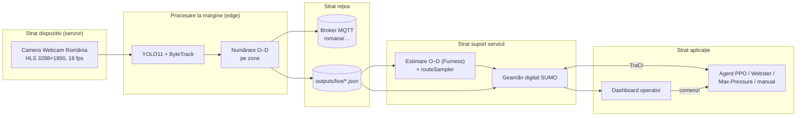

# Semaforizare Piața Romană – documentația proiectului

**Semaforizarea inteligentă, bazată pe inteligență artificială, a intersecției Piața Romană din București,
cu date preluate în timp real de pe camera publică Webcam România și simulare în SUMO**

Autor: Niunin Matei-Gabriel · Universitatea Transilvania din Brașov, Facultatea de Matematică și Informatică,
Informatică ID, anul III · Discipline: *Interfețe om-calculator* și *Internet of Things* · Anul universitar 2026–2027

---

## Cuprins

1. [Context și motivație](#1-context-și-motivație)
2. [Obiective și cerințe](#2-obiective-și-cerințe)
3. [Arhitectura sistemului (perspectiva IoT)](#3-arhitectura-sistemului-perspectiva-iot)
4. [Modulul de viziune artificială](#4-modulul-de-viziune-artificială)
5. [Puntea cameră → simulare: cererea de trafic calibrată](#5-puntea-cameră--simulare-cererea-de-trafic-calibrată)
6. [Rețeaua rutieră în SUMO](#6-rețeaua-rutieră-în-sumo)
7. [Controlul inteligent al semafoarelor](#7-controlul-inteligent-al-semafoarelor)
8. [Interfața om-calculator: dispeceratul](#8-interfața-om-calculator-dispeceratul)
9. [Rezultate](#9-rezultate)
10. [Limitări, aspecte etice și lucrări viitoare](#10-limitări-aspecte-etice-și-lucrări-viitoare)
11. [Ghid de instalare și rulare](#11-ghid-de-instalare-și-rulare)
12. [Jurnalul bornelor](#12-jurnalul-bornelor)
13. [Asistență generativă](#13-asistență-generativă)
14. [Bibliografie și licențe](#14-bibliografie-și-licențe)

---

## 1. Context și motivație

Piața Romană este nodul în care axa nord–sud Lascăr Catargiu – Magheru (paralelă cu magistrala de metrou M2)
se intersectează cu axa est–vest a Bulevardului Dacia[^wiki-romana]. În piață se varsă, în plus, două străzi cu
sens unic de ieșire: Str. D. I. Mendeleev și Str. Căderea Bastiliei. Camera Webcam România montată pe clădirea
dintre Bd. Magheru și Bd. Dacia (axa estică) filmează continuu „sensul giratoriu din mijlocul pieței, trecerile de
pietoni, traficul de pe bulevardele Magheru, Lascăr Catargiu și Dacia”[^webcam].

Bucureștiul este unul dintre cele mai congestionate orașe din lume. În ediția 2025 a TomTom Traffic Index,
nivelul mediu de congestie a fost de 62,5%, orașul a ocupat locul 20 global (5 în Europa), iar un șofer a
pierdut în medie 171 de ore pe an la orele de vârf, cu o viteză medie de vârf de 14 km/h[^tomtom][^pmb-tomtom].

Municipalitatea operează sistemul de management al traficului BTMS, extins la aproximativ 267–268 de intersecții
coordonate dintr-un centru unic, majoritatea cu automate „cu funcționare în mod adaptiv”[^btms-267][^buletin-btms].
În 2026 a fost anunțat un proiect nou, bazat pe AI, pentru 92 de intersecții în prima etapă: „Vom monta 305 camere
şi 1.500 de senzori”, cu ajustarea timpilor de semaforizare după numărul de mașini și prioritate pentru transportul
public[^digi24-ai]. Axa Unirii – Universitate – Piața Romană – Piața Victoriei a fost chiar pilotul primului sistem
„undă verde” din 2007[^economedia]. Infrastructura rămâne însă fragilă: în mai 2026 un incendiu la un punct trafo
de pe Bd. Magheru 43 a lăsat nefuncționale semafoarele din zona Pieței Romane[^adevarul-incendiu] – motiv pentru
care sistemul propus are întotdeauna un plan fix de rezervă.

Proiectul arată, la scară academică, lanțul complet pe care îl presupun aceste sisteme: **senzor video →
date de trafic → model digital al intersecției → decizie automată → supraveghere umană**.

## 2. Obiective și cerințe

| # | Cerință (din tema proiectului) | Cum este îndeplinită |
|---|---|---|
| R1 | Preluarea în timp real a datelor de pe camera publică | `vision/stream.py` citește fluxul HLS cu reconectare automată; `run_vision.py` analizează 4–6 cadre/s |
| R2 | Direcțiile **din care vin** și **spre care se îndreaptă** vehiculele, cât mai aproape de adevăr | 10 zone poligonale (intrare/ieșire pe fiecare braț) calibrate pe traiectorii reale; matrice O–D pe intervale de 15 min; 2 zone pe trecerile de pietoni vizibile |
| R3 | Transformarea datelor în flux de trafic simulat în SUMO, nu trafic aleator | estimare O–D Furness + `routeSampler.py` pe viraje, pe tipuri de vehicule (inclusiv biciclete); pietoni din numărătorile de pe treceri; trafic de fond doar ca fracțiune declarată |
| R4 | Model AI care recunoaște semafoarele intersecției și le controlează | cele 16 semafoare fizice ale pieței sunt identificate automat după coordonate și grupate într-un controler, ca automatul real; agent PPO care alege ordinea și durata fazelor reale |
| R5 | Antrenare până la fluidizarea optimă a intersecției | antrenare pe mai multe scenarii, în paralel; evaluare față de 4 linii de bază pe 5 seed-uri, pentru toți participanții (vehicule, bicicliști, pietoni) |
| R6 | Extindere la intersecțiile principale conexe | varianta „coridor”: Piața Romană + 5 intersecții vecine controlate simultan |
| R7 | Documentație în limba română, cu surse și licențe | acest document; note de subsol; § 14 |
| R8 | Evoluție vizibilă pe GitHub, pe borne | commit + push la fiecare bornă (§ 12) |

Cerințe nefuncționale: siguranță (agentul nu poate produce stări periculoase ale semaforului), confidențialitate
(nicio imagine stocată), reproductibilitate (rețea, cerere și rezultate regenerabile din scripturi),
rulare pe un laptop Windows fără GPU.

## 3. Arhitectura sistemului (perspectiva IoT)

Sistemul urmează modelul pe straturi din recomandarea ITU-T Y.2060[^itu-y2060]:

* **Senzorul virtual.** Camera nu este a proiectului; este tratată ca un senzor public, iar „inteligența” rulează pe
  stația locală (*edge computing*). Spre restul sistemului pleacă doar **numărători agregate** – economie de lățime de
  bandă și, mai ales, conformitate cu principiul minimizării datelor din GDPR[^gdpr].
* **Rețea.** Modulul de viziune publică opțional pe MQTT (OASIS Standard 5.0[^mqtt]; broker recomandat Eclipse
  Mosquitto[^mosquitto]): `romana/stare/camera` (retained, QoS 1), `romana/numaratori/interval` (retained),
  `romana/evenimente/viraj`. Local, aceleași date sunt scrise atomic în `outputs/live/*.json`.
* **Servicii.** Estimarea matricei O–D și generarea cererii; geamănul digital SUMO.
* **Aplicație.** Controlerul semaforului și dispeceratul.

## 4. Modulul de viziune artificială

### 4.1 Sursa video

Fluxul `mono.m3u8` este o listă HLS de segmente `.ts` de 6 s, H.264, 3288 × 1850 px, 18 fps (verificat cu
`ffprobe` la 20.10.2026). `FrameSource` îl citește prin FFmpeg/OpenCV[^opencv][^ffmpeg] pe un fir separat și
păstrează doar ultimul cadru; la căderea fluxului se reconectează cu întârziere exponențială (1 s → 30 s).

**Camere pentru intersecțiile conexe.** S-au căutat (21.10.2026) toate camerele publice din zona modelată:
lista Webcam România pentru București (8 camere)[^webcam-buc], Windy Webcams, Meteoblue și listele de
intersecții supravegheate. Rezultat:

| Cameră | Ce arată | Folosită? |
|---|---|---|
| Webcam România – Piața Romană (HLS) | piața, toate cele 6 brațe, 2 treceri de pietoni | **da** – singura sursă video a proiectului |
| Webcam România – Piața Victoriei (YouTube live) | pasajul Victoriei, în afara zonei modelate (dincolo de Lascăr Catargiu × Gh. Manu) | nu |
| „Calea Victoriei City Cam” (YouTube) | imagine statică a Ateneului, fără trafic | nu |
| Windy / Meteoblue „Piața Romană” | aceeași cameră Webcam România | – |
| Listele de „intersecții supravegheate” (Dacia × Dorobanți, Magheru × Enescu) | camere ale Poliției / PMB, fără imagine publică | nu (indisponibile) |

Pentru intersecțiile conexe (§ 6.1) nu există deci camere publice. Conform principiului proiectului, traficul
lor este simulat din datele Pieței Romane: rutele candidate pornesc de la marginea rețelei și traversează
intersecțiile vecine (§ 5.2), astfel încât fiecare vecin primește exact traficul observat care intră în piață
sau iese din ea pe brațul lui, plus traficul de fond declarat (15%).

**Calculul pe laptop.** Laptopul nu are placă grafică NVIDIA; YOLO11s la 1600 px rula pe procesor cu ≈0,9
cadre/s, prea puțin pentru urmărire (traiectorii fragmentate, Magheru subnumărat la ≈250 veh/h). Detectorul
este exportat automat în formatul Intel OpenVINO[^openvino] (`runtime: "openvino"` în `config/camera.json`) și
rulează pe placa grafică Intel integrată: ≈5 cadre/s cu exact aceleași detecții pe cadrul de test (34 de
vehicule, 11 persoane), lăsând procesorul liber pentru simulare și antrenare.

### 4.2 Detecție și urmărire

* **Detecție:** Ultralytics YOLO11[^yolo11], preantrenat pe COCO[^coco]; clasele folosite: car (2) → `passenger`,
  motorcycle (3), bus (5, include troleibuzele STB), truck (7), bicycle (1) și person (0) – pentru numărarea
  pietonilor pe treceri (§ 4.4) și pentru estomparea în previzualizare.
  Implicit `yolo11s` la 1600 px pe regiunea de interes (partea de jos a cadrului, fără cer), configurabil în
  `config/camera.json`; pe GPU NVIDIA se poate folosi `--device 0`.
* **Urmărire:** ByteTrack[^bytetrack] (asociază și detecțiile cu scor mic, util la ocluziile din piață);
  alternativ BoT-SORT[^botsort].
* **Punctul de referință** al fiecărui vehicul este mijlocul laturii de jos a dreptunghiului (contactul cu solul),
  mai stabil la perspectivă decât centrul.

### 4.3 Zonele de intrare/ieșire și matricea origine–destinație

Camera vede cele șase brațe ale pieței, de la stânga la dreapta: Bd. Magheru (extremă stânga), Str. Mendeleev
(ieșire), Bd. Dacia vest (centru-stânga), Bd. Lascăr Catargiu (centru-dreapta), Str. Căderea Bastiliei (ieșire,
lângă clădirea ASE) și Bd. Dacia est (extremă dreapta). Pentru fiecare braț cu dublu sens s-au definit **două**
poligoane – banda de intrare spre piață și banda de ieșire – iar pentru străzile cu sens unic doar zona de ieșire
(10 zone în total, `config/camera.json`, coordonate normalizate 0–1, independente de rezoluție).

*Zonele de numărare (verde = intrare, portocaliu = ieșire, mov = străzi cu sens unic de ieșire). Imagine:
© WebcamRomania.ro, captură din 20.10.2026, 22:59, persoane estompate; folosită în scop de citare academică.*

Poziția zonelor nu a fost aleasă „din ochi”: s-au înregistrat 3 minute de flux, s-au urmărit vehiculele cu
YOLO11 + ByteTrack (256 de traiectorii) și s-au suprapus traiectoriile pe imagine, cu punctele de început și de
sfârșit marcate; zonele s-au pus acolo unde traiectoriile intră și ies din cadru. **Calibrarea actuală este
preliminară (imagini de noapte)**; rafinarea pe lumină de zi este planificată în Borna 7. Dacă operatorul mută
camera, zonele se redesenează interactiv cu `scripts\2b_calibrare_zone.bat`.

Regula de numărare (`classify()` în `vision/od_counter.py`), aplicată pe traiectoria întreagă la închiderea ei:

* originea = **prima** zonă de intrare vizitată **înaintea oricărei ieșiri**; destinația = **ultima** zonă de
  ieșire a **altui** braț, vizitată după origine. Zonele de intrare și de ieșire ale aceluiași braț sunt
  alăturate: prima variantă a regulii producea 25 de „întoarceri” Magheru → Magheru în 5 minute, de fapt
  vehicule care atingeau banda vecină;
* pe brațele îndepărtate, parțial ascunse (Dacia vest, Lascăr Catargiu, Mendeleev, Căderea Bastiliei), zonele
  sunt marcate `capat_traiectorie`: o intrare contează doar dacă traiectoria **începe** acolo (vehiculul apare
  din strada ascunsă), o ieșire doar dacă traiectoria **se termină** acolo (toleranță 1,5 s). Verificarea
  sensului de mers (`recount --directii`) a arătat că fosta zonă „intrare Dacia vest” prindea de fapt
  vehiculele care circulă pe inel prin dreptul străzii (73 din 74 se îndepărtau de centru);
* o traiectorie completă produce un viraj (origine → destinație); una fragmentată (vehicul pierdut la o
  ocluzie) contribuie doar la numărătoarea pe braț.

Se agregă pe intervale de 15 minute, separat pe tipuri de vehicule, în `data/counts/numaratori_AAAA-LL-ZZ.csv`.

**Jurnalul anonim de traiectorii și renumărarea.** Pe lângă numărători, modulul salvează în
`data/trajectories/traiectorii_AAAA-LL-ZZ.jsonl.gz` fiecare traiectorie închisă: clasa obiectului și pozițiile
punctului de contact cu solul, în coordonate normalizate, cu timpul relativ – fără imagini, fără numere de
înmatriculare, fără ID-ul de urmărire. Astfel zonele pot fi recalibrate **după** colectare, iar
`python -m romana.vision.recount` reface numărătorile din jurnal (testat: rezultat identic cu numărarea live).
Tot din jurnal se desenează câmpul de mișcare al vehiculelor și capetele traiectoriilor (`recount --flux`),
folosite la plasarea zonelor.

### 4.4 Pietoni și bicicliști

În simulare intră toți participanții observabili pe cameră. Camera vede două dintre cele 7 treceri semaforizate
ale pieței: trecerea de pe Bd. Magheru (prim-plan, stânga) și trecerea dublă de pe Bd. Dacia est (prim-plan,
dreapta). Pentru fiecare s-a desenat o zonă cu rolul `trecere` (`config/camera.json`), peste marcajul zebră
de pe cadrul din 21.10.2026, 01:30 (de verificat pe lumină de zi).

* **Pietoni.** Persoanele detectate sunt urmărite cu același ByteTrack. Un pieton este numărat **o singură dată
  pe fiecare trecere** pe care a fost văzut în cel puțin 2 cadre și pe care s-a deplasat cel puțin 4% din
  lățimea cadrului (punctul de contact cu solul în zona trecerii) – cine doar așteaptă la bordură nu contează;
  în CSV apar ca rânduri `pietoni` (braț, trecere). Debitul măsurat se extrapolează la toată piața cu
  `factor_extrapolare_pietoni` = 2,5 din `config/demand.json` (ipoteză declarată: camera vede 2 din cele ≈7
  treceri semaforizate; factorul se va verifica printr-o numărătoare manuală).
* **Bicicliști și motocicliști.** Bicicleta (clasa 1) este numărată ca vehicul pe zonele de intrare/ieșire, ca
  orice alt vehicul, și primește în SUMO rute pe care bicicletele au acces. Persoana de pe bicicletă sau
  motocicletă **nu** este numărată ca pieton: o persoană al cărei punct de contact cu solul cade în caseta unei
  biciclete/motociclete (lărgită cu 25%) este exclusă (`is_rider` în `vision/od_counter.py`).

### 4.5 Confidențialitate

Imaginile pot conține persoane și numere de înmatriculare, deci prelucrarea intră sub GDPR[^gdpr] și sub ghidul
EDPB 3/2019 privind dispozitivele video[^edpb]. Măsurile implementate: prelucrare exclusiv în memorie; nicio
înregistrare video sau decupaj salvat; fără citirea numerelor de înmatriculare; ID-urile de urmărire sunt
temporare și uitate la închiderea traiectoriei; persoanele sunt estompate în previzualizarea pentru dashboard
(redusă la 960 px și suprascrisă continuu); se publică doar numărători agregate și jurnalul de traiectorii
anonime (clasă + poziții normalizate ale punctului de contact cu solul, fără imagini sau identificatori), din
care nu se poate reconstitui nicio imagine și nicio persoană. Fișierele `.ts`/`.mp4` sunt
excluse din Git (`.gitignore`). Fluxul este public, iar utilizarea este strict academică; pagina operatorului
menționează „Toate drepturile rezervate”[^webcam], de aceea imaginile nu sunt redistribuite, iar pentru o
utilizare dincolo de proiectul academic se recomandă acordul scris al Webcam România.

## 5. Puntea cameră → simulare: cererea de trafic calibrată

Aceasta este piesa care asigură că agentul se antrenează pe **trafic real**, nu pe trafic aleatoriu.

### 5.1 Estimarea matricei O–D (Furness)

Camera nu urmărește fiecare vehicul de la intrare până la ieșire (stâlpi, autobuze care acoperă alte vehicule,
distanța până la brațele îndepărtate). De aceea se combină trei surse (`bridge/od_estimation.py`):

* **totalurile pe linii** $T_o$ = vehiculele intrate pe brațul $o$ (cea mai fiabilă măsurătoare);
* **totalurile pe coloane** $U_d$ = vehiculele ieșite pe brațul $d$, rescalate la $\sum T$;
* **sămânța** $S_{od}$ = virajele complete observate + $w \cdot p_{od}$, unde $p$ este o distribuție a priori
  (`config/demand.json`) folosită doar ca regularizare când observațiile lipsesc ($w = 2$ vehicule-echivalent).

Matricea se echilibrează prin metoda Furness (IPF)[^ortuzar], alternând scalarea coloanelor și a liniilor și
terminând pe linii, astfel încât **volumele de intrare măsurate sunt respectate exact**. Un factor de corecție
a detecției (numărătoare manuală / automată) poate fi setat după validarea manuală pe 15 minute.

### 5.2 De la O–D la vehicule în SUMO

1. Se generează un set mare de **rute candidate realiste**: drumuri minime de la marginea rețelei
   (`randomTrips.py` + `duarouter`), păstrând doar rutele care pornesc și se termină pe artere și au cel mult
   15% din lungime pe străzi rezidențiale, plus rute garantate pentru fiecare pereche intrare → ieșire.
2. Pentru fiecare interval de 15 min și fiecare tip de vehicul se scrie un fișier de viraje (`edgeRelation`
   de la muchia de intrare a brațului la muchia de ieșire).
3. `routeSampler.py`[^sumo-turns] alege din setul candidat exact atâtea rute câte trebuie pentru a reproduce
   virajele (optimizare liniară); calitatea se raportează prin indicatorul GEH și fișierele `mismatch_*.xml`.
4. Traficul de pe străzile vecine care **nu** trece prin piață (nemonitorizat video) se adaugă separat, ca
   fracțiune declarată din volumul observat (`fond_fractiune`, implicit 15%), pe rute care evită piața.

Astfel, intersecțiile vecine primesc traficul care chiar intră și iese din Piața Romană pe brațele lor, ceea ce
răspunde cerinței de a nu antrena agentul pe un flux necorespunzător realității.

### 5.3 Scenariul de referință (până la datele de zi)

În lipsa datelor oficiale publice de volum pentru Piața Romană (singura cifră publică găsită este o estimare
neoficială de ~3.446 veh/h pe Magheru spre Romană, dintr-un singur ciclu de semafor, 2011/2012[^wizard]),
până la colectarea datelor de zi se folosesc trei scenarii ipotetice explicite: *moderat* (0,7× → 1.442 veh/h
prin piață), *vârf* (720 / 620 / 390 / 330 veh/h pe Magheru / Catargiu / Dacia est / Dacia vest → 2.060 veh/h)
și *aglomerat* (1,2× → 2.472 veh/h), fiecare cu 15% trafic de fond și 1.200 de pietoni/h prin zona pieței
(stația de metrou M2 și ASE; valoare ipotetică). Compoziția: 88% autoturisme, 4% autobuze/troleibuze, 3%
camioane, 3% motociclete, 2% biciclete. Volumul de vârf a fost ales astfel încât planul fix de referință să
funcționeze aproape de saturație pe replica fidelă a rețelei: peste ≈1,0× inelul se suprasaturează, ceea ce
corespunde congestiei cunoscute a pieței. Scenariile servesc la dezvoltarea și verificarea lanțului și vor fi
completate cu scenarii construite din numărătorile reale.

### 5.4 Geamănul digital live

`bridge/live_twin.py` rulează SUMO (opțional SUMO-GUI) continuu, în timp real: în fiecare secundă citește
debitele curente publicate de modulul de viziune și injectează vehicule pe brațe ca proces Poisson cu acele
debite, cu destinații după proporțiile de viraj observate și tipuri după compoziția traficului (bicicliștii pe
rute permise bicicletelor). Pietonii sunt injectați tot Poisson, pe trasee pietonale care trec prin piață, cu
debitul măsurat pe trecerile vizibile × factorul de extrapolare. Dacă fluxul camerei lipsește mai mult de 60 s,
trece pe profilul de referință și **afișează explicit** acest lucru în dashboard. Modul „plan fix” rulează
planul de referință complet (N–S / E–V / pietoni, § 6.3).

## 6. Rețeaua rutieră în SUMO

### 6.1 Construcție reproductibilă

`network/build_network.py` pornește de la extrasul OpenStreetMap[^osm] al zonei și rulează `netconvert`[^sumo]
pe un dreptunghi de 2,2 × 1,6 km, care include Piața Romană și primele intersecții semaforizate pe fiecare braț:

| ID în proiect | Intersecție | Cameră |
|---|---|---|
| `romana` | Piața Romană (Magheru – Lascăr Catargiu – Dacia) | da |
| `dacia_eminescu` | Bd. Dacia × Str. M. Eminescu × Calea Dorobanților | nu |
| `magheru_enescu` | Bd. Magheru × Str. G. Enescu / Tache Ionescu | nu |
| `catargiu_manu` | Bd. Lascăr Catargiu × Str. Gh. Manu | nu |
| `dacia_victoriei` | Bd. Dacia × Calea Victoriei | nu |
| `dacia_polona` | Bd. Dacia × Str. Polonă | nu |

Semafoarele sunt găsite **după coordonatele geografice** (centroidul nodurilor), nu după ID-urile generate de
`netconvert`, care se schimbă la fiecare regenerare. Sensurile unice Mendeleev și Căderea Bastiliei (doar ieșire
din piață) sunt confirmate atât de etichetele OSM (`oneway=yes`), cât și de traiectoriile observate pe cameră.

### 6.2 Replica fidelă a pieței (Borna 8)

**Principiul:** infrastructura rămâne exact cea din realitate – inelul pieței, axa centrală N–S, benzile și
virajele marcate, sensurile unice, benzile dedicate STB, trotuarele, trecerile de pietoni și pozițiile reale ale
semafoarelor. Proiectul schimbă **doar modul în care semafoarele existente răspund traficului** (programul,
ordinea și durata fazelor) – singurul lucru care se poate implementa pe automatul real.

Importul `netconvert` folosește etichetele OSM pentru trotuare (`--osm.sidewalks`), accesul bicicletelor,
benzile de viraj și restricțiile pe benzi (`--osm.turn-lanes`, `--osm.lane-access`), iar trecerile de pietoni și
zonele de așteptare sunt reconstruite la toate intersecțiile (`--crossings.guess`, `--walkingareas`; opțiunea
`--osm.crossings` provoacă un crash în netconvert 1.28 pe acest extras). Rezultatul: 6.943 de muchii, 924 de
noduri, 53 de semafoare, 225 de benzi dedicate autobuzelor și trotuare pe toate arterele.

În OSM, piața are **16 semafoare fizice** (pe intrări, pe inel, pe axa centrală și la treceri). Ca în realitate,
unde toate sunt conduse de un singur automat de intersecție, ele sunt grupate într-un controler `romana`
(cele aflate la cel mult 80 m de centrul pieței, `--tls.join` cu `--tls.join-exclude` pentru restul). Controlerul
are 61 de legături: 54 pentru vehicule și 7 treceri de pietoni.

*Istoric:* în Bornele 3–7 piața fusese modelată ca un singur nod agregat, pentru că primul import OSM intra în
blocaj circular pe segmentele interne foarte scurte. În Borna 8, cu programul construit pe grupuri de semnal, s-a
constatat că inelul se bloca atunci când semnalele de pe brațele de ieșire primeau roșu și opreau vehiculele
deja intrate pe inel. Cu ieșirile pe verde în toate fazele de vehicule (§ 6.3), replica fidelă funcționează, iar
nodul agregat (care nu respecta realitatea) a fost abandonat.

### 6.3 Grupurile de semnal și fazele semaforului Piața Romană

Programul nu este cel ghicit de `netconvert`, ci este construit pe **grupuri de semnal** cu semnificație de
trafic (`config/network.json` → `romana_grupuri`), după muchia OSM pe care stau vehiculele la linia de oprire:

| Grup | Legături | Rol |
|---|---|---|
| `intrare_magheru`, `intrare_catargiu`, `intrare_dacia_est`, `intrare_dacia_vest` | 12 / 3 / 4 / 2 | intrările în piață |
| `axa_ns_centru` | 6 | axa centrală N–S, prin mijlocul pieței |
| `inel_dacia` | 11 | inelul din jurul insulei, pe direcția Dacia |
| `iesire_magheru_catargiu`, `iesire_dacia` | 12 / 4 | semnalele de pe brațele de ieșire |
| `pietoni` | 7 | trecerile de pietoni (grup automat) |

| Faza | Semnificație | În planul fix |
|---|---|---|
| 0 | N–S: Magheru ↔ Lascăr Catargiu prin centru | da, 36 s |
| 1 | E–V: Dacia în jurul insulei | da, 28 s |
| 2 | Pietoni: toate trecerile, axa centrală se golește | da, 12 s |
| 3 | N–S, cu intrările Dacia deschise (fără dozare) | nu |
| 4 | E–V, cu intrările Magheru/Catargiu deschise (fără dozare) | nu |

Planul fix de referință are un ciclu de ≈ 91 s (3 faze + galben 3 s + roșu de degajare 2 s după fiecare).
Ieșirile au verde în toate fazele de vehicule, pentru că fiecare ieșire este alimentată în ambele faze principale;
trecerile de pe ieșiri primesc verde în faza de pietoni. **Trecerile de pietoni primesc verde automat** în orice
fază în care niciun flux de vehicule cu verde nu le intersectează geometric (verificare de siguranță la
construcția programului; `build_network.py` refuză un program în care o trecere nu primește niciodată verde).
Roșul de degajare păstrează verdele legăturilor care rămân verzi și în faza următoare. Fazele 3–4 există ca
opțiuni, dar evaluarea a arătat că, deschizând intrările spre un inel deja ocupat, ele blochează piața (§ 7.4);
de aceea strategiile adaptive aleg implicit doar dintre fazele 0–2.

Intersecțiile vecine păstrează programele `actuated` generate (realist: sistemul BTMS funcționează adaptiv), cu
excepția variantei „coridor”, în care sunt conduse de agent.

## 7. Controlul inteligent al semafoarelor

### 7.1 Formularea ca problemă de decizie Markov

* **Pas de decizie:** 5 s simulate.
* **Stare:** pentru fiecare semafor controlat – faza verde curentă (one-hot), indicatorul „verde minim
  îndeplinit”, durata verdelui curent (normalizată la verdele maxim), pentru fiecare bandă de intrare coada
  (vehicule oprite) și densitatea, normalizate la capacitatea de stocare a benzii (lungime / 7,5 m), și, pentru
  fiecare zonă de așteptare a unei treceri controlate, numărul de pietoni care așteaptă (normalizat la 15).
  Aceeași funcție (`observation()` din `control/signals.py`) servește antrenarea, evaluarea și geamănul digital.
* **Acțiune:** faza verde dorită. La Piața Romană, implicit una din cele 3 faze ale planului real (N–S, E–V,
  pietoni): agentul decide **ordinea și durata** fazelor, adică exact ce se poate programa pe automatul existent
  (fazele „fără dozare” se pot activa cu `--toate-fazele`). În varianta coridor, câte o acțiune pentru fiecare din
  cele 6 semafoare – spațiu `MultiDiscrete`.
* **Recompensă:** $r_t = -\frac{1}{100}\left(\sum_{\ell} q_\ell(t) + \sum_{c} p_c(t) + b(t)\right)$,
  unde $q_\ell$ este numărul de vehicule oprite pe banda de intrare $\ell$, $p_c$ numărul de pietoni care
  așteaptă la trecerea $c$, iar $b$ numărul de vehicule care nu pot intra în rețea (blocate la margine); un
  pieton și un vehicul neintrodus cântăresc cât un vehicul oprit. *Lecție din Borna 8:* cu o penalizare mică
  pentru $b$ (0,002), agentul coridor a învățat să „ascundă” coada în afara rețelei – cozi de 4–8 vehicule în
  piață, dar ≈450 s așteptare medie și ≈400 de vehicule rămase în scenariul moderat. Este un exemplu clasic de
  exploatare a recompensei (*reward hacking*); modelele au fost reantrenate cu formula de mai sus, iar evaluarea
  raportează și întârzierea la intrarea în rețea.

### 7.2 Siguranța prin construcție

Agentul nu setează direct culorile. `control/signals.py` primește doar „faza verde următoare” și impune:
galben 3 s, roșu general 2 s (pe legăturile care se schimbă), verde minim 10 s, verde maxim 90 s (după care
faza avansează forțat). Ciorna inițială sărea direct între faze verzi, fără galben (vezi
`legacy/google_ai_draft/README.md`).

### 7.3 Algoritmul de învățare

PPO (Proximal Policy Optimization)[^ppo] din Stable-Baselines3[^sb3], rețea MLP 128 × 128, rată de învățare
3·10⁻⁴, ≈1.024 de tranziții pe actualizare, lot 128, 10 epoci, γ = 0,98, λ_GAE = 0,95, coeficient de entropie
0,01. Simularea rulează prin `libsumo` (aceeași interfață ca TraCI, fără comunicație prin socket), în **8 procese
paralele** (`SubprocVecEnv`, opțiunea `--medii`): ≈55–70 de pași de decizie pe secundă pe procesorul laptopului
(i5-13420H), față de ≈18 cu un singur proces – replica fidelă, cu pietoni, este mult mai costisitoare decât
nodul agregat. Pe Windows, PYTHONPATH-ul setat de instalatorul SUMO umbrește pachetul pip `libsumo` cu varianta
din instalare, căreia îi lipsesc DLL-uri; `control/env.py` încarcă explicit pachetul pip. Fiecare episod = o
oră de trafic, pe un scenariu ales aleator din setul de antrenare, cu seed SUMO aleator. PPO a fost preferat lui DQN[^dqn] pentru că suportă natural acțiunile `MultiDiscrete` ale
variantei coridor. Literatura de referință pentru RL în semaforizare: IntelliLight[^intellilight],
PressLight[^presslight], CoLight[^colight], MPLight[^mplight] și sintezele lui Wei et al.[^survey2019][^survey2021];
mediul a fost scris în stilul sumo-rl[^sumorl].

### 7.4 Linii de bază

1. **Plan fix de referință:** programul din rețea (N–S 36 s, E–V 28 s, pietoni 12 s, ciclu ≈ 91 s) – linia de
   bază față de care se raportează procentele.
2. **Plan fix Webster**[^webster]: ciclul optim $C_0 = \frac{1{,}5L + 5}{1 - Y}$ (limitat la 60–150 s), cu $L$ =
   timpul pierdut (7 s/fază, plus întreaga fază de pietoni) și $Y = \sum_i y_i$, $y_i$ = cel mai mare raport
   debit / debit de saturație (1800 veh/h/bandă, doar benzile de autoturisme, fără benzile STB) dintre intrările
   fazei de vehicule $i$; verdele se împarte proporțional cu $y_i$, faza de pietoni își păstrează durata.
3. **Actuated SUMO:** pe aceleași 3 faze, prelungirea verdelui cât timp detectoarele văd vehicule la intervale sub
   3 s (min 10 s, max 60 s).
4. **Max-Pressure**[^maxpressure]: la fiecare decizie se alege faza cu presiunea maximă
   $\sum (\text{coadă amonte} - \text{coadă aval})$ pe legăturile ei verzi; pentru trecerile de pietoni, „coada”
   amonte este numărul de pietoni care așteaptă (altfel faza de pietoni nu ar fi aleasă niciodată). Este un
   algoritm fără învățare, cu garanții teoretice de stabilitate, pe care un agent RL trebuie să-l egaleze sau
   să-l depășească pentru a fi convingător. Pe replica fidelă, Max-Pressure cu toate cele 5 faze alegea mereu
   fazele „fără dozare” (cele mai multe legături verzi ⇒ presiunea cea mai mare) și bloca piața complet
   (scenariul moderat, 1 seed: 1.226 de vehicule rămase în rețea, față de 107 la planul fix); restrâns la fazele
   planului real, nu mai blochează piața (97 de vehicule rămase, media pe 5 seed-uri; rezultatele complete în § 9).

### 7.5 Metrici

Din `tripinfo` SUMO, pe toată durata scenariului plus 15 minute de golire, **separat pe categorii de
participanți**:

* vehicule motorizate: timpul mediu de așteptare (medie și mediană pe seed-uri), pierderea de timp
  (*timeLoss*), întârzierea la intrarea în rețea (*departDelay*), durata medie a călătoriei, vehiculele sosite,
  emisiile de CO₂ (modelul HBEFA din SUMO);
* bicicliști (`vType` bicycle): așteptarea și pierderea de timp medii;
* pietoni (`personinfo`/`walk`): pierderea de timp medie a deplasării;
* pierderea de timp totală a tuturor participanților (ore, inclusiv întârzierea la intrare), vehiculele rămase
  în rețea sau neintroduse la final, coada medie de
  vehicule și numărul mediu de pietoni care așteaptă la trecerile Pieței Romane (eșantionate la 5 s).

Se raportează media ± abaterea standard pe 5 seed-uri. Observație: o parte din întârzieri se produce la
semafoarele de la marginea zonei modelate (de ex. Str. Știrbei Vodă, Str. Ion Câmpineanu), pe rutele care pornesc
de acolo; ele depind foarte puțin de strategia de la Piața Romană, deci nu schimbă clasamentul strategiilor, dar
măresc valorile absolute.

## 8. Interfața om-calculator: dispeceratul

`scripts\7_dashboard.bat` deschide la `http://localhost:8050` consola operatorului (Flask + HTML/JS fără
framework). Principiul de proiectare: **automatizarea propune, omul supervizează** – operatorul vede ce vede
algoritmul și poate prelua oricând controlul.

| Euristică Nielsen[^nielsen] | Aplicare în dashboard |
|---|---|
| Vizibilitatea stării sistemului | indicatoare pentru flux cameră / reconectare, cadre/s, vârsta datelor; faza curentă cu etapa (verde/galben/roșu de degajare) și secundele de verde; sursa cererii („camera live” sau „profil de referință”); vehiculele și pietonii din simulare, pietonii care așteaptă la treceri, debitul de pietoni măsurat de cameră |
| Potrivirea cu lumea reală | schema pieței respectă orientarea reală a brațelor; denumiri de străzi, nu ID-uri de muchii; culori de semafor |
| Controlul și libertatea utilizatorului | patru moduri de control; revenirea la AI sau la planul fix dintr-un clic; `Esc` anulează |
| Consistență și standarde | aceleași denumiri ale modurilor în butoane, confirmări și starea afișată |
| Prevenirea erorilor | schimbarea modului cere confirmare explicită; în modul manual se alege doar faza verde – galbenul și roșul de siguranță se aplică automat |
| Recunoaștere în loc de reamintire | fazele manuale sunt afișate cu numele lor complet; legenda culorilor cozilor e implicită (albastru < 8, galben < 18, roșu ≥ 18 vehicule) |
| Design estetic și minimalist | o singură accentuare cromatică (albastrul STB), restul neutru; culorile de semafor folosite doar pentru stare |
| Ajutor la recunoașterea și remedierea erorilor | mesajele de lipsă indică exact scriptul de pornit („Porniți scripts\2_viziune_live.bat”) |

Sunt respectate și regulile lui Shneiderman[^shneiderman] privind feedback-ul informativ, închiderea dialogului
(confirmare → stare actualizată) și controlul intern al utilizatorului. Accesibilitate: contrast ridicat,
focalizare vizibilă de la tastatură, etichete ARIA pentru schemă și grafic, `prefers-reduced-motion` respectat,
aranjare pe o coloană sub 900 px. Atribuirile cerute (OSM, Webcam România, SUMO) apar permanent în subsol.

## 9. Rezultate

Rezultatele complete, regenerate automat de `scripts\5_evalueaza.bat`, sunt în
[`docs/rezultate/rezultate.md`](rezultate/rezultate.md), iar graficul comparativ în
[`docs/rezultate/comparatie_strategii.png`](rezultate/comparatie_strategii.png).

<!-- REZULTATE_INCEPUT -->
*Secțiune actualizată în Borna 8 (21.10.2026), pe replica fidelă a rețelei, cu toți participanții, pe cele trei
scenarii de referință ipotetice (§ 5.3) – nu încă pe date reale de zi.*

**Configurație.** 3 scenarii × 6 strategii × 5 seed-uri SUMO = 90 de simulări a câte 75 de minute (60 de minute
de cerere + 15 minute de golire). Agentul pieței: PPO, 500.736 de pași de decizie (≈ 700 de episoade de o oră),
72,9 minute de antrenare în 8 procese paralele, recompensa din § 7.1, acțiuni = cele 3 faze ale planului real.
Agentul coridor: 300.000 de pași, 6 controlere.

**Pierderea totală de timp a tuturor participanților** (vehicule, inclusiv întârzierea la intrare, bicicliști,
pietoni; ore; media pe 5 seed-uri, procente față de planul fix de referință):

| Strategie | Moderat (1.442 veh/h) | Vârf (2.060 veh/h) | Aglomerat (2.472 veh/h) |
|---|---|---|---|
| Plan fix de referință | 183,0 | 432,3 | 728,3 |
| Plan fix (Webster) | 291,5 (+59%) | 481,6 (+11%) | 731,8 (+0%) |
| Actuated SUMO | 189,2 (+3%) | 386,1 (−11%) | 580,7 (−20%) |
| Max-Pressure | 192,2 (+5%) | 379,1 (−12%) | 687,1 (−6%) |
| **Agent RL piață (PPO)** | **177,8 (−3%)** | **298,6 (−31%)** | **405,3 (−44%)** |
| Agent RL coridor (PPO) | 361,0 (+97%) | 563,8 (+30%) | 624,0 (−14%) |

**Așteptarea medie a vehiculelor motorizate** (s): agentul pieței obține 121 / 150 / 204 s, față de 135 / 402 /
790 s la planul fix (−10% / −63% / −74%) și 135 / 261 / 503 s la actuated, cel mai bun algoritm clasic. Abaterea
standard între seed-uri este mică (25 / 21 / 54 s), deci politica nu mai cade în blocaj ca planurile fixe sau
Max-Pressure, a căror medie este trasă în sus de câteva rulări blocate (de aceea raportul dă și mediana).
Bicicliștii câștigă la fel: 61 / 72 / 124 s așteptare, față de 78 / 402 / 807 s la planul fix.

**Pietonii.** Pierderea de timp a pietonilor crește ușor la agentul pieței în scenariile moderat și vârf (+12% și
+6%: 171 și 178 s față de 153 și 168 s) și scade în scenariul aglomerat (−9%). Recompensa cântărește un pieton
care așteaptă cât un vehicul oprit, iar la volume mari de vehicule agentul favorizează golirea cozilor. Este un
compromis explicit, care poate fi mutat prin ponderea pietonilor în recompensă (lucrare viitoare: o pondere pe
persoană, ca pentru călătorii din autobuze).

**Observații.**

* **Webster** dă rezultate mai slabe decât planul de referință: cu debitul de saturație teoretic (1.800
  veh/h/bandă), gradul de saturație calculat este mic (Y ≈ 0,25), iar ciclul rezultat (≈ 72 s) se dovedește prea
  scurt pentru inelul pieței: capacitatea reală a intrărilor este mult sub cea teoretică (ipoteză: țeserea pe inel
  și cozile interne), iar timpul pierdut la schimbarea fazelor are pondere mai mare într-un ciclu scurt.
* **Max-Pressure** este bun în mediană la vârf (174 s), dar instabil; restrâns la fazele planului real, nu mai
  blochează piața ca varianta cu toate fazele (§ 7.4).
* **Agentul coridor** nu depășește planurile `actuated` ale intersecțiilor vecine: cu o acțiune comună pentru 6
  controlere (fazele vecinilor sunt cele generate de `netconvert`) și 300.000 de pași, curba de învățare se
  plafonează sub cea a agentului pieței (recompensă medie pe episod ≈ −1.250 față de ≈ −1.050). Rezultatul negativ
  este raportat ca atare; pentru coordonare, direcțiile promițătoare sunt agenți descentralizați cu parametri
  comuni (MPLight[^mplight]) sau atenție pe graf (CoLight[^colight]).
* **Prima versiune a recompensei** a produs un agent coridor care „ascundea” coada la marginea rețelei (§ 7.1);
  evaluarea pe toți participanții și cu întârzierea la intrare a făcut problema vizibilă.
* Valorile absolute sunt mari pentru că includ întârzierile de la semafoarele de la marginea zonei și cozile de
  intrare (§ 7.5); comparația dintre strategii este cea relevantă.

Concluzie: pe replica fidelă a pieței, cu toți participanții și fără a schimba nimic din infrastructură, un
controler care decide doar **ordinea și durata fazelor existente** reduce pierderea totală de timp cu 31–44% la
volume de vârf față de planul fix de referință și cu 23–30% față de cel mai bun algoritm clasic (actuated),
cu un cost mic pentru pietoni la volume moderate. Rezultatele trebuie confirmate pe scenariile din date reale
de zi (Borna 9).
<!-- REZULTATE_SFARSIT -->

## 10. Limitări, aspecte etice și lucrări viitoare

* **Date de calibrare.** Zonele camerei sunt calibrate preliminar pe imagini de noapte; până la colectarea
  numărătorilor de zi, rezultatele sunt obținute pe scenarii ipotetice declarate (§ 5.3). Precizia detectorului
  trebuie validată printr-o numărătoare manuală de 15 minute (factorul de corecție din `config/demand.json`).
* **Brațele îndepărtate** (Catargiu, Dacia vest, Căderea Bastiliei) apar mici în imagine; o parte din vehicule
  sunt pierdute de detector – de aici folosirea totalurilor pe brațe și a echilibrării Furness în loc de
  virajele complete.
* **Programul real al automatului** nu este public. Grupurile de semnal și planul fix de referință (§ 6.3) sunt
  reconstruite din geometria OSM și din conflictele dintre mișcări, nu preluate de la PMB/BTMS; duratele
  36 / 28 / 12 s sunt ipoteze declarate.
* **Trecerile de pietoni** sunt reconstruite de `netconvert` (`--crossings.guess`), nu importate direct din OSM
  (crash în netconvert 1.28); pozițiile lor trebuie comparate vizual cu imaginea camerei.
* **Pietonii** sunt număraţi doar pe 2 din cele ≈7 treceri și extrapolați cu un factor declarat (2,5); traseele
  lor în simulare sunt plauzibile (drumuri minime prin zona pieței), nu observate.
* **Intersecțiile vecine** nu au cameră; traficul lor propriu este o fracțiune declarată (15%).
* **Transfer în realitate.** O politică antrenată în simulare nu se aplică direct pe un automat real; ar fi
  nevoie de validare în buclă închisă cu operatorul (rolul dispeceratului) și de integrare cu sistemul BTMS.
* **Licențe.** Ultralytics YOLO este AGPL-3.0: publicarea proiectului impune publicarea întregului cod.

Lucrări viitoare: recompensă cu prioritate pentru transportul public, ponderată cu numărul de călători
(obiectiv declarat și de PMB); coordonare multi-agent cu atenție pe graf (CoLight); validare pe mai multe zile
de date; compararea planului fix de referință cu programul real, dacă poate fi obținut de la operator.

## 11. Ghid de instalare și rulare

**Cerințe:** Windows 10/11, Python 3.11–3.13, ~3 GB spațiu, conexiune la internet pentru fluxul camerei.
SUMO poate fi instalarea oficială existentă (cu `SUMO_HOME` setat) sau pachetul `eclipse-sumo` din
`requirements.txt`. GPU-ul NVIDIA este opțional.

| Script (`scripts\`) | Ce face |
|---|---|
| `0_instalare.bat` | creează `.venv` și instalează dependențele |
| `1_construieste_retea.bat` | regenerează rețeaua SUMO din OSM |
| `2_viziune_live.bat` | analiza live a camerei (fereastră cu zonele; `q` = oprire); scrie numărătorile |
| `2b_calibrare_zone.bat` | redesenarea zonelor pe un cadru live |
| `3_genereaza_cerere.bat` | scenariu SUMO din numărători, ex.: `--nume dimineata --de-la "2026-10-21 07:30" --pana-la "2026-10-21 08:30"` |
| `4_antreneaza_ai.bat` | antrenare PPO (`--coridor` pentru 6 semafoare, `--pasi N`) |
| `5_evalueaza.bat` | evaluare comparativă, actualizează `docs/rezultate/` |
| `6_geaman_digital.bat` | SUMO-GUI alimentat live de cameră |
| `7_dashboard.bat` | dispeceratul web |
| `8_simulare_gui.bat` | rulează un scenariu în SUMO-GUI cu agentul AI |
| `PORNESTE_TOT.bat` | viziune + geamăn digital + dashboard, în trei ferestre |

Flux tipic pentru o zi de date: rulați `2_viziune_live.bat` în intervalul dorit (ex. 07:30–09:30), apoi
`3_genereaza_cerere.bat` cu acel interval, `4_antreneaza_ai.bat`, `5_evalueaza.bat`.

## 12. Jurnalul bornelor

| Bornă | Data | Conținut | Asistent |
|---|---|---|---|
| Ciornă | 18.10.2026 | scenariu `osmWebWizard` cu trafic aleator, script YOLOv8 cu 3 linii, PPO 2000 pași | modulul AI Google (Chrome) |
| B0 | 20.10.2026 | audit al ciornei (erori de sintaxă, `hash()` nedeterminist, fără galben, scenariu în blocaj), restructurare | Claude (Anthropic) |
| B1 | 20.10.2026 | rețea SUMO reproductibilă din OSM, 6 semafoare identificate geografic | Claude |
| B2 | 20.10.2026 | viziune: HLS, YOLO11 + ByteTrack, 10 zone calibrate pe traiectorii reale, matrice O–D | Claude |
| B3 | 20.10.2026 | estimare Furness + routeSampler, scenarii; diagnosticarea blocajului inelului și nodul agregat | Claude |
| B4 | 20–21.10.2026 | mediu RL, PPO (piață și coridor), Webster / actuated / Max-Pressure, evaluare | Claude |
| B5 | 20.10.2026 | geamăn digital live, dispecerat web, MQTT, scripturi Windows | Claude |
| B6 | 20–21.10.2026 | documentația de față | Claude |
| B7 | planificat | calibrare pe lumină de zi (zonele de vehicule și trecerile de pietoni) și date de vârf reale | Claude |
| B8 | 21.10.2026 | replica fidelă a rețelei (16 semafoare fizice într-un controler, grupuri de semnal, treceri, trotuare, benzi STB); toți participanții: pietoni și bicicliști în cerere, cameră, geamăn digital, recompensă și evaluare; liniile de bază corectate pe rețeaua nouă (plan fix de referință, Webster, actuated, Max-Pressure); antrenare paralelă; reantrenare și evaluare | Claude |
| B9 | planificat | reantrenare și evaluare pe scenariile din datele reale de zi; verificare finală | Claude |

Fiecare bornă corespunde unui commit cu prefixul „Borna N” în istoricul GitHub.

## 13. Asistență generativă

Conform cerințelor de integritate academică, se declară folosirea asistenților generativi:

* **până la 18.10.2026 inclusiv** (ciorna din `legacy/google_ai_draft/`): modulul AI Google integrat în browserul
  Chrome[^google-ai];
* **începând cu 20.10.2026** (Bornele 0–8: audit, arhitectură, cod, experimente, documentație): Claude, asistent
  AI dezvoltat de Anthropic, model Claude Opus 5.5[^claude], lucrând pe repository la cererea și sub
  coordonarea autorului.

Deciziile de proiectare, rezultatele experimentale și sursele au fost verificate prin rularea efectivă a
codului; afirmațiile despre lumea reală sunt susținute de sursele de mai jos.

## 14. Bibliografie și licențe

Fiecare sursă este citată în text printr-o notă de subsol. Lista de mai jos indică și licența / termenii de
utilizare ai resurselor folosite efectiv în proiect.

| Resursă folosită | Licență / termeni |
|---|---|
| Date OpenStreetMap (rețeaua rutieră) | ODbL 1.0 – „© OpenStreetMap contributors”[^osm] |
| Eclipse SUMO 1.28.0 (simulator, `sumolib`, `traci`, `libsumo`, `routeSampler`) | EPL-2.0[^sumo] |
| Ultralytics YOLO11 | AGPL-3.0[^yolo11] |
| Ponderi preantrenate pe COCO | adnotări COCO CC BY 4.0[^coco] |
| ByteTrack (implementarea din Ultralytics) | MIT[^bytetrack] |
| Stable-Baselines3, Gymnasium, sumo-rl | MIT[^sb3][^sumorl] |
| OpenCV | Apache-2.0[^opencv] |
| Intel OpenVINO (inferența YOLO pe placa grafică Intel) | Apache-2.0[^openvino] |
| FFmpeg (prin OpenCV) | LGPL-2.1+[^ffmpeg] |
| Flask | BSD-3-Clause[^flask] |
| Eclipse Paho MQTT / Mosquitto | EPL-2.0 / EDL-1.0[^mosquitto] |
| Fluxul video Webcam România | © WebcamRomania.ro, toate drepturile rezervate; folosit doar pentru analiză în memorie, în scop academic[^webcam] |
| Fonturi Barlow (dashboard, Google Fonts) | SIL Open Font License 1.1[^barlow] |

[^wiki-romana]: Wikipedia, „Piața Romană” și „Piața Romană metro station”, https://en.wikipedia.org/wiki/Pia%C8%9Ba_Roman%C4%83, accesat 20.10.2026. Licență CC BY-SA 4.0.
[^webcam]: Webcam România, „Webcam Piața Romană București – Live din Centrul Capitalei”, https://webcamromania.ro/webcam-orase/webcam-piata-romana-bucuresti/, accesat 20.10.2026. Flux: https://s5.webcamromania.ro/piataromanab/tracks-v1/mono.m3u8. © 2016–2026 WebcamRomania.ro, toate drepturile rezervate.
[^tomtom]: TomTom, „Bucharest traffic report – TomTom Traffic Index 2025”, https://www.tomtom.com/traffic-index/city/bucharest/, publicat ianuarie 2026. © TomTom, citare cu atribuire.
[^pmb-tomtom]: Primăria Municipiului București, „București, pe locul 20 în lume din punct de vedere al traficului…”, https://www.bucuresti.ro/articole/bucuresti-pe-locul-20-in-lume-din-punct-de-vedere-al-traficului-care-este-viteza-medie-cu-care-se-circula-in-oras-1751, 2026.
[^btms-267]: Business24, „București: extinderea sistemului de trafic – rețea centralizată de intersecții”, https://business24.ro/trafic-inteligent/bucuresti-extindere-sistem-trafic-retea-centralizata-intersectii-1670366, 6.10.2026; B365, https://b365.ro/pmb-anunta-extinderea-sistemului-de-semaforizare-inteligenta-dar-nu-se-spune-si-ce-presupune-aminteste-ca-e-implementat-deja-in-267-de-intersectii-din-bucuresti-622733/. Drepturi rezervate (presă).
[^buletin-btms]: Buletin de București, „Sistemul de semaforizare inteligentă din București se extinde: patru noi intersecții integrate în BTMS”, https://buletin.de/bucuresti/sistemul-de-semaforizare-inteligenta-din-bucuresti-se-extinde-patru-noi-intersectii-integrate-in-btms-anul-acesta/, 2026; HCL PMB nr. 187/2026.
[^digi24-ai]: Digi24, „Bucureștiul face primul pas către semaforizarea inteligentă: PMB modernizează aproape 100 de intersecții cu ajutorul AI”, https://www.digi24.ro/digieconomic/consumer/bucurestiul-face-primul-pas-catre-semaforizarea-inteligenta-pmb-modernizeaza-aproape-100-de-intersectii-cu-ajutorul-ai-101141, 2026; declarație PMB citată de Stiripesurse/Capital.ro, 14.05.2026.
[^economedia]: Economedia, despre pilotul „undă verde” din 2007 pe axa Unirii – Universitate – Romană – Victoriei („fluența circulației crescând cu 30%”), https://economedia.ro, accesat 20.10.2026.
[^adevarul-incendiu]: Adevărul, despre incendiul de la punctul trafo de pe Bd. Magheru 43 care a afectat semafoarele din zona Piața Romană, 8.05.2026, https://adevarul.ro.
[^gdpr]: Regulamentul (UE) 2016/679 (GDPR), https://eur-lex.europa.eu/eli/reg/2016/679/oj; Legea nr. 190/2018. Reutilizare EUR-Lex conform Deciziei 2011/833/UE.
[^edpb]: European Data Protection Board, *Guidelines 3/2019 on processing of personal data through video devices*, v2.0, 2020, https://edpb.europa.eu.
[^itu-y2060]: ITU-T, Recomandarea Y.2060 *Overview of the Internet of things*, 2012, https://www.itu.int/rec/T-REC-Y.2060-201206-I.
[^mqtt]: OASIS, *MQTT Version 5.0*, OASIS Standard, 7.03.2019, https://docs.oasis-open.org/mqtt/mqtt/v5.0/mqtt-v5.0.html.
[^mosquitto]: R. A. Light, „Mosquitto: server and client implementation of the MQTT protocol”, *Journal of Open Source Software* 2(13):265, 2017, doi:10.21105/joss.00265, https://mosquitto.org. Licență EPL-2.0 / EDL-1.0; clientul Eclipse Paho Python: EPL-2.0 / EDL-1.0.
[^webcam-buc]: Webcam România, „Webcam Live Municipiul București”, https://webcamromania.ro/webcam-live/municipiul-bucuresti/; pagina Piața Victoriei, https://webcamromania.ro/webcam-orase/webcam-piata-victoriei-bucuresti/, accesate 21.10.2026. © WebcamRomania.ro.
[^openvino]: Intel, *OpenVINO Toolkit* 2026.4, https://docs.openvino.ai, licență Apache-2.0; exportul din Ultralytics: https://docs.ultralytics.com/integrations/openvino/.
[^opencv]: G. Bradski, „The OpenCV Library”, *Dr. Dobb's Journal of Software Tools*, 2000; https://opencv.org/license/ (Apache-2.0 de la versiunea 4.5.0).
[^ffmpeg]: FFmpeg, https://ffmpeg.org/legal.html (LGPL-2.1+ / GPL în funcție de compilare).
[^yolo11]: G. Jocher, J. Qiu, *Ultralytics YOLO11*, v11.0.0, 2024, https://github.com/ultralytics/ultralytics, https://docs.ultralytics.com/models/yolo11. Licență AGPL-3.0 sau Enterprise.
[^coco]: T.-Y. Lin et al., „Microsoft COCO: Common Objects in Context”, ECCV 2014, doi:10.1007/978-3-319-10602-1_48, https://cocodataset.org. Adnotări CC BY 4.0.
[^bytetrack]: Y. Zhang et al., „ByteTrack: Multi-Object Tracking by Associating Every Detection Box”, ECCV 2022, LNCS 13682, pp. 1–21, doi:10.1007/978-3-031-20047-2_1, https://github.com/FoundationVision/ByteTrack (MIT).
[^botsort]: N. Aharon, R. Orfaig, B.-Z. Bobrovsky, „BoT-SORT: Robust Associations Multi-Pedestrian Tracking”, arXiv:2206.14651, 2022.
[^ortuzar]: J. de D. Ortúzar, L. G. Willumsen, *Modelling Transport*, ed. a 4-a, Wiley, 2011, cap. 5 (metoda Furness / IPF); K. P. Furness, „Time function iteration”, *Traffic Engineering and Control* 7(7), 1965.
[^sumo-turns]: Eclipse SUMO Documentation, „Turns – routeSampler.py”, https://sumo.dlr.de/docs/Tools/Turns.html și „Routes from Observation Points”, https://sumo.dlr.de/docs/Demand/Routes_from_Observation_Points.html, accesat 20.10.2026.
[^wizard]: Wizard Media, „Măsurători trafic outdoor București”, https://www.wizard-media.ro/panouri-2013/pag/masuratori-trafic-outdoor-bucuresti/, 2011/2012 – estimare neoficială, folosită doar ca ordin de mărime.
[^osm]: OpenStreetMap Foundation, „Copyright and License”, https://www.openstreetmap.org/copyright; Open Data Commons, *Open Database License (ODbL) v1.0*, https://opendatacommons.org/licenses/odbl/1-0/. Date © OpenStreetMap contributors; rețeaua `.net.xml` derivată este distribuită tot sub ODbL.
[^sumo]: P. A. Lopez, M. Behrisch, L. Bieker-Walz, J. Erdmann, Y.-P. Flötteröd, R. Hilbrich, L. Lücken, J. Rummel, P. Wagner, E. Wießner, „Microscopic Traffic Simulation using SUMO”, *21st IEEE ITSC*, 2018, pp. 2575–2582, doi:10.1109/ITSC.2018.8569938. Eclipse SUMO 1.28.0, doi:10.5281/zenodo.23219601, https://sumo.dlr.de, licență EPL-2.0.
[^ppo]: J. Schulman, F. Wolski, P. Dhariwal, A. Radford, O. Klimov, „Proximal Policy Optimization Algorithms”, arXiv:1707.06347, 2017.
[^sb3]: A. Raffin, A. Hill, A. Gleave, A. Kanervisto, M. Ernestus, N. Dormann, „Stable-Baselines3: Reliable Reinforcement Learning Implementations”, *JMLR* 22(268):1–8, 2021, https://jmlr.org/papers/v22/20-1364.html. Cod MIT; Gymnasium (Farama Foundation), MIT.
[^dqn]: V. Mnih et al., „Human-level control through deep reinforcement learning”, *Nature* 518:529–533, 2015, doi:10.1038/nature14236.
[^intellilight]: H. Wei, G. Zheng, H. Yao, Z. Li, „IntelliLight: A Reinforcement Learning Approach for Intelligent Traffic Light Control”, KDD 2018, pp. 2496–2505, doi:10.1145/3219819.3220096.
[^presslight]: H. Wei et al., „PressLight: Learning Max Pressure Control to Coordinate Traffic Signals in Arterial Network”, KDD 2019, doi:10.1145/3292500.3330949.
[^colight]: H. Wei et al., „CoLight: Learning Network-level Cooperation for Traffic Signal Control”, CIKM 2019, pp. 1913–1922, doi:10.1145/3357384.3357902.
[^mplight]: C. Chen et al., „Toward A Thousand Lights: Decentralized Deep Reinforcement Learning for Large-Scale Traffic Signal Control”, AAAI 2020, https://ojs.aaai.org/index.php/AAAI/article/view/5744.
[^survey2019]: H. Wei, G. Zheng, V. Gayah, Z. Li, „A Survey on Traffic Signal Control Methods”, arXiv:1904.08117, 2019.
[^survey2021]: H. Wei, G. Zheng, V. Gayah, Z. Li, „Recent Advances in Reinforcement Learning for Traffic Signal Control: A Survey of Models and Evaluation”, *ACM SIGKDD Explorations* 22(2), 2021, doi:10.1145/3447556.3447565.
[^sumorl]: L. N. Alegre, *SUMO-RL*, 2019, https://github.com/LucasAlegre/sumo-rl, v1.4.5 (MIT).
[^webster]: F. V. Webster, *Traffic Signal Settings*, Road Research Technical Paper No. 39, HMSO, Londra, 1958.
[^maxpressure]: P. Varaiya, „Max pressure control of a network of signalized intersections”, *Transportation Research Part C* 36:177–195, 2013, doi:10.1016/j.trc.2013.08.014.
[^nielsen]: J. Nielsen, R. Molich, „Heuristic evaluation of user interfaces”, CHI '90, doi:10.1145/97243.97281; J. Nielsen, „Enhancing the explanatory power of usability heuristics”, CHI '94, doi:10.1145/191666.191729; https://www.nngroup.com/articles/ten-usability-heuristics/.
[^shneiderman]: B. Shneiderman, C. Plaisant, M. Cohen, S. Jacobs, N. Elmqvist, N. Diakopoulos, *Designing the User Interface*, ed. a 6-a, Pearson, 2016; https://www.cs.umd.edu/users/ben/goldenrules.html.
[^flask]: Pallets, *Flask*, https://flask.palletsprojects.com (BSD-3-Clause).
[^barlow]: J. Tribby, *Barlow* (familie de fonturi), Google Fonts, https://fonts.google.com/specimen/Barlow (SIL OFL 1.1).
[^google-ai]: Google, modulul de asistență AI integrat în browserul Chrome, folosit pentru ciorna proiectului până la 18.10.2026.
[^claude]: Anthropic, Claude (model Claude Opus 5.5), asistent AI generativ, https://www.anthropic.com/claude, folosit începând cu 20.10.2026.
