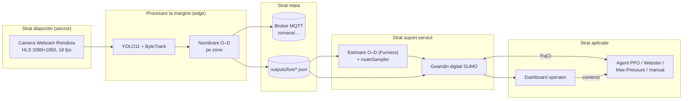
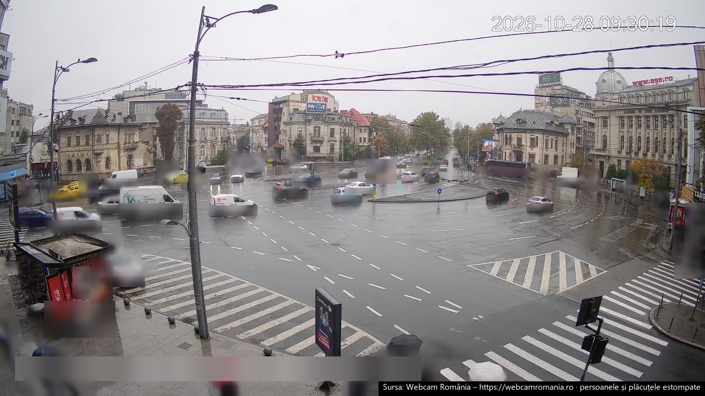
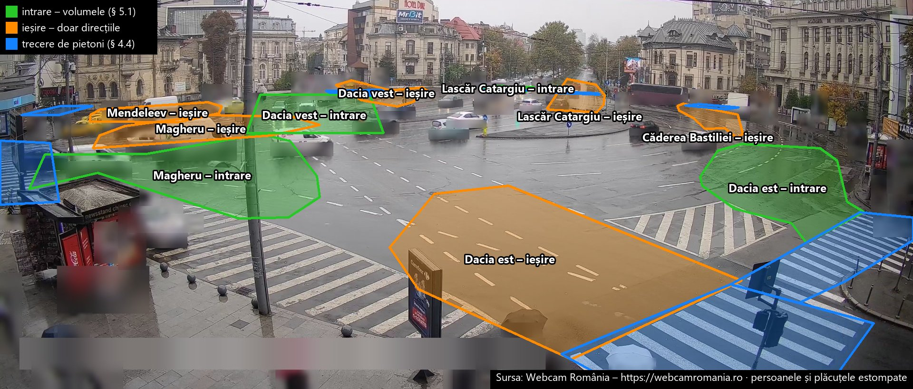

# Semaforizare Piața Romană – documentația proiectului

**Semaforizarea inteligentă, bazată pe inteligență artificială, a intersecției Piața Romană din București,
cu date preluate în timp real de pe camera publică Webcam România și simulare în SUMO**

Autor: Niunin Matei-Gabriel · Universitatea Transilvania din Brașov, Facultatea de Matematică și Informatică,
Informatică ID, anul III · Discipline: *Interfețe om-calculator* și *Internet of Things* · Anul universitar 2026–2027

Documentația: © 2026 Niunin Matei-Gabriel, CC BY 4.0 (§ 14.1) · Conține informații din OpenStreetMap,
© OpenStreetMap contributors, ODbL 1.0 – https://www.openstreetmap.org/copyright · Sursa fluxului video:
Webcam România – https://webcamromania.ro, folosit cu acordul scris din 27.10.2026 (§ 14.1) · Cod sursă (GNU AGPL v3)
și date: https://github.com/NiuninMatei/Semaforizare_Piata_Romana

---

## Cuprins

1. [Context și motivație](#1-context-și-motivație)
2. [Obiective și cerințe](#2-obiective-și-cerințe)
3. [Arhitectura sistemului (perspectiva IoT)](#3-arhitectura-sistemului-perspectiva-iot)
4. [Modulul de viziune artificială](#4-modulul-de-viziune-artificială)
5. [Puntea cameră → simulare: cererea de trafic calibrată](#5-puntea-cameră--simulare-cererea-de-trafic-calibrată)
6. [Rețeaua rutieră în SUMO](#6-rețeaua-rutieră-în-sumo)
7. [Controlul inteligent al semafoarelor](#7-controlul-inteligent-al-semafoarelor)
8. [Interfața om-calculator: dispeceratul](#8-interfața-om-calculator-dispeceratul)
9. [Rezultate](#9-rezultate)
10. [Limitări, aspecte etice și lucrări viitoare](#10-limitări-aspecte-etice-și-lucrări-viitoare)
11. [Ghid de utilizare](#11-ghid-de-utilizare)
12. [Jurnalul proiectului](#12-jurnalul-proiectului)
13. [Asistență generativă](#13-asistență-generativă)
14. [Bibliografie și licențe](#14-bibliografie-și-licențe)
- [Anexa A. Fișierele de rezultate](#anexa-a-fișierele-de-rezultate-docsrezultate)

---

## 1. Context și motivație

Piața Romană este nodul în care axa nord–sud Lascăr Catargiu – Magheru (paralelă cu magistrala de metrou M2)
se intersectează cu axa est–vest a Bulevardului Dacia[^wiki-romana]. În piață se varsă, în plus, două străzi cu
sens unic de ieșire: Str. D. I. Mendeleev și Str. Căderea Bastiliei. Camera Webcam România montată pe clădirea
dintre Bd. Magheru și Bd. Dacia (axa estică) filmează continuu „sensul giratoriu din mijlocul pieței, trecerile de
pietoni, traficul de pe bulevardele Magheru, Lascăr Catargiu și Dacia”[^webcam].

Bucureștiul este unul dintre cele mai congestionate orașe din lume. În ediția 2025 a TomTom Traffic Index,
nivelul mediu de congestie a fost de 62,5%, orașul a ocupat locul 20 global (5 în Europa), iar un șofer a
pierdut în medie 171 de ore pe an la orele de vârf, cu o viteză medie de vârf de 14 km/h[^tomtom][^pmb-tomtom].

Municipalitatea operează sistemul de management al traficului BTMS, extins la aproximativ 267–268 de intersecții
coordonate dintr-un centru unic, majoritatea cu automate „cu funcționare în mod adaptiv”[^btms-267][^buletin-btms].
În 2026 a fost anunțat un proiect nou, bazat pe AI, pentru 92 de intersecții în prima etapă: „Vom monta 305 camere
şi 1.500 de senzori”, cu ajustarea timpilor de semaforizare după numărul de mașini și prioritate pentru transportul
public[^digi24-ai]. Axa Unirii – Universitate – Piața Romană – Piața Victoriei a fost chiar pilotul primului sistem
„undă verde” din 2007[^economedia]. Infrastructura rămâne însă fragilă: pe 8 mai 2026 un incendiu la cablurile electrice
subterane din Piața Romană a scos din funcțiune semafoarele pieței[^adevarul-incendiu] – motiv pentru
care sistemul propus are întotdeauna un plan fix de rezervă.

Proiectul arată, la scară academică, lanțul complet pe care îl presupun aceste sisteme: **senzor video →
date de trafic → model digital al intersecției → decizie automată → supraveghere umană**.

**Întrebarea proiectului.** Pe măsură ce s-au strâns date reale, s-a văzut că nu există o singură strategie bună
pentru orice trafic (§ 9). De aceea proiectul nu caută un agent AI „cu orice preț”. Caută **cea mai bună combinație
implementabilă de planuri și agenți pentru cazurile reale de trafic ale pieței**. Fiecare caz (lejer, mediu sau
intens, după debitul măsurat de cameră) primește strategia care câștigă pe datele lui, iar un selector o activează
după traficul măsurat. Programul semafoarelor e singurul lucru schimbat; geometria și semafoarele rămân cele reale.
Candidați sunt deopotrivă planurile fixe clasice, programele din planuri fixe pe cazuri și agenții de învățare prin
întărire. Câștigă cel mai bun, verificat pe o zi nevăzută, iar ceilalți rămân documentați ca încercări (§ 9.9). În
calcul intră toți participanții observați pe cameră: autoturisme, autobuze și troleibuze, camioane, motociclete,
bicicliști și pietoni.

## 2. Obiective și cerințe

| # | Cerință (din tema proiectului) | Cum este îndeplinită |
|---|---|---|
| R1 | Preluarea în timp real a datelor de pe camera publică | `vision/stream.py` citește fluxul HLS cu reconectare automată; `run_vision.py` analizează 4–6 cadre/s |
| R2 | Direcțiile **din care vin** și **spre care se îndreaptă** vehiculele, cât mai aproape de adevăr | 10 zone poligonale (intrare/ieșire pe fiecare braț) calibrate pe traiectorii reale; matrice O–D pe intervale de 15 min; 10 zone pe trecerile de pietoni, corectate pe 28.10 (§ 4.4) |
| R3 | Transformarea datelor în flux de trafic simulat în SUMO, nu trafic aleator | estimare O–D Furness + `routeSampler.py` pe viraje, pe tipuri de vehicule (inclusiv biciclete); pietoni din numărătorile de pe treceri; trafic de fond doar ca fracțiune declarată |
| R4 | Model AI care recunoaște semafoarele intersecției și le controlează | cele 16 semafoare fizice ale pieței sunt identificate automat după coordonate și grupate într-un controler, ca automatul real; agent PPO care alege ordinea și durata fazelor reale; agenții sunt candidați alături de planurile fixe, în programul pe cazuri de trafic (§ 9.9) |
| R5 | Antrenare până la fluidizarea optimă a intersecției | antrenare pe mai multe scenarii, în paralel; evaluare față de 4 linii de bază pe seed-urile de test 1–10 (alegerile pe seed-urile de validare 11–15), pentru toți participanții (vehicule, bicicliști, pietoni); fluidizarea optimă se caută pe cazuri de trafic: fiecare caz primește strategia care câștigă pe el, plan fix sau agent, aleasă pe validare și verificată pe o zi nevăzută (§ 9.9) |
| R6 | Extindere la intersecțiile principale conexe | varianta „coridor”: Piața Romană + cei 4 vecini imediați care o alimentează, controlați simultan |
| R7 | Documentație în limba română, cu surse și licențe | acest document; note de subsol; § 14 |
| R8 | Evoluție vizibilă pe GitHub, pe borne | commit + push la fiecare bornă (§ 12) |

Cerințe nefuncționale: siguranță (agentul nu poate produce stări periculoase ale semaforului), confidențialitate
(nicio înregistrare video păstrată; din cameră e publicat doar un cadru estompat, § 4.5; local rămân doar previzualizarea
estompată, suprascrisă continuu, și, temporar, capturi și scurte clipuri folosite la calibrarea zonelor, șterse după
calibrare), reproductibilitate (rețea, cerere și rezultate regenerabile din scripturi),
rulare pe un laptop Windows fără GPU dedicat (detecția rulează pe placa grafică Intel integrată, § 4.1).

## 3. Arhitectura sistemului (perspectiva IoT)

Sistemul urmează modelul pe straturi din recomandarea ITU-T Y.2060[^itu-y2060]:



* **Senzorul virtual.** Camera nu este a proiectului; este tratată ca un senzor public, iar „inteligența” rulează pe
  stația locală (*edge computing*). Spre restul sistemului pleacă doar **numărători agregate** și traiectorii fără imagini și fără identificatori
  (pseudonimizate), plus previzualizarea estompată pentru dispeceratul local (§ 4.5) – economie de lățime de
  bandă și, mai ales, conformitate cu principiul minimizării datelor din GDPR[^gdpr].
* **Rețea.** Modulul de viziune publică opțional pe MQTT (OASIS Standard 5.0[^mqtt]; broker recomandat Eclipse
  Mosquitto[^mosquitto]): `romana/stare/camera` (retained, QoS 1), `romana/numaratori/interval` (retained),
  `romana/evenimente/viraj`. Local, aceleași date sunt scrise atomic în `outputs/live/*.json`.
* **Servicii.** Estimarea matricei O–D și generarea cererii; geamănul digital SUMO.
* **Aplicație.** Controlerul semaforului și dispeceratul.

## 4. Modulul de viziune artificială

### 4.1 Sursa video

Fluxul `mono.m3u8` este o listă HLS de segmente `.ts` de 6 s, H.264, 3288 × 1850 px, 18 fps (verificat cu
`ffprobe` la 20.10.2026). `FrameSource` îl citește prin FFmpeg/OpenCV[^opencv][^ffmpeg] pe un fir separat, pune
cadrele (6 pe secundă) într-un tampon în memorie și le redă uniform, cu o întârziere fixă de 8 s (§ 4.6); la căderea
fluxului se reconectează cu întârziere exponențială (1 s → 30 s).



*Figura 4.1 – Vederea camerei publice din Piața Romană, miercuri 28.10.2026, 09:30, pe ploaie (sursa: Webcam
România – https://webcamromania.ro[^webcam]). În prim-plan, Bd. Magheru (stânga) și Bd. Dacia est (dreapta); în
fundal, Bd. Lascăr Catargiu și clădirea ASE. Persoanele, plăcuțele tuturor vehiculelor și textul publicitar
suprapus de cameră sunt estompate (§ 4.5). Publicată cu acordul scris al Webcam România din 27.10.2026 (§ 14.1);
imaginea nu este licențiată de proiect.*

**Camere pentru intersecțiile conexe.** S-au căutat (21.10.2026) toate camerele publice din zona modelată:
lista Webcam România pentru București (8 camere)[^webcam-buc], Windy Webcams[^windy], Meteoblue[^meteoblue] și
listele de intersecții supravegheate. Rezultat:

| Cameră | Ce arată | Folosită? |
|---|---|---|
| Webcam România – Piața Romană (HLS) | piața, toate cele 6 brațe și trecerile lor de pietoni (pietonii se detectează de încredere doar pe cele 2 din prim-plan, § 4.4) | **da** – singura sursă video a proiectului |
| Webcam România – Piața Victoriei (YouTube live)[^youtube] | pasajul Victoriei, în afara zonei modelate (dincolo de Lascăr Catargiu × Gh. Manu) | nu |
| „Calea Victoriei City Cam” (YouTube) | imagine statică a Ateneului, fără trafic | nu |
| Windy / Meteoblue „Piața Romană” | aceeași cameră Webcam România | – |
| Listele de „intersecții supravegheate” (Dacia × Dorobanți, Magheru × Enescu) | camere ale Poliției / PMB, fără imagine publică | nu (indisponibile) |

Pentru intersecțiile conexe (§ 6.1) nu există deci camere publice. Conform principiului proiectului, traficul
lor este simulat din datele Pieței Romane: rutele candidate pornesc de la marginea rețelei și traversează
intersecțiile vecine (§ 5.2), astfel încât fiecare vecin primește exact traficul observat care intră în piață
sau iese din ea pe brațul lui, plus traficul de fond declarat (15%).

**Calculul pe laptop.** Laptopul nu are placă grafică NVIDIA; YOLO11s la 1600 px rula pe procesor cu ≈0,9
cadre/s, prea puțin pentru urmărire (traiectorii fragmentate, Magheru subnumărat la ≈250 veh/h). Detectorul
este exportat automat în formatul Intel OpenVINO[^openvino] (`runtime: "openvino"` în `config/camera.json`) și
rulează pe placa grafică Intel integrată: ≈5 cadre/s cu exact aceleași detecții pe cadrul de test (34 de
vehicule, 11 persoane), lăsând procesorul liber pentru simulare și antrenare.

### 4.2 Detecție și urmărire

* **Detecție:** Ultralytics YOLO11[^yolo11], preantrenat pe COCO[^coco]; clasele folosite: car (2) → `passenger`,
  motorcycle (3), bus (5, include troleibuzele STB), truck (7), bicycle (1) și person (0) – pentru numărarea
  pietonilor pe treceri (§ 4.4) și pentru estomparea în previzualizare.
  Implicit `yolo11s` la 1600 px pe regiunea de interes (partea de jos a cadrului, fără cer), configurabil în
  `config/camera.json`; pe GPU NVIDIA se poate folosi `--device 0`.
* **Urmărire:** ByteTrack[^bytetrack] (asociază și detecțiile cu scor mic, util la ocluziile din piață);
  alternativ BoT-SORT[^botsort].
* **Punctul de referință** al fiecărui vehicul este mijlocul laturii de jos a dreptunghiului (contactul cu solul),
  mai stabil la perspectivă decât centrul.

### 4.3 Zonele de intrare/ieșire și matricea origine–destinație

Camera vede cele șase brațe ale pieței, de la stânga la dreapta: Bd. Magheru (extremă stânga), Str. Mendeleev
(ieșire), Bd. Dacia vest (centru-stânga), Bd. Lascăr Catargiu (centru-dreapta), Str. Căderea Bastiliei (ieșire,
lângă clădirea ASE) și Bd. Dacia est (extremă dreapta). Pentru fiecare braț cu dublu sens s-au definit **două**
poligoane – banda de intrare spre piață și banda de ieșire – iar pentru străzile cu sens unic doar zona de ieșire
(10 zone de vehicule, plus zonele de trecere pentru pietoni, § 4.4; `config/camera.json`, coordonate normalizate
0–1, independente de rezoluție). Ieșirile servesc doar la direcții (proporțiile de viraj), nu la volume (§ 5.1).



*Figura 4.2 – Zonele de numărare actuale (recalibrate pe 26.10, `config/camera.json`) peste captura din figura
4.1, fără cer: verde – intrările, din care se iau volumele; portocaliu – ieșirile, folosite doar pentru
direcții; albastru – trecerile de pietoni (§ 4.4). Sursa imaginii: Webcam România; persoanele, plăcuțele și
textul publicitar al camerei sunt estompate.*

**Zonele desenate de autor** (23–24.10.2026, folosite până la recalibrarea din 26.10, de mai jos): 16 decupaje pe capturi ale camerei (10 zone de
vehicule, 6 treceri), localizate automat în cadrul de 3288 px prin potrivire de puncte caracteristice (SIFT) cu
scara fixă 3288/1920 (capturi pe un ecran de 1920 px) și vot pe translație; două zone cu prea puține repere au
fost poziționate manual, cu forma și mărimea decupajului. Ele înlocuiesc calibrările anterioare (din
traiectoriile primelor ore și redesenarea din 22.10, § 12.2). Dacă operatorul mută camera, zonele se
redesenează cu `scripts\2b_calibrare_zone.bat`, iar `recount` reface numărătorile din jurnal.

**Recalibrarea pe o numărătoare de referință (26.10.2026).** La cererea autorului, toate zonele au fost reanalizate
de la zero și alese pe măsurători, nu pe aspect:

* *Numărătoarea de referință.* Două clipuri de câte 3 minute (26.10, 11:58 și 12:19; stocate doar local și șterse
  după adnotare) au fost adnotate cadru cu cadru, pe foi de contact la 0,5 s: pe fiecare țintă (intrările de pe cele
  4 brațe, zebrele) și pe fiecare bucată de 30 s au numărat **doi adnotatori AI independenți** (instanțe separate ale asistentului Claude, § 13; nu oameni), cu un al treilea ca
  arbitru la diferențe peste max(2; 15%). Aceleași clipuri au fost trecute prin lanțul live (YOLO11s, 1600 px,
  6 cadre/s), deci referința și numărarea automată văd exact aceleași cadre (clipurile au mici salturi de câteva
  secunde, aceleași pentru ambele). Adnotatorii au corectat și o greșeală de țintă: intrările dinspre Lascăr
  Catargiu coboară pe carosabilul din stânga spațiului verde și virează pe după monument.
* *Calibrarea camerei pe rețea.* Prin corespondențe imagine ↔ rețeaua OSM (capetele zebrelor, liniile de oprire) s-a
  potrivit o omografie a planului străzii: în fundal eroarea e de ≈14 px (sub ≈1 m); în prim-planul de lângă cameră
  niciun model plan unic nu se potrivește (distorsiunea obiectivului, OSM decalat local), așa că acolo zonele s-au
  desenat pe marcajele reale, pe un fundal median din 90 de cadre (fără vehicule), verificate pe câmpul de mișcare.
  Tot atunci s-a constatat că zona cu dungi din stânga-jos (unde parchează uneori o mașină) este o **zonă hașurată,
  nu o trecere de pietoni** – nu se numără pietoni acolo.
* *Rezultat* (cât din referință prinde numărarea automată pe bucățile adnotate, clipul 1 / clipul 2 – ieșirea
  „prins” a comenzii `referinta factori`, § 11.8): **Dacia vest** 27% / 37% cu zona veche (zonele din commitul
  `e1d0f77`) → **90% / 89%** cu zona nouă (mașinile care ies din bulevard spre cameră, după linia de oprire; zona
  veche prindea puțin din ele); **Magheru** 84% / 96% și **Dacia est** 98% / 124% – zonele existente erau deja bune
  și au rămas; **Lascăr Catargiu** 44% / 38% – limita e detectorul (vehicule mici, departe), nu zona. La 2560 px
  detectorul prinde pe Catargiu 83% / 60% și pe Magheru 101% / 91%, dar procesează doar ≈2,3 cadre/s pe placa
  grafică integrată a laptopului, față de ≈4,4 la 1600 px – insuficient pentru urmărirea live; e o recomandare
  pentru un hardware cu GPU dedicat.
* *Factorii de corecție a detecției* (referință / automat, pe ambele clipuri; interval de încredere 90% prin
  bootstrap pe bucăți): Magheru **1,09** [1,02; 1,16], Dacia est **0,88** [0,57; 1,05], Dacia vest **1,12**
  [0,70; 1,42], Lascăr Catargiu **2,52** [2,06; 3,00] (`factor_corectie_detectie` în `config/demand.json`). Ei
  înlocuiesc presupunerea de dinainte (cererea între „doar intrări” și „media intrări / ieșiri”, § 5.1) cu o
  calibrare măsurată. Limita: două clipuri de 3 minute de la prânz – factorii trebuie confirmați pe alte ore.
  Numărătorile adnotatorilor, traiectoriile vehiculelor din clipuri (fără pietoni și fără imagini), factorii și
  corespondențele calibrării camerei sunt publicate în `docs/rezultate/referinta/` (comenzile: § 11.8).

Regula de numărare (`classify()` în `vision/od_counter.py`), aplicată pe traiectoria întreagă la închiderea ei:

* originea = **prima** zonă de intrare vizitată **înaintea oricărei ieșiri**; destinația = **ultima** zonă de
  ieșire a **altui** braț, vizitată după origine. Zonele de intrare și de ieșire ale aceluiași braț sunt
  alăturate: prima variantă a regulii producea 25 de „întoarceri” Magheru → Magheru în 5 minute, de fapt
  vehicule care atingeau banda vecină;
* pe brațele îndepărtate, parțial ascunse (Dacia vest, Lascăr Catargiu, Mendeleev, Căderea Bastiliei), zonele
  de ieșire sunt marcate `capat_traiectorie`: o ieșire contează doar dacă traiectoria **se termină** acolo (toleranță
  1,5 s); până la recalibrarea din 26.10 erau marcate și intrările Dacia vest și Catargiu, care contau doar dacă
  traiectoria **începea** acolo (vehiculul apărea din strada ascunsă). Pe 21.10, verificarea
  sensului de mers (`recount --directii`) a arătat că fosta zonă „intrare Dacia vest” prindea de fapt
  vehiculele care circulă pe inel prin dreptul străzii (73 din 74 se îndepărtau de centru);
* fiecare zonă cere un **sens de mers** în imagine (±60°), măsurat pe primele / ultimele 1,5 s ale
  traiectoriei (zonele `capat_traiectorie`) sau pe porțiunea din zonă: intrările se mișcă spre piață,
  ieșirile dinspre piață. Zonele unui braț se pot astfel suprapune fără confuzie;
* o traiectorie completă produce un viraj (origine → destinație); una fragmentată (vehicul pierdut la o
  ocluzie) contribuie doar la numărătoarea pe braț.

**Calibrarea pe datele de zi (21.10.2026).** Pozițiile zonelor au fost stabilite din jurnalul primelor 1,5 ore
de traiectorii (≈16.000 de fragmente): câmpul de mișcare arată sensul fiecărei benzi (inelul circulă în sens
trigonometric), iar hărțile cu începuturile și sfârșiturile traiectoriilor arată unde vehiculele apar din /
dispar în străzile parțial ascunse (Lascăr Catargiu sus-centru, Dacia vest în spatele stației de troleibuz,
Căderea Bastiliei sus-dreapta). Geometria din rețeaua OSM (azimutul fiecărui braț văzut din poziția camerei)
confirmă ordinea brațelor în imagine: camera privește spre vest, deci stânga = sud (Magheru), dreapta = nord
(Căderea Bastiliei). Corecții: fosta zonă de intrare Dacia vest era pe inel; zona Căderea Bastiliei era prea sus
(0 vehicule); intrarea Dacia est stătea parțial peste trecerea de pietoni, iar vehiculele circulă deasupra ei.

**Reunirea fragmentelor.** La 5 cadre/s, stâlpii, autobuzele și copacii întrerup urmărirea. Înainte de
numărare, `recount` reunește fragmentele aceleiași traiectorii: un fragment care se termină este legat de unul
care începe în cel mult 2 s, aproape de poziția prezisă din viteza de la capăt, de aceeași categorie și cu
direcție compatibilă (≈12% din fragmente sunt reunite). Chiar și așa, doar ≈25–40% dintre vehicule sunt urmărite
de la intrare până la ieșire (virajele față de intrări, în `data/counts`) – matricea O–D se sprijină deci în principal
pe totalurile pe brațe (§ 5.1).

Se agregă pe intervale de 15 minute, separat pe tipuri de vehicule, în `data/counts/numaratori_AAAA-LL-ZZ.csv`.

**Auditul numărării (25.10.2026).** Cu zonele de atunci (23–24.10), camera număra în medie **1,6 ieșiri
pentru fiecare intrare** (cu zonele actuale, ≈1,4), deși fizic fiecare vehicul care intră iese. Harta capetelor de
traiectorie arată cauza: pe inelul din fundal vehiculele sunt
atât de mici încât detectorul le pierde oriunde, iar un vehicul pierdut în dreptul unei ieșiri îndepărtate pare
„ieșit” pe ea. S-a încercat corectarea regulii pe criteriul conservării vehiculelor (cadre minime în zonă,
înaintare minimă pe stradă, prag relativ la lungimea zonei – `Params.capat_min_*`, rezultatele în
`docs/rezultate/calibrare_conservare*.csv`): orice prag care aduce raportul ieșiri/intrări la ~1 elimină aproape
complet ieșirile reale spre Dacia vest și Căderea Bastiliei, deci acolo ieșirile **nu pot fi deosebite** de
vehiculele pierdute cu această cameră. Concluzie: ieșirile de pe brațele îndepărtate nu sunt o măsurătoare de
încredere; regula rămâne neschimbată (pragurile noi sunt dezactivate), iar consecința pentru cerere e tratată în
§ 5.1. Pe brațele apropiate (Magheru, Dacia est) și pe trecerea mare de pe Dacia est numărarea e coerentă.

**Jurnalul de traiectorii și renumărarea.** Pe lângă numărători, modulul salvează local, în
`data/trajectories_brute/traiectorii_AAAA-LL-ZZ.jsonl.gz` (exclus din Git), fiecare traiectorie închisă: clasa
obiectului, momentul de început `t0` (timp Unix, la 0,01 s) și pozițiile punctului de contact cu solul, în coordonate
normalizate, cu timpul relativ față de `t0` – fără imagini, fără numere de înmatriculare, fără ID-ul de urmărire.
Astfel zonele pot fi recalibrate **după** colectare, iar `python -m romana.vision.recount` reface numărătorile din
jurnalul local (testat: rezultat identic cu numărarea live). În depozit, `data/trajectories/` conține doar ieșirea
comenzii `python -m romana.vision.recount --publica`: traiectoriile vehiculelor (inclusiv biciclete și motociclete),
cu fragmentele deja reunite, fără pietoni, în același format. Pe acest jurnal publicat, renumărarea vehiculelor
reproduce exact renumărarea din jurnalul complet (verificat pe ziua de 22.10, cu zonele din 23–24.10: 10 726 de
intrări, 2 238 de viraje, 0 din 53 de intervale diferite; cu zonele actuale, recalibrate pe 26.10: 13 414 intrări din
jurnalul publicat față de 13 413 din cel complet – o singură intrare în plus, pe Dacia vest, la 10:15–10:30 – și
aceleași 3 270 de viraje); pietonii apar doar în numărătorile agregate din `data/counts/`.
Tot din jurnal se desenează câmpul de mișcare al vehiculelor și capetele traiectoriilor (`recount --flux`),
folosite la plasarea zonelor.

### 4.4 Pietoni și bicicliști

În simulare intră toți participanții observabili pe cameră. Zonele cu rolul `trecere` (`config/camera.json`, refăcute
pe 26.10.2026) acoperă zebra de pe Magheru, cele două zebre ale trecerii duble de pe Dacia est (peste ieșire și peste
intrare, cu refugiul dintre ele) și, proiectate din rețeaua OSM, trecerile din fundal (Mendeleev, Dacia vest, Lascăr
Catargiu, Căderea Bastiliei). În practică, pietonii sunt detectați de încredere doar pe trecerile din prim-plan (Magheru, la marginea
cadrului și parțial ascunsă de chioșc, și mai ales Dacia est): pe trecerile îndepărtate persoanele sunt prea mici
în imagine pentru detector.

**Corecturile din 28.10 (observațiile autorului)**, făcute înainte de prelucrarea zilei de test. Zonele de vehicule
au rămas neschimbate.
- *Mendeleev.* Cele două zone vechi stăteau pe locul unde netconvert ghicește trecerea, adică peste banda cu mașini
  parcate și taxiuri de pe Str. Mendeleev. Pe 28.10 zona a fost mutată pe zebra marcată din OpenStreetMap (calea
  1104820827, 10,3 m), proiectată cu modelul camerei (§ 4.3), mai la stânga, lângă colțul clădirii BCR.
  Pe locul real trecerea e acoperită de un stâlp, de copaci și de mașinile parcate. Pe 28.10 traiectoriile au arătat
  doar 2 traversări ale străzii în tot cadrul. Pietonii de pe Mendeleev intră deci în cerere doar prin factorul de
  extrapolare.
- *Dacia est.* Trecerea dublă e, de fapt, o singură trecere peste bulevard: în OSM, o singură cale de trecere taie
  ambele carosabile. Între cele două zone rămăsese neacoperită porțiunea din mijloc a zebrei. Pe 28.10, 2 786 de
  traiectorii de pietoni au trecut prin această porțiune, majoritatea între trotuarul de lângă cameră și cel din
  dreapta-sus. Zona de peste intrare a fost prelungită până la cea de peste ieșire.
- *Celelalte treceri din fundal* (Magheru, Dacia vest, Lascăr Catargiu, Căderea Bastiliei) se potrivesc cu nodurile
  de trecere din OSM proiectate în imagine.
- *Efectul* pe ziua de luni: traversările numărate cresc cu 6% (14 421 → 15 294), în principal pe Dacia est
  (5 596 → 6 604). Cele 135 de „traversări” ale zonei vechi de pe Mendeleev erau, cel mai probabil, detecții false.

Jurnalul de traiectorii nu depinde de zone. O corectură a zonelor nu cere deci o colectare nouă: numărătorile se
refac din jurnal cu `romana.vision.recount`.

* **Pietoni.** Persoanele detectate sunt urmărite cu același ByteTrack. De la 26.10.2026 fiecare trecere are
  zebra reală (poligon + axa de la o bordură la cealaltă) și câte o **zonă de așteptare** la fiecare bordură
  (ideea autorului, restrânsă la proximitatea zebrei, ca să nu fie numărați trecătorii de pe trotuar). Un pieton
  este numărat **o singură dată pe fiecare trecere**, dacă (a) a înaintat pe axa zebrei cel puțin 30% din lungimea
  ei (cine merge pe lângă zebră nu contează) sau (b) a așteptat la bordură între 5 și 120 s (cererea pentru faza de
  pietoni, inclusiv cei pe care detectorul îi pierde apoi printre vehicule; staționarea mai lungă – stația de
  autobuz, chioșcul – și obiectele statice sunt excluse). Pragul de 5 s a fost ales pe numărătoarea de referință
  (§ 4.3): cu el, trecerile de pe Dacia est ies la 95–110% din referință, față de 20–60% fără zonele de așteptare
  (eșantion mic: 2–3 bucăți de 30 s pe zebră). În CSV apar ca rânduri `pietoni` (braț, trecere). Debitul măsurat se extrapolează la toată piața cu
  `factor_extrapolare_pietoni` = 2,5 din `config/demand.json` (ipoteză declarată: pietonii sunt detectați de
  încredere pe ≈2 din cele ≈7 treceri semaforizate).
* **Bicicliști și motocicliști.** Bicicleta (clasa 1) este numărată ca vehicul pe zonele de intrare/ieșire, ca
  orice alt vehicul, și primește în SUMO rute pe care bicicletele au acces. Persoana de pe bicicletă sau
  motocicletă **nu** este numărată ca pieton: o persoană al cărei punct de contact cu solul cade în caseta unei
  biciclete/motociclete (lărgită cu 25%) este exclusă (`is_rider` în `vision/od_counter.py`).

### 4.5 Confidențialitate

Imaginile pot conține persoane și numere de înmatriculare, deci prelucrarea intră sub GDPR[^gdpr] și sub ghidul
EDPB 3/2019 privind dispozitivele video[^edpb]. Măsurile implementate:

* cadrele se prelucrează în memorie; modulul de viziune nu salvează nicio înregistrare video. Singura imagine
  scrisă pe disc în funcționarea normală este previzualizarea pentru dispecerat (persoanele estompate, redusă la
  960 px, suprascrisă continuu și afișată doar local). Pentru calibrarea zonelor s-au folosit, temporar, capturi
  și scurte clipuri ale camerei, păstrate local și șterse după calibrare; niciuna nu este publicată;
* singurele imagini publicate sunt figurile 4.1 și 4.2, făcute dintr-un singur cadru (28.10.2026, 09:30). În
  cadru s-au estompat automat persoanele, bicicliștii și motocicliștii (YOLO11 pe dale suprapuse, cu margine în
  jurul fiecărei detecții), banda plăcuțelor la toate vehiculele (la cererea autorului, pentru o imagine uniformă,
  și la cele îndepărtate, deși plăcuțele lor nu se pot citi) și textul publicitar suprapus de cameră.
  Imaginea publicată a fost apoi verificată vizual pe 9 bucăți, de agenți independenți, în două runde. Prima
  rundă a găsit 19 locuri scăpate detectorului, mai ales pietoni mici pe trotuarele din fundal, estompate apoi
  manual. A doua rundă nu a mai găsit nicio persoană sigur neestompată; cele 14 locuri incerte pe care le-a semnalat
  (forme mici la marginea petelor, posibile siluete îndepărtate) au fost estompate preventiv. Cadrul brut a fost
  șters;
* numerele de înmatriculare nu se citesc;
* ID-urile de urmărire sunt temporare și se uită la închiderea traiectoriei;
* se publică doar numărători agregate și jurnalul de traiectorii al vehiculelor (inclusiv biciclete și
  motociclete; tot așa și cele din clipurile numărătorii de referință, § 4.3): clasa obiectului, momentul de început `t0` și pozițiile normalizate ale punctului de contact cu
  solul, fără imagini și fără identificatori (date pseudonimizate); traiectoriile individuale ale pietonilor rămân
  doar în jurnalul local (`data/trajectories_brute/`, nepublicat); versiunile vechi ale jurnalelor publicate, care
  le conțineau, au fost eliminate din tot istoricul depozitului pe 26.10.2026 (§ 12.5).

Riscul de reidentificare nu este nul: o traiectorie individualizează un obiect în timp și spațiu și ar putea fi
legată, în principiu, de alte imagini ale aceleiași camere – cu atât mai mult cu cât momentul de început `t0` este
păstrat, deocamdată, la precizia de 0,01 s. De aceea traiectoriile nu sunt numite anonime, iar
licența deschisă a datelor (§ 14.1) nu ar face publicabile date personale. Fișierele `.ts`/`.mp4` sunt excluse
din Git (`.gitignore`). Depozitul și PDF-ul conțin un singur cadru al camerei, estompat (figurile 4.1 și 4.2). Fluxul este
public, iar utilizarea este strict academică. Webcam România și-a dat acordul scris pe 27.10.2026 pentru analiza
automată a fluxului în scop academic și necomercial, cu sursa indicată, și pentru publicarea a cel mult două
capturi cu persoanele estompate (§ 14.1)[^webcam]. Orice altă utilizare (comercială, alte imagini, persoane
neestompate) cere un acord nou.

**Informarea persoanelor vizate (art. 14 GDPR).** Operatorul este autorul proiectului, Niunin Matei-Gabriel;
contact: pagina de *Issues* a depozitului, https://github.com/NiuninMatei/Semaforizare_Piata_Romana/issues.
Scopul: cercetarea academică privind semaforizarea adaptivă a Pieței Romane. Temeiul: interesul legitim (art. 6
alin. (1) lit. f) GDPR), cu garanțiile pentru cercetarea științifică (art. 89 GDPR; art. 8 din Legea nr.
190/2018). Datele: pozițiile și traiectoriile participanților la trafic, extrase automat din fluxul public al
camerei Piața Romană; cadrele video nu se păstrează. Destinatari: publicul – numărătorile agregate și
traiectoriile vehiculelor sunt publicate deschis în depozitul GitHub. Stocarea: jurnalul local complet se
păstrează pe durata proiectului și a evaluării academice, apoi se șterge; datele publicate rămân în depozit.
Persoanele vizate au drepturile prevăzute de art. 15–18 și 21 GDPR; pentru art. 15–18, în limitele art. 11
(operatorul nu le poate identifica fără informații suplimentare furnizate chiar de ele). Există și dreptul de a
depune plângere la Autoritatea Națională de Supraveghere a Prelucrării Datelor cu Caracter Personal (ANSPDCP,
https://www.dataprotection.ro). Informarea individuală a trecătorilor este imposibilă (art. 14 alin. (5) lit. b)
GDPR), de aceea informarea este publicată aici.

### 4.6 Calitatea înregistrării: urmărirea sacadată din 21–22.10

Pe 27.10.2026, ziua de luni 26.10 a ieșit, la aceleași ore, cu de până la trei ori mai multe intrări numărate decât
miercuri 21.10 (pe Magheru 1 484/h față de 481/h, orele 10–17), deși camera nu s-a mișcat: hărțile de ocupare ale
traiectoriilor din cele patru zile se suprapun fără nicio deplasare (corelație 0,91–0,96), iar codul și parametrii
detecției (YOLO11s, 1600 px, OpenVINO) sunt aceiași. Diferența este în continuitatea urmăririi, măsurată direct în
jurnalele de traiectorii (`romana.vision.calitate`, `docs/rezultate/calitate_inregistrare.csv`; pe jurnalele publicate
din `data/trajectories/` ies practic aceleași cifre):

| Perioada | Goluri > 1 s între punctele unei traiectorii | Densitate (puncte pe secundă de traiectorie) |
|---|---|---|
| miercuri 21.10, 11:45–21:00 | 12–17% | 1,0–1,5 |
| noaptea 21–22.10, 21:00–06:00 | 5–10% | 2,1–2,9 |
| joi 22.10, 07:00–19:00 | 11–22% | 0,8–1,4 |
| joi 22.10, de la 20:00 | 2–3% | 3,7–4,5 |
| duminică 25.10 și luni 26.10 | 1–6% | 2,4–5,2 |

Un vehicul oprit la semafor este detectat în fiecare cadru, deci densitatea nu scade din cauza aglomerației, ci doar
a înregistrării. Schimbarea coincide cu tamponul de redare de 8 s pentru fluxul HLS, introdus pe 22.10 seara pentru
demonstrația live (§ 12.2, P3: „imaginea camerei mergea 2 s și stătea 4 s”, pentru că fluxul vine în bucăți de 6 s):
înainte, și analiza primea cadrele în rafale, cu opriri, iar urmărirea avea goluri în care vehiculele „săreau” peste
zonele mici de numărare. Problema a fost văzută atunci doar ca una de afișare. **Consecințe:** (1) zilele lucrătoare 21–22.10
(ziua) sunt subnumărate, cu un factor necunoscut și diferit pe brațe; factorii de corecție din § 4.3, măsurați pe
26.10, corespund înregistrării continue și nu se aplică acelor zile; (2) prima zi lucrătoare înregistrată continuu este
**luni 26.10**, chiar ziua numărătorii de referință: vârful ei calibrat are ≈5 000 de vehicule/h prin piață
(§ 5.4), iar numărătoarea de referință de la prânz (§ 4.3) dă ≈6 200 de vehicule/h (Magheru ≈3 070, Lascăr Catargiu ≈1 450,
Dacia vest ≈1 050, Dacia est ≈650) – de aproximativ două ori vârfurile din 21–22.10 (≈2 500 de vehicule/h); (3)
duminica 25.10, înregistrată continuu, părea „mai aglomerată” decât zilele lucrătoare (4 683 de vehicule/h la vârf) –
un semnal care ar fi trebuit să atragă atenția mai devreme. Pentru o colectare nouă: `romana.vision.calitate` pe
jurnalul zilei, înainte de orice scenariu.

## 5. Puntea cameră → simulare: cererea de trafic calibrată

Aceasta este piesa care asigură că agentul se antrenează pe **trafic real**, nu pe trafic aleatoriu.

### 5.1 Estimarea matricei O–D (Furness)

Camera nu urmărește fiecare vehicul de la intrare până la ieșire (stâlpi, autobuze care acoperă alte vehicule,
distanța până la brațele îndepărtate). De aceea se combină trei surse (`bridge/od_estimation.py`):

* **totalurile pe linii** $T_o$ = vehiculele intrate pe brațul $o$ (cea mai fiabilă măsurătoare);
* **totalurile pe coloane** $U_d$ = vehiculele ieșite pe brațul $d$, rescalate la $\sum T$;
* **sămânța** $S_{od}$ = virajele complete observate + $w \cdot p_{od}$, unde $p$ este o distribuție a priori
  (`config/demand.json`) folosită doar ca regularizare când observațiile lipsesc ($w = 2$ vehicule-echivalent).

Matricea se echilibrează prin metoda Furness (IPF)[^ortuzar], alternând scalarea coloanelor și a liniilor și
terminând pe linii (cu `echilibrare: "doar_intrari"` se scalează doar liniile). Factorii de corecție a
detecției pe brațe (`factor_corectie_detectie`) vin din numărătoarea de referință adnotată (§ 4.3).

**Echilibrarea intrări / ieșiri.** Pe datele de zi, suma ieșirilor numărate a depășit suma intrărilor cu
≈30% (ex. 12:00–12:15: 1.856 față de 2.436 veh/h). Diferența nu poate fi reală la scara a 15 minute (stocarea
pe inel este de câteva zeci de vehicule): camera **subnumără intrările** de la marginea cadrului (Magheru, Dacia
est – vehiculele apar deja parțial în zonă, în spatele chioșcului și al stației de autobuz) și **supranumără
ieșirile** spre străzile parțial ascunse (un vehicul pierdut lângă o stradă pare că a ieșit pe ea). O
comparație cu numărarea pe linii de control (*screen lines*) a dat erori de sens opus (≈745 intrări și ≈1.330
ieșiri pe oră), deci adevărul este între cele două metode. În lipsa unei numărători manuale de referință,
ambele sume au fost tratate ca măsurători ale aceluiași debit și aduse la **media** lor înainte de Furness
(`echilibrare: "medie"`); fiecare parte își păstrează distribuția pe brațe.

**Două calibrări ale cererii (25.10.2026).** Auditul numărării (§ 4.3) a arătat că ieșirile de pe brațele
îndepărtate sunt supranumărate (vehicule pierdute de detector), iar autorul a observat că semaforul controlează
doar intrările. De aceea s-a adăugat modul `echilibrare: "doar_intrari"` (implicit în `config/demand.json`):
volumele vin numai din intrări, iar proporțiile de viraj din traiectoriile complete și distribuția a priori;
ieșirile brute nu se mai folosesc. Intrările pot fi însă și ele subnumărate (vehicule ascunse de chioșc, de
autobuze sau unele de altele în aglomerație). Cele două calibrări mărginesc astfel cererea reală:

| Calibrare | Ce folosește | Vârf zile lucrătoare | Rolul în evaluare |
|---|---|---|---|
| **marginea de jos** – `doar_intrari` | doar intrările | ≈1 640–1 980 veh/h | scenariile din 25–26.10 (istoricul git) |
| **marginea de sus** – `medie` | media intrări / ieșiri | ≈2 400–3 000 veh/h | scenariile din 23–25.10 (istoricul git) |

Rezultatele se raportează pentru ambele (§ 9.2); incertitudinea din interiorul fiecăreia este acoperită de
scenariile de sensibilitate ×0,8 și ×1,2 (§ 5.4).

**Cererea calibrată pe numărătoarea de referință (26.10.2026).** Numărătoarea de referință (§ 4.3) a măsurat cât
din intrările reale prinde camera pe fiecare braț. Cu zonele refăcute, intrările numărate se înmulțesc cu factorii
de corecție măsurați (Magheru 1,09; Dacia est 0,88; Dacia vest 1,12; Lascăr Catargiu 2,52), iar ieșirile servesc
doar la proporțiile de viraj (`echilibrare: "doar_intrari"`). Vârful zilelor 21–22.10 iese ≈2 520–2 560 veh/h prin
piață – aproape de fosta margine de sus (≈2 400–2 510) și mult peste marginea de jos (≈1 640): cererea reală era
mai aproape de marginea de sus, probabil chiar peste ea (21–22.10 sunt subnumărate, § 4.6). Scenariile actuale din
`sumo/scenarios` folosesc această calibrare (§ 5.4).

### 5.2 De la O–D la vehicule în SUMO

1. Se generează un set mare de **rute candidate realiste**: drumuri minime de la marginea rețelei
   (`randomTrips.py` + `duarouter`), păstrând doar rutele care pornesc și se termină pe artere și au cel mult
   15% din lungime pe străzi rezidențiale, plus rute garantate pentru fiecare pereche intrare → ieșire.
2. Pentru fiecare interval de 15 min și fiecare tip de vehicul se scrie un fișier de viraje (`edgeRelation`
   de la muchia de intrare a brațului la muchia de ieșire).
3. `routeSampler.py`[^sumo-turns] alege din setul candidat exact atâtea rute câte trebuie pentru a reproduce
   virajele (optimizare liniară); calitatea se raportează prin indicatorul GEH și fișierele `mismatch_*.xml`.
4. Traficul de pe străzile vecine care **nu** trece prin piață (nemonitorizat video) se adaugă separat, ca
   fracțiune declarată din volumul observat (`fond_fractiune`, implicit 15%), pe rute care evită piața.

Astfel, intersecțiile vecine primesc traficul care chiar intră și iese din Piața Romană pe brațele lor, ceea ce
răspunde cerinței de a nu antrena agentul pe un flux necorespunzător realității.

### 5.3 Scenariul de referință (până la datele de zi)

În lipsa datelor oficiale publice de volum pentru Piața Romană (singura cifră publică găsită este o estimare
neoficială de ~3.446 veh/h pe Magheru spre Romană, dintr-un singur ciclu de semafor, 2011/2012[^wizard]),
până la colectarea datelor de zi se folosesc trei scenarii ipotetice explicite: *moderat* (0,7× → 1.442 veh/h
prin piață), *vârf* (720 / 620 / 390 / 330 veh/h pe Magheru / Catargiu / Dacia est / Dacia vest → 2.060 veh/h)
și *aglomerat* (1,2× → 2.472 veh/h), fiecare cu 15% trafic de fond și 1.200 de pietoni/h prin zona pieței
(stația de metrou M2 și ASE; valoare ipotetică). Compoziția: 88% autoturisme, 4% autobuze/troleibuze, 3%
camioane, 3% motociclete, 2% biciclete. Volumul de vârf a fost ales astfel încât planul fix de referință să
funcționeze aproape de saturație pe replica fidelă a rețelei, cu parametrii impliciți ai șoferilor (§ 6.4): peste
≈1,0× inelul se suprasatura, ceea ce părea să corespundă congestiei cunoscute a pieței. Scenariile au servit la
dezvoltarea și verificarea lanțului și au fost completate cu scenariile construite din numărătorile reale (§ 5.4).

### 5.4 Scenariile din date reale (Borna 9)

Datele colectate: **miercuri 21.10.2026 de la 11:45 până joi 22.10.2026 la 11:00** (zi, seară, noapte și vârful
de dimineață, la ≈5–6 cadre/s, dar cu urmărire sacadată, mai ales ziua, § 4.6), **duminică 25.10.2026 de la
01:14 până la ≈17:00** (noapte, dimineață, prânz, după-amiază) și **luni 26.10.2026 de la 09:11 până marți
27.10.2026 la 06:04** (din marți, doar noaptea: publicată, fără scenarii). Toate zilele sunt numărate cu zonele finale (§ 4.3): pentru
21–22.10, ≈200 000 de traiectorii după reunirea fragmentelor, ≈31 000 de intrări numărate și ≈8 000 de viraje
urmărite complet. Profilurile au forma așteptată: în 21–22.10 vârful de seară (17:15–18:15) și platoul
de dimineață (08:00–10:45), iar luni 26.10 vârful la 15:00–16:00; noaptea, câteva sute de vehicule pe oră; duminică
traficul crește abia de la 08:30, cu vârful după-amiaza (15:30–16:30).

`python -m romana.bridge.scenarii_zi --zi AAAA-LL-ZZ` alege automat ferestrele (ora de vârf, ora cea mai liniștită
și, dacă nu se suprapun cu vârful, dimineața 07:30–08:30, prânzul 12:00–13:00 și seara 17:30–18:30) și construiește scenariile, plus
sensibilitățile vârf ×1,2 și liniștit ×0,8. Cu zonele și regulile din 26.10.2026 (§ 4.3, § 4.4), datele renumărate
și cererea calibrată (§ 5.1), scenariile actuale sunt (pentru comparație, aceleași ferestre cu calibrările
anterioare):

| Scenariu | Fereastra | Vehicule prin piață (veh/h) | Fond | Pietoni/h | Marginea de jos | Marginea de sus |
|---|---|---|---|---|---|---|
| `zi_2026-10-21_pranz` (miercuri) | 12:00–13:00 | 1 948 | 292 | 3 059 | 1 194 | ≈1 780 |
| `zi_2026-10-21_varf` | 17:15–18:15 | 2 515 | 377 | 3 107 | 1 636 | ≈2 510 |
| `zi_2026-10-21_varf_x1_2` | vârf × 1,2 | 3 017 | 453 | 3 107 | 1 963 | ≈3 020 |
| `zi_2026-10-21_linistit` | 23:00–00:00 | 766 | 115 | 376 | 649 | ≈860 |
| `zi_2026-10-21_linistit_x0_8` | liniștit × 0,8 | 613 | 92 | 376 | 519 | ≈690 |
| `zi_2026-10-22_dimineata` (joi) | 07:30–08:30 | 2 209 | 331 | 2 826 | 1 534 | ≈2 220 |
| `zi_2026-10-22_varf` | 09:45–10:45 | 2 556 | 383 | 2 829 | 1 646 | ≈2 400 |
| `zi_2026-10-22_varf_x1_2` | vârf × 1,2 | 3 067 | 460 | 2 829 | 1 975 | ≈2 880 |
| `zi_2026-10-22_linistit` | 02:30–03:30 | 165 | 25 | 32 | 162 | ≈300 |
| `zi_2026-10-22_linistit_x0_8` | liniștit × 0,8 | 132 | 20 | 32 | 130 | ≈240 |
| `zi_2026-10-25_dimineata` (duminică) | 07:30–08:30 | 854 | 128 | 574 | 704 | – |
| `zi_2026-10-25_pranz` | 12:00–13:00 | 3 911 | 587 | 2 536 | – | – |
| `zi_2026-10-25_varf` | 15:30–16:30 | 4 683 | 702 | 2 775 | – | – |
| `zi_2026-10-25_varf_x1_2` | vârf × 1,2 | 5 620 | 843 | 2 775 | – | – |
| `zi_2026-10-25_linistit` | 05:15–06:15 | 387 | 58 | 232 | 349 | – |
| `zi_2026-10-25_linistit_x0_8` | liniștit × 0,8 | 309 | 46 | 232 | 279 | – |
| `zi_2026-10-26_pranz` (luni) | 12:00–13:00 | 3 381 | 507 | 3 902 | – | – |
| `zi_2026-10-26_varf` | 15:00–16:00 | 5 009 | 751 | 5 707 | – | – |
| `zi_2026-10-26_varf_x1_2` | vârf × 1,2 | 6 010 | 902 | 5 707 | – | – |
| `zi_2026-10-26_seara` | 17:30–18:30 | 3 357 | 504 | 4 670 | – | – |
| `zi_2026-10-26_linistit` | 21:30–22:30 | 1 004 | 151 | 870 | – | – |
| `zi_2026-10-26_linistit_x0_8` | liniștit × 0,8 | 803 | 120 | 870 | – | – |

Luni 26.10 (colectată de la 09:11, deci fără vârful de dimineață) este prima zi lucrătoare înregistrată cu urmărire
continuă (§ 4.6); zilele 21–22.10 sunt subnumărate, iar vârfurile lor (≈2 500 de vehicule/h) sunt aproximativ
jumătate din cel de luni (≈5 000) și din numărătoarea de referință de la prânz (≈6 200, § 4.3).

Marginile de jos și de sus sunt calibrările anterioare (§ 5.1; scenariile lor se regăsesc în istoricul git, la
commiturile `e1d0f77` și `7a79502`, § 11.8); pe
duminică, datele complete (până la 17:00) mută vârful la 15:30–16:30, iar fereastra de prânz devine scenariu separat.
Rezultatele din § 9.1–9.4 și din § 9.5 (fără E12–E14) au fost obținute pe calibrările anterioare (marginile de jos și
de sus); reevaluarea pe cererea calibrată este în § 9.8 (tot pe ea sunt E12 / E13 și localizarea de la vârfurile din
21–22.10, § 9.6), iar testul pe ziua de luni 26.10, cu capacitatea calibrată, în § 9.9 (pe aceleași scenarii sunt E14
și localizarea de la vârful de luni, § 9.6). Din 28.10,
scenariile din arbore folosesc capacitatea calibrată (§ 6.4). Pentru fiecare tip de vehicul, `routeSampler` reproduce relațiile de viraj țintă cu
GEH < 5 pentru ≈94% din relațiile autoturismelor și 100% din cele ale celorlalte tipuri. Agenții au fost
antrenați pe scenariile din 21–22.10 (doar E14, negativ, pe cele de luni, § 9.5); duminica 25.10 a servit ca test de
generalizare, iar lunea 26.10 ca test și apoi ca zi de validare a protocolului din § 9.9 (testul: miercuri 28.10).

Compoziția traficului măsurată (prima zi, 21.10): ≈93% autoturisme, ≈4% autobuze și troleibuze, ≈3% camioane,
sub 0,5% biciclete și motociclete – mult sub ipoteza inițială (2% biciclete, 3% motociclete), într-o zi de
octombrie cu 12–15 °C; duminică, la prânz, ≈95% autoturisme și ≈3% autobuze. Scenariile ipotetice `referinta_*`
(§ 5.3) rămân în proiect pentru comparație, dar agenții sunt antrenați **doar** pe scenariile din date reale.

### 5.5 Geamănul digital live

`bridge/live_twin.py` rulează SUMO (opțional SUMO-GUI) continuu, în timp real: în fiecare secundă citește
debitele curente publicate de modulul de viziune și injectează vehicule pe brațe ca proces Poisson cu acele
debite, cu destinații după proporțiile de viraj observate și tipuri după compoziția traficului (bicicliștii pe
rute permise bicicletelor). Pietonii sunt injectați tot Poisson, pe trasee pietonale care trec prin piață, cu
debitul măsurat pe trecerile vizibile × factorul de extrapolare. Dacă fluxul camerei lipsește (starea lui e mai
veche de 60 s) sau intervalul de numărare de 15 minute abia a început, păstrează ultimele debite bune ale camerei,
cel mult 20 de minute; apoi trece pe profilul de referință și **afișează explicit** acest lucru în dashboard. Simularea avansează în pași de 0,2 s
întinși pe secunda reală (mișcare fluentă în SUMO-GUI), iar controlerul semaforului lucrează pe secunde întregi.
Modurile de control, alese din dispecerat: agentul AI, planul fix de referință (N–S / E–V / pietoni, § 6.3),
Max-Pressure, manual și „Program pe tipuri de trafic” (§ 9.2, § 9.4), care comută automat după debitul măsurat
de cameră (media intrărilor și ieșirilor).

## 6. Rețeaua rutieră în SUMO

### 6.1 Construcție reproductibilă

`network/build_network.py` pornește de la extrasul OpenStreetMap[^osm] al zonei și rulează `netconvert`[^sumo]
pe un dreptunghi de 2,2 × 1,6 km, care include Piața Romană și primele intersecții semaforizate pe fiecare braț:

| ID în proiect | Intersecție | Distanța | Cameră | În coridorul controlat |
|---|---|---|---|---|
| `romana` | Piața Romană (Magheru – Lascăr Catargiu – Dacia) | – | da | da (controlerul principal) |
| `dacia_eminescu` | Bd. Dacia × Str. M. Eminescu × Calea Dorobanți (Dacia est) | ~215 m | nu | da |
| `magheru_enescu` | Bd. Magheru × Str. G. Enescu / Tache Ionescu (sud) | ~350 m | nu | da |
| `catargiu_manu` | Bd. Lascăr Catargiu × Str. Gh. Manu (nord-vest) | ~490 m | nu | da |
| `dacia_victoriei` | Bd. Dacia × Calea Victoriei (Dacia vest) | ~480 m | nu | da |
| `dacia_polona` | Bd. Dacia × Str. Polonă | ~525 m | nu | nu – Bd. Dacia este aici sens unic de ieșire din piață |

Semafoarele sunt găsite **după coordonatele geografice** (centroidul nodurilor), nu după ID-urile generate de
`netconvert`, care se schimbă la fiecare regenerare. Sensurile unice Mendeleev și Căderea Bastiliei (doar ieșire
din piață) sunt confirmate atât de etichetele OSM (`oneway=yes`), cât și de traiectoriile observate pe cameră.

**Coridorul controlat** (varianta „coridor” a agentului) cuprinde piața și cei 4 vecini imediați care o
alimentează. Bd. Dacia × Str. Polonă a fost scoasă din coridor la observația autorului, confirmată de OSM: pe
ambele tronsoane dintre Calea Dorobanți și Str. Polonă, Bd. Dacia are `oneway=yes` (doar autobuzele circulă în
contrasens, `oneway:bus=no`), deci la Polonă traficul obișnuit doar pleacă din piață. Intersecția rămâne în
simulare, pe programul ei actual. Piața Victoriei și Piața Universității sunt mai departe (≈0,9 și ≈1,5 km, cu
alte intersecții semaforizate între ele și piață): prima abia intră în colțul de nord-vest al rețelei, a doua e în
afara ei; camera publică a Pieței Victoriei arată pasajul și nu e folosită (§ 4.1).
Denumirea străzii este **Calea Dorobanți**; în OSM apare ca „Calea Dorobanților”.

### 6.2 Replica fidelă a pieței (Borna 8)

**Principiul:** infrastructura rămâne exact cea din realitate – inelul pieței, axa centrală N–S, benzile și
virajele marcate, sensurile unice, benzile dedicate STB, trotuarele, trecerile de pietoni și pozițiile reale ale
semafoarelor. Proiectul schimbă **doar modul în care semafoarele existente răspund traficului** (programul,
ordinea și durata fazelor) – singurul lucru care se poate implementa pe automatul real.

Importul `netconvert` folosește etichetele OSM pentru trotuare (`--osm.sidewalks`), accesul bicicletelor,
benzile de viraj și restricțiile pe benzi (`--osm.turn-lanes`, `--osm.lane-access`), iar trecerile de pietoni și
zonele de așteptare sunt reconstruite la toate intersecțiile (`--crossings.guess`, `--walkingareas`; opțiunea
`--osm.crossings` provoacă un crash în netconvert 1.28 pe acest extras). Rezultatul: 6.943 de muchii, 924 de
noduri, 53 de semafoare, 225 de benzi dedicate autobuzelor și trotuare pe toate arterele.

În OSM, piața are **16 semafoare fizice** (pe intrări, pe inel, pe axa centrală și la treceri). Ca în realitate,
unde toate sunt conduse de un singur automat de intersecție, ele sunt grupate într-un controler `romana`
(cele aflate la cel mult 80 m de centrul pieței, `--tls.join` cu `--tls.join-exclude` pentru restul). Controlerul
are 61 de legături: 54 pentru vehicule și 7 treceri de pietoni.

*Istoric:* în Bornele 3–7 piața fusese modelată ca un singur nod agregat, pentru că primul import OSM intra în
blocaj circular pe segmentele interne foarte scurte. În Borna 8, cu programul construit pe grupuri de semnal, s-a
constatat că inelul se bloca atunci când semnalele de pe brațele de ieșire primeau roșu și opreau vehiculele
deja intrate pe inel. Cu ieșirile pe verde în toate fazele de vehicule (§ 6.3), replica fidelă funcționează, iar
nodul agregat (care nu respecta realitatea) a fost abandonat.

### 6.3 Grupurile de semnal și fazele semaforului Piața Romană

Programul nu este cel ghicit de `netconvert`, ci este construit pe **grupuri de semnal** cu semnificație de
trafic (`config/network.json` → `romana_grupuri`), după muchia OSM pe care stau vehiculele la linia de oprire:

| Grup | Legături | Rol |
|---|---|---|
| `intrare_magheru`, `intrare_catargiu`, `intrare_dacia_est`, `intrare_dacia_vest` | 12 / 3 / 4 / 2 | intrările în piață |
| `axa_ns_centru` | 6 | axa centrală N–S, prin mijlocul pieței |
| `inel_dacia` | 11 | inelul din jurul insulei, pe direcția Dacia |
| `iesire_magheru_catargiu`, `iesire_dacia` | 12 / 4 | semnalele de pe brațele de ieșire |
| `pietoni` | 7 | trecerile de pietoni (grup automat) |

| Faza | Semnificație | În planul fix |
|---|---|---|
| 0 | N–S: Magheru ↔ Lascăr Catargiu prin centru | da, 36 s |
| 1 | E–V: Dacia în jurul insulei | da, 28 s |
| 2 | Pietoni: toate trecerile, axa centrală se golește | da, 12 s |
| 3 | N–S, cu intrările Dacia deschise (fără dozare) | nu |
| 4 | E–V, cu intrările Magheru/Catargiu deschise (fără dozare) | nu |

Planul fix de referință are un ciclu de ≈ 91 s (3 faze + galben 3 s + roșu de degajare 2 s după fiecare).
Ieșirile au verde în toate fazele de vehicule, pentru că fiecare ieșire este alimentată în ambele faze principale;
trecerile de pe ieșiri primesc verde în faza de pietoni. **Trecerile de pietoni primesc verde automat** în orice
fază în care niciun flux de vehicule cu verde nu le intersectează geometric (verificare de siguranță la
construcția programului; `build_network.py` refuză un program în care o trecere nu primește niciodată verde).
Roșul de degajare păstrează verdele legăturilor care rămân verzi și în faza următoare. Fazele 3–4 există ca
opțiuni, dar evaluarea a arătat că, deschizând intrările spre un inel deja ocupat, ele blochează piața (§ 7.4);
de aceea strategiile adaptive aleg implicit doar dintre fazele 0–2.

Intersecțiile vecine păstrează programele `actuated` generate (realist: sistemul BTMS funcționează adaptiv), cu
excepția variantei „coridor”, în care sunt conduse de agent.

### 6.4 Capacitatea geamănului, verificată pe debitul observat (27.10)

Geometria poate fi fidelă, iar geamănul tot să nu poată trece traficul real: capacitatea depinde și de cât de strâns
circulă șoferii. Verificarea s-a făcut pe luni 26.10, prima zi lucrătoare înregistrată continuu (§ 4.6): vârful
calibrat (`zi_2026-10-26_varf`, 15:00–16:00, ≈5 000 de vehicule/h prin piață) și vârful ×1,2 (≈6 000 de vehicule/h,
apropiat de numărătoarea de referință de la prânz, ≈6 200, § 4.3). Cu parametrii impliciți SUMO pentru șoferi (modelul
Krauss: timpul de reacție `tau` = 1,0 s, distanța minimă 2,5 m, imperfecțiunea `sigma` = 0,5), geamănul **se
blochează**: din 5 681 de vehicule ale vârfului rămân 2 121 neintroduse, iar pe intrarea Magheru trec 436 de vehicule
pe oră, față de ≈2 360 cerute de scenariu (≈3 070 în numărătoarea de referință). Baleiajul parametrilor (planul fix, seed 1):

| Șoferi (`tau` / distanța minimă / `sigma`) | Vârful de luni: neintroduse la final | Vârful ×1,2: neintroduse la final |
|---|---|---|
| 1,0 s / 2,5 m / 0,5 (implicit) | 2 121 (blocaj) | 3 135 (blocaj) |
| 1,0 s / 2,5 m / 0 | 1 771 (blocaj) | – |
| 1,0 s / 2,0 m / 0,5 | 2 051 (blocaj) | – |
| 0,9 s / 2,5 m / 0,5 | 588 | – |
| 0,9 s / 2,0 m / 0,5 | 473 | 1 000 |
| **0,8 s / 2,5 m / 0,5** | **15** | **45** |
| 0,8 s / 2,0 m / 0,5 | 19 | 19 |
| 0,8 s / 2,0 m / 0,3 | 10 | 19 |

Parametrul decisiv este timpul de reacție: cu **`tau` = 0,8 s** (o singură modificare față de valoarea implicită,
aleasă empiric: dintre valorile încercate, cea mai mică modificare a unui singur parametru care elimină blocajul),
geamănul servește practic tot vârful de luni și vârful ×1,2 (15 și 45 de vehicule neintroduse la final, din ≈5 700
și ≈6 800),
fără blocaje; distanța minimă și imperfecțiunea contează puțin. Calibrarea este în `sumo/demand/vtypes_capacitate.add.xml`
(și `vtypes_capacitate_indisciplinat.add.xml`), cu scenariile `capacitate_zi_*` și `capacitate_indisciplinat_zi_*`
(`romana.bridge.indisciplinat --vtypes … --prefix …`).

Cu parametrii impliciți, intrările pieței trec doar 35–44% din câte trec cu `tau` = 0,8 s (1 689 față de 3 830 la
vârf, 1 613 față de 4 576 la vârful ×1,2, în ora măsurată). Cum geamănul calibrat nu e saturat (rămân 15–45 de vehicule
neintroduse), capacitatea implicită este cel mult o treime până la jumătate din cea reală. Rezultatele din § 9.1–9.8
sunt obținute cu parametrii impliciți:
- pe cererea din 21–22.10, subnumărată la aproximativ jumătate (§ 4.6), deci cu un grad de saturare cel puțin
  egal cu cel real, probabil mai mare, și cu valori absolute mai mici;
- pe duminica 25.10 (§ 9.3, § 9.4), înregistrată continuu, deci cu o cerere apropiată de cea reală pe un geamăn
  suprasaturat; de aici, probabil, și pierderea de avantaj a agenților la vârful de duminică.

**Din 28.10.2026, geamănul calibrat este implicit** (decizia autorului). Timpul de reacție `tau` = 0,8 s este scris
în tipurile de vehicule generate de `romana.bridge.build_demand` (`sumo/demand/vtypes.add.xml`) și în
`vtypes_indisciplinat.add.xml`. Prin urmare, toate scenariile `zi_*` și `indisciplinat_*` din arbore, geamănul live
și antrenările noi folosesc capacitatea calibrată. Fișierele `vtypes_capacitate*.add.xml` și scenariile
`capacitate_*` au acum aceleași valori și rămân doar pentru reproducerea § 9.9 și a validării E14, care le folosesc
numele. Rezultatele din § 9.1–9.8 sunt istorice: s-au obținut cu tipurile implicite SUMO, din commitul `75592d3`
(Anexa A). Evaluarea pe ziua de luni cu capacitatea calibrată este în § 9.9.

## 7. Controlul inteligent al semafoarelor

### 7.1 Formularea ca problemă de decizie Markov

* **Pas de decizie:** 5 s simulate.
* **Stare:** pentru fiecare semafor controlat – faza verde curentă (one-hot), indicatorul „verde minim
  îndeplinit”, durata verdelui curent (normalizată la verdele maxim), pentru fiecare bandă de intrare coada
  (vehicule oprite) și densitatea, normalizate la capacitatea de stocare a benzii (lungime / 7,5 m), și, pentru
  fiecare zonă de așteptare a unei treceri controlate, numărul de pietoni care așteaptă (normalizat la 15).
  Aceeași funcție (`observation()` din `control/signals.py`) servește antrenarea, evaluarea și geamănul digital.
* **Acțiune:** faza verde dorită. La Piața Romană, implicit una din cele 3 faze ale planului real (N–S, E–V,
  pietoni): agentul decide **ordinea și durata** fazelor, adică exact ce se poate programa pe automatul existent
  (fazele „fără dozare” se pot activa cu `--toate-fazele`). În varianta coridor, câte o acțiune pentru fiecare din
  cele 5 semafoare ale coridorului – spațiu `MultiDiscrete`.
* **Recompensă:** $r_t = -\frac{1}{100}\left(\sum_{\ell} q_\ell(t) + \sum_{c} p_c(t) + b(t)\right)$,
  unde $q_\ell$ este numărul de vehicule oprite pe banda de intrare $\ell$, $p_c$ numărul de pietoni care
  așteaptă la trecerea $c$, iar $b$ numărul de vehicule care nu pot intra în rețea (blocate la margine); un
  pieton și un vehicul neintrodus cântăresc cât un vehicul oprit. *Lecție din Borna 8:* cu o penalizare mică
  pentru $b$ (0,002), agentul coridor a învățat să „ascundă” coada în afara rețelei – cozi de 4–8 vehicule în
  piață, dar ≈450 s așteptare medie și ≈400 de vehicule rămase în scenariul moderat. Este un exemplu clasic de
  exploatare a recompensei (*reward hacking*); modelele au fost reantrenate cu formula de mai sus, iar evaluarea
  raportează și întârzierea la intrarea în rețea.
* **Varianta „cozi în amonte” (v2, Borna 9).** Pe scenariile din date reale, la vârf, benzile scurte de la
  linia de oprire (30–90 m) sunt pline indiferent de decizii, deci $\sum_\ell q_\ell$ nu mai variază, iar
  cozile care cresc spre intersecțiile vecine (ex. Bd. Dacia dinspre Calea Victoriei) nu se văd. Cu
  `--obs-amonte`, observația primește, pentru fiecare intrare a fiecărui controler, coada de pe muchiile din
  amonte pe ≈250 m (normalizată la capacitatea lor de stocare) și numărul de vehicule neintroduse, iar
  recompensa adaugă la $\sum_\ell q_\ell$ și vehiculele oprite pe aceste benzi din amonte (fiecare bandă o
  singură dată): $r_t = -\frac{1}{100}\left(\sum_{\ell} q_\ell + \sum_{u} q_u + \sum_{c} p_c + b\right)$.
  Opțiunea se salvează în `models/*.json` (`obs_amonte`), astfel încât evaluarea și geamănul digital folosesc
  automat aceeași observație.

### 7.2 Siguranța prin construcție

Agentul nu setează direct culorile. `control/signals.py` primește doar „faza verde următoare” și impune:
galben 3 s, roșu general 2 s (pe legăturile care se schimbă), verde minim 10 s, verde maxim 90 s (după care
faza avansează forțat). Ciorna inițială sărea direct între faze verzi, fără galben (vezi
`legacy/google_ai_draft/README.md`).

### 7.3 Algoritmul de învățare

PPO (Proximal Policy Optimization)[^ppo] din Stable-Baselines3[^sb3], rețea MLP 128 × 128, rată de învățare
3·10⁻⁴, ≈1.024 de tranziții pe actualizare, lot 128, 10 epoci, γ = 0,98, λ_GAE = 0,95, coeficient de entropie
0,01. Simularea rulează prin `libsumo` (aceeași interfață ca TraCI, fără comunicație prin socket), în **8 procese
paralele** (`SubprocVecEnv`, opțiunea `--medii`): ≈55–70 de pași de decizie pe secundă pe procesorul laptopului
(i5-13420H), față de ≈18 cu un singur proces – replica fidelă, cu pietoni, este mult mai costisitoare decât
nodul agregat. Pe Windows, PYTHONPATH-ul setat de instalatorul SUMO umbrește pachetul pip `libsumo` cu varianta
din instalare, căreia îi lipsesc DLL-uri; `control/env.py` încarcă explicit pachetul pip. Fiecare episod = o
oră de trafic, pe un scenariu ales aleator din setul de antrenare, cu seed SUMO aleator. PPO a fost preferat lui DQN[^dqn] pentru că suportă natural acțiunile `MultiDiscrete` ale
variantei coridor. Literatura de referință pentru RL în semaforizare: IntelliLight[^intellilight],
PressLight[^presslight], CoLight[^colight], MPLight[^mplight] și sintezele lui Wei et al.[^survey2019][^survey2021];
mediul a fost scris în stilul sumo-rl[^sumorl].

### 7.4 Linii de bază

1. **Plan fix de referință:** programul din rețea (N–S 36 s, E–V 28 s, pietoni 12 s, ciclu ≈ 91 s) – linia de
   bază față de care se raportează procentele.
2. **Plan fix Webster**[^webster]: ciclul optim $C_0 = \frac{1{,}5L + 5}{1 - Y}$ (limitat la 60–150 s), cu $L$ =
   timpul pierdut (7 s/fază, plus întreaga fază de pietoni) și $Y = \sum_i y_i$, $y_i$ = cel mai mare raport
   debit / debit de saturație (1800 veh/h/bandă, doar benzile de autoturisme, fără benzile STB) dintre intrările
   fazei de vehicule $i$; verdele se împarte proporțional cu $y_i$, faza de pietoni își păstrează durata.
3. **Actuated SUMO:** pe aceleași 3 faze, prelungirea verdelui cât timp detectoarele văd vehicule la intervale sub
   3 s (min 10 s, max 60 s).
4. **Max-Pressure**[^maxpressure]: la fiecare decizie se alege faza cu presiunea maximă
   $\sum (\text{coadă amonte} - \text{coadă aval})$ pe legăturile ei verzi; pentru trecerile de pietoni, „coada”
   amonte este numărul de pietoni care așteaptă (altfel faza de pietoni nu ar fi aleasă niciodată). Este un
   algoritm fără învățare, cu garanții teoretice de stabilitate, pe care un agent RL trebuie să-l egaleze sau
   să-l depășească pentru a fi convingător. Pe replica fidelă, Max-Pressure cu toate cele 5 faze alegea mereu
   fazele „fără dozare” (cele mai multe legături verzi ⇒ presiunea cea mai mare) și bloca piața complet
   (scenariul moderat, 1 seed: 1.226 de vehicule rămase în rețea, față de 107 la planul fix); restrâns la fazele
   planului real, nu mai blochează piața (97 de vehicule rămase, media pe 5 seed-uri; rezultatele complete în `docs/rezultate/scenarii_referinta/`, Anexa A).

### 7.5 Metrici

Din `tripinfo` SUMO, pe toată durata scenariului plus 15 minute de golire, **separat pe categorii de
participanți**:

* vehicule motorizate: timpul mediu de așteptare (medie și mediană pe seed-uri), pierderea de timp
  (*timeLoss*), întârzierea la intrarea în rețea (*departDelay*), durata medie a călătoriei, vehiculele sosite,
  emisiile de CO₂ (modelul HBEFA din SUMO);
* bicicliști (`vType` bicycle): așteptarea și pierderea de timp medii;
* pietoni (`personinfo`/`walk`): pierderea de timp medie a deplasării;
* pierderea de timp totală a tuturor participanților (ore, inclusiv întârzierea la intrare), vehiculele rămase
  în rețea sau neintroduse la final, coada medie de
  vehicule și numărul mediu de pietoni care așteaptă la trecerile Pieței Romane (eșantionate la 5 s).

Se raportează media ± abaterea standard pe seed-urile de test 1–10 sau, la unele strategii și evaluări, doar pe 1–5 (precizat în cap. 9 și în Anexa A; în `docs/rezultate/rezultate.md` au 5 seed-uri duminica și, în zilele lucrătoare, Max-Pressure, planul 46/48/12, agentul oficial și E9). Observație: o parte din întârzieri se produce la
semafoarele de la marginea zonei modelate (de ex. Str. Știrbei Vodă, Str. Ion Câmpineanu), pe rutele care pornesc
de acolo; ele depind foarte puțin de strategia de la Piața Romană, deci nu schimbă clasamentul strategiilor, dar
măresc valorile absolute.

## 8. Interfața om-calculator: dispeceratul

`scripts\7_dashboard.bat` deschide la `http://localhost:8050` consola operatorului (Flask + HTML/JS fără
framework). Principiul de proiectare: **automatizarea propune, omul supervizează** – operatorul vede ce vede
algoritmul și poate prelua oricând controlul.

*Captura dispeceratului se reface ca figură proprie, fără imaginea camerei.*

| Euristică Nielsen[^nielsen] | Aplicare în dashboard |
|---|---|
| Vizibilitatea stării sistemului | imaginea camerei ca flux video continuu (MJPEG, ≈6 cadre/s); indicatoare pentru flux cameră / reconectare, cadre/s, vârsta datelor; în modul „Program”, componenta care conduce semaforul în acel moment; faza curentă cu etapa (verde/galben/roșu de degajare) și secundele de verde; sursa cererii („camera live” sau „profil de referință”); vehiculele și pietonii din simulare, pietonii care așteaptă la treceri, debitul de pietoni măsurat de cameră |
| Potrivirea cu lumea reală | schema pieței respectă orientarea reală a brațelor; denumiri de străzi, nu ID-uri de muchii; culori de semafor |
| Controlul și libertatea utilizatorului | cinci moduri de control (Agent AI, Plan fix, Max-Pressure, Manual, Program pe tipuri de trafic); revenirea la AI sau la planul fix dintr-un clic; `Esc` anulează |
| Consistență și standarde | aceleași denumiri ale modurilor în butoane, confirmări și starea afișată |
| Prevenirea erorilor | schimbarea modului cere confirmare explicită; în modul manual se alege doar faza verde – galbenul și roșul de siguranță se aplică automat |
| Recunoaștere în loc de reamintire | fazele manuale sunt afișate cu numele lor complet; legenda culorilor cozilor e implicită (albastru ≤ 8, galben 9–18, roșu > 18 vehicule) |
| Design estetic și minimalist | o singură accentuare cromatică (albastrul STB), restul neutru; culorile de semafor folosite doar pentru stare |
| Ajutor la recunoașterea și remedierea erorilor | mesajele de lipsă indică exact scriptul de pornit („Porniți scripts\2_viziune_live.bat”) |

Sunt respectate și regulile lui Shneiderman[^shneiderman] privind feedback-ul informativ, închiderea dialogului
(confirmare → stare actualizată) și controlul intern al utilizatorului. Accesibilitate: contrast ridicat,
focalizare vizibilă de la tastatură, etichete ARIA pentru schemă și grafic, `prefers-reduced-motion` respectat,
aranjare pe o coloană sub 900 px. Atribuirile cerute (OSM, Webcam România, SUMO) și linkul la codul sursă (AGPL-3.0) apar permanent în subsol.

## 9. Rezultate

### 9.1 Cum se evaluează

* **Scenariile** (§ 5.4): 10 ore de trafic din zilele lucrătoare 21–22.10.2026 (liniștit, prânz, dimineață, vârf
  și variantele de sensibilitate ×0,8 / ×1,2) și 5 ore din duminica 25.10.2026, zi pe care nicio strategie nu a
  fost antrenată sau aleasă. Fiecare scenariu durează o oră de cerere plus 15 minute de golire.
* **Indicatorul principal**: pierderea totală de timp a tuturor participanților – vehicule (inclusiv întârzierea
  la intrarea în rețea), bicicliști și pietoni –, exprimată față de planul fix de referință (ipoteza pentru programul actual,
  36/28/12 s, § 6.3, § 10). Restul metricilor (§ 7.5) sunt în `docs/rezultate/rezultate.md`.
* **Separarea datelor**: fiecare simulare depinde de un seed aleatoriu (sosirile, comportamentul șoferilor).
  Alegerile – ce agent, ce plan, ce strategie pe ce tip de trafic – s-au făcut **pe seed-urile de validare
  11–15** (11–13 la primele, inclusiv agentul oficial și E3); rezultatele raportate sunt pe **seed-urile de
  test 1–10** (1–5 unde se precizează), nefolosite la alegere. Excepția este
  componenta pentru trafic greu a marginii de sus: validarea a ales agentul E7, iar planul 46/48/12, mai simplu, a
  fost preferat după echivalența lor pe seed-urile de test 1–5 (p = 0,32, § 9.5).
* **Statistica**: comparațiile se fac pe perechi (același scenariu, același seed), cu testul t pe perechi și
  testul Wilcoxon; „mai bun în k din n” numără rulările în care strategia are o pierdere totală mai mică.
* **Cele două calibrări ale cererii** (§ 5.1): marginea de sus (media intrări/ieșiri măsurate) și marginea de jos
  (doar intrările). Atunci se credea că adevărul se află între ele, de aceea rezultatele sunt raportate pentru
  ambele. Numărătoarea de referință (§ 4.3) și înregistrarea continuă din 26.10 (§ 4.6) au arătat ulterior că
  cererea reală e de circa două ori marginea de sus și de trei ori marginea de jos; reevaluarea pe cererea calibrată e în § 9.8–9.9.

### 9.2 Rezultatul principal: programul pe tipuri de trafic

Pe calibrările din 21–22.10, cu geamănul cu capacitate implicită și participanți disciplinați, niciun agent AI aplicat singur pe toate
tipurile de trafic nu bătea în mod robust un plan fix bine reglat (§ 9.5). Pe cererea calibrată și pe ziua nouă,
cu capacitatea calibrată, situația se schimbă (§ 9.9). Soluția găsită atunci a fost un **program pe tipuri de trafic**: pentru fiecare tip de trafic (lejer, moderat,
greu) se folosește strategia care a fost cea mai bună pe datele de validare, iar la performanță practic egală se
preferă strategia mai simplă. Toate componentele sunt implementabile pe automatul existent (se schimbă doar
programul semaforului). Programul este implementat în geamănul digital și în dispecerat (modul „Program pe tipuri
de trafic”, `bridge/live_twin.py`), cu comutare automată după debitul măsurat de cameră (media intrărilor și
ieșirilor, la 1 300 și 2 000 veh/h); varianta implicită este „programul realist” (§ 9.4).

| Calibrarea cererii | Trafic lejer | Trafic moderat (prânz) | Trafic greu (vârf, dimineață) |
|---|---|---|---|
| marginea de sus (media intrări/ieșiri) | agentul E9 (`ppo_romana_lejer`) | agentul E3 (`ppo_romana_zn3`) | plan fix 46/48/12 s |
| marginea de jos (doar intrări) | actuated* (egal cu agentul oficial, mai simplu) | agentul E3 | planul fix actual (toate alternativele egale cu el) |
| **condiții reale: participanți indisciplinați** (§ 9.4) – „program realist” | agentul oficial (`ppo_romana`) | agentul E3 | agentul E3 |

\* Programul actuated presupune detectarea vehiculelor la intrări (bucle inductive sau camera, ca în acest proiect).

**Zilele lucrătoare, marginea de sus** – 100 de rulări pe strategie (10 scenarii × 10 seed-uri de test), media pe
scenarii față de planul fix actual:

| Program pe tipuri de trafic | Actuated | Webster | Agent E3 | Plan 46/48/12 | Agent E7 | Agent E9 | Agent oficial | Max-Pressure |
|---|---|---|---|---|---|---|---|---|
| **−6,9%** | −2,8% | +0,2% | +0,8% | +1,4% | +1,9% | +3,4% | +5,4% | +11,3% |

Programul este semnificativ mai bun decât planul fix (−6,9%; p = 0,0003 t / 0,00002 Wilcoxon; mai bun în 79 din
100 de rulări) și decât actuated, cea mai bună metodă clasică (−3,2%; p = 0,04 / 0,002; 68 din 100). Pe
scenarii: liniștit −6,8…−11,0%, prânz −5,1%, vârf −4,4…−12,9%, dimineața +12,6% (singurul scenariu unde pierde).

**Zilele lucrătoare, marginea de jos** – programul, planul fix, actuated și agentul E3 pe 100 de rulări (seed-urile
de test 1–10); celelalte strategii pe 50 (seed-urile 1–5):

| Program pe tipuri de trafic | Actuated | Agent E3 | Agent E9 | Agent oficial | Plan 46/48/12 | Max-Pressure |
|---|---|---|---|---|---|---|
| **−1,5%** | −0,3% | +0,7% | +2,6% | +3,8% | +6,4% | +22,0% |

La volume mai mici (vârful ≈1 650 veh/h în loc de ≈2 500), planul fix actual este greu de bătut la vârf, iar
programul rămâne pe el. Programul câștigă constant la trafic lejer (−6,0…−7,3%): pe cele 50 de rulări în care
diferă de planul fix (trafic lejer și prânz) este mai bun în 44 (Wilcoxon p = 0,0003). La prânz, agentul E3 este instabil la această
calibrare (−2,3% pe seed-urile 1–5, +11,7% în medie pe seed-urile 1–10), ceea ce reduce câștigul mediu la −1,5%.

**Ce înseamnă.** Câștigul programului depinde de cât trafic este de fapt în piață și de cât de disciplinați sunt
participanții: ≈1,5% (marginea de jos), ≈7% (marginea de sus) și ≈16% cu participanți indisciplinați (§ 9.4) din
timpul pierdut de toți participanții, fără nicio lucrare pe stradă. O oră aglomerată
pierde în piață câteva sute de ore-om, deci câștigul înseamnă zeci de ore-om pe fiecare oră aglomerată.

### 9.3 Generalizarea pe o zi de weekend (duminică, 25.10.2026)

Duminica are alt tipar de trafic (trafic mic până la 08:30, vârful la 15:30–16:30, § 5.4; datele de atunci, folosite
mai jos, se opresc înainte de acest vârf) și nu a fost folosită la
antrenare sau la alegere.

* **Marginea de sus** (date până la 11:30; 5 scenarii × 10 seed-uri): programul −5,2% față de planul fix
  (p = 0,03; mai bun în 43 din 50) și semnificativ mai bun decât actuated (p = 0,0006). Agenții AI singuri au
  bătut toți planul fix, inclusiv la vârful datelor de atunci (09:30–10:30): E9 −6,5%, E3 −4,9% (−7,2% la vârf), agentul oficial
  −4,9%; Max-Pressure −4,5%, actuated −1,5%, Webster +0,4%, planul 46/48/12 +5,3%.
* **Marginea de jos** (datele până la 13:50; vârful 11:45–12:45 cu ≈3 480 veh/h la intrări, mai mult decât orice
  scenariu de antrenare; 5 scenarii × 5 seed-uri): programul (regula aleasă pe validare pentru această calibrare)
  −4,5% față de planul fix – mai bun în toate cele 15 rulări în care diferă de el (Wilcoxon p = 0,0001); cea mai
  bună strategie a fost aici actuated (−6,2%, mai bun în 22 din 25), iar agenții AI au câștigat doar la trafic lejer
  și în dimineața de duminică (−1…−8%), fiind la vârful foarte mare egali cu planul fix sau mai slabi (agentul
  oficial −2,0% în medie, E3 −0,4%, E9 −0,3%).

Concluzie: programul pe tipuri de trafic rămâne mai bun decât planul fix și pe o zi nouă, pentru ambele calibrări.
Planul fix 46/48/12, reglat pe vârfurile din zilele lucrătoare, nu se potrivește vârfului de duminică, iar agenții
AI generalizează bine la volume apropiate de cele de antrenare (marginea de sus), dar nu la un vârf mult mai mare
decât cele văzute la antrenare (marginea de jos) – un argument pentru reantrenarea periodică pe date noi.

### 9.4 Robustețea la participanți indisciplinați

Șoferii și pietonii din București nu respectă întotdeauna regulile (observația autorului). Testul folosește
aceleași scenarii (marginea de jos) cu tipurile de participanți din `sumo/demand/vtypes_indisciplinat.add.xml`:
vehicule care blochează intersecția după 1 s de așteptare, trec pe roșu în primele 2 s și pe galben târziu,
schimbă banda agresiv; pietoni care traversează pe roșu în primele 5 s și ignoră uneori vehiculele.

5 scenarii (prânzul și vârful din 21.10, dimineața, noaptea și vârful din 22.10) × 10 seed-uri de test
(`docs/rezultate/robustete_indisciplinat*.csv`). Indisciplina schimbă mult traficul: cu planul fix, timpul
pierdut crește la vârfuri cu +31% (21.10) și +16% (22.10) și cu +7% dimineața – intersecția blocată și trecerile
pe roșu strică ritmul fazelor – și scade cu ≈15% la prânz și noaptea, când trecerile pe roșu „câștigă” timp într-o
intersecție nesaturată (seed-urile 1–5). Față de planul fix, în aceleași condiții:

| Strategie | Medie | Vârf 21.10 | Vârf 22.10 | Dimineața | Prânz | Noaptea | Mai bun în | p (t / Wilcoxon) |
|---|---|---|---|---|---|---|---|---|
| **Agent E3** | **−14,1%** | −14,8% | −28,0% | −20,0% | −3,1% | −4,6% | 40 / 50 | 0,00001 / <0,00001 |
| **Agent E9** | **−9,9%** | −6,9% | −24,8% | −6,4% | −4,1% | −7,3% | 37 / 50 | 0,003 / 0,002 |
| Agent oficial | −0,1% | +5,2% | −11,0% | +3,5% | +15,7% | −14,1% | 30 / 50 | 0,99 (nesemnif.) |
| Actuated | +6,4% | +0,4% | +4,0% | +7,4% | +30,6% | −10,6% | 25 / 50 | 0,23 (nesemnif.) |

**Cu participanți indisciplinați – situația reală din București – specialiștii AI sunt mult mai buni decât
planul fix**, în special la vârf (până la −28%), deși au fost antrenați cu participanți disciplinați: observă cozile
reale și se adaptează din mers când intersecția se blochează, ceea ce un plan fix nu poate face. Programul pe
tipuri de trafic ales pentru marginea de jos (care păstrează planul fix la vârf) câștigă aici doar −2,7%
(nesemnificativ; −1,5% pe seed-urile 1–5). De aceea, pentru condițiile reale s-a ales pe validare (seed-urile 11–15 ale acelorași scenarii cu
participanți indisciplinați, `docs/rezultate/validare_indisciplinat.csv`) un **„program realist”**: agentul oficial
la trafic lejer (−13,3% pe validare), agentul E3 la trafic moderat (−3,5%) și greu (−19,4%; planul 46/48/12 iese
aici +21%, +22% pe toată validarea). Pe seed-urile de test 1–10:

| Program realist față de | Diferență medie | p (t / Wilcoxon) | Mai bun în |
|---|---|---|---|
| planul fix actual | **−16,0%** (noaptea −14,1%, prânz −3,1%, vârfuri −14,8% / −28,0%, dimineața −20,0%) | 0,00001 / 0,000002 | **42 / 50** |
| actuated | **−18,4%** | <0,000001 / <0,000001 | 46 / 50 |

Programul realist este varianta implicită a modului „Program pe tipuri de trafic” din geamănul live
(`VARIANTA_PROGRAM = "realist"` în `bridge/live_twin.py`; varianta pentru participanți disciplinați rămâne
disponibilă ca `"marginea_sus"`).

**Programul realist pe duminică** (zi nevăzută, participanți indisciplinați, 5 scenarii × 10 seed-uri de test,
`docs/rezultate/robustete_indisciplinat_duminica*.csv`; dimineața de duminică intră în banda lejeră): −4,4% față
de planul fix, mai bun în 40 din 50 de rulări (Wilcoxon p = 0,035; testul t, sensibil la valorile extreme, nu e
semnificativ: p = 0,53) – câștigă la trafic lejer și dimineața (−9…−10%) și la vârf (−5,8%), dar la vârful ×1,2
(≈4 200 veh/h, peste orice scenariu de antrenare) agentul E3 pierde (+11,4%). Agentul oficial singur a fost aici
cel mai bun (−7,9% în medie, mai bun în 44 din 50, Wilcoxon p = 0,0001; −9,7% la vârf, −2,5% la vârful ×1,2);
față de actuated, programul realist este la egalitate (−0,7%, nesemnificativ). Concluzia: pentru tipare de trafic
mult diferite de cele de antrenare, agenții trebuie reantrenați pe date noi (§ 10). (Pe primele 5 seed-uri
rezultatul era −4,3%, nesemnificativ: p = 0,37.)

*Notă de verificare:* prima rulare a testului a dat rezultate identice cu scenariile normale – funcția care pornește
simularea înlocuia tipurile de participanți din scenariu cu cele standard (`control/env.py`, corectat pe
25.10.2026); rezultatele de mai sus sunt din rularea corectată, iar rezultatele scenariilor normale nu sunt
afectate (verificat).

### 9.5 Drumul până la rezultat: ce nu a mers

| Etapă | Rezultat | Concluzie |
|---|---|---|
| Agentul oficial `ppo_romana` pe datele numărate cu zonele inițiale (22.10, 300 de simulări) | −4,6% față de planul fix | rezultat construit pe zone greșite (§ 12.1, etapa 5) |
| Același agent pe datele renumărate cu zonele corecte (23.10) | +5,2% (câștig la trafic lejer, pierdere la vârf) | rezultatul nu supraviețuiește datelor corecte |
| Agent cu cozile din amonte (v2), imitație + PPO (v3), orizont lung (E1) | toate mai slabe decât v1 | negative |
| Coridorul: piața + 4 intersecții vecine, un singur agent | +35,4% | negativ; ar cere agenți descentralizați (MPLight[^mplight], CoLight[^colight]) și mult mai mult timp de antrenare |
| E2 – reantrenare scurtă pe datele noi | +19,8% pe validare (vechiul +11,3%) | negativ |
| E3 – reantrenare cu pași de învățare mici | ≈ vechiul în medie, dar −17,6% la prânz | **adoptat pentru traficul moderat** |
| E4 – agent nou de la zero, 1 000 000 de pași | +11,6…+12,9% pe validare | fără câștig: plafonul unui agent universal |
| E5 – specialist trafic greu, reantrenare | +9,4% pe validare | negativ |
| E6/E7 – specialist trafic greu pornind de la planul 46/48/12 | E7: −9,3% validare, −7,0% test | echivalent statistic cu planul 46/48/12 (p = 0,32) → se păstrează planul, mai simplu |
| E8 – specialist trafic moderat | mai slab decât E3 | negativ |
| E9 – specialist trafic lejer | pe test, la trafic lejer: −9,5% față de −9,0% (agentul oficial), p = 0,001 | **adoptat pentru traficul lejer** (marginea de sus) |
| E10 – E3 reantrenat 200 000 de pași pe scenariile cu participanți indisciplinați (lr 3·10⁻⁵, 26.10) | −6,6% pe validare față de −13,4% (E3); punctele intermediare, la 25 000 de pași distanță, variază între −5,4% și +7,2% (`docs/rezultate/validare_indisciplinat_e10.csv`) | negativ: reantrenarea strică politica E3 în loc s-o îmbunătățească → E3 rămâne |
| E11 – agent nou de la zero, 1 000 000 de pași, pe scenariile de zi lucrătoare cu participanți disciplinați și indisciplinați amestecați (26.10) | cel mai bun punct intermediar (500 000 de pași) −6,9% pe validarea cu participanți indisciplinați, față de −13,4% (E3); modelul final +4,6% (`docs/rezultate/validare_indisciplinat_e11.csv`) | negativ: nici antrenarea de la zero pe ambele comportamente nu ajunge la E3 |
| E12 / E13 – E3, respectiv agentul oficial, continuați 300 000 de pași (lr 3·10⁻⁵) pe cele 20 de scenarii calibrate de zi lucrătoare din 21–22.10 (participanți disciplinați și indisciplinați), cu punctele intermediare de la +100 000 și +200 000 de pași ca candidați (noaptea 26–27.10) | pe validarea cu participanți indisciplinați (seed-urile 11–15; medii pe perechi, ca în § 9.8–9.9): E12 (+100 000 de pași, `cand_romana_cal3_100k`) −5,9% față de −2,3% (E3), dar modelul final +1,7%; E13 (final, `ppo_romana_cal`) −9,3% față de −10,1% (agentul oficial, cel mai bun în validare). Media pe scenarii, convenția din `_alegere.json` și din rândurile E10/E11: −6,3% / −3,0% / +1,1% / −9,6% / −10,5%. Pe test (seed-urile 1–5), programul în care fiecare componentă a programului realist e înlocuită cu varianta ei reantrenată (oficialul → E13 la trafic lejer, E3 → E12 în rest), fixat înainte de rulare, dă față de planul fix −6,7% (40/50) cu participanți indisciplinați și −3,9% (37/50) cu disciplinați. Față de programul realist: +1,0% (p = 0,86 / 0,59) și −0,5% (p = 0,22 / 0,25) (`validare_calibrat.csv`, `test_reantrenare_*.csv`) | echivalent statistic cu programul realist → programul realist rămâne; scenariile de antrenare din 21–22.10 sunt subnumărate (§ 4.6) și geamănul avea capacitatea implicită (§ 6.4), deci reantrenarea pe ele nu poate repara vârfurile |
| E14 – E13 continuat 300 000 de pași (lr 3·10⁻⁵) pe cele 12 scenarii de luni 26.10 cu capacitatea calibrată (participanți disciplinați și indisciplinați), cu punctele intermediare de la +100 000 și +200 000 de pași ca candidați (noaptea 27–28.10) | pe validarea de luni (seed-urile 11–15, ambele comportamente, 60 de perechi; aceeași zi ca la antrenare, deci un test favorabil lui): modelul final −6,3% față de planul fix, față de −7,9% (E13) și −7,6% (agentul oficial); direct față de E13, +2,2% (mai bun în 27 / 60, p = 0,06 / 0,09); punctele intermediare, +4,5% și +5,0% față de E13 (p ≤ 0,03) (`validare_e14.csv`) | negativ: nici reantrenarea pe geamănul calibrat, chiar pe ziua de validare, nu întrece E13 → E14 nu devine candidat, iar protocolul din § 9.9 rămâne cu E13 singur |
| Grila de 10 planuri fixe (verde N–S × E–V × pietoni; 21–22.10, capacitate implicită) | planul actual 36/28/12 e cel mai bun în medie; 46/48/12 câștigă la vârf | **46/48/12 adoptat pentru traficul greu** (marginea de sus) |

Lecția metodologică: diferențele de 1–2 puncte își schimbau semnul între seed-urile de validare și cele de test,
de aceea validarea a trecut de la 3 la 5 seed-uri, iar rezultatele finale se raportează pe 10 seed-uri de test, cu
teste statistice.

### 9.6 Unde se pierde timpul la vârf

Analiza localizării întârzierilor pe cererea calibrată (§ 9.8; vârfurile din 21 și 22.10, geamănul cu capacitate
implicită, planul fix actual, seed 1, `romana.control.localizare`, § 11.8) împarte timpul vehiculelor oprite sau care
așteaptă să intre în rețea astfel:

| Vârful | Coada de intrare pe Bd. Dacia vest | Zona pieței (intrări + ≈250 m amonte) | La alte semafoare și pe alte străzi | Coada de intrare pe Dacia est / Magheru |
|---|---|---|---|---|
| 21.10, participanți disciplinați | **78%** | 11% | 10% | 1% / 0% |
| 22.10, participanți disciplinați | **66%** | 16% | 14% | 3% / 0,4% |
| 21.10, participanți indisciplinați | **64%** | 13% | 16% | 0,5% / 7% |
| 22.10, participanți indisciplinați | **50%** | 18% | 24% | 2% / 6% |

Așadar, pe geamănul cu capacitate implicită, la vârf, **jumătate până la trei sferturi din timpul vehiculelor oprite sau neintroduse** este
coada vehiculelor de pe Bd. Dacia dinspre Calea Victoriei care nici nu încap în rețea – coada se întinde dincolo de
zona modelată – și doar 11–18% sunt opriri în piață propriu-zisă (`docs/rezultate/localizare_varf_calibrat.csv`). Pe
calibrarea anterioară (22.10, zonele inițiale) ponderea era 68%, cu ≈24% în piață: cu zona nouă a camerei, Dacia vest
e numărat aproape complet (§ 4.3), iar coada lui a crescut. Grila de planuri fixe (datele din 21–22.10, capacitate
implicită, zonele inițiale) arăta că nici cel mai bun plan fix posibil nu câștigă mai mult de ≈5% la vârful din 21.10.

**Cu capacitatea calibrată (§ 6.4), concluzia se schimbă.** Analiza s-a refăcut pe vârful de luni și pe vârful ×1,2,
cu ambele comportamente (`docs/rezultate/localizare_varf_capacitate.csv`):
- La aceeași cerere (vârful de luni, participanți disciplinați), timpul vehiculelor oprite sau neintroduse scade de
  la 2 230 de vehicul-ore cu parametrii impliciți la 184 cu `tau` = 0,8 s.
- **Coada de pe Bd. Dacia vest** (muchia de intrare `-231435896`) **practic dispare** (≈0,1%).
- Restul timpului este tot în majoritate așteptare la intrare (67–86%), dar acum pe Calea Victoriei, la capătul
  vestic al rețelei (muchia `1165343128#0`, 55–75%). De acolo pornesc ≈1 650 de vehicule/h, care merg spre piață pe
  Str. C. A. Rosetti și Bd. Magheru. În zona pieței rămân 6–14%.

Raportată la pierderea totală a tuturor participanților (cu planul fix, § 9.9), această coadă de la margine
înseamnă ≈13–20% la vârf și ≈30–38% la vârful ×1,2. Nu s-a verificat încă dacă e o limită reală (de exemplu la
intersecția Str. C. A. Rosetti × Bd. Magheru) sau un efect al introducerii vehiculelor la marginea rețelei. În schimb, coada de pe Dacia vest, care părea o limită fizică, ține de geamănul cu capacitate implicită. Cu capacitatea
calibrată, piața și brațul Dacia vest trec vârful de luni, iar coada rămasă e la marginea zonei modelate, unde
semaforul pieței are o influență mică. Lămurirea ei e o lucrare viitoare (§ 10). Dacă se confirmă că e reală,
decongestionarea vârfului cere intervenții pe acel acces sau pe cerere (transport public, rute alternative) – o
informație utilă pentru administratorul drumului.

### 9.7 Concluzie

Punctele 1–5 rezumă rezultatele pe calibrările anterioare (21, 22 și 25.10; geamănul cu capacitate implicită,
§ 6.4). Punctul 6 rezumă testul pe cererea calibrată și pe ziua nouă, cu geamănul care trece debitul real.

1. **Inteligența artificială pe infrastructura existentă merită, folosită inteligent.** Pe calibrările anterioare,
   un program pe tipuri de trafic a redus timpul pierdut de toți participanții, față de programul actual, cu
   ≈1,5–7% când participanții respectă regulile. Când nu le respectă (cazul real din București), reducerea a fost de
   **≈16%**, semnificativ statistic, fără nicio lucrare pe stradă. Pe cererea calibrată, avantajul programului
   realist față de planul fix scade și nu mai e semnificativ cu participanți indisciplinați (−6,2%, § 9.8;
   −3,9% pe 26.10, § 9.9). Față de actuated rămâne clar (−8…−12%).
2. **Pe calibrările anterioare, când participanții respectă regulile, un singur agent AI nu bătea un plan fix bine
   reglat la vârf**, dar era printre cele mai bune strategii la trafic lejer și moderat. Pe o zi nouă generaliza
   la volume apropiate de cele de antrenare; pentru situații foarte diferite are nevoie de reantrenare pe date noi.
   Pe ziua de luni, cu capacitatea calibrată, E13 dă în medie −9,7% față de planul fix cu participanți disciplinați (−7,9% pe 10 seed-uri) și câștigă în fiecare scenariu, inclusiv la vârf (§ 9.9).
3. **Calitatea datelor contează cel mai mult**: corectarea zonelor și a felului de numărare a schimbat rezultatul
   mai mult decât orice algoritm, iar o înregistrare sacadată a înjumătățit cererea măsurată fără să se observe
   (§ 4.6). Incertitudinea măsurării cererii se reflectă într-un interval, nu într-un număr.
4. **Cu participanți indisciplinați, ca în București, avantajul AI crește**: pe calibrarea marginii de jos,
   specialiștii E3 și E9 au redus timpul pierdut cu ≈10–14% față de planul fix (până la −28% la vârf),
   semnificativ statistic (§ 9.4), pentru că se adaptează la blocaje pe care un plan fix nu le poate anticipa. Pe
   cererea calibrată, avantajul lor scade (E3 practic egal cu planul fix, § 9.8–9.9). Agenții antrenați pe toate
   tipurile de trafic (oficialul, E13) păstrează însă ≈10% pe ziua nouă (§ 9.9).
5. **La vârf, pe geamănul cu capacitate implicită, coada de pe Dacia vest domina timpul pierdut** (§ 9.6). Cu
   capacitatea calibrată, această coadă dispare. Rămâne o coadă de intrare la marginea vestică a rețelei (Calea
   Victoriei): ≈13–20% din pierderea totală la vârf, cu natura încă neverificată (limită reală sau efect al
   marginii).
6. **Pe o zi lucrătoare nevăzută, cu geamănul care trece debitul real (§ 9.9), toți agenții AI bat actuated și, în
   medie, planul fix.** Cel mai constant este agentul oficial reantrenat pe cererea calibrată (E13): −9,5% / −9,7%
   față de planul fix, câștigă în fiecare scenariu și e mai bun decât actuated în toate cele 60 de perechi. Cu
   participanți indisciplinați e la egalitate cu agentul oficial. Programul realist rămâne mai bun decât actuated,
   dar componenta lui pentru traficul greu (E3) nu se transferă pe ziua nouă cu participanți indisciplinați. Dacă
   E13 îl înlocuiește se decide pe testul din 28.10, după protocolul fixat dinainte.

### 9.8 Reevaluarea pe cererea calibrată (26.10.2026)

Cu zonele refăcute și cererea calibrată pe numărătoarea de referință (§ 4.3, § 5.1), cele 10 scenarii de zi
lucrătoare au volume apropiate de fosta margine de sus. Agenții **nu au fost reantrenați** pe ele (au fost antrenați
pe calibrările anterioare). Strategiile au fost reevaluate pe seed-urile de test 1–5 (50 de perechi scenariu × seed;
`docs/rezultate/calibrat_indisciplinat.csv`, `calibrat_normal.csv`); programele pe tipuri de trafic folosesc benzile
din § 9.2 (trafic lejer = scenariile liniștite, moderat = prânzul din 21.10, greu = restul):

| Față de planul fix (participanți indisciplinați) | Diferență medie | Mai bun în | p (t / Wilcoxon) |
|---|---|---|---|
| Programul realist (oficial la lejer, E3 la moderat și greu) | −6,2% | 36 / 50 | 0,46 / 0,10 |
| Agentul oficial singur | −5,6% | 37 / 50 | 0,45 / 0,07 |
| Agentul E9 singur | −3,5% | 31 / 50 | 0,12 / 0,03 |
| Agentul E3 singur | −0,7% | 26 / 50 | 0,48 / 0,34 |
| Actuated | +7,4% | 20 / 50 | <0,001 / <0,001 |
| Planul 46/48/12 | +12,0% | 7 / 50 | <0,001 / <0,001 |

Față de actuated, programul realist câștigă **−11,7%** (mai bun în 44 din 50, p < 0,001). Față de planul fix, câștigul
de −6,2% nu mai este semnificativ: în 9 din 10 scenarii programul e mai bun (−2…−16%), dar la vârful ×1,2 din 22.10
(≈3 070 veh/h, peste orice volum de antrenare) agentul E3 pierde +26,5%. Cu participanți disciplinați, programul realist dă −1,3% față de planul fix (mai bun în 36
din 50, nesemnificativ: p = 0,57 / 0,25) și −4,3% față de actuated (nesemnificativ), iar agenții singuri ies între
+1,0% și +3,6% față de planul fix (E3 −0,6% față de actuated); și aici vârfurile ×1,2 sunt punctul slab (programul
pierde +12% și +24%).

**Concluzia reevaluării:** pe cererea calibrată, avantajul AI se păstrează față de actuated și în majoritatea
situațiilor față de planul fix, dar e mai mic decât pe calibrările anterioare, iar la volumele cele mai mari agenții
trebuie **reantrenați pe scenariile calibrate**. Prima reantrenare (E12 / E13, § 9.5), pe scenariile calibrate din
21–22.10, a dat un program echivalent statistic cu programul realist, deci nu a fost adoptată. Explicația a venit după
ea: scenariile din 21–22.10 sunt subnumărate din cauza înregistrării sacadate (§ 4.6), iar geamănul cu parametrii
impliciți nu poate trece debitul real de luni (§ 6.4). Evaluarea pe ziua de luni, cu capacitatea calibrată, este
în § 9.9.

### 9.9 Testul pe o zi lucrătoare nouă, cu capacitatea calibrată (luni, 26.10.2026)

Luni 26.10 este prima zi lucrătoare înregistrată continuu (§ 4.6) și **nu a fost folosită nici la antrenarea, nici la
alegerea vreunui agent sau program** până la acest test. A servit însă la calibrarea modelului pe care se face testul: factorii de
corecție vin din numărătoarea de referință din aceeași zi (§ 4.3), iar timpul de reacție al șoferilor a fost ales pe
vârful ei (§ 6.4). Au fost evaluate planul fix, actuated, planul 46/48/12 și agenții (oficialul, E3, E9, E12 și E13,
ultimii doi aleși înainte, § 9.5); Webster și Max-Pressure nu au fost rulate. Evaluarea s-a făcut pe cele 6
scenarii ale zilei: prânz 12:00–13:00, vârf 15:00–16:00, seara 17:30–18:30, liniștit 21:30–22:30, plus vârful ×1,2
și liniștitul ×0,8. Geamănul a avut capacitatea calibrată (`tau` = 0,8 s, § 6.4;
scenariile `capacitate_zi_2026-10-26_*` și `capacitate_indisciplinat_zi_2026-10-26_*`). Rularea s-a făcut pe
seed-urile 1–5, adică 30 de perechi scenariu × seed pentru fiecare comportament. Benzile sunt cele din § 9.8:
lejer = scenariile liniștite, moderat = prânzul, greu = restul. Fișierele sunt
`docs/rezultate/capacitate_indisciplinat_26.csv` și `capacitate_normal_26.csv`.

| Față de planul fix | Participanți indisciplinați | Participanți disciplinați |
|---|---|---|
| **E13 singur** (agentul oficial reantrenat, `ppo_romana_cal`) | **−9,5%**, mai bun în 27 / 30 (p = 0,0007 / 0,0001) | **−9,7%**, 28 / 30 (p = 0,0001 / 0,00001) |
| Agentul oficial singur | −10,0%, 26 / 30 (p = 0,001 / 0,0001) | −5,9%, 24 / 30 (p = 0,07 / 0,01) |
| Programul reantrenat (E13 la lejer, E12 în rest) | −7,1%, 24 / 30 (p = 0,010 / 0,008) | −6,5%, 22 / 30 (p = 0,02 / 0,04) |
| Programul realist (oficial la lejer, E3 în rest) | −3,9%, 18 / 30 (p = 0,85 / 0,73) | −6,4%, 24 / 30 (p = 0,04 / 0,009) |
| E12 singur | −5,9%, 23 / 30 (p = 0,01 / 0,02) | −6,2%, 22 / 30 (p = 0,02 / 0,03) |
| E9 singur | −5,4%, 19 / 30 (p = 0,07 / 0,22) | −7,0%, 23 / 30 (p = 0,01 / 0,003) |
| E3 singur | −1,9%, 18 / 30 (p = 0,92 / 0,90) | −5,2%, 24 / 30 (p = 0,04 / 0,009) |
| Actuated | +5,1%, 13 / 30 (p = 0,008 / 0,03) | +4,5%, 11 / 30 (p = 0,004 / 0,007) |
| Planul 46/48/12 | +10,1%, 4 / 30 (p = 0,02 / 0,002) | +7,9%, 5 / 30 (p = 0,005 / 0,0006) |

p = testul t pe perechi / testul Wilcoxon. Față de actuated, E13 este mai bun în **toate cele 60 de perechi**
(−13,2% în ambele comportamente), iar programul realist câștigă −8,3% (24 / 30) și −10,2% (28 / 30).

**Verificarea pe 10 seed-uri.** Seed-urile 6–10, rulate pe 27–28.10, după fixarea protocolului de mai jos
(`capacitate_indisciplinat_26_6_10.csv`, `capacitate_normal_26_6_10.csv`), confirmă concluziile principale, dar nu și ordinea exactă a strategiilor. Pe cele 60 de perechi
ale fiecărui comportament, față de planul fix, E13 dă −9,2% cu participanți indisciplinați și −7,9% cu disciplinați
(mai bun în 53 / 60 în ambele). Agentul oficial dă −8,5% / −6,3%, E9 −6,3% / −7,5%, iar programul realist −3,5%
(p = 0,84 / 0,53) / −5,0% (p = 0,13 / 0,05). Față de actuated, E13 e mai bun în 117 din 120 de perechi. Față de
programul realist, E13 dă −5,3% (39 / 60) și −2,5% (33 / 60), iar pe cele 120 de perechi reunite −3,9% (72 / 120,
p < 0,000001 / 0,000006). Avantajul lui E13 cu participanți disciplinați se îngustează pe seed-urile noi (−7,9% pe
10 seed-uri, față de −9,7% pe seed-urile 1–5), dar pe 10 seed-uri este cel mai bun în ambele comportamente.

Ce arată testul:

1. **Pe o zi nevăzută, cu geamănul care trece debitul real, toți agenții AI bat actuated** (semnificativ, în ambele
   comportamente) **și, în medie, planul fix.** Față de planul fix, diferența e semnificativă pentru toți, cu excepția
   E3 și E9 cu participanți indisciplinați. **E13 este cel mai constant:** câștigă în fiecare dintre cele 6 scenarii, în
   ambele comportamente (−1,7% … −17,6% pe scenariu). Este cel mai bun cu participanți disciplinați (−9,7%, față de
   −5,9% la oficial). Cu participanți indisciplinați e la egalitate cu oficialul (−9,5% față de −10,0%; direct, +1,2%,
   p = 0,90 / 0,69), care însă pierde la vârful ×1,2. Pentru ordinul de mărime: cu planul fix, pierderea totală de
   timp a tuturor participanților într-un scenariu este de ≈50 de ore-om noaptea, ≈450–490 la prânz, ≈590–610 seara,
   ≈750–820 la vârf și ≈1 060 la vârful ×1,2.
2. **Programul realist nu mai este cea mai bună combinație.** Componenta lui pentru trafic moderat și greu (E3)
   pierde, cu participanți indisciplinați, seara (+4,7%) și la vârful ×1,2 (+6,4%). Cu participanți disciplinați, E3
   se descurcă bine (−5,2%). Față de programul realist, E13 dă −5,2% cu participanți indisciplinați (p = 0,002 / 0,006)
   și −3,1% cu disciplinați (p = 0,03 / 0,06). Combinația aleasă pe 21–22.10 (date subnumărate, capacitate implicită)
   nu se transferă complet pe ziua nouă, iar agenții antrenați pe toate tipurile de trafic (oficialul, E13)
   generalizează mai bine.
3. **Planul 46/48/12, ales pentru vârf pe grila de planuri din 21–22.10, e acum mai slab decât planul actual**
   (+8…+10%). Pe un geamăn cu capacitatea reală, dintre cele două planuri fixe testate, cel actual (36/28/12) este
   mai bun. Grila refăcută ulterior pe geamănul calibrat (protocolul de mai jos) arată însă că nici planul actual nu
   e aproape de cel mai bun plan fix: ciclurile scurte câștigă.
4. **Reantrenarea pe scenariile calibrate a ajutat agentul oficial pe ziua nouă, dar doar cu participanți
   disciplinați:** −9,7% față de −5,9%. Cu participanți indisciplinați, cei doi sunt la egalitate (−9,5% față de
   −10,0%). Același tipar apărea și pe testul din 21–22.10 (§ 9.5): cu participanți disciplinați E13 dădea −4,8%, iar
   oficialul +1,0%. Validarea din 21–22.10 conținea însă doar participanți indisciplinați, unde cei doi erau la
   egalitate, deci nu avea cum să arate diferența.

**Ce nu se poate concluziona din acest test.** Alegerea unui nou program după rezultatele de mai sus ar însemna
alegerea pe datele de test. De aceea luni 26.10 devine **ziua de validare** pentru alegerea următoare, iar protocolul
s-a fixat pe 27.10, la ≈05:30, înainte de prelucrarea oricărei zile noi (data testului a fost mutată pe 28.10 în
noaptea de 27–28.10, tot înainte de orice prelucrare):

- **Candidatul este E13 singur.** Pe 26.10 este cel mai bun cu participanți disciplinați și cel mai constant: mai
  bun decât planul fix în 55 din 60 de perechi, câștigă în toate scenariile. Față de programul realist, pe cele 60 de
  perechi reunite, dă −4,1% (mai bun în 38 / 60, p = 0,0002 / 0,001).
- **E14, verificat înainte de test (28.10, ≈05:00).** Agentul E14 (E13 continuat pe scenariile de luni cu
  capacitatea calibrată, § 9.5) a fost validat pe seed-urile 11–15 ale zilei de luni, înainte de prelucrarea zilei
  de 28.10. Iese mai slab decât E13 (+2,2%, p = 0,06 / 0,09), deci nu devine candidat. Candidatul rămâne E13 singur.
- **Grila de planuri fixe pe geamănul calibrat, verificată înainte de test (28.10, ≈10:30).** Pe aceeași validare
  (luni 26.10, seed-urile 11–15, cele 12 scenarii cu capacitatea calibrată) s-au încercat 23 de planuri fixe: verdele
  N–S de 12–44 s, E–V de 10–36 s, pietonii 12 s (`grila_calibrat.csv`). Câștigă ciclurile scurte. Cel mai bun plan,
  **12/14/12**, are un ciclu de ≈53 s, față de ≈91 s la planul de referință 36/28/12. Dă −9,3% față de planul fix
  (mai bun în 53 / 60, p < 0,000001). Pe aceleași date, E13 dă −7,9%. Direct, planul 12/14/12 față de E13 dă −0,9%
  (35 / 60, p = 0,10 / 0,15), adică o diferență nesemnificativă. Pe benzi, validarea alege 16/10/12 la trafic lejer
  și moderat și 12/14/12 la trafic greu. Acest program din planuri fixe (`TOD_FIX`) dă −10,8% față de planul fix și
  −2,3% față de E13 (p = 0,05 / 0,01), dar e ales chiar pe aceste date, deci estimarea e optimistă. Planul 12/14/12
  și programul pe benzi intră în test: la început ca strategii raportate, apoi, după decizia autorului de mai jos
  („cel mai bun câștigă”), ca candidați. Aceste planuri au o limită: verdele de 10–14 s respectă
  verdele minim al controlerului (10 s, § 7.2), dar e aproape de timpul de degajare a pietonilor. Cea mai lungă
  trecere comandată de semaforul pieței are 12,8 m, adică ≈11 s la 1,2 m/s, timp pe care modelul nu îl impune
  separat, nici planurilor fixe, nici agenților (§ 10).
- **Cum câștigă agenții pe geamănul calibrat (diagnostic, 28.10).** Pe trei scenarii de validare (luni: liniștit,
  prânz, vârf; seed 11), E13 și agentul oficial schimbă faza aproape mereu imediat ce verdele minim o permite.
  Mediana verdelui este de 11 s pe toate cele trei faze, iar ciclul median e de 30–45 s (`durate_verde_agenti.csv`,
  `romana.control.durate_verde`). Faza E–V e sărită des: E13 îi dă de 1,3–3,4 ori mai puține verzi decât fazei N–S.
  Agenții lucrează deci chiar în zona verzilor scurte în care câștigă și planurile fixe din grilă. În plus, aleg
  după cerere ordinea fazelor și pe care să o sară.
- **Testul se face pe prima zi lucrătoare nouă colectată complet: miercuri 28.10.** Colectarea zilei de marți 27.10
  s-a oprit la 06:04, la închiderea calculatorului, deci ziua nu e completă (noaptea 00:00–06:04 e publicată în
  `data/`, dar din ea nu s-au generat scenarii). Se folosesc toate scenariile generate
  de `romana.bridge.scenarii_zi` și `romana.bridge.indisciplinat` pentru 28.10, adică `zi_2026-10-28_*` și `indisciplinat_zi_2026-10-28_*`, cu
  capacitatea calibrată, implicită din 28.10 (§ 6.4). Rularea se face pe seed-urile 1–10 și cu ambele
  comportamente. Strategiile comparate sunt programul realist, agentul oficial, E3, E13, planul fix, actuated,
  planurile 12/14/12 și 16/10/12 și programele din planuri fixe pe benzi (`TOD_FIX` după numele scenariilor,
  `TOD_DEBIT` după debit). Înainte de scenarii se verifică și continuitatea înregistrării zilei
  (`romana.vision.calitate`, § 4.6). Joi 29.10, dacă e colectată complet, servește ca zi de confirmare (mai jos).
- **Regula inițială, pentru E13 (se raportează în continuare):** E13 ar înlocui programul realist dacă (a) pe toate
  perechile reunite (ambele comportamente) are diferența medie negativă față de programul realist și testul Wilcoxon
  bilateral pe perechi dă p < 0,05, și (b) în niciunul dintre comportamente, luat separat, nu iese semnificativ mai
  slab (Wilcoxon bilateral, p < 0,05, cu diferența medie pozitivă). Pe 26.10, regula ar fi fost îndeplinită.
- **Schimbarea protocolului înainte de test: „cel mai bun câștigă” (decizia autorului, 28.10, ≈12:30).** După
  rezultatul grilei, autorul a hotărât ca geamănul live să primească cea mai bună strategie dintre candidații
  validați, oricare ar fi ea, iar celelalte să rămână în documentație ca încercări. Ideea proiectului se mută astfel
  de la „un agent AI cu orice preț” la cea mai bună combinație implementabilă, pe cazuri de trafic din date reale
  (§ 1, § 2). Schimbarea s-a făcut înaintea oricărei prelucrări a zilei de 28.10. Până atunci se rulase pe ea doar
  planul fix, pe o oră parțială, ca verificare tehnică a lanțului, fără comparații între strategii. Tot înainte de
  test, la observația autorului, s-au corectat zonele a două treceri de pietoni: Mendeleev mutată pe zebra reală și
  Dacia est legată (§ 4.4). Corectura schimbă doar numărul de pietoni, cu ≈ +6%, nu și vehiculele. Zilele 28.10 și
  29.10 se numără cu zonele noi. Scenariile zilei de validare 26.10 nu s-au refăcut: au cu ≈6% mai puțini pietoni.
  - *Cazurile de trafic se definesc după debitul echilibrat măsurat de cameră* (media dintre intrări și ieșiri, ca în
    `scenarii_zi` și ca în geamănul live): **lejer sub 2 400 veh/h, intens peste 4 100 veh/h, mediu între ele**.
    Pragurile sunt la jumătatea distanței dintre ferestrele zilei de validare: liniștit 1 213, seara 3 502, prânz
    3 592, vârf 4 653 veh/h. Pragurile vechi ale geamănului live (1 300 / 2 000 veh/h) veneau din zilele
    subnumărate 21–22.10 și ar fi pus azi aproape toată ziua la „intens”. Pe benzile noi, validarea alege aceleași
    planuri: 16/10/12 la trafic lejer și mediu, 12/14/12 la trafic intens. Programul rezultat, `TOD_DEBIT`, dă −10,2%
    față de planul fix și −1,7% față de E13 (Wilcoxon p = 0,02; testul t nesemnificativ).
  - *Candidații*, fixați înainte de test, de la cel mai simplu la cel mai complex, sunt planul 12/14/12, programul
    `TOD_DEBIT` și E13. Ei se compară cu strategia în vigoare, programul realist (aceleași benzi după debit).
  - *Regula* (`romana.control.decizie`): câștigă candidatul cu cea mai mică pierdere totală de timp pe toate
    perechile din 28.10 (scenariu × seed, ambele comportamente), cu două condiții. (a) Trebuie să fie semnificativ
    mai bun decât programul realist (Wilcoxon bilateral, p < 0,05, diferența medie negativă). (b) Nu are voie să fie
    semnificativ mai slab în niciun comportament luat separat. Dacă primii doi candidați eligibili nu se deosebesc
    semnificativ, câștigă cel mai simplu de pus în practică. Fără niciun candidat eligibil, rămâne programul
    realist. Pe validare (în eșantion pentru planuri), regula ar alege planul 12/14/12: toți trei bat programul
    realist, iar planul 12/14/12 și `TOD_DEBIT` sunt la egalitate (p = 0,83).
  - *Confirmarea pe 29.10*: câștigătorul rămâne în geamănul live, afară de cazul în care pe ziua de confirmare iese
    semnificativ mai slab decât programul realist (Wilcoxon p < 0,05, diferența medie pozitivă). Atunci geamănul
    revine la programul realist.
  - *Pragurile se reverifică* pe fiecare zi nouă. Dacă ferestrele unei zile se împart altfel între cazuri sau dacă
    un caz ar cere o treaptă intermediară, schimbarea se face doar după o nouă validare, nu pe datele de test.
- **Ce urmează:** geamănul live (`live_twin.py`) primește câștigătorul prin `VARIANTA_PROGRAM`. Variantele `e13`,
  `plan_scurt` și `tod_debit` și pragurile noi au fost implementate înainte de test. Planurile fixe rulează acum
  în geamăn cu duratele exacte, verificate secundă cu secundă; înainte, o verificare la 5 s le rotunjea în sus.
  Fără o comandă din dispecerat, geamănul pornește acum în modul „program” (înainte: agentul oficial). Cazul se
  alege live după debitul intervalului curent de 15 minute, deci lângă un prag programul poate comuta mai des decât în
  evaluare, unde cazul vine din media orei. Autorul a aprobat ca trecerea să se facă automat și să fie documentată. Capacitatea calibrată e deja implicită în
  geamănul live din 28.10 (§ 6.4). Dacă un plan fix câștigă, verzile lui scurte ar trebui verificate, înainte de o
  aplicare reală, față de timpii de degajare a pietonilor (§ 10).

Limitele testului din 26.10: o singură zi lucrătoare (10 seed-uri; tabelul de mai sus, pe seed-urile 1–5), iar agenții sunt
antrenați pe geamănul cu capacitate implicită. Ziua de test a contribuit la calibrare (factorii de corecție, timpul
de reacție). Reantrenarea pe ziua de luni cu capacitatea calibrată (E14) nu a întrecut E13 (§ 9.5); reantrenarea pe
mai multe zile rămâne un pas următor (§ 10). Planurile fixe scurte și agenții folosesc același verde minim de 10 s,
fără timpul de degajare a pietonilor (§ 10).

## 10. Limitări, aspecte etice și lucrări viitoare

* **Precizia numărării – cererea reală este cunoscută doar ca interval.** Auditul numărării (§ 4.3) a arătat că
  ieșirile de pe brațele îndepărtate sunt supranumărate (vehicule mici pierdute de detector pe inelul din fundal),
  iar intrările pot fi subnumărate (vehicule ascunse de chioșc, de autobuze sau unele de altele în aglomerație).
  O numărătoare manuală în teren nu este realistă pentru un singur om la peste 1 000 de vehicule pe oră și 6 brațe
  (observația autorului). De aceea referința s-a obținut, ca în practica ingineriei de trafic, din înregistrare
  adnotată: două clipuri de 3 minute din 26.10, 11:58 și 12:19, fiecare numărat de câte doi adnotatori AI independenți (§ 4.3).
  Din ea vin factorii de corecție pe braț. Limitele care rămân: adnotatorii sunt instanțe ale asistentului AI, nu
  oameni (o verificare umană a câtorva minute ar întări referința); referința acoperă 6 minute dintr-o singură zi și o
  singură oră, iar factorii presupun că raportul dintre numărătoarea automată și cea reală e același la orice oră.
  Zilele 21–22.10 sunt subnumărate din cauza înregistrării sacadate (§ 4.6), iar factorii nu li se aplică. Rezultatele
  pe cele două calibrări anterioare (marginile de jos și de sus, § 5.1) rămân raportate pentru transparență.
* **Brațele îndepărtate** (Catargiu, Dacia vest, Căderea Bastiliei) apar mici în imagine; virajele urmărite complet
  sunt ≈25–40% din intrări (§ 4.3), deci proporțiile de viraj se sprijină parțial pe distribuția a priori (§ 5.1).
* **Patru zile de date** (trei zile lucrătoare de octombrie și o duminică), cu vreme rece: vara, ploaia puternică
  sau evenimentele speciale nu sunt acoperite. Dintre zilele lucrătoare, doar 26.10 a fost înregistrată continuu,
  iar 21–22.10 sunt subnumărate (§ 4.6). Pe duminică, vârful a depășit volumele de antrenare, iar agenții AI
  au pierdut din avantaj (§ 9.3) – reantrenarea periodică pe date noi ar fi necesară într-o utilizare reală.
* **Comportamentul participanților** din simulare este cel al modelelor SUMO; indisciplina (trecerea pe roșu,
  blocarea intersecției, pietonii pe roșu) este modelată prin tipurile de vehicule din `vtypes_indisciplinat.add.xml`
  (§ 9.4). Ea e folosită și în § 9.6, § 9.8, § 9.9 și la antrenarea E10–E14, cu parametri aleși, nu măsurați.
  Traversările prin afara trecerilor nu pot fi modelate în SUMO.
* **Capacitatea geamănului.** Cu parametrii impliciți ai șoferilor, geamănul trece la intrări cel mult ≈35–45% din
  cât trece geamănul calibrat (§ 6.4). Rezultatele din § 9.1–9.8 sunt obținute așa. Pentru 21–22.10, cererea era
  subnumărată la aproximativ jumătate, deci gradul de saturare era cel puțin cel real, probabil mai mare, iar valorile
  absolute erau mai mici. Duminica 25.10 (§ 9.3, § 9.4), înregistrată continuu, a pus o cerere apropiată de cea reală
  pe geamănul implicit, deci suprasaturat. Testul din § 9.9 și toată munca de după 28.10 folosesc capacitatea
  calibrată, implicită de atunci; dintre agenți, doar E14 e antrenat pe ea, fără câștig față de E13 (§ 9.5).
* **Verdele minim și pietonii.** Controlerul impune verdele minim de 10 s, galbenul de 3 s și roșul general de 2 s
  (§ 7.2), dar nu impune separat timpul de degajare a pietonilor de pe trecerile paralele cu faza verde. Cea mai
  lungă trecere comandată de semaforul pieței are 12,8 m, adică ≈11 s la 1,2 m/s. Pe geamănul calibrat, cele mai
  bune planuri fixe au verzi de 10–16 s (§ 9.9), unele la limita acestui timp, iar agenții folosesc aproape mereu chiar
  verdele minim (mediana 11 s, § 9.9). O aplicare reală ar cere verzi minime pe fază, calculate după lungimea
  trecerilor, atât pentru planurile fixe, cât și pentru agenți.
* **Programul real al automatului** nu este public. Grupurile de semnal și planul fix de referință (§ 6.3) sunt
  reconstruite din geometria OSM și din conflictele dintre mișcări, nu preluate de la PMB/BTMS; duratele
  36 / 28 / 12 s sunt ipoteze declarate.
* **Trecerile de pietoni** sunt reconstruite de `netconvert` (`--crossings.guess`), nu importate direct din OSM
  (crash în netconvert 1.28). *Verificat pe 23.10* cu capturile din cameră și din Google Street View[^streetview]: rețeaua
  are treceri pe toate brațele pieței (Magheru 12, Lascăr Catargiu 6, Dacia 34, Mendeleev 9, Căderea Bastiliei 13
  segmente de trecere); Str. Mendeleev și Str. Căderea Bastiliei sunt sens unic de ieșire din piață, ca în
  rețea; Magheru are 4 benzi spre piață și 3 dinspre piață, iar Bd. Dacia (vest și est) câte 2 benzi pe sens,
  ca în rețea. Pe brațele pieței nu există parcare pe carosabil, cu excepția străzilor Mendeleev și Căderea
  Bastiliei (verificat de autor în Street View); vehiculele parcate nu sunt modelate în SUMO, iar pe aceste două
  străzi ele ocupă doar marginea, în afara benzii de circulație.
* **Pietonii** sunt numărați acum pe 10 zone de trecere (3 în prim-plan, 7 în fundal; § 4.4), dar pe trecerile
  îndepărtate persoanele sunt prea mici în imagine pentru detector; extrapolarea cu un factor declarat (2,5)
  rămâne; traseele lor în simulare sunt plauzibile (drumuri minime prin zona pieței), nu observate.
* **Intersecțiile vecine** nu au cameră; traficul lor propriu este o fracțiune declarată (15%).
* **Transfer în realitate.** O politică antrenată în simulare nu se aplică direct pe un automat real; ar fi
  nevoie de validare în buclă închisă cu operatorul (rolul dispeceratului) și de integrare cu sistemul BTMS.
* **Licențe.** Codul este distribuit sub GNU AGPL v3 sau ulterioară: licență obligatorie pentru modulul de
  viziune, care folosește Ultralytics YOLO11 (AGPL-3.0, inclusiv ponderile), și aleasă pentru tot codul în
  conformitate cu cerința Ultralytics. Orice redistribuire trebuie să ofere codul sursă complet (AGPL § 6), iar o
  versiune modificată pusă la dispoziția utilizatorilor prin rețea trebuie să le ofere codul ei sursă (AGPL § 13).
  O integrare cu sursă închisă (de exemplu într-un automat comercial sau în BTMS) ar cere atât licența Enterprise
  Ultralytics (sau înlocuirea detectorului), cât și o licență separată de la autor pentru codul proiectului.
  Datele derivate din OSM rămân sub ODbL 1.0 (§ 14.1). Fluxul camerei este folosit cu acordul scris al Webcam
  România (27.10.2026), limitat la scopul academic și necomercial, cu sursa indicată (§ 14.1); o folosire
  comercială (de exemplu într-un produs pentru administrația drumului) ar cere un acord nou.

Lucrări viitoare: testul agentului E13 pe ziua de miercuri 28.10, după protocolul fixat în § 9.9; reantrenarea
agenților pe mai multe zile cu capacitatea calibrată (pe o singură zi, E14 nu a întrecut E13, § 9.5); verzi minime
pe fază, calculate după trecerile de pietoni, pentru planurile fixe și pentru agenți, apoi reantrenarea și
reevaluarea cu ele; lămurirea cozii de intrare de pe Calea Victoriei, la marginea rețelei (§ 9.6); recompensă cu prioritate
pentru transportul public, ponderată cu numărul de călători
(obiectiv declarat și de PMB); coordonare multi-agent cu atenție pe graf (CoLight); validare pe mai multe zile
de date; compararea planului fix de referință cu programul real, dacă poate fi obținut de la operator.

## 11. Ghid de utilizare

Capitolul se adresează oricărui cititor – profesor, student, inginer de trafic sau curios – care vrea să
instaleze, să ruleze sau să verifice proiectul.

### 11.1 Cerințe

| | |
|---|---|
| Sistem | Windows 10/11 (testat pe Windows 11, laptop Lenovo V15 G4, i5-13420H, 16 GB RAM, fără GPU NVIDIA) |
| Python | 3.11–3.13 (testat 3.12) |
| SUMO | 1.28 – instalarea oficială (https://sumo.dlr.de, cu `SUMO_HOME` setat) **sau** pachetul `eclipse-sumo` din `requirements.txt` |
| Spațiu | ~4 GB (mediul Python + modele) |
| Internet | pentru fluxul camerei și instalare |
| Opțional | placă grafică Intel (OpenVINO, implicit) sau NVIDIA (`runtime: "pytorch"`, `--device 0`) pentru viziune |

### 11.2 Instalare (o singură dată)

```bat
git clone https://github.com/NiuninMatei/Semaforizare_Piata_Romana.git
cd Semaforizare_Piata_Romana
scripts\0_instalare.bat
```

Scriptul creează mediul virtual `.venv` și instalează dependențele; toate celelalte scripturi din `scripts\`
activează automat acest mediu.

### 11.3 Verificarea rapidă (fără cameră, ~10 minute)

Numărătorile, jurnalul de traiectorii, scenariile și modelele antrenate sunt incluse în repository, deci
rezultatele se pot reproduce fără a colecta date noi.

| Pas | Comandă | Ce trebuie să se vadă |
|---|---|---|
| Teste automate | `set PYTHONPATH=src` apoi `.venv\Scripts\python -m unittest discover tests` | `OK` (37 de teste: numărarea O–D, pietoni, sensul de mers, renumărarea, statisticile pe perechi, validarea și comparația cu fișierele publicate, scenariile cu participanți indisciplinați, numărătoarea de referință, calibrarea camerei) |
| Simulare vizuală | `scripts\8_simulare_gui.bat` | SUMO-GUI cu ora de vârf din 21.10.2026 și agentul AI la semaforul pieței |
| Comparație vizuală | `scripts\8_simulare_gui.bat sumo\scenarios\zi_2026-10-21_varf.sumocfg --strategie fix_referinta` | aceeași oră, cu planul fix |
| Comparație măsurată | `scripts\9_demo_comparatie.bat` (~2,5 min) | prânzul din 21.10 (altă oră: `--scenariu`), cu planul fix, Max-Pressure și agentul AI, pe categorii de participanți |
| Evaluare scurtă | `.venv\Scripts\python -m romana.control.evaluate --seeds 1 --procese 4 --scenarii sumo\scenarios\zi_2026-10-21_varf.sumocfg` | tabelul din `docs\rezultate\rezultate.md` regenerat; **atenție:** se rescriu fișierele publicate `rezultate.md`, `rezultate_brute.csv` și graficul (refacere: `git checkout -- docs/rezultate`, § 11.8) |

### 11.4 Rularea completă, pas cu pas

| # | Script (`scripts\`) | Ce face | Durată |
|---|---|---|---|
| 1 | `1_construieste_retea.bat` | regenerează rețeaua SUMO din extrasul OSM (`data\osm`) | ~2 min |
| 2 | `2_viziune_live.bat` | analiza live a camerei (fereastră cu zonele, `q` = oprire); scrie `data\counts` și jurnalul local `data\trajectories_brute` (versiunea publicabilă, doar vehiculele: `recount --publica`) | cât se dorește (o zi întreagă pentru un profil complet) |
| 2b | `2b_calibrare_zone.bat` | redesenarea zonelor dacă operatorul mută camera | ~5 min |
| 2c | `2c_renumarare.bat --zi AAAA-LL-ZZ` | renumără ziua din jurnalul local de traiectorii (după o recalibrare a zonelor); pe o clonă fără `data\trajectories_brute` se renumără doar vehiculele din jurnalul publicat – folosiți atunci `--out` cu alt director, ca pietonii din `data\counts` să nu se piardă | ~5 min |
| 3b | `3b_scenarii_zi.bat --zi AAAA-LL-ZZ` | găsește ora de vârf și ora liniștită, adaugă dimineața, prânzul și seara dacă sunt acoperite complet de date și nu se suprapun cu vârful, apoi construiește scenariile SUMO (plus vârful ×1,2 și liniștitul ×0,8) | ~5 min |
| 3 | `3_genereaza_cerere.bat --nume X --de-la "..." --pana-la "..."` | un scenariu pe o fereastră aleasă manual | ~1 min |
| 4 | `4_antreneaza_ai.bat --nume X --pasi 500000 --medii 8 --scenarii <fișierele .sumocfg, enumerate>` | antrenarea unui agent PPO (opțiuni: `--continua`, `--lr`, `--bc-plan`, `--coridor`); fără un `--nume` nou se suprascrie `models\ppo_romana.zip`, iar `*` nu se expandează (nici de `cmd.exe`, nici de `train`) | 1–3 h pe laptopul de test |
| 5 | `5_evalueaza.bat --scenarii <fișierele zi_* / referinta_*>` | evaluarea comparativă (opțiuni: `--seeds`, `--seed-start`, `--planuri 46,48,12`, `--adauga`); scenariile se dau cale cu cale, ca în § 11.3 (`cmd.exe` nu expandează `*`); fără `--scenarii` se oprește cu `FileNotFoundError`, înainte de orice simulare, la scenariile `capacitate_*` / `indisciplinat_*` (nu au `od_estimat.json`); rescrie fișierele publicate `rezultate_brute.csv`, `rezultate.md` și `comparatie_strategii.png` din `docs\rezultate\` (refacere: § 11.8) | ~1 h |
| 6 | `6_geaman_digital.bat` | SUMO-GUI alimentat **live** de cameră, semafor condus de strategia aleasă în dispecerat | continuu |
| 7 | `7_dashboard.bat` | dispeceratul web la http://localhost:8050 | continuu |
| – | `PORNESTE_TOT.bat` | 2 + 6 + 7 în trei ferestre: sistemul complet în timp real | continuu |
| 10 | `10_documentatie_pdf.bat` | exportă documentația în PDF cu pagini numerotate (`docs\DOCUMENTATIE.pdf`) | ~1 min |

### 11.5 Demonstrația live (~20 de minute)

Pornire: `scripts\PORNESTE_TOT.bat`, apoi câte o fereastră pe ecran, în ordinea în care circulă datele:

| Pas | Fereastra | Ce se arată |
|---|---|---|
| 1. Ochii sistemului | „Piata Romana – viziune artificiala” | detecțiile YOLO11 + ByteTrack, zonele de intrare/ieșire/trecere, debitele pe brațe (imaginea redată fluent, cu 8 s întârziere) |
| 2. Geamănul digital | SUMO-GUI | rețeaua fidelă OSM, cele 16 semafoare ca un controler, traficul generat din debitele camerei, în timp real |
| 3. Omul în buclă | dispeceratul, http://localhost:8050 | camera ca flux video, faza curentă în cuvinte, cozile pe brațe; orice mod de control („Agent AI”, „Plan fix”, „Max-Pressure”, „Manual”, „Program pe tipuri de trafic”) se aplică după „Confirm” |
| 4. Dovada măsurată | `scripts\9_demo_comparatie.bat` | aceeași oră reală cu planul fix, Max-Pressure și agentul AI |
| 5. Rezultate și limite | capitolele 9 și 10 | evaluarea oficială și limitările declarate |

**Strategia recomandată** este „Program pe tipuri de trafic” (§ 9.2, § 9.4): comută automat, după debitul măsurat
de cameră, între agentul AI oficial (trafic lejer) și agentul E3 (trafic moderat și greu) – varianta aleasă pentru
participanți indisciplinați, ca în realitate; dispeceratul arată în fiecare moment ce componentă conduce semaforul.

### 11.6 Unde se găsesc lucrurile

| Director / fișier | Conținut |
|---|---|
| `docs/DOCUMENTATIE.md` | documentația (acest document); `docs/DOCUMENTATIE.pdf` – aceeași, cu pagini numerotate (`scripts\10_documentatie_pdf.bat`) |
| `src/romana/vision/` | cameră → detecție → urmărire → numărare (`od_counter.py`, `recount.py`); numărătoarea de referință (`referinta.py`) și calibrarea camerei pe rețea (`calibrare_camera.py`) |
| `src/romana/bridge/` | estimarea O–D, cererea SUMO, scenariile zilei, scenariile cu participanți indisciplinați (`indisciplinat.py`), geamănul digital live |
| `src/romana/network/` | construirea replicii fidele a rețelei din OSM |
| `src/romana/control/` | controlerul sigur de semafor, mediul Gymnasium, PPO, liniile de bază, evaluarea, validarea pe seed-uri (`validare.py`), statisticile pe perechi (`analiza.py`), localizarea întârzierilor la vârf (`localizare.py`), duratele de verde ale agenților (`durate_verde.py`) și regula „cel mai bun câștigă”, cu cazurile de trafic după debit (`decizie.py`) |
| `src/romana/dashboard/` | dispeceratul web |
| `config/` | camera și zonele, rețeaua și grupurile de semnal, parametrii cererii |
| `data/counts/`, `data/trajectories/` | datele reale colectate (numărători agregate și traiectoriile vehiculelor, fără imagini și fără identificatori – pseudonimizate); licența în `data/LICENTA.txt`; jurnalul complet, cu pietoni, rămâne local în `data/trajectories_brute/` (exclus din Git) |
| `sumo/scenarios/zi_*` | scenariile din date reale; `referinta_*` = scenariile ipotetice inițiale |
| `models/` | agenții antrenați (`.zip` Stable-Baselines3 + `.npz` pentru rulare fără PyTorch) |
| `docs/rezultate/` | datele brute ale evaluărilor (tabele CSV, grafice, tabelul detaliat generat automat) și numărătoarea de referință (`referinta/`) – anexa A |
| `docs/imagini/` | cele două imagini ale camerei (figurile 4.1 și 4.2, un singur cadru estompat din 28.10.2026), publicate cu acordul scris al Webcam România; nu sunt licențiate de proiect (`LicenseRef-Toate-drepturile-rezervate`, § 14.1) |
| `docs/img/` | figurile proprii (scheme pe fond neutru, fără imagini ale camerei); directorul se creează la refacerea figurilor |
| `legacy/google_ai_draft/` | ciorna inițială, păstrată cu raportul de audit |
| `README.md` | prezentarea scurtă afișată pe pagina GitHub a proiectului |
| `LICENSE`, `LICENSES/` | textele licențelor: GNU AGPL v3 (codul și modelele), ODbL 1.0 (datele), CC BY 4.0 (documentația), CC0 1.0 (`build.bat`, `run.bat`, `output.add.xml` din ciornă, generate de osmWebWizard) și nota pentru imaginile camerei (`LicenseRef-Toate-drepturile-rezervate`) |
| `NOTICE`, `REUSE.toml`, `*/LICENTA.txt` | atribuirile terților, harta „cale → licență” și notele de licență din `data/`, `sumo/`, `models/` (§ 14.1) |
| `.claude/CLAUDE.md` | instrucțiunile și starea de lucru pentru asistentul Claude Code (nu fac parte din documentație) |

### 11.7 Probleme frecvente

| Simptom | Cauză / soluție |
|---|---|
| `SUMO nu a fost găsit` | setați `SUMO_HOME` sau rulați `pip install eclipse-sumo==1.28.0` în `.venv` |
| `DLL load failed ... _libsumo` | PYTHONPATH-ul instalatorului SUMO umbrește pachetul pip; proiectul îl ocolește automat (`control/env.py`). Dacă persistă: `set ROMANA_USE_TRACI=1` (mai lent) |
| viziunea are sub 2 cadre/s | fără GPU, verificați `runtime: "openvino"` în `config/camera.json`; cu GPU NVIDIA: `runtime: "pytorch"`, `--device 0` |
| `Cannot use optimization (scipy not installed)` | `pip install scipy` în `.venv` |
| camera nu răspunde | fluxul public poate fi temporar indisponibil; geamănul digital trece automat pe profilul de referință și afișează asta |

### 11.8 Reproducerea rezultatelor și a calibrării

Toate comenzile se dau din rădăcina depozitului, după `set PYTHONPATH=src` (în PowerShell `$env:PYTHONPATH="src"`),
și încep cu `.venv\Scripts\python -m`. Se pot verifica trei lucruri:

1. **Statisticile din capitolul 9** se calculează direct din fișierele publicate în `docs\rezultate\` (Anexa A), fără
   nicio simulare, și dau exact cifrele din text (primul tabel).
2. **Simulările** sunt deterministe: aceeași strategie, pe același scenariu și cu același seed, dă exact aceeași
   pierdere de timp (verificat pe rulări din `calibrat_normal.csv`, `calibrat_indisciplinat.csv`,
   `robustete_indisciplinat.csv` și `validare_indisciplinat.csv`). Scenariile se regenerează însă, cu aceleași nume, la
   fiecare recalibrare a cererii, deci un fișier se reproduce numai cu **versiunea scenariilor din momentul rulării**,
   dată în coloana „Scenariile” (aici și în Anexa A). Fișierele marcate „arborele curent” corespund scenariilor actuale;
   cele marcate „tipurile vechi” (de exemplu `calibrat_*.csv`) cer și tipurile de vehicule de dinainte de 28.10, aduse cu
   `git checkout 75592d3 -- sumo/demand/vtypes.add.xml sumo/demand/vtypes_indisciplinat.add.xml` (Anexa A);
   pentru celelalte, scenariile se aduc temporar din istoricul git, ca în README – de exemplu
   `git checkout e1d0f77 -- sumo/scenarios sumo/demand config/demand.json`, iar după rulare
   `git checkout HEAD -- sumo config/demand.json`. Fișierele apărute după acel commit rămân cele curente (de exemplu
   `indisciplinat_zi_2026-10-25_pranz`), de aceea scenariile se dau explicit, fără tipare. Variantă care nu atinge
   arborele de lucru: `git archive -o outputs\e1d0f77.tar e1d0f77 sumo`, dezarhivată cu
   `mkdir outputs\e1d0f77` și `tar -xf outputs\e1d0f77.tar -C outputs\e1d0f77`, cu scenariile date prin cale
   (`--scenarii outputs\e1d0f77\sumo\scenarios\<scenariu>.sumocfg`). Rulările se scriu în `outputs\validare\`, iar
   `--compara` le compară cu fișierul publicat (rulările comune, câte sunt identice, diferența maximă);
   `romana.control.validare` refuză să suprascrie un fișier existent din `docs\rezultate\` fără `--suprascrie`.
   `romana.control.evaluate` scrie însă direct în `docs\rezultate\`: rezultatul se compară cu
   `git diff --stat docs/rezultate`, apoi se reface cu `git checkout -- docs/rezultate`.
3. **Calibrarea din § 4.3** se reface din datele publicate în `docs\rezultate\referinta\` (ultimul tabel).

**Statisticile, fără simulări.** Implicit, fiecare strategie (și fiecare program) se compară cu planul fix (`FIX`) și
cu actuated (`ACTUATED`), iar actuated nu apare ca strategie; rândurile „Actuated” din § 9.4 și § 9.8 cer
`--strategii ACTUATED --referinte FIX`.

| Cifrele | Comanda |
|---|---|
| § 9.8, participanți indisciplinați: programul realist (−6,2% / −11,7% față de actuated), agenții, planul 46/48/12 | `romana.control.analiza docs\rezultate\calibrat_indisciplinat.csv --program REALIST=lejer:ppo_romana,moderat:ppo_romana_zn3,greu:ppo_romana_zn3 --pe-scenarii` |
| § 9.8, participanți disciplinați: programul realist (−1,3% / −4,3%), agenții (+1,0…+3,6%) | aceeași comandă, pe `docs\rezultate\calibrat_normal.csv` |
| § 9.4, agenții față de planul fix și programul realist pe 10 seed-uri (−16,0% / −18,4%) | `romana.control.analiza docs\rezultate\robustete_indisciplinat.csv docs\rezultate\robustete_indisciplinat_6_10.csv --program REALIST=lejer:ppo_romana,moderat:ppo_romana_zn3,greu:ppo_romana_zn3 --pe-scenarii` |
| Rândurile „Actuated” (§ 9.4: +6,4%, 25 / 50; § 9.8: +7,4%, 20 / 50) | aceleași fișiere, cu `--strategii ACTUATED --referinte FIX` |
| § 9.4, programul realist pe duminică (−4,4%, 40 / 50; dimineața de duminică intră în banda lejeră) | `romana.control.analiza docs\rezultate\robustete_indisciplinat_duminica.csv docs\rezultate\robustete_indisciplinat_duminica_6_10.csv --benzi "lejer=*linistit*,*dimineata;moderat=*pranz*;greu" --program REALIST=lejer:ppo_romana,moderat:ppo_romana_zn3,greu:ppo_romana_zn3` (cu benzile implicite, dimineața ar intra la „greu”: −3,7%) |
| § 9.2, programele marginilor de sus și de jos; § 9.3, duminica | marginea de sus: `romana.control.analiza docs\rezultate\rezultate_brute_marginea_de_sus.csv --exclude "*2026-10-25*" --program SUS=lejer:rl_ppo_romana_lejer,moderat:rl_ppo_romana_zn3,greu:plan_46_48_12 --referinte fix_referinta actuated`; marginea de jos: `romana.control.analiza docs\rezultate\rezultate_brute.csv --exclude "*2026-10-25*" --program JOS=lejer:actuated,moderat:rl_ppo_romana_zn3,greu:fix_referinta --referinte fix_referinta actuated`; duminica (§ 9.3): `--scenarii "*2026-10-25*" --benzi "lejer=*linistit*,*dimineata;moderat=*pranz*;greu"` |
| § 9.5, validarea E12 / E13 (−5,9% / −2,3% / +1,7% / −9,3% / −10,1%, medii pe perechi) | `romana.control.analiza docs\rezultate\validare_calibrat.csv --referinte FIX` |
| § 9.5, programul reantrenat pe test (−6,7% / −3,9% față de planul fix; față de programul realist +1,0% / −0,5%; fără `--strategii`, apar și agenții) | `romana.control.analiza docs\rezultate\calibrat_indisciplinat.csv docs\rezultate\test_reantrenare_indisciplinat.csv --program REALIST=lejer:ppo_romana,moderat:ppo_romana_zn3,greu:ppo_romana_zn3 --program REANTRENAT=lejer:ppo_romana_cal,moderat:cand_romana_cal3_100k,greu:cand_romana_cal3_100k --strategii REANTRENAT --referinte FIX REALIST` (la fel pe `calibrat_normal.csv` cu `test_reantrenare_normal.csv`) |
| § 9.9, toate strategiile pe luni 26.10 față de planul fix și actuated | `romana.control.analiza docs\rezultate\capacitate_indisciplinat_26.csv --program REALIST=lejer:ppo_romana,moderat:ppo_romana_zn3,greu:ppo_romana_zn3 --program REANTRENAT=lejer:ppo_romana_cal,moderat:cand_romana_cal3_100k,greu:cand_romana_cal3_100k --pe-scenarii`; rândurile actuated și 46/48/12: `--strategii ACTUATED PLAN_46_48_12 --referinte FIX` (la fel pe `capacitate_normal_26.csv`) |
| § 9.9, verificarea pe 10 seed-uri (E13 −9,2% / −7,9% față de planul fix; −3,9% față de programul realist pe 120 de perechi) | `romana.control.analiza docs\rezultate\capacitate_indisciplinat_26.csv docs\rezultate\capacitate_indisciplinat_26_6_10.csv --program REALIST=lejer:ppo_romana,moderat:ppo_romana_zn3,greu:ppo_romana_zn3 --referinte FIX REALIST ACTUATED` (la fel cu fișierele `capacitate_normal_26*`; pentru perechile reunite, toate cele patru fișiere și `--referinte FIX REALIST`) |
| § 9.5 / § 9.9, validarea E14 (−6,3% față de planul fix; +2,2% față de E13) | `romana.control.analiza docs\rezultate\validare_e14.csv --referinte FIX ppo_romana_cal` (o strategie dată ca referință nu mai apare și ca strategie comparată: E13 față de planul fix se obține cu `--referinte FIX`) |
| § 9.9, grila de planuri fixe pe geamănul calibrat (12/14/12: −9,3% față de planul fix, −0,9% față de E13; `TOD_FIX`: −10,8% / −2,3%) | `romana.control.analiza docs\rezultate\grila_calibrat.csv docs\rezultate\validare_e14.csv --program TOD_FIX=lejer:PLAN_16_10_12,moderat:PLAN_16_10_12,greu:PLAN_12_14_12 --strategii PLAN_12_14_12 TOD_FIX --referinte FIX ppo_romana_cal` (fără `--strategii` și cu `--referinte FIX` apar toate cele 23 de planuri; alegerea pe bandă s-a făcut după media pe scenarii a diferențelor procentuale, ca în `romana.control.validare`) |
| Corectarea câmpului `seeduri_validare` din alegerile existente | `romana.control.validare --corecteaza-alegeri docs\rezultate` |

**Simulările.** Strategiile și seed-urile sunt exact cele din fișierul publicat; numărul de simulări în paralel se dă
cu `--procese N` (implicit 4).

| Fișierul (secțiunea) | Scenariile | Comanda |
|---|---|---|
| scenariile `indisciplinat_*` (§ 9.4) | arborele curent | `romana.bridge.indisciplinat --verifica` (verifică, fără să scrie, că sunt exact copiile scenariilor `zi_*` cu `vtypes_indisciplinat.add.xml`; fără `--verifica` le regenerează lângă sursă) |
| `calibrat_indisciplinat.csv`, `calibrat_normal.csv` (§ 9.8) | arborele curent, tipurile vechi | `romana.control.validare ACTUATED PLAN_46_48_12 models\ppo_romana.zip models\ppo_romana_zn3.zip models\ppo_romana_lejer.zip --scenarii "indisciplinat_zi_2026-10-2[12]_*" --seeds 1-5 --fara-alegere --out outputs\validare\calibrat_indisciplinat.csv --compara docs\rezultate\calibrat_indisciplinat.csv`; participanți disciplinați: `--scenarii "zi_2026-10-2[12]_*"`, cu `calibrat_normal` în loc de `calibrat_indisciplinat` |
| `calitate_inregistrare.csv` (§ 4.6) | – (din jurnalele de traiectorii) | `romana.vision.calitate data\trajectories\traiectorii_2026-10-2[1256].jsonl.gz --out outputs\calitate.csv` (fișierul publicat e din jurnalele brute locale; pe cele publicate cifrele sunt practic aceleași) |
| `capacitate_baleiaj.csv` (§ 6.4) | arborele curent, tipurile vechi (rândurile „standard”) | `romana.control.capacitate zi_2026-10-26_varf t10s0=1.0:2.5:0 t10g20=1.0:2.0:0.5 t09g25=0.9:2.5:0.5 t09g20=0.9:2.0:0.5 t08g25=0.8:2.5:0.5 t08g20=0.8:2.0:0.5 t08s3=0.8:2.0:0.3 --out outputs\capacitate.csv`, apoi `zi_2026-10-26_varf_x1_2 t09g20=0.9:2.0:0.5 t08g20=0.8:2.0:0.5 t08s3=0.8:2.0:0.3` și, separat (rândul adăugat pe 27.10, fără al doilea rând „standard”), `zi_2026-10-26_varf_x1_2 t08g25=0.8:2.5:0.5` |
| `localizare_varf_capacitate.csv` (§ 9.6) | arborele curent (rândul `zi_2026-10-26_varf`: tipurile vechi) | `romana.control.localizare capacitate_zi_2026-10-26_varf capacitate_zi_2026-10-26_varf_x1_2 capacitate_indisciplinat_zi_2026-10-26_varf capacitate_indisciplinat_zi_2026-10-26_varf_x1_2 zi_2026-10-26_varf --out outputs\localizare_capacitate.csv` |
| scenariile `capacitate_*` (§ 6.4) | arborele curent | `romana.bridge.indisciplinat --scenarii "sumo\scenarios\zi_2026-10-2[56]_*.sumocfg" --vtypes vtypes_capacitate.add.xml --prefix capacitate_` și `--vtypes vtypes_capacitate_indisciplinat.add.xml --prefix capacitate_indisciplinat_` |
| agenții E12 / E13 (§ 9.5) | arborele curent, tipurile vechi | se copiază `models\ppo_romana_zn3.*` în `models\ppo_romana_cal3.*` (E12), respectiv `models\ppo_romana.*` în `models\ppo_romana_cal.*` (E13), apoi `romana.control.train --nume romana_cal3 --continua --lr 3e-5 --pasi 300000 --medii 8 --scenarii` cu cele 20 de fișiere `sumo\scenarios\zi_2026-10-2[12]_*.sumocfg` și `indisciplinat_zi_2026-10-2[12]_*.sumocfg` (la fel cu `--nume romana_cal`); punctele intermediare sunt în `outputs\train\<nume>\checkpoints` (antrenarea PPO nu e deterministă pe mai multe procese, deci modelele refăcute diferă ușor de cele publicate) |
| `validare_calibrat.csv` (§ 9.5) | arborele curent, tipurile vechi | `romana.control.validare ACTUATED models\ppo_romana.zip models\ppo_romana_zn3.zip models\cand_romana_cal3_100k.zip models\ppo_romana_cal3.zip models\ppo_romana_cal.zip --scenarii "indisciplinat_zi_2026-10-2[12]_*" --seeds 11-15 --out outputs\validare\validare_calibrat.csv --compara docs\rezultate\validare_calibrat.csv` |
| `test_reantrenare_indisciplinat.csv`, `test_reantrenare_normal.csv` (§ 9.5) | arborele curent, tipurile vechi | `romana.control.validare models\cand_romana_cal3_100k.zip models\ppo_romana_cal.zip --scenarii "indisciplinat_zi_2026-10-2[12]_*" --seeds 1-5 --fara-alegere --fara-fix --out outputs\validare\test_reantrenare_indisciplinat.csv --compara docs\rezultate\test_reantrenare_indisciplinat.csv`; participanți disciplinați: `--scenarii "zi_2026-10-2[12]_*"`, cu `test_reantrenare_normal` |
| `capacitate_indisciplinat_26.csv`, `capacitate_normal_26.csv` (§ 9.9) | arborele curent | `romana.control.validare ACTUATED PLAN_46_48_12 models\ppo_romana.zip models\ppo_romana_zn3.zip models\ppo_romana_lejer.zip models\cand_romana_cal3_100k.zip models\ppo_romana_cal.zip --scenarii "capacitate_indisciplinat_zi_2026-10-26_*" --seeds 1-5 --fara-alegere --out outputs\validare\capacitate_indisciplinat_26.csv --compara docs\rezultate\capacitate_indisciplinat_26.csv`; participanți disciplinați: `--scenarii "capacitate_zi_2026-10-26_*"`, cu `capacitate_normal_26` |
| `capacitate_indisciplinat_26_6_10.csv`, `capacitate_normal_26_6_10.csv` (§ 9.9) | arborele curent | aceeași comandă, cu `--seeds 6-10` și `_26_6_10` în locul lui `_26` în cele două nume de fișier |
| agentul E14 (§ 9.5) | arborele curent | se copiază `models\ppo_romana_cal.*` în `models\ppo_romana_e14.*`, apoi `romana.control.train --nume romana_e14 --continua --lr 3e-5 --pasi 300000 --medii 8 --scenarii` cu cele 12 fișiere `sumo\scenarios\capacitate_zi_2026-10-26_*.sumocfg` și `capacitate_indisciplinat_zi_2026-10-26_*.sumocfg` (modelele refăcute diferă ușor de cel publicat, ca la E12 / E13) |
| `validare_e14.csv` (§ 9.5) | arborele curent | `romana.control.validare ACTUATED models\ppo_romana.zip models\ppo_romana_zn3.zip models\ppo_romana_cal.zip models\cand_romana_e14_100k.zip models\cand_romana_e14_200k.zip models\ppo_romana_e14.zip --scenarii "capacitate_*zi_2026-10-26_*" --seeds 11-15 --out outputs\validare\validare_e14.csv`; punctele intermediare nu sunt publicate: `cand_romana_e14_100k` și `cand_romana_e14_200k` sunt `outputs\train\romana_e14\checkpoints\romana_e14_901344_steps.zip` și `romana_e14_1001344_steps.zip` |
| `grila_calibrat.csv` (§ 9.9) | arborele curent | `romana.control.validare` cu cele 23 de planuri `PLAN_a_b_12`, pentru (a, b) = (28, 22), (28, 28), (28, 36), (36, 22), (36, 36), (44, 22), (44, 28), (44, 36), (20, 14), (20, 18), (20, 22), (24, 14), (24, 18), (24, 22), (28, 14), (28, 18), (12, 10), (12, 14), (12, 18), (16, 10), (16, 14), (16, 18), (20, 10), și `--scenarii "capacitate_*zi_2026-10-26_*" --seeds 11-15 --out outputs\validare\grila_calibrat.csv`; rulată pe 28.10 în trei tranșe (8 + 8 + 7 planuri, fiecare rafinare în jurul celui mai bun plan de până atunci), reunite; simulările sunt deterministe, iar planul fix a ieșit identic în toate tranșele |
| `durate_verde_agenti.csv` (§ 9.9) | arborele curent | `romana.control.durate_verde models\ppo_romana_cal.zip models\ppo_romana.zip --scenarii capacitate_zi_2026-10-26_linistit capacitate_zi_2026-10-26_pranz capacitate_zi_2026-10-26_varf --seed 11 --out outputs\durate_verde.csv` |
| `localizare_varf_calibrat.csv` (§ 9.6) | arborele curent, tipurile vechi | `romana.control.localizare zi_2026-10-21_varf zi_2026-10-22_varf indisciplinat_zi_2026-10-21_varf indisciplinat_zi_2026-10-22_varf --out outputs\localizare_varf.csv` (aceleași valori ca fișierul publicat) |
| `robustete_indisciplinat.csv`, `robustete_indisciplinat_6_10.csv` (§ 9.4) | `e1d0f77` | `romana.control.validare ACTUATED models\ppo_romana.zip models\ppo_romana_zn3.zip models\ppo_romana_lejer.zip --scenarii indisciplinat_zi_2026-10-21_pranz indisciplinat_zi_2026-10-21_varf indisciplinat_zi_2026-10-22_varf indisciplinat_zi_2026-10-22_linistit indisciplinat_zi_2026-10-22_dimineata --seeds 1-5 --fara-alegere --out outputs\validare\robustete_indisciplinat.csv --compara docs\rezultate\robustete_indisciplinat.csv`; seed-urile 6–10: `--seeds 6-10`, cu `robustete_indisciplinat_6_10` în cele două nume de fișier |
| `robustete_indisciplinat_duminica.csv`, `robustete_indisciplinat_duminica_6_10.csv` (§ 9.4) | `e1d0f77` | `romana.control.validare ACTUATED models\ppo_romana.zip models\ppo_romana_zn3.zip --scenarii indisciplinat_zi_2026-10-25_dimineata indisciplinat_zi_2026-10-25_linistit indisciplinat_zi_2026-10-25_linistit_x0_8 indisciplinat_zi_2026-10-25_varf indisciplinat_zi_2026-10-25_varf_x1_2 --seeds 1-5 --fara-alegere --out outputs\validare\robustete_indisciplinat_duminica.csv --compara docs\rezultate\robustete_indisciplinat_duminica.csv`; seed-urile 6–10: `--seeds 6-10`, cu `robustete_indisciplinat_duminica_6_10` |
| `validare_indisciplinat.csv` + `_alegere.json` (alegerea programului realist, § 9.4) | `e1d0f77` | `romana.control.validare ACTUATED PLAN_46_48_12 models\ppo_romana.zip models\ppo_romana_zn3.zip models\ppo_romana_lejer.zip --scenarii indisciplinat_zi_2026-10-21_pranz indisciplinat_zi_2026-10-21_varf indisciplinat_zi_2026-10-22_varf indisciplinat_zi_2026-10-22_linistit indisciplinat_zi_2026-10-22_dimineata --seeds 11-15 --out outputs\validare\validare_indisciplinat.csv --compara docs\rezultate\validare_indisciplinat.csv` (alegerea, scrisă în `outputs\validare\validare_indisciplinat_alegere.json`, se compară cu cea publicată) |
| `validare_intrari.csv` + `_alegere.json` (componentele marginii de jos, § 9.2) | `e1d0f77` | `romana.control.validare ACTUATED PLAN_46_48_12 models\ppo_romana.zip models\ppo_romana_lejer.zip models\ppo_romana_zn3.zip models\ppo_romana_greu_e7_400k.zip --scenarii "zi_2026-10-2[12]_*" --seeds 11-15 --out outputs\validare\validare_intrari.csv --compara docs\rezultate\validare_intrari.csv` |
| `rezultate_brute.csv`, `rezultate.md`, graficul (marginea de jos, § 9.2–9.3) | `e1d0f77` | `romana.control.evaluate` (`scripts\5_evalueaza.bat`), cu scenariile, strategiile, modelele și seed-urile din fișier date explicit (`--scenarii`, `--strategii`, `--model`, `--seeds`, `--seed-start`) |
| `rezultate_brute_marginea_de_sus.csv` și validările marginii de sus din 23–25.10 (Anexa A) | `7a79502` | aceleași module: `romana.control.evaluate`, respectiv `romana.control.validare` cu strategiile, scenariile și seed-urile din fișier |
| fișierele din 21–22.10 (Anexa A) | `1619a30`, `8176be5`, `a845bf9` | produse cu codul de atunci (înaintea corecturii din `control/env.py` și a modulului `validare`): se refac numai pe tot arborele acelui commit, într-un director separat (de exemplu `git worktree add ..\romana_8176be5 8176be5`) |

**Calibrarea din § 4.3**, din datele publicate în `docs\rezultate\referinta\`:

| Ce | Comanda |
|---|---|
| Factorii de corecție și procentele „prins” (§ 4.3) | `romana.vision.referinta factori --clip docs\rezultate\referinta\clip1\traiectorii docs\rezultate\referinta\referinta_clip1.csv --clip docs\rezultate\referinta\clip2\traiectorii docs\rezultate\referinta\referinta_clip2.csv` (aceleași valori ca în `factori.json`, cu sau fără `--fara-reunire`); la 2560 px: directoarele `clip1_2560` și `clip2_2560`; cu zonele vechi: în plus `--camera outputs\camera_e1d0f77.json`, după `git show e1d0f77:config/camera.json > outputs\camera_e1d0f77.json` (în cmd) |
| Modelul camerei – omografia (§ 4.3) | `romana.vision.calibrare_camera potrivire docs\rezultate\referinta\corespondente_camera.json --out outputs\calibrare_camera` (dă exact `model_camera.json` și `erori_camera.csv`); zonele derivate din rețea: `romana.vision.calibrare_camera zone outputs\calibrare_camera\model.json` (într-un fișier separat de `config\camera.json`) |
| O numărătoare de referință nouă, pe un clip nou (local) | `romana.vision.calibrare_camera repere --harta outputs\calibrare_camera\harta.png` (reperele rețelei, cu grilă de 5 m, pentru corespondențe); `romana.vision.referinta foi tinte.json clip.mp4` (foile de contact pentru adnotatori); `romana.vision.referinta viziune clip.mp4` (lanțul live pe clip, cu ieșirile în `outputs\referinta\clip\`); `romana.vision.referinta publica outputs\referinta\clip\traiectorii docs\rezultate\referinta\clip\traiectorii` (doar vehiculele); referința e un CSV `tinta,bucata,adnotator,numar` (sau `tinta,bucata,numar`, cu numărul final pe bucată) |

Clipurile, foile de contact și suprapunerile conțin imagini ale camerei: rămân doar local (în `outputs\`, exclus din
Git), numai pe durata calibrării, și se șterg după aceea (§ 4.5, § 14.1). În depozit ajung numai date fără imagini:
numărătorile adnotatorilor, traiectoriile vehiculelor din clipuri (fără pietoni, ca la `recount --publica`), factorii
și corespondențele calibrării (coordonate). Pe aceste fișiere, `referinta factori` dă exact factorii, intervalele și
procentele din § 4.3 – aceleași ca pe jurnalele complete ale clipurilor –, iar `calibrare_camera potrivire` reface
exact modelul camerei. Jurnalele complete (cu pietoni), necesare doar pentru zebrele de pe Dacia est, rămân la autor
(`outputs\referinta\`).

## 12. Jurnalul proiectului

Povestea construirii proiectului: ce s-a încercat, ce nu a mers, ce s-a corectat și de ce. Istoricul exact al
modificărilor este în commit-urile „Borna N: …” de pe GitHub.

**Echipa.** Autor și coordonator: Niunin Matei-Gabriel – a stabilit obiectivele și regulile (rețea fidelă, toți
participanții, date reale, doar programul semaforului se schimbă), a verificat pe teren și în imagini, a corectat
greșelile și a venit cu ideile-cheie. Implementarea: asistentul AI Claude (Anthropic), prin Claude Code, rulând local
pe laptopul autorului. Ciorna inițială (până la 18.10.2026): modulul AI Google (capitolul 13).

### 12.1 Etapele proiectului

**Etapa 0 – de la ciornă la un proiect serios (până la 20.10.2026).** Ciorna inițială avea un scenariu
`osmWebWizard` în blocaj, trafic aleatoriu și un agent fără verificare; a fost auditată, păstrată în `legacy/`, iar
proiectul a fost restructurat pe borne (§ 12.3). Regula de bază, stabilită de autor: **nu se schimbă nimic din
infrastructură** – doar felul în care semafoarele existente răspund traficului.

**Etapa 1 – rețeaua fidelă și toți participanții (noaptea de 20–21.10).** Replica fidelă din OpenStreetMap: 16
semafoare fizice într-un singur controler, grupuri de semnal, treceri, trotuare, benzi STB. Provocări: importul
trecerilor din OSM bloca `netconvert` (trecerile au fost reconstruite geometric); inelul pieței se bloca singur
(diagnostic: ieșirile primeau roșu – acum au verde în fazele de vehicule); liniile de bază aveau defecte (actuated cu faze
greșite, Webster cu chei vechi, Max-Pressure care bloca inelul prin faze fără dozare) – toate reparate. Cel mai
instructiv: **agentul care trișa** – agentul pentru coridor ținea vehiculele în afara rețelei, ca să nu apară în
cozi; vehiculele care așteaptă să intre contează acum în recompensă ca unele oprite.

**Etapa 2 – ochii sistemului (21.10).** În zona modelată există o singură cameră publică (Piața Romană), deci
intersecțiile vecine sunt simulate din datele ei. Detecția rula cu 0,9 cadre/s pe procesor; mutată pe placa grafică
Intel prin OpenVINO: ~5–6 cadre/s. Numărările absurde (întoarceri false „Magheru → Magheru”, mașini de pe inel
numărate ca intrări pe Dacia vest) au dus la regula de numărare pe traiectoria întreagă (§ 4.3). Rutele porneau de
la linia de oprire și blocau intrarea în simulare – acum pornesc de la capătul bulevardelor. Logistic: git nu avea
credențiale în linia de comandă (push-ul se face prin GitHub Desktop), iar laptopul rula în mod de economisire.

**Etapa 3 – primele rezultate pe date reale (22.10).** Două zile de trafic real, 10 scenarii, 300 de simulări:
agentul AI −4,6% față de planul fix. Corecturile autorului: strada se numește Calea Dorobanți; intersecția
Dacia × Polonă e sens unic de ieșire, deci nu intră în coridor. Experimentele cu agentul care vede cozile din
amonte, cu imitația unui plan fix, cu orizontul lung și cu coordonarea a 4 vecini (+35%) au fost negative.
Diagnostic important: 68% din întârzierea la vârf vine din coada de pe Bd. Dacia vest, dincolo de piață. Analiza a
fost refăcută pe 27.10: pe cererea calibrată ponderea iese 50–78%, iar cu capacitatea calibrată a geamănului coada
dispare (§ 9.6).

**Etapa 4 – sistemul rulat live, cap-coadă (seara de 22.10).** Rularea completă (camera, geamănul, dispeceratul) a
scos la iveală defecte reale (§ 12.2, P1–P5, O8): oprirea viziunii la citiri simultane, revenirea pe date de rezervă
la fiecare 15 minute, imaginea care mergea 2 s și stătea 4 s, dispeceratul cu 1 cadru/s, vehiculele care „săreau”
în SUMO. Privind imaginea analizată, autorul a observat că zonele erau desenate greșit – cea mai memorabilă
greșeală: **marcajul de staționare interzisă confundat cu trecerea de pietoni de pe Magheru**.

**Etapa 5 – datele corectate răstoarnă rezultatul (23.10).** Autorul a desenat el însuși zonele pe capturi ale
camerei; localizarea lor automată (potrivire SIFT, scara 3288/1920 dedusă din potrivirile sigure) a mers abia după
corectarea citirii fondului transparent. Renumărarea a crescut virajele urmărite complet de la 2 800 la 4 995. Pe
scenariile corecte, agentul care dădea −4,6% a ajuns la **+5,2%** – rezultatul frumos era construit pe date greșite,
iar acest lucru a fost raportat ca atare. O greșeală a asistentului, corectată de autor: o singură bandă „văzută” în
Street View pe Dacia est (în realitate două pe sens, iar rețeaua era corectă).

**Etapa 6 – specialiști în loc de un agent universal (24–25.10).** Reantrenarea scurtă (E2) a înrăutățit agentul; cu
pași de învățare de 10 ori mai mici (E3) a devenit cel mai bun la prânz. Ideea care a deblocat proiectul: un
**program pe tipuri de trafic** – agentul AI acolo unde e cel mai bun, un plan fix bine reglat la vârf. Agentul de
la zero cu 1 milion de pași (E4) nu a fost mai bun; specialiștii pentru trafic greu (E5–E7) au ajuns cel mult la
nivelul celui mai bun plan fix; specialistul pentru trafic lejer (E9) a fost puțin, dar sigur, mai bun. Diferențele
de 1–2 puncte își schimbau semnul între seed-urile de validare și cele de test – de aici validarea cu 5 seed-uri,
stabilită dinainte, și testele statistice pe perechi. Lucrul s-a făcut în condiții reale: dintr-o cafenea cu prize
până la plecarea autobuzului, cu opriri pentru masă și cu procesorul limitat cât autorul avea nevoie de el.

**Etapa 7 – „ești sigur că numeri corect?” (25.10).** Întrebarea autorului a dus la un audit al numărării: camera
număra 1,6 ieșiri pentru fiecare intrare, pentru că pe inelul din fundal vehiculele mici sunt pierdute de detector
oriunde, iar o mașină pierdută în dreptul ieșirii Catargiu părea „ieșită”. Calibrarea pe conservarea vehiculelor a
arătat că ieșirile spre Dacia vest și Căderea Bastiliei nu pot fi deosebite de pierderi. **Ideea autorului:**
semaforul controlează doar intrările, deci volumele se iau doar din intrări (§ 5.1). Tot de la autor: testul cu
participanți indisciplinați (§ 9.4) – realitatea străzilor din București. Prima rulare a testului a dat rezultate
identice cu cele normale, ceea ce a dus la descoperirea unui defect (simularea ignora tipurile de participanți din
scenariu); după corectare, testul a dat cel mai puternic argument pentru AI: cu participanți indisciplinați,
specialiștii AI au redus timpul pierdut cu ≈10–14% față de planul fix, până la −28% la vârf.

**Etapa 8 – măsurarea măsurării (26–28.10).** O numărătoare de referință, cu două clipuri adnotate de câte doi
adnotatori AI independenți, a dat factorii de corecție pe braț și zonele finale (§ 4.3). Prima zi lucrătoare
prelucrată după aceea (luni 26.10) a ieșit cu de până la trei ori mai multe vehicule decât miercuri 21.10, la
aceleași ore. Cauza nu era camera și nici codul, ci înregistrarea: înainte de tamponul HLS din 22.10 seara,
urmărirea mergea în rafale și pierdea vehicule (§ 4.6). Debitul real a scos la iveală și o limită a geamănului: cu
parametrii impliciți ai șoferilor, nu putea trece traficul de luni. Calibrarea timpului de reacție a rezolvat-o
(§ 6.4). Reantrenarea agenților pe zilele subnumărate (E12/E13) nu a schimbat alegerea: pe validare, agentul oficial
a rămas cel mai bun, iar pe test programul reantrenat a ieșit echivalent cu programul realist. Pe ziua de luni,
nevăzută și cu geamănul calibrat, agenții AI au bătut actuated și, în medie, planul fix. Cel mai constant a fost
agentul oficial reantrenat, E13 (§ 9.9). Alegerea finală s-a lăsat pe o zi nouă (miercuri 28.10), după un protocol
fixat înainte. Reantrenarea pe ziua de luni cu geamănul calibrat (E14) nu a întrecut E13 (§ 9.5). Grila de planuri
fixe refăcută pe geamănul calibrat a arătat că un ciclu scurt (12/14/12) ajunge pe validare la nivelul lui E13, așa
că a intrat în test ca referință raportată (§ 9.9).

**Etapa 9 – cel mai bun câștigă (28.10).** Rezultatul grilei a schimbat întrebarea proiectului. Autorul a hotărât
ca fluidizarea să se construiască pe cazuri de trafic din date reale, cu cea mai bună strategie pe fiecare caz,
plan fix sau agent AI, nu cu un singur agent impus dinainte (§ 1). Înainte de testul din 28.10 s-au fixat regula
„cel mai bun câștigă”, cazurile după debitul măsurat de cameră și variantele din geamănul live (§ 9.9).

### 12.2 Observațiile autorului și corecturile

| # | Observație / problemă | Ce s-a făcut |
|---|---|---|
| O1 | Zona trecerii de pe Magheru era desenată pe marcajul de staționare interzisă din fața chioșcului | mutată pe zebra reală; ulterior toate zonele au fost înlocuite cu cele desenate de autor (23.10) |
| O2–O7 | Zonele Magheru (prea late), Mendeleev (prea sus), Dacia vest (suprapuse), Catargiu (prea jos, prindea inelul), Căderea Bastiliei (prea jos), Dacia est (deasupra intrării reale); lipseau 5 treceri | redesenate pe 22.10, apoi înlocuite (23.10) cu decupajele desenate de autor pe capturi ale camerei, localizate automat (§ 4.3) |
| O8 | Mișcarea din dispecerat și din SUMO era sacadată | flux video continuu (MJPEG) în dispecerat; pași de simulare de 0,2 s |
| O9 | Comparația măsurată nu arăta bicicliștii și pietonii | `9_demo_comparatie.bat` afișează numărul și așteptarea lor |
| O10 | Trecerea de pe Căderea Bastiliei trebuie să fie deasupra ieșirii | mutată deasupra zonei de ieșire |
| O11 | Și Mendeleev este sens unic, nu doar Căderea Bastiliei | corectat în documentație (rețeaua era corectă) |
| O12 | Dacia are 2 benzi pe sens, fără parcare; doar Mendeleev și Căderea Bastiliei au parcare | concluzia greșită retrasă; rețeaua era corectă |
| O13 | Numărarea ieșirilor e de încredere? | audit: ieșirile îndepărtate sunt supranumărate (§ 4.3) → volumele doar din intrări |
| O14 | Participanții din București sunt indisciplinați | testul de robustețe cu participanți indisciplinați (§ 9.4) |
| O15 | Prea multe documente | o singură documentație (acest document); README scurt pentru pagina GitHub |
| P1 | Viziunea se oprea când dispeceratul citea imaginea | scriere atomică, citiri simultane tolerate |
| P2 | Geamănul revenea pe date de rezervă la începutul fiecărui interval de 15 min | păstrează ultimele debite bune ale camerei |
| P3 | Imaginea camerei mergea 2 s și stătea 4 s (camera trimite bucăți de 6 s) | tampon de redare de 8 s: cadre la 0,17 s, fără pauze; abia pe 27.10 s-a văzut că opririle afectaseră și numărarea din 21–22.10 (§ 4.6) |
| P4 | Fereastra camerei tăia imaginea | fereastră redimensionabilă |
| P5 | SUMO-GUI pornea cu toată rețeaua | vederea pornește centrată pe piață |
| P6 | Programul live comuta după intrările camerei, iar pragurile erau pe altă unitate | comutarea pe aceeași măsură ca scenariile (§ 9.2) |
| O16 | Fluidizarea cere un ansamblu de planuri / agenți pe cazuri de trafic, nu un singur agent; cel mai bun câștigă (28.10) | regula „cel mai bun câștigă”, cazurile după debit (2 400 / 4 100 veh/h), variantele noi din geamănul live, fixate înainte de testul din 28.10 (§ 9.9); pragurile se reverifică pe fiecare zi nouă |
| P7 | Pragurile programului live (1 300 / 2 000 veh/h) veneau din zilele subnumărate, iar planurile fixe rulau în geamăn rotunjite la 5 s | pragurile din ziua de validare (2 400 / 4 100); planurile fixe urmărite secundă cu secundă (§ 9.9) |
| O17 | Plăcuțele tuturor vehiculelor să fie estompate, pentru o imagine uniformă; trecerea de pe Mendeleev stătea peste locul taxiurilor; zona trecerii de pe Dacia est nu era legată (28.10) | plăcuțele estompate la toate vehiculele; Mendeleev mutată pe zebra marcată din OSM; zona de peste intrarea Dacia est prelungită până la cea de peste ieșire, după traiectoriile pietonilor; numărătorile se refac din jurnal, fără colectare nouă (§ 4.4) |

### 12.3 Bornele

| Bornă | Data | Conținut |
|---|---|---|
| Ciornă | 18.10.2026 | scenariu `osmWebWizard` cu trafic aleator, script YOLOv8 cu 3 linii de numărare, PPO cu 2000 de pași (modulul AI Google) |
| B0 | 20.10.2026 | audit al ciornei (erori de sintaxă, `hash()` nedeterminist, fără galben, scenariu în blocaj), restructurare |
| B1 | 20.10.2026 | rețea SUMO reproductibilă din OSM, semafoarele identificate geografic |
| B2 | 20.10.2026 | viziune: HLS, YOLO11 + ByteTrack, zone, matrice O–D |
| B3 | 20.10.2026 | estimare Furness + routeSampler, scenarii |
| B4 | 20–21.10.2026 | mediu RL, PPO (piață și coridor), Webster / actuated / Max-Pressure, evaluare |
| B5 | 20.10.2026 | geamăn digital live, dispecerat web, MQTT, scripturi Windows |
| B6 | 20–21.10.2026 | documentația |
| B7 | 21–22.10.2026 | viziune pe lumină de zi, OpenVINO, jurnal de traiectorii și renumărare, colectare de date în intervalul 21.10, 11:45 – 22.10, 11:00 (cu urmărire sacadată, § 4.6) |
| B8 | 21.10.2026 | replica fidelă a rețelei, toți participanții (pietoni, bicicliști), liniile de bază corectate |
| B9 | 21–28.10.2026 | scenariile din date reale, agenții pe date reale, verificarea live, zonele desenate de autor, renumărarea, specialiștii și programul pe tipuri de trafic, evaluarea statistică, ziua de weekend, cererea din intrări, testul de robustețe, licențele și curățarea istoricului, zonele refăcute pe numărătoarea de referință și cererea calibrată, calitatea înregistrării, capacitatea geamănului, testul pe ziua de luni și protocolul pentru 28.10, acordul Webcam România |

### 12.4 Ce am învățat

1. **Datele bune contează mai mult decât algoritmul.** Cea mai mare schimbare de rezultat nu a venit din AI, ci din
   corectarea zonelor de pe cameră și a felului în care se numără.
2. **Un rezultat bun trebuie să supraviețuiască verificării.** −4,6% a devenit +5,2% când datele au fost corectate;
   rezultatul a fost raportat, iar soluția a fost căutată mai departe.
3. **AI-ul e util acolo unde e potrivit, iar „potrivit” depinde de cât de fidel e geamănul.** Pe geamănul cu
   capacitate implicită, un singur agent nu bătea un plan fix bine reglat la vârf, iar combinat cu planuri clasice
   aducea un câștig semnificativ. Pe geamănul care trece debitul real, agentul reantrenat a bătut singur planul fix
   actual în fiecare scenariu al unei zile noi, dar pe aceeași zi un plan fix cu ciclu scurt (12/14/12) ajunge la
   nivelul lui (§ 9.9).
4. **Rezultatele negative sunt rezultate.** Coridorul, agentul universal, specialiștii nereușiți au îngustat drumul
   spre soluția bună și sunt documentate.
5. **Ochiul omului rămâne indispensabil.** Marcajul confundat cu o trecere, banda „lipsă” de pe Dacia, ideea de a
   lua volumele doar din intrări – toate au venit de la autor.

### 12.5 Post-scriptum: curățarea istoricului depozitului (26.10.2026)

După ce depozitul a devenit public, un audit de licențe și de protecție a datelor (§ 14.1) a constatat trei
nereguli în fișierele publicate anterior: (1) capturi ale camerei Webcam România, ale căror drepturi aparțin
operatorului camerei (toate drepturile rezervate), incluse în `docs/img/` și în PDF-ul documentației; (2) una dintre
ele, cu persoane neestompate; (3) jurnalele de traiectorii care conțineau și traiectoriile individuale ale
pietonilor (date pseudonimizate, nu anonime). Măsurile, în ordine:

* capturile au fost scoase din versiunea curentă, iar jurnalele publicate păstrează doar traiectoriile vehiculelor
  (pietonii apar numai agregat, în `data/counts`);
* aceleași fișiere au fost eliminate din **tot istoricul** depozitului (`git filter-repo`): capturile, versiunile
  vechi ale PDF-ului care le conțineau și versiunile vechi ale jurnalelor de traiectorii. Restul conținutului
  fiecărui commit (codul, textul documentației, datele de vehicule, mesajele, autorii, datele) a rămas neschimbat;
  s-au schimbat doar identificatorii commit-urilor. Corespondența vechi → nou a celor 105 commit-uri este în
  `docs/corespondenta_commituri.txt`, ca istoricul urmărit de coordonator să rămână verificabil;
* PDF-ul de atunci (fără imagini ale camerei) și jurnalele curente (doar vehicule) au fost readăugate într-un commit
  nou; o copie a istoricului original este păstrată doar local de autor, nepublicată;
* autorul a cerut în scris, prin e-mail (26.10.2026), acordul Webcam România pentru analiza fluxului și pentru 1–2
  capturi estompate. **Acordul a venit în scris pe 27.10.2026** (§ 14.1). Curățarea istoricului rămâne justificată:
  capturile vechi aveau persoane neestompate, pe care acordul nu le acoperă. Commit-urile vechi rămân totuși
  accesibile pe GitHub prin referința cererii de actualizare automată a dependențelor (`refs/pull/1/head`), pe care
  numai GitHub o poate șterge. Cererea autorului către GitHub Support (26.10.2026) așteaptă încă răspuns;
* pe 28.10.2026 s-a publicat, în limitele acordului, un singur cadru estompat, verificat pe bucăți (figurile 4.1
  și 4.2, § 4.5).

## 13. Asistență generativă

Conform cerințelor de integritate academică, se declară folosirea asistenților generativi:

* **până la 18.10.2026 inclusiv** (ciorna din `legacy/google_ai_draft/`): modulul AI Google integrat în browserul
  Chrome[^google-ai];
* **începând cu 20.10.2026** (Bornele 0–9): Claude, asistent AI dezvoltat de Anthropic, model Claude Opus 5.5,
  rulat prin Claude Code în aplicația desktop Claude[^claude], direct pe calculatorul autorului.

**Contribuția declarată a asistentului.** Claude a realizat cea mai mare parte a muncii de implementare:
auditul ciornei, arhitectura sistemului, **aproape tot codul sursă** (viziune, estimarea cererii, rețeaua
SUMO, mediul de învățare, agenții, liniile de bază, evaluarea, geamănul digital, dispeceratul, testele),
colectarea și calibrarea datelor de pe cameră, inclusiv adnotarea clipurilor numărătorii de referință (instanțe
separate ale asistentului, independente între ele, § 4.3), antrenarea și evaluarea modelelor, diagnosticarea erorilor
și redactarea acestei documentații. A lucrat autonom pe repository, cu acordul explicit al autorului de a controla
calculatorul (inclusiv publicarea commit-urilor pe GitHub prin GitHub Desktop). Fiecare commit realizat de
asistent poartă linia `Co-Authored-By: Claude …` în istoricul Git.

**Contribuția autorului.** Niunin Matei-Gabriel a definit tema, cerințele și principiile proiectului (replica
fidelă a rețelei reale, toți participanții la trafic, cererea calibrată pe cameră, lucrul pe borne, lucrul local),
a coordonat și a direcționat lucrul, a luat deciziile de ansamblu, a pus la dispoziție echipamentul și
permisiunile și a verificat rezultatele. Ideile și corecturile-cheie au venit de la autor (§ 12.2): zonele de pe
cameră desenate de el însuși (inclusiv observația că marcajul de staționare interzisă fusese confundat cu o
trecere), verificarea rețelei în Street View, auditul numărării („ești sigur că numeri corect?”), calcularea
cererii doar din intrări, testul cu participanți indisciplinați și organizarea documentației într-un singur
document.

Deciziile de proiectare și rezultatele experimentale au fost verificate prin rularea efectivă a
codului; afirmațiile despre lumea reală sunt susținute de sursele de mai jos.

## 14. Bibliografie și licențe

### 14.1 Licențele proiectului și drepturile de autor

Proiectul este public pe GitHub și are **mai multe licențe, pe părți**, pentru că sursele folosite impun
regimuri diferite. Programul care folosește biblioteca de viziune Ultralytics se distribuie numai sub GNU AGPL
v3[^ultralytics-licenta]. Datele OpenStreetMap cer ca orice bază de date derivată din ele să rămână sub ODbL
1.0[^osm]. Imaginile camerei nu pot fi licențiate deloc de proiect, pentru că drepturile asupra lor nu aparțin
autorului[^webcam-termeni]. Regula de bază: drepturile autorilor surselor primează; acolo unde o licență este
ambiguă, s-a ales varianta sigură.

| Partea proiectului | Căi | Licență | De ce |
|---|---|---|---|
| Codul sursă, scripturile, testele, configurările | `src/`, `scripts/`, `tests/`, `config/`, `requirements.txt`; codul ciornei din `legacy/` | GNU AGPL v3 sau ulterioară (`AGPL-3.0-or-later`)[^agpl] | obligatorie pentru modulul de viziune, care folosește Ultralytics YOLO11 (AGPL-3.0); extinsă la tot codul, ca variantă sigură, conform cerinței Ultralytics de licențiere a întregului proiect |
| Modelele antrenate | `models/` | AGPL-3.0-or-later | alegerea autorului: aceeași licență ca a codului care le încarcă; atribuire OSM, pentru că au fost antrenate pe rețeaua derivată[^osmf-atribuire] |
| Extrasul OSM, rețeaua, cererea, scenariile | `data/osm/`, `sumo/`, `legacy/google_ai_draft/osm*` | ODbL 1.0 | impusă de OpenStreetMap: sunt baze de date derivate, cu share-alike |
| Fișierele ciornei generate de osmWebWizard | `legacy/google_ai_draft/build.bat`, `run.bat`, `output.add.xml` | CC0 1.0 | generate automat de `osmWebWizard.py` (Eclipse SUMO 1.28.0): nu se revendică drepturi; în măsura în care ar exista, autorul renunță la ele |
| Numărătorile și traiectoriile | `data/counts/`, `data/trajectories/`; traiectoriile vehiculelor din clipurile numărătorii de referință (`docs/rezultate/referinta/clip*/traiectorii/`) | ODbL 1.0, în măsura în care asupra lor există drepturi | alegerea autorului: aceeași licență ca a cererii care încorporează numărătorile; faptele în sine nu sunt protejate |
| Documentația, rezultatele, figurile proprii | `docs/` (fără traiectoriile de mai sus și fără imaginile camerei din `docs/imagini/`), `README.md`, `NOTICE` | CC BY 4.0[^ccby] | alegerea autorului; nicio sursă nu impune alt regim |

Textele integrale se află în `LICENSE` (AGPL), `LICENSES/ODbL-1.0.txt`, `LICENSES/CC-BY-4.0.txt` și
`LICENSES/CC0-1.0.txt`. Atribuirile terților și harta detaliată „cale → licență” sunt în fișierele `NOTICE` și
`REUSE.toml`. În `data/`, `sumo/` și `models/` există câte o notă de licență, `LICENTA.txt`.

**De ce AGPL.** Ultralytics distribuie sub AGPL-3.0 atât biblioteca, cât și ponderile YOLO11 preantrenate. Tot
sub AGPL-3.0 este și trackerul ByteTrack folosit, care este implementarea din Ultralytics[^yolo11][^bytetrack].
Programul combinat cu Ultralytics – modulul de viziune – se distribuie deci numai sub AGPL-3.0. Celelalte module
(cererea, rețeaua, controlul, dispeceratul) nu importă Ultralytics și comunică cu viziunea doar prin fișiere; ele
ar putea purta și o licență compatibilă (MIT, Apache-2.0, GPL-3.0). S-a ales totuși AGPL-3.0-or-later pentru tot
codul: este conformă poziției Ultralytics („Open-source your entire project under AGPL-3.0”), coerentă și cea mai
sigură. AGPL nu permite restricții suplimentare, de tipul „doar uz academic” sau „necomercial” (AGPL § 7 și § 10).
Ultralytics își declară licența ca „AGPL-3.0” în fișierul de licență, ca „AGPLv3 or later” în metadatele
pachetului și ca „AGPL-3.0-only” în dependența sa `ultralytics-platform`. Formula „AGPL-3.0-or-later” rămâne
compatibilă cu toate aceste variante și este cea recomandată de textul licenței. Celelalte componente sunt
compatibile:

* Eclipse SUMO: codul proiectului este un client TraCI/`libsumo`, pe care licența SUMO îl exclude din lucrările
  derivate; la distribuirea unui pachet combinat cu SUMO se folosește opțiunea GPL-2.0-or-later a licenței
  sale duble[^sumo];
* clientul MQTT Paho, prin opțiunea EDL-1.0 (BSD-3-Clause)[^mosquitto];
* OpenCV și OpenVINO, sub Apache-2.0[^opencv][^openvino];
* PyTorch, sub o combinație de licențe permisive (BSD-3-Clause, Apache-2.0, BSD-2-Clause, BSL-1.0, MIT)[^pytorch];
* NumPy, pandas, SciPy, Flask și Python-Markdown, sub licențe de tip BSD; Matplotlib, sub licența Matplotlib,
  de tip PSF[^pydata][^flask][^markdown-py];
* Stable-Baselines3 și Gymnasium, sub MIT[^sb3];
* FFmpeg, sub LGPL[^ffmpeg];
* Python, sub licența PSF[^python].

Dispeceratul ascultă doar pe calculatorul local. Subsolul lui are totuși un link la codul sursă, ca cerința
AGPL § 13 (oferirea sursei unei versiuni modificate folosite prin rețea) să fie îndeplinită și dacă va fi expus
vreodată. AGPL permite și folosirea comercială, cu condiția publicării sursei. O integrare cu sursă închisă, de
exemplu într-un automat comercial sau în BTMS, ar cere licența Enterprise Ultralytics (sau înlocuirea
detectorului) și o licență separată de la autor pentru codul proiectului.

**Datele OpenStreetMap.** Extrasul din `data/osm/` și tot ce este derivat din el (rețeaua, rutele, scenariile)
se distribuie numai sub ODbL 1.0, cu notificarea pusă în directoare (`sumo/LICENTA.txt`, `data/LICENTA.txt`), în
`NOTICE` și în această documentație, iar ca comentariu XML în fișierele generate de `build_demand.py` de la 26.10
(în rețea, la următoarea regenerare cu `build_network.py`; ODbL § 4.2). Rezultatele, graficele și modelele sunt *lucrări
produse* și poartă notificarea cerută de ODbL § 4.3 (prin această documentație, prin `NOTICE`, prin
`models/LICENTA.txt` și, pentru tabelele generate, în capul fișierelor `docs/rezultate/**/rezultate.md`):
„Conține informații din OpenStreetMap (https://www.openstreetmap.org), puse la dispoziție aici sub Open
Database License (ODbL) 1.0 – https://opendatacommons.org/licenses/odbl/1-0/. © OpenStreetMap contributors –
https://www.openstreetmap.org/copyright”. Cerința de a oferi baza derivată sau metoda (ODbL § 4.6) este îndeplinită
prin `sumo/net/`, `sumo/demand/`, `sumo/scenarios/`, `src/romana/network/build_network.py` și
`config/network.json`; versiunile exacte ale scenariilor folosite pentru fiecare model sau rezultat se găsesc în
istoricul git al depozitului https://github.com/NiuninMatei/Semaforizare_Piata_Romana (scenariile de antrenare
sunt listate în `models/*.json`). Rețeaua nu a fost modificată cu informații din surse Google: Street View a
servit doar la verificarea vizuală (§ 10).

**Imaginile camerei.** Sursa: fluxul public Webcam România (webcamromania.ro)[^webcam]. Drepturile asupra
imaginilor aparțin operatorului camerei, neidentificat public; Webcam România declară că nu deține drepturi
asupra fluxurilor[^webcam-termeni]. Proiectul analizează fluxul în memorie; pentru previzualizarea locală se
suprascrie continuu un singur cadru estompat. Capturile și scurtele clipuri folosite la desenarea zonelor nu sunt
acte provizorii: sunt copii păstrate local, numai pe durata calibrării, nepublicate, și se șterg după încheierea ei.
Temeiul principal invocat este excepția pentru actele provizorii
de reproducere: art. 35 alin. (3) din Legea nr. 8/1996[^legea8], care transpune art. 5 alin. (1) din Directiva
2001/29/CE[^infosoc] și se aplică și drepturilor conexe, prin art. 120; numărătorile rezultate sunt simple fapte
(art. 9 lit. f)). Subsidiar s-ar putea invoca excepțiile pentru extragerea de text și de date (art. 36^1 și
36^2, care transpun art. 3–4 din Directiva (UE) 2019/790[^dsm]), cu două rezerve: art. 36^1 privește doar
organizațiile de cercetare și instituțiile de patrimoniu cultural, iar art. 36^2 nu se aplică dacă titularul
și-a rezervat drepturile prin mijloace care pot fi citite automat. Fișierul `robots.txt` al site-ului
webcamromania.ro exclude listele de redare HLS (`.m3u8`), deci această excepție este incertă. Din acest motiv
autorul a cerut în scris, prin e-mail (26.10.2026), acordul Webcam România. A rugat-o, dacă drepturile aparțin
operatorului camerei, să indice titularul sau să-i transmită cererea. **Acordul a venit în scris pe 27.10.2026**,
pentru:
- (a) analiza automată a fluxului în scop academic și necomercial, cu indicarea sursei („Webcam România –
  https://webcamromania.ro”);
- (b) publicarea a 1–2 capturi ale camerei, cu persoanele estompate.

Răspunsul nu a indicat alt titular, așa că acordul este al singurei părți identificabile. Dacă operatorul camerei se
face cunoscut și obiectează, capturile se retrag și analiza fluxului se oprește. Corespondența este păstrată de
autor. Utilizarea rămâne în limitele acordului: academică, necomercială, cu sursa indicată. Depozitul și PDF-ul
conțin două imagini dintr-un singur cadru al camerei (28.10.2026, 09:30): `docs/imagini/camera_piata_romana.jpg` și
`docs/imagini/camera_zone.jpg`, adică figurile 4.1 și 4.2. Persoanele, plăcuțele tuturor vehiculelor și textul
publicitar suprapus de cameră sunt estompate (§ 4.5), iar sursa este scrisă pe imagine. Imaginile nu sunt licențiate
de proiect și nu intră sub CC BY 4.0 (`LicenseRef-Toate-drepturile-rezervate`, adnotarea din `REUSE.toml`). Capturile
publicate anterior, cu persoane neestompate, au fost eliminate din tot istoricul depozitului (§ 12.5).

**Datele de trafic.** Numărătorile și traiectoriile sunt informații factuale, iar „simplele fapte și date” nu
sunt protejate (art. 9 lit. f) din Legea nr. 8/1996). Licența ODbL se acordă asupra lor în măsura în care există
drepturi de autor sau drepturi sui generis asupra bazei de date. Ele nu reproduc nicio imagine. Traiectoriile
sunt fără imagini și fără identificatori (pseudonimizate); traiectoriile individuale ale pietonilor nu sunt
publicate, ci doar numărătorile agregate (§ 4.5, § 12.5). Ieșirea unui program sub licență GNU nu este acoperită de
licența programului decât dacă reproduce părți din el[^gpl-faq], deci datele nu devin AGPL din cauza YOLO11.

**Conținutul realizat cu asistenți generativi** (cap. 13). Termenii Anthropic îi cedează utilizatorului toate
drepturile Anthropic asupra rezultatelor, dacă astfel de drepturi există[^claude]. Pentru ciornă, termenii Google
precizează că Google nu revendică proprietatea asupra conținutului generat[^google-ai]. Licențele de mai sus se
aplică în măsura în care asupra acestui conținut există drepturi de autor.

**Ce nu acoperă licențele proiectului:**

* citatele din surse terțe (presă, pagina și termenii Webcam România, termenii Ultralytics, Anthropic și Google,
  ghidurile OSMF), preluate cu indicarea sursei (art. 35 din Legea nr. 8/1996);
* imaginile camerei: cele două din `docs/imagini/` (figurile 4.1 și 4.2) și capturile vechi, eliminate din istoric, dar
  încă accesibile pe GitHub prin `refs/pull/1/head` (§ 12.5); drepturile aparțin operatorului camerei;
* mărcile menționate;
* subseturile de fonturi Microsoft încorporate în PDF (licența lor permite încorporarea);
* bibliotecile terțe, care rămân sub licențele lor (§ 14.2) și nu sunt incluse în depozit.

### 14.2 Resursele folosite și licențele lor

Fiecare sursă este citată în text printr-o notă de subsol. Tabelul de mai jos indică licența sau termenii de
utilizare ai resurselor folosite efectiv în proiect.

| Resursă folosită | Licență / termeni |
|---|---|
| Claude (Anthropic), model Claude Opus 5.5, prin Claude Code – asistent AI care a scris cea mai mare parte a codului și a documentației (§ 13) | Termenii Anthropic: drepturile Anthropic asupra rezultatelor, dacă există, sunt cedate utilizatorului; folosirea AI trebuie atribuită (§ 13)[^claude] |
| Modulul AI Google din Chrome – ciorna inițială (`legacy/`) | Termenii Google; Google nu revendică proprietatea asupra conținutului generat[^google-ai] |
| Date OpenStreetMap (extrasul, rețeaua rutieră, rutele) | ODbL 1.0 – „© OpenStreetMap contributors”; bazele derivate tot sub ODbL 1.0[^osm][^osmf-atribuire] |
| Eclipse SUMO 1.28.0 (simulator, `sumolib`, `traci`, `libsumo`, `routeSampler`) | EPL-2.0 OR GPL-2.0-or-later; codul proiectului este client TraCI, iar pentru un pachet combinat se folosește opțiunea GPL-2.0-or-later[^sumo] |
| Ultralytics YOLO11 (`ultralytics` 8.4.183, cu dependența `ultralytics-platform` 0.1.90) și ponderile YOLO11 preantrenate | AGPL-3.0 pentru cod și ponderi (`ultralytics-platform`: AGPL-3.0-only) sau licență Enterprise[^yolo11][^ultralytics-licenta] |
| Setul COCO (pe care au fost antrenate ponderile) | adnotări © COCO Consortium, CC BY 4.0; imagini conform Flickr Terms of Use; setul nu este redistribuit[^coco] |
| ByteTrack: implementarea din Ultralytics (folosită) / codul original (nefolosit direct) | AGPL-3.0 / MIT[^bytetrack] |
| Stable-Baselines3, Gymnasium | MIT[^sb3] |
| sumo-rl – model de proiectare pentru mediul RL (instalat, neimportat) | MIT[^sumorl] |
| PyTorch | BSD-3-Clause, cu componente Apache-2.0, BSD-2-Clause, BSL-1.0 și MIT[^pytorch] |
| NumPy, pandas, SciPy, Matplotlib | BSD-3-Clause; Matplotlib License (de tip PSF)[^pydata] |
| OpenCV | Apache-2.0[^opencv] |
| Intel OpenVINO (inferența YOLO pe placa grafică Intel) | Apache-2.0[^openvino] |
| FFmpeg (prin OpenCV) | LGPL-2.1-or-later[^ffmpeg] |
| Flask | BSD-3-Clause[^flask] |
| Python-Markdown (exportul PDF) | BSD-3-Clause[^markdown-py] |
| Eclipse Paho MQTT (client) / Mosquitto (broker opțional, neinclus) | EPL-2.0 OR EDL-1.0 (BSD-3-Clause); proiectul folosește opțiunea EDL-1.0[^mosquitto] |
| Fluxul video al camerei Piața Romană (sursa: Webcam România) | drepturile asupra imaginilor aparțin operatorului camerei, neidentificat public; Webcam România declară că nu deține drepturi asupra fluxurilor; analizat în memorie, în scop academic și necomercial, cu acordul scris al Webcam România din 27.10.2026, care permite și publicarea a 1–2 capturi cu persoanele estompate; folosit: un singur cadru, din 28.10.2026 (figurile 4.1 și 4.2)[^webcam][^webcam-termeni] |
| Google Street View (doar verificarea vizuală a rețelei, § 10) | Termenii suplimentari Google Maps / Google Earth; nicio informație preluată, nicio captură publicată[^streetview] |
| Fonturile Barlow și Barlow Semi Condensed (dispecerat, Google Fonts) | SIL Open Font License 1.1; legate, nu incluse[^barlow] |
| Python 3.12 | PSF-2.0[^python] |
| Licențele proiectului (§ 14.1) | GNU AGPL v3[^agpl]; ODbL 1.0[^osm]; CC BY 4.0[^ccby]; CC0 1.0 (trei fișiere generate ale ciornei) |

[^wiki-romana]: Wikipedia, „Piața Romană” și „Piața Romană metro station”, https://en.wikipedia.org/wiki/Pia%C8%9Ba_Roman%C4%83, accesat 20.10.2026. Licență CC BY-SA 4.0. Folosită doar pentru fapte; nu s-a preluat text.
[^webcam]: Webcam România, „Webcam Piața Romană București – Live din Centrul Capitalei”, https://webcamromania.ro/webcam-orase/webcam-piata-romana-bucuresti/, accesat 20.10.2026. Flux: https://s5.webcamromania.ro/piataromanab/tracks-v1/mono.m3u8. Pagina: © 2016–2026 WebcamRomania.ro. Fluxul: drepturile asupra imaginilor aparțin operatorului camerei, neidentificat public; Webcam România declară că nu deține drepturi asupra fluxurilor („Termeni și condiții”, secțiunile 2 și 4). Fluxul este analizat doar în memorie; proiectul publică doar două imagini estompate dintr-un singur cadru (figurile 4.1 și 4.2), cu acordul scris al Webcam România din 27.10.2026 (§ 14.1).
[^tomtom]: TomTom, „Bucharest traffic report – TomTom Traffic Index 2025”, https://www.tomtom.com/traffic-index/city/bucharest/, publicat ianuarie 2026. © TomTom, citare cu atribuire.
[^pmb-tomtom]: Primăria Municipiului București, „București, pe locul 20 în lume din punct de vedere al traficului…”, https://www.bucuresti.ro/articole/bucuresti-pe-locul-20-in-lume-din-punct-de-vedere-al-traficului-care-este-viteza-medie-cu-care-se-circula-in-oras-1751, 2026.
[^btms-267]: Business24, „București: extinderea sistemului de trafic – rețea centralizată de intersecții”, https://business24.ro/trafic-inteligent/bucuresti-extindere-sistem-trafic-retea-centralizata-intersectii-1670366, 6.10.2026; B365, https://b365.ro/pmb-anunta-extinderea-sistemului-de-semaforizare-inteligenta-dar-nu-se-spune-si-ce-presupune-aminteste-ca-e-implementat-deja-in-267-de-intersectii-din-bucuresti-622733/. Drepturi rezervate (presă).
[^buletin-btms]: Buletin de București, „Sistemul de semaforizare inteligentă din București se extinde: patru noi intersecții integrate în BTMS”, https://buletin.de/bucuresti/sistemul-de-semaforizare-inteligenta-din-bucuresti-se-extinde-patru-noi-intersectii-integrate-in-btms-anul-acesta/, 2026; HCL PMB nr. 187/2026.
[^digi24-ai]: Citatul aparține Primăriei Municipiului București (anunț instituțional, fără vorbitor numit), preluat de Digi24, „Peste 90 de intersecții și treceri de pietoni din București vor avea semaforizare inteligentă. Anunțul făcut de Primăria Capitalei”, 14.05.2026, editor A.P., https://www.digi24.ro/stiri/actualitate/social/peste-90-de-intersectii-si-treceri-de-pietoni-din-bucuresti-vor-avea-semaforizare-inteligenta-anuntul-facut-de-primaria-capitalei-3770033, accesat 26.10.2026; vezi și Digi24, „Bucureștiul face primul pas către semaforizarea inteligentă: PMB modernizează aproape 100 de intersecții cu ajutorul AI”, https://www.digi24.ro/digieconomic/consumer/bucurestiul-face-primul-pas-catre-semaforizarea-inteligenta-pmb-modernizeaza-aproape-100-de-intersectii-cu-ajutorul-ai-101141, 2026; declarație PMB citată și de Stiripesurse/Capital.ro, 14.05.2026. Drepturi rezervate (presă).
[^economedia]: M. Podaru, „Explicații pentru ambuteiajele din București…” (despre sistemul „undă verde”, început ca proiect pilot în 2007 pe axa Unirii – Universitate – Romană – Victoriei, „după implementare fluența circulației crescând cu 30%”), Economedia, 10.05.2022, https://economedia.ro/explicatii-pentru-ambuteiajele-din-bucuresti-doar-260-de-intersectii-semaforizate-din-cele-440-sunt-si-integrate-in-sistemul-inteligent-cu-unda-verde-modernizarea-semafoarelor-ar-costa-50-de-mil.html, accesat 26.10.2026. Drepturi rezervate (presă).
[^adevarul-incendiu]: Digi24, „Incendiu în Piața Romană: semafoare scoase din funcțiune într-una dintre cele mai aglomerate intersecții din Capitală”, 8.05.2026, editor Ș.A., https://www.digi24.ro/stiri/actualitate/incendiu-in-piata-romana-semafoare-scoase-din-functiune-intr-una-dintre-cele-mai-aglomerate-intersectii-din-capitala-3761469, accesat 26.10.2026 (primele informații: focul ar fi izbucnit la cablurile electrice subterane); același eveniment relatat și de Adevărul, 8.05.2026. Drepturi rezervate (presă).
[^gdpr]: Regulamentul (UE) 2016/679 (GDPR), https://eur-lex.europa.eu/eli/reg/2016/679/oj; Legea nr. 190/2018. Reutilizare EUR-Lex conform Deciziei 2011/833/UE.
[^edpb]: European Data Protection Board, *Guidelines 3/2019 on processing of personal data through video devices*, v2.0, 2020, https://edpb.europa.eu.
[^itu-y2060]: ITU-T, Recomandarea Y.2060 *Overview of the Internet of things*, 2012, https://www.itu.int/rec/T-REC-Y.2060-201206-I.
[^mqtt]: OASIS, *MQTT Version 5.0*, OASIS Standard, 7.03.2019, https://docs.oasis-open.org/mqtt/mqtt/v5.0/mqtt-v5.0.html.
[^mosquitto]: R. A. Light, „Mosquitto: server and client implementation of the MQTT protocol”, *Journal of Open Source Software* 2(13):265, 2017, doi:10.21105/joss.00265, https://mosquitto.org. Licență EPL-2.0 OR EDL-1.0. Clientul Eclipse Paho MQTT Python 2.1.0, https://github.com/eclipse-paho/paho.mqtt.python: EPL-2.0 OR EDL-1.0 (textul EDL-1.0 este BSD-3-Clause, https://www.eclipse.org/org/documents/edl-v10.php); proiectul folosește opțiunea EDL-1.0, compatibilă cu AGPL-3.0.
[^webcam-buc]: Webcam România, „Webcam Live Municipiul București”, https://webcamromania.ro/webcam-live/municipiul-bucuresti/; pagina Piața Victoriei, https://webcamromania.ro/webcam-orase/webcam-piata-victoriei-bucuresti/, accesate 21.10.2026. Paginile: © WebcamRomania.ro; fluxurile video aparțin operatorilor camerelor.
[^openvino]: Intel, *OpenVINO Toolkit* 2026.4, https://docs.openvino.ai, licență Apache-2.0; exportul din Ultralytics: https://docs.ultralytics.com/integrations/openvino/.
[^opencv]: G. Bradski, „The OpenCV Library”, *Dr. Dobb's Journal of Software Tools*, 2000; https://opencv.org/license/ (Apache-2.0 de la versiunea 4.5.0).
[^ffmpeg]: FFmpeg, https://ffmpeg.org/legal.html. Roțile `opencv-python` includ FFmpeg sub LGPL-2.1-or-later (https://github.com/opencv/opencv-python#licensing); varianta GPL apare doar la compilarea cu componente GPL.
[^yolo11]: G. Jocher, J. Qiu, *Ultralytics YOLO11*, v11.0.0, 2024, https://github.com/ultralytics/ultralytics, https://docs.ultralytics.com/models/yolo11. Licență AGPL-3.0 sau Enterprise, pentru cod și pentru ponderile preantrenate („All Ultralytics YOLO trained models fall under the AGPL-3.0 License by default”). Versiunea folosită: `ultralytics` 8.4.183; dependența `ultralytics-platform` 0.1.90 (https://github.com/ultralytics/sdk) este declarată AGPL-3.0-only.
[^coco]: T.-Y. Lin et al., „Microsoft COCO: Common Objects in Context”, ECCV 2014, doi:10.1007/978-3-319-10602-1_48, https://cocodataset.org; termeni: https://cocodataset.org/#termsofuse. Adnotări © COCO Consortium, CC BY 4.0; imaginile aparțin autorilor lor (Flickr Terms of Use). Setul nu este redistribuit de proiect; ponderile antrenate pe el sunt ale Ultralytics, sub AGPL-3.0 (nota YOLO11).
[^bytetrack]: Y. Zhang et al., „ByteTrack: Multi-Object Tracking by Associating Every Detection Box”, ECCV 2022, LNCS 13682, pp. 1–21, doi:10.1007/978-3-031-20047-2_1. Codul original: https://github.com/FoundationVision/ByteTrack (MIT, © 2021 Yifu Zhang), nefolosit direct. Implementarea folosită: Ultralytics, `ultralytics/trackers/byte_tracker.py` și `bytetrack.yaml`, AGPL-3.0.
[^botsort]: N. Aharon, R. Orfaig, B.-Z. Bobrovsky, „BoT-SORT: Robust Associations Multi-Pedestrian Tracking”, arXiv:2206.14651, 2022.
[^ortuzar]: J. de D. Ortúzar, L. G. Willumsen, *Modelling Transport*, ed. a 4-a, Wiley, 2011, cap. 5 (metoda Furness / IPF); K. P. Furness, „Time function iteration”, *Traffic Engineering and Control* 7(7), 1965.
[^sumo-turns]: Eclipse SUMO Documentation, „Turns – routeSampler.py”, https://sumo.dlr.de/docs/Tools/Turns.html și „Routes from Observation Points”, https://sumo.dlr.de/docs/Demand/Routes_from_Observation_Points.html, accesat 20.10.2026.
[^wizard]: Wizard Media, „Măsurători trafic outdoor București”, https://www.wizard-media.ro/panouri-2013/pag/masuratori-trafic-outdoor-bucuresti/, 2011/2012 – estimare neoficială, folosită doar ca ordin de mărime.
[^osm]: OpenStreetMap Foundation, „Copyright and License”, https://www.openstreetmap.org/copyright; Open Data Commons, *Open Database License (ODbL) v1.0*, https://opendatacommons.org/licenses/odbl/1-0/ (textul în `LICENSES/ODbL-1.0.txt`). Date © OpenStreetMap contributors. Extrasul din `data/osm/` și bazele de date derivate din el (rețeaua `sumo/net/`, rutele din `sumo/demand/`, scenariile din `sumo/scenarios/`, scenariul ciornei din `legacy/`) sunt distribuite sub ODbL 1.0. Rezultatele, graficele și modelele sunt lucrări produse (ODbL § 4.3).
[^sumo]: P. A. Lopez, M. Behrisch, L. Bieker-Walz, J. Erdmann, Y.-P. Flötteröd, R. Hilbrich, L. Lücken, J. Rummel, P. Wagner, E. Wießner, „Microscopic Traffic Simulation using SUMO”, *21st IEEE ITSC*, 2018, pp. 2575–2582, doi:10.1109/ITSC.2018.8569938. Eclipse SUMO 1.28.0, doi:10.5281/zenodo.23219601, https://sumo.dlr.de, licență EPL-2.0 OR GPL-2.0-or-later (licența secundară desemnată, https://github.com/eclipse-sumo/sumo/blob/main/NOTICE.md). Același NOTICE.md exclude aplicațiile client TraCI din lucrările derivate; pentru distribuirea unui pachet combinat cu SUMO se folosește opțiunea GPL-2.0-or-later, compatibilă cu AGPL-3.0.
[^ppo]: J. Schulman, F. Wolski, P. Dhariwal, A. Radford, O. Klimov, „Proximal Policy Optimization Algorithms”, arXiv:1707.06347, 2017.
[^sb3]: A. Raffin, A. Hill, A. Gleave, A. Kanervisto, M. Ernestus, N. Dormann, „Stable-Baselines3: Reliable Reinforcement Learning Implementations”, *JMLR* 22(268):1–8, 2021, https://jmlr.org/papers/v22/20-1364.html. Cod MIT; Gymnasium (Farama Foundation), MIT.
[^dqn]: V. Mnih et al., „Human-level control through deep reinforcement learning”, *Nature* 518:529–533, 2015, doi:10.1038/nature14236.
[^intellilight]: H. Wei, G. Zheng, H. Yao, Z. Li, „IntelliLight: A Reinforcement Learning Approach for Intelligent Traffic Light Control”, KDD 2018, pp. 2496–2505, doi:10.1145/3219819.3220096.
[^presslight]: H. Wei et al., „PressLight: Learning Max Pressure Control to Coordinate Traffic Signals in Arterial Network”, KDD 2019, doi:10.1145/3292500.3330949.
[^colight]: H. Wei et al., „CoLight: Learning Network-level Cooperation for Traffic Signal Control”, CIKM 2019, pp. 1913–1922, doi:10.1145/3357384.3357902.
[^mplight]: C. Chen et al., „Toward A Thousand Lights: Decentralized Deep Reinforcement Learning for Large-Scale Traffic Signal Control”, AAAI 2020, https://ojs.aaai.org/index.php/AAAI/article/view/5744.
[^survey2019]: H. Wei, G. Zheng, V. Gayah, Z. Li, „A Survey on Traffic Signal Control Methods”, arXiv:1904.08117, 2019.
[^survey2021]: H. Wei, G. Zheng, V. Gayah, Z. Li, „Recent Advances in Reinforcement Learning for Traffic Signal Control: A Survey of Models and Evaluation”, *ACM SIGKDD Explorations* 22(2), 2021, doi:10.1145/3447556.3447565.
[^sumorl]: L. N. Alegre, *SUMO-RL*, 2019, https://github.com/LucasAlegre/sumo-rl, v1.4.5 (MIT).
[^webster]: F. V. Webster, *Traffic Signal Settings*, Road Research Technical Paper No. 39, HMSO, Londra, 1958.
[^maxpressure]: P. Varaiya, „Max pressure control of a network of signalized intersections”, *Transportation Research Part C* 36:177–195, 2013, doi:10.1016/j.trc.2013.08.014.
[^nielsen]: J. Nielsen, R. Molich, „Heuristic evaluation of user interfaces”, CHI '90, doi:10.1145/97243.97281; J. Nielsen, „Enhancing the explanatory power of usability heuristics”, CHI '94, doi:10.1145/191666.191729; https://www.nngroup.com/articles/ten-usability-heuristics/.
[^shneiderman]: B. Shneiderman, C. Plaisant, M. Cohen, S. Jacobs, N. Elmqvist, N. Diakopoulos, *Designing the User Interface*, ed. a 6-a, Pearson, 2016; https://www.cs.umd.edu/users/ben/goldenrules.html.
[^flask]: Pallets, *Flask*, https://flask.palletsprojects.com (BSD-3-Clause).
[^barlow]: J. Tribby, *Barlow* și *Barlow Semi Condensed* (familii de fonturi), Google Fonts, https://fonts.google.com/specimen/Barlow (SIL OFL 1.1, https://openfontlicense.org). Sunt legate din Google Fonts, nu incluse în depozit.
[^google-ai]: Google, modulul de asistență AI integrat în browserul Chrome, folosit pentru ciorna proiectului până la 18.10.2026. Termenii Google, https://policies.google.com/terms, secțiunea „Your content”: „Some of our services allow you to generate original content. Google won't claim ownership over that content.”
[^claude]: Anthropic, *Claude* (model Claude Opus 5.5, ID `claude-opus-5-5`), asistent AI generativ, rulat prin *Claude Code* (aplicația desktop Claude), https://www.anthropic.com/claude, https://www.anthropic.com/claude-code; termeni: Consumer Terms, § 4 („we assign to you all our right, title, and interest (if any) in Outputs”), https://www.anthropic.com/legal/consumer-terms; Usage Policy, care interzice predarea lucrărilor asistate de AI fără permisiune sau atribuire („Plagiarize or submit AI-assisted work without proper permission or attribution”), https://www.anthropic.com/legal/aup; accesate 26.10.2026. Folosit începând cu 20.10.2026 pentru implementare, experimente și documentație (contribuția detaliată în § 13).
[^agpl]: Free Software Foundation, *GNU Affero General Public License*, versiunea 3, 19.11.2007, https://www.gnu.org/licenses/agpl-3.0.html; textul integral în `LICENSE`.
[^ccby]: Creative Commons, *Attribution 4.0 International (CC BY 4.0)*, https://creativecommons.org/licenses/by/4.0/legalcode; textul în `LICENSES/CC-BY-4.0.txt`.
[^ultralytics-licenta]: Ultralytics, „Ultralytics Licensing”, https://www.ultralytics.com/license, accesat 26.10.2026: „Open-source your entire project under AGPL-3.0” sau licența Enterprise, pentru folosirile care nu respectă AGPL-3.0.
[^osmf-atribuire]: OpenStreetMap Foundation, *Attribution Guidelines*, 2021, https://osmfoundation.org/wiki/Licence/Attribution_Guidelines (atribuirea în baze de date, în publicații tipărite și PDF, pentru modele de învățare automată).
[^webcam-termeni]: Webcam România, „Termeni și condiții”, actualizați în mai 2026, https://webcamromania.ro/termeni-si-conditii/, accesat 26.10.2026. Secțiunea 2: site-ul nu deține drepturi asupra fluxurilor video transmise, care aparțin operatorilor camerelor. Secțiunea 4: „Fluxurile video aparțin proprietarilor originali”; reproducerea conținutului site-ului fără acordul scris al administratorului nu este permisă, iar citările scurte cu link către sursă sunt permise doar în condițiile uzanței jurnalistice. Secțiunea 12: contactul se face prin formularul de contact.
[^legea8]: Legea nr. 8/1996 privind dreptul de autor și drepturile conexe, republicată, forma consolidată la 01.05.2022 (inclusiv modificările aduse de Legea nr. 69/2022): art. 9 lit. f), art. 35, art. 36^1, art. 36^2, art. 120; https://legislatie.just.ro/Public/DetaliiDocumentAfis/259087.
[^infosoc]: Directiva 2001/29/CE privind armonizarea anumitor aspecte ale dreptului de autor și drepturilor conexe în societatea informațională, art. 5 alin. (1), https://eur-lex.europa.eu/eli/dir/2001/29/oj. Reutilizare EUR-Lex conform Deciziei 2011/833/UE.
[^dsm]: Directiva (UE) 2019/790 privind dreptul de autor și drepturile conexe pe piața unică digitală, art. 3–4, https://eur-lex.europa.eu/eli/dir/2019/790/oj. Reutilizare EUR-Lex conform Deciziei 2011/833/UE.
[^gpl-faq]: Free Software Foundation, „Frequently Asked Questions about the GNU Licenses”, „In what cases is the output of a GPL program covered by the GPL too?”, https://www.gnu.org/licenses/gpl-faq.html#WhatCaseIsOutputGPL.
[^pytorch]: A. Paszke et al., „PyTorch: An Imperative Style, High-Performance Deep Learning Library”, NeurIPS 2019; https://github.com/pytorch/pytorch, versiunea 2.14 (licență BSD-3-Clause; expresia din metadatele pachetului: Apache-2.0 AND Apache-2.0 WITH LLVM-exception AND BSD-2-Clause AND BSD-3-Clause AND BSL-1.0 AND MIT).
[^pydata]: C. R. Harris et al., „Array programming with NumPy”, *Nature* 585:357–362, 2020, doi:10.1038/s41586-020-2649-2 (BSD-3-Clause); pandas, https://pandas.pydata.org (BSD-3-Clause); P. Virtanen et al., „SciPy 1.0”, *Nature Methods* 17:261–272, 2020, doi:10.1038/s41592-019-0686-2 (BSD-3-Clause); J. D. Hunter, „Matplotlib: A 2D Graphics Environment”, *Computing in Science & Engineering* 9(3):90–95, 2007, doi:10.1109/MCSE.2007.55 (Matplotlib License, de tip PSF, https://matplotlib.org/stable/project/license.html).
[^markdown-py]: Python-Markdown 3.8.1, https://github.com/Python-Markdown/markdown (BSD-3-Clause).
[^python]: Python Software Foundation, *Python 3.12*, https://docs.python.org/3/license.html (PSF-2.0).
[^streetview]: Google, Street View (Google Maps), consultat pe 23.10.2026 doar pentru verificarea vizuală a rețelei. Termeni: Google Maps/Google Earth Additional Terms of Service, https://www.google.com/help/terms_maps/. Din Street View nu s-a preluat nicio informație în rețeaua OSM/SUMO și nu se publică nicio captură.
[^windy]: Windy.com, Webcams, https://www.windy.com/webcams, consultat 21.10.2026; nefolosit (afișează aceeași cameră Webcam România).
[^meteoblue]: meteoblue, webcam-uri, https://www.meteoblue.com, consultat 21.10.2026; nefolosit (afișează aceeași cameră Webcam România).
[^youtube]: YouTube, transmisiile „Webcam România – Piața Victoriei” și „Calea Victoriei City Cam”, consultate 21.10.2026; nefolosite. Termeni: https://www.youtube.com/t/terms.

## Anexa A. Fișierele de rezultate (`docs/rezultate/`)

Datele brute din care provin cifrele capitolului 9: fie rezultatele complete ale evaluării (fiecare rând = o
simulare: scenariu, strategie, seed și toate metricile din § 7.5), fie doar indicatorul principal (`model, scenariu,
seed, pierdere_h`). Statisticile din capitolul 9 se calculează din aceste fișiere cu `romana.control.analiza`, fără
simulări (§ 11.8).

Coloana „Scenariile” dă versiunea scenariilor pe care a fost produs fișierul: „arborele curent” sau commitul din
care se aduc temporar (`git checkout <commit> -- sumo/scenarios sumo/demand config/demand.json`, revenirea cu
`git checkout HEAD -- sumo config/demand.json`, § 11.8). „Arborele curent, tipurile vechi” înseamnă scenariile
actuale cu tipurile de vehicule de dinainte de 28.10 (timpul de reacție implicit SUMO, § 6.4). Ele se aduc cu
`git checkout 75592d3 -- sumo/demand/vtypes.add.xml sumo/demand/vtypes_indisciplinat.add.xml`, iar revenirea se face
cu `git checkout HEAD -- sumo/demand`. La fișierele marcate cu un commit, scenariile din arborele curent au aceleași nume, dar
cererea recalibrată pe 26.10, deci dau alte cifre. Coloana „Se reproduce cu” dă modulul care reface fișierul. Fișierele
`validare_*`, `robustete_*` și `calibrat_*` au fost produse cu scripturile de lucru din care provine modulul
`romana.control.validare` (publicat pe 26.10); modulul dă aceleași valori (verificat pe rulări din
`calibrat_normal.csv`, `calibrat_indisciplinat.csv`, `robustete_indisciplinat.csv` și `validare_indisciplinat.csv`).
Unele validări conțin și candidați sau puncte intermediare ale antrenării care nu sunt publicate în `models/`
(`ppo_romana_final_a/b`, `ppo_romana_nou_375k/600k/800k/900k`, `ppo_romana_greu_e7`, `ppo_romana_moderat_mij`,
`romana_ind_*`, `romana_mix_*`, `ppo_romana_g99*`, `ppo_romana_v3_c*` și candidații `cand_*`, în afară de
`cand_romana_cal3_100k`): rândurile lor nu se pot
reface, celelalte da.

| Fișier | Conținut | Scenariile | Se reproduce cu |
|---|---|---|---|
| `rezultate_brute.csv`, `rezultate.md`, `comparatie_strategii.png` | evaluarea pe scenariile din „doar intrări” (marginea de jos a cererii: zile lucrătoare și duminică, seed-urile de test), cu tabelul detaliat pe categorii de participanți și graficul | `e1d0f77` | `romana.control.evaluate` (`scripts\5_evalueaza.bat`) |
| `rezultate_brute_marginea_de_sus.csv` | evaluarea pe scenariile cu cererea „medie” (marginea de sus): 1 400 de simulări, zile lucrătoare cu seed-urile 1–10 și duminica dimineața | `7a79502` | `romana.control.evaluate` |
| `rezultate_v1_si_experimente.csv` | evaluarea din 22.10 (zonele inițiale), cu agentul v1 și experimentele v2/v3 (§ 9.5) | `8176be5`, cu codul de atunci | `romana.control.evaluate` din acel commit |
| `scenarii_referinta/` | evaluarea pe scenariile ipotetice inițiale (`referinta_*`) | `a845bf9`, cu codul de atunci | `romana.control.evaluate` din acel commit |
| `calibrat_normal.csv`, `calibrat_indisciplinat.csv` | reevaluarea pe cererea calibrată, participanți disciplinați / indisciplinați, seed-urile de test 1–5 (§ 9.8) | arborele curent, tipurile vechi | `romana.control.validare --seeds 1-5 --fara-alegere` |
| `calitate_inregistrare.csv` | continuitatea urmăririi pe ore și zile (§ 4.6): traiectorii, goluri > 1 s, densitatea punctelor | – | `romana.vision.calitate` |
| `capacitate_baleiaj.csv` | capacitatea geamănului pe vârful de luni și ×1,2 pentru variante ale parametrilor de șofer (§ 6.4): vehicule introduse, neintroduse, intrări pe brațe | arborele curent, tipurile vechi (rândurile „standard”) | `romana.control.capacitate` |
| `localizare_varf_capacitate.csv` | aceeași analiză ca în `localizare_varf_calibrat.csv` (rândul următor), pe vârful de luni și vârful ×1,2, cu capacitatea calibrată (ambele comportamente), plus vârful de luni cu parametrii impliciți, pentru comparație (§ 9.6) | arborele curent (rândul `zi_2026-10-26_varf`: tipurile vechi) | `romana.control.localizare` |
| `localizare_varf_calibrat.csv` | unde se pierde timpul la vârf (§ 9.6): vehicul-ore oprite pe zone și vehiculele neintroduse pe muchia de plecare (stradă, capăt vest / est), planul fix actual, seed 1, pe cele 4 vârfuri calibrate | arborele curent, tipurile vechi | `romana.control.localizare` |
| `robustete_indisciplinat.csv`, `robustete_indisciplinat_6_10.csv` | testul cu participanți indisciplinați, seed-urile 1–5 și 6–10 (§ 9.4): actuated, agentul oficial, E3, E9 și planul fix, pe 5 scenarii de zi lucrătoare | `e1d0f77` | `romana.control.validare --seeds 1-5` / `--seeds 6-10`, `--fara-alegere` (comanda completă: § 11.8) |
| `robustete_indisciplinat_duminica.csv`, `robustete_indisciplinat_duminica_6_10.csv` | același test pe duminica 25.10, seed-urile 1–5 și 6–10 (§ 9.4): actuated, agentul oficial, E3 și planul fix | `e1d0f77` (cele 5 scenarii de duminică de atunci, fără `pranz`) | la fel |
| `validare_indisciplinat.csv` + `_alegere.json` | validarea din care s-a ales programul realist (seed-urile 11–15) | `e1d0f77` | `romana.control.validare --seeds 11-15` |
| `validare_intrari.csv` + `_alegere.json` | validarea componentelor programului pentru marginea de jos (seed-urile 11–15) | `e1d0f77` | `romana.control.validare --seeds 11-15` |
| `validare_indisciplinat_e10.csv`, `validare_indisciplinat_e11.csv` | validarea agenților E10 și E11 (§ 9.5), cu punctele lor intermediare | `e1d0f77` | `romana.control.validare` (punctele intermediare nu sunt publicate) |
| `validare_calibrat.csv` + `_alegere.json` | validarea agenților E12 și E13 (§ 9.5) pe scenariile calibrate cu participanți indisciplinați, seed-urile 11–15, cu planul fix, actuated, agentul oficial, E3 și câte trei candidați (punctele de la +100 000 și +200 000 de pași și modelul final) | arborele curent, tipurile vechi | `romana.control.validare` (dintre candidați sunt publicați doar `cand_romana_cal3_100k`, `ppo_romana_cal3` și `ppo_romana_cal`) |
| `capacitate_indisciplinat_26.csv`, `capacitate_normal_26.csv` | testul pe luni 26.10 cu capacitatea calibrată (§ 9.9): planul fix, actuated, planul 46/48/12, agentul oficial, E3, E9, E12 și E13, seed-urile 1–5 | arborele curent | `romana.control.validare --seeds 1-5 --fara-alegere` |
| `capacitate_indisciplinat_26_6_10.csv`, `capacitate_normal_26_6_10.csv` | aceleași strategii pe seed-urile 6–10, rulate după fixarea protocolului (§ 9.9) | arborele curent | `romana.control.validare --seeds 6-10 --fara-alegere` |
| `durate_verde_agenti.csv` | duratele de verde ale lui E13 și ale agentului oficial pe trei scenarii de validare (luni 26.10, seed 11): mediana pe fază, numărul de verzi, ciclul median (§ 9.9) | arborele curent | `romana.control.durate_verde` |
| `grila_calibrat.csv` | grila de 23 de planuri fixe pe geamănul calibrat (§ 9.9): luni 26.10, ambele comportamente, seed-urile 11–15, plus planul fix | arborele curent | `romana.control.validare PLAN_a_b_12 …` |
| `validare_e14.csv` + `_alegere.json` | validarea agentului E14 (§ 9.5) pe luni 26.10, ambele comportamente, seed-urile 11–15: planul fix, actuated, agentul oficial, E3, E13 și trei candidați E14 (punctele de la +100 000 și +200 000 de pași și modelul final) | arborele curent | `romana.control.validare` (dintre candidați e publicat doar modelul final, `ppo_romana_e14`) |
| `test_reantrenare_indisciplinat.csv`, `test_reantrenare_normal.csv` | testul agenților aleși E12 (`cand_romana_cal3_100k`) și E13 (`ppo_romana_cal`), seed-urile 1–5; celelalte strategii vin din `calibrat_*.csv` | arborele curent, tipurile vechi | `romana.control.validare --seeds 1-5 --fara-alegere --fara-fix` |
| `validare_zone_noi`, `validare_e2_e3`, `validare_clasice`, `validare_nou_*`, `validare_greu*`, `validare_moderat_e8`, `validare_lejer_e9` (23–25.10), fiecare cu `_alegere.json` unde există | validările pentru marginea de sus (seed-urile 11–13, apoi 11–15), din care s-au ales agenții, planurile și componentele programului; în `_alegere.json`: scorul mediu al fiecărei strategii față de planul fix, strategia aleasă, seed-urile (cele prezente în CSV) și scenariile | `7a79502` | `romana.control.validare` (seed-urile din alegeri corectate cu `--corecteaza-alegeri`; testele pe seed-urile 1–10 nu au fișier de alegere) |
| `validare_finala.csv` | validarea din 22.10 din care s-a ales agentul oficial (seed-urile 11–13) | `8176be5`, cu codul de atunci | scripturi de lucru, în formatul lui `romana.control.validare` |
| `grila_plan.csv`, `grila_plan_zone_noi.csv` | grilele de planuri fixe (§ 9.5) | `1619a30`, cu codul de atunci / `7a79502` | scripturi de lucru nepublicate, cu aceeași funcție de simulare (`evaluate.run_one`); o grilă se reface cu `romana.control.validare PLAN_a_b_c …` sau `romana.control.evaluate --planuri a,b,c` |
| `calibrare_conservare*.csv` | încercarea de calibrare a ieșirilor pe criteriul conservării vehiculelor (§ 4.3) | – (renumărare, fără simulări) | script de lucru nepublicat: renumărarea (`vision/recount.py`) cu pragurile `Params.capat_min_*` din `vision/od_counter.py` |
| `candidati_*.csv`, `alegere_agent*.json` | candidații și alegerea agenților din experimentele timpurii (`alegere_agent.json` ↔ `validare_finala.csv`, `alegere_agent_zone_noi.json` ↔ `validare_e2_e3.csv`) | `candidati_*`: `1619a30`; `alegere_agent.json`: `8176be5`, cu codul de atunci; `alegere_agent_zone_noi.json`: `7a79502` | scripturi de lucru, în același format ca `romana.control.validare` |
| `referinta/` | numărătoarea de referință din 26.10 (§ 4.3): numărătorile adnotatorilor pe bucăți de 30 s (`referinta_clip1.csv`, `referinta_clip2.csv`: `tinta, bucata, adnotator, numar`), traiectoriile vehiculelor din cele două clipuri la 1600 px (`clip1/`, `clip2/`) și la 2560 px (`clip1_2560/`, `clip2_2560/`), fără pietoni și fără imagini (licența: ODbL 1.0, § 14.1), factorii (`factori.json`) și calibrarea camerei (`corespondente_camera.json`, `model_camera.json`, `erori_camera.csv`) | – | `romana.vision.referinta factori`, `romana.vision.calibrare_camera potrivire` (§ 11.8) |
