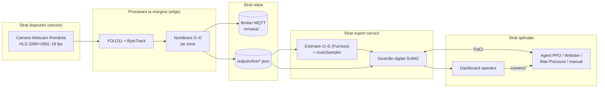

# Semaforizare Piața Romană – documentația proiectului

**Semaforizarea inteligentă, bazată pe inteligență artificială, a intersecției Piața Romană din București,
cu date preluate în timp real de pe camera publică Webcam România și simulare în SUMO**

Autor: Niunin Matei-Gabriel · Universitatea Transilvania din Brașov, Facultatea de Matematică și Informatică,
Informatică ID, anul III · Discipline: *Interfețe om-calculator* și *Internet of Things* · Anul universitar 2026–2027

---

## Cuprins

1. [Context și motivație](#1-context-și-motivație)
2. [Obiective și cerințe](#2-obiective-și-cerințe)
3. [Arhitectura sistemului (perspectiva IoT)](#3-arhitectura-sistemului-perspectiva-iot)
4. [Modulul de viziune artificială](#4-modulul-de-viziune-artificială)
5. [Puntea cameră → simulare: cererea de trafic calibrată](#5-puntea-cameră--simulare-cererea-de-trafic-calibrată)
6. [Rețeaua rutieră în SUMO](#6-rețeaua-rutieră-în-sumo)
7. [Controlul inteligent al semafoarelor](#7-controlul-inteligent-al-semafoarelor)
8. [Interfața om-calculator: dispeceratul](#8-interfața-om-calculator-dispeceratul)
9. [Rezultate](#9-rezultate)
10. [Limitări, aspecte etice și lucrări viitoare](#10-limitări-aspecte-etice-și-lucrări-viitoare)
11. [Ghid de utilizare](#11-ghid-de-utilizare)
12. [Jurnalul proiectului](#12-jurnalul-proiectului)
13. [Asistență generativă](#13-asistență-generativă)
14. [Bibliografie și licențe](#14-bibliografie-și-licențe)
- [Anexa A. Fișierele de rezultate](#anexa-a-fișierele-de-rezultate-docsrezultate)

---

## 1. Context și motivație

Piața Romană este nodul în care axa nord–sud Lascăr Catargiu – Magheru (paralelă cu magistrala de metrou M2)
se intersectează cu axa est–vest a Bulevardului Dacia[^wiki-romana]. În piață se varsă, în plus, două străzi cu
sens unic de ieșire: Str. D. I. Mendeleev și Str. Căderea Bastiliei. Camera Webcam România montată pe clădirea
dintre Bd. Magheru și Bd. Dacia (axa estică) filmează continuu „sensul giratoriu din mijlocul pieței, trecerile de
pietoni, traficul de pe bulevardele Magheru, Lascăr Catargiu și Dacia”[^webcam].

Bucureștiul este unul dintre cele mai congestionate orașe din lume. În ediția 2025 a TomTom Traffic Index,
nivelul mediu de congestie a fost de 62,5%, orașul a ocupat locul 20 global (5 în Europa), iar un șofer a
pierdut în medie 171 de ore pe an la orele de vârf, cu o viteză medie de vârf de 14 km/h[^tomtom][^pmb-tomtom].

Municipalitatea operează sistemul de management al traficului BTMS, extins la aproximativ 267–268 de intersecții
coordonate dintr-un centru unic, majoritatea cu automate „cu funcționare în mod adaptiv”[^btms-267][^buletin-btms].
În 2026 a fost anunțat un proiect nou, bazat pe AI, pentru 92 de intersecții în prima etapă: „Vom monta 305 camere
şi 1.500 de senzori”, cu ajustarea timpilor de semaforizare după numărul de mașini și prioritate pentru transportul
public[^digi24-ai]. Axa Unirii – Universitate – Piața Romană – Piața Victoriei a fost chiar pilotul primului sistem
„undă verde” din 2007[^economedia]. Infrastructura rămâne însă fragilă: în mai 2026 un incendiu la un punct trafo
de pe Bd. Magheru 43 a lăsat nefuncționale semafoarele din zona Pieței Romane[^adevarul-incendiu] – motiv pentru
care sistemul propus are întotdeauna un plan fix de rezervă.

Proiectul arată, la scară academică, lanțul complet pe care îl presupun aceste sisteme: **senzor video →
date de trafic → model digital al intersecției → decizie automată → supraveghere umană**.

## 2. Obiective și cerințe

| # | Cerință (din tema proiectului) | Cum este îndeplinită |
|---|---|---|
| R1 | Preluarea în timp real a datelor de pe camera publică | `vision/stream.py` citește fluxul HLS cu reconectare automată; `run_vision.py` analizează 4–6 cadre/s |
| R2 | Direcțiile **din care vin** și **spre care se îndreaptă** vehiculele, cât mai aproape de adevăr | 10 zone poligonale (intrare/ieșire pe fiecare braț) calibrate pe traiectorii reale; matrice O–D pe intervale de 15 min; 2 zone pe trecerile de pietoni vizibile |
| R3 | Transformarea datelor în flux de trafic simulat în SUMO, nu trafic aleator | estimare O–D Furness + `routeSampler.py` pe viraje, pe tipuri de vehicule (inclusiv biciclete); pietoni din numărătorile de pe treceri; trafic de fond doar ca fracțiune declarată |
| R4 | Model AI care recunoaște semafoarele intersecției și le controlează | cele 16 semafoare fizice ale pieței sunt identificate automat după coordonate și grupate într-un controler, ca automatul real; agent PPO care alege ordinea și durata fazelor reale |
| R5 | Antrenare până la fluidizarea optimă a intersecției | antrenare pe mai multe scenarii, în paralel; evaluare față de 4 linii de bază pe 5 seed-uri, pentru toți participanții (vehicule, bicicliști, pietoni) |
| R6 | Extindere la intersecțiile principale conexe | varianta „coridor”: Piața Romană + cei 4 vecini imediați care o alimentează, controlați simultan |
| R7 | Documentație în limba română, cu surse și licențe | acest document; note de subsol; § 14 |
| R8 | Evoluție vizibilă pe GitHub, pe borne | commit + push la fiecare bornă (§ 12) |

Cerințe nefuncționale: siguranță (agentul nu poate produce stări periculoase ale semaforului), confidențialitate
(nicio imagine stocată), reproductibilitate (rețea, cerere și rezultate regenerabile din scripturi),
rulare pe un laptop Windows fără GPU.

## 3. Arhitectura sistemului (perspectiva IoT)

Sistemul urmează modelul pe straturi din recomandarea ITU-T Y.2060[^itu-y2060]:



* **Senzorul virtual.** Camera nu este a proiectului; este tratată ca un senzor public, iar „inteligența” rulează pe
  stația locală (*edge computing*). Spre restul sistemului pleacă doar **numărători agregate** – economie de lățime de
  bandă și, mai ales, conformitate cu principiul minimizării datelor din GDPR[^gdpr].
* **Rețea.** Modulul de viziune publică opțional pe MQTT (OASIS Standard 5.0[^mqtt]; broker recomandat Eclipse
  Mosquitto[^mosquitto]): `romana/stare/camera` (retained, QoS 1), `romana/numaratori/interval` (retained),
  `romana/evenimente/viraj`. Local, aceleași date sunt scrise atomic în `outputs/live/*.json`.
* **Servicii.** Estimarea matricei O–D și generarea cererii; geamănul digital SUMO.
* **Aplicație.** Controlerul semaforului și dispeceratul.

## 4. Modulul de viziune artificială

### 4.1 Sursa video

Fluxul `mono.m3u8` este o listă HLS de segmente `.ts` de 6 s, H.264, 3288 × 1850 px, 18 fps (verificat cu
`ffprobe` la 20.10.2026). `FrameSource` îl citește prin FFmpeg/OpenCV[^opencv][^ffmpeg] pe un fir separat și
păstrează doar ultimul cadru; la căderea fluxului se reconectează cu întârziere exponențială (1 s → 30 s).

**Camere pentru intersecțiile conexe.** S-au căutat (21.10.2026) toate camerele publice din zona modelată:
lista Webcam România pentru București (8 camere)[^webcam-buc], Windy Webcams, Meteoblue și listele de
intersecții supravegheate. Rezultat:

| Cameră | Ce arată | Folosită? |
|---|---|---|
| Webcam România – Piața Romană (HLS) | piața, toate cele 6 brațe, 2 treceri de pietoni | **da** – singura sursă video a proiectului |
| Webcam România – Piața Victoriei (YouTube live) | pasajul Victoriei, în afara zonei modelate (dincolo de Lascăr Catargiu × Gh. Manu) | nu |
| „Calea Victoriei City Cam” (YouTube) | imagine statică a Ateneului, fără trafic | nu |
| Windy / Meteoblue „Piața Romană” | aceeași cameră Webcam România | – |
| Listele de „intersecții supravegheate” (Dacia × Dorobanți, Magheru × Enescu) | camere ale Poliției / PMB, fără imagine publică | nu (indisponibile) |

Pentru intersecțiile conexe (§ 6.1) nu există deci camere publice. Conform principiului proiectului, traficul
lor este simulat din datele Pieței Romane: rutele candidate pornesc de la marginea rețelei și traversează
intersecțiile vecine (§ 5.2), astfel încât fiecare vecin primește exact traficul observat care intră în piață
sau iese din ea pe brațul lui, plus traficul de fond declarat (15%).

**Calculul pe laptop.** Laptopul nu are placă grafică NVIDIA; YOLO11s la 1600 px rula pe procesor cu ≈0,9
cadre/s, prea puțin pentru urmărire (traiectorii fragmentate, Magheru subnumărat la ≈250 veh/h). Detectorul
este exportat automat în formatul Intel OpenVINO[^openvino] (`runtime: "openvino"` în `config/camera.json`) și
rulează pe placa grafică Intel integrată: ≈5 cadre/s cu exact aceleași detecții pe cadrul de test (34 de
vehicule, 11 persoane), lăsând procesorul liber pentru simulare și antrenare.

### 4.2 Detecție și urmărire

* **Detecție:** Ultralytics YOLO11[^yolo11], preantrenat pe COCO[^coco]; clasele folosite: car (2) → `passenger`,
  motorcycle (3), bus (5, include troleibuzele STB), truck (7), bicycle (1) și person (0) – pentru numărarea
  pietonilor pe treceri (§ 4.4) și pentru estomparea în previzualizare.
  Implicit `yolo11s` la 1600 px pe regiunea de interes (partea de jos a cadrului, fără cer), configurabil în
  `config/camera.json`; pe GPU NVIDIA se poate folosi `--device 0`.
* **Urmărire:** ByteTrack[^bytetrack] (asociază și detecțiile cu scor mic, util la ocluziile din piață);
  alternativ BoT-SORT[^botsort].
* **Punctul de referință** al fiecărui vehicul este mijlocul laturii de jos a dreptunghiului (contactul cu solul),
  mai stabil la perspectivă decât centrul.

### 4.3 Zonele de intrare/ieșire și matricea origine–destinație

Camera vede cele șase brațe ale pieței, de la stânga la dreapta: Bd. Magheru (extremă stânga), Str. Mendeleev
(ieșire), Bd. Dacia vest (centru-stânga), Bd. Lascăr Catargiu (centru-dreapta), Str. Căderea Bastiliei (ieșire,
lângă clădirea ASE) și Bd. Dacia est (extremă dreapta). Pentru fiecare braț cu dublu sens s-au definit **două**
poligoane – banda de intrare spre piață și banda de ieșire – iar pentru străzile cu sens unic doar zona de ieșire
(10 zone de vehicule, plus 6 zone de trecere pentru pietoni, § 4.4; `config/camera.json`, coordonate normalizate
0–1, independente de rezoluție).


*Zonele de numărare finale, desenate de autor (verde = intrare, portocaliu = ieșire, mov = străzi cu sens unic
de ieșire, roșu = treceri de pietoni). Imagine: © WebcamRomania.ro, captură din 23.10.2026, 12:42; folosită în
scop de citare academică.*


*Câmpul de mișcare calculat din ≈119.000 de traiectorii ale zilei de 21.10 (direcția medie pe celule; galben =
spre partea de jos a imaginii, mov = spre partea de sus): se văd inelul circulat în sens trigonometric, intrările
de pe Magheru (stânga jos, spre dreapta) și Dacia est (dreapta, în sus), ieșirile spre Catargiu și Căderea
Bastiliei (sus). Imagine de fundal: © WebcamRomania.ro, persoane estompate.*

**Zonele finale sunt desenate de autor** (23–24.10.2026): 16 decupaje pe capturi ale camerei (10 zone de
vehicule, 6 treceri), localizate automat în cadrul de 3288 px prin potrivire de puncte caracteristice (SIFT) cu
scara fixă 3288/1920 (capturi pe un ecran de 1920 px) și vot pe translație; două zone cu prea puține repere au
fost poziționate manual, cu forma și mărimea decupajului. Ele înlocuiesc calibrările anterioare (din
traiectoriile primelor ore și redesenarea din 22.10, § 12.2). Dacă operatorul mută camera, zonele se
redesenează cu `scripts\2b_calibrare_zone.bat`, iar `recount` reface numărătorile din jurnal.

Regula de numărare (`classify()` în `vision/od_counter.py`), aplicată pe traiectoria întreagă la închiderea ei:

* originea = **prima** zonă de intrare vizitată **înaintea oricărei ieșiri**; destinația = **ultima** zonă de
  ieșire a **altui** braț, vizitată după origine. Zonele de intrare și de ieșire ale aceluiași braț sunt
  alăturate: prima variantă a regulii producea 25 de „întoarceri” Magheru → Magheru în 5 minute, de fapt
  vehicule care atingeau banda vecină;
* pe brațele îndepărtate, parțial ascunse (Dacia vest, Lascăr Catargiu, Mendeleev, Căderea Bastiliei), zonele
  sunt marcate `capat_traiectorie`: o intrare contează doar dacă traiectoria **începe** acolo (vehiculul apare
  din strada ascunsă), o ieșire doar dacă traiectoria **se termină** acolo (toleranță 1,5 s). Verificarea
  sensului de mers (`recount --directii`) a arătat că fosta zonă „intrare Dacia vest” prindea de fapt
  vehiculele care circulă pe inel prin dreptul străzii (73 din 74 se îndepărtau de centru);
* fiecare zonă cere un **sens de mers** în imagine (±60°), măsurat pe primele / ultimele 1,5 s ale
  traiectoriei (zonele `capat_traiectorie`) sau pe porțiunea din zonă: intrările se mișcă spre piață,
  ieșirile dinspre piață. Zonele unui braț se pot astfel suprapune fără confuzie;
* o traiectorie completă produce un viraj (origine → destinație); una fragmentată (vehicul pierdut la o
  ocluzie) contribuie doar la numărătoarea pe braț.

**Calibrarea pe datele de zi (21.10.2026).** Pozițiile zonelor au fost stabilite din jurnalul primelor 1,5 ore
de traiectorii (≈16.000 de fragmente): câmpul de mișcare arată sensul fiecărei benzi (inelul circulă în sens
trigonometric), iar hărțile cu începuturile și sfârșiturile traiectoriilor arată unde vehiculele apar din /
dispar în străzile parțial ascunse (Lascăr Catargiu sus-centru, Dacia vest în spatele stației de troleibuz,
Căderea Bastiliei sus-dreapta). Geometria din rețeaua OSM (azimutul fiecărui braț văzut din poziția camerei)
confirmă ordinea brațelor în imagine: camera privește spre vest, deci stânga = sud (Magheru), dreapta = nord
(Căderea Bastiliei). Corecții: fosta zonă de intrare Dacia vest era pe inel; zona Căderea Bastiliei era prea sus
(0 vehicule); intrarea Dacia est stătea parțial peste trecerea de pietoni, iar vehiculele circulă deasupra ei.

**Reunirea fragmentelor.** La 5 cadre/s, stâlpii, autobuzele și copacii întrerup urmărirea. Înainte de
numărare, `recount` reunește fragmentele aceleiași traiectorii: un fragment care se termină este legat de unul
care începe în cel mult 2 s, aproape de poziția prezisă din viteza de la capăt, de aceeași categorie și cu
direcție compatibilă (≈12% din fragmente sunt reunite). Chiar și așa, doar ≈10% dintre vehicule sunt urmărite
de la intrare până la ieșire – matricea O–D se sprijină deci în principal pe totalurile pe brațe (§ 5.1).

Se agregă pe intervale de 15 minute, separat pe tipuri de vehicule, în `data/counts/numaratori_AAAA-LL-ZZ.csv`.

**Auditul numărării (25.10.2026).** Camera numără în medie **1,6 ieșiri pentru fiecare intrare**, deși fizic
fiecare vehicul care intră iese. Harta capetelor de traiectorie arată cauza: pe inelul din fundal vehiculele sunt
atât de mici încât detectorul le pierde oriunde, iar un vehicul pierdut în dreptul unei ieșiri îndepărtate pare
„ieșit” pe ea. S-a încercat corectarea regulii pe criteriul conservării vehiculelor (cadre minime în zonă,
înaintare minimă pe stradă, prag relativ la lungimea zonei – `Params.capat_min_*`, rezultatele în
`docs/rezultate/calibrare_conservare*.csv`): orice prag care aduce raportul ieșiri/intrări la ~1 elimină aproape
complet ieșirile reale spre Dacia vest și Căderea Bastiliei, deci acolo ieșirile **nu pot fi deosebite** de
vehiculele pierdute cu această cameră. Concluzie: ieșirile de pe brațele îndepărtate nu sunt o măsurătoare de
încredere; regula rămâne neschimbată (pragurile noi sunt dezactivate), iar consecința pentru cerere e tratată în
§ 5.1. Pe brațele apropiate (Magheru, Dacia est) și pe trecerea mare de pe Dacia est numărarea e coerentă.

**Jurnalul anonim de traiectorii și renumărarea.** Pe lângă numărători, modulul salvează în
`data/trajectories/traiectorii_AAAA-LL-ZZ.jsonl.gz` fiecare traiectorie închisă: clasa obiectului și pozițiile
punctului de contact cu solul, în coordonate normalizate, cu timpul relativ – fără imagini, fără numere de
înmatriculare, fără ID-ul de urmărire. Astfel zonele pot fi recalibrate **după** colectare, iar
`python -m romana.vision.recount` reface numărătorile din jurnal (testat: rezultat identic cu numărarea live).
Tot din jurnal se desenează câmpul de mișcare al vehiculelor și capetele traiectoriilor (`recount --flux`),
folosite la plasarea zonelor.

### 4.4 Pietoni și bicicliști

În simulare intră toți participanții observabili pe cameră. Autorul a desenat 6 zone cu rolul `trecere`
(`config/camera.json`): Magheru, Mendeleev, Dacia vest, Lascăr Catargiu, Căderea Bastiliei și trecerea dublă de pe
Dacia est. În practică, pietonii sunt detectați de încredere doar pe trecerile din prim-plan (Magheru, la marginea
cadrului și parțial ascunsă de chioșc, și mai ales Dacia est): pe trecerile îndepărtate persoanele sunt prea mici
în imagine pentru detector.

* **Pietoni.** Persoanele detectate sunt urmărite cu același ByteTrack. Un pieton este numărat **o singură dată
  pe fiecare trecere** pe care a fost văzut în cel puțin 2 cadre și pe care s-a deplasat cel puțin 4% din
  lățimea cadrului (punctul de contact cu solul în zona trecerii) – cine doar așteaptă la bordură nu contează;
  în CSV apar ca rânduri `pietoni` (braț, trecere). Debitul măsurat se extrapolează la toată piața cu
  `factor_extrapolare_pietoni` = 2,5 din `config/demand.json` (ipoteză declarată: pietonii sunt detectați de
  încredere pe ≈2 din cele ≈7 treceri semaforizate).
* **Bicicliști și motocicliști.** Bicicleta (clasa 1) este numărată ca vehicul pe zonele de intrare/ieșire, ca
  orice alt vehicul, și primește în SUMO rute pe care bicicletele au acces. Persoana de pe bicicletă sau
  motocicletă **nu** este numărată ca pieton: o persoană al cărei punct de contact cu solul cade în caseta unei
  biciclete/motociclete (lărgită cu 25%) este exclusă (`is_rider` în `vision/od_counter.py`).

### 4.5 Confidențialitate

Imaginile pot conține persoane și numere de înmatriculare, deci prelucrarea intră sub GDPR[^gdpr] și sub ghidul
EDPB 3/2019 privind dispozitivele video[^edpb]. Măsurile implementate: prelucrare exclusiv în memorie; nicio
înregistrare video sau decupaj salvat; fără citirea numerelor de înmatriculare; ID-urile de urmărire sunt
temporare și uitate la închiderea traiectoriei; persoanele sunt estompate în previzualizarea pentru dashboard
(redusă la 960 px și suprascrisă continuu); se publică doar numărători agregate și jurnalul de traiectorii
anonime (clasă + poziții normalizate ale punctului de contact cu solul, fără imagini sau identificatori), din
care nu se poate reconstitui nicio imagine și nicio persoană. Fișierele `.ts`/`.mp4` sunt
excluse din Git (`.gitignore`). Fluxul este public, iar utilizarea este strict academică; pagina operatorului
menționează „Toate drepturile rezervate”[^webcam], de aceea imaginile nu sunt redistribuite, iar pentru o
utilizare dincolo de proiectul academic se recomandă acordul scris al Webcam România.

## 5. Puntea cameră → simulare: cererea de trafic calibrată

Aceasta este piesa care asigură că agentul se antrenează pe **trafic real**, nu pe trafic aleatoriu.

### 5.1 Estimarea matricei O–D (Furness)

Camera nu urmărește fiecare vehicul de la intrare până la ieșire (stâlpi, autobuze care acoperă alte vehicule,
distanța până la brațele îndepărtate). De aceea se combină trei surse (`bridge/od_estimation.py`):

* **totalurile pe linii** $T_o$ = vehiculele intrate pe brațul $o$ (cea mai fiabilă măsurătoare);
* **totalurile pe coloane** $U_d$ = vehiculele ieșite pe brațul $d$, rescalate la $\sum T$;
* **sămânța** $S_{od}$ = virajele complete observate + $w \cdot p_{od}$, unde $p$ este o distribuție a priori
  (`config/demand.json`) folosită doar ca regularizare când observațiile lipsesc ($w = 2$ vehicule-echivalent).

Matricea se echilibrează prin metoda Furness (IPF)[^ortuzar], alternând scalarea coloanelor și a liniilor și
terminând pe linii (cu `echilibrare: "doar_intrari"` se scalează doar liniile). Un factor de corecție a
detecției (`factor_corectie_detectie`) poate fi setat după o adnotare de referință (§ 10).

**Echilibrarea intrări / ieșiri.** Pe datele de zi, suma ieșirilor numărate a depășit suma intrărilor cu
≈30% (ex. 12:00–12:15: 1.856 față de 2.436 veh/h). Diferența nu poate fi reală la scara a 15 minute (stocarea
pe inel este de câteva zeci de vehicule): camera **subnumără intrările** de la marginea cadrului (Magheru, Dacia
est – vehiculele apar deja parțial în zonă, în spatele chioșcului și al stației de autobuz) și **supranumără
ieșirile** spre străzile parțial ascunse (un vehicul pierdut lângă o stradă pare că a ieșit pe ea). O
comparație cu numărarea pe linii de control (*screen lines*) a dat erori de sens opus (≈745 intrări și ≈1.330
ieșiri pe oră), deci adevărul este între cele două metode. În lipsa unei numărători manuale de referință,
ambele sume au fost tratate ca măsurători ale aceluiași debit și aduse la **media** lor înainte de Furness
(`echilibrare: "medie"`); fiecare parte își păstrează distribuția pe brațe.

**Două calibrări ale cererii (25.10.2026).** Auditul numărării (§ 4.3) a arătat că ieșirile de pe brațele
îndepărtate sunt supranumărate (vehicule pierdute de detector), iar autorul a observat că semaforul controlează
doar intrările. De aceea s-a adăugat modul `echilibrare: "doar_intrari"` (implicit în `config/demand.json`):
volumele vin numai din intrări, iar proporțiile de viraj din traiectoriile complete și distribuția a priori;
ieșirile brute nu se mai folosesc. Intrările pot fi însă și ele subnumărate (vehicule ascunse de chioșc, de
autobuze sau unele de altele în aglomerație). Cele două calibrări mărginesc astfel cererea reală:

| Calibrare | Ce folosește | Vârf zile lucrătoare | Rolul în evaluare |
|---|---|---|---|
| **marginea de jos** – `doar_intrari` | doar intrările | ≈1 640–1 980 veh/h | scenariile actuale din `sumo/scenarios` |
| **marginea de sus** – `medie` | media intrări / ieșiri | ≈2 400–3 000 veh/h | scenariile din 23–25.10 (istoricul git) |

Rezultatele se raportează pentru ambele (§ 9.2); incertitudinea din interiorul fiecăreia este acoperită de
scenariile de sensibilitate ×0,8 și ×1,2 (§ 5.4).

### 5.2 De la O–D la vehicule în SUMO

1. Se generează un set mare de **rute candidate realiste**: drumuri minime de la marginea rețelei
   (`randomTrips.py` + `duarouter`), păstrând doar rutele care pornesc și se termină pe artere și au cel mult
   15% din lungime pe străzi rezidențiale, plus rute garantate pentru fiecare pereche intrare → ieșire.
2. Pentru fiecare interval de 15 min și fiecare tip de vehicul se scrie un fișier de viraje (`edgeRelation`
   de la muchia de intrare a brațului la muchia de ieșire).
3. `routeSampler.py`[^sumo-turns] alege din setul candidat exact atâtea rute câte trebuie pentru a reproduce
   virajele (optimizare liniară); calitatea se raportează prin indicatorul GEH și fișierele `mismatch_*.xml`.
4. Traficul de pe străzile vecine care **nu** trece prin piață (nemonitorizat video) se adaugă separat, ca
   fracțiune declarată din volumul observat (`fond_fractiune`, implicit 15%), pe rute care evită piața.

Astfel, intersecțiile vecine primesc traficul care chiar intră și iese din Piața Romană pe brațele lor, ceea ce
răspunde cerinței de a nu antrena agentul pe un flux necorespunzător realității.

### 5.3 Scenariul de referință (până la datele de zi)

În lipsa datelor oficiale publice de volum pentru Piața Romană (singura cifră publică găsită este o estimare
neoficială de ~3.446 veh/h pe Magheru spre Romană, dintr-un singur ciclu de semafor, 2011/2012[^wizard]),
până la colectarea datelor de zi se folosesc trei scenarii ipotetice explicite: *moderat* (0,7× → 1.442 veh/h
prin piață), *vârf* (720 / 620 / 390 / 330 veh/h pe Magheru / Catargiu / Dacia est / Dacia vest → 2.060 veh/h)
și *aglomerat* (1,2× → 2.472 veh/h), fiecare cu 15% trafic de fond și 1.200 de pietoni/h prin zona pieței
(stația de metrou M2 și ASE; valoare ipotetică). Compoziția: 88% autoturisme, 4% autobuze/troleibuze, 3%
camioane, 3% motociclete, 2% biciclete. Volumul de vârf a fost ales astfel încât planul fix de referință să
funcționeze aproape de saturație pe replica fidelă a rețelei: peste ≈1,0× inelul se suprasaturează, ceea ce
corespunde congestiei cunoscute a pieței. Scenariile servesc la dezvoltarea și verificarea lanțului și vor fi
completate cu scenarii construite din numărătorile reale.

### 5.4 Scenariile din date reale (Borna 9)

Datele colectate: **miercuri 21.10.2026 de la 11:45 până joi 22.10.2026 la 11:00** (zi, seară, noapte și vârful
de dimineață, flux continuu la ≈5–6 cadre/s) și **duminică 25.10.2026 de la 01:14** (noapte, dimineață, prânz;
colectarea a continuat până la oprirea sistemului). Toate zilele sunt numărate cu zonele finale (§ 4.3): pentru
21–22.10, ≈200 000 de traiectorii după reunirea fragmentelor, ≈24 000 de intrări numărate și ≈5 000 de viraje
urmărite complet. Profilurile au forma așteptată: în zilele lucrătoare vârful de seară (17:15–18:15) și platoul
de dimineață (08:00–10:45), noaptea câteva sute de vehicule pe oră; duminică traficul crește abia de la 08:30,
cu vârful la prânz.

`python -m romana.bridge.scenarii_zi --zi AAAA-LL-ZZ` alege automat ferestrele (ora de vârf, ora cea mai liniștită
și, dacă nu se suprapun cu vârful, dimineața 07:30–08:30 și prânzul 12:00–13:00) și construiește scenariile, plus
sensibilitățile vârf ×1,2 și liniștit ×0,8. Cu zonele finale (§ 4.3), datele renumărate și cererea calculată doar
din intrări (marginea de jos, § 5.1), scenariile actuale sunt:

| Scenariu | Fereastra | Vehicule prin piață (veh/h) | Fond | Pietoni/h | Marginea de sus* |
|---|---|---|---|---|---|
| `zi_2026-10-21_pranz` (miercuri) | 12:00–13:00 | 1 194 | 179 | 3 152 | ≈1 780 |
| `zi_2026-10-21_varf` | 17:15–18:15 | 1 636 | 245 | 3 205 | ≈2 510 |
| `zi_2026-10-21_varf_x1_2` | vârf × 1,2 | 1 963 | 294 | 3 205 | ≈3 020 |
| `zi_2026-10-21_linistit` | 23:00–00:00 | 649 | 97 | 247 | ≈860 |
| `zi_2026-10-21_linistit_x0_8` | liniștit × 0,8 | 519 | 78 | 247 | ≈690 |
| `zi_2026-10-22_dimineata` (joi) | 07:30–08:30 | 1 534 | 230 | 3 027 | ≈2 220 |
| `zi_2026-10-22_varf` | 09:45–10:45 | 1 646 | 247 | 2 869 | ≈2 400 |
| `zi_2026-10-22_varf_x1_2` | vârf × 1,2 | 1 975 | 296 | 2 869 | ≈2 880 |
| `zi_2026-10-22_linistit` | 02:30–03:30 | 162 | 24 | 20 | ≈300 |
| `zi_2026-10-22_linistit_x0_8` | liniștit × 0,8 | 130 | 19 | 20 | ≈240 |
| `zi_2026-10-25_dimineata` (duminică) | 07:30–08:30 | 704 | 106 | 450 | – |
| `zi_2026-10-25_varf` | 11:45–12:45 | 3 483 | 522 | 1 963 | – |
| `zi_2026-10-25_varf_x1_2` | vârf × 1,2 | 4 180 | 627 | 1 963 | – |
| `zi_2026-10-25_linistit` | 05:15–06:15 | 349 | 52 | 183 | – |
| `zi_2026-10-25_linistit_x0_8` | liniștit × 0,8 | 279 | 42 | 183 | – |

\* Vehiculele prin piață cu calibrarea „medie” (media intrări/ieșiri), folosită până la 25.10 (scenariile se
regăsesc în istoricul git); pentru duminică, scenariile cu această calibrare au fost construite din datele de
până la 11:30 (§ 9.3). Pentru fiecare tip de vehicul, `routeSampler` reproduce relațiile de viraj țintă cu
GEH < 5 pentru ≈94% din relațiile autoturismelor și 100% din cele ale celorlalte tipuri. Agenții au fost
antrenați pe scenariile din zilele lucrătoare; duminica servește doar ca test de generalizare.

Compoziția traficului măsurată (prima zi, 21.10): ≈93% autoturisme, ≈4% autobuze și troleibuze, ≈3% camioane,
sub 0,5% biciclete și motociclete – mult sub ipoteza inițială (2% biciclete, 3% motociclete), într-o zi de
octombrie cu 12–15 °C; duminică, la prânz, ≈95% autoturisme și ≈3% autobuze. Scenariile ipotetice `referinta_*`
(§ 5.3) rămân în proiect pentru comparație, dar agenții sunt antrenați **doar** pe scenariile din date reale.

### 5.5 Geamănul digital live

`bridge/live_twin.py` rulează SUMO (opțional SUMO-GUI) continuu, în timp real: în fiecare secundă citește
debitele curente publicate de modulul de viziune și injectează vehicule pe brațe ca proces Poisson cu acele
debite, cu destinații după proporțiile de viraj observate și tipuri după compoziția traficului (bicicliștii pe
rute permise bicicletelor). Pietonii sunt injectați tot Poisson, pe trasee pietonale care trec prin piață, cu
debitul măsurat pe trecerile vizibile × factorul de extrapolare. Dacă fluxul camerei lipsește mai mult de 60 s,
trece pe profilul de referință și **afișează explicit** acest lucru în dashboard; la începutul fiecărui interval
de numărare de 15 minute păstrează ultimele debite bune ale camerei. Simularea avansează în pași de 0,2 s
întinși pe secunda reală (mișcare fluentă în SUMO-GUI), iar controlerul semaforului lucrează pe secunde întregi.
Modurile de control, alese din dispecerat: agentul AI, planul fix de referință (N–S / E–V / pietoni, § 6.3),
Max-Pressure, manual și „Program pe tipuri de trafic” (§ 9.2, § 9.4), care comută automat după debitul măsurat
de cameră (media intrărilor și ieșirilor).

## 6. Rețeaua rutieră în SUMO

### 6.1 Construcție reproductibilă

`network/build_network.py` pornește de la extrasul OpenStreetMap[^osm] al zonei și rulează `netconvert`[^sumo]
pe un dreptunghi de 2,2 × 1,6 km, care include Piața Romană și primele intersecții semaforizate pe fiecare braț:

| ID în proiect | Intersecție | Distanța | Cameră | În coridorul controlat |
|---|---|---|---|---|
| `romana` | Piața Romană (Magheru – Lascăr Catargiu – Dacia) | – | da | da (controlerul principal) |
| `dacia_eminescu` | Bd. Dacia × Str. M. Eminescu × Calea Dorobanți (Dacia est) | ~215 m | nu | da |
| `magheru_enescu` | Bd. Magheru × Str. G. Enescu / Tache Ionescu (sud) | ~350 m | nu | da |
| `catargiu_manu` | Bd. Lascăr Catargiu × Str. Gh. Manu (nord-vest) | ~490 m | nu | da |
| `dacia_victoriei` | Bd. Dacia × Calea Victoriei (Dacia vest) | ~480 m | nu | da |
| `dacia_polona` | Bd. Dacia × Str. Polonă | ~525 m | nu | nu – Bd. Dacia este aici sens unic de ieșire din piață |

Semafoarele sunt găsite **după coordonatele geografice** (centroidul nodurilor), nu după ID-urile generate de
`netconvert`, care se schimbă la fiecare regenerare. Sensurile unice Mendeleev și Căderea Bastiliei (doar ieșire
din piață) sunt confirmate atât de etichetele OSM (`oneway=yes`), cât și de traiectoriile observate pe cameră.

**Coridorul controlat** (varianta „coridor” a agentului) cuprinde piața și cei 4 vecini imediați care o
alimentează. Bd. Dacia × Str. Polonă a fost scoasă din coridor la observația autorului, confirmată de OSM: pe
ambele tronsoane dintre Calea Dorobanți și Str. Polonă, Bd. Dacia are `oneway=yes` (doar autobuzele circulă în
contrasens, `oneway:bus=no`), deci la Polonă traficul obișnuit doar pleacă din piață. Intersecția rămâne în
simulare, pe programul ei actual. Piața Victoriei și Piața Universității sunt mai departe (≈0,9 și ≈1,5 km, cu
alte intersecții semaforizate între ele și piață) și în afara zonei modelate; nicio cameră publică nu le acoperă.
Denumirea străzii este **Calea Dorobanți**; în OSM apare ca „Calea Dorobanților”.

### 6.2 Replica fidelă a pieței (Borna 8)

**Principiul:** infrastructura rămâne exact cea din realitate – inelul pieței, axa centrală N–S, benzile și
virajele marcate, sensurile unice, benzile dedicate STB, trotuarele, trecerile de pietoni și pozițiile reale ale
semafoarelor. Proiectul schimbă **doar modul în care semafoarele existente răspund traficului** (programul,
ordinea și durata fazelor) – singurul lucru care se poate implementa pe automatul real.

Importul `netconvert` folosește etichetele OSM pentru trotuare (`--osm.sidewalks`), accesul bicicletelor,
benzile de viraj și restricțiile pe benzi (`--osm.turn-lanes`, `--osm.lane-access`), iar trecerile de pietoni și
zonele de așteptare sunt reconstruite la toate intersecțiile (`--crossings.guess`, `--walkingareas`; opțiunea
`--osm.crossings` provoacă un crash în netconvert 1.28 pe acest extras). Rezultatul: 6.943 de muchii, 924 de
noduri, 53 de semafoare, 225 de benzi dedicate autobuzelor și trotuare pe toate arterele.

În OSM, piața are **16 semafoare fizice** (pe intrări, pe inel, pe axa centrală și la treceri). Ca în realitate,
unde toate sunt conduse de un singur automat de intersecție, ele sunt grupate într-un controler `romana`
(cele aflate la cel mult 80 m de centrul pieței, `--tls.join` cu `--tls.join-exclude` pentru restul). Controlerul
are 61 de legături: 54 pentru vehicule și 7 treceri de pietoni.

*Istoric:* în Bornele 3–7 piața fusese modelată ca un singur nod agregat, pentru că primul import OSM intra în
blocaj circular pe segmentele interne foarte scurte. În Borna 8, cu programul construit pe grupuri de semnal, s-a
constatat că inelul se bloca atunci când semnalele de pe brațele de ieșire primeau roșu și opreau vehiculele
deja intrate pe inel. Cu ieșirile pe verde în toate fazele de vehicule (§ 6.3), replica fidelă funcționează, iar
nodul agregat (care nu respecta realitatea) a fost abandonat.

### 6.3 Grupurile de semnal și fazele semaforului Piața Romană

Programul nu este cel ghicit de `netconvert`, ci este construit pe **grupuri de semnal** cu semnificație de
trafic (`config/network.json` → `romana_grupuri`), după muchia OSM pe care stau vehiculele la linia de oprire:

| Grup | Legături | Rol |
|---|---|---|
| `intrare_magheru`, `intrare_catargiu`, `intrare_dacia_est`, `intrare_dacia_vest` | 12 / 3 / 4 / 2 | intrările în piață |
| `axa_ns_centru` | 6 | axa centrală N–S, prin mijlocul pieței |
| `inel_dacia` | 11 | inelul din jurul insulei, pe direcția Dacia |
| `iesire_magheru_catargiu`, `iesire_dacia` | 12 / 4 | semnalele de pe brațele de ieșire |
| `pietoni` | 7 | trecerile de pietoni (grup automat) |

| Faza | Semnificație | În planul fix |
|---|---|---|
| 0 | N–S: Magheru ↔ Lascăr Catargiu prin centru | da, 36 s |
| 1 | E–V: Dacia în jurul insulei | da, 28 s |
| 2 | Pietoni: toate trecerile, axa centrală se golește | da, 12 s |
| 3 | N–S, cu intrările Dacia deschise (fără dozare) | nu |
| 4 | E–V, cu intrările Magheru/Catargiu deschise (fără dozare) | nu |

Planul fix de referință are un ciclu de ≈ 91 s (3 faze + galben 3 s + roșu de degajare 2 s după fiecare).
Ieșirile au verde în toate fazele de vehicule, pentru că fiecare ieșire este alimentată în ambele faze principale;
trecerile de pe ieșiri primesc verde în faza de pietoni. **Trecerile de pietoni primesc verde automat** în orice
fază în care niciun flux de vehicule cu verde nu le intersectează geometric (verificare de siguranță la
construcția programului; `build_network.py` refuză un program în care o trecere nu primește niciodată verde).
Roșul de degajare păstrează verdele legăturilor care rămân verzi și în faza următoare. Fazele 3–4 există ca
opțiuni, dar evaluarea a arătat că, deschizând intrările spre un inel deja ocupat, ele blochează piața (§ 7.4);
de aceea strategiile adaptive aleg implicit doar dintre fazele 0–2.

Intersecțiile vecine păstrează programele `actuated` generate (realist: sistemul BTMS funcționează adaptiv), cu
excepția variantei „coridor”, în care sunt conduse de agent.

## 7. Controlul inteligent al semafoarelor

### 7.1 Formularea ca problemă de decizie Markov

* **Pas de decizie:** 5 s simulate.
* **Stare:** pentru fiecare semafor controlat – faza verde curentă (one-hot), indicatorul „verde minim
  îndeplinit”, durata verdelui curent (normalizată la verdele maxim), pentru fiecare bandă de intrare coada
  (vehicule oprite) și densitatea, normalizate la capacitatea de stocare a benzii (lungime / 7,5 m), și, pentru
  fiecare zonă de așteptare a unei treceri controlate, numărul de pietoni care așteaptă (normalizat la 15).
  Aceeași funcție (`observation()` din `control/signals.py`) servește antrenarea, evaluarea și geamănul digital.
* **Acțiune:** faza verde dorită. La Piața Romană, implicit una din cele 3 faze ale planului real (N–S, E–V,
  pietoni): agentul decide **ordinea și durata** fazelor, adică exact ce se poate programa pe automatul existent
  (fazele „fără dozare” se pot activa cu `--toate-fazele`). În varianta coridor, câte o acțiune pentru fiecare din
  cele 5 semafoare ale coridorului – spațiu `MultiDiscrete`.
* **Recompensă:** $r_t = -\frac{1}{100}\left(\sum_{\ell} q_\ell(t) + \sum_{c} p_c(t) + b(t)\right)$,
  unde $q_\ell$ este numărul de vehicule oprite pe banda de intrare $\ell$, $p_c$ numărul de pietoni care
  așteaptă la trecerea $c$, iar $b$ numărul de vehicule care nu pot intra în rețea (blocate la margine); un
  pieton și un vehicul neintrodus cântăresc cât un vehicul oprit. *Lecție din Borna 8:* cu o penalizare mică
  pentru $b$ (0,002), agentul coridor a învățat să „ascundă” coada în afara rețelei – cozi de 4–8 vehicule în
  piață, dar ≈450 s așteptare medie și ≈400 de vehicule rămase în scenariul moderat. Este un exemplu clasic de
  exploatare a recompensei (*reward hacking*); modelele au fost reantrenate cu formula de mai sus, iar evaluarea
  raportează și întârzierea la intrarea în rețea.
* **Varianta „cozi în amonte” (v2, Borna 9).** Pe scenariile din date reale, la vârf, benzile scurte de la
  linia de oprire (30–90 m) sunt pline indiferent de decizii, deci $\sum_\ell q_\ell$ nu mai variază, iar
  cozile care cresc spre intersecțiile vecine (ex. Bd. Dacia dinspre Calea Victoriei) nu se văd. Cu
  `--obs-amonte`, observația primește, pentru fiecare intrare a fiecărui controler, coada de pe muchiile din
  amonte pe ≈250 m (normalizată la capacitatea lor de stocare) și numărul de vehicule neintroduse, iar
  recompensa adaugă la $\sum_\ell q_\ell$ și vehiculele oprite pe aceste benzi din amonte (fiecare bandă o
  singură dată): $r_t = -\frac{1}{100}\left(\sum_{\ell} q_\ell + \sum_{u} q_u + \sum_{c} p_c + b\right)$.
  Opțiunea se salvează în `models/*.json` (`obs_amonte`), astfel încât evaluarea și geamănul digital folosesc
  automat aceeași observație.

### 7.2 Siguranța prin construcție

Agentul nu setează direct culorile. `control/signals.py` primește doar „faza verde următoare” și impune:
galben 3 s, roșu general 2 s (pe legăturile care se schimbă), verde minim 10 s, verde maxim 90 s (după care
faza avansează forțat). Ciorna inițială sărea direct între faze verzi, fără galben (vezi
`legacy/google_ai_draft/README.md`).

### 7.3 Algoritmul de învățare

PPO (Proximal Policy Optimization)[^ppo] din Stable-Baselines3[^sb3], rețea MLP 128 × 128, rată de învățare
3·10⁻⁴, ≈1.024 de tranziții pe actualizare, lot 128, 10 epoci, γ = 0,98, λ_GAE = 0,95, coeficient de entropie
0,01. Simularea rulează prin `libsumo` (aceeași interfață ca TraCI, fără comunicație prin socket), în **8 procese
paralele** (`SubprocVecEnv`, opțiunea `--medii`): ≈55–70 de pași de decizie pe secundă pe procesorul laptopului
(i5-13420H), față de ≈18 cu un singur proces – replica fidelă, cu pietoni, este mult mai costisitoare decât
nodul agregat. Pe Windows, PYTHONPATH-ul setat de instalatorul SUMO umbrește pachetul pip `libsumo` cu varianta
din instalare, căreia îi lipsesc DLL-uri; `control/env.py` încarcă explicit pachetul pip. Fiecare episod = o
oră de trafic, pe un scenariu ales aleator din setul de antrenare, cu seed SUMO aleator. PPO a fost preferat lui DQN[^dqn] pentru că suportă natural acțiunile `MultiDiscrete` ale
variantei coridor. Literatura de referință pentru RL în semaforizare: IntelliLight[^intellilight],
PressLight[^presslight], CoLight[^colight], MPLight[^mplight] și sintezele lui Wei et al.[^survey2019][^survey2021];
mediul a fost scris în stilul sumo-rl[^sumorl].

### 7.4 Linii de bază

1. **Plan fix de referință:** programul din rețea (N–S 36 s, E–V 28 s, pietoni 12 s, ciclu ≈ 91 s) – linia de
   bază față de care se raportează procentele.
2. **Plan fix Webster**[^webster]: ciclul optim $C_0 = \frac{1{,}5L + 5}{1 - Y}$ (limitat la 60–150 s), cu $L$ =
   timpul pierdut (7 s/fază, plus întreaga fază de pietoni) și $Y = \sum_i y_i$, $y_i$ = cel mai mare raport
   debit / debit de saturație (1800 veh/h/bandă, doar benzile de autoturisme, fără benzile STB) dintre intrările
   fazei de vehicule $i$; verdele se împarte proporțional cu $y_i$, faza de pietoni își păstrează durata.
3. **Actuated SUMO:** pe aceleași 3 faze, prelungirea verdelui cât timp detectoarele văd vehicule la intervale sub
   3 s (min 10 s, max 60 s).
4. **Max-Pressure**[^maxpressure]: la fiecare decizie se alege faza cu presiunea maximă
   $\sum (\text{coadă amonte} - \text{coadă aval})$ pe legăturile ei verzi; pentru trecerile de pietoni, „coada”
   amonte este numărul de pietoni care așteaptă (altfel faza de pietoni nu ar fi aleasă niciodată). Este un
   algoritm fără învățare, cu garanții teoretice de stabilitate, pe care un agent RL trebuie să-l egaleze sau
   să-l depășească pentru a fi convingător. Pe replica fidelă, Max-Pressure cu toate cele 5 faze alegea mereu
   fazele „fără dozare” (cele mai multe legături verzi ⇒ presiunea cea mai mare) și bloca piața complet
   (scenariul moderat, 1 seed: 1.226 de vehicule rămase în rețea, față de 107 la planul fix); restrâns la fazele
   planului real, nu mai blochează piața (97 de vehicule rămase, media pe 5 seed-uri; rezultatele complete în § 9).

### 7.5 Metrici

Din `tripinfo` SUMO, pe toată durata scenariului plus 15 minute de golire, **separat pe categorii de
participanți**:

* vehicule motorizate: timpul mediu de așteptare (medie și mediană pe seed-uri), pierderea de timp
  (*timeLoss*), întârzierea la intrarea în rețea (*departDelay*), durata medie a călătoriei, vehiculele sosite,
  emisiile de CO₂ (modelul HBEFA din SUMO);
* bicicliști (`vType` bicycle): așteptarea și pierderea de timp medii;
* pietoni (`personinfo`/`walk`): pierderea de timp medie a deplasării;
* pierderea de timp totală a tuturor participanților (ore, inclusiv întârzierea la intrare), vehiculele rămase
  în rețea sau neintroduse la final, coada medie de
  vehicule și numărul mediu de pietoni care așteaptă la trecerile Pieței Romane (eșantionate la 5 s).

Se raportează media ± abaterea standard pe 5 seed-uri. Observație: o parte din întârzieri se produce la
semafoarele de la marginea zonei modelate (de ex. Str. Știrbei Vodă, Str. Ion Câmpineanu), pe rutele care pornesc
de acolo; ele depind foarte puțin de strategia de la Piața Romană, deci nu schimbă clasamentul strategiilor, dar
măresc valorile absolute.

## 8. Interfața om-calculator: dispeceratul

`scripts\7_dashboard.bat` deschide la `http://localhost:8050` consola operatorului (Flask + HTML/JS fără
framework). Principiul de proiectare: **automatizarea propune, omul supervizează** – operatorul vede ce vede
algoritmul și poate prelua oricând controlul.


| Euristică Nielsen[^nielsen] | Aplicare în dashboard |
|---|---|
| Vizibilitatea stării sistemului | imaginea camerei ca flux video continuu (MJPEG, ≈6 cadre/s); indicatoare pentru flux cameră / reconectare, cadre/s, vârsta datelor; în modul „Program”, componenta care conduce semaforul în acel moment; faza curentă cu etapa (verde/galben/roșu de degajare) și secundele de verde; sursa cererii („camera live” sau „profil de referință”); vehiculele și pietonii din simulare, pietonii care așteaptă la treceri, debitul de pietoni măsurat de cameră |
| Potrivirea cu lumea reală | schema pieței respectă orientarea reală a brațelor; denumiri de străzi, nu ID-uri de muchii; culori de semafor |
| Controlul și libertatea utilizatorului | cinci moduri de control (Agent AI, Plan fix, Max-Pressure, Manual, Program pe tipuri de trafic); revenirea la AI sau la planul fix dintr-un clic; `Esc` anulează |
| Consistență și standarde | aceleași denumiri ale modurilor în butoane, confirmări și starea afișată |
| Prevenirea erorilor | schimbarea modului cere confirmare explicită; în modul manual se alege doar faza verde – galbenul și roșul de siguranță se aplică automat |
| Recunoaștere în loc de reamintire | fazele manuale sunt afișate cu numele lor complet; legenda culorilor cozilor e implicită (albastru < 8, galben < 18, roșu ≥ 18 vehicule) |
| Design estetic și minimalist | o singură accentuare cromatică (albastrul STB), restul neutru; culorile de semafor folosite doar pentru stare |
| Ajutor la recunoașterea și remedierea erorilor | mesajele de lipsă indică exact scriptul de pornit („Porniți scripts\2_viziune_live.bat”) |

Sunt respectate și regulile lui Shneiderman[^shneiderman] privind feedback-ul informativ, închiderea dialogului
(confirmare → stare actualizată) și controlul intern al utilizatorului. Accesibilitate: contrast ridicat,
focalizare vizibilă de la tastatură, etichete ARIA pentru schemă și grafic, `prefers-reduced-motion` respectat,
aranjare pe o coloană sub 900 px. Atribuirile cerute (OSM, Webcam România, SUMO) apar permanent în subsol.

## 9. Rezultate

### 9.1 Cum se evaluează

* **Scenariile** (§ 5.4): 10 ore de trafic din zilele lucrătoare 21–22.10.2026 (liniștit, prânz, dimineață, vârf
  și variantele de sensibilitate ×0,8 / ×1,2) și 5 ore din duminica 25.10.2026, zi pe care nicio strategie nu a
  fost antrenată sau aleasă. Fiecare scenariu durează o oră de cerere plus 15 minute de golire.
* **Indicatorul principal**: pierderea totală de timp a tuturor participanților – vehicule (inclusiv întârzierea
  la intrarea în rețea), bicicliști și pietoni –, exprimată față de planul fix de referință (programul actual,
  36/28/12 s, § 6.3). Restul metricilor (§ 7.5) sunt în `docs/rezultate/rezultate.md`.
* **Separarea datelor**: fiecare simulare depinde de un seed aleatoriu (sosirile, comportamentul șoferilor).
  Alegerile – ce agent, ce plan, ce strategie pe ce tip de trafic – s-au făcut **numai pe seed-urile de validare
  11–15**; rezultatele raportate sunt pe **seed-urile de test 1–10**, nefolosite la alegere.
* **Statistica**: comparațiile se fac pe perechi (același scenariu, același seed), cu testul t pe perechi și
  testul Wilcoxon; „mai bun în k din n” numără rulările în care strategia are o pierdere totală mai mică.
* **Cele două calibrări ale cererii** (§ 5.1): marginea de sus (media intrări/ieșiri măsurate) și marginea de jos
  (doar intrările). Adevărul se află între ele, de aceea rezultatele sunt raportate pentru ambele.

### 9.2 Rezultatul principal: programul pe tipuri de trafic

Niciun agent AI, aplicat singur pe toate tipurile de trafic, nu bate în mod robust un plan fix bine reglat
(§ 9.5). Soluția găsită este un **program pe tipuri de trafic**: pentru fiecare tip de trafic (lejer, moderat,
greu) se folosește strategia care a fost cea mai bună pe datele de validare, iar la performanță practic egală se
preferă strategia mai simplă. Toate componentele sunt implementabile pe automatul existent (se schimbă doar
programul semaforului). Programul este implementat în geamănul digital și în dispecerat (modul „Program pe tipuri
de trafic”, `bridge/live_twin.py`), cu comutare automată după debitul măsurat de cameră (media intrărilor și
ieșirilor, la 1 300 și 2 000 veh/h); varianta implicită este „programul realist” (§ 9.4).

| Calibrarea cererii | Trafic lejer | Trafic moderat (prânz) | Trafic greu (vârf, dimineață) |
|---|---|---|---|
| marginea de sus (media intrări/ieșiri) | agentul E9 (`ppo_romana_lejer`) | agentul E3 (`ppo_romana_zn3`) | plan fix 46/48/12 s |
| marginea de jos (doar intrări) | actuated* (egal cu agentul oficial, mai simplu) | agentul E3 | planul fix actual (toate alternativele egale cu el) |
| **condiții reale: participanți indisciplinați** (§ 9.4) – „program realist” | agentul oficial (`ppo_romana`) | agentul E3 | agentul E3 |

\* Programul actuated presupune detectarea vehiculelor la intrări (bucle inductive sau camera, ca în acest proiect).

**Zilele lucrătoare, marginea de sus** – 100 de rulări pe strategie (10 scenarii × 10 seed-uri de test), media pe
scenarii față de planul fix actual:

| Program pe tipuri de trafic | Actuated | Webster | Agent E3 | Plan 46/48/12 | Agent E7 | Agent E9 | Agent oficial | Max-Pressure |
|---|---|---|---|---|---|---|---|---|
| **−6,9%** | −2,8% | +0,2% | +0,8% | +1,4% | +1,9% | +3,4% | +5,4% | +11,4% |

Programul este semnificativ mai bun decât planul fix (−6,9%; p = 0,0003 t / 0,00002 Wilcoxon; mai bun în 79 din
100 de rulări) și decât actuated, cea mai bună metodă clasică (−3,2%; p = 0,04 / 0,002; 68 din 100). Pe
scenarii: liniștit −6,8…−11,0%, prânz −5,1%, vârf −4,4…−12,9%, dimineața +12,6% (singurul scenariu unde pierde).

**Zilele lucrătoare, marginea de jos** – programul, planul fix, actuated și agentul E3 pe 100 de rulări (seed-urile
de test 1–10); celelalte strategii pe 50 (seed-urile 1–5):

| Program pe tipuri de trafic | Actuated | Agent E3 | Agent E9 | Agent oficial | Plan 46/48/12 | Max-Pressure |
|---|---|---|---|---|---|---|
| **−1,5%** | −0,4% | +0,7% | +2,6% | +3,8% | +6,5% | +22,0% |

La volume mai mici (vârful ≈1 650 veh/h în loc de ≈2 500), planul fix actual este greu de bătut la vârf, iar
programul rămâne pe el. Programul câștigă constant la trafic lejer (−6,0…−7,3%): pe cele 50 de rulări în care
diferă de planul fix este mai bun în 44 (Wilcoxon p = 0,0003). La prânz, agentul E3 este instabil la această
calibrare (−2,3% pe seed-urile 1–5, +11,7% în medie pe seed-urile 1–10), ceea ce reduce câștigul mediu la −1,5%.

**Ce înseamnă.** Câștigul programului depinde de cât trafic este de fapt în piață și de cât de disciplinați sunt
participanții: ≈1,5% (marginea de jos), ≈7% (marginea de sus) și ≈16% cu participanți indisciplinați (§ 9.4) din
timpul pierdut de toți participanții, fără nicio lucrare pe stradă. O oră aglomerată
pierde în piață câteva sute de ore-om, deci câștigul înseamnă zeci de ore-om pe fiecare oră aglomerată.

### 9.3 Generalizarea pe o zi de weekend (duminică, 25.10.2026)

Duminica are alt tipar de trafic (vârf la prânz, mai mare decât în zilele lucrătoare) și nu a fost folosită la
antrenare sau la alegere.

* **Marginea de sus** (date până la 11:30; 5 scenarii × 10 seed-uri): programul −5,2% față de planul fix
  (p = 0,03; mai bun în 43 din 50) și semnificativ mai bun decât actuated (p = 0,0006). Agenții AI singuri au
  bătut toți planul fix, inclusiv la vârful de weekend: E9 −6,5%, E3 −5,0% (−7,2% la vârf), agentul oficial
  −4,9%; Max-Pressure −4,5%, actuated −1,5%, Webster +0,4%, planul 46/48/12 +5,3%.
* **Marginea de jos** (datele până la 13:50; vârful 11:45–12:45 cu ≈3 480 veh/h la intrări, mai mult decât orice
  scenariu de antrenare; 5 scenarii × 5 seed-uri): programul (regula aleasă pe validare pentru această calibrare)
  −4,5% față de planul fix – mai bun în toate cele 15 rulări în care diferă de el (Wilcoxon p = 0,0001); cea mai
  bună strategie a fost aici actuated (−6,2%, mai bun în 22 din 25), iar agenții AI au câștigat doar la trafic lejer
  și în dimineața de duminică (−4…−8%), fiind la vârful foarte mare egali cu planul fix sau mai slabi (agentul
  oficial −2,0% în medie, E3 −0,4%, E9 −0,3%).

Concluzie: programul pe tipuri de trafic rămâne mai bun decât planul fix și pe o zi nouă, pentru ambele calibrări.
Planul fix 46/48/12, reglat pe vârfurile din zilele lucrătoare, nu se potrivește vârfului de duminică, iar agenții
AI generalizează bine la volume apropiate de cele de antrenare (marginea de sus), dar nu la un vârf mult mai mare
decât cele văzute la antrenare (marginea de jos) – un argument pentru reantrenarea periodică pe date noi.

### 9.4 Robustețea la participanți indisciplinați

Șoferii și pietonii din București nu respectă întotdeauna regulile (observația autorului). Testul folosește
aceleași scenarii (marginea de jos) cu tipurile de participanți din `sumo/demand/vtypes_indisciplinat.add.xml`:
vehicule care blochează intersecția după 1 s de așteptare, trec pe roșu în primele 2 s și pe galben târziu,
schimbă banda agresiv; pietoni care traversează pe roșu în primele 5 s și ignoră uneori vehiculele.

5 scenarii (prânzul și vârful din 21.10, dimineața, noaptea și vârful din 22.10) × 10 seed-uri de test
(`docs/rezultate/robustete_indisciplinat*.csv`). Indisciplina schimbă mult traficul: cu planul fix, timpul
pierdut crește la vârfuri cu +31% (21.10) și +16% (22.10) și cu +7% dimineața – intersecția blocată și trecerile
pe roșu strică ritmul fazelor – și scade cu ≈15% la prânz și noaptea, când trecerile pe roșu „câștigă” timp într-o
intersecție nesaturată (seed-urile 1–5). Față de planul fix, în aceleași condiții:

| Strategie | Medie | Vârf 21.10 | Vârf 22.10 | Dimineața | Prânz | Noaptea | Mai bun în | p (t / Wilcoxon) |
|---|---|---|---|---|---|---|---|---|
| **Agent E3** | **−14,1%** | −14,8% | −28,0% | −20,0% | −3,1% | −4,6% | 40 / 50 | 0,00001 / <0,00001 |
| **Agent E9** | **−9,9%** | −6,9% | −24,8% | −6,4% | −4,1% | −7,3% | 37 / 50 | 0,003 / 0,002 |
| Agent oficial | −0,1% | +5,2% | −11,0% | +3,5% | +15,7% | −14,1% | 30 / 50 | 0,99 (nesemnif.) |
| Actuated | +6,4% | +0,4% | +4,0% | +7,4% | +30,6% | −10,6% | 25 / 50 | 0,23 (nesemnif.) |
**Cu participanți indisciplinați – situația reală din București – specialiștii AI sunt mult mai buni decât
planul fix**, în special la vârf (până la −28%), deși au fost antrenați cu participanți disciplinați: observă cozile
reale și se adaptează din mers când intersecția se blochează, ceea ce un plan fix nu poate face. Programul pe
tipuri de trafic ales pentru marginea de jos (care păstrează planul fix la vârf) câștigă aici doar −1,5%
(nesemnificativ). De aceea, pentru condițiile reale s-a ales pe validare (seed-urile 11–15 ale acelorași scenarii cu
participanți indisciplinați, `docs/rezultate/validare_indisciplinat.csv`) un **„program realist”**: agentul oficial
la trafic lejer (−13,3% pe validare), agentul E3 la trafic moderat (−3,5%) și greu (−19,4%; planul 46/48/12 iese
aici +22%). Pe seed-urile de test 1–10:

| Program realist față de | Diferență medie | p (t / Wilcoxon) | Mai bun în |
|---|---|---|---|
| planul fix actual | **−16,0%** (noaptea −14,1%, prânz −3,1%, vârfuri −14,8% / −28,0%, dimineața −20,0%) | 0,00001 / 0,000002 | **42 / 50** |
| actuated | **−18,4%** | <0,000001 / <0,000001 | 46 / 50 |

Programul realist este varianta implicită a modului „Program pe tipuri de trafic” din geamănul live
(`VARIANTA_PROGRAM = "realist"` în `bridge/live_twin.py`; varianta pentru participanți disciplinați rămâne
disponibilă ca `"marginea_sus"`).

**Programul realist pe duminică** (zi nevăzută, participanți indisciplinați, 5 scenarii × 5 seed-uri,
`docs/rezultate/robustete_indisciplinat_duminica.csv`): −4,3% față de planul fix (mai bun în 19 din 25, dar
nesemnificativ: p = 0,37) – câștigă la trafic lejer și dimineața (−9…−10%), dar la vârful foarte mare de duminică
(≈3 500–4 200 veh/h, peste orice scenariu de antrenare) agentul E3 pierde ușor (+8,7% la vârful ×1,2). Agentul
oficial singur a fost aici cel mai bun (−9,1% în medie, −11,6% la vârf). Concluzia: pentru tipare de trafic mult
diferite de cele de antrenare, agenții trebuie reantrenați pe date noi (§ 10).

*Notă de verificare:* prima rulare a testului a dat rezultate identice cu scenariile normale – funcția care pornește
simularea înlocuia tipurile de participanți din scenariu cu cele standard (`control/env.py`, corectat pe
25.10.2026); rezultatele de mai sus sunt din rularea corectată, iar rezultatele scenariilor normale nu sunt
afectate (verificat).

### 9.5 Drumul până la rezultat: ce nu a mers

| Etapă | Rezultat | Concluzie |
|---|---|---|
| Agentul oficial `ppo_romana` pe datele numărate cu zonele inițiale (22.10, 300 de simulări) | −4,6% față de planul fix | rezultat construit pe zone greșite (§ 12.1, etapa 5) |
| Același agent pe datele renumărate cu zonele corecte (23.10) | +5,2% (câștig la trafic lejer, pierdere la vârf) | rezultatul nu supraviețuiește datelor corecte |
| Agent cu cozile din amonte (v2), imitație + PPO (v3), orizont lung (E1) | toate mai slabe decât v1 | negative |
| Coridorul: piața + 4 intersecții vecine, un singur agent | +35,4% | negativ; ar cere agenți descentralizați (MPLight[^mplight], CoLight[^colight]) și mult mai mult timp de antrenare |
| E2 – reantrenare scurtă pe datele noi | +19,8% pe validare (vechiul +11,3%) | negativ |
| E3 – reantrenare cu pași de învățare mici | ≈ vechiul în medie, dar −17,6% la prânz | **adoptat pentru traficul moderat** |
| E4 – agent nou de la zero, 1 000 000 de pași | +11,6…+12,9% pe validare | fără câștig: plafonul unui agent universal |
| E5 – specialist trafic greu, reantrenare | +9,4% pe validare | negativ |
| E6/E7 – specialist trafic greu pornind de la planul 46/48/12 | E7: −9,3% validare, −7,0% test | echivalent statistic cu planul 46/48/12 (p = 0,32) → se păstrează planul, mai simplu |
| E8 – specialist trafic moderat | mai slab decât E3 | negativ |
| E9 – specialist trafic lejer | −9,5% față de −9,0% (agentul oficial), p = 0,001 | **adoptat pentru traficul lejer** (marginea de sus) |
| E10 – E3 reantrenat 200 000 de pași pe scenariile cu participanți indisciplinați (lr 3·10⁻⁵, 26.10) | −6,6% pe validare față de −13,4% (E3); punctele intermediare, la 25 000 de pași distanță, variază între −5,4% și +7,2% (`docs/rezultate/validare_indisciplinat_e10.csv`) | negativ: reantrenarea strică politica E3 în loc s-o îmbunătățească → E3 rămâne |
| Grila de 11 planuri fixe (verde N–S × E–V × pietoni) | planul actual 36/28/12 e cel mai bun în medie; 46/48/12 câștigă la vârf | **46/48/12 adoptat pentru traficul greu** (marginea de sus) |

Lecția metodologică: diferențele de 1–2 puncte își schimbau semnul între seed-urile de validare și cele de test,
de aceea validarea a trecut de la 3 la 5 seed-uri, iar rezultatele finale se raportează pe 10 seed-uri de test, cu
teste statistice.

### 9.6 Limita fizică la vârf

Analiza localizării întârzierilor (datele din 21–22.10, marginea de sus) arată că, la vârf, **68% din timpul
pierdut** se acumulează în coada de pe Bd. Dacia vest, care se întinde dincolo de zona pieței, și doar ≈24% în
piață propriu-zisă; nici cel mai bun plan fix posibil nu câștigă mai mult de ≈5% la vârf. Niciun program de
semafor nu poate elimina complet această coadă: decongestionarea serioasă a vârfului cere intervenții pe
capacitatea acelui braț sau pe cerere (transport public, rute alternative) – o informație utilă pentru
administratorul drumului.

### 9.7 Concluzie

1. **Inteligența artificială pe infrastructura existentă merită, folosită inteligent.** Într-un program pe tipuri
   de trafic reduce timpul pierdut de toți participanții față de programul actual cu ≈1,5–7% când participanții
   respectă regulile și cu **≈16%** când nu le respectă (cazul real din București), semnificativ statistic, fără
   nicio lucrare pe stradă.
2. **Când participanții respectă regulile, un singur agent AI nu bate un plan fix bine reglat la vârf**, dar e
   printre cele mai bune strategii la trafic lejer și moderat; pe o zi nouă generalizează la volume apropiate de
   cele de antrenare, iar pentru situații foarte diferite are nevoie de reantrenare pe date noi.
3. **Calitatea datelor contează cel mai mult**: corectarea zonelor și a felului de numărare a schimbat rezultatul
   mai mult decât orice algoritm; incertitudinea măsurării cererii se reflectă într-un interval, nu într-un număr.
4. **Cu participanți indisciplinați, ca în București, avantajul AI crește mult**: specialiștii E3 și E9 reduc timpul
   pierdut cu ≈10–14% față de planul fix (până la −28% la vârf), semnificativ statistic, pentru că se adaptează la
   blocaje pe care un plan fix nu le poate anticipa.
5. **La vârf există o limită fizică** (coada de pe Dacia vest), care cere măsuri dincolo de semafor.

## 10. Limitări, aspecte etice și lucrări viitoare

* **Precizia numărării – cererea reală este cunoscută doar ca interval.** Auditul numărării (§ 4.3) a arătat că
  ieșirile de pe brațele îndepărtate sunt supranumărate (vehicule mici pierdute de detector pe inelul din fundal),
  iar intrările pot fi subnumărate (vehicule ascunse de chioșc, de autobuze sau unele de altele în aglomerație).
  De aceea rezultatele se raportează pentru două calibrări – doar intrări (marginea de jos) și media intrări /
  ieșiri (marginea de sus) – care diferă cu ≈35% la vârf (§ 5.1, § 9.2). O numărătoare manuală în teren nu este
  realistă pentru un singur om la peste 1 000 de vehicule pe oră și 6 brațe (observația autorului); în practica
  ingineriei de trafic referința se obține din câteva minute de înregistrare adnotate cadru cu cadru sau de echipe
  de numărători – o adnotare de 2–3 minute de video (estompat, șters după adnotare) ar fixa nivelul real al cererii
  între cele două margini (lucrare viitoare).
* **Brațele îndepărtate** (Catargiu, Dacia vest, Căderea Bastiliei) apar mici în imagine; virajele urmărite complet
  sunt ≈21% din intrări, deci proporțiile de viraj se sprijină parțial pe distribuția a priori (§ 5.1).
* **Trei zile de date** (două zile lucrătoare de octombrie și o duminică), cu vreme rece: vara, ploaia puternică
  sau evenimentele speciale nu sunt acoperite. Pe duminică, vârful a depășit volumele de antrenare, iar agenții AI
  au pierdut din avantaj (§ 9.3) – reantrenarea periodică pe date noi ar fi necesară într-o utilizare reală.
* **Comportamentul participanților** din simulare este cel al modelelor SUMO; indisciplina (trecerea pe roșu,
  blocarea intersecției, pietonii pe roșu) este modelată doar în testul de robustețe (§ 9.4), iar traversările
  prin afara trecerilor nu pot fi modelate în SUMO.* **Programul real al automatului** nu este public. Grupurile de semnal și planul fix de referință (§ 6.3) sunt
  reconstruite din geometria OSM și din conflictele dintre mișcări, nu preluate de la PMB/BTMS; duratele
  36 / 28 / 12 s sunt ipoteze declarate.
* **Trecerile de pietoni** sunt reconstruite de `netconvert` (`--crossings.guess`), nu importate direct din OSM
  (crash în netconvert 1.28). *Verificat pe 23.10* cu capturile din cameră și din Google Street View: rețeaua
  are treceri pe toate brațele pieței (Magheru 12, Lascăr Catargiu 6, Dacia 34, Mendeleev 9, Căderea Bastiliei 13
  segmente de trecere); Str. Mendeleev și Str. Căderea Bastiliei sunt sens unic de ieșire din piață, ca în
  rețea; Magheru are 4 benzi spre piață și 3 dinspre piață, iar Bd. Dacia (vest și est) câte 2 benzi pe sens,
  ca în rețea. Pe brațele pieței nu există parcare pe carosabil, cu excepția străzilor Mendeleev și Căderea
  Bastiliei (verificat de autor în Street View); vehiculele parcate nu sunt modelate în SUMO, iar pe aceste două
  străzi ele ocupă doar marginea, în afara benzii de circulație.
* **Pietonii** sunt număraţi acum pe 6 zone de trecere desenate de autor (față de 2), dar pe trecerile
  îndepărtate persoanele sunt prea mici în imagine pentru detector; extrapolarea cu un factor declarat (2,5)
  rămâne; traseele lor în simulare sunt plauzibile (drumuri minime prin zona pieței), nu observate.
* **Intersecțiile vecine** nu au cameră; traficul lor propriu este o fracțiune declarată (15%).
* **Transfer în realitate.** O politică antrenată în simulare nu se aplică direct pe un automat real; ar fi
  nevoie de validare în buclă închisă cu operatorul (rolul dispeceratului) și de integrare cu sistemul BTMS.
* **Licențe.** Ultralytics YOLO este AGPL-3.0: publicarea proiectului impune publicarea întregului cod.

Lucrări viitoare: recompensă cu prioritate pentru transportul public, ponderată cu numărul de călători
(obiectiv declarat și de PMB); coordonare multi-agent cu atenție pe graf (CoLight); validare pe mai multe zile
de date; compararea planului fix de referință cu programul real, dacă poate fi obținut de la operator.

## 11. Ghid de utilizare

Capitolul se adresează oricărui cititor – profesor, student, inginer de trafic sau curios – care vrea să
instaleze, să ruleze sau să verifice proiectul.

### 11.1 Cerințe

| | |
|---|---|
| Sistem | Windows 10/11 (testat pe Windows 11, laptop Lenovo V15 G4, i5-13420H, 16 GB RAM, fără GPU NVIDIA) |
| Python | 3.11–3.13 (testat 3.12) |
| SUMO | 1.28 – instalarea oficială (https://sumo.dlr.de, cu `SUMO_HOME` setat) **sau** pachetul `eclipse-sumo` din `requirements.txt` |
| Spațiu | ~4 GB (mediul Python + modele) |
| Internet | pentru fluxul camerei și instalare |
| Opțional | placă grafică Intel (OpenVINO, implicit) sau NVIDIA (`runtime: "pytorch"`, `--device 0`) pentru viziune |

### 11.2 Instalare (o singură dată)

```bat
git clone https://github.com/NiuninMatei/Semaforizare_Piata_Romana.git
cd Semaforizare_Piata_Romana
scripts\0_instalare.bat
```

Scriptul creează mediul virtual `.venv` și instalează dependențele; toate celelalte scripturi din `scripts\`
activează automat acest mediu.

### 11.3 Verificarea rapidă (fără cameră, ~10 minute)

Numărătorile, jurnalul de traiectorii, scenariile și modelele antrenate sunt incluse în repository, deci
rezultatele se pot reproduce fără a colecta date noi.

| Pas | Comandă | Ce trebuie să se vadă |
|---|---|---|
| Teste automate | `set PYTHONPATH=src` apoi `.venv\Scripts\python -m unittest discover tests` | `OK` (10 teste: numărarea O–D, pietoni, sensul de mers, renumărarea) |
| Simulare vizuală | `scripts\8_simulare_gui.bat` | SUMO-GUI cu ora de vârf din 21.10.2026 și agentul AI la semaforul pieței |
| Comparație vizuală | `scripts\8_simulare_gui.bat sumo\scenarios\zi_2026-10-21_varf.sumocfg --strategie fix_referinta` | aceeași oră, cu planul fix |
| Comparație măsurată | `scripts\9_demo_comparatie.bat` (~2,5 min) | aceeași oră reală cu planul fix, Max-Pressure și agentul AI, pe categorii de participanți |
| Evaluare scurtă | `.venv\Scripts\python -m romana.control.evaluate --seeds 1 --procese 4 --scenarii sumo\scenarios\zi_2026-10-21_varf.sumocfg` | tabelul din `docs\rezultate\rezultate.md` regenerat |

### 11.4 Rularea completă, pas cu pas

| # | Script (`scripts\`) | Ce face | Durată |
|---|---|---|---|
| 1 | `1_construieste_retea.bat` | regenerează rețeaua SUMO din extrasul OSM (`data\osm`) | ~2 min |
| 2 | `2_viziune_live.bat` | analiza live a camerei (fereastră cu zonele, `q` = oprire); scrie `data\counts` și `data\trajectories` | cât se dorește (o zi întreagă pentru un profil complet) |
| 2b | `2b_calibrare_zone.bat` | redesenarea zonelor dacă operatorul mută camera | ~5 min |
| 2c | `2c_renumarare.bat --zi AAAA-LL-ZZ` | renumără ziua din jurnalul de traiectorii (după o recalibrare a zonelor) | ~5 min |
| 3b | `3b_scenarii_zi.bat --zi AAAA-LL-ZZ` | găsește ora de vârf, dimineața, prânzul și ora liniștită și construiește scenariile SUMO | ~5 min |
| 3 | `3_genereaza_cerere.bat --nume X --de-la "..." --pana-la "..."` | un scenariu pe o fereastră aleasă manual | ~1 min |
| 4 | `4_antreneaza_ai.bat --pasi 500000 --medii 8 --scenarii sumo\scenarios\zi_*.sumocfg` | antrenarea unui agent PPO (opțiuni: `--continua`, `--lr`, `--bc-plan`, `--coridor`) | 1–3 h pe laptopul de test |
| 5 | `5_evalueaza.bat` | evaluarea comparativă (opțiuni: `--seeds`, `--seed-start`, `--planuri 46,48,12`, `--adauga`); actualizează `docs\rezultate\` | ~1 h |
| 6 | `6_geaman_digital.bat` | SUMO-GUI alimentat **live** de cameră, semafor condus de strategia aleasă în dispecerat | continuu |
| 7 | `7_dashboard.bat` | dispeceratul web la http://localhost:8050 | continuu |
| – | `PORNESTE_TOT.bat` | 2 + 6 + 7 în trei ferestre: sistemul complet în timp real | continuu |
| 10 | `10_documentatie_pdf.bat` | exportă documentația în PDF cu pagini numerotate (`docs\DOCUMENTATIE.pdf`) | ~1 min |

### 11.5 Demonstrația live (~20 de minute)

Pornire: `scripts\PORNESTE_TOT.bat`, apoi câte o fereastră pe ecran, în ordinea în care circulă datele:

| Pas | Fereastra | Ce se arată |
|---|---|---|
| 1. Ochii sistemului | „Piata Romana – viziune artificiala” | detecțiile YOLO11 + ByteTrack, zonele de intrare/ieșire/trecere, debitele pe brațe (imaginea redată fluent, cu 8 s întârziere) |
| 2. Geamănul digital | SUMO-GUI | rețeaua fidelă OSM, cele 16 semafoare ca un controler, traficul generat din debitele camerei, în timp real |
| 3. Omul în buclă | dispeceratul, http://localhost:8050 | camera ca flux video, faza curentă în cuvinte, cozile pe brațe; orice mod de control („Agent AI”, „Plan fix”, „Max-Pressure”, „Manual”, „Program pe tipuri de trafic”) se aplică după „Confirm” |
| 4. Dovada măsurată | `scripts\9_demo_comparatie.bat` | aceeași oră reală cu planul fix, Max-Pressure și agentul AI |
| 5. Rezultate și limite | capitolele 9 și 10 | evaluarea oficială și limitările declarate |

**Strategia recomandată** este „Program pe tipuri de trafic” (§ 9.2, § 9.4): comută automat, după debitul măsurat
de cameră, între agentul AI oficial (trafic lejer) și agentul E3 (trafic moderat și greu) – varianta aleasă pentru
participanți indisciplinați, ca în realitate; dispeceratul arată în fiecare moment ce componentă conduce semaforul.

### 11.6 Unde se găsesc lucrurile

| Director / fișier | Conținut |
|---|---|
| `docs/DOCUMENTATIE.md` | documentația (acest document); `docs/DOCUMENTATIE.pdf` – aceeași, cu pagini numerotate (`scripts\10_documentatie_pdf.bat`) |
| `src/romana/vision/` | cameră → detecție → urmărire → numărare (`od_counter.py`, `recount.py`) |
| `src/romana/bridge/` | estimarea O–D, cererea SUMO, scenariile zilei, geamănul digital live |
| `src/romana/network/` | construirea replicii fidele a rețelei din OSM |
| `src/romana/control/` | controlerul sigur de semafor, mediul Gymnasium, PPO, liniile de bază, evaluarea |
| `src/romana/dashboard/` | dispeceratul web |
| `config/` | camera și zonele, rețeaua și grupurile de semnal, parametrii cererii |
| `data/counts/`, `data/trajectories/` | datele reale colectate (numărători agregate și traiectorii anonime – fără imagini) |
| `sumo/scenarios/zi_*` | scenariile din date reale; `referinta_*` = scenariile ipotetice inițiale |
| `models/` | agenții antrenați (`.zip` Stable-Baselines3 + `.npz` pentru rulare fără PyTorch) |
| `docs/rezultate/` | datele brute ale evaluărilor (tabele CSV, grafice, tabelul detaliat generat automat) – anexa A |
| `docs/img/` | imaginile din documentație |
| `legacy/google_ai_draft/` | ciorna inițială, păstrată cu raportul de audit |
| `README.md` | prezentarea scurtă afișată pe pagina GitHub a proiectului |
| `.claude/CLAUDE.md` | instrucțiunile și starea de lucru pentru asistentul Claude Code (nu fac parte din documentație) |

### 11.7 Probleme frecvente

| Simptom | Cauză / soluție |
|---|---|
| `SUMO nu a fost găsit` | setați `SUMO_HOME` sau rulați `pip install eclipse-sumo==1.28.0` în `.venv` |
| `DLL load failed ... _libsumo` | PYTHONPATH-ul instalatorului SUMO umbrește pachetul pip; proiectul îl ocolește automat (`control/env.py`). Dacă persistă: `set ROMANA_USE_TRACI=1` (mai lent) |
| viziunea are sub 2 cadre/s | fără GPU, verificați `runtime: "openvino"` în `config/camera.json`; cu GPU NVIDIA: `runtime: "pytorch"`, `--device 0` |
| `Cannot use optimization (scipy not installed)` | `pip install scipy` în `.venv` |
| camera nu răspunde | fluxul public poate fi temporar indisponibil; geamănul digital trece automat pe profilul de referință și afișează asta |

## 12. Jurnalul proiectului

Povestea construirii proiectului: ce s-a încercat, ce nu a mers, ce s-a corectat și de ce. Istoricul exact al
modificărilor este în commit-urile „Borna N: …” de pe GitHub.

**Echipa.** Autor și coordonator: Niunin Matei-Gabriel – a stabilit obiectivele și regulile (rețea fidelă, toți
participanții, date reale, doar programul semaforului se schimbă), a verificat pe teren și în imagini, a corectat
greșelile și a venit cu ideile-cheie. Implementarea: asistentul AI Claude (Anthropic), prin Claude Code, rulând local
pe laptopul autorului. Ciorna inițială (până la 18.10.2026): modulul AI Google (capitolul 13).

### 12.1 Etapele proiectului

**Etapa 0 – de la ciornă la un proiect serios (până la 20.10.2026).** Ciorna inițială avea o rețea „agregată”
(piața ca un singur nod), trafic aleatoriu și un agent fără verificare; a fost auditată, păstrată în `legacy/`, iar
proiectul a fost restructurat pe borne (§ 12.3). Regula de bază, stabilită de autor: **nu se schimbă nimic din
infrastructură** – doar felul în care semafoarele existente răspund traficului.

**Etapa 1 – rețeaua fidelă și toți participanții (noaptea de 20–21.10).** Replica fidelă din OpenStreetMap: 16
semafoare fizice într-un singur controler, grupuri de semnal, treceri, trotuare, benzi STB. Provocări: importul
trecerilor din OSM bloca `netconvert` (trecerile au fost reconstruite geometric); inelul pieței se bloca singur
(diagnostic: ieșirile primeau roșu – acum au verde permanent); liniile de bază aveau defecte (actuated cu faze
greșite, Webster cu chei vechi, Max-Pressure care bloca inelul prin faze fără dozare) – toate reparate. Cel mai
instructiv: **agentul care trișa** – agentul pentru coridor ținea vehiculele în afara rețelei, ca să nu apară în
cozi; vehiculele care așteaptă să intre contează acum în recompensă ca unele oprite.

**Etapa 2 – ochii sistemului (21.10).** În zona modelată există o singură cameră publică (Piața Romană), deci
intersecțiile vecine sunt simulate din datele ei. Detecția rula cu 0,9 cadre/s pe procesor; mutată pe placa grafică
Intel prin OpenVINO: ~5–6 cadre/s. Numărările absurde (întoarceri false „Magheru → Magheru”, mașini de pe inel
numărate ca intrări pe Dacia vest) au dus la regula de numărare pe traiectoria întreagă (§ 4.3). Rutele porneau de
la linia de oprire și blocau intrarea în simulare – acum pornesc de la capătul bulevardelor. Logistic: git nu avea
credențiale în linia de comandă (push-ul se face prin GitHub Desktop), iar laptopul rula în mod de economisire.

**Etapa 3 – primele rezultate pe date reale (22.10).** Două zile de trafic real, 10 scenarii, 300 de simulări:
agentul AI −4,6% față de planul fix. Corecturile autorului: strada se numește Calea Dorobanți; intersecția
Dacia × Polonă e sens unic de ieșire, deci nu intră în coridor. Experimentele cu agentul care vede cozile din
amonte, cu imitația unui plan fix, cu orizontul lung și cu coordonarea a 4 vecini (+35%) au fost negative.
Diagnostic important: 68% din întârzierea la vârf vine din coada de pe Bd. Dacia vest, dincolo de piață.

**Etapa 4 – sistemul rulat live, cap-coadă (seara de 22.10).** Rularea completă (camera, geamănul, dispeceratul) a
scos la iveală defecte reale (§ 12.2, P1–P5, O8): oprirea viziunii la citiri simultane, revenirea pe date de rezervă
la fiecare 15 minute, imaginea care mergea 2 s și stătea 4 s, dispeceratul cu 1 cadru/s, vehiculele care „săreau”
în SUMO. Privind imaginea analizată, autorul a observat că zonele erau desenate greșit – cea mai memorabilă
greșeală: **marcajul de staționare interzisă confundat cu trecerea de pietoni de pe Magheru**.

**Etapa 5 – datele corectate răstoarnă rezultatul (23.10).** Autorul a desenat el însuși zonele pe capturi ale
camerei; localizarea lor automată (potrivire SIFT, scara 3288/1920 dedusă din potrivirile sigure) a pornit după o
eroare de citire a fondului transparent. Renumărarea a crescut virajele urmărite complet de la 2 800 la 4 995. Pe
scenariile corecte, agentul care dădea −4,6% a ajuns la **+5,2%** – rezultatul frumos era construit pe date greșite,
iar acest lucru a fost raportat ca atare. O greșeală a asistentului, corectată de autor: o singură bandă „văzută” în
Street View pe Dacia est (în realitate două pe sens, iar rețeaua era corectă).

**Etapa 6 – specialiști în loc de un agent universal (24–25.10).** Reantrenarea scurtă (E2) a înrăutățit agentul; cu
pași de învățare de 10 ori mai mici (E3) a devenit cel mai bun la prânz. Ideea care a deblocat proiectul: un
**program pe tipuri de trafic** – agentul AI acolo unde e cel mai bun, un plan fix bine reglat la vârf. Agentul de
la zero cu 1 milion de pași (E4) nu a fost mai bun; specialiștii pentru trafic greu (E5–E7) au ajuns cel mult la
nivelul celui mai bun plan fix; specialistul pentru trafic lejer (E9) a fost puțin, dar sigur, mai bun. Diferențele
de 1–2 puncte își schimbau semnul între seed-urile de validare și cele de test – de aici validarea cu 5 seed-uri,
stabilită dinainte, și testele statistice pe perechi. Lucrul s-a făcut în condiții reale: dintr-o cafenea cu prize
până la plecarea autobuzului, cu opriri pentru masă și cu procesorul limitat cât autorul avea nevoie de el.

**Etapa 7 – „ești sigur că numeri corect?” (25.10).** Întrebarea autorului a dus la un audit al numărării: camera
număra 1,6 ieșiri pentru fiecare intrare, pentru că pe inelul din fundal vehiculele mici sunt pierdute de detector
oriunde, iar o mașină pierdută în dreptul ieșirii Catargiu părea „ieșită”. Calibrarea pe conservarea vehiculelor a
arătat că ieșirile spre Dacia vest și Căderea Bastiliei nu pot fi deosebite de pierderi. **Ideea autorului:**
semaforul controlează doar intrările, deci volumele se iau doar din intrări (§ 5.1). Tot de la autor: testul cu
participanți indisciplinați (§ 9.4) – realitatea străzilor din București. Prima rulare a testului a dat rezultate
identice cu cele normale, ceea ce a dus la descoperirea unui defect (simularea ignora tipurile de participanți din
scenariu); după corectare, testul a dat cel mai puternic argument pentru AI: cu participanți indisciplinați,
specialiștii AI au redus timpul pierdut cu ≈10–14% față de planul fix, până la −28% la vârf.

### 12.2 Observațiile autorului și corecturile

| # | Observație / problemă | Ce s-a făcut |
|---|---|---|
| O1 | Zona trecerii de pe Magheru era desenată pe marcajul de staționare interzisă din fața chioșcului | mutată pe zebra reală; ulterior toate zonele au fost înlocuite cu cele desenate de autor (23.10) |
| O2–O7 | Zonele Magheru (prea late), Mendeleev (prea sus), Dacia vest (suprapuse), Catargiu (prea jos, prindea inelul), Căderea Bastiliei (prea jos), Dacia est (deasupra intrării reale); lipseau 5 treceri | redesenate pe 22.10, apoi înlocuite (23.10) cu decupajele desenate de autor pe capturi ale camerei, localizate automat (§ 4.3) |
| O8 | Mișcarea din dispecerat și din SUMO era sacadată | flux video continuu (MJPEG) în dispecerat; pași de simulare de 0,2 s |
| O9 | Comparația măsurată nu arăta bicicliștii și pietonii | `9_demo_comparatie.bat` afișează numărul și așteptarea lor |
| O10 | Trecerea de pe Căderea Bastiliei trebuie să fie deasupra ieșirii | mutată deasupra zonei de ieșire |
| O11 | Și Mendeleev este sens unic, nu doar Căderea Bastiliei | corectat în documentație (rețeaua era corectă) |
| O12 | Dacia are 2 benzi pe sens, fără parcare; doar Mendeleev și Căderea Bastiliei au parcare | concluzia greșită retrasă; rețeaua era corectă |
| O13 | Numărarea ieșirilor e de încredere? | audit: ieșirile îndepărtate sunt supranumărate (§ 4.3) → volumele doar din intrări |
| O14 | Participanții din București sunt indisciplinați | testul de robustețe cu participanți indisciplinați (§ 9.4) |
| O15 | Prea multe documente | o singură documentație (acest document); README scurt pentru pagina GitHub |
| P1 | Viziunea se oprea când dispeceratul citea imaginea | scriere atomică, citiri simultane tolerate |
| P2 | Geamănul revenea pe date de rezervă la începutul fiecărui interval de 15 min | păstrează ultimele debite bune ale camerei |
| P3 | Imaginea camerei mergea 2 s și stătea 4 s (camera trimite bucăți de 6 s) | tampon de redare de 8 s: cadre la 0,17 s, fără pauze |
| P4 | Fereastra camerei tăia imaginea | fereastră redimensionabilă |
| P5 | SUMO-GUI pornea cu toată rețeaua | vederea pornește centrată pe piață |
| P6 | Programul live comuta după intrările camerei, iar pragurile erau pe altă unitate | comutarea pe aceeași măsură ca scenariile (§ 9.2) |

### 12.3 Bornele

| Bornă | Data | Conținut |
|---|---|---|
| Ciornă | 18.10.2026 | scenariu `osmWebWizard` cu trafic aleator, script YOLOv8 cu 3 linii, PPO 2000 pași (modulul AI Google) |
| B0 | 20.10.2026 | audit al ciornei (erori de sintaxă, `hash()` nedeterminist, fără galben, scenariu în blocaj), restructurare |
| B1 | 20.10.2026 | rețea SUMO reproductibilă din OSM, semafoarele identificate geografic |
| B2 | 20.10.2026 | viziune: HLS, YOLO11 + ByteTrack, zone, matrice O–D |
| B3 | 20.10.2026 | estimare Furness + routeSampler, scenarii |
| B4 | 20–21.10.2026 | mediu RL, PPO (piață și coridor), Webster / actuated / Max-Pressure, evaluare |
| B5 | 20.10.2026 | geamăn digital live, dispecerat web, MQTT, scripturi Windows |
| B6 | 20–21.10.2026 | documentația |
| B7 | 21–22.10.2026 | viziune pe lumină de zi, OpenVINO, jurnal de traiectorii și renumărare, colectare continuă de două zile |
| B8 | 21.10.2026 | replica fidelă a rețelei, toți participanții (pietoni, bicicliști), liniile de bază corectate |
| B9 | 21–25.10.2026 | scenariile din date reale, agenții pe date reale, verificarea live, zonele desenate de autor, renumărarea, specialiștii și programul pe tipuri de trafic, evaluarea statistică, ziua de weekend, cererea din intrări, testul de robustețe |

### 12.4 Ce am învățat

1. **Datele bune contează mai mult decât algoritmul.** Cea mai mare schimbare de rezultat nu a venit din AI, ci din
   corectarea zonelor de pe cameră și a felului în care se numără.
2. **Un rezultat bun trebuie să supraviețuiască verificării.** −4,6% a devenit +5,2% când datele au fost corectate;
   rezultatul a fost raportat, iar soluția a fost căutată mai departe.
3. **AI-ul e util acolo unde e potrivit.** Un singur agent nu bate un plan fix bine reglat la vârf; combinat cu
   planuri clasice aduce un câștig semnificativ și se adaptează la zile noi, lucru pe care un plan fix nu-l face.
4. **Rezultatele negative sunt rezultate.** Coridorul, agentul universal, specialiștii nereușiți au îngustat drumul
   spre soluția bună și sunt documentate.
5. **Ochiul omului rămâne indispensabil.** Marcajul confundat cu o trecere, banda „lipsă” de pe Dacia, ideea de a
   număra doar intrările – toate au venit de la autor.

## 13. Asistență generativă

Conform cerințelor de integritate academică, se declară folosirea asistenților generativi:

* **până la 18.10.2026 inclusiv** (ciorna din `legacy/google_ai_draft/`): modulul AI Google integrat în browserul
  Chrome[^google-ai];
* **începând cu 20.10.2026** (Bornele 0–9): Claude, asistent AI dezvoltat de Anthropic, model Claude Opus 5.5,
  rulat prin Claude Code în aplicația desktop Claude[^claude], direct pe calculatorul autorului.

**Contribuția declarată a asistentului.** Claude a realizat cea mai mare parte a muncii de implementare:
auditul ciornei, arhitectura sistemului, **aproape tot codul sursă** (viziune, estimarea cererii, rețeaua
SUMO, mediul de învățare, agenții, liniile de bază, evaluarea, geamănul digital, dispeceratul, testele),
colectarea și calibrarea datelor de pe cameră, antrenarea și evaluarea modelelor, diagnosticarea erorilor și
redactarea acestei documentații. A lucrat autonom pe repository, cu acordul explicit al autorului de a controla
calculatorul (inclusiv publicarea commit-urilor pe GitHub prin GitHub Desktop). Fiecare commit realizat de
asistent poartă linia `Co-Authored-By: Claude …` în istoricul Git.

**Contribuția autorului.** Niunin Matei-Gabriel a definit tema, cerințele și principiile proiectului (replica
fidelă a rețelei reale, toți participanții la trafic, cererea calibrată pe cameră, lucrul pe borne, lucrul local),
a coordonat și a direcționat lucrul, a luat deciziile de ansamblu, a pus la dispoziție echipamentul și
permisiunile și a verificat rezultatele. Ideile și corecturile-cheie au venit de la autor (§ 12.2): zonele de pe
cameră desenate de el însuși (inclusiv observația că marcajul de staționare interzisă fusese confundat cu o
trecere), verificarea rețelei în Street View, auditul numărării („ești sigur că numeri corect?”), calcularea
cererii doar din intrări, testul cu participanți indisciplinați și organizarea documentației într-un singur
document.

Deciziile de proiectare, rezultatele experimentale și sursele au fost verificate prin rularea efectivă a
codului; afirmațiile despre lumea reală sunt susținute de sursele de mai jos.

## 14. Bibliografie și licențe

Fiecare sursă este citată în text printr-o notă de subsol. Lista de mai jos indică și licența / termenii de
utilizare ai resurselor folosite efectiv în proiect.

| Resursă folosită | Licență / termeni |
|---|---|
| Claude (Anthropic), model Claude Opus 5.5, prin Claude Code – asistent AI care a scris cea mai mare parte a codului și a documentației (§ 13) | Termenii Anthropic; conținutul generat aparține utilizatorului, cu obligația declarării folosirii AI[^claude] |
| Modulul AI Google din Chrome – ciorna inițială (`legacy/`) | Termenii Google[^google-ai] |
| Date OpenStreetMap (rețeaua rutieră) | ODbL 1.0 – „© OpenStreetMap contributors”[^osm] |
| Eclipse SUMO 1.28.0 (simulator, `sumolib`, `traci`, `libsumo`, `routeSampler`) | EPL-2.0[^sumo] |
| Ultralytics YOLO11 | AGPL-3.0[^yolo11] |
| Ponderi preantrenate pe COCO | adnotări COCO CC BY 4.0[^coco] |
| ByteTrack (implementarea din Ultralytics) | MIT[^bytetrack] |
| Stable-Baselines3, Gymnasium, sumo-rl | MIT[^sb3][^sumorl] |
| OpenCV | Apache-2.0[^opencv] |
| Intel OpenVINO (inferența YOLO pe placa grafică Intel) | Apache-2.0[^openvino] |
| FFmpeg (prin OpenCV) | LGPL-2.1+[^ffmpeg] |
| Flask | BSD-3-Clause[^flask] |
| Eclipse Paho MQTT / Mosquitto | EPL-2.0 / EDL-1.0[^mosquitto] |
| Fluxul video Webcam România | © WebcamRomania.ro, toate drepturile rezervate; folosit doar pentru analiză în memorie, în scop academic[^webcam] |
| Fonturi Barlow (dashboard, Google Fonts) | SIL Open Font License 1.1[^barlow] |

[^wiki-romana]: Wikipedia, „Piața Romană” și „Piața Romană metro station”, https://en.wikipedia.org/wiki/Pia%C8%9Ba_Roman%C4%83, accesat 20.10.2026. Licență CC BY-SA 4.0.
[^webcam]: Webcam România, „Webcam Piața Romană București – Live din Centrul Capitalei”, https://webcamromania.ro/webcam-orase/webcam-piata-romana-bucuresti/, accesat 20.10.2026. Flux: https://s5.webcamromania.ro/piataromanab/tracks-v1/mono.m3u8. © 2016–2026 WebcamRomania.ro, toate drepturile rezervate.
[^tomtom]: TomTom, „Bucharest traffic report – TomTom Traffic Index 2025”, https://www.tomtom.com/traffic-index/city/bucharest/, publicat ianuarie 2026. © TomTom, citare cu atribuire.
[^pmb-tomtom]: Primăria Municipiului București, „București, pe locul 20 în lume din punct de vedere al traficului…”, https://www.bucuresti.ro/articole/bucuresti-pe-locul-20-in-lume-din-punct-de-vedere-al-traficului-care-este-viteza-medie-cu-care-se-circula-in-oras-1751, 2026.
[^btms-267]: Business24, „București: extinderea sistemului de trafic – rețea centralizată de intersecții”, https://business24.ro/trafic-inteligent/bucuresti-extindere-sistem-trafic-retea-centralizata-intersectii-1670366, 6.10.2026; B365, https://b365.ro/pmb-anunta-extinderea-sistemului-de-semaforizare-inteligenta-dar-nu-se-spune-si-ce-presupune-aminteste-ca-e-implementat-deja-in-267-de-intersectii-din-bucuresti-622733/. Drepturi rezervate (presă).
[^buletin-btms]: Buletin de București, „Sistemul de semaforizare inteligentă din București se extinde: patru noi intersecții integrate în BTMS”, https://buletin.de/bucuresti/sistemul-de-semaforizare-inteligenta-din-bucuresti-se-extinde-patru-noi-intersectii-integrate-in-btms-anul-acesta/, 2026; HCL PMB nr. 187/2026.
[^digi24-ai]: Digi24, „Bucureștiul face primul pas către semaforizarea inteligentă: PMB modernizează aproape 100 de intersecții cu ajutorul AI”, https://www.digi24.ro/digieconomic/consumer/bucurestiul-face-primul-pas-catre-semaforizarea-inteligenta-pmb-modernizeaza-aproape-100-de-intersectii-cu-ajutorul-ai-101141, 2026; declarație PMB citată de Stiripesurse/Capital.ro, 14.05.2026.
[^economedia]: Economedia, despre pilotul „undă verde” din 2007 pe axa Unirii – Universitate – Romană – Victoriei („fluența circulației crescând cu 30%”), https://economedia.ro, accesat 20.10.2026.
[^adevarul-incendiu]: Adevărul, despre incendiul de la punctul trafo de pe Bd. Magheru 43 care a afectat semafoarele din zona Piața Romană, 8.05.2026, https://adevarul.ro.
[^gdpr]: Regulamentul (UE) 2016/679 (GDPR), https://eur-lex.europa.eu/eli/reg/2016/679/oj; Legea nr. 190/2018. Reutilizare EUR-Lex conform Deciziei 2011/833/UE.
[^edpb]: European Data Protection Board, *Guidelines 3/2019 on processing of personal data through video devices*, v2.0, 2020, https://edpb.europa.eu.
[^itu-y2060]: ITU-T, Recomandarea Y.2060 *Overview of the Internet of things*, 2012, https://www.itu.int/rec/T-REC-Y.2060-201206-I.
[^mqtt]: OASIS, *MQTT Version 5.0*, OASIS Standard, 7.03.2019, https://docs.oasis-open.org/mqtt/mqtt/v5.0/mqtt-v5.0.html.
[^mosquitto]: R. A. Light, „Mosquitto: server and client implementation of the MQTT protocol”, *Journal of Open Source Software* 2(13):265, 2017, doi:10.21105/joss.00265, https://mosquitto.org. Licență EPL-2.0 / EDL-1.0; clientul Eclipse Paho Python: EPL-2.0 / EDL-1.0.
[^webcam-buc]: Webcam România, „Webcam Live Municipiul București”, https://webcamromania.ro/webcam-live/municipiul-bucuresti/; pagina Piața Victoriei, https://webcamromania.ro/webcam-orase/webcam-piata-victoriei-bucuresti/, accesate 21.10.2026. © WebcamRomania.ro.
[^openvino]: Intel, *OpenVINO Toolkit* 2026.4, https://docs.openvino.ai, licență Apache-2.0; exportul din Ultralytics: https://docs.ultralytics.com/integrations/openvino/.
[^opencv]: G. Bradski, „The OpenCV Library”, *Dr. Dobb's Journal of Software Tools*, 2000; https://opencv.org/license/ (Apache-2.0 de la versiunea 4.5.0).
[^ffmpeg]: FFmpeg, https://ffmpeg.org/legal.html (LGPL-2.1+ / GPL în funcție de compilare).
[^yolo11]: G. Jocher, J. Qiu, *Ultralytics YOLO11*, v11.0.0, 2024, https://github.com/ultralytics/ultralytics, https://docs.ultralytics.com/models/yolo11. Licență AGPL-3.0 sau Enterprise.
[^coco]: T.-Y. Lin et al., „Microsoft COCO: Common Objects in Context”, ECCV 2014, doi:10.1007/978-3-319-10602-1_48, https://cocodataset.org. Adnotări CC BY 4.0.
[^bytetrack]: Y. Zhang et al., „ByteTrack: Multi-Object Tracking by Associating Every Detection Box”, ECCV 2022, LNCS 13682, pp. 1–21, doi:10.1007/978-3-031-20047-2_1, https://github.com/FoundationVision/ByteTrack (MIT).
[^botsort]: N. Aharon, R. Orfaig, B.-Z. Bobrovsky, „BoT-SORT: Robust Associations Multi-Pedestrian Tracking”, arXiv:2206.14651, 2022.
[^ortuzar]: J. de D. Ortúzar, L. G. Willumsen, *Modelling Transport*, ed. a 4-a, Wiley, 2011, cap. 5 (metoda Furness / IPF); K. P. Furness, „Time function iteration”, *Traffic Engineering and Control* 7(7), 1965.
[^sumo-turns]: Eclipse SUMO Documentation, „Turns – routeSampler.py”, https://sumo.dlr.de/docs/Tools/Turns.html și „Routes from Observation Points”, https://sumo.dlr.de/docs/Demand/Routes_from_Observation_Points.html, accesat 20.10.2026.
[^wizard]: Wizard Media, „Măsurători trafic outdoor București”, https://www.wizard-media.ro/panouri-2013/pag/masuratori-trafic-outdoor-bucuresti/, 2011/2012 – estimare neoficială, folosită doar ca ordin de mărime.
[^osm]: OpenStreetMap Foundation, „Copyright and License”, https://www.openstreetmap.org/copyright; Open Data Commons, *Open Database License (ODbL) v1.0*, https://opendatacommons.org/licenses/odbl/1-0/. Date © OpenStreetMap contributors; rețeaua `.net.xml` derivată este distribuită tot sub ODbL.
[^sumo]: P. A. Lopez, M. Behrisch, L. Bieker-Walz, J. Erdmann, Y.-P. Flötteröd, R. Hilbrich, L. Lücken, J. Rummel, P. Wagner, E. Wießner, „Microscopic Traffic Simulation using SUMO”, *21st IEEE ITSC*, 2018, pp. 2575–2582, doi:10.1109/ITSC.2018.8569938. Eclipse SUMO 1.28.0, doi:10.5281/zenodo.23219601, https://sumo.dlr.de, licență EPL-2.0.
[^ppo]: J. Schulman, F. Wolski, P. Dhariwal, A. Radford, O. Klimov, „Proximal Policy Optimization Algorithms”, arXiv:1707.06347, 2017.
[^sb3]: A. Raffin, A. Hill, A. Gleave, A. Kanervisto, M. Ernestus, N. Dormann, „Stable-Baselines3: Reliable Reinforcement Learning Implementations”, *JMLR* 22(268):1–8, 2021, https://jmlr.org/papers/v22/20-1364.html. Cod MIT; Gymnasium (Farama Foundation), MIT.
[^dqn]: V. Mnih et al., „Human-level control through deep reinforcement learning”, *Nature* 518:529–533, 2015, doi:10.1038/nature14236.
[^intellilight]: H. Wei, G. Zheng, H. Yao, Z. Li, „IntelliLight: A Reinforcement Learning Approach for Intelligent Traffic Light Control”, KDD 2018, pp. 2496–2505, doi:10.1145/3219819.3220096.
[^presslight]: H. Wei et al., „PressLight: Learning Max Pressure Control to Coordinate Traffic Signals in Arterial Network”, KDD 2019, doi:10.1145/3292500.3330949.
[^colight]: H. Wei et al., „CoLight: Learning Network-level Cooperation for Traffic Signal Control”, CIKM 2019, pp. 1913–1922, doi:10.1145/3357384.3357902.
[^mplight]: C. Chen et al., „Toward A Thousand Lights: Decentralized Deep Reinforcement Learning for Large-Scale Traffic Signal Control”, AAAI 2020, https://ojs.aaai.org/index.php/AAAI/article/view/5744.
[^survey2019]: H. Wei, G. Zheng, V. Gayah, Z. Li, „A Survey on Traffic Signal Control Methods”, arXiv:1904.08117, 2019.
[^survey2021]: H. Wei, G. Zheng, V. Gayah, Z. Li, „Recent Advances in Reinforcement Learning for Traffic Signal Control: A Survey of Models and Evaluation”, *ACM SIGKDD Explorations* 22(2), 2021, doi:10.1145/3447556.3447565.
[^sumorl]: L. N. Alegre, *SUMO-RL*, 2019, https://github.com/LucasAlegre/sumo-rl, v1.4.5 (MIT).
[^webster]: F. V. Webster, *Traffic Signal Settings*, Road Research Technical Paper No. 39, HMSO, Londra, 1958.
[^maxpressure]: P. Varaiya, „Max pressure control of a network of signalized intersections”, *Transportation Research Part C* 36:177–195, 2013, doi:10.1016/j.trc.2013.08.014.
[^nielsen]: J. Nielsen, R. Molich, „Heuristic evaluation of user interfaces”, CHI '90, doi:10.1145/97243.97281; J. Nielsen, „Enhancing the explanatory power of usability heuristics”, CHI '94, doi:10.1145/191666.191729; https://www.nngroup.com/articles/ten-usability-heuristics/.
[^shneiderman]: B. Shneiderman, C. Plaisant, M. Cohen, S. Jacobs, N. Elmqvist, N. Diakopoulos, *Designing the User Interface*, ed. a 6-a, Pearson, 2016; https://www.cs.umd.edu/users/ben/goldenrules.html.
[^flask]: Pallets, *Flask*, https://flask.palletsprojects.com (BSD-3-Clause).
[^barlow]: J. Tribby, *Barlow* (familie de fonturi), Google Fonts, https://fonts.google.com/specimen/Barlow (SIL OFL 1.1).
[^google-ai]: Google, modulul de asistență AI integrat în browserul Chrome, folosit pentru ciorna proiectului până la 18.10.2026.
[^claude]: Anthropic, *Claude* (model Claude Opus 5.5, ID `claude-opus-5-5`), asistent AI generativ, rulat prin *Claude Code* (aplicația desktop Claude), https://www.anthropic.com/claude, https://www.anthropic.com/claude-code; termeni de utilizare: https://www.anthropic.com/legal. Folosit începând cu 20.10.2026 pentru implementare, experimente și documentație (contribuția detaliată în § 13).

## Anexa A. Fișierele de rezultate (`docs/rezultate/`)

Datele brute din care provin cifrele capitolului 9 (fiecare rând = o simulare: scenariu, strategie, seed și toate
metricile din § 7.5). Se regenerează cu `scripts\5_evalueaza.bat` și scripturile de validare.

| Fișier | Conținut |
|---|---|
| `rezultate_brute.csv`, `rezultate.md`, `comparatie_strategii.png` | evaluarea pe scenariile actuale (marginea de jos a cererii: zile lucrătoare și duminică, seed-urile de test), cu tabelul detaliat pe categorii de participanți și graficul |
| `rezultate_brute_marginea_de_sus.csv` | evaluarea pe scenariile cu cererea „medie” (marginea de sus): 1 400 de simulări, zile lucrătoare cu seed-urile 1–10 și duminica dimineața |
| `rezultate_v1_si_experimente.csv` | evaluarea din 22.10 (zonele inițiale), cu agentul v1 și experimentele v2/v3 (§ 9.5) |
| `robustete_indisciplinat.csv`, `robustete_indisciplinat_6_10.csv` | testul cu participanți indisciplinați, seed-urile 1–5 și 6–10 (§ 9.4) |
| `validare_*.csv` (+ `*_alegere.json`) | validările pe seed-urile 11–15 (11–13 la primele), din care s-au ales agenții, planurile și componentele programului: `validare_intrari` (marginea de jos), `validare_indisciplinat` (programul realist), `validare_greu*`, `validare_moderat_e8`, `validare_lejer_e9`, `validare_nou_*`, `validare_e2_e3`, `validare_clasice`, `validare_finala` |
| `grila_plan*.csv` | grilele de planuri fixe (§ 9.5) |
| `calibrare_conservare*.csv` | încercarea de calibrare a ieșirilor pe criteriul conservării vehiculelor (§ 4.3) |
| `candidati_*.csv`, `alegere_agent*.json` | candidații și alegerea agenților din experimentele timpurii |
